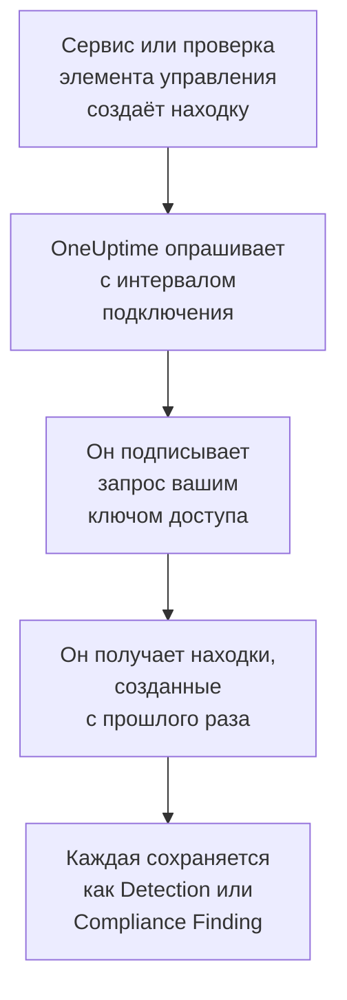

# AWS Security Hub

Импортируйте находки [AWS Security Hub](https://aws.amazon.com/security-hub/) в события безопасности OneUptime: находки GuardDuty, Inspector, Macie и IAM Access Analyzer, собственные проверки элементов управления Security Hub и находки продуктов партнёров. Там вы ищете их рядом со своими логами, трассировками и метриками, сопоставляете с любыми другими источниками и вызываете дежурных по тем, что важны. OneUptime читает их с ключом доступа, который вы создаёте и которому разрешено одно действие только для чтения, и ничего не меняет в AWS. Не нужно настраивать ни агента, ни правило EventBridge, ни экспорт в S3.

:::cards
- [Настройка подключения](#настройка-подключения): Политика IAM, ключ доступа и форма подключения.
- [Что импортируется](#что-импортируется): Как каждая находка становится событием безопасности.
- [Как работает опрос](#как-работает-опрос): Окно, которое читает каждый опрос, и почему оно перекрывает предыдущее на 30 минут.
- [Устранение неполадок](#устранение-неполадок): Что означает каждая ошибка и что нужно изменить.
:::

## Как это работает



Каждую минуту OneUptime опрашивает каждое включённое подключение, интервал опроса которого истёк. Опрос вызывает `GetFindings` Security Hub в вашем регионе, подписывая запрос по [Signature Version 4](https://docs.aws.amazon.com/IAM/latest/UserGuide/reference_sigv-create-signed-request.html), для находок, созданных после предыдущего опроса. Он сохраняет каждую как событие [OCSF](https://schema.ocsf.io/): проверку элемента управления — как Compliance Finding (класс `2003`), а любую другую находку — как Detection Finding (класс `2004`). Затем правила обнаружения, мониторы и панели мониторинга обрабатывают её как событие безопасности из любого другого источника.

## Перед началом работы

- В OneUptime роль Project Owner, Project Admin или Security Admin. Роли Security Member и Security Viewer видят подключения и историю их запусков, но не могут их менять.
- Учётная запись AWS с Security Hub, включённым в регионе, который вы подключаете. Security Hub региональный: подключение читает находки, которые одна учётная запись хранит в одном регионе.
- Чтобы читать находки всех учётных записей и регионов через одно подключение, — учётная запись делегированного администратора Security Hub в её домашнем регионе с включённой [межрегиональной агрегацией](https://docs.aws.amazon.com/securityhub/latest/userguide/finding-aggregation.html). **Security Hub → Settings → Regions** показывает домашний регион.
- Исходящий HTTPS от приложения и worker OneUptime к `securityhub.<region>.amazonaws.com` или `securityhub.<region>.amazonaws.com.cn` в Китае и правильные часы на их хостах: AWS отклоняет запрос, подписанный с расхождением больше 5 минут.

## Настройка подключения

Подключение подписывает свои запросы ключом доступа IAM. Удостоверению ключа нужно одно действие, `securityhub:GetFindings`, и ничего больше: подключение никогда не меняет находку.

:::steps
### Разрешите чтение находок

В [консоли IAM](https://console.aws.amazon.com/iam/) откройте **Policies → Create policy**, выберите **JSON** и вставьте эту политику. Задайте ей имя, например `OneUptimeSecurityHubRead`:

```json
{
  "Version": "2012-10-17",
  "Statement": [
    {
      "Effect": "Allow",
      "Action": "securityhub:GetFindings",
      "Resource": "*"
    }
  ]
}
```

`GetFindings` нельзя ограничить ресурсом, поэтому `Resource` остаётся `*`. Управляемая политика `AWSSecurityHubReadOnlyAccess` тоже подходит, но разрешает больше.

### Создайте ключ доступа

1. Откройте **Users → Create user**, задайте имя пользователя, например `oneuptime-security-hub`, оставьте доступ к консоли выключенным и прикрепите политику. Для находок других учётных записей сделайте это в учётной записи делегированного администратора.
2. Откройте пользователя, затем **Security credentials → Access keys → Create access key**, и выберите **Third-party service**.
3. Скопируйте **Идентификатор ключа доступа** и **Секретный ключ доступа**. AWS показывает секрет только один раз.

### Добавьте подключение в OneUptime

Откройте **Продукты → Security Events → Подключения** (`/dashboard/{projectId}/security-events/connections`), нажмите **Добавить подключение**, выберите **AWS Security Hub** и нажмите **Далее**. Заполните настройки из таблицы ниже, нажмите **Далее** и вставьте секрет в **Секретный ключ доступа**.

### Проверьте его перед сохранением

Нажмите **Проверить эти настройки** в разделе **Проверка перед сохранением**. Проверка подписывает запрос значениями из формы, ничего не сохраняя, поэтому неверный ключ или недостающее разрешение обнаруживаются до того, как подключение будет создано. Затем нажмите **Далее**, задайте подключению **Имя** и создайте его.
:::

| Параметр | Что ввести |
| --- | --- |
| **Регион** | Код региона, например `us-east-1`, `eu-central-1` или `us-gov-west-1`: для находок других учётных записей — домашний регион учётной записи администратора. |
| **Идентификатор ключа доступа** | Идентификатор ключа: от 16 до 128 букв или цифр, обычно 20, начиная с `AKIA` или с `ASIA` для временных учётных данных. |
| **Секретный ключ доступа** | Секрет ключа. Он шифруется, никогда не возвращается API и больше не показывается. Замените его с помощью **Обновить учётные данные** в подключении. |
| **Session token** | Только для временных учётных данных, которым он нужен: ключ `ASIA` без него отклоняется, а ключ `AKIA` с ним отклоняется. |

Временные учётные данные из `aws sts assume-role` или `aws sts get-session-token` истекают — для принятой роли самое позднее через 12 часов, — и опрос останавливается, пока вы не вставите новые с помощью **Обновить учётные данные**. Долгоживущий ключ с этой узкой политикой, сменяемый по вашему собственному графику, продолжает опрос без присмотра. Чтобы перейти с временных учётных данных на долгоживущий ключ, введите новый ключ в **Обновить учётные данные** и включите **Remove the stored Session token**.

На шаге **Опрос** также есть необязательное **Описание**, **Интервал опроса (минуты)** — целое число от `1` до `1440`, по умолчанию `5`, и **Включено**, изначально включённое.

## Что импортируется

Каждая находка становится одним событием с поставщиком `Amazon Web Services` и продуктом `AWS Security Hub`. Находка с объектом `Compliance`, то есть проверка элемента управления по стандарту вроде AWS Foundational Security Best Practices или CIS, становится Compliance Finding (класс OCSF `2003`). Любая другая находка становится Detection Finding (класс OCSF `2004`).

| Поле находки | Столбец OneUptime |
| --- | --- |
| `Id`, ARN для находок, которые создаёт AWS | UID события, по которому также отбрасываются дубликаты |
| `CreatedAt`, иначе `UpdatedAt`, иначе `FirstObservedAt` | Время события |
| `Title` | Имя правила |
| `GeneratorId`, например тип находки GuardDuty или идентификатор элемента управления | Идентификатор правила |
| `Title`, иначе `Description` | Сообщение |
| `Severity.Label`, иначе диапазон `Severity.Normalized` | Серьёзность |
| `Workflow.Status`: `NEW`, `NOTIFIED`, `RESOLVED` или `SUPPRESSED`, иначе более старое `WorkflowState` | Статус |
| `Types` в `TTPs/`: `TTPs/Initial Access/...` становится `TA0001` | Тактики и техники MITRE ATT&CK |
| Пользователь IAM ресурса ключа доступа или пользователя, `Network.SourceIpV4` или `SourceIpV6`, `Process.Name` или `Process.Path` | Пользователь, IP и процесс субъекта |
| Идентификатор экземпляра ресурса `AwsEc2Instance`, `Network.DestinationIpV4` или `DestinationIpV6`, `Network.DestinationPort`, первый `Resources[].Id` | Хост, IP, порт и ресурс цели |
| Они, каждый `Resources[].Id`, `AwsAccountId`, домены сети, имена вредоносного ПО и значения аналитики угроз | Наблюдаемые объекты |
| Вся находка, развёрнутая в ключи с точками, например `Compliance.Status` и `Remediation.Recommendation.Url` | `attributes` |

Если у находки нет `Severity.Label`, решает `Severity.Normalized`: `0` — Informational, от `1` до `39` — Low, от `40` до `69` — Medium, от `70` до `89` — High, от `90` до `100` — Critical. Находка, которую Security Hub обновляет позже, с новым `Workflow.Status` или с элементом управления, который теперь проходит проверку, сохраняет свой `Id`, поэтому не импортируется повторно: событие хранит находку такой, какой она была при импорте.

## Как работает опрос

Каждый опрос получает находки, созданные в его окне, начиная с самых старых, по 100 на страницу и следует по `NextToken`, пока не прочитает всё окно:

```text
POST https://securityhub.{region}.amazonaws.com/findings
    {"Filters": {"CreatedAt": [{"Start": "{window start}", "End": "{window end}"}]},
     "SortCriteria": [{"Field": "CreatedAt", "SortOrder": "asc"}],
     "MaxResults": 100}
```

- **Курсором служит время создания.** Находки выбираются по `CreatedAt`, а не по `FirstObservedAt`. GuardDuty создаёт находку, когда увидит достаточно активности, а проверку элемента управления — когда Security Hub впервые проверит ресурс, через часы или дни после начала активности. Курсор по времени наблюдения пропустил бы их.
- **Первый опрос смотрит на 24 часа назад**, чтобы новое подключение сразу показало свои недавние находки.
- **Каждый следующий опрос начинается за 30 минут до сохранённого курсора.** `CreatedAt` задаёт сервис, нашедший проблему, а находка попадает в Security Hub позже: GuardDuty отправляет новые находки в течение пяти минут, а неудачная доставка через EventBridge повторяется до 24 часов. Перекрытие читает такие находки при следующем опросе. Находка, которая приходит больше чем через 30 минут после своего `CreatedAt`, может оказаться позади курсора: импортируйте её интервал времени, чтобы вернуть её.
- **Опрос читает не больше 24 часов после курсора.** Подключение, курсор которого отстал, догоняет серией 24-часовых окон, а его **Состояние** показывает **Catching up**.
- **Дубликаты отбрасываются по `Id` находки** в пределах проекта, поэтому перекрытие, повторно прочитанное окно и импорт никогда не сохраняют находку дважды.

### Когда окно содержит больше, чем может прочитать один опрос

Опрос отправляет не больше 20 запросов по 100 находок: 2 000 находок. Если окно содержит больше, запуск получает статус **Частично** с предупреждением вроде такого:

```text
Stopped after 20 findings requests (the per-run request limit) before the window was fully read. The last finding read was created at 2026-09-14T08:12:44.000Z.
```

Находки читаются начиная с самых старых, поэтому OneUptime переносит курсор на время создания последней прочитанной находки, и следующий опрос начинается оттуда, без 30-минутного перекрытия, с той же длиной окна. Загруженная учётная запись догоняет примерно по 2 000 находок за опрос, вместо того чтобы заново читать одни и те же. Перекрытие возвращается, когда курсор уйдёт на 30 минут дальше этой точки.

Если запуск вообще не может продвинуться дальше сохранённого курсора, например потому что одни только 30 минут перекрытия содержат больше 2 000 находок, OneUptime вместо этого укорачивает окно:

1. **Сузить.** Следующий опрос читает окно вдвое короче с той же начальной точки и продолжает делить его пополам, пока окно не будет прочитано целиком, вплоть до одной минуты. Предупреждение запуска говорит об этом: `This window holds more records than one poll can read; the next poll reads a {n} minute window from the same starting point.`
2. **Снова расти.** После того как окно прочитано целиком, следующее снова вдвое длиннее, до 24 часов.
3. **Пройти мимо одной минуты.** Если даже одна минута содержит больше, чем может прочитать опрос, опрос проходит мимо неё, чтобы новые находки продолжали поступать, а перекрытие последующих опросов больше не дотягивается до неё. Запуск остаётся в статусе **Частично**, а **Последняя ошибка** сообщает `More records were created in the one minute from {cursor} to {end} than one poll can read. Polling moved past this minute so newer records keep arriving; use Import this time range in Diagnostics on this minute to recover what one run can read.` Импортируйте эту минуту с помощью **Import this time range**, чтобы получить то, что может прочитать один запуск.

Запуск, который полностью завершается ошибкой AWS, сохраняет курсор и длину окна, и следующий опрос заново читает то же окно. Единственное исключение — запрос, превысивший время ожидания: курсор остаётся на месте, но следующее окно вдвое короче, потому что слишком тяжёлое для своевременного ответа окно превышало бы время ожидания при каждой попытке. Изменение **Интервал опроса (минуты)** ничего из этого не меняет: оно определяет, как часто начинается опрос, а не где начинается его окно.

### Запуск, просмотр и импорт по требованию

Нажмите **Диагностика** в подключении, чтобы увидеть его последние запуски и работать с ним вручную. Запускать эти действия может любой, кто может менять подключение; читать историю может любой, кто может его видеть.

- **Запустить сейчас** сразу запускает опрос с обычным курсором, даже если подключение не **Включено**.
- **Preview findings** читает интервал времени до 7 дней и ничего не импортирует.
- **Import this time range** после вашего подтверждения импортирует интервал до 7 дней, не перемещая курсор. Уже импортированные находки пропускаются.
- **Copy diagnostics** в запуске копирует его отчёт для поддержки. Он никогда не содержит учётных данных.

## Проверка подключения

**Проверить подключение** в строке подключения и **Проверить эти настройки** в форме выполняются в процессе API, а не в фоновом worker, поэтому проверка отвечает даже тогда, когда проблема в самих worker. Она выполняет такие проверки по порядку:

| Проверка | Что она проверяет |
| --- | --- |
| **Конфигурация** | Каждый параметр задан и правильно оформлен. Если это не так, ни к чему не обращаются. |
| **Authenticate with AWS** | AWS принимает подписанный запрос `GetFindings` для одной находки, созданной за последние 24 часа. AWS проверяет подпись раньше политики IAM, поэтому отказ политики всё равно проходит эту проверку: ключ верный. |
| **Read findings** | Security Hub отвечает на этот запрос: удостоверение может вызывать `securityhub:GetFindings`, и Security Hub включён в регионе. |
| **Findings available to import** | Сколько находок создано за последние 24 часа и за последние 7 дней, по одной странице из 100 на каждый интервал, поэтому `100+` означает больше. Ни одной за 7 дней — это предупреждение, а не сбой. |
| **Background workers**, **Poll scheduler**, **Security event storage** | Сторона самого OneUptime: процесс забирает задания из очереди Worker, задание опроса выполняется каждую минуту, а хранилище событий безопасности отвечает. |
| **Scheduled polling** | Для сохранённого подключения: опрос включён, ни один запуск не застрял в ожидании worker, а опросы выполняются вовремя. |

У каждого запроса в проверке срок 20 секунд. Проверка никогда ничего не импортирует и не перемещает курсор, а каждая неудачная проверка сообщает, что нужно изменить.

## Устранение неполадок

**Последняя ошибка** подключения хранит полное сообщение об ошибке со скрытыми учётными данными после префикса, который называет неудавшийся шаг. Если у подключения есть ошибка, выберите **Просмотреть ошибку** в столбце **Действия**, чтобы прочитать её, и **Скопировать ошибку** в диалоговом окне, чтобы скопировать. Каждое сообщение начинается с `AWS Security Hub findings request`; читайте то, что идёт дальше.

:::details Last Error сообщает `failed (HTTP 401)` или `failed (HTTP 403)`
AWS отклонил запрос. Сообщение цитирует код ошибки AWS или собственные слова AWS, если код не был отправлен:

- `AccessDeniedException` или `is not authorized to perform`: ключ верный, но его удостоверение не может вызывать `securityhub:GetFindings`. Прикрепите политику из раздела [Настройка подключения](#настройка-подключения). Её также может запретить граница разрешений или политика управления сервисами.
- `InvalidAccessException` или `is not subscribed to AWS Security Hub`: Security Hub не включён для этой учётной записи в регионе из поля **Регион**, или учётная запись не является там его администратором.
- `InvalidSignatureException` или `SignatureDoesNotMatch`, или `The request signature we calculated does not match`: **Секретный ключ доступа** не относится к **Идентификатор ключа доступа**. Создайте новый ключ доступа и сохраните его с помощью **Обновить учётные данные**.
- `UnrecognizedClientException` или `InvalidClientTokenId`, или `The security token included in the request is invalid`: AWS не знает **Идентификатор ключа доступа**. Он введён с ошибкой, удалён, деактивирован или относится к другому разделу, либо это временный ключ без своего **Session token**.
- `ExpiredTokenException` или `The security token included in the request is expired`: срок временных учётных данных истёк. Выпустите новые или перейдите на долгоживущий ключ.
- `RequestTimeTooSkewed` или `RequestExpired`, или `Signature expired`: часы на хостах OneUptime расходятся больше чем на 5 минут. Исправьте NTP на хостах приложения и worker.
- Кода нет вовсе: AWS не сообщил, отклонил ли запрос ключ или политика. Сначала проверьте ключ, затем политику.
:::

:::details Last Error сообщает `failed (HTTP ...)` с другим статусом
- `HTTP 404`: ни одна конечная точка Security Hub не ответила для региона из поля **Регион**. Сравните его с меню регионов консоли AWS: `us-east-1`, а не `us-east1` или `N. Virginia`.
- `HTTP 429`: учётная запись упёрлась в лимит Security Hub — 3 запроса `GetFindings` в секунду в регионе. Следующий опрос повторит попытку. Если это повторяется, поищите другой инструмент или подключение, которое читает ту же учётную запись и регион.
- `HTTP 5xx`: у Security Hub возникла проблема на его стороне. Следующий опрос повторит попытку.
- `HTTP 400`: Security Hub отклонил запрос, который строит OneUptime, а не ваши настройки. Отправьте сообщение в поддержку OneUptime.
:::

:::details Last Error сообщает `returned`, `timed out` или `Could not reach data source`
- `returned a non-JSON body` или `returned an unrecognized response shape`: ответил не Security Hub, а что-то другое, например страница входа прокси или шлюз, который переписывает ответы. Об этом сообщается, а не считается пустым окном, чтобы курсор никогда не проходил мимо находок, которые никто не прочитал.
- `timed out after 60 seconds with no response` или `failed: Could not reach data source`: запрос не получил ответа. Конечные точки Security Hub публичные, поэтому проверьте DNS, межсетевые экраны и прокси между приложением и worker OneUptime и `securityhub.<region>.amazonaws.com`.
:::

:::details Last Polled — Never, а Last Error пуст
Для этого подключения не завершился ни один опрос. Запустите **Проверить подключение**: его проверки **Background workers** и **Poll scheduler** называют причину. В самостоятельно размещённой установке обычная причина — `DISABLE_QUEUE_WORKERS=true` в приложении без отдельного развёртывания worker, которое забирало бы задания: установите `false` или запустите развёртывание worker (Helm: `worker.enabled: true`).
:::

:::details Запуск имеет статус Partial
- `Stopped after 20 findings requests`: окно содержало больше 2 000 находок, которые читает один запуск. Ничего не теряется: следующий опрос начинается после последней прочитанной находки. Подключение, которое остаётся в статусе **Частично** опрос за опросом, догоняет накопившийся объём, и его **Последний опрос** и **Последнее импортированное событие** продолжают двигаться вперёд. Если оно никогда не догоняет, учётная запись создаёт больше 2 000 находок за интервал опроса: сократите **Интервал опроса (минуты)**.
- `More records were created in the one minute from ... than one poll can read`: опрос прошёл мимо этой минуты. Импортируйте её с помощью **Import this time range** в **Диагностика**. Импорт читает столько же, сколько опрос.
:::

:::details Проверка проходит, но ничего не импортируется
Прочитайте **Findings available to import** в отчёте проверки. `0` за последние 7 дней означает, что Security Hub не создал ни одной находки в этой учётной записи и регионе: проверьте, что там включены GuardDuty, Inspector или стандарт безопасности. Чтобы видеть находки других учётных записей и регионов, подключите учётную запись администратора в её домашнем регионе.
:::

:::details Находка из консоли Security Hub так и не пришла
Сравните её `CreatedAt` с её `ProcessedAt` — моментом, когда Security Hub её получил. Находка, пришедшая больше чем через 30 минут после своего `CreatedAt`, может оказаться позади курсора: импортируйте её `CreatedAt` с помощью **Import this time range**.
:::

## Что вы получаете

- **Поиск.** Фильтруйте находки по серьёзности, статусу, правилу, учётной записи, ресурсу или любому наблюдаемому объекту в обозревателе событий безопасности, рядом со всеми другими источниками.
- **Сопоставление.** Пользователи, экземпляры, IP, ARN ресурсов и идентификаторы учётных записей каждой находки индексируются как наблюдаемые объекты, поэтому один поиск находит всё, где они упоминаются.
- **Правила обнаружения.** Правила Sigma, которые выполняются по расписанию над вашими событиями безопасности и открывают оповещения, вызывающие дежурных.
- **Мониторы.** Мониторы событий безопасности подсчитывают совпадающие события, например новые критические находки GuardDuty или проваленные проверки, и открывают инциденты или оповещения при превышении порога.

События безопасности тарифицируются как остальная телеметрия, за каждый принятый ГБ. См. [цены](https://oneuptime.com/pricing).

## Дальнейшие шаги

:::cards
- [События безопасности](/docs/telemetry/security-events): Поиск, сопоставление и оповещения по импортированным данным.
- [Okta System Log](/docs/integrations/okta): Импортируйте также входы из вашего поставщика удостоверений.
- [Роли](/docs/permissions/reference#роли): Что могут видеть и менять роли Security.
- [Обзор интеграций](/docs/integrations/index): Другие инструменты, которые можно подключить.
:::
