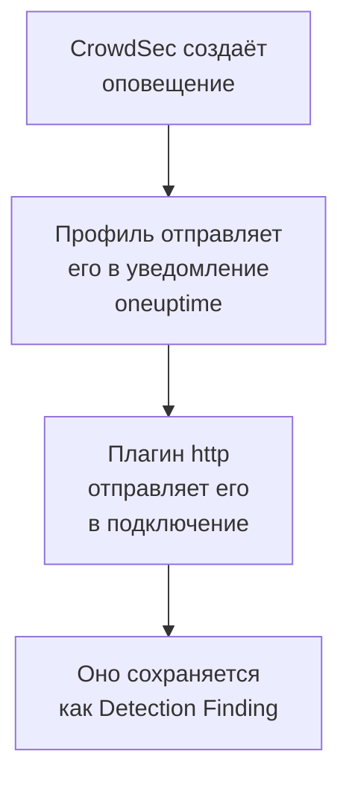

# CrowdSec

Получайте оповещения [CrowdSec](https://www.crowdsec.net/) в событиях безопасности OneUptime по мере того, как CrowdSec их создаёт, и блокируйте адреса из списка блокировки вашего проекта с помощью CrowdSec. Собственный плагин уведомлений CrowdSec отправляет каждое оповещение в подключение CrowdSec, которое открывает кейсы по обнаружениям CrowdSec. Когда вы включаете блокировку, OneUptime через Local API CrowdSec добавляет бан для каждого адреса, который вы блокируете, и каждый баунсер, который читает этот Local API, блокирует адрес.

:::cards
- [Настройка подключения](#настройка-подключения): Подключение и уведомление, которое отправляет в него оповещения CrowdSec.
- [Что принимается](#что-принимается): Как каждое оповещение CrowdSec становится событием безопасности.
- [Блокировка адресов с помощью CrowdSec](#блокировка-адресов-с-помощью-crowdsec): Добавьте в CrowdSec баны для адресов из вашего списка блокировки.
- [Чтение списков блокировки CrowdSec](#чтение-списков-блокировки-crowdsec): Списки, которые отдаёт CrowdSec Console, в виде фида аналитики угроз.
- [Устранение неполадок](#устранение-неполадок): Что означает каждая ошибка и что нужно изменить.
:::

## Как это работает



Local API CrowdSec передаёт каждое оповещение, которое профиль отправляет в уведомление, плагину этого уведомления. Уведомление подключения использует плагин `http` CrowdSec: он отправляет оповещение в собственном JSON CrowdSec в приём событий безопасности с вашим ключом приёма данных, указывая подключение. OneUptime сохраняет его как событие [OCSF](https://schema.ocsf.io/) Detection Finding (класс `2004`), проверяет по вашим правилам обнаружения и открывает кейс по каждому собственному обнаружению CrowdSec, уровень которого не ниже значения **Открывать кейсы от** подключения. Ничего не опрашивается: оповещение приходит через несколько секунд после того, как CrowdSec его создал.

## Перед началом работы

- В OneUptime роль Владелец проекта, Администратор проекта или Администратор безопасности. Роли Участник безопасности и Зритель безопасности видят подключения, но не могут их менять.
- CrowdSec 1.5 или новее, с его Local API и плагином уведомлений `http`, который входит в поставку. Эта страница написана по CrowdSec v1.8.2.
- Исходящий HTTPS от хоста, на котором работает Local API CrowdSec, к вашему OneUptime.
- Чтобы ещё и блокировать адреса: Local API, до которого может достучаться OneUptime, и машина для OneUptime (см. [Блокировка адресов с помощью CrowdSec](#блокировка-адресов-с-помощью-crowdsec)).

## Настройка подключения

:::steps
### Добавьте подключение в OneUptime

Откройте **Продукты → События безопасности → Подключения** (`/dashboard/{projectId}/security-events/connections`), нажмите **Добавить подключение**, выберите **CrowdSec** и нажмите **Далее**. Чтобы только получать оповещения, оставьте все параметры из таблицы ниже пустыми; чтобы ещё и блокировать адреса, заполните их.

### Проверьте его перед сохранением

Нажмите **Проверить эти настройки** в разделе **Проверка перед сохранением**. Если Local API не задан, проверка сообщает об этом и ни к чему не обращается; если задан, она обращается к Local API и входит как машина, ничего не сохраняя. Затем нажмите **Далее**, задайте подключению **Имя** на шаге **Оповещения**, выберите значение **Открывать кейсы от** и создайте его.

### Сохраните уведомление на хосте CrowdSec

При создании подключения открывается его окно **Отправить оповещения**, которое потом можно снова открыть из строки подключения. **Выберите ключ приёма данных**, затем сохраните показанное уведомление, в котором уже подставлены ваш ключ и ваше подключение, на хосте, где работает Local API CrowdSec:

```yaml title="/etc/crowdsec/notifications/oneuptime.yaml"
type: http
name: oneuptime

# info or quieter: at debug, CrowdSec logs each request's headers.
log_level: info

format: |
  {{.|toJson}}

url: https://oneuptime.com/security-events/v1/ingest?connection=YOUR_CONNECTION_ID&format=crowdsec
method: POST
headers:
  Content-Type: application/json
  x-oneuptime-token: YOUR_INGESTION_TOKEN
```

### Направьте оповещения ваших профилей в это уведомление

В `/etc/crowdsec/profiles.yaml` добавьте `oneuptime` в `notifications` каждого профиля, оповещения которого должен получать OneUptime, затем перезагрузите CrowdSec:

```yaml title="/etc/crowdsec/profiles.yaml"
notifications:
  - oneuptime
```

```bash
sudo systemctl reload crowdsec
```

### Отправьте тестовое оповещение

```bash
sudo cscli notifications test oneuptime
```

**Отправить оповещения** показывает, когда оно приходит, а **Просмотреть оповещения** открывает его в событиях безопасности. Это событие с серьёзностью Informational, и оно не открывает кейс.
:::

| Параметр | Что ввести |
| --- | --- |
| **URL Local API** | Только для блокировки адресов: адрес, по которому OneUptime обращается к Local API CrowdSec, например `https://crowdsec.example.com:8080`. Используйте `https` везде, где соединение проходит через сеть. |
| **ID машины** | Только для блокировки адресов: машина, от имени которой входит OneUptime, добавленная на хосте CrowdSec командой `sudo cscli machines add oneuptime --auto -f -`. |
| **Блокировать адреса с помощью CrowdSec** | Выключен в новом подключении. Включённый, добавляет в CrowdSec баны для адресов и диапазонов из вашего списка блокировки и требует трёх других параметров (см. [Блокировка адресов с помощью CrowdSec](#блокировка-адресов-с-помощью-crowdsec)). |
| **Пароль машины** | Только для блокировки адресов: пароль, который `cscli` вывел для машины. Он шифруется, никогда не возвращается API и больше не показывается. Замените его с помощью **Обновить учётные данные** в подключении. |

На шаге **Оповещения** также есть необязательное **Описание** и **Включено**, изначально включённое. Подключение, которое не включено, сохраняет получаемые оповещения как события и не открывает по ним кейсы.

В контейнере уведомление кладётся в папку, смонтированную в `/etc/crowdsec/notifications/`, и перезапуск контейнера считывает его. Установка в Kubernetes задаёт его в значениях Helm в разделе `config.notifications`, а `profiles.yaml` — рядом, в разделе `config`.

## Что принимается

Каждое оповещение, которое отправляет CrowdSec, становится одним событием Detection Finding (класс OCSF `2004`) с поставщиком и продуктом `CrowdSec`:

| Поле CrowdSec | Столбец OneUptime |
| --- | --- |
| `uuid` или хеш оповещения, у которого его нет | UID события, по которому также отбрасываются дубликаты |
| `stop_at` или `start_at` | Время события |
| `scenario` | ID правила и имя правила: заголовок сценария в CrowdSec Hub или его имя |
| `source.ip` или `source.value` оповещения `Ip` | IP субъекта |
| `target_fqdn` или `target_host` оповещения или его событий, иначе `machine`, которую называют его события | Целевой хост |
| `target_user`, `target_uri` | Целевой пользователь и ресурс |
| `type` первого решения | Статус: `Blocked` для бана, `Challenge` для капчи, `Logged` без решения или в режиме симуляции |
| Поведение сценария | Серьёзность, а также его тактики и техники MITRE ATT&CK |
| Всё остальное, например `source.cn`, `source.as_name` и `events_count` | `attributes`: поля оповещения, развёрнутые в ключи с точками, его первые 10 событий целиком и разбор OneUptime в `crowdsec.` |

У оповещения CrowdSec нет собственной серьёзности, поэтому OneUptime берёт её из того, что обнаруживает сценарий, по меткам CrowdSec Hub (`ssh:bruteforce`, `http:exploit`):

| Поведение | Серьёзность |
| --- | --- |
| Эксплойт, например CVE или то, что заблокировал компонент AppSec, или то, что злоумышленник делает, проникнув внутрь | High |
| Перебор паролей, отказ в обслуживании, мошенничество, невозможный вход или поведение, которое OneUptime не может отнести ни к одной категории | Medium |
| Сканирование, зондирование, обход сайтов, боты, спам и изменения из облачного аудита | Low |
| Собственные тестовые сценарии CrowdSec | Informational |

Когда **Открывать кейсы от** установлено на **Высокий и выше**, эксплойты, обнаруженные CrowdSec, открывают кейсы, а его повседневные баны сканеров и подборщиков паролей остаются событиями для ваших правил обнаружения. Кейсы открывают только собственные обнаружения CrowdSec. Решение, которое кто-то добавил через `cscli` или в CrowdSec Console, адрес из списка блокировки CrowdSec, тестовое оповещение и возвращающиеся собственные баны OneUptime имеют серьёзность Informational и кейсов не открывают. Оповещение, отправленное дважды, как это делает `cscli notifications reinject`, сохраняется один раз.

## Блокировка адресов с помощью CrowdSec

Включите **Блокировать адреса с помощью CrowdSec** в подключении, и для адресов и диапазонов из [списка блокировки](/docs/telemetry/security-cases#список-блокировки) вашего проекта в CrowdSec будут добавлены баны. Каждый баунсер, который читает его Local API, например его баунсеры для межсетевого экрана, nginx и Traefik, блокирует их там, где работает, так же как блокирует собственные баны CrowdSec. Блокировки проходят те же согласования и те же ограничения автоматического реагирования и снимаются той же кнопкой **Снять**, что и в любом другом месте, где применяется ваш список блокировки.

В новом подключении переключатель выключен. Чтобы включить его:

1. На хосте CrowdSec добавьте машину для OneUptime; команда выведет её пароль:

   ```bash
   sudo cscli machines add oneuptime --auto -f -
   ```

2. Дайте OneUptime доступ к Local API, который слушает `127.0.0.1:8080`, если не указано иное: задайте `api.server.listen_uri` в `config.yaml` CrowdSec, обслуживайте его по TLS или за прокси `https` и пропустите адреса OneUptime через ваш межсетевой экран.
3. Измените подключение, заполните **URL Local API** и **ID машины**, введите пароль в **Пароль машины**, включите **Блокировать адреса с помощью CrowdSec** и сохраните. Затем **Проверить подключение** проверяет, что машина входит и читает баны OneUptime, ничего не меняя.

Как создаётся бан и как он заканчивается:

- Каждая блокировка — это одно решение о бане, созданное так же, как его создаёт `cscli decisions add`, со сценарием `oneuptime/blocklist`. CrowdSec хранит его как ручное решение, поэтому оно никогда не передаётся в Central API CrowdSec, если вы не делитесь ручными решениями. OneUptime читает и удаляет только свои собственные баны и никогда — созданные человеком или самим CrowdSec.
- Блокировка со сроком окончания — это бан ровно до этого срока, и тогда CrowdSec снимает его сам, независимо от того, может ли OneUptime до него достучаться. Блокировка до снятия — это бан на 7 дней, который продлевается, когда остаётся 3 дня или меньше, поэтому бан, который OneUptime больше не поддерживает, заканчивается в течение недели.
- **Снять** удаляет бан при следующем проходе, в течение минуты. Бан, удалённый в CrowdSec командой `cscli decisions delete` или очисткой (flush), создаётся снова при следующем проходе, пока действует блокировка.
- Адрес или диапазон из одного из списков разрешённых CrowdSec никогда не банится: блокировка показывает его там как неприменённый, называя список разрешённых, а уже созданный бан удаляется, как только адрес попадает в список разрешённых.
- Собственные адреса вашего проекта, например ваши **Доверенные прокси**, балансировщики нагрузки и периметр, никогда нигде не блокируются, в том числе в CrowdSec.
- CrowdSec только банит: проверка (challenge) там не применяется, а домен, URL или файл ему не отправляются.

Когда Local API недоступен, в CrowdSec ничего не меняется: баны, которые он хранит, остаются и заканчиваются в свой срок. **Где применяется** в разделе **Список блокировки** показывает, когда CrowdSec в последний раз держал каждую блокировку, а OneUptime повторяет попытку через 1 минуту, затем каждый раз ждёт вдвое дольше, вплоть до 30 минут. Новая блокировка ждёт, пока её можно будет создать.

## Чтение списков блокировки CrowdSec

CrowdSec Console отдаёт списки блокировки, на которые подписана ваша организация, как интеграцию Raw IP List: по адресу на строку, за именем пользователя и паролем. [Фид аналитики угроз](/docs/telemetry/threat-intelligence) читает их и сопоставляет с ними ваши события:

1. В CrowdSec Console создайте интеграцию Raw IP List с выключенной агрегацией IP: OneUptime сопоставляет адреса, а не диапазоны. Скопируйте её конечную точку, имя пользователя и пароль.
2. В OneUptime откройте **Продукты → События безопасности → Обнаружения → Разведка угроз**, нажмите **Создать: Фид разведки угроз** и выберите **Список индикаторов**.
3. Вставьте конечную точку в **URL списка**, выберите **Имя пользователя и пароль** в разделе **Вход** и вставьте оба значения. На тарифе Community CrowdSec, который допускает одну загрузку в день, установите **Интервал опроса (минуты)** в `1440`.

Списки принадлежат CrowdSec: вы можете использовать их в своих инструментах, но не передавать дальше. OneUptime не предлагает собственного списка.

## Проверка подключения

**Проверить подключение** в строке подключения и **Проверить эти настройки** в форме выполняются в процессе API, а не в фоновом worker. Они выполняют такие проверки по порядку:

| Проверка | Что она проверяет |
| --- | --- |
| **Конфигурация** | Параметры либо все пустые, либо все заданы, и правильно оформлены. Если это не так, ни к чему не обращаются. |
| **Reach CrowdSec's Local API** | `GET /health` отвечает. Если Local API не задан, проверка сообщает, что подключение только получает оповещения, и следующие три не выполняются. |
| **Sign in to the Local API** | `POST /v1/watchers/login` принимает машину и её пароль. |
| **Read CrowdSec's allowlists** | `GET /v1/allowlists` отвечает, и сколько адресов и диапазонов содержат эти списки. Local API старше 1.6.8, в котором их нет, проходит проверку. |
| **Block with CrowdSec** | Только при включённом **Блокировать адреса с помощью CrowdSec**: машина может прочитать баны OneUptime обратно, и сколько из них действует. Проверка ничего не меняет. |
| **Background workers**, **Security event storage** | Сторона самого OneUptime: процесс забирает задания из очереди Worker, которые сохраняют то, что отправляет CrowdSec, а хранилище событий безопасности отвечает. |
| **Alerts received** | Для сохранённого подключения: когда пришло последнее оповещение. Если оповещений ещё нет, это предупреждение с инструкцией, как отправить тестовое оповещение. |

Проверка никогда ничего не банит и не удаляет. **Скопировать отчёт** копирует список проверок в формате JSON без пароля и токенов.

## Устранение неполадок

**Состояние** подключения показывает **Ожидает оповещений**, пока не придёт первое оповещение, а затем **Оповещения поступают**, сколько бы ни пришлось ждать следующего; **Кейсы приостановлены** означает, что подключение не включено. CrowdSec записывает ответ плагина в собственный журнал, `/var/log/crowdsec.log`, как `HTTP server returned non 200 status code`.

:::details Оповещения не приходят
- Выполните `sudo cscli notifications list`: `oneuptime` должно быть в списке и активно в профиле. Уведомление, которое не указано ни в одном профиле, ничего не отправляет.
- `401`: ключ приёма данных в `x-oneuptime-token` отсутствует, неверен или истёк, а `422`: он выключен. Выберите ключ в **Отправить оповещения** и скопируйте уведомление заново.
- `400`: адрес не указывает ни одного подключения CrowdSec этого проекта. Скопируйте адрес из **Отправить оповещения** подключения: он заканчивается ID подключения.
- В журнале вообще ничего нет: хост CrowdSec не может достучаться до вашего OneUptime. Проверьте исходящий HTTPS с него и его прокси.
:::

:::details Проверка подключения не проходит на Reach CrowdSec's Local API
`CrowdSec Local API health check could not be completed` означает, что ничего не ответило: Local API по умолчанию слушает `127.0.0.1`, поэтому OneUptime не может до него достучаться, пока `api.server.listen_uri` и ваш межсетевой экран этого не разрешат. Предупреждение о том, что он отвечает по `http`, означает, что пароль машины идёт по сети незашифрованным: обслуживайте Local API по TLS или поставьте перед ним прокси `https`.
:::

:::details Проверка подключения не проходит на Sign in to the Local API
`CrowdSec Local API login failed (HTTP 401)` заканчивается тем, что нужно сделать: проверьте ID машины и пароль с помощью `sudo cscli machines list`, подтвердите ещё не подтверждённую машину командой `sudo cscli machines validate oneuptime` или добавьте машину, которая входит по паролю. Сохраните новый пароль с помощью **Обновить учётные данные**.
:::

:::details Блокировка не применяется в CrowdSec
Наведите указатель на её **Где применяется**: там указан список разрешённых, в котором есть адрес, проверка (challenge), которую CrowdSec не применяет, или ошибка Local API. Пока Local API недоступен, OneUptime продолжает попытки, а баны, которые CrowdSec уже хранит, остаются в силе.
:::

:::details CrowdSec отправляет оповещения, но ни одно не сохраняется
То, что отправляет CrowdSec, сохраняют фоновые worker: в самостоятельно размещённой установке с `DISABLE_QUEUE_WORKERS=true` в приложении и без отдельного развёртывания worker оповещения принимаются, но никогда не сохраняются. **Проверить подключение** показывает это как неудачную проверку **Background workers**. Установите `false` или запустите развёртывание worker (Helm: `worker.enabled: true`).
:::

## Дальнейшие шаги

:::cards
- [События безопасности](/docs/telemetry/security-events): Поиск, сопоставление и оповещения по тому, что отправляет CrowdSec.
- [Кейсы безопасности](/docs/telemetry/security-cases): Работайте с кейсами, которые открывают обнаружения CrowdSec, и блокируйте прямо из них.
- [Аналитика угроз](/docs/telemetry/threat-intelligence): Сопоставляйте свои события со списками блокировки CrowdSec.
- [Обзор интеграций](/docs/integrations/index): Другие инструменты, которые можно подключить.
:::
