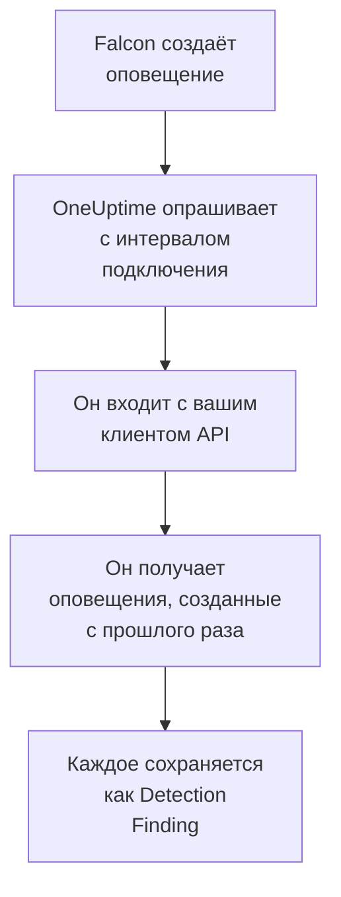

# CrowdStrike Falcon

Импортируйте оповещения [CrowdStrike Falcon](https://www.crowdstrike.com/platform/) — из обнаружений на конечных точках, в удостоверениях и в облаке — в события безопасности OneUptime. Там вы ищете их рядом со своими журналами, трассировками и метриками, сопоставляете их со всеми другими источниками и вызываете дежурных по тем, что действительно важны. OneUptime читает их через Falcon Alerts API с помощью созданного вами клиента API и никогда ничего не записывает в Falcon.

:::cards
- [Настройка подключения](#настройка-подключения): Клиент API с одной областью и форма подключения.
- [Что импортируется](#что-импортируется): Как каждое оповещение Falcon становится событием безопасности.
- [Как работает опрос](#как-работает-опрос): Окно, которое читает каждый опрос, и что с ним делает загруженный CID.
- [Устранение неполадок](#устранение-неполадок): Что означает каждая ошибка и что нужно изменить.
:::

## Как это работает



Каждую минуту OneUptime опрашивает каждое включённое подключение, интервал опроса которого истёк. Опрос входит в ваше облако Falcon с идентификатором и секретом клиента API, запрашивает у Alerts API оповещения, созданные после предыдущего опроса, и сохраняет каждое как событие [OCSF](https://schema.ocsf.io/) Detection Finding (класс `2004`). Затем правила обнаружения, мониторы и панели мониторинга обрабатывают его как событие безопасности из любого другого источника.

## Перед началом работы

- В OneUptime роль Project Owner, Project Admin или Security Admin. Роли Security Member и Security Viewer видят подключения и историю их запусков, но не могут их менять.
- Идентификатор клиента Falcon (CID) и пользователь консоли Falcon, который может управлять клиентами API: роль Falcon Administrator или пользовательская роль с разрешением API clients and keys.
- Исходящий HTTPS от приложения и worker OneUptime к хосту API вашего облака Falcon, указанному ниже в поле **Falcon cloud**.

## Настройка подключения

:::steps
### Создайте клиент API

1. В консоли Falcon откройте **Support and resources → API clients and keys** и выберите **Create API client**.
2. Задайте имя, например `OneUptime security events`. В разделе **API scopes** включите **Alerts → Read** и оставьте все остальные области выключенными: подключение никогда ничего не записывает в Falcon.
3. Создайте клиент. Falcon один раз показывает его идентификатор клиента, секрет и базовый URL. Скопируйте все три сейчас: секрет можно сбросить позже, но он больше никогда не показывается.

### Определите своё облако Falcon

Базовый URL, который показал Falcon, говорит, в каком облаке находится ваш CID. Страница **API clients and keys** тоже показывает его рядом с каждым клиентом. Клиент из одного облака отклоняется остальными.

| Базовый URL, который показывает Falcon | Облако Falcon |
| --- | --- |
| `https://api.crowdstrike.com` | US-1 |
| `https://api.us-2.crowdstrike.com` | US-2 |
| `https://api.eu-1.crowdstrike.com` | EU-1 |
| `https://api.laggar.gcw.crowdstrike.com` | US-GOV-1 |

### Добавьте подключение в OneUptime

Откройте **Продукты → Security Events → Подключения** (`/dashboard/{projectId}/security-events/connections`), нажмите **Добавить подключение**, выберите **CrowdStrike Falcon** и нажмите **Далее**. Заполните параметры из таблицы ниже, нажмите **Далее** и вставьте секрет в поле **Секрет клиента**.

### Проверьте его перед сохранением

Нажмите **Проверить эти настройки** в разделе **Проверка перед сохранением**. Проверка выполняет вход и читает оповещения со значениями из формы, ничего не сохраняя, поэтому неправильное облако или отсутствующая область обнаруживаются ещё до создания подключения. Затем нажмите **Далее**, задайте подключению **Имя** и создайте его.
:::

| Параметр | Что ввести |
| --- | --- |
| **Client ID** | Идентификатор клиента API в том виде, в каком его показал Falcon при создании клиента. |
| **Falcon cloud** | Облако вашего CID: **US-1 (api.crowdstrike.com)**, **US-2 (api.us-2.crowdstrike.com)**, **EU-1 (api.eu-1.crowdstrike.com)** или **US-GOV-1 (api.laggar.gcw.crowdstrike.com)**. Каждый запрос уходит на хост API этого облака. |
| **Секрет клиента** | Секрет клиента API. Он шифруется, никогда не возвращается API и больше не показывается. Замените его с помощью **Обновить учётные данные** в подключении. |

На шаге **Опрос** также есть необязательное **Описание**, **Интервал опроса (минуты)** — целое число от `1` до `1440`, по умолчанию `5`, и **Включено**, изначально включённое. Подключение, которое не включено, всё равно можно проверять и опрашивать вручную.

## Что импортируется

Подключение читает оповещения Falcon: то, что консоль Falcon показывает в разделах **Endpoint security → Endpoint detections** и **Next-Gen SIEM → Alerts**, от каждого продукта, который их создаёт. Каждое оповещение становится одним событием Detection Finding (класс OCSF `2004`) с поставщиком `CrowdStrike` и продуктом `Falcon`:

| Поле Falcon | Столбец OneUptime |
| --- | --- |
| `composite_id` | UID события, по которому также отбрасываются дубликаты |
| `created_timestamp` | Время события |
| `display_name` или `name` | Имя правила |
| `pattern_id` | Идентификатор правила |
| `description` или имя правила | Сообщение |
| `severity_name` или `severity` от 0 до 100 | Серьёзность |
| `status`, например `new`, `in_progress` или `closed` | Статус |
| `tactic_id`, `technique_id` | Тактики и техники MITRE ATT&CK |
| `device.hostname`, `device.local_ip`, `user_name`, `filename` или `cmdline` | Хост, IP, пользователь и процесс субъекта |
| `device.hostname`, `device.local_ip`, `device.external_ip`, `user_name`, `sha256` | Наблюдаемые объекты |
| Всё остальное, например `device.platform_name`, `falcon_host_link`, `product` и `timestamp` | `attributes`, развёрнутые в ключи с точками |

Временем события намеренно считается момент, когда Falcon создал оповещение: время стоящего за ним поведения, `timestamp`, остаётся в `attributes.timestamp`.

## Как работает опрос

- **Курсором служит время создания.** Оповещения выбираются по `created_timestamp`, а не по времени стоящего за ними поведения. Falcon может создать оповещение намного позже описываемой им активности, и курсор по времени активности пропустил бы каждое такое оповещение.
- **Первый опрос смотрит на 24 часа назад**, чтобы новое подключение сразу показало свои недавние оповещения.
- **Каждый следующий опрос начинается за 1 минуту до сохранённого курсора**, чтобы оповещение, созданное на границе двух окон, никогда не терялось.
- **Опрос читает не больше 24 часов после курсора.** Подключение, курсор которого отстал, догоняет серией 24-часовых окон.
- **Дубликаты отбрасываются по `composite_id`** в пределах проекта, поэтому перекрытие и повторно прочитанное окно никогда не сохраняют оповещение дважды.
- **Каждое окно стоит** одного запроса токена, который сохраняется на время жизни токена, а затем одного запроса оповещений и одной выборки оповещений на каждые 1 000 оповещений, у каждого из которых своё время ожидания.

### Когда окно содержит больше, чем может прочитать один опрос

Опрос отправляет не больше 20 запросов. С одним запросом токена и двумя запросами на каждые 1 000 оповещений он читает не больше 9 000 оповещений. Если окно содержит больше, запуск получает статус **Частично** с предупреждением вроде такого:

```text
Stopped after 19 requests before reading the whole window. Alerts are read oldest first; every alert created before 2026-09-14T08:12:44.995Z was read.
```

Запрос оповещений отсортирован по `created_timestamp`, начиная с самых старых, поэтому OneUptime переносит курсор на время создания последнего прочитанного оповещения, и следующий опрос начинается оттуда с той же длиной окна, со смещения `0`. Так загруженный CID догоняет примерно по 9 000 оповещений за опрос, а не читает одни и те же заново. Оповещения, созданные в тот же момент, читаются дважды, и проверка дубликатов отбрасывает вторую копию.

Запрос оповещений Falcon не может листать дальше 10 000 результатов (`limit` плюс `offset`). Ограничение числа запросов останавливает запуск на 9 000 оповещений, раньше этого потолка. Если потолок когда-нибудь всё же остановит чтение, это обрабатывается так же: запуск получает статус **Частично**, курсор переносится на последнее прочитанное оповещение, а следующий запрос снова начинается со смещения `0`.

Если запуск вообще не может продвинуться дальше сохранённого курсора, например потому что больше 9 000 оповещений приходятся на минуту перекрытия, OneUptime вместо этого сокращает окно:

1. **Сузить.** Следующий опрос читает окно вдвое короче с той же начальной точки и продолжает делить его пополам, пока окно не будет прочитано целиком, вплоть до одной минуты. Предупреждение запуска говорит об этом: `This window holds more records than one poll can read; the next poll reads a {n} minute window from the same starting point.`
2. **Снова расти.** После того как окно прочитано целиком, следующее снова вдвое длиннее, до 24 часов.
3. **Пройти мимо одной минуты.** Если даже одна минута содержит больше, чем может прочитать опрос, опрос проходит мимо неё, чтобы новые оповещения продолжали поступать. Запуск остаётся **Частично**, а **Последняя ошибка** содержит `More records were created in the one minute from {cursor} to {end} than one poll can read. Polling moved past this minute so newer records keep arriving; use Import this time range in Diagnostics on this minute to recover what one run can read.` Импортируйте эту минуту с помощью **Import this time range**, чтобы восстановить то, что может прочитать один запуск.

Запуск, который полностью завершается ошибкой Falcon, сохраняет курсор и длину окна, и следующий опрос заново читает то же окно. Единственное исключение — запрос, превысивший время ожидания: курсор остаётся на месте, но следующее окно вдвое короче, потому что слишком тяжёлое для своевременного ответа окно превышало бы время ожидания при каждой попытке. Изменение **Интервал опроса (минуты)** ничего из этого не меняет: оно определяет, как часто начинается опрос, а не где начинается его окно.

### Запуск, просмотр и импорт по требованию

Нажмите **Диагностика** в подключении, чтобы увидеть его последние запуски и работать с ним вручную. Запускать эти действия может любой, кто может менять подключение; читать историю может любой, кто может его видеть.

- **Запустить сейчас** сразу запускает опрос с обычным курсором, даже если подключение не **Включено**.
- **Preview alerts** читает интервал времени до 7 дней и ничего не импортирует.
- **Import this time range** после вашего подтверждения импортирует интервал до 7 дней, не перемещая курсор. Уже импортированные оповещения пропускаются.
- **Copy diagnostics** в запуске копирует его отчёт для поддержки. Он никогда не содержит учётных данных.

## Проверка подключения

**Проверить подключение** в строке подключения и **Проверить эти настройки** в форме выполняются в процессе API, а не в фоновом worker, поэтому проверка отвечает даже тогда, когда проблема в самих worker. Она выполняет такие проверки по порядку:

| Проверка | Что она проверяет |
| --- | --- |
| **Конфигурация** | **Client ID**, **Falcon cloud** и **Секрет клиента** заданы и правильно оформлены. Если это не так, ни к чему не обращаются. |
| **Authenticate with CrowdStrike Falcon** | `POST /oauth2/token` с идентификатором и секретом клиента API на хосте вашего облака возвращает токен. |
| **Read alerts from the Falcon Alerts API** | Запрос одного оповещения (`limit=1`) за последние 24 часа принимается, что подтверждает область **Alerts → Read**. |
| **Alerts available to import** | Сколько оповещений создано за последние 24 часа и за последние 7 дней. Отсутствие оповещений за 7 дней — предупреждение, а не ошибка: опрос импортирует новые оповещения по мере того, как Falcon их создаёт. |
| **Background workers**, **Poll scheduler**, **Security event storage** | Сторона самого OneUptime: процесс забирает задания из очереди Worker, задание опроса выполняется каждую минуту, а хранилище событий безопасности отвечает. |
| **Scheduled polling** | Для сохранённого подключения: опрос включён, ни один запуск не застрял в ожидании worker, а опросы выполняются вовремя. |

У каждого запроса в проверке срок 20 секунд. Проверка никогда ничего не импортирует и не перемещает курсор, а каждая неудачная проверка сообщает, что нужно изменить. **Скопировать отчёт** копирует список проверок в формате JSON без учётных данных и токенов.

## Устранение неполадок

**Последняя ошибка** подключения и каждая неудачная проверка хранят полное сообщение об ошибке со скрытыми учётными данными после префикса, который называет неудавшийся шаг. Если у подключения есть ошибка, выберите **Просмотреть ошибку** в столбце **Действия**, чтобы прочитать её, и **Скопировать ошибку** в диалоговом окне, чтобы скопировать. Сначала прочитайте префикс.

:::details Last Error начинается с `CrowdStrike Falcon token request`
- `CrowdStrike Falcon token request failed (HTTP 401)` или `(HTTP 403)`: Falcon отклонил идентификатор и секрет клиента API ещё до обращения к Alerts API. Убедитесь, что **Falcon cloud** — это облако вашего CID, поскольку клиент из другого облака здесь отклоняется, что **Client ID** принадлежит этому клиенту и что **Секрет клиента** — секрет, выданный вместе с ним. Если секрет утерян, сбросьте его в консоли Falcon и сохраните с помощью **Обновить учётные данные**.
- `CrowdStrike Falcon token request returned ...`: Falcon ответил чем-то непригодным — телом не в формате JSON или без `access_token`. Обычно это прокси или шлюз посередине, а не учётные данные.
:::

:::details Last Error начинается с `CrowdStrike Falcon alerts`
- `CrowdStrike Falcon alerts query failed (HTTP 403)`: токен принят, но у клиента API нет области **Alerts → Read**. Включите её для клиента в **API clients and keys** и сохраните. Она применяется к следующему токену, поэтому повторите проверку через минуту.
- `CrowdStrike Falcon alerts query failed (HTTP 401)`: Alerts API отклонил токен, что почти всегда означает, что **Falcon cloud** — не то облако, которое выдало клиент.
- `CrowdStrike Falcon alerts query failed (HTTP 429)` или `CrowdStrike Falcon alerts fetch failed (HTTP 429)`: Falcon ограничивает частоту запросов этого клиента API. HTTP-клиент OneUptime не сохраняет заголовки ответа при ошибке, поэтому сообщение обычно заканчивается словами `the X-RateLimit-RetryAfter header was not available`, а не приводит значение. Запланированные опросы повторяют попытку сами. Если это повторяется, выдайте OneUptime собственный клиент API, а не общий с другими инструментами.
- `CrowdStrike Falcon alerts query failed (HTTP 400)`: Falcon отклонил запрос. Подключение отправляет фиксированный фильтр FQL по `created_timestamp`, поэтому скопируйте отчёт и отправьте его в поддержку OneUptime.
- `CrowdStrike Falcon alerts query returned ...` или `CrowdStrike Falcon alerts fetch returned ...`: Falcon ответил `200`, но с телом не в формате JSON или в форме, которую подключение не знает. Об этом сообщается, а не считается пустым окном, чтобы курсор никогда не проходил мимо оповещений, которые никто не прочитал.
- `CrowdStrike Falcon alerts fetch failed (HTTP ...)`: список оповещений получен, но выборка самих оповещений не удалась по тем же причинам, что и запрос. Код `403` здесь означает, что область была удалена между двумя вызовами.
:::

:::details Last Error сообщает, что запрос не удалось выполнить
`CrowdStrike Falcon token request could not be completed`, `CrowdStrike Falcon alerts query could not be completed` и `CrowdStrike Falcon alerts fetch could not be completed` означают, что ничего не вернулось: превышено время ожидания, сбой DNS или заблокирован исходящий трафик. Проверьте исходящий HTTPS от приложения и worker OneUptime к хосту API вашего облака, например `api.crowdstrike.com`.
:::

:::details Last Error называет неизвестное облако
`CrowdStrike Falcon cloud "..." is not one of us-1, us-2, eu-1, us-gov-1` означает, что сохранённое облако не входит в число известных подключению. Отредактируйте подключение и выберите облако из списка.
:::

:::details Запуск имеет статус Partial
- `Stopped after 19 requests before reading the whole window`: окно содержало больше 9 000 оповещений, которые читает один запуск. Ничего не теряется: следующий опрос начинается после последнего прочитанного оповещения. Подключение, которое остаётся **Частично** опрос за опросом, догоняет отставание, а его **Последний опрос** и **Последнее импортированное событие** продолжают двигаться вперёд. Число может немного превышать 19, если токен обновлялся во время запуска.
- `Falcon returned alerts out of created_timestamp order, so this run cannot name a point to resume from.`: запрос проигнорировал порядок от старых к новым, поэтому запуск не может перенести курсор на своё последнее оповещение, и следующий опрос вместо этого читает более короткое окно. Если это повторяется, отправьте отчёт о запуске в поддержку OneUptime.
- `More records were created in the one minute from ... than one poll can read`: опрос прошёл мимо этой минуты. Импортируйте её с помощью **Import this time range** в **Диагностика**. Импорт читает столько же, сколько опрос.
:::

:::details Last Polled — Never, а Last Error пуст
Ни один опрос не выполнялся, поэтому до Falcon ничего не дошло. **Проверить подключение** показывает это как неудачную проверку **Background workers** или **Poll scheduler**. В самостоятельно размещённой установке обычная причина — `DISABLE_QUEUE_WORKERS=true` в приложении без отдельного развёртывания worker, которое забирало бы задания: установите `false` или запустите развёртывание worker (Helm: `worker.enabled: true`).
:::

:::details Проверка проходит, но события не появляются
Прочитайте **Alerts available to import**: предупреждение там означает, что за последние 7 дней Falcon не создал ни одного оповещения, поэтому импортировать пока нечего. В противном случае откройте **Диагностика**, проверьте окно и счётчики последнего опроса и используйте **View events in this time range** в запуске, чтобы открыть интервал времени импортированных им оповещений.
:::

## Что вы получаете

- **Поиск.** Фильтруйте оповещения Falcon по серьёзности, статусу, тактике MITRE, хосту, пользователю или любому наблюдаемому объекту в обозревателе событий безопасности рядом с журналами и метриками этого хоста.
- **Сопоставление.** Имена хостов, IP, пользователи и хеши файлов каждого оповещения индексируются как наблюдаемые объекты, поэтому один поиск находит всё, что упоминает хост, во всех источниках.
- **Правила обнаружения.** Правила Sigma, которые выполняются по расписанию над вашими событиями безопасности и открывают оповещения, вызывающие дежурных.
- **Мониторы.** Мониторы событий безопасности подсчитывают совпадающие события и открывают инциденты или оповещения при превышении порога.

События безопасности тарифицируются как остальная телеметрия, за каждый принятый ГБ. См. [цены](https://oneuptime.com/pricing).

## Дальнейшие шаги

:::cards
- [События безопасности](/docs/telemetry/security-events): Поиск, сопоставление и оповещения по импортированным данным.
- [Microsoft Defender XDR](/docs/integrations/microsoft-defender-xdr): Импортируйте также оповещения рабочих нагрузок Microsoft Defender.
- [Роли](/docs/permissions/reference#роли): Что могут видеть и менять роли Security.
- [Обзор интеграций](/docs/integrations/index): Другие инструменты, которые можно подключить.
:::
