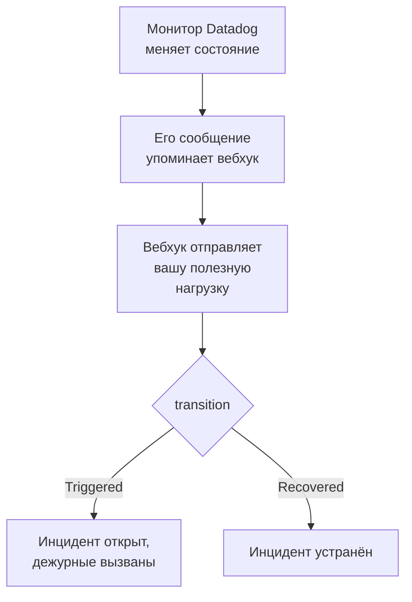

# Datadog

Отправляйте оповещения мониторов [Datadog](https://www.datadoghq.com) в OneUptime, чтобы каждое оповещение становилось инцидентом, который вызывает вашу дежурную команду и устраняется, когда монитор Datadog восстанавливается. Datadog отправляет оповещения через свою [интеграцию Webhooks](https://docs.datadoghq.com/integrations/webhooks/), поэтому ни на одной стороне ничего не нужно устанавливать.

:::cards
- [Выбор способа приёма оповещений в OneUptime](#выбор-способа-приёма-оповещений-в-oneuptime): Монитор Incoming Request или собственный рабочий процесс.
- [Приём оповещений монитором](#приём-оповещений-монитором): Один инцидент на оповещение, устраняемый при восстановлении.
- [Настройка Datadog](#настройка-datadog): Вебхук и мониторы, которые его уведомляют.
- [Устранение неполадок](#устранение-неполадок): Когда оповещения не приходят или инциденты остаются открытыми.
:::

## Как это работает



Монитор Datadog уведомляет вебхуки, упомянутые в его сообщении, когда меняет состояние: когда срабатывает, предупреждает, восстанавливается или остаётся без данных. JSON-тело вебхука вы пишете сами из [переменных шаблона](https://docs.datadoghq.com/integrations/webhooks/#usage) Datadog, поэтому в этом руководстве есть готовое тело, которое называет каждое оповещение и говорит, что с ним произошло.

## Перед началом работы

- Аккаунт Datadog, в котором вы можете настраивать интеграции и редактировать мониторы.
- В OneUptime право создавать мониторы или рабочие процессы, если вы выберете этот путь.

## Выбор способа приёма оповещений в OneUptime

Сначала настройте OneUptime: он выдаст URL, на который будет отправлять Datadog.

| Способ | Когда использовать |
| --- | --- |
| Монитор Incoming Request (рекомендуется) | Вы хотите, чтобы каждое оповещение становилось инцидентом, который вызывает дежурных и устраняется, когда монитор Datadog восстанавливается. Ничего строить не нужно. |
| Рабочий процесс с триггером Webhook | Вам нужна собственная логика: фильтровать оповещения, преобразовывать их или сначала вызывать другие системы. Рабочий процесс объявляет инцидент для каждого полученного оповещения и не устраняет его при восстановлении. |

Оба способа получают один и тот же JSON от одного и того же вебхука, поэтому можно начать с одного и позже перейти на другой, изменив один URL в Datadog.

## Приём оповещений монитором

[Монитор Incoming Request](/docs/monitor/incoming-request-monitor) выдаёт вам URL, а его критерии определяют, что делает каждое оповещение.

:::steps
### Создайте монитор

Откройте **Мониторы** и нажмите **Создать монитор**. Выберите **Incoming Request** в поле **Тип монитора**, назовите монитор `Datadog` и нажмите **Далее**.

### Объявляйте инцидент для каждого оповещения

На шаге **Критерии** откройте первый критерий, тот, что переводит монитор в состояние «не в сети». Задайте для его фильтра **Тело запроса**, **Содержит**, `"transition":"Triggered"`. Этот критерий уже объявляет инцидент, когда его фильтр совпадает. Заполните инцидент:

- **Заголовок инцидента**: `{{requestBody.title}}`.
- **Описание инцидента**, в разделе **Описание**: `{{requestBody.body}}`, а затем `Datadog: {{requestBody.link}}` отдельной строкой.
- **Серьёзность**: серьёзность инцидента, которая должна быть у этих оповещений.
- **Политики дежурств**, в разделе **Дежурство**: политики, которые нужно вызывать.
- **Автоустранение инцидента**, в разделе **Дополнительные поля**: оставьте включённым, как по умолчанию. Без него восстановления игнорируются, а инциденты остаются открытыми.

### Открывайте один инцидент на оповещение

В том же критерии откройте **Настройки** и включите **Group incidents and alerts by a payload field**. Заполните его, как показано ниже, чтобы у каждого оповещения был свой инцидент и его восстановление устраняло этот инцидент:

| Поле | Значение |
| --- | --- |
| **Open a separate incident for each…** | `requestBody.alert_key` |
| **Field that signals recovery** | `requestBody.transition` |
| **Value that means recovered** | `Recovered` |

### Возвращайте монитор в сеть

Откройте второй критерий, тот, что переводит монитор в состояние «в сети», и задайте для его фильтра **Тело запроса**, **Содержит**, `"transition":"Recovered"`.

### Скопируйте URL

Нажмите **Создать монитор**. Страница **Обзор** монитора показывает его **Heartbeat URL**. Скопируйте его для Datadog:

```text
https://oneuptime.com/heartbeat/<secret key>
```

У самостоятельно размещённой установки вместо `oneuptime.com` указан собственный хост.
:::

Полезная нагрузка ниже записывает в `alert_key` идентификатор монитора Datadog и теги сработавшей группы, поэтому у каждой группы монитора с несколькими оповещениями свой инцидент, а восстановление этой группы его устраняет. Монитор, который срабатывает повторно или повторно уведомляет, пока его инцидент открыт, не открывает второй инцидент. Что делает каждая настройка, описано в разделе [Приём оповещений от другой системы](/docs/monitor/incoming-request-monitor#приём-оповещений-от-другой-системы).

> [!NOTE]
> Уведомление **Warn** или **No Data** с этими фильтрами инцидент не открывает. Чтобы вас вызывали и при предупреждениях, нажмите **Добавить критерии**, задайте новому критерию фильтр **Тело запроса**, **Содержит**, `"transition":"Warn"`, инцидент с собственным значением поля **Серьёзность** и те же настройки группировки, а затем перетащите его выше первого критерия. Критерии проверяются сверху вниз, и решает первый совпавший.

## Настройка Datadog

:::steps
### Добавьте вебхук

В Datadog откройте [плитку интеграции Webhooks](https://app.datadoghq.com/integrations/webhooks) и установите интеграцию, если она ещё не установлена. Добавьте вебхук с такими настройками и сохраните его:

- **Name**: `oneuptime`. Мониторы упоминают вебхук по этому имени, как `@webhook-oneuptime`.
- **URL**: URL, скопированный из OneUptime.
- **Payload**:

  ```json
  {
    "alert_key": "$ALERT_ID $ALERT_SCOPE",
    "transition": "$ALERT_TRANSITION",
    "title": "$EVENT_TITLE",
    "body": "$TEXT_ONLY_MSG",
    "host": "$HOSTNAME",
    "priority": "$PRIORITY",
    "link": "$LINK"
  }
  ```

### Упомяните вебхук в мониторах

В каждом мониторе Datadog, который должен вызывать дежурных через OneUptime, добавьте `@webhook-oneuptime` в сообщение уведомления монитора и сохраните монитор. После этого Datadog отправляет оповещения и восстановления этого монитора в OneUptime.
:::

| Переменная | Что в неё записывает Datadog |
| --- | --- |
| `$ALERT_ID` | Идентификатор сработавшего монитора Datadog. |
| `$ALERT_SCOPE` | Теги сработавшей группы, например `host:web-1`. |
| `$ALERT_TRANSITION` | Что произошло: `Triggered`, `Re-Triggered`, `Warn`, `Recovered`, `No Data`, `Renotify` и другие. |
| `$EVENT_TITLE` | Заголовок события, например `[Triggered] High CPU`. |
| `$TEXT_ONLY_MSG` | Сообщение монитора без Markdown. |
| `$LINK` | Ссылка на событие в Datadog. |

## Проверка

Отправьте в OneUptime оповещение, как это сделал бы Datadog:

```bash
curl -X POST "https://oneuptime.com/heartbeat/<secret key>" \
  -H "Content-Type: application/json" \
  -d '{
    "alert_key": "1234 host:web-1",
    "transition": "Triggered",
    "title": "[Triggered] High CPU",
    "body": "CPU is above 90% on web-1.",
    "host": "web-1",
    "priority": "normal",
    "link": "https://app.datadoghq.com/event/event?id=1"
  }'
```

Открывается инцидент с заголовком `[Triggered] High CPU`. Отправьте тот же запрос со значением `Recovered` для `transition`, и инцидент будет устранён.

Затем проверьте из Datadog: откройте монитор, который упоминает вебхук, нажмите **Test Notifications** и отправьте его уведомление **Alert**. Посмотрите на временную шкалу монитора OneUptime, чтобы убедиться, что оно пришло.

## Приём оповещений рабочим процессом

Используйте [рабочий процесс](/docs/workflows/index), когда между Datadog и инцидентом нужны собственные шаги.

:::steps
### Создайте рабочий процесс

Откройте **Рабочие процессы**, нажмите **Создать рабочий процесс**, затем **Начать с нуля**. Назовите его `Datadog alerts` и нажмите **Создать рабочий процесс**.

### Добавьте триггер Webhook

Нажмите на пунктирный блок **Выберите, что запускает этот рабочий процесс** и выберите **Webhook**. Нажмите на триггер, затем **Скопировать URL** и укажите этот URL в вебхуке в Datadog.

### Проверьте, что монитор сработал

Нажмите **Добавить компонент**, добавьте блок **If / Else** и подключите к нему точку **Out** триггера. Задайте для **Value to check** значение `{{local.components.webhook-1.returnValues.request-body.transition}}`, для **Comparison** значение **is equal to**, а для **Compare with** значение `Triggered`.

### Объявите инцидент

Добавьте блок **Create One Incident** и подключите к нему сторону **Yes** блока **If / Else**. В поле **Incident Template** выберите шаблон, который задаёт серьёзность и политики дежурств для вызова (см. [Шаблоны инцидентов](/docs/incidents/settings#шаблоны-инцидентов)). В поле **JSON Object** задайте то, что приходит от Datadog:

```json
{
  "title": "{{local.components.webhook-1.returnValues.request-body.title}}",
  "description": "{{local.components.webhook-1.returnValues.request-body.body}}\nDatadog: {{local.components.webhook-1.returnValues.request-body.link}}"
}
```

Без шаблона **JSON Object** также должен содержать `incidentSeverityId` — идентификатор одного из уровней серьёзности инцидентов проекта.

### Включите рабочий процесс

Включите **Включено** в верхней части окна **Конструктор**. Выключенный рабочий процесс отвечает Datadog кодом `400`.
:::

Каждое уведомление `Triggered` объявляет новый инцидент. Восстановление уходит по стороне **No** блока **If / Else**, к которой ничего не подключено, поэтому запуск на этом заканчивается. Чтобы получать один инцидент на оповещение с устранением при восстановлении, используйте монитор.

## Устранение неполадок

:::details В OneUptime ничего не приходит
- Убедитесь, что сообщение монитора Datadog упоминает `@webhook-oneuptime` именно так, как называется вебхук.
- Монитор сразу отвечает `200`, ещё до каких-либо проверок, даже при неверном секретном ключе. Посмотрите на временную шкалу монитора, чтобы понять, доходят ли оповещения.
- Выключенный рабочий процесс отвечает `400`. Включите **Включено** в верхней части его окна **Конструктор**.
:::

:::details Инциденты открываются, но никогда не устраняются
- Монитор Datadog должен уведомлять вебхук и о своих восстановлениях. Сообщение, которое упоминает вебхук только для оповещений, внутри условия, восстановление не отправляет.
- Инциденту критерия нужно **Автоустранение инцидента** в разделе **Дополнительные поля**.
- **Value that means recovered** должно быть точно `Recovered`. Сравнение учитывает регистр.
- `alert_key` восстановления должен совпадать с ключом оповещения: оставьте `$ALERT_ID $ALERT_SCOPE` в полезной нагрузке как есть.
:::

:::details Поле показывает имя переменной или пустое значение
Datadog заполняет только те переменные, которые относятся к событию. Отправьте тестовое уведомление и посмотрите, что пришло: на временной шкале монитора, а для рабочего процесса — в **Журналы → Запуски**.
:::

:::details Все оповещения монитора сводятся в один инцидент
Каждой группе нужен собственный `alert_key`. Убедитесь, что полезная нагрузка составляет его и из `$ALERT_ID`, и из `$ALERT_SCOPE`, а путь группировки — `requestBody.alert_key`.
:::

## Безопасность

- **Обращайтесь с URL как с паролем.** Любой, у кого он есть, может открывать инциденты. Если он утёк, сбросьте его: **Сбросить секретный ключ входящего запроса** на странице **Настройки** монитора или **Сбросить URL** в триггере **Webhook** рабочего процесса. Затем обновите **URL** вебхука в Datadog.
- **Самостоятельное размещение?** Datadog отправляет вебхуки из интернета, поэтому ваш OneUptime должен быть доступен оттуда по HTTPS.

## Дальнейшие шаги

:::cards
- [Мониторинг входящих запросов](/docs/monitor/incoming-request-monitor): Все настройки монитора, который принимает ваши оповещения.
- [Prometheus Alertmanager](/docs/integrations/prometheus-alertmanager): Та же настройка для Alertmanager.
- [Правила эскалации](/docs/on-call/escalation-rules): Решите, кого и когда вызывает политика дежурств.
- [Обзор интеграций](/docs/integrations/index): Другие инструменты, которые можно подключить.
:::
