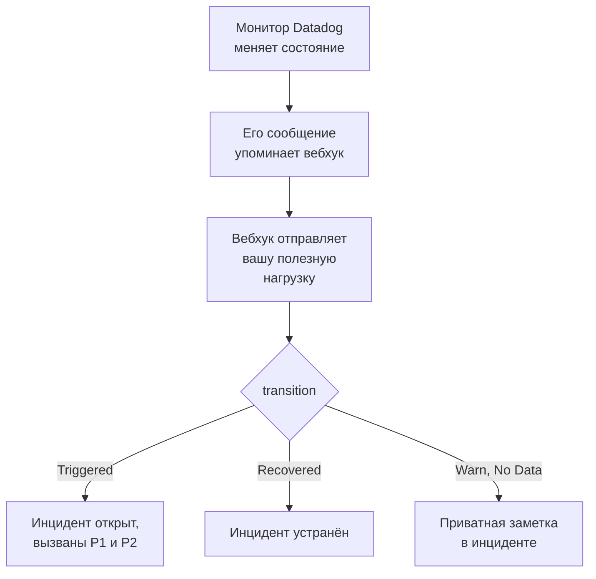

# Datadog

Отправляйте оповещения мониторов [Datadog](https://www.datadoghq.com) в OneUptime, чтобы каждое из них становилось инцидентом или оповещением, вызывало вашу дежурную команду, когда это срочно, и устранялось, когда монитор Datadog восстанавливается. Datadog отправляет оповещения через свою [интеграцию Webhooks](https://docs.datadoghq.com/integrations/webhooks/), поэтому ни на одной стороне ничего не нужно устанавливать.

:::cards
- [Выбор способа приёма оповещений в OneUptime](#выбор-способа-приёма-оповещений-в-oneuptime): Шаблон рабочего процесса или монитор Incoming Request.
- [Начните с шаблона](#начните-с-шаблона): Выберите, кого вызывать, скопируйте URL и посмотрите, что делает каждое оповещение.
- [Приём оповещений монитором](#приём-оповещений-монитором): Один инцидент на оповещение, устраняемый при восстановлении.
- [Настройка Datadog](#настройка-datadog): Вебхук и мониторы, которые его уведомляют.
- [Устранение неполадок](#устранение-неполадок): Когда оповещения не приходят или инциденты остаются открытыми.
:::

## Как это работает



Монитор Datadog уведомляет вебхуки, упомянутые в его сообщении, когда меняет состояние: когда срабатывает, предупреждает, восстанавливается или остаётся без данных. JSON-тело вебхука вы пишете сами из [переменных шаблона](https://docs.datadoghq.com/integrations/webhooks/#usage) Datadog, поэтому в этом руководстве есть готовое тело, которое называет каждое оповещение и говорит, что с ним произошло.

## Перед началом работы

- Аккаунт Datadog, в котором вы можете настраивать интеграции и редактировать мониторы.
- В OneUptime — право создавать рабочие процессы или мониторы, если вы выберете этот путь. В OneUptime Cloud рабочим процессам нужен план **Growth** или выше.

## Выбор способа приёма оповещений в OneUptime

Сначала настройте OneUptime: он выдаст URL, на который будет отправлять Datadog.

| Способ | Когда использовать |
| --- | --- |
| Шаблон рабочего процесса (рекомендуется) | Вы хотите получать каждое оповещение как инцидент или оповещение с серьёзностью по приоритету монитора, с вызовом дежурных для P1 и P2, с заметками о предупреждениях и устранением при восстановлении. Ничего строить не нужно. |
| Монитор Incoming Request | Вы хотите инциденты без рабочего процесса, на любом плане, и монитор, статус которого следует за Datadog. |

Оба способа получают один и тот же JSON от одного и того же вебхука, поэтому можно начать с одного и позже перейти на другой, изменив один URL в Datadog.

## Начните с шаблона

В диалоге **Создать рабочий процесс** есть два шаблона Datadog, в категории **Datadog** его списка категорий: **Declare an incident when a Datadog monitor triggers** и, для оповещений, **Create an alert when a Datadog monitor triggers**. Оба делают одно и то же, каждый со своим видом записи.

:::steps
1. Перейдите в **Рабочие процессы** и нажмите **Создать рабочий процесс**. В разделе **Или начать с шаблона** выберите **Datadog** в списке категорий, нажмите **Declare an incident when a Datadog monitor triggers** или **Create an alert when a Datadog monitor triggers**, а затем **Использовать шаблон**.
2. В поле **Who to page for P1 and P2 monitors** выберите политики дежурств, которые нужно вызывать, или ни одной, чтобы никого не вызывать, и нажмите **Создать рабочий процесс**. Рабочий процесс откроется в окне **Конструктор** выключенным.
3. Нажмите на триггер **Webhook**, затем на **Скопировать URL** и сохраните URL для Datadog.
4. Включите **Включено** вверху окна **Конструктор**. Выключенный рабочий процесс отвечает Datadog кодом `400`.
:::

Затем [настройте Datadog](#настройка-datadog), чтобы он отправлял свои оповещения на этот URL. Шаг `read-event-1` рабочего процесса открывается с теми же настройками, если вы вернётесь к нему в окне **Конструктор**.

### Что делает рабочий процесс

После триггера **Webhook** шаг **Check With JavaScript** `read-event-1` читает `transition`, который отправляет Datadog, а **Incident From Another Tool** (в шаблоне для оповещений — **Alert From Another Tool**) делает то, что оно означает, по ключу цикла оповещения. Datadog хранит этот ключ с момента срабатывания оповещения до его восстановления, а при следующем срабатывании ключ новый, поэтому каждый раз получает собственный инцидент. Инцидент хранит ключ в своём настраиваемом поле `datadogAlertCycleKey`.

| Переход | Что делает рабочий процесс |
| --- | --- |
| `Triggered`, `Re-Triggered` | Объявляет инцидент с заголовком `Datadog: <monitor>` и серьёзностью, которой соответствует приоритет монитора, не показывая его на ваших страницах статуса. Его описание ссылается на оповещение в Datadog и перечисляет приоритет, узел, область и сообщение монитора. Уведомление для оповещения, у которого уже есть инцидент, второй инцидент не открывает и никого не вызывает повторно. |
| `Recovered` | Устраняет инцидент оповещения, если он ещё не устранён. Причина видна в его хронологии. |
| `Warn`, `Re-Warn`, `No Data`, `Re-No Data` | Добавляет в инцидент оповещения приватную заметку о том, в каком состоянии сейчас монитор. |
| `Renotify` | Ничего: оповещение всё ещё открыто. |

Предупреждение или восстановление для оповещения без инцидента ничего не меняет. Всё остальное, например запрос от другого инструмента, остаётся без изменений: `read-event-1` переходит на **No**, а **Шаги** запуска объясняют почему. В Datadog ничего не возвращается: он сам устраняет свои оповещения, когда сигнал восстанавливается, и именно это устраняет инцидент.

### Приоритеты и вызов дежурных

Новый инцидент вызывает политики дежурств, которые вы выбрали, если приоритет его монитора P1 или P2 либо приоритета нет. P3, P4 и P5 открывают инцидент и никого не вызывают. В новом проекте приоритеты сопоставляются с такими уровнями серьёзности инцидентов и оповещений:

| Приоритет в Datadog | Инцидент | Оповещение | Дежурные |
| --- | --- | --- | --- |
| P1 | Critical Incident | High | Вызваны |
| P2 | Critical Incident | High | Вызваны |
| Без приоритета | Critical Incident | High | Вызваны |
| P3 | Major Incident | Low | Не вызваны |
| P4 | Minor Incident | Low | Не вызваны |
| P5 | Minor Incident | Low | Не вызваны |

Если у вас свои уровни серьёзности, P1, P2 и отсутствие приоритета идут к самому серьёзному, P3 — к среднему, а P4 и P5 — к наименее серьёзному.

- Чтобы сопоставить приоритет с одним из ваших по имени, измените `SEVERITY_BY_NAME` в шаге `read-event-1`, например `{ P3: 'Minor Incident' }`.
- Чтобы вызывать дежурных и для P3, задайте **Compare with** шага `if-page-1` **If / Else** значение `3`.

## Приём оповещений монитором

[Монитор Incoming Request](/docs/monitor/incoming-request-monitor) выдаёт вам URL, а его критерии определяют, что делает каждое оповещение.

:::steps
### Создайте монитор

Откройте **Мониторы** и нажмите **Создать монитор**. Выберите **Incoming Request** в поле **Тип монитора**, назовите монитор `Datadog` и нажмите **Далее**.

### Объявляйте инцидент для каждого оповещения

На шаге **Критерии** откройте первый критерий, тот, что переводит монитор в состояние «не в сети». Задайте для его фильтра **Тело запроса**, **Содержит**, `"transition":"Triggered"`. Этот критерий уже объявляет инцидент, когда его фильтр совпадает. Заполните инцидент:

- **Заголовок инцидента**: `{{requestBody.title}}`.
- **Описание инцидента**, в разделе **Описание**: `{{requestBody.body}}`, а затем `Datadog: {{requestBody.link}}` отдельной строкой.
- **Серьёзность**: серьёзность инцидента, которая должна быть у этих оповещений.
- **Политики дежурств**, в разделе **Дежурство**: политики, которые нужно вызывать.
- **Автоустранение инцидента**, в разделе **Дополнительные поля**: оставьте включённым, как по умолчанию. Без него восстановления игнорируются, а инциденты остаются открытыми.

### Открывайте один инцидент на оповещение

В том же критерии откройте **Настройки** и включите **Group incidents and alerts by a payload field**. Заполните его, как показано ниже, чтобы у каждого оповещения был свой инцидент и его восстановление устраняло этот инцидент:

| Поле | Значение |
| --- | --- |
| **Open a separate incident for each…** | `requestBody.alert_key` |
| **Field that signals recovery** | `requestBody.transition` |
| **Value that means recovered** | `Recovered` |

### Возвращайте монитор в сеть

Откройте второй критерий, тот, что переводит монитор в состояние «в сети», и задайте для его фильтра **Тело запроса**, **Содержит**, `"transition":"Recovered"`.

### Скопируйте URL

Нажмите **Создать монитор**. Страница **Обзор** монитора показывает его **Heartbeat URL**. Скопируйте его для Datadog:

```text
https://oneuptime.com/heartbeat/<secret key>
```

У самостоятельно размещённой установки вместо `oneuptime.com` указан собственный хост.
:::

Полезная нагрузка ниже записывает в `alert_key` идентификатор монитора Datadog и теги сработавшей группы, поэтому у каждой группы монитора с несколькими оповещениями свой инцидент, а восстановление этой группы его устраняет. Монитор, который срабатывает повторно или повторно уведомляет, пока его инцидент открыт, не открывает второй инцидент. Что делает каждая настройка, описано в разделе [Приём оповещений от другой системы](/docs/monitor/incoming-request-monitor#приём-оповещений-от-другой-системы).

> [!NOTE]
> Уведомление **Warn** или **No Data** с этими фильтрами инцидент не открывает. Чтобы вас вызывали и при предупреждениях, нажмите **Добавить критерии**, задайте новому критерию фильтр **Тело запроса**, **Содержит**, `"transition":"Warn"`, инцидент с собственным значением поля **Серьёзность** и те же настройки группировки, а затем перетащите его выше первого критерия. Критерии проверяются сверху вниз, и решает первый совпавший.

## Настройка Datadog

:::steps
### Добавьте вебхук

В Datadog откройте [плитку интеграции Webhooks](https://app.datadoghq.com/integrations/webhooks) и установите интеграцию, если она ещё не установлена. Добавьте вебхук с такими настройками и сохраните его:

- **Name**: `oneuptime`. Мониторы упоминают вебхук по этому имени, как `@webhook-oneuptime`.
- **URL**: URL, скопированный из OneUptime.
- **Payload**:

  ```json
  {
    "alert_key": "$ALERT_ID $ALERT_SCOPE",
    "alert_cycle_key": "$ALERT_CYCLE_KEY",
    "transition": "$ALERT_TRANSITION",
    "alert_priority": "$ALERT_PRIORITY",
    "title": "$EVENT_TITLE",
    "body": "$TEXT_ONLY_MSG",
    "host": "$HOSTNAME",
    "scope": "$ALERT_SCOPE",
    "priority": "$PRIORITY",
    "link": "$LINK"
  }
  ```

### Упомяните вебхук в мониторах

В каждом мониторе Datadog, который должен вызывать дежурных через OneUptime, добавьте `@webhook-oneuptime` в сообщение уведомления монитора и сохраните монитор. После этого Datadog отправляет оповещения и восстановления этого монитора в OneUptime.
:::

| Переменная | Что в неё записывает Datadog |
| --- | --- |
| `$ALERT_ID` | Идентификатор сработавшего монитора Datadog. |
| `$ALERT_SCOPE` | Теги сработавшей группы, например `host:web-1`. |
| `$ALERT_CYCLE_KEY` | Идентификатор, который остаётся прежним с момента срабатывания оповещения до его восстановления. |
| `$ALERT_TRANSITION` | Что произошло: `Triggered`, `Re-Triggered`, `Warn`, `Recovered`, `No Data`, `Renotify` и другие. |
| `$ALERT_PRIORITY` | Приоритет монитора Datadog, от `P1` до `P5`, или ничего для монитора без приоритета. |
| `$EVENT_TITLE` | Заголовок события, например `[Triggered] High CPU`. |
| `$TEXT_ONLY_MSG` | Сообщение монитора без Markdown. |
| `$LINK` | Ссылка на событие в Datadog. |

Одна полезная нагрузка подходит для обоих способов: шаблон опирается на `alert_cycle_key` и `alert_priority`, а монитор — на `alert_key`. Оставьте их все, и позже можно будет переключиться, изменив только URL.

## Проверка

Отправьте оповещение на скопированный URL, как это сделал бы Datadog:

```bash
curl -X POST "<url>" \
  -H "Content-Type: application/json" \
  -d '{
    "alert_key": "1234 host:web-1",
    "alert_cycle_key": "7151157925468446720",
    "transition": "Triggered",
    "alert_priority": "P1",
    "title": "[Triggered] High CPU",
    "body": "CPU is above 90% on web-1.",
    "host": "web-1",
    "scope": "host:web-1",
    "priority": "normal",
    "link": "https://app.datadoghq.com/event/event?id=1"
  }'
```

С шаблоном открывается инцидент с заголовком `Datadog: High CPU`, и вызываются выбранные вами политики дежурств. С монитором открывается инцидент с заголовком `[Triggered] High CPU`. Отправьте тот же запрос со значением `Recovered` для `transition`, и инцидент будет устранён.

Затем проверьте из Datadog: откройте монитор, который упоминает вебхук, нажмите **Test Notifications** и отправьте его уведомление **Alert**. Чтобы убедиться, что оно пришло, откройте **Журналы → Запуски** рабочего процесса или временную шкалу монитора OneUptime.

## Устранение неполадок

:::details В OneUptime ничего не приходит
- Убедитесь, что сообщение монитора Datadog упоминает `@webhook-oneuptime` именно так, как называется вебхук.
- Монитор сразу отвечает `200`, ещё до каких-либо проверок, даже при неверном секретном ключе. Посмотрите на временную шкалу монитора, чтобы понять, доходят ли оповещения.
- Выключенный рабочий процесс отвечает `400`. Включите **Включено** в верхней части его окна **Конструктор**.
:::

:::details Рабочий процесс запускается, но ничего не открывает
Откройте запуск в **Журналы → Запуски**. Запись `read-event-1` на вкладке **Шаги** объясняет, почему он перешёл на **No**.

- `Datadog named no alert cycle key`: добавьте `"alert_cycle_key": "$ALERT_CYCLE_KEY"` в полезную нагрузку вебхука в Datadog.
- `Datadog named no transition`: добавьте `"transition": "$ALERT_TRANSITION"` в полезную нагрузку вебхука в Datadog.
:::

:::details Дежурные не вызваны
- Вызывают только мониторы P1 и P2 и мониторы без приоритета. См. [Приоритеты и вызов дежурных](#приоритеты-и-вызов-дежурных).
- Уведомление для оповещения, у которого уже есть инцидент, никого не вызывает повторно.
- Если в диалоге **Создать рабочий процесс** никто не выбран, в рабочем процессе нет шага, который вызывает.
:::

:::details Инциденты открываются, но никогда не устраняются
- Монитор Datadog должен уведомлять вебхук и о своих восстановлениях. Сообщение, которое упоминает вебхук только для оповещений, внутри условия, восстановление не отправляет.
- С шаблоном откройте запуск восстановления в **Журналы → Запуски**: его последний шаг объясняет причину. `alert_cycle_key` восстановления должен совпадать с ключом оповещения, поэтому оставьте `$ALERT_CYCLE_KEY` в полезной нагрузке как есть.
- С монитором инциденту критерия нужно **Автоустранение инцидента** в разделе **Дополнительные поля**.
- **Value that means recovered** должно быть точно `Recovered`. Сравнение учитывает регистр.
- `alert_key` восстановления должен совпадать с ключом оповещения: оставьте `$ALERT_ID $ALERT_SCOPE` в полезной нагрузке как есть.
:::

:::details Поле показывает имя переменной или пустое значение
Datadog заполняет только те переменные, которые относятся к событию. Отправьте тестовое уведомление и посмотрите, что пришло: на временной шкале монитора, а для рабочего процесса — в **Журналы → Запуски**.
:::

:::details Все оповещения монитора сводятся в один инцидент
С монитором каждой группе нужен собственный `alert_key`. Убедитесь, что полезная нагрузка составляет его и из `$ALERT_ID`, и из `$ALERT_SCOPE`, а путь группировки — `requestBody.alert_key`.
:::

## Безопасность

- **Обращайтесь с URL как с паролем.** Любой, у кого он есть, может открывать инциденты. Если он утёк, сбросьте его: **Сбросить URL** в триггере **Webhook** рабочего процесса или **Сбросить секретный ключ входящего запроса** на странице **Настройки** монитора. Затем обновите **URL** вебхука в Datadog.
- **Ссылки ведут на Datadog.** Шаблон ссылается на оповещение только на сайте Datadog, что бы ни говорил запрос, и записывает присланное Datadog как текст.
- **Самостоятельное размещение?** Datadog отправляет вебхуки из интернета, поэтому ваш OneUptime должен быть доступен оттуда по HTTPS.

## Дальнейшие шаги

:::cards
- [Шаблоны рабочих процессов](/docs/workflows/authoring): Создайте рабочий процесс из шаблона и измените его в Конструкторе.
- [Мониторинг входящих запросов](/docs/monitor/incoming-request-monitor): Все настройки монитора, который принимает ваши оповещения.
- [New Relic](/docs/integrations/new-relic): Тот же шаблон, для проблем New Relic.
- [Правила эскалации](/docs/on-call/escalation-rules): Решите, кого и когда вызывает политика дежурств.
- [Обзор интеграций](/docs/integrations/index): Другие инструменты, которые можно подключить.
:::
