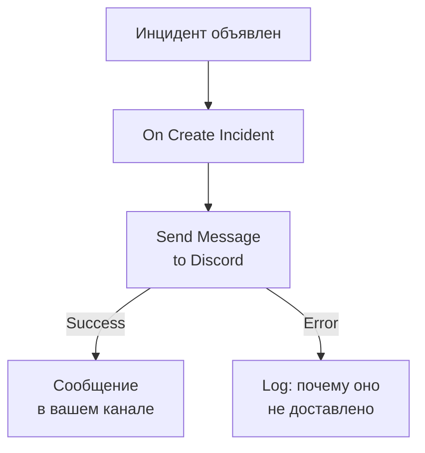

# Discord

Публикуйте сообщение в канале [Discord](https://discord.com), когда открывается инцидент, чтобы люди, следящие за этим каналом, сразу узнали о нём. Шаг рабочего процесса **Send Message to Discord** в OneUptime публикует через вебхук канала, а готовый шаблон создаёт весь рабочий процесс за вас. Эта интеграция **исходящая**: OneUptime пишет в канал и не читает, что в нём говорят.

:::cards
- [Как это работает](#как-это-работает): Что делает рабочий процесс, когда открывается инцидент.
- [Настройка](#настройка-интеграции): Вебхук в Discord, затем рабочий процесс: из шаблона или с нуля.
- [Советы](#советы): Форматирование, длинные сообщения и другие события.
- [Устранение неполадок](#устранение-неполадок): Что означают ошибки шага и что изменить.
:::

## Как это работает



Шаг публикует **Message Text** в вебхук канала. Он переходит на выход **Success**, когда Discord принимает сообщение, и на выход **Error** с причиной от Discord, когда Discord его отклоняет. Шаблон подключает шаг **Log** к **Error**, чтобы запуск, который не смог опубликовать сообщение, объяснял почему.

## Перед началом работы

- В Discord — разрешение **Manage Webhooks** для канала.
- В OneUptime — право создавать рабочие процессы и переменные. В OneUptime Cloud для рабочих процессов нужен тариф **Growth** или выше.

## Настройка интеграции

:::steps
### Создайте вебхук в Discord

1. В Discord откройте настройки канала через **Edit Channel**, затем **Integrations → Webhooks**, и выберите **New Webhook**.
2. Задайте ему имя, например `OneUptime`, и проверьте, что он публикует в нужный канал.
3. Выберите **Copy Webhook URL**.

Любой, у кого есть URL, может публиковать в канале, поэтому храните его так же надёжно, как пароль.

### Создайте рабочий процесс

Начните с шаблона, который создаёт весь рабочий процесс за вас, или с нуля.

:::tabs
@tab Из шаблона
1. Откройте **Рабочие процессы** и нажмите **Создать рабочий процесс**.
2. Введите `Discord` в **Поиск шаблонов…**, нажмите **Tell Discord when an incident opens**, затем **Использовать шаблон**.
3. Оставьте имя **Notify Discord on new incident** или измените его и нажмите **Далее**.
4. Вставьте URL в **Discord Webhook URL** и нажмите **Создать рабочий процесс**.

Рабочий процесс открывается в окне **Конструктор** с тремя шагами: **On Create Incident**; **Send Message to Discord**, который публикует номер, заголовок, серьёзность и состояние инцидента; и шаг **Log** на его выходе **Error**. URL сохраняется как секретная переменная рабочего процесса `discordWebhookUrl`.
@tab С нуля
1. Сохраните URL как секретную глобальную переменную: перейдите в **Рабочие процессы → Глобальные переменные**, нажмите **Создать: Рабочий процесс Переменная**, назовите её `DISCORD_WEBHOOK_URL` и нажмите **Далее**. Вставьте URL в **Содержимое**, включите **Секрет** и нажмите **Создать: Рабочий процесс Переменная**.
2. Перейдите в **Рабочие процессы**, нажмите **Создать рабочий процесс**, выберите **Начать с нуля**, задайте имя рабочего процесса и нажмите **Создать рабочий процесс**.
3. В окне **Конструктор** нажмите **Выберите, что запускает этот рабочий процесс** и выберите **On Create Incident** в разделе **Популярные**. Нажмите на триггер: его **Fields to pass on** начинаются с поля **Заголовок**, поэтому нажмите **Добавить поле** и выберите остальные поля, которые показывает ваше сообщение, например **Incident Number With Prefix**.
4. Нажмите **Добавить компонент**, найдите `discord` и нажмите **Send Message to Discord**. Соедините выход **Success** триггера с этим шагом.
5. Нажмите на новый шаг. В **Discord Incoming Webhook URL** нажмите **{ }** и выберите `DISCORD_WEBHOOK_URL` в разделе **Global variables**. В **Message Text** напишите сообщение и вставьте поля инцидента с помощью **{ }**.
:::

Сообщение, созданное с нуля, читает поля инцидента по ссылкам вроде этих:

```text
🚨 **Incident {{local.components.incident-on-create-1.returnValues.model.incidentNumberWithPrefix}} declared**
**Title:** {{local.components.incident-on-create-1.returnValues.model.title}}
```

### Включите и проверьте

Включите переключатель **Включено** в верхней части окна **Конструктор**. С этого момента каждый новый инцидент публикуется в канале.

Чтобы проверить без открытия инцидента, нажмите **Запустить рабочий процесс** и выберите уже существующий инцидент в поле **Инцидент**: последние показаны в списке, а другой можно найти, введя его номер или часть заголовка. Нажмите **Запустить рабочий процесс вручную** и подтвердите кнопкой **Запустить**. Панель **Запуск рабочего процесса** отслеживает запуск, и сообщение появляется в канале. Если шаг вместо этого переходит в **Error**, строка шага **Log** объясняет почему: см. [Устранение неполадок](#устранение-неполадок).
:::

## Советы

- **Форматируйте с помощью Markdown Discord.** Текст отправляется так, как набран, поэтому Markdown Discord в нём работает: звёздочки вокруг слова делают его жирным, а URL отображается как ссылка.
- **Учитывайте лимит в 2 000 символов.** Discord принимает сообщения длиной до 2 000 символов. Более длинное обрезается и заканчивается на "… (truncated — see OneUptime for the full text)", а не отклоняется.
- **Публикуйте не только новые инциденты.** Создайте другой рабочий процесс на **On Update Incident** для смены состояния или на **On Create Alert** для оповещений с тем же шагом. Чтобы публиковать только некоторые инциденты, поставьте перед шагом блок **If / Else**.
- **Только собственные адреса Discord.** Шаг публикует на URL `https` на `discord.com` или `discordapp.com` и не следует перенаправлениям, поэтому URL, указывающий куда-то ещё, останавливает запуск.

## Устранение неполадок

Когда шаг переходит в **Error**, запуск объясняет почему: шаг **Log** шаблона записывает `❌ Discord could not deliver the incident notification:` и причину от Discord.

:::details Discord отвечает "Unknown Webhook" или "Invalid Webhook Token"
Вебхук удалён, или URL скопирован неправильно. Создайте новый вебхук и замените URL: в рабочем процессе из шаблона — переменную `discordWebhookUrl`, в собственном рабочем процессе — содержимое `DISCORD_WEBHOOK_URL`.
:::

:::details Discord отвечает "You are being rate limited"
Discord ограничивает частоту публикаций одного вебхука. Всплеск инцидентов может упереться в этот лимит: публикуйте меньше сообщений, например только для некоторых уровней серьёзности.
:::

:::details Запуск останавливается с "Discord Webhook URL must be an https URL on discord.com or discordapp.com"
**Discord Incoming Webhook URL** содержит не вебхук Discord, или переменная, которую он читает, пуста. Снова вставьте URL из **Copy Webhook URL**.
:::

## Дальнейшие шаги

:::cards
- [Компоненты рабочего процесса](/docs/workflows/components#discord): Каждая настройка шага и что означают его выходы.
- [Telegram](/docs/integrations/telegram): Та же идея в чате Telegram.
- [Запуски рабочего процесса](/docs/workflows/runs-and-logs): Посмотрите, что сделал каждый запуск рабочего процесса.
- [Обзор интеграций](/docs/integrations/index): Исходящий шаблон и другие инструменты, которые можно подключить.
:::
