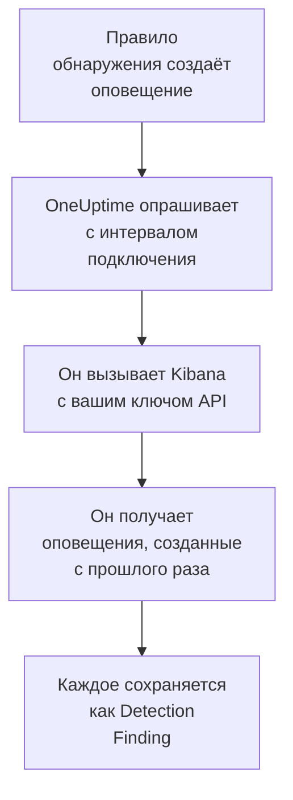

# Elastic Security

Импортируйте оповещения об обнаружениях, которые создают ваши правила [Elastic Security](https://www.elastic.co/security), в события безопасности OneUptime. Там вы ищете их рядом со своими логами, трассировками и метриками, сопоставляете с любыми другими источниками и вызываете дежурных по тем, что важны. OneUptime читает их через API механизма обнаружения Kibana с ключом API, который вы создаёте, и ничего не меняет в Elastic.

:::cards
- [Настройка подключения](#настройка-подключения): Ключ API, его привилегии и форма подключения.
- [Что импортируется](#что-импортируется): Как каждое оповещение об обнаружении становится событием безопасности.
- [Как работает опрос](#как-работает-опрос): Окно, которое читает каждый опрос, и что с ним делает загруженное пространство.
- [Устранение неполадок](#устранение-неполадок): Что означает каждая ошибка и что нужно изменить.
:::

## Как это работает



Каждую минуту OneUptime опрашивает каждое включённое подключение, интервал опроса которого истёк. Опрос запрашивает у Kibana оповещения об обнаружениях, созданные в вашем пространстве после предыдущего опроса, по 1 000 за раз, и сохраняет каждое как событие [OCSF](https://schema.ocsf.io/) Detection Finding (класс `2004`). Учитываются все типы правил: пользовательский запрос, порог, EQL, совпадение индикаторов, машинное обучение и новые термины. Затем правила обнаружения, мониторы и панели мониторинга обрабатывают оповещения как события безопасности из любого другого источника.

## Перед началом работы

- В OneUptime роль Project Owner, Project Admin или Security Admin. Роли Security Member и Security Viewer видят подключения и историю их запусков, но не могут их менять.
- Elastic Security 8.x или новее, в Elastic Cloud или в вашем собственном стеке Elastic, с правилами обнаружения, которые выполняются в пространстве Kibana.
- Доступ к Kibana, который может видеть оповещения об обнаружениях в этом пространстве: привилегии индекса `read` и `view_index_metadata` для `.alerts-security.alerts-<space-id>` и привилегия функции Security в Kibana, которая позволяет читать там оповещения.
- Kibana, до которой OneUptime может добраться по HTTPS. OneUptime Cloud подключается из интернета, поэтому Kibana нужен публичный адрес, как у развёртываний Elastic Cloud: частные адреса отклоняются. Самостоятельно размещённый OneUptime подключается из своих контейнеров приложения и worker и может добраться до Kibana в вашей частной сети, если только `DATA_SOURCE_BLOCK_PRIVATE_ADDRESSES` не равно `true`.

## Настройка подключения

:::steps
### Создайте ключ API

1. В Kibana откройте **Stack Management → API keys** и выберите **Create API key**.
2. Задайте ему имя, например `oneuptime-security-events`. У ключа есть привилегии пользователя, который его создаёт, если только вы не дадите ему меньше: ему нужны только перечисленные выше.
3. Выберите, когда он истекает, или оставьте бессрочным. Ключ с истёкшим сроком останавливает подключение, пока вы его не замените.
4. Создайте ключ и скопируйте его значение **Base64**, которое Kibana показывает только один раз. Не идентификатор ключа и не пару `id:api_key`.

### Найдите идентификатор своего пространства

Оповещения хранятся по пространствам. Откройте пространство, где выполняются ваши правила: его идентификатор — это часть адреса Kibana после `/s/`, например `security` в `https://kibana.example.com/s/security/app/security`. У пространства по умолчанию нет части `/s/`, и ему не нужен идентификатор.

### Добавьте подключение в OneUptime

Откройте **Продукты → Security Events → Connections** (`/dashboard/{projectId}/security-events/connections`), нажмите **Добавить подключение**, выберите **Elastic Security** и нажмите **Далее**. Заполните настройки из таблицы ниже, нажмите **Далее** и вставьте ключ в **API-ключ**.

### Проверьте его перед сохранением

Нажмите **Test these settings** в разделе **Проверка перед сохранением**. Проверка проходит аутентификацию и читает оповещения со значениями из формы, ничего не сохраняя, поэтому неверное пространство или недостающая привилегия обнаруживаются до того, как подключение будет создано. Затем нажмите **Далее**, задайте подключению **Имя** и создайте его.
:::

| Параметр | Что ввести |
| --- | --- |
| **Kibana URL** | Адрес, с которого обслуживается Kibana, например `https://kibana.example.com` или `https://<deployment>.kb.<region>.cloud.es.io`. Без пути: ни `/app/security`, ни `/api`, ни части `/s/<space>`. |
| **Kibana space** | Идентификатор пространства, а не его имя: буквы, цифры, дефисы и подчёркивания. Оставьте пустым для пространства по умолчанию. |
| **API-ключ** | Значение **Base64** ключа, само по себе: OneUptime сам добавляет схему `ApiKey`. Оно шифруется, никогда не возвращается API и больше не показывается. Замените его с помощью **Update credentials** в подключении. |

На шаге **Polling** также есть необязательное **Описание**, **Poll Interval (Minutes)** — целое число от `1` до `1440`, по умолчанию `5`, и **Включено**, изначально включённое.

## Что импортируется

Каждое оповещение об обнаружении становится событием Detection Finding (класс OCSF `2004`) с поставщиком `Elastic` и продуктом `Elastic Security`:

| Поле оповещения | Столбец OneUptime |
| --- | --- |
| `_id`, идентификатор оповещения | UID события, по которому также отбрасываются дубликаты |
| `kibana.alert.original_time`, иначе `kibana.alert.start`, иначе `@timestamp` | Время события |
| `kibana.alert.rule.name` | Имя правила |
| `kibana.alert.rule.uuid`, иначе `kibana.alert.rule.rule_id` | Идентификатор правила |
| `kibana.alert.reason`, иначе имя правила, иначе `kibana.alert.rule.description` | Сообщение |
| `kibana.alert.severity`, иначе диапазон `kibana.alert.risk_score` | Серьёзность |
| `kibana.alert.workflow_status`: `open`, `acknowledged` или `closed` | Статус |
| `kibana.alert.rule.threat`, включая подтехники | Тактики и техники MITRE ATT&CK |
| `user.name`, `host.name`, `source.ip` или `host.ip`, `process.name` или `process.executable` | Пользователь, хост, IP и процесс субъекта |
| `process.name`, `process.executable` и `process.command_line`; `process.parent.name`, `process.parent.executable` и `process.parent.command_line` | Имя, путь и командная строка процесса; имя, путь и командная строка родительского процесса |
| `user.target.name`, `destination.domain`, `destination.ip`, `destination.port`, `file.path` | Пользователь, хост, IP, порт и ресурс цели |
| Они, а также `related.*`, `dns.question.name`, `url.domain` и хеши файлов | Наблюдаемые объекты |
| Всё оповещение, развёрнутое в ключи с точками, с `_index` и `_id` | `attributes` |

Временем оповещения намеренно считается время активности, к которой оно относится. Его `@timestamp`, когда правило его создало, — это то, что читает опрос, поэтому оповещение, созданное сегодня о вчерашней активности, отображается во вчерашнем дне в обозревателе событий безопасности. Если у оповещения нет серьёзности, решает его оценка риска: от `74` Critical, от `48` High, от `22` Medium, ниже — Low.

## Как работает опрос

Каждый опрос получает оповещения, созданные в его окне, начиная с самых старых, по 1 000 на страницу. В пространстве, отличном от пространства по умолчанию, путь начинается с `/s/{Kibana space}`:

```text
POST {Kibana URL}/api/detection_engine/signals/search
    {"query": {"range": {"@timestamp": {"gte": "{window start}", "lt": "{window end}"}}},
     "size": 1000, "sort": [{"@timestamp": "asc"}]}
```

- **Курсором служит время создания.** Оповещения выбираются по их собственному `@timestamp`, когда их создал запуск правила, и никогда — по времени активности, к которой они относятся. Правило, которое выполняется раз в час, создаёт оповещения об активности возрастом до часа, и курсор по времени активности пропустил бы их все.
- **Первый опрос смотрит на 24 часа назад**, чтобы новое подключение сразу показало свои недавние оповещения.
- **Каждый следующий опрос начинается за 1 минуту до сохранённого курсора**, чтобы оповещение, созданное на границе двух окон, никогда не терялось.
- **Опрос читает не больше 24 часов после курсора.** Подключение, курсор которого отстал, догоняет серией 24-часовых окон, а его **Health** показывает **Catching up**.
- **Дубликаты отбрасываются по `_id` оповещения** в пределах проекта, поэтому перекрытие, повторно прочитанное окно и импорт никогда не сохраняют оповещение дважды.

Поиск оповещений Kibana принимает размер и сортировку, но не токен страницы. Поэтому OneUptime листает страницы, перенося начало диапазона на последнее оповещение каждой страницы, и исключает по `_id` оповещения, уже прочитанные в этот момент. Один запуск правила часто помечает много оповещений одним и тем же временем, и такая группа читается страница за страницей, ни одно дважды и ни одно не пропущено.

### Когда окно содержит больше, чем может прочитать один опрос

Опрос читает не больше 10 000 оповещений, не больше чем за 20 запросов. Если окно содержит больше, запуск получает статус **Partial** с предупреждением вроде такого:

```text
Stopped after collecting 10000 alerts; the window holds more.
```

Оповещения читаются начиная с самых старых, поэтому OneUptime переносит курсор на время создания последнего прочитанного оповещения, и следующий опрос начинается оттуда с той же длиной окна. Загруженное пространство догоняет по 10 000 оповещений за опрос, вместо того чтобы заново читать одни и те же. Оповещения, созданные в тот же самый момент, читаются дважды, и проверка дубликатов отбрасывает вторую копию.

Исключённые идентификаторы передаются в каждом запросе, а Kibana ограничивает размер запроса. Если один момент разделяет больше оповещений, чем может исключить один запрос, около 7 800, запуск останавливается на нём со статусом **Partial** и предупреждением, в котором назван этот момент.

Если запуск вообще не может продвинуться дальше сохранённого курсора, OneUptime вместо этого сокращает окно:

1. **Сузить.** Следующий опрос читает окно вдвое короче с той же начальной точки и продолжает делить его пополам, пока окно не будет прочитано целиком, вплоть до одной минуты. Предупреждение запуска говорит об этом: `This window holds more records than one poll can read; the next poll reads a {n} minute window from the same starting point.`
2. **Снова расти.** После того как окно прочитано целиком, следующее снова вдвое длиннее, до 24 часов.
3. **Пройти мимо одной минуты.** Если даже одна минута содержит больше, чем может прочитать опрос, опрос проходит мимо неё, чтобы новые оповещения продолжали поступать. Запуск остаётся **Partial**, а **Последняя ошибка** содержит `More records were created in the one minute from {cursor} to {end} than one poll can read. Polling moved past this minute so newer records keep arriving; use Import this time range in Diagnostics on this minute to recover what one run can read.` Импортируйте эту минуту с помощью **Import this time range**, чтобы восстановить то, что может прочитать один запуск.

Запуск, который полностью завершается ошибкой Kibana, сохраняет курсор и длину окна, и следующий опрос заново читает то же окно. Единственное исключение — запрос, превысивший время ожидания: курсор остаётся на месте, но следующее окно вдвое короче, потому что слишком тяжёлое для своевременного ответа окно превышало бы время ожидания при каждой попытке. Изменение **Poll Interval (Minutes)** ничего из этого не меняет: оно определяет, как часто начинается опрос, а не где начинается его окно.

### Запуск, просмотр и импорт по требованию

Нажмите **Diagnostics** в подключении, чтобы увидеть его последние запуски и работать с ним вручную. Запускать эти действия может любой, кто может менять подключение; читать историю может любой, кто может его видеть.

- **Run now** сразу запускает опрос с обычным курсором, даже если подключение не **Включено**.
- **Preview alerts** читает интервал времени до 7 дней и ничего не импортирует.
- **Import this time range** после вашего подтверждения импортирует интервал до 7 дней, не перемещая курсор. Уже импортированные оповещения пропускаются.
- **Copy diagnostics** в запуске копирует его отчёт для поддержки. Он никогда не содержит учётных данных.

## Проверка подключения

**Проверить подключение** в строке подключения и **Test these settings** в форме выполняются в процессе API, а не в фоновом worker, поэтому проверка отвечает даже тогда, когда проблема в самих worker. Она выполняет такие проверки по порядку:

| Проверка | Что она проверяет |
| --- | --- |
| **Конфигурация** | Каждый параметр задан и правильно оформлен. Если это не так, ни к чему не обращаются. |
| **Authenticate with Kibana** | `/api/status` Kibana отвечает полностью. Kibana отвечает и тем, кого не аутентифицировала, но меньшим объёмом, поэтому короткий ответ проваливает эту проверку. |
| **Read detection alerts** | Можно прочитать одно оповещение, созданное за последние 24 часа. Это подтверждает привилегии и пространство. |
| **Alerts available to import** | Сколько оповещений создано за последние 24 часа и за последние 7 дней, с `+` там, где Elasticsearch подсчитал только часть. Ни одного за 7 дней — это предупреждение, а не сбой. |
| **Background workers**, **Poll scheduler**, **Security event storage** | Сторона самого OneUptime: процесс забирает задания из очереди Worker, задание опроса выполняется каждую минуту, а хранилище событий безопасности отвечает. |
| **Scheduled polling** | Для сохранённого подключения: опрос включён, ни один запуск не застрял в ожидании worker, а опросы выполняются вовремя. |

У каждого запроса в проверке срок 20 секунд. Проверка никогда ничего не импортирует и не перемещает курсор, а каждая неудачная проверка сообщает, что нужно изменить.

## Отправка событий безопасности в Elastic Security

OneUptime также может отправлять то, что находит, в Elasticsearch в виде документов Elastic Common Schema (ECS) в потоке данных, чтобы оповещения, хронологии и правила обнаружения Elastic Security видели обнаружения OneUptime рядом с вашими собственными. Обнаружение — это документ с `event.kind` `alert`, а у любого другого события `event.kind` `event`.

:::steps
### Создайте API-ключ с правом записи

В Kibana откройте **Stack Management → API keys**, нажмите **Create API key**, выдайте ему привилегии ниже и скопируйте его значение **Encoded**.

### Добавьте получателя

Откройте **Продукты → Security Events → Connections**. В разделе **Отправка в вашу SIEM** нажмите **Добавить получателя**, выберите Elastic Security в поле **SIEM** и нажмите **Далее**. Заполните **URL Elasticsearch**, то есть конечную точку Elasticsearch развёртывания, а не Kibana, и вставьте ключ в **API-ключ**. **Поток данных** необязателен: если оставить его пустым, документы идут в `logs-oneuptime.security-default`, который Elasticsearch создаёт при первой записи.

### Отправьте тестовое событие и начните отправку

Нажмите **Отправить тестовое событие**: в поток данных поступит один документ. Затем в разделе **Что отправлять** оставьте **Только обнаружения** или выберите **Все события безопасности** и нажмите **Начать отправку**.
:::

Привилегии ключа для потока данных по умолчанию:

```json title="oneuptime-writer-role.json"
{
  "oneuptime-writer": {
    "indices": [
      {
        "names": [
          "logs-oneuptime.security-*"
        ],
        "privileges": [
          "create_doc",
          "auto_configure"
        ]
      }
    ]
  }
}
```

- Документы уходят пакетами до 500, каждый с собственным id своего события, поэтому событие, отправленное дважды, хранится один раз.
- Документ, который Elasticsearch не может сопоставить, пропускается и называется в **Просмотреть ошибку**, а документ, который он пока не может принять (`429`), отправляется снова.
- Оповещения, которые OneUptime импортировал из Elastic Security, никогда не отправляются обратно в него.

## Устранение неполадок

**Последняя ошибка** подключения хранит полное сообщение об ошибке со скрытыми учётными данными после префикса, который называет неудавшийся шаг. Если у подключения есть ошибка, выберите **Просмотреть ошибку** в столбце **Действия**, чтобы прочитать её, и **Скопировать ошибку** в диалоговом окне, чтобы скопировать. Сначала прочитайте префикс.

:::details Last Error начинается с `Elastic Security status request`
- `Elastic Security status request failed (HTTP ...)`: Kibana отклонила запрос статуса.
  - `HTTP 401`: Kibana не приняла ключ API. Это не значение **Base64**, или срок ключа истёк, или он аннулирован. Создайте новый ключ и сохраните его с помощью **Update credentials**.
  - `HTTP 404`: в **Kibana URL** есть путь, или это не Kibana.
  - `HTTP 503`: Kibana сообщает, что недоступна, обычно потому что не может связаться с Elasticsearch.
  - `HTTP 3xx`: Kibana перенаправила запрос, а перенаправления отклоняются. Используйте адрес, с которого обслуживается Kibana.
- `Elastic Security status request returned ...`: ответила не Kibana, а что-то другое, например страница входа или прокси.
- Если сбоит только проверка и сообщает, что Kibana `answered without authenticating the request`, ключ не дошёл до Kibana. Проверьте, что это значение **Base64** и что никакой прокси перед Kibana не удаляет заголовок `Authorization`.
:::

:::details Last Error начинается с `Elastic Security alerts search`
- `Elastic Security alerts search failed (HTTP ...)`: Kibana отклонила поиск оповещений.
  - `HTTP 403`: ключ проходит вход, но не может читать оповещения пространства. Дайте ему привилегии из раздела [Перед началом работы](#перед-началом-работы).
  - `HTTP 404`: ни у одного пространства нет такого идентификатора **Kibana space**, или в нём не включён Elastic Security.
  - `HTTP 429` или `HTTP 5xx`: Kibana или Elasticsearch ограничивает запросы или даёт сбой. Следующий опрос повторит попытку.
- `Elastic Security alerts search returned ...`: Kibana ответила `200`, но без читаемой страницы оповещений, например с собственной ошибкой. Сообщение её цитирует. Об этом сообщается, а не считается пустым окном, чтобы курсор никогда не проходил мимо оповещений, которые никто не прочитал.
:::

:::details Last Error заканчивается на `did not complete`
`Elastic Security alerts search did not complete`, как и для запроса статуса, означает, что запрос не получил ответа: истекло время ожидания, имя не разрешается, подключение отклонено или частный адрес отклонён. Проверьте, что приложение OneUptime и worker могут добраться до Kibana по правильной схеме и порту. После превышения времени ожидания следующий опрос читает окно вдвое короче.
:::

:::details Last Polled — Never, а Last Error пуст
Для этого подключения не завершился ни один опрос. Запустите **Проверить подключение**: его проверки **Background workers** и **Poll scheduler** называют причину. В самостоятельно размещённой установке обычная причина — `DISABLE_QUEUE_WORKERS=true` в приложении без отдельного развёртывания worker, которое забирало бы задания: установите `false` или запустите развёртывание worker (Helm: `worker.enabled: true`).
:::

:::details Запуск имеет статус Partial
- `Stopped after collecting 10000 alerts; the window holds more`: окно содержало больше 10 000 оповещений, которые читает один запуск. Ничего не теряется: следующий опрос начинается после последнего прочитанного оповещения. Подключение, которое остаётся в статусе **Partial** опрос за опросом, догоняет накопившийся объём, и его **Last Polled** и **Last Event Imported** продолжают двигаться вперёд. Если оно никогда не догоняет, пространство создаёт больше 10 000 оповещений за интервал опроса: сократите **Poll Interval (Minutes)**.
- `More records were created in the one minute from ... than one poll can read`: опрос прошёл мимо этой минуты. Импортируйте её с помощью **Import this time range** в **Diagnostics**. Импорт читает столько же, сколько опрос.
:::

:::details Проверка проходит, но ничего не импортируется
Прочитайте **Alerts available to import** в отчёте проверки. `0` за последние 7 дней означает, что ни одно правило не создало оповещение в этом пространстве: проверьте, что там включены правила и что **Kibana space** — это пространство, в котором они выполняются. Если оповещения есть, расширьте интервал времени в обозревателе событий безопасности: оповещения отображаются по времени своей активности, которое может быть задолго до их создания.
:::

## Что вы получаете

- **Поиск.** Фильтруйте оповещения по серьёзности, статусу, правилу, технике MITRE ATT&CK, пользователю, хосту или любому наблюдаемому объекту в обозревателе событий безопасности, рядом со всеми другими источниками.
- **Сопоставление.** Пользователи, хосты, IP, домены и хеши каждого оповещения индексируются как наблюдаемые объекты, поэтому один поиск находит всё, где они упоминаются.
- **Правила обнаружения.** Правила Sigma, которые выполняются по расписанию над вашими событиями безопасности и открывают оповещения, вызывающие дежурных.
- **Мониторы.** Мониторы событий безопасности подсчитывают совпадающие события, например новые критические оповещения, и открывают инциденты или оповещения при превышении порога.

События безопасности тарифицируются как остальная телеметрия, за каждый принятый ГБ. См. [цены](https://oneuptime.com/pricing).

## Дальнейшие шаги

:::cards
- [События безопасности](/docs/telemetry/security-events): Поиск, сопоставление и оповещения по импортированным данным.
- [Splunk Enterprise Security](/docs/integrations/splunk): Импортируйте также notable events из search head Splunk.
- [Роли](/docs/permissions/reference#роли): Что могут видеть и менять роли Security.
- [Обзор интеграций](/docs/integrations/index): Другие инструменты, которые можно подключить.
:::
