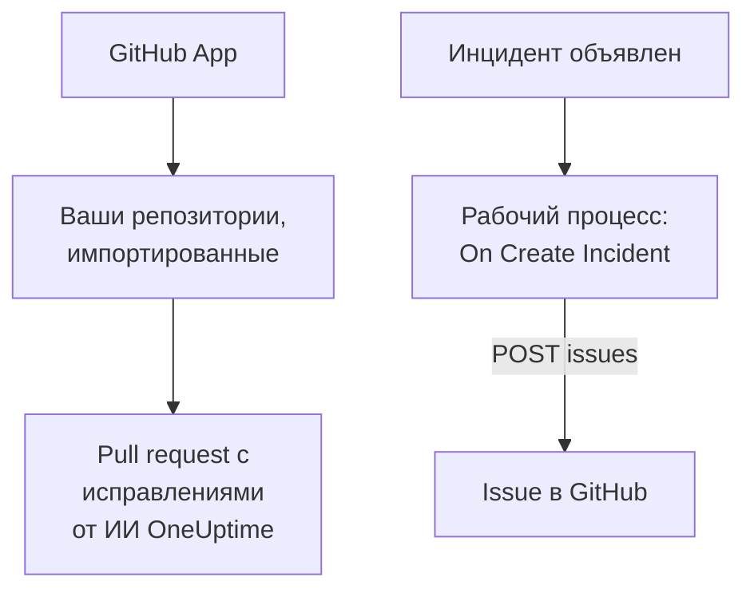

# GitHub

OneUptime работает с [GitHub](https://github.com) двумя способами. Подключите свои репозитории через GitHub App от OneUptime, и ИИ OneUptime будет открывать pull request, исправляющие найденное, и отвечать, когда вы упоминаете его в issue или pull request. Или создайте рабочий процесс, который открывает issue в GitHub для каждого инцидента, чтобы последующая работа отслеживалась в репозитории, которому принадлежит сервис.

:::cards
- [Выбор способа подключения](#выбор-способа-подключения): GitHub App или рабочий процесс, и что делает каждый из них.
- [Подключение репозиториев](#подключение-репозиториев): GitHub App для pull request с исправлениями.
- [Issue для каждого инцидента](#откройте-issue-в-github-для-каждого-инцидента): Один рабочий процесс, два блока.
- [Устранение неполадок](#устранение-неполадок): Когда GitHub отклоняет запрос.
:::

## Как это работает



Эти способы независимы, и можно использовать любой из них или оба. GitHub App работает в репозиториях, в которые вы её устанавливаете. Рабочему процессу нужен только токен, и он вызывает [REST API](https://docs.github.com/en/rest/issues/issues#create-an-issue) GitHub, как любой другой API.

## Выбор способа подключения

| Способ | Что делает | Что нужно |
| --- | --- | --- |
| GitHub App | Импортирует ваши репозитории. ИИ OneUptime открывает в них pull request, исправляющие исключения, медленные трассировки и причины, которые находят его расследования, и отвечает на упоминания в issue и pull request. | Организация или учётная запись, в которую устанавливается приложение. В OneUptime Cloud — тариф **Growth**. |
| Рабочий процесс | Открывает issue в GitHub для каждого инцидента в выбранном вами репозитории. | Токен GitHub, который может создавать issue, и рабочий процесс из двух блоков. |

## Подключение репозиториев

Откройте **Продукты → Код** и нажмите **Подключить GitHub**. GitHub спросит, куда установить приложение и какие репозитории оно может использовать. Каждый репозиторий установки импортируется и остаётся актуальным, когда вы добавляете репозитории в установку или убираете их.

Если приложение уже установлено в учётной записи, для другого проекта или прямо из GitHub, нажмите **Подключить существующую установку** под кнопкой **Подключить GitHub** вместо повторной установки. Для этого нужна учётная запись GitHub, которая администрирует установку: это владелец личной учётной записи или тот, у кого есть права admin на каждый репозиторий, к которому у установки есть доступ, как у владельца организации.

Самостоятельно размещённому экземпляру сначала нужна собственная GitHub App: в разделе [Интеграция с GitHub](/docs/self-hosted/github-integration) показано, как её создать. После этого ИИ открывает pull request в ваших репозиториях из раздела [Код](/docs/ai/ai-agent), а на странице [GitHub App](/docs/ai/github-app) показано, что делает приложение, когда вы упоминаете его в issue или pull request.

## Перед началом работы

Остальная часть страницы строит рабочий процесс. Ему нужен:

- Токен GitHub, который может создавать issue в репозитории: детализированный персональный токен доступа для этого репозитория с разрешением **Issues** в значении **Read and write** или классический токен с областью `repo`. Создайте его в [настройках токенов](https://github.com/settings/tokens) GitHub.
- В OneUptime — право создавать рабочие процессы и глобальные переменные. В OneUptime Cloud для рабочих процессов нужен тариф **Growth** или выше.

## Сохраните токен

:::steps
1. Перейдите в **Рабочие процессы → Глобальные переменные** и нажмите **Создать: Рабочий процесс Переменная**.
2. Назовите её `GITHUB_TOKEN` и нажмите **Далее**.
3. Вставьте токен в **Содержимое**, включите **Секрет** и нажмите **Создать: Рабочий процесс Переменная**.
:::

Секретная переменная заменяется на `[REDACTED]` в журналах запусков, поэтому токен никогда не появляется в запуске.

## Откройте issue в GitHub для каждого инцидента

:::steps
### Создайте рабочий процесс

Перейдите в **Рабочие процессы**, нажмите **Создать рабочий процесс**, затем **Начать с нуля**. Назовите его `Incidents to GitHub` и нажмите **Создать рабочий процесс**.

### Добавьте триггер

Нажмите пунктирный блок **Выберите, что запускает этот рабочий процесс** и выберите **On Create Incident**. Нажмите на триггер: его **Fields to pass on** начинаются с поля **Заголовок**, поэтому нажмите **Добавить поле** и выберите **Описание** и **Incident Number With Prefix**.

### Откройте issue

Нажмите **Добавить компонент**, добавьте блок **API Post (JSON)** и соедините с ним точку **Success** триггера. Задайте его **URL** как `https://api.github.com/repos/your-org/your-repo/issues`, указав владельца и имя вашего репозитория. В разделе **Дополнительные поля** задайте его **Request Headers**:

```json
{
  "Authorization": "Bearer {{global.variables.GITHUB_TOKEN}}",
  "Accept": "application/vnd.github+json",
  "X-GitHub-Api-Version": "2022-11-28"
}
```

А его **Request Body** — так:

```json
{
  "title": "{{local.components.incident-on-create-1.returnValues.model.title}}",
  "body": "{{local.components.incident-on-create-1.returnValues.model.description}}\n\nOpened by OneUptime for incident {{local.components.incident-on-create-1.returnValues.model.incidentNumberWithPrefix}}.",
  "labels": ["incident"]
}
```

### Проверьте, затем включите

Нажмите **Запустить рабочий процесс**, выберите тестовый инцидент в поле **Инцидент** и запустите. Шаг **API Post (JSON)** показывает ответ `201` с новым issue, его `number` и `html_url`. Затем включите переключатель **Включено** в верхней части окна **Конструктор**.
:::

Issue остаётся открытым, когда инцидент разрешён, потому что последующая работа обычно длится дольше инцидента. Для тикетов, синхронизированных с инцидентом в обе стороны, см. [Jira](/docs/integrations/jira).

## Советы

- **GitHub Enterprise Server.** Отправляйте запрос на свой сервер: `https://your-github-host/api/v3/repos/your-org/your-repo/issues`. Серверу на частном сетевом адресе нужен самостоятельно размещённый OneUptime, администратор которого это разрешает: см. [Исходящий доступ в сеть](/docs/workflows/configuration#исходящий-доступ-в-сеть).
- **Назначьте его.** Добавьте в тело `"assignees": ["octocat"]` или `"milestone": 3`. GitHub молча отбрасывает метки, исполнителей и вехи, если токен не может выполнять push в репозиторий.
- **Только некоторые инциденты.** Поставьте блок **If / Else** между триггером и блоком API и открывайте issue только на его стороне **Yes**, например для одной серьёзности.

## Устранение неполадок

Шаг **API Post (JSON)** переходит в **Error**, когда GitHub отклоняет запрос. Его **Response Status** и **Response Body** в запуске объясняют причину.

:::details GitHub отвечает 401
Токен неверен, истёк или отозван. Создайте новый и замените содержимое `GITHUB_TOKEN`.
:::

:::details GitHub отвечает 403
Токен не может создавать там issue: детализированный токен без **Issues** в значении **Read and write** для этого репозитория, токен, который ваша организация не одобрила, или классический токен, не авторизованный для единого входа вашей организации. Ответ 403, в теле которого говорится о лимите частоты, означает, что токен отправил слишком много запросов: подождите или открывайте issue для меньшего числа инцидентов.
:::

:::details GitHub отвечает 404
Владелец или репозиторий в **URL** указан неверно, или токен не видит репозиторий. Для частного репозитория, который токен не видит, GitHub отвечает 404, а не 403.
:::

:::details GitHub отвечает 410 или 422
- `410`: issues отключены в настройках репозитория.
- `422`: GitHub не может прочитать тело. Проверьте, что это корректный JSON, что `title` задан, а `labels` и `assignees` — списки.
:::

## Дальнейшие шаги

:::cards
- [GitHub App](/docs/ai/github-app): Попросите ИИ OneUptime об изменении, доработке или ревью прямо из GitHub.
- [GitLab](/docs/integrations/gitlab): Тот же рабочий процесс для issue в GitLab.
- [Компоненты рабочего процесса](/docs/workflows/components#api): Все настройки блоков API.
- [Обзор интеграций](/docs/integrations/index): Схемы, на которых строится каждая интеграция.
:::
