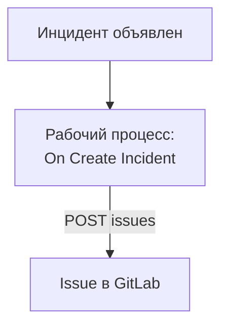

# GitLab

Открывайте issue в [GitLab](https://gitlab.com) для каждого инцидента OneUptime, чтобы последующая работа отслеживалась в проекте, которому принадлежит сервис. Рабочий процесс вызывает [Issues API](https://docs.gitlab.com/api/issues/#new-issue) GitLab на GitLab.com или на вашем собственном GitLab.

:::cards
- [Сохраните токен](#сохраните-токен): Держите токен GitLab вне своих рабочих процессов.
- [Issue для каждого инцидента](#откройте-issue-в-gitlab-для-каждого-инцидента): Один рабочий процесс, два блока.
- [Советы](#советы): Собственный GitLab, пути проектов и исполнители.
- [Устранение неполадок](#устранение-неполадок): Когда GitLab отклоняет запрос.
:::

> [!NOTE]
> ИИ OneUptime работает и в репозиториях GitLab: подключите их в разделе «Код» с токеном доступа, и для каждого исправления он откроет запрос на слияние. См. [Подключение репозитория](/docs/ai/ai-agent#подключение-репозитория).

## Как это работает



Рабочий процесс запускается один раз для каждого нового инцидента. Его блок **API Post (JSON)** отправляет заголовок и описание инцидента в issues проекта, подписывая запрос токеном доступа.

## Перед началом работы

- Идентификатор проекта GitLab. На странице обзора проекта выберите меню действий, вертикальное многоточие, затем **Copy project ID**.
- Токен доступа GitLab с областью `api` для пользователя или бота, чья роль в проекте позволяет создавать issue: токен доступа проекта, группы или персональный. Создайте его в **Settings → Access tokens** в проекте, группе или настройках своего пользователя.
- В OneUptime — право создавать рабочие процессы и глобальные переменные. В OneUptime Cloud для рабочих процессов нужен тариф **Growth** или выше.

## Сохраните токен

:::steps
1. Перейдите в **Рабочие процессы → Глобальные переменные** и нажмите **Создать: Рабочий процесс Переменная**.
2. Назовите её `GITLAB_TOKEN` и нажмите **Далее**.
3. Вставьте токен в **Содержимое**, включите **Секрет** и нажмите **Создать: Рабочий процесс Переменная**.
:::

Секретная переменная заменяется на `[REDACTED]` в журналах запусков, поэтому токен никогда не появляется в запуске.

## Откройте issue в GitLab для каждого инцидента

:::steps
### Создайте рабочий процесс

Перейдите в **Рабочие процессы**, нажмите **Создать рабочий процесс**, затем **Начать с нуля**. Назовите его `Incidents to GitLab` и нажмите **Создать рабочий процесс**.

### Добавьте триггер

Нажмите пунктирный блок **Choose what starts this workflow** и выберите **On Create Incident**. Нажмите на триггер: его **Fields to pass on** начинаются с поля **Заголовок**, поэтому нажмите **Добавить поле** и выберите **Описание** и **Incident Number With Prefix**.

### Откройте issue

Нажмите **Добавить компонент**, добавьте блок **API Post (JSON)** и соедините с ним точку **Success** триггера. Задайте его **URL** как `https://gitlab.com/api/v4/projects/12345678/issues`, подставив идентификатор вашего проекта вместо `12345678`. В разделе **Дополнительные поля** задайте его **Request Headers**:

```json
{
  "PRIVATE-TOKEN": "{{global.variables.GITLAB_TOKEN}}"
}
```

А его **Request Body** — так:

```json
{
  "title": "{{local.components.incident-on-create-1.returnValues.model.title}}",
  "description": "{{local.components.incident-on-create-1.returnValues.model.description}}\n\nOpened by OneUptime for incident {{local.components.incident-on-create-1.returnValues.model.incidentNumberWithPrefix}}.",
  "labels": "incident,oneuptime"
}
```

### Проверьте, затем включите

Нажмите **Запустить рабочий процесс**, выберите тестовый инцидент в поле **Инцидент** и запустите. Шаг **API Post (JSON)** показывает ответ `201` с новым issue, его `iid` и `web_url`. Затем включите переключатель **Включено** в верхней части окна **Конструктор**.
:::

Блок отправляет JSON, поэтому ему не нужен заголовок `Content-Type`. GitLab создаёт метки, которых ещё не видел, поэтому `incident` и `oneuptime` не требуют настройки. Issue остаётся открытым, когда инцидент разрешён, потому что последующая работа обычно длится дольше инцидента.

## Советы

- **Собственный GitLab.** Отправляйте запрос на свой сервер: `https://gitlab.example.com/api/v4/projects/12345678/issues`. Серверу на частном сетевом адресе нужен самостоятельно размещённый OneUptime, администратор которого это разрешает: см. [Исходящий доступ в сеть](/docs/workflows/configuration#исходящий-доступ-в-сеть).
- **Путь проекта вместо его идентификатора.** Путь работает вместо идентификатора, если записать его `/` как `%2F`: `projects/your-group%2Fyour-project/issues`. URL отправляется ровно так, как написан, поэтому кодируйте его сами.
- **Назначьте его.** Добавьте в тело `"assignee_ids": [42]` или `"due_date": "2026-12-31"`, либо `"confidential": true`, чтобы показывать его только участникам проекта.
- **Только некоторые инциденты.** Поставьте блок **If / Else** между триггером и блоком API и открывайте issue только на его стороне **Yes**, например для одной серьёзности.

## Устранение неполадок

Шаг **API Post (JSON)** переходит в **Error**, когда GitLab отклоняет запрос. Его **Response Status** и **Response Body** в запуске объясняют причину.

:::details GitLab отвечает 401
Токен неверен, истёк или отозван. Создайте новый и замените содержимое `GITLAB_TOKEN`.
:::

:::details GitLab отвечает 403
У токена нет области `api`, или роль его пользователя в проекте не позволяет создавать issue. Если дело в области, тело ответа называет `insufficient_scope`.
:::

:::details GitLab отвечает 404
Идентификатор проекта в **URL** указан неверно, или токен не видит проект. Для частного проекта, который токен не видит, GitLab отвечает 404, а не 403.
:::

:::details GitLab отвечает 400
GitLab не может прочитать тело: нет `title`, или у поля неверный тип. Тело ответа называет это поле.
:::

## Дальнейшие шаги

:::cards
- [GitHub](/docs/integrations/github): Тот же рабочий процесс для GitHub, а также GitHub App.
- [Компоненты рабочего процесса](/docs/workflows/components#api): Все настройки блоков API.
- [Запуски рабочего процесса](/docs/workflows/runs-and-logs): Смотрите, что каждый запрос отправил и получил в ответ.
- [Обзор интеграций](/docs/integrations/index): Схемы, на которых строится каждая интеграция.
:::
