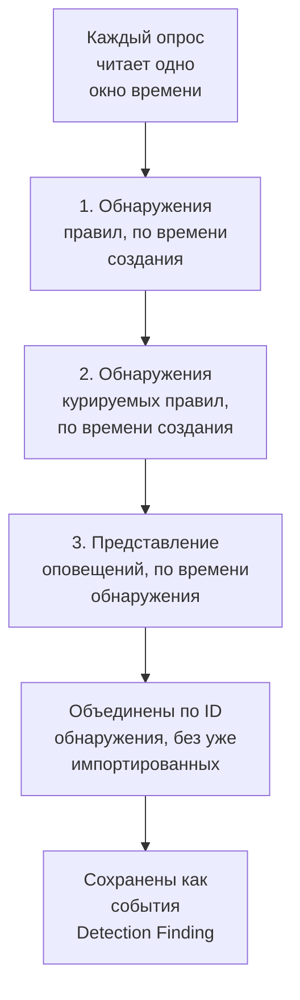

# Google SecOps

Передавайте оповещения и обнаружения [Google SecOps](https://cloud.google.com/security/products/security-operations) (ранее Chronicle) в события безопасности OneUptime. Там вы ищете их рядом со своими журналами, трассировками и метриками, сопоставляете их со всеми другими источниками и вызываете дежурных по тем, что действительно важны.

:::cards
- [Выбор способа подключения](#выбор-способа-подключения): Вебхук из playbook SOAR, управляемый коннектор или пересылка UDM.
- [Настройка управляемого коннектора](#настройка-управляемого-коннектора): Ключ сервисного аккаунта и форма подключения.
- [Как опрашивает коннектор](#как-опрашивает-коннектор): Три чтения каждого окна и их бюджеты.
- [Устранение неполадок](#устранение-неполадок): Что сообщает Last Error и что делать.
- [Отправка событий безопасности в Google SecOps](#отправка-событий-безопасности-в-google-secops): Обнаружения OneUptime в Google SecOps.
:::

## Выбор способа подключения

| Способ | Что поступает | Когда использовать |
| --- | --- | --- |
| Вебхук из playbook SOAR | Каждое оповещение, которое отправляет playbook, за считаные секунды | Вы используете playbook SOAR и хотите получать их оповещения в OneUptime без опроса. |
| Управляемый коннектор | Оповещения, а при желании и обнаружения правил, с опросом по интервалу | Вы хотите, чтобы OneUptime получал их за вас, без какой-либо настройки в SecOps. |
| Пересылка событий UDM | Необработанные события UDM для полноценного поиска и сопоставления | Вы уже экспортируете события UDM и хотите получать их все. |

Каждый способ нормализует поступающие данные в [OCSF](https://schema.ocsf.io/) — Open Cybersecurity Schema Framework, в котором OneUptime хранит каждое событие безопасности, поэтому правила обнаружения и панели мониторинга работают одинаково независимо от источника.

## Перед началом работы

- Для управляемого коннектора в OneUptime роль Project Owner, Project Admin или Security Admin. Роли Security Member и Security Viewer могут просматривать подключения, но не создавать их.
- Для вебхука и пересылки UDM ключ приёма: откройте **Настройки проекта → Телеметрия и APM → Ключи приема** и нажмите **Создать ключ приёма**.
- Для управляемого коннектора право создавать сервисный аккаунт Google Cloud в проекте, к которому привязан ваш экземпляр SecOps.

## Отправка оповещений из playbook SOAR

Playbook SOAR в Google SecOps могут отправлять оповещения на любую конечную точку HTTP. Направьте один из них на приём событий безопасности OneUptime.

:::steps
### Добавьте действие HTTP request

В своём playbook SOAR в SecOps добавьте действие **HTTP request**, которое выполняется для новых оповещений.

### Направьте его на OneUptime

Задайте для **Method** значение `POST`, а для **URL** — `https://oneuptime.com/security-events/v1/ingest` или `https://<your-host>/security-events/v1/ingest` в самостоятельно размещённой установке. Добавьте такие заголовки:

```text
Content-Type: application/json
x-oneuptime-token: <your telemetry ingestion key>
```

Отправляйте JSON оповещения как **Body**. Обнаружение — сведения о правиле с совпавшими событиями UDM в `collectionElements` — распознаётся само, сохраняется как событие Detection Finding, а пользователи, хосты и IP его совпавших событий сохраняются как наблюдаемые объекты.

### Проверьте, что оповещения приходят

Запустите playbook. Его оповещения за считаные секунды появляются в **Продукты → Security Events**.
:::

## Пересылка событий UDM

Для полноценного поиска и сопоставления пересылайте сами события UDM, например из конвейера экспорта BigQuery, из Cloud Function или из любого уже используемого вами пересыльщика:

```bash
curl -X POST "https://oneuptime.com/security-events/v1/ingest?format=udm" \
  -H "Content-Type: application/json" \
  -H "x-oneuptime-token: <your telemetry ingestion key>" \
  -d '{
    "events": [
      {
        "metadata": {
          "event_type": "USER_LOGIN",
          "event_timestamp": "2026-08-21T10:00:00Z",
          "vendor_name": "Google",
          "product_name": "Google SecOps"
        },
        "principal": { "user": { "userid": "alice" }, "ip": ["203.0.113.7"] },
        "target": { "hostname": "vpn-gw-01" },
        "security_result": [{ "severity": "HIGH", "action": ["BLOCK"] }]
      }
    ]
  }'
```

- `format` может принимать значения `udm`, `ocsf`, `google-secops-alert` или `generic`. Если его не указать, формат определяется для каждого события отдельно.
- Тело может быть одним событием, списком событий или `{ "events": [...] }`.
- `x-oneuptime-service-name` задаёт службу телеметрии, к которой относятся события. Без него они относятся к службе, названной по продукту из полезной нагрузки.

## Настройка управляемого коннектора

OneUptime опрашивает обнаружения и оповещения вашего тенанта по интервалу, без настройки SOAR. Google SecOps — это провайдер Security Event Connections, поэтому он создаётся, проверяется, опрашивается и диагностируется на той же странице и тем же способом, что и любой другой управляемый коннектор.

:::steps
### Создайте ключ сервисного аккаунта

В Google Cloud создайте сервисный аккаунт в проекте, к которому привязан ваш экземпляр SecOps, и назначьте ему роль **Chronicle API Viewer** (`roles/chronicle.viewer`). Эта роль включает разрешения `legacySearchDetections`, `legacySearchCuratedDetections`, `countAllCuratedRuleSetDetections` и `legacyFetchAlertsView`, с которыми читает коннектор.

На вкладке **Keys** сервисного аккаунта добавьте ключ типа **JSON** и скачайте его. Весь файл вставляется в подключение. Его `token_uri` должен быть URL `https` на хосте Google, а у ключа, скачанного из Google Cloud, он уже такой.

### Найдите регион и имя ресурса экземпляра

В Google SecOps откройте **SIEM Settings → Profile**. Имя ресурса экземпляра имеет вид `projects/{project}/locations/{location}/instances/{instance}`, где компонент экземпляра — идентификатор экземпляра SecOps; отображаемое имя подключения или имя сервисного аккаунта его не заменяет. Регион — это региональная конечная точка, обслуживающая это расположение, и он должен совпадать с сегментом locations в имени ресурса экземпляра, иначе подключение отклоняется при сохранении.

### Добавьте подключение

Откройте **Продукты → Security Events → Подключения** (`/dashboard/{projectId}/security-events/connections`), выберите **Добавить подключение**, выберите **Google SecOps** и заполните форму параметрами из таблицы ниже.

### Проверьте перед сохранением

Перед сохранением выберите **Проверить эти настройки** в разделе **Проверка перед сохранением**. Проверка выполняется со значениями из формы и ничего не сохраняет, поэтому повреждённый ключ, отсутствующая роль или неверный экземпляр обнаруживаются ещё до создания подключения. В форме редактирования та же кнопка проверяет показанные на экране **Регион**, **Имя ресурса экземпляра** и **Data to import** с сохранённым ключом; поле учётных данных, оставленное пустым, сохраняет сохранённый ключ. Если что-то из проверяемого отличается от сохранённого в подключении, включая только что введённый ключ, строка в истории запусков не записывается, потому что у подключения ещё нет этих параметров.
:::

| Параметр | Где его найти | Обязательный |
| --- | --- | --- |
| **Регион** | Региональная конечная точка Google SecOps (`us`, `europe`, `asia-southeast1`, ...), соответствующая расположению в имени ресурса вашего экземпляра. Значения по умолчанию нет, чтобы тенант за пределами США не мог случайно сохранить неверную конечную точку. | Да |
| **Имя ресурса экземпляра** | Google SecOps **SIEM Settings → Profile**: `projects/{project}/locations/{location}/instances/{instance}`. | Да |
| **Закрывать оповещения, когда закрывается их кейс** | На последнем шаге формы, выключено, пока вы его не включите. Если включено, закрытие кейса закрывает его оповещения Google SecOps: см. [Закрывать оповещения, когда закрывается их кейс](#закрывать-оповещения-когда-закрывается-их-кейс). | Нет |
| **JSON сервисного аккаунта** | Google Cloud, вкладка **Keys** сервисного аккаунта. Вставьте весь файл ключа JSON. Только для записи: хранится в зашифрованном виде, никогда не возвращается API и больше не показывается на странице. Чтобы заменить его, используйте **Обновить учётные данные** в подключении. | Да |
| **Data to import** | **Оповещения** импортируются всегда, потому что API оповещений Google всегда их возвращает. Выберите **Обнаружения**, чтобы импортировать также срабатывания правил, которые не создали оповещение. Это не пересылает необработанные события UDM: пересылайте их сами, как описано выше. | Оповещения всегда |

Шаг опроса в форме запрашивает **Имя**, необязательное **Описание**, параметр подключения **Включено** и **Интервал опроса (минуты)**: целое число от `1` до `1440`, по умолчанию `5`. Любое значение вне этого диапазона отклоняется при сохранении.

Новые обнаружения импортируются как события Detection Finding, относящиеся к службе телеметрии `Google SecOps`.

## Состояние подключения

Список подключений показывает **Имя** (под ним — провайдер подключения и его выбор Data to import), **Состояние**, **Последний опрос** и **Последнее импортированное событие**. **Статус** (Enabled или Disabled), **Интервал (минуты)** и **Последний успешный опрос** находятся в **Настроить столбцы**. Если у подключения есть ошибка, в его столбце **Действия** появляется **Просмотреть ошибку** рядом с **Проверить подключение**, **Запустить сейчас**, **Диагностика**, **Редактировать** и **Обновить учётные данные**. Enabled означает, что автоматический опрос настроен. Last Polled фиксирует попытку; успешное пустое окно не доказывает, что конкретное обнаружение было импортировано.

**Состояние** показывает **Last poll succeeded** только после того, как импортировано хотя бы одно событие. До этого успешно работающее подключение показывает **Polling, no events imported yet** — именно это состояние стоит исследовать с помощью Проверить подключение. Другие состояния: **No records returned**, **Partial import**, **Catching up**, **Last poll failed**, **Poll overdue**, **Schedule paused** и **Ожидает первого опроса**; наведите указатель на состояние, чтобы увидеть, что оно означает.

> [!NOTE]
> Коннектор использует устаревшие API обнаружений и оповещений Chronicle `v1alpha`, которые Google выпускает в статусе pre-GA. Когда опрос завершается ошибкой, поле **Последняя ошибка** подключения хранит полное сообщение об ошибке со скрытыми учётными данными после префикса, который называет неудавшийся шаг, в том числе когда Chronicle отвечает `200` и помещает отказ в тело ответа. Выберите **Просмотреть ошибку** в столбце **Действия** подключения, чтобы прочитать сообщение, а затем **Скопировать ошибку** в диалоговом окне, чтобы скопировать его для поддержки.

## Как опрашивает коннектор



Раз в минуту фоновый worker ставит в очередь опрос для каждого включённого подключения, у которого с момента последнего опроса истёк интервал. Каждый опрос — это запуск в истории подключения, который выполняет worker. Он читает одно окно времени тремя способами и объединяет результаты по идентификатору обнаружения, поэтому запись, возвращённая более чем одним проходом, сохраняется один раз:

1. **Обнаружения правил по времени создания.** `legacy:legacySearchDetections` с `ruleId=-` (каждая ревизия каждого правила) и `listBasis=CREATED_TIME`, с переходом по `nextPageToken`, пока страница не станет последней.
2. **Обнаружения курируемых правил по времени создания.** `legacy:legacySearchCuratedDetections` тем же способом, по одному разу на каждое курируемое (написанное Google) правило. Эта конечная точка принимает один идентификатор курируемого правила (`ur_...`) и не поддерживает подстановку «все правила», поэтому проход сначала вызывает `:countAllCuratedRuleSetDetections` за неделю до окна и до его конца, а затем ищет в каждом курируемом правиле, которое дало обнаружения. Курируемому правилу, которое не срабатывало в ту неделю, импортировать нечего. Тенант без доступа к курируемым правилам отвечает на этот проход кодом `400`, `403` или `404`; это записывается как предупреждение в запуске, а не как ошибка.
3. **Представление оповещений по времени обнаружения.** `legacy:legacyFetchAlertsView`, которое охватывает оповещения телеметрии, оповещения SOAR и оповещения машинного интеллекта, а также оповещения правил. У конечной точки нет постраничного вывода, поэтому ответ, который Google ограничивает, делится на окна поменьше и читается заново.

Представление оповещений умеет фильтровать только по времени обнаружения, а Google часто делает оповещение доступным для чтения намного позже его времени обнаружения (задержка приёма, запланированные правила, повторные запуски по поздним данным). Поэтому запланированный опрос также **просматривает представление оповещений за 24 часа до своего окна**, только оповещения, и это записывается как проверка **Read late alerts by detection time**. Уже импортированные записи пропускаются, поэтому повторы этого просмотра видны в **Already imported**. Просмотр выполняется по возможности: если Google его ограничивает, у него заканчивается бюджет или он завершается ошибкой, запуск получает предупреждение, но опрос не становится Partial или Не удалось, и курсор всё равно движется вперёд, потому что день, к которому он возвращается, уже прочитан предыдущими опросами.

Опрос по **времени создания** — основа всей конструкции. Правило Google SecOps выполняется по расписанию (каждые 10 минут, каждый час, каждый день), и создаваемое им обнаружение содержит `detectionTime` — конец временного окна правила или время совпавшего события, тогда как `createdTime` — это момент, когда механизм обнаружения действительно его создал. У обнаружения, созданного в 10:05 для окна, которое заканчивается в 09:00, время обнаружения уже позади курсора, прошедшего 09:00 несколько опросов назад, поэтому коннектор, опрашивающий по времени обнаружения, никогда его не увидит, как и любое событие, пришедшее с опозданием. Чтение по времени создания заставляет каждый опрос спрашивать «что Google создал с тех пор, как я смотрел в последний раз», и именно на этот вопрос есть ответ. Каждый запуск записывает свою задержку создания: сколько полученных записей было создано позже чем через один интервал опроса (плюс минута) после их времени обнаружения, и наибольший разрыв, поэтому эффект виден в Diagnostics.

Первый опрос нового подключения смотрит на **24 часа** назад по времени создания. Каждый следующий опрос продолжает с сохранённого курсора подключения с перекрытием в **1 минуту**; запись, созданная на границе окна, читается обоими опросами и сохраняется один раз, потому что опросы пропускают события, уже сохранённые с тем же идентификатором источника. Каждый запланированный опрос читает не больше **24 часов** после курсора, поэтому подключение с более старым сохранённым курсором догоняет последовательными 24-часовыми окнами (Health показывает **Catching up**), а не отбрасывает обнаружения между ними. Для записей, созданных до первого 24-часового окна, используйте **Import this time range** в Diagnostics.

### Когда окно содержит больше, чем может прочитать один опрос

Коннектор выделяет каждому опросу фиксированные бюджеты: у прохода обнаружений правил **20** страниц поиска, у прохода курируемых правил до **200** запросов (подсчёт плюс как минимум одна страница на каждое курируемое правило, сработавшее за последнюю неделю, начиная с самых активных правил), представление оповещений и его просмотр поздних оповещений делят **16** запросов, а всё чтение останавливается через **4 минуты**. Проход курируемых правил не начинает новых курируемых правил после того, как израсходовано 60 % этого времени, чтобы представление оповещений всё равно выполнилось. Если опрос не может выполнить поиск по всем активным курируемым правилам, он записывает предупреждение с числом неохваченных правил, а не удерживает курсор, потому что в более коротком окне по-прежнему пришлось бы искать по всем этим правилам. Проход, который бюджет остановил на полпути, записывается как проверка с предупреждением, называющая бюджет (например, `Read rule detections by created time was stopped by the request budget after 20 requests.`), а проход, который бюджет так и не дал начать, — это пропущенная проверка с той же причиной в предупреждениях запуска, но никогда не успех. Окно с большим числом обнаружений нельзя прочитать за один опрос, и опрос никогда не перечитывает одно и то же окно бесконечно:

1. **Сузить.** Поисковые конечные точки Google возвращают сначала самые новые обнаружения, поэтому у опроса, который остановился рано, нет точки, с которой можно продолжить. Опрос записывается как **Частично**, курсор остаётся на месте, а следующий опрос читает вдвое более короткое окно с той же начальной точки с предупреждением `This window holds more records than one poll can read; the next poll reads a {n} minute window from the same starting point.` Деление пополам продолжается вплоть до одной минуты, пока окно не поместится.
2. **Снова расти.** Каждый завершённый опрос удваивает следующее окно, до максимума в 24 часа, поэтому всплеск стоит нескольких коротких опросов, а не навсегда замедленного подключения.
3. **Пройти мимо одной минуты.** Если даже одна минута содержит больше обнаружений, чем может прочитать опрос, опрос переносит курсор за эту минуту, чтобы новые обнаружения продолжали поступать. Запуск получает статус **Частично**, а тот же текст стоит в начале **Последняя ошибка**: `More records were created in the one minute from {start} to {end} than one poll can read. Polling moved past this minute so newer records keep arriving; use Import this time range in Diagnostics on this minute to recover what one run can read.` Чтобы восстановить то, что может прочитать один запуск, откройте **Диагностика**, выберите пользовательский интервал, охватывающий эту минуту (поля интервала используют ваше местное время; сообщение приводится в UTC), и выполните **Import this time range**; у импорта те же ограничения на запуск, что и у опроса. Уже импортированные обнаружения пропускаются.

Опрос со статусом Partial также сохраняет свои предупреждения в **Последняя ошибка**, где они остаются, пока завершённый опрос их не очистит. Опрос, который полностью завершается ошибкой (именно ошибкой, а не из-за слишком большого числа записей), сохраняет свой курсор и длину окна и повторяется на следующем такте. Единственное исключение — запрос, превысивший время ожидания: следующий опрос читает вдвое более короткое окно с той же начальной точки (`The source did not answer in time for this window; the next poll reads a {n} minute window from the same starting point.`), потому что слишком тяжёлое для своевременного ответа окно иначе превышало бы время ожидания при каждой повторной попытке. Сокращение интервала опроса ничего из этого не меняет: окно определяется курсором и результатом последнего опроса, а не частотой опросов.

## Проверка подключения

**Проверить подключение** в строке подключения или в **Диагностика** выполняется синхронно в процессе API. Ей не нужен фоновый worker, и именно поэтому она может сообщить, что ни один worker не работает. Список проверок:

1. **Конфигурация**: каждое поле задано и правильно оформлено: поддерживаемый **Регион**, соответствующий расположению экземпляра, **Имя ресурса экземпляра** правильной формы и ключ **JSON сервисного аккаунта** с `client_email`, читаемым `private_key` и `token_uri` от Google. Если это не так, ни к чему не обращаются.
2. **Authenticate with Google**: ключ обменивается на токен доступа в конечной точке OAuth Google ещё до обращения к Chronicle.
3. **Read rule detections**, **Read curated rule detections** и **Read the alerts view**: проба одной записи для каждого прохода за последние 24 часа. Проверка курируемых правил читает счётчики курируемых правил за последние 7 дней и пробует курируемое правило с наибольшим числом обнаружений; если за эту неделю не сработало ни одно курируемое правило, проверка проходит, не пробуя ничего. Чтение курируемых правил с ответом `400`, `403` или `404` — это предупреждение, потому что у тенанта может просто не быть доступа к курируемым правилам.
4. **Detections available to import**: что есть у Google с сохранённым выбором **Data to import** и с другим выбором (только Оповещения или Оповещения и **Обнаружения**) за последние 24 часа и за последние 7 дней: число совпадений в представлении оповещений и одна страница поиска по времени создания на каждый интервал, в виде числа или `1000+`. Если у сохранённого выбора ничего нет, а у другого есть, проверка предупреждает: ваши правила создают обнаружения, но оповещения для них не включены. Отредактируйте подключение и выберите **Обнаружения** в **Data to import** или включите оповещения для правил в Google SecOps.
5. **Background workers**, **Poll scheduler** и **Security event storage**: обрабатывает ли какой-либо процесс очередь Worker OneUptime, зарегистрировано ли ежеминутное задание опроса и отвечает ли хранилище событий безопасности на тот же поиск дубликатов, который опрос выполняет перед каждой вставкой, чтобы неисправная аналитическая база данных проявилась здесь с названием, а не часом позже как ошибка опроса.
6. **Scheduled polling** (только сохранённые подключения): включён ли опрос, не застрял ли запуск в очереди в ожидании worker и опрашивается ли подключение по расписанию.

У каждого запроса в проверке срок 20 секунд. Проверки не затрагивают курсор опроса и хранилище событий. Сохранённое подключение, проверенное с сохранёнными параметрами, получает строку в истории запусков с типом test, а подробности строки показывают тот же список проверок.

## Просмотр, запуск и импорт по требованию

Откройте **Диагностика** в подключении, чтобы увидеть последние запуски и управлять коннектором. Владельцы проекта, администраторы проекта и администраторы безопасности могут запускать операции. Участники и наблюдатели безопасности могут читать историю.

- **Запустить сейчас** сразу ставит опрос в очередь с обычным курсором и путём приёма, даже если запланированный опрос отключён. Состояния «в очереди» и «выполняется» остаются видимыми, пока worker выполняет запрос. Если запуск остаётся в очереди, проверьте, обрабатывают ли worker очередь Worker; проверка **Background workers** в Проверить подключение показывает, делает ли это какой-либо процесс.
- **Preview detections** читает выбранный интервал времени, ничего не импортируя и не меняя курсор. Используйте последний час, 24 часа, 7 дней или пользовательский интервал до 7 дней. Интервал соответствует представлению оповещений SecOps, которое читает по времени обнаружения, а два прохода поиска читают как обнаружения, созданные в нём, так и обнаружения, время обнаружения которых попадает в него, поэтому просмотр за вчера показывает и обнаружения, созданные вчера по более старым событиям. Просмотр показывает время обнаружения и время создания отдельно. Результаты следуют сохранённому выбору **Data to import** подключения.
- **Import this time range** после вашего подтверждения импортирует выбранный интервал, не перемещая курсор опроса. Так же восстанавливается минута, мимо которой прошёл опрос, как описано выше. Сначала просмотрите интервал. Повторные опросы и импорты пропускают события, уже сохранённые в проекте с тем же идентификатором источника. Импорт может запускать настроенные правила обнаружения и мониторы точно так же, как запланированный опрос.

Подробности каждого запуска показывают **Requested window (UTC)**, выбор **Data to import** подключения и пять счётчиков:

| Счётчик | Что он считает |
| --- | --- |
| **Returned by Google SecOps** | Записи, которые Google вернул за три прохода, после объединения по идентификатору. |
| **Imported into OneUptime** | Строки, записанные в хранилище событий. |
| **Already imported** | Записи, пропущенные потому, что тот же идентификатор источника уже сохранён в этом проекте; из-за перекрытия в 1 минуту и повторных запусков это нормально. |
| **Отклонено** | Возвращённые объекты, которые не являются обнаружениями Google SecOps. Они учитываются и вызывают предупреждение, никогда не повторяются и не удерживают курсор. |
| **Не удалось** | Записи, которые не удалось нормализовать. Опрос повторяет их в более коротком окне. |

**Provider details** добавляют **Time basis read**, записи **Returned by each pass** (обнаружения правил, обнаружения курируемых правил и представление оповещений) и **Creation lag**. Далее идут проверки, по одной на проход, предупреждения и примеры обнаружений. Подробности запланированного опроса показывают также **Window read by this poll** и то, что **Next scheduled poll reads**, а опрос со статусом Partial сообщает, сохранил ли он свою начальную точку и сузил следующее окно или прошёл мимо одной минуты, которую называет. **Успешно**, **No records returned**, **Частично** и **Не удалось** — разные результаты.

Используйте **View events in this time range** в запуске, чтобы открыть интервал времени событий для возвращённых им обнаружений. Иначе обнаружение, созданное сегодня со вчерашним временем обнаружения, может скрываться фильтром недавних событий. История запусков сохраняет ошибки после того, как более поздний завершённый опрос очищает Last Error. При обращении в поддержку используйте **Copy diagnostics**; учётные данные сервисного аккаунта и токены туда никогда не попадают.

## Почему я не вижу событий?

Проверьте эти пункты по порядку. Каждый можно отличить от следующего в **Диагностика** или с помощью **Проверить подключение**.

1. **Data to import.** По умолчанию импортируются только **Оповещения**, а обнаружение правила становится оповещением, только если для правила в Google SecOps включены оповещения. Тенант, правила которого создают обнаружения без оповещений, вечно и честно опрашивает пустоту. Запустите **Проверить подключение**: проверка **Detections available to import** считает с **Обнаружения** и без них и сообщает, если их выбор добавил бы записи. Отредактируйте подключение и выберите **Обнаружения** в **Data to import** или включите оповещения для правил.
2. **Частота запуска правил и задержка обнаружения.** Обнаружения создаются при запуске правила, а это может быть через час или через сутки после описываемых событий. Коннектор опрашивает по времени создания, поэтому они приходят с первым опросом после того, как Google их создаст, а не в их время обнаружения. Только что включённое правило ещё ничего не создало, а спокойному тенанту нечего создавать. Проверка доступности сообщает, сколько обнаружений создано за последние 24 часа и 7 дней; ноль с **Обнаружения** и без них означает, что у Google пока нет ничего, что OneUptime мог бы импортировать.
3. **Прочитайте счётчики последнего запуска.** В Diagnostics **Returned by Google SecOps** с нулём в **Imported into OneUptime** и соответствующим значением **Already imported** означает, что коннектор работает как задумано: эти обнаружения импортировал предыдущий опрос. Записи **Отклонено** — это объекты, которые вернул Google и которые вообще не являются обнаружениями.
4. **Выполняется ли опрос вообще?** Last Polled со значением `Never` и пустой Last Error означают, что для этого подключения не завершился ни один опрос. Проверить подключение сообщает о **Background workers** (процессы, обрабатывающие очередь Worker), **Poll scheduler** (регистрация ежеминутного планировщика) и **Scheduled polling** (собственное расписание этого подключения, включая просроченный опрос или запуск, застрявший в очереди). Параметры развёртывания, которые это вызывают, описаны в разделе устранения неполадок ниже.
5. **Ищите в правильном месте.** События сохраняются по времени обнаружения, которое может быть на несколько часов или дней раньше времени их создания и импорта, поэтому фильтр «последний час» в Security Events скрывает обнаружение о вчерашних событиях, импортированное минуту назад. Используйте **View events in this time range** в запуске в Diagnostics: оно открывает интервал времени событий для обнаружений, которые вернул этот запуск.

## Как задаётся серьёзность

Google SecOps хранит серьёзность обнаружения в разных местах в зависимости от того, кто написал правило, и OneUptime читает их в таком порядке, используя первое, где указана серьёзность:

1. **Собственная серьёзность Google** (`detection[].severity`). Google задаёт её для курируемых правил, например Applied Threat Intelligence и курируемых наборов правил.
2. **Серьёзность оповещения** (`severity` в Collection) для оповещений SOAR и тел вебхуков.
3. **Серьёзность из `meta` правила.** Для пользовательского правила YARA-L Google оставляет `detection[].severity` пустым и возвращает раздел `meta` правила как `ruleLabels`. OneUptime читает метку `severity` — это значение, которое показывает панель правил Google SecOps. Распознаются Info, Informational, Low, Medium, High и Critical в любом регистре.
4. **Результат `$risk_score` правила**, если правило не задаёт серьёзность, с классификацией по [рекомендуемым Google диапазонам](https://docs.cloud.google.com/chronicle/docs/yara-l/outcome-syntax): 90–100 Critical, 80–89 High, 50–79 Medium, 20–49 Low, 1–19 Informational. OneUptime использует только оценку, которую задаёт само правило. Он игнорирует `riskScore`, который Google заполняет для правил без собственной оценки (40 для правил с оповещениями, 15 для остальных), потому что это значение по умолчанию ничего не говорит о серьёзности обнаружения.

Обнаружение, которое не классифицировано ни одним из этих способов, показывается как Unknown. Чтобы классифицировать пользовательское правило, добавьте серьёзность в его раздел `meta` в Google SecOps, например `severity = "High"`, или задайте `$risk_score` в его разделе `outcome`. Обнаружения, которые правило создаст после этого, импортируются с этой серьёзностью.

## Закрывать оповещения, когда закрывается их кейс

Когда **Закрывать оповещения, когда закрывается их кейс** включено, закрытие [кейса безопасности](/docs/telemetry/security-cases#закрытие-кейса) закрывает оповещения Google SecOps, из которых он возник. Каждое оповещение помечается закрытым с вердиктом кейса: True Positive — как вредоносное, False Positive или Benign Positive — как невредоносное, вместе с заметкой о закрытии кейса и ссылкой на кейс. Хронология кейса показывает, сколько оповещений закрыто.

- Сервисному аккаунту нужно `chronicle.legacies.legacyUpdateAlert`, которое есть у роли `roles/chronicle.editor`. Роль `roles/chronicle.viewer` читает оповещения, но не может их закрыть, и тогда в кейсе появляется `403`.
- Оповещение, которого в Google SecOps больше нет, пропускается. Когда Google SecOps недоступен, OneUptime повторяет попытки около часа, а затем пишет в кейсе, что не удалось закрыть.

## Проверяйте свои другие события на его индикаторы

[Фид аналитики угроз](/docs/telemetry/threat-intelligence#как-читается-google-secops), у которого **Источник** — **Google SecOps**, через это подключение читает индикаторы, найденные аналитикой угроз Google SecOps в её событиях, и проверяет на них остальные события вашего проекта: входы, сетевые потоки и события конечных точек, которых Google SecOps никогда не видел.

## Отправка событий безопасности в Google SecOps

OneUptime может отправлять найденное и в Google SecOps, чтобы SIEM, в котором работает ваша команда, видел обнаружения OneUptime рядом со своими. Каждое событие безопасности импортируется как событие UDM вместе с серьёзностью, тегами MITRE ATT&CK и правилом, которое его нашло:

| Событие безопасности | Тип события UDM |
| --- | --- |
| Вход | `USER_LOGIN` |
| Запуск процесса, его открытие, внедрение в него или завершение | `PROCESS_LAUNCH`, `PROCESS_OPEN`, `PROCESS_INJECTION`, `PROCESS_TERMINATION` |
| Процесс, повысивший свои привилегии | `PROCESS_PRIVILEGE_ESCALATION` |
| Любая другая активность процесса | `PROCESS_UNCATEGORIZED` |
| Сетевое соединение | `NETWORK_CONNECTION` |
| Всё остальное или событие без полей, которые нужны его типу | `GENERIC_EVENT` |

В событии процесса `principal` — это процесс, который действовал, а `target` — процесс, над которым он действовал: при запуске это родительский процесс и запущенный им процесс.

:::steps
### Создайте ключ, которому разрешён импорт событий

В Google Cloud создайте сервисный аккаунт в проекте, к которому привязан ваш экземпляр SecOps, и назначьте ему роль с разрешением `chronicle.events.import`, например **Chronicle API Editor** (`roles/chronicle.editor`). На его вкладке **Keys** добавьте ключ типа **JSON** и скачайте его.

### Добавьте получателя

Откройте **Продукты → Security Events → Подключения**. В разделе **Отправка в вашу SIEM** нажмите **Добавить получателя**, выберите Google SecOps в поле **SIEM** и нажмите **Далее**. Выберите **Регион**, заполните **Имя ресурса экземпляра** так же, как для коннектора выше, и вставьте ключ в **JSON сервисного аккаунта**.

### Отправьте тестовое событие

Нажмите **Отправить тестовое событие**. Одно событие `GENERIC_EVENT` от продукта `OneUptime Security Events` уходит в Google SecOps с настройками из формы, и ничего не сохраняется. Оно появляется в Google SecOps в течение нескольких минут.

### Выберите, что отправлять

В **Что отправлять** оставьте **Только обнаружения** - то, что нашли ваши правила и аналитика угроз, и оповещения ваших подключённых продуктов, - или выберите **Все события безопасности**. Нажмите **Начать отправку**.
:::

- Получатель отправляет события, поступающие с момента его сохранения, но никогда не историю проекта, а новые отправляет каждую минуту.
- Оповещения, которые OneUptime импортировал из Google SecOps, никогда не отправляются туда обратно.
- Если Google SecOps не отвечает или отклоняет пакет, получатель сохраняет свою позицию и повторяет попытку при следующем запуске. Его **Статус** показывает **Сбой**, а **Просмотреть ошибку** показывает, что ответил Google SecOps.

## Устранение неполадок

:::details Обнаружения пользовательских правил показывают серьёзность Unknown, а курируемые классифицированы
Правило не задаёт серьёзность. Добавьте `severity = "Low"`, `"Medium"`, `"High"` или `"Critical"` в раздел `meta` правила или задайте `$risk_score` в его разделе `outcome` (см. [Как задаётся серьёзность](#как-задаётся-серьёзность)). Версии до этого изменения также игнорировали серьёзность из `meta` пользовательского правила; обновление заново классифицирует обнаружения, импортированные этими версиями, по меткам правила, сохранённым с каждым обнаружением.
:::

:::details Оповещения появляются в Google SecOps, но никогда не появляются в OneUptime
Обновитесь до версии, которая читает обнаружения курируемых правил по одному курируемому правилу за раз и просматривает представление оповещений в поисках поздних оповещений. Более ранние версии отправляли `ruleId=-` в `legacySearchCuratedDetections`, где нет подстановки, поэтому Google отвечал на каждый поиск по курируемым правилам пустым успехом; кроме того, они читали представление оповещений только за несколько минут времени обнаружения самого опроса, поэтому оповещение, которое Google делал доступным позже, никогда не попадало в поле зрения. И то и другое выглядело как исправное, спокойное подключение. После обновления используйте **Import this time range** в Diagnostics, чтобы импортировать последние 7 дней.
:::

:::details Google возвращает ноль записей
Проверьте в Diagnostics точное окно времени, основу времени и сохранённый выбор **Data to import** и запустите Проверить подключение, чтобы прочитать счётчики доступности с **Обнаружения** и без них. Для срабатывания правила без оповещения нужен флажок **Обнаружения**. Просмотрите период, который охватывает и время его обнаружения, и время создания. Первый запланированный опрос смотрит на 24 часа назад по времени создания; для более старых записей используйте **Import this time range**.
:::

:::details Health показывает Partial import
Откройте последний запуск в **Диагностика** и прочитайте его предупреждения; те же предупреждения есть в Last Error. `This window holds more records than one poll can read; ...` означает, что опрос сужает своё окно с той же начальной точки и никаких действий не требуется: окно снова вырастет, когда опросы начнут завершаться. `More records were created in the one minute from ...` означает, что опрос прошёл мимо этой минуты; импортируйте её с помощью **Import this time range**, чтобы восстановить пропущенные обнаружения. Предупреждение о том, что проход был остановлен бюджетом запросов или бюджетом времени опроса либо не запущен из-за них, называет прерванный проход. Сокращение интервала опроса не меняет окно. Один лишь пустой Last Error не доказывает полного охвата.
:::

:::details Health показывает Poll overdue
Запланированные опросы не выполняются вовремя. Проверьте очередь worker и запустите Проверить подключение, чтобы увидеть проверки **Background workers** и **Scheduled polling**.
:::

:::details Статус показывает Disabled
Запланированный опрос пропускает подключение. Пользователи с правами по-прежнему могут проверять, просматривать, запускать опрос с помощью **Запустить сейчас** или импортировать из Diagnostics.
:::

:::details Last Polled — `Never`, а Last Error пуст
Для этого подключения не завершился ни один опрос. Откройте **Диагностика**: если в истории запусков нет ни одного опроса или есть только застрявший в очереди, фоновый worker вообще не выполнял задание опроса, поэтому до Chronicle никогда ничего не доходило. В самостоятельно размещённых развёртываниях обычная причина — `DISABLE_QUEUE_WORKERS=true` в контейнере приложения без отдельного развёртывания worker, которое разбирало бы очереди. Либо установите `DISABLE_QUEUE_WORKERS=false` (значение по умолчанию из `config.example.env`, с которым поставляется Docker Compose), либо запустите выделенное развёртывание worker (Helm: `worker.enabled: true`, по умолчанию `false`). Проверить подключение сообщает об этом как о неудачной проверке **Background workers**, **Poll scheduler** или **Scheduled polling**. Опрос, который запустился, но остановился, не дойдя до подключения, вместо этого отображается в истории как неудачный запуск: `Another poll or import for this source is still running in this project` означает, что другой опрос или импорт Google SecOps в этом проекте удерживал блокировку источника, и подключение снова ставится в очередь на следующем такте. Планировщик, который не смог даже поставить опрос в очередь, записывает в Last Error `Scheduler could not queue a poll:` и причину.
:::

:::details Last Error заполнен
Опрос был предпринят, и в нём что-то не удалось, опрос не смог прочитать всё своё окно, или планировщик не смог поставить опрос в очередь. Для неудачного опроса поле хранит полное сообщение об ошибке со скрытыми учётными данными. Если у подключения есть ошибка, выберите **Просмотреть ошибку** в его столбце **Действия**, чтобы открыть полное сообщение, а затем **Скопировать ошибку** в диалоговом окне, чтобы скопировать его для поддержки. Поле очищается при следующем завершённом опросе, который также убирает действие **Просмотреть ошибку**; история запусков его сохраняет. Сначала прочитайте префикс. Сообщение, начинающееся с `More records were created in the one minute from`, означает пропущенную минуту, а не ошибку; см. **Health показывает Partial import** выше. Код состояния HTTP есть только у четырёх префиксов, поэтому сообщение без кода не доказывает неисправность на стороне OneUptime:

- `Google token exchange failed (HTTP ...)`: учётные данные сервисного аккаунта были отклонены в конечной точке OAuth Google ещё до обращения к Chronicle. Обычно это повреждённый, отозванный ключ или ключ из другого проекта.
- `Google token exchange returned ...`: та же конечная точка OAuth ответила, но чем-то непригодным: без `access_token` или телом не в формате JSON. Это всё ещё до Chronicle, и обычно причина в прокси или шлюзе посередине, а не в самом ключе.
- `Google SecOps detections search failed (HTTP ...)`: сам Chronicle отклонил поиск по времени создания (`legacySearchDetections` или `legacySearchCuratedDetections`). Код `403` обычно означает, что у сервисного аккаунта нет роли **Chronicle API Viewer** в проекте, к которому привязан экземпляр; в проходе курируемых правил коды `400`, `403` и `404` понижаются до предупреждения, потому что у тенанта может просто не быть доступа к курируемым правилам.
- `Google SecOps detections search returned ...`: Chronicle ответил на поиск кодом `200`, но тело не было читаемой страницей обнаружений: пустое, не JSON или в форме, которую парсер не распознаёт. Об этом сообщается, а не считается спокойным окном, чтобы курсор не мог пройти мимо пропущенного.
- `Google SecOps curated rule detection counts failed (HTTP ...)`: Chronicle отклонил `countAllCuratedRuleSetDetections` — вызов, который называет курируемые правила, по которым ищет проход курируемых правил. Коды `400`, `403` и `404` понижаются до предупреждения по той же причине, что и при поиске по курируемым правилам; всё остальное приводит к неудаче опроса.
- `Google SecOps curated rule detection counts returned ...`: Chronicle ответил на запрос счётчиков курируемых правил кодом `200`, но тело было пустым, не JSON или в форме, которую парсер не распознаёт. Об этом сообщается, а не читается как «ни одно курируемое правило не сработало», чтобы обнаружения курируемых правил не пропускались молча.
- `Google SecOps alerts fetch failed (HTTP ...)`: сам Chronicle отклонил запрос к представлению оповещений. Код `403` обычно означает, что у сервисного аккаунта нет роли **Chronicle API Viewer** в проекте, к которому привязан экземпляр; код `404` обычно означает, что имя ресурса экземпляра указывает на другой экземпляр или что префикс региона не обслуживается Chronicle.
- `Google SecOps alerts fetch returned ...`: Chronicle ответил `200`, но тело не было читаемым потоком оповещений обнаружения: пустое, не JSON или в форме, которую парсер не распознаёт. Об этом намеренно сообщается, а не считается пустым окном: если считать нечитаемое тело ответом «оповещений нет», курсор прошёл бы мимо всего пропущенного.
- `Google SecOps alerts query was rejected by Chronicle on an HTTP 200`: Chronicle принял запрос, выполнил его и отклонил запрос внутри возвращённого тела (`validSnapshotQuery` или `validBaselineQuery` равны false либо есть `queryValidationErrors`). Это отказ Google, и кода состояния HTTP в нём нет вообще.
- `timed out after 60 seconds with no response`: ни конечная точка OAuth Google, ни Chronicle не ответили до того, как клиент прекратил ожидание (проверка подключения использует срок 20 секунд на запрос и сообщает ту же формулировку с этим числом). Ничего не вернулось, поэтому сообщение не указывает виновную сторону; проверьте исходящий трафик worker OneUptime, а также тенант.
- Сообщение, которое не подходит ни под один пункт выше, пришло не от Google. Сообщение, начинающееся с имени поля — `Region`, `Instance resource name` или `Service account JSON`, — означает, что сохранённые параметры не проходят проверку: отредактируйте подключение или замените ключ с помощью **Обновить учётные данные**. Подключение, перенесённое из прежнего коннектора Google SecOps, сохранённые параметры которого больше не проходят текущие правила, попадает сюда, пока его не отредактируют. В остальных случаях сбой был на стороне OneUptime: обычно обнаружения пришли, а не удалась их запись в хранилище телеметрии.
:::

:::details Last Error приводит `Unknown name "pageSize": Cannot bind query parameter`
Сообщение гласит `Google SecOps alerts fetch failed (HTTP 400)` и указывает на неподдерживаемый параметр запроса в представлении оповещений. Версия **13.0.0** из основного репозитория уже заменила `pageSize` на `alertListOptions.maxReturnedAlerts` для этой конечной точки. Если эта ошибка всё ещё появляется, проверьте фактические образы приложения и worker, включая собственные сборки и отдельно развёрнутые worker. Замена ключа сервисного аккаунта не исправляет неподдерживаемый параметр запроса. Успешный обмен токена OAuth подтверждает, что учётные данные приняты; сам по себе отказ параметра не доказывает ни аутентификацию, ни авторизацию.
:::

### Запрос оповещений по-прежнему возвращает `400 INVALID_ARGUMENT`

Успешный обмен токена OAuth подтверждает, что Google принял учётные данные сервисного аккаунта. Он не подтверждает ни имя ресурса экземпляра SecOps, ни разрешение на чтение этого экземпляра. Общий ответ `Request contains an invalid argument` не говорит, какой аргумент не прошёл.

Версия **13.0.0** из основного репозитория уже использует `alertListOptions.maxReturnedAlerts` в представлении оповещений. Если развёртывание, сообщающее эту версию, всё ещё отправляет туда `pageSize`, проверьте фактические образы, которые использует каждый опрашивающий worker, включая отдельно развёрнутые worker и собственные сборки.

1. Проверьте **версии запущенных образов приложения и worker**. Обновление локального исходного файла коннектора или повторная загрузка JSON сервисного аккаунта не обновляет развёрнутый контейнер. Разверните образ с исправлением коннектора на каждом приложении или выделенном worker, который выполняет задание опроса. Если вы собираете собственный образ, пересоберите его из исправленного исходного кода и разверните новый неизменяемый тег; перезапуска pod со старым образом недостаточно.
2. Сверьте запрос к представлению оповещений со [справочником API Google](https://docs.cloud.google.com/chronicle/docs/reference/rest/v1alpha/projects.locations.instances.legacy/legacyFetchAlertsView). Он использует `timeRange.startTime`, `timeRange.endTime`, `snapshotQuery=` (пустое значение включает все статусы оповещений), `alertListOptions.maxReturnedAlerts` и `includeNonAlertingDetections`, явно заданный по сохранённому выбору **Data to import**. Он не должен отправлять `pageSize` или `pageToken` в эту конечную точку. Два прохода по времени создания используют [`legacySearchDetections`](https://docs.cloud.google.com/chronicle/docs/reference/rest/v1alpha/projects.locations.instances.legacy/legacySearchDetections) и `legacySearchCuratedDetections`, где задокументированными параметрами являются `ruleId`, `listBasis`, `alertState`, `pageSize` и `pageToken`, а их ошибки вместо этого несут префикс поиска обнаружений. `legacySearchCuratedDetections` всегда получает один идентификатор курируемого правила и никогда `-`. Не заменяйте это фильтром, исключающим закрытые оповещения, иначе обнаружения будут потеряны.
3. Сравните полный ресурс `projects/{project}/locations/{location}/instances/{instance}` со значениями в настройках вашего тенанта Google SecOps. Компонент экземпляра должен быть идентификатором экземпляра SecOps; отображаемое имя подключения или имя сервисного аккаунта его не заменяет. Убедитесь, что региональная конечная точка соответствует расположению экземпляра.
4. После завершения развёртывания дождитесь следующего настроенного интервала опроса. **Последний опрос** должен сдвинуться вперёд, а **Последняя ошибка** — очиститься при завершённом опросе. Если окно содержит обнаружения, они должны появиться в **Продукты → Security Events**; спокойное окно вполне может принять ноль событий.

Если та же ошибка сохраняется, откройте **Просмотреть ошибку** в столбце **Действия** подключения, используйте **Скопировать ошибку** в диалоговом окне и передайте в поддержку это сообщение, тег или дайджест образа, регион и имя ресурса экземпляра. Учётные данные в записанном сообщении скрыты; не отправляйте отдельно закрытый ключ сервисного аккаунта, утверждение JWT или токен доступа. Ошибки, записанные до обновления, могут уже быть усечены; последующий неудачный опрос запишет полное сообщение. Неудачный опрос сохраняет своё окно для повторной попытки, а опрос со статусом Partial сужает следующее окно или проходит мимо одной минуты, которую называет в Last Error. Запланированное наверстывание обрабатывает до 24 часов за запуск.

## Переход с прежнего коннектора Google SecOps

Раньше у Google SecOps были собственная карточка подключений, API и механизм опроса. Теперь это провайдер Security Event Connections, и обновление переносит существующие подключения за вас.

- **Подключения переносятся автоматически.** Когда обновлённая версия выполняет свои миграции данных, каждое подключение Google SecOps копируется в Security Event Connections с провайдером `google-secops`. Оно сохраняет свой идентификатор, имя, **Регион**, **Имя ресурса экземпляра**, ключ сервисного аккаунта, состояние **Включено**, интервал опроса, выбор **Data to import**, курсор опроса, Last Polled, Last Successful Poll, Last Event Imported и Last Error, поэтому опрос продолжается с того места, где остановился. Коннектор сохраняет удостоверение `Google` / `Google SecOps`, под которым импортировал прежний коннектор, поэтому уже импортированные обнаружения считаются **Already imported**, а не сохраняются дважды.
- **Недавняя история запусков переносится вместе с ними.** Последние 500 запусков каждого подключения копируются в его историю запусков в **Диагностика**. Запуск, который ещё стоял в очереди или выполнялся, копируется как неудачный с сообщением `This operation was still in progress when Google SecOps moved to Security Event Connections, so its outcome was not recorded here. Check the imported security events before running it again.`
- **Прежние строки отключаются, а не удаляются.** Поэтому старый worker, который ещё работает во время поэтапного развёртывания, не может опросить тот же экземпляр второй раз. Для отката на версию с прежним коннектором эти строки нужно снова включить.
- **Подключение, которое нельзя перенести, остаётся на месте.** Подключение без сохранённого ключа или с ключом, который нельзя расшифровать с помощью `ENCRYPTION_SECRET` этого сервера, пропускается и упоминается в журнале worker; добавьте его заново в **Продукты → Security Events → Подключения**. Подключение, сохранённые параметры которого больше не проходят текущую проверку, всё равно переносится, а его опросы завершаются ошибкой с сообщением, называющим поле, пока вы его не отредактируете. Подключение, перенос которого прервала временная ошибка базы данных, переносится, когда миграция снова выполняется при следующем запуске worker, и опрос продолжается с его скопированного курсора.
- **Маршруты API изменились.** Маршруты `/google-secops-connection` и `/google-secops-connection-run`, включая `/google-secops-connection/test` и `/google-secops-connection/:connectionId/run`, заменены на `/security-event-connection` и `/security-event-connection-run` с провайдером `google-secops`; операции — `/security-event-connection/test` и `/security-event-connection/:connectionId/run`. Прежние поля верхнего уровня перенесены в `config` и `secrets`:

  ```json
  {
    "data": {
      "name": "Google SecOps production",
      "provider": "google-secops",
      "config": {
        "region": "us",
        "instanceResourceName": "projects/{project}/locations/{location}/instances/{instance}"
      },
      "secrets": {
        "serviceAccountJson": "<the service account key file, as a JSON string>"
      },
      "alertingOnly": true,
      "pollIntervalInMinutes": 5,
      "isEnabled": true
    }
  }
  ```

  `alertingOnly` — это противоположность прежнего `includeNonAlertingDetections`: установите `false`, чтобы импортировать также **Обнаружения**. `secrets` доступен только для записи, как и `serviceAccountJson`.

- **У событий появился новый атрибут подключения.** Обнаружения, импортированные до переноса, сохраняют атрибут `oneuptime.google_secops.connection_id`. Обнаружения, импортированные после него, несут `oneuptime.security_connection.id` (с `oneuptime.security_connection.provider`, равным `google-secops`), как и у любого управляемого коннектора. Оба содержат один и тот же идентификатор подключения, поэтому фильтруйте по обоим, чтобы искать через границу обновления. **View events in this time range** в перенесённом запуске использует атрибут, с которым были записаны его события.

## Что вы получаете

- **Поиск.** Фильтруйте события по серьёзности, классу OCSF, субъекту, цели или любому наблюдаемому объекту в обозревателе событий безопасности.
- **Сопоставление.** Пользователи, хосты, IP и домены каждого события индексируются как наблюдаемые объекты, поэтому один поиск находит всё, что упоминает хост, рядом с журналами и метриками этого хоста.
- **Правила обнаружения.** Правила Sigma, которые выполняются по расписанию над вашими событиями безопасности, открывают оповещения, вызывающие дежурных, и записывают события Detection Finding.
- **Мониторы.** Мониторы событий безопасности подсчитывают совпадающие события и открывают инциденты или оповещения при превышении порога.
- **Панели мониторинга и ИИ.** Виджеты событий безопасности на панелях мониторинга, в том числе представление потоков Sankey, и инструменты ИИ `search_security_events` и `security_event_summary` для вопросов на естественном языке.

События безопасности тарифицируются как остальная телеметрия, за каждый принятый ГБ. См. [цены](https://oneuptime.com/pricing).

## Дальнейшие шаги

:::cards
- [События безопасности](/docs/telemetry/security-events): Поиск, сопоставление и оповещения по импортированным данным.
- [Microsoft Sentinel](/docs/integrations/microsoft-sentinel): Импортируйте также инциденты рабочей области Sentinel.
- [Роли](/docs/permissions/reference#роли): Что могут видеть и менять роли Security.
- [Обзор интеграций](/docs/integrations/index): Другие инструменты, которые можно подключить.
:::
