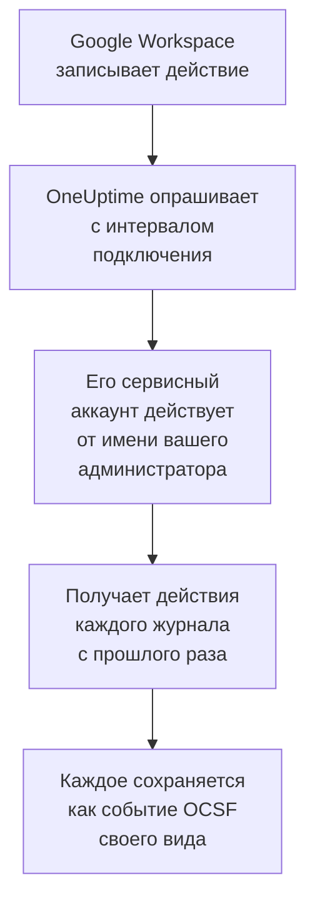

# Google Workspace

Импортируйте журналы аудита [Google Workspace](https://workspace.google.com) в события безопасности OneUptime: входы и то, что Google в них отметил, изменения администраторов, приложения, получившие доступ к данным, единый вход, собственные настройки безопасности аккаунтов и, если хотите, файлы, к которым открыт доступ за пределами организации или которые скачаны в Google Диске. Там вы ищете их рядом со своими журналами, трассировками и метриками, сопоставляете их со всеми другими источниками и вызываете дежурных по тем, что действительно важны. OneUptime читает их с помощью сервисного аккаунта, который действует от имени одного из ваших администраторов, и ничего не меняет в Google Workspace.

:::cards
- [Настройка подключения](#настройка-подключения): Сервисный аккаунт, делегирование на уровне домена и форма подключения.
- [Что импортируется](#что-импортируется): Какие действия импортируются и как каждое становится событием безопасности.
- [Как работает опрос](#как-работает-опрос): Окно, которое читает каждый опрос, и почему оно перекрывает предыдущее на 2 часа.
- [Устранение неполадок](#устранение-неполадок): Что означает каждая ошибка и что нужно изменить.
:::

## Как это работает

Каждую минуту OneUptime опрашивает каждое включённое подключение, интервал опроса которого истёк. Опрос входит как ваш сервисный аккаунт от имени указанного вами администратора и получает действия каждого журнала аудита после предыдущего опроса ([Activities: list](https://developers.google.com/admin-sdk/reports/reference/rest/v1/activities/list)): администрирование, входы, токены OAuth, SAML, безопасность аккаунтов и, когда включён параметр **Активность в Google Диске**, Диск. Каждое событие действия сохраняется как событие [OCSF](https://schema.ocsf.io/): вход — как событие Authentication, назначенная роль администратора — как событие User Access Management, вход, отмеченный Google, — как Detection Finding.

## Перед началом работы

- В OneUptime роль Project Owner, Project Admin или Security Admin. Роли Security Member и Security Viewer видят подключения и историю их запусков, но не могут их менять.
- Суперадминистратор Google Workspace, чтобы разрешить делегирование на уровне домена, и администратор, от имени которого действует сервисный аккаунт, с привилегией Reports. У суперадминистратора она есть.
- Проект Google Cloud, в котором вы можете создать сервисный аккаунт и включить Admin SDK API.
- Для активности в Диске — версия с журналом аудита Диска, например Business Standard, Business Plus, Enterprise или Education.
- Исходящий HTTPS от приложения и worker OneUptime к `oauth2.googleapis.com` и `admin.googleapis.com`.

## Настройка подключения

Подключение выполняет вход с ключом сервисного аккаунта и [делегированием на уровне домена](https://developers.google.com/identity/protocols/oauth2/service-account#delegatingauthority), с одной областью доступа только на чтение: `https://www.googleapis.com/auth/admin.reports.audit.readonly`.

:::steps
### Создайте сервисный аккаунт и ключ

1. В [консоли Google Cloud](https://console.cloud.google.com) выберите проект, откройте **APIs & Services → Library**, найдите **Admin SDK API** и выберите **Enable**.
2. Откройте **IAM & Admin → Service accounts → Create service account**, назовите аккаунт `oneuptime-security-events` и выберите **Done**. Роль в проекте ему не нужна.
3. Откройте сервисный аккаунт и скопируйте его **Unique ID** — идентификатор клиента, который называет делегирование. На вкладке **Keys** выберите **Add key → Create new key → JSON** и сохраните файл: это и есть ключ.

### Разрешите делегирование на уровне домена

1. В [консоли администратора Google](https://admin.google.com) от имени суперадминистратора откройте **Security → Access and data control → API controls → Manage domain-wide delegation** и выберите **Add new**.
2. Введите **Unique ID** сервисного аккаунта как **Client ID** и `https://www.googleapis.com/auth/admin.reports.audit.readonly` как **OAuth scope**. Выберите **Authorize**. Google может применять это несколько минут.
3. Чтобы плейбуки могли блокировать и разблокировать пользователей и завершать их сеансы (см. [Сдерживание](/docs/telemetry/security-cases#сдерживание)), добавьте `https://www.googleapis.com/auth/admin.directory.user` и `https://www.googleapis.com/auth/admin.directory.user.security` в области того же клиента через запятую. Администратор, от имени которого действует подключение, должен тогда управлять этими пользователями.

### Добавьте подключение в OneUptime

Откройте **Продукты → Security Events → Подключения** (`/dashboard/{projectId}/security-events/connections`), нажмите **Добавить подключение**, выберите **Google Workspace** в разделе **Идентификация** и нажмите **Далее**. Введите **Administrator email**, нажмите **Далее** и вставьте содержимое файла ключа в поле **JSON сервисного аккаунта**. На шаге **Опрос** включите **Активность в Google Диске**, чтобы читать и Диск.

### Проверьте его перед сохранением

Нажмите **Проверить эти настройки** в разделе **Проверка перед сохранением**. Проверка выполняет вход и читает журналы входов и администрирования со значениями из формы, ничего не сохраняя, поэтому отсутствующее делегирование обнаруживается ещё до создания подключения. Затем нажмите **Далее**, задайте подключению **Имя** и создайте его.
:::

| Параметр | Что ввести |
| --- | --- |
| **Administrator email** | Адрес администратора, от имени которого действует сервисный аккаунт, например `admin@example.com`. У него должна быть привилегия Reports. |
| **Активность в Google Диске** | Необязательный, по умолчанию выключен. Если включён, каждый опрос читает и предоставление доступа и скачивания в Диске. |
| **JSON сервисного аккаунта** | Весь файл ключа, содержащий `client_email` и `private_key`. Он шифруется, никогда не возвращается API и больше не показывается. Замените его с помощью **Обновить учётные данные** в подключении. |

На шаге **Опрос** также есть необязательное **Описание**, **Интервал опроса (минуты)** — целое число от `1` до `1440`, по умолчанию `5`, и **Включено**, изначально включённое.

## Что импортируется

У каждого события поставщик `Google` и продукт `Google Workspace`. Действие, содержащее несколько событий, становится отдельным событием безопасности для каждого, и каждое событие хранит поля действия и свои собственные — как `event.name`, `event.type` и `parameters.<name>`, — поэтому правило читает их под именами Google.

| Журнал | События | Класс OCSF | Серьёзность |
| --- | --- | --- | --- |
| Входы (`login`) | `login_success`, `login_failure` с причиной, `login_challenge`. Выход читается, но не импортируется. | Authentication (`3002`) | Informational; Low для неудачного входа; Medium, когда Google помечает его как `is_suspicious` |
| Находки Google (`login`) | `suspicious_login` и его разновидности, `gov_attack_warning`, `account_disabled_hijacked` и другие аккаунты, отключённые Google | Detection Finding (`2004`) | Medium; High для атаки при поддержке государства, захваченного аккаунта или утёкшего пароля |
| Администрирование (`admin`) | Выданные или отозванные привилегии и роли администратора, делегирование на уровне домена, созданные, удалённые или заблокированные пользователи, отключённая двухэтапная аутентификация, участники групп, настройки | User Access Management (`3005`), Account Change (`3001`), Group Management (`3006`), Entity Management (`3004`) | Medium для выданных полномочий; Low для удалённого пользователя или отключённой двухэтапной аутентификации |
| Токены OAuth (`token`) | Приложение, получившее доступ к чьим-то данным, с его областями доступа, или лишившееся этого доступа | Authorize Session (`3003`) | Informational |
| SAML (`saml`) | Единый вход в приложение | Authentication (`3002`) | Low для неудачного входа |
| Безопасность аккаунтов (`user_accounts`) | Изменения двухэтапной аутентификации, пароля и восстановления | Account Change (`3001`) | Low, если изменение ослабляет аккаунт |
| Диск (`drive`), при включённом параметре | `change_user_access`, `change_document_visibility`, `change_document_access_scope`, `change_acl_editors`, `download` | File Hosting Activity (`6006`) | Low для файла, к которому открыт доступ за пределами домена владельца или по ссылке |

Правила библиотеки для Google Workspace читают их в том виде, в каком они импортируются здесь, например правила для входа, отмеченного Google, выданных привилегий администратора и файла, ставшего общедоступным в Диске.

## Как работает опрос

- **Действия читаются по времени, когда они произошли.** У Reports API нет другого времени, по которому их можно получить, и Google указывает, что его журналы поступают с опозданием от минут до часов.
- **Первый опрос смотрит на 24 часа назад**, чтобы новое подключение сразу показало свои недавние действия.
- **Каждый следующий опрос начинается за 120 минут до сохранённого курсора**, поэтому действие, которое Google делает доступным для чтения с опозданием до 2 часов, читается при следующем опросе, а дубликаты отбрасываются по идентификатору каждого события в пределах проекта. Действие, поступившее ещё позже, опрос не читает: импортируйте его интервал времени из раздела **Диагностика**.
- **Опрос читает не больше 24 часов после курсора.** Подключение, курсор которого отстал, догоняет серией 24-часовых окон.
- **Диск читается по одному событию за раз**, поскольку Диск записывает каждый файл, который кто-либо открывает. Когда Google отклоняет журнал Диска, запуск выдаёт предупреждение, а остальные журналы по-прежнему импортируются.
- **Неудавшийся запуск ничего не меняет.** После сетевой ошибки или статуса ошибки от Google курсор и длина окна остаются прежними, и следующий опрос заново читает то же окно. Единственное исключение — запрос, превысивший время ожидания: курсор остаётся на месте, но следующее окно вдвое короче, потому что слишком тяжёлое для своевременного ответа окно превышало бы время ожидания при каждой попытке.

### Когда окно содержит больше, чем может прочитать один опрос

У каждого журнала свой бюджет в страницах по 1 000 действий: 10 для входов, по 5 для администрирования, токенов OAuth и SAML, 3 для безопасности аккаунтов и 4 для каждого события Диска. Опрос останавливается через 4 минуты. Когда бюджет останавливает журнал до конца его окна, запуск получает состояние **Частично**, а его предупреждение называет журнал и бюджет. Google отдаёт сначала самые новые действия, поэтому OneUptime сокращает окно, а не переносит курсор за действия, до которых так и не дошёл:

1. **Сузить.** Следующий опрос читает окно вдвое короче с той же начальной точки и продолжает делить его пополам, пока окно не будет прочитано целиком, вплоть до одной минуты. Предупреждение запуска говорит об этом: `This window holds more records than one poll can read; the next poll reads a {n} minute window from the same starting point.` Действия, уже импортированные из более длинного окна, пропускаются как дубликаты.
2. **Снова расти.** После того как окно прочитано целиком, курсор переносится на его конец, а следующее окно снова вдвое длиннее, до 24 часов.
3. **Пройти мимо одной минуты.** Если даже одна минута содержит больше, чем может прочитать один опрос, опрос проходит мимо неё, чтобы новые действия продолжали поступать. Запуск остаётся **Частично**, а **Последняя ошибка** содержит `More records were created in the one minute from {cursor} to {end} than one poll can read. Polling moved past this minute so newer records keep arriving; use Import this time range in Diagnostics on this minute to recover what one run can read.` Импортируйте эту минуту с помощью **Import this time range**, чтобы восстановить то, что может прочитать один запуск.

Изменение **Интервал опроса (минуты)** ничего из этого не меняет: оно определяет, как часто начинается опрос, а не где начинается его окно.

### Запуск, просмотр и импорт по требованию

Нажмите **Диагностика** в подключении, чтобы увидеть его последние запуски и работать с ним вручную. Запускать эти действия может любой, кто может менять подключение; читать историю может любой, кто может его видеть.

- **Запустить сейчас** сразу запускает опрос с обычным курсором, даже если подключение не **Включено**.
- **Preview audit events** читает интервал времени до 7 дней и ничего не импортирует.
- **Import this time range** после вашего подтверждения импортирует интервал до 7 дней, не перемещая курсор. Уже импортированные действия пропускаются. Google хранит журналы аудита 6 месяцев.
- **Copy diagnostics** в запуске копирует его отчёт для поддержки. Он никогда не содержит учётных данных.

## Проверка подключения

**Проверить подключение** в строке подключения и **Проверить эти настройки** в форме выполняются в процессе API, а не в фоновом worker, поэтому проверка отвечает даже тогда, когда проблема в самих worker. Она выполняет такие проверки по порядку:

| Проверка | Что она проверяет |
| --- | --- |
| **Конфигурация** | Адрес администратора и ключ правильно оформлены. Если это не так, ни к чему не обращаются. |
| **Authenticate with Google** | Google позволяет сервисному аккаунту действовать от имени администратора: делегирование на уровне домена настроено. |
| **Read the audit logs** | Журналы входов и администрирования за последние 24 часа можно прочитать. |
| **Read Drive activity** | Только при включённом параметре: журнал Диска можно прочитать. |
| **Activities available to import** | Сколько действий входа и администрирования содержат последние 24 часа, не больше 1 000 каждого вида, поэтому `1000+` означает больше. Ни одного — это предупреждение. |
| **Background workers**, **Poll scheduler**, **Security event storage** | Сторона самого OneUptime: процесс забирает задания из очереди Worker, задание опроса выполняется каждую минуту, а хранилище событий безопасности отвечает. |
| **Scheduled polling** | Для сохранённого подключения: опрос включён, ни один запуск не застрял в ожидании worker, а опросы выполняются вовремя. |

У каждого запроса в проверке срок 20 секунд. Проверка никогда ничего не импортирует и не перемещает курсор, а каждая неудачная проверка сообщает, что нужно изменить.

## Устранение неполадок

**Последняя ошибка** подключения хранит полное сообщение об ошибке со скрытыми учётными данными. Если у подключения есть ошибка, выберите **Просмотреть ошибку** в столбце **Действия**, чтобы прочитать её, и **Скопировать ошибку** в диалоговом окне, чтобы скопировать. Каждое сообщение начинается с `Google Workspace`, затем называет неудавшийся запрос и цитирует причину, которую указал Google.

:::details Последняя ошибка сообщает `token request failed`
- `unauthorized_client`: у сервисного аккаунта нет делегирования на уровне домена для этой области доступа. Добавьте его **Unique ID** с `https://www.googleapis.com/auth/admin.reports.audit.readonly` в разделе **Manage domain-wide delegation**.
- `invalid_grant` с `Invalid email or User ID`: **Administrator email** не является пользователем этого Google Workspace.
- `invalid_grant` с `Invalid JWT Signature`: ключ удалён или отключён. Создайте новый ключ и сохраните его с помощью **Обновить учётные данные**.
:::

:::details Последняя ошибка сообщает `activities request failed (HTTP 403)`
- Причина `SERVICE_DISABLED` или `accessNotConfigured`: Admin SDK API выключен в проекте сервисного аккаунта. Включите его и проверьте снова через несколько минут.
- Причина `forbidden`: у администратора нет привилегии Reports. Назначьте её в разделе **Account → Admin roles** в консоли администратора Google или укажите суперадминистратора.
:::

:::details Активность в Google Диске не читается
Журналу Диска нужна версия, в которой он есть, и администратор с привилегией Reports. Каждый запуск предупреждает `Drive activity was not read`, а остальные журналы по-прежнему импортируются. Выключите **Активность в Google Диске**, если в вашей версии нет журнала Диска.
:::

:::details Последняя ошибка сообщает `did not complete`
Запрос не получил ответа: истекло время ожидания, имя не разрешается или адрес отклонён. Проверьте, что приложение и worker OneUptime могут связаться с `oauth2.googleapis.com` и `admin.googleapis.com` через любой используемый вами прокси.
:::

:::details Проверка проходит, но Last Polled — Never
Задание опроса ни разу не выполнялось. Прочитайте проверки **Background workers** и **Poll scheduler**. В самостоятельно размещённой установке обычная причина — `DISABLE_QUEUE_WORKERS=true` в приложении без отдельного развёртывания worker, которое забирало бы задания: установите `false` или запустите развёртывание worker (Helm: `worker.enabled: true`, по умолчанию `false`).
:::

## Дальнейшие шаги

:::cards
- [События безопасности](/docs/telemetry/security-events): Поиск, сопоставление и оповещения по импортированным данным.
- [Microsoft Entra ID](/docs/integrations/microsoft-entra-id): Импортируйте входы и изменения каталога Microsoft.
- [Google SecOps](/docs/integrations/google-secops): Получайте также обнаружения из Google SecOps.
- [Обзор интеграций](/docs/integrations/index): Другие инструменты, которые можно подключить.
:::
