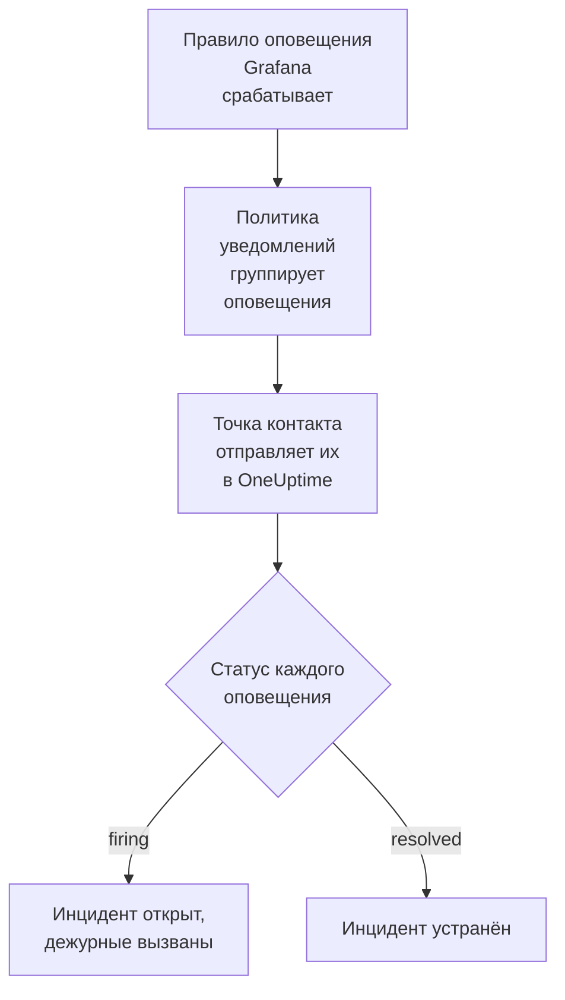

# Grafana

Отправляйте оповещения [Grafana](https://grafana.com) в OneUptime, чтобы каждое сработавшее оповещение становилось инцидентом, который вызывает вашу дежурную команду и устраняется, когда оповещение восстанавливается. Grafana отправляет оповещения через точку контакта с вебхуком, поэтому ни на одной стороне ничего не нужно устанавливать.

:::cards
- [Выбор способа приёма оповещений в OneUptime](#выбор-способа-приёма-оповещений-в-oneuptime): Монитор Incoming Request или собственный рабочий процесс.
- [Приём оповещений монитором](#приём-оповещений-монитором): Один инцидент на оповещение, устраняемый при восстановлении.
- [Настройка Grafana](#настройка-grafana): Точка контакта с вебхуком и политика, которая её использует.
- [Устранение неполадок](#устранение-неполадок): Когда оповещения не приходят или инциденты остаются открытыми.
:::

## Как это работает



Политики уведомлений Grafana группируют сработавшие оповещения, а точка контакта с вебхуком отправляет каждую группу одним JSON-уведомлением. Оно имеет ту же форму, что и уведомление [Prometheus Alertmanager](/docs/integrations/prometheus-alertmanager): `status`, список `alerts`, в котором у каждого оповещения есть собственные `status` и `fingerprint`, а также `commonLabels` и `commonAnnotations`, общие для его оповещений. Grafana добавляет `title` и `message`, написанные для людей.

## Перед началом работы

- Grafana 9 или новее с Grafana Alerting, который используется по умолчанию начиная с Grafana 9. Grafana должна иметь доступ к вашему OneUptime по HTTPS.
- В OneUptime право создавать мониторы или рабочие процессы, если вы выберете этот путь.

## Выбор способа приёма оповещений в OneUptime

Сначала настройте OneUptime: он выдаст URL, на который будет отправлять Grafana.

| Способ | Когда использовать |
| --- | --- |
| Монитор Incoming Request (рекомендуется) | Вы хотите, чтобы каждое оповещение становилось инцидентом, который вызывает дежурных и устраняется, когда оповещение восстанавливается. Ничего строить не нужно. |
| Рабочий процесс с триггером Webhook | Вам нужна собственная логика: фильтровать оповещения, преобразовывать их или сначала вызывать другие системы. Рабочий процесс открывает один инцидент на уведомление, а не на оповещение, и не устраняет его при восстановлении. |

Оба способа получают один и тот же JSON от одной и той же точки контакта, поэтому можно начать с одного и позже перейти на другой, изменив один URL в Grafana.

## Приём оповещений монитором

[Монитор Incoming Request](/docs/monitor/incoming-request-monitor) выдаёт вам URL, а его критерии определяют, что делает каждое уведомление.

:::steps
### Создайте монитор

Откройте **Мониторы** и нажмите **Создать монитор**. Выберите **Incoming Request** в поле **Тип монитора**, назовите монитор `Grafana` и нажмите **Далее**.

### Объявляйте инцидент для каждого сработавшего оповещения

На шаге **Критерии** откройте первый критерий, тот, что переводит монитор в состояние «не в сети». Задайте для его фильтра **Тело запроса**, **Содержит**, `"status":"firing"`. Этот критерий уже объявляет инцидент, когда его фильтр совпадает. Заполните инцидент:

- **Заголовок инцидента**: `{{requestBody.commonLabels.alertname}}`.
- **Описание инцидента**, в разделе **Описание**: `{{requestBody.message}}`, текст, который Grafana пишет для уведомления.
- **Серьёзность**: серьёзность инцидента, которая должна быть у этих оповещений.
- **Политики дежурств**, в разделе **Дежурство**: политики, которые нужно вызывать.
- **Автоустранение инцидента**, в разделе **Дополнительные поля**: оставьте включённым, как по умолчанию. Без него восстановления игнорируются, а инциденты остаются открытыми.

### Открывайте один инцидент на оповещение

В том же критерии откройте **Настройки** и включите **Group incidents and alerts by a payload field**. Заполните его, как показано ниже, чтобы у каждого оповещения был свой инцидент и его восстановление устраняло этот инцидент:

| Поле | Значение |
| --- | --- |
| **Open a separate incident for each…** | `requestBody.alerts[*].fingerprint` |
| **Field that signals recovery** | `requestBody.alerts[*].status` |
| **Value that means recovered** | `resolved` |

### Возвращайте монитор в сеть

Откройте второй критерий, тот, что переводит монитор в состояние «в сети», и задайте для его фильтра **Тело запроса**, **Содержит**, `"status":"resolved"`.

### Скопируйте URL

Нажмите **Создать монитор**. Страница **Обзор** монитора показывает его **Heartbeat URL**. Скопируйте его для Grafana:

```text
https://oneuptime.com/heartbeat/<secret key>
```

У самостоятельно размещённой установки вместо `oneuptime.com` указан собственный хост.
:::

Каждое оповещение уведомления открывает собственный инцидент, но не больше значения **Max incidents per request** (`100`, если вы его не измените), а собственный `status` каждого оповещения определяет, когда устраняется его инцидент. `fingerprint` в Grafana идентифицирует оповещение по его меткам, поэтому группировать нужно именно по нему. Что делает каждая настройка, описано в разделе [Приём оповещений от другой системы](/docs/monitor/incoming-request-monitor#приём-оповещений-от-другой-системы).

> [!WARNING]
> Не группируйте по метке, общей для всех оповещений уведомления. Политика уведомлений Grafana по умолчанию группирует оповещения по `grafana_folder` и `alertname`, поэтому у всех оповещений одного уведомления одинаковый `alertname`: группировка по `requestBody.alerts[*].labels.alertname` сводит всё уведомление в один инцидент.

`{{requestBody.commonLabels.alertname}}` и `{{requestBody.message}}` описывают всё уведомление, которое при политике по умолчанию соответствует одному правилу оповещения. Ключ группировки тоже является переменной, `{{fingerprint}}`, но это хеш, который дежурному ничего не говорит. Все переменные, которые можно использовать, перечислены в разделе [Шаблоны инцидентов и оповещений](/docs/monitor/incident-alert-templating).

## Настройка Grafana

:::steps
### Добавьте точку контакта с вебхуком

В Grafana откройте **Alerting → Contact points** и нажмите **+ Add contact point**. В Grafana 11 и новее раздел **Alerting** находится в **Alerts & IRM**, а **Contact points** — это вкладка раздела **Notification configuration**.

Назовите точку контакта `OneUptime`, выберите **Webhook** в поле **Integration** и вставьте скопированный URL в поле **URL**. Оставьте для **HTTP Method** значение `POST` и нажмите **Save contact point**.

### Отправляйте в неё оповещения

Откройте **Alerting → Notification policies**. Укажите `OneUptime` как точку контакта политики по умолчанию или добавьте дочернюю политику, которая совпадает с оповещениями для OneUptime, с точкой контакта `OneUptime`.
:::

Grafana отправляет `Content-Type: application/json`, который нужен монитору, чтобы читать поля уведомления. Настройка **Max Alerts** точки контакта ограничивает число оповещений в одном уведомлении: оставьте `0`, то есть без ограничения, или не больше значения **Max incidents per request** монитора.

## Проверка

1. В Grafana откройте точку контакта `OneUptime` и нажмите **Test**. Grafana отправляет сработавшее тестовое оповещение, и в OneUptime открывается инцидент. Тестовое оповещение никогда не восстанавливается, поэтому устраните этот инцидент вручную.
2. Дайте сработать настоящему правилу оповещения, например ненадолго понизив его порог, и посмотрите, как открывается его инцидент, а затем устраняется, когда вы вернёте порог.

## Приём оповещений рабочим процессом

Используйте [рабочий процесс](/docs/workflows/index), когда между Grafana и инцидентом нужны собственные шаги.

:::steps
### Создайте рабочий процесс

Откройте **Рабочие процессы**, нажмите **Создать рабочий процесс**, затем **Начать с нуля**. Назовите его `Grafana alerts` и нажмите **Создать рабочий процесс**.

### Добавьте триггер Webhook

Нажмите на пунктирный блок **Выберите, что запускает этот рабочий процесс** и выберите **Webhook**. Нажмите на триггер, затем **Скопировать URL** и укажите этот URL в точке контакта в Grafana.

### Проверьте, что уведомление сработало

Нажмите **Добавить компонент**, добавьте блок **If / Else** и подключите к нему точку **Out** триггера. Задайте для **Value to check** значение `{{local.components.webhook-1.returnValues.request-body.status}}`, для **Comparison** значение **is equal to**, а для **Compare with** значение `firing`.

### Объявите инцидент

Добавьте блок **Create One Incident** и подключите к нему сторону **Yes** блока **If / Else**. В поле **Incident Template** выберите шаблон, который задаёт серьёзность и политики дежурств для вызова (см. [Шаблоны инцидентов](/docs/incidents/settings#шаблоны-инцидентов)). В поле **JSON Object** задайте то, что приходит от Grafana:

```json
{
  "title": "{{local.components.webhook-1.returnValues.request-body.title}}",
  "description": "{{local.components.webhook-1.returnValues.request-body.message}}"
}
```

Без шаблона **JSON Object** также должен содержать `incidentSeverityId` — идентификатор одного из уровней серьёзности инцидентов проекта.

### Включите рабочий процесс

Включите **Включено** в верхней части окна **Конструктор**. Выключенный рабочий процесс отвечает Grafana кодом `400`.
:::

Один запуск обрабатывает одно уведомление, поэтому он объявляет один инцидент независимо от того, сколько оповещений содержит уведомление. Уведомление со статусом `resolved` уходит по стороне **No** блока **If / Else**, к которой ничего не подключено, поэтому запуск на этом заканчивается. Чтобы получать один инцидент на оповещение с устранением при восстановлении, используйте монитор.

## Устранение неполадок

:::details В OneUptime ничего не приходит
- Нажмите **Test** в точке контакта: Grafana показывает ошибку, если не может обратиться к URL. Подробности есть в журнале сервера Grafana.
- Монитор сразу отвечает `200`, ещё до каких-либо проверок, даже при неверном секретном ключе. Посмотрите на временную шкалу монитора, чтобы понять, доходят ли уведомления.
- Выключенный рабочий процесс отвечает `400`. Включите **Включено** в верхней части его окна **Конструктор**.
:::

:::details Инциденты открываются, но никогда не устраняются
- Инциденту критерия нужно **Автоустранение инцидента** в разделе **Дополнительные поля**.
- **Field that signals recovery** должно быть `requestBody.alerts[*].status`, а **Value that means recovered** — точно `resolved`. Сравнение учитывает регистр.
- Пути группировки должны начинаться с `requestBody.`, и только первый `[*]` в пути читает список. Путь, нарушающий любое из этих правил, ни с чем не совпадает, причём без ошибки.
:::

:::details Один инцидент на уведомление, полное оповещений
Вы сгруппировали по метке, одинаковой для всех оповещений уведомления, например по `alertname` при политике по умолчанию. Вместо этого группируйте по `requestBody.alerts[*].fingerprint`.
:::

:::details Инцидент показывает ссылку вместо значения
Ссылка на поле, которого нет в уведомлении, остаётся в том виде, как написана, вместе с фигурными скобками. Сравните имя поля с тем, что отправила Grafana: для рабочего процесса откройте запуск в **Журналы → Запуски** и сравните с тем, что получил триггер.
:::

Руководство по [Prometheus Alertmanager](/docs/integrations/prometheus-alertmanager#устранение-неполадок) описывает и другие случаи, и они относятся также к уведомлениям Grafana.

## Безопасность

- **Обращайтесь с URL как с паролем.** Любой, у кого он есть, может открывать инциденты. Если он утёк, сбросьте его: **Сбросить секретный ключ входящего запроса** на странице **Настройки** монитора или **Сбросить URL** в триггере **Webhook** рабочего процесса. Затем обновите **URL** точки контакта в Grafana.
- **Самостоятельное размещение?** Разрешите Grafana обращаться к вашему OneUptime по HTTPS через ваш файрвол.

## Дальнейшие шаги

:::cards
- [Мониторинг входящих запросов](/docs/monitor/incoming-request-monitor): Все настройки монитора, который принимает ваши оповещения.
- [Prometheus Alertmanager](/docs/integrations/prometheus-alertmanager): Та же настройка, плюс «выключатель мёртвого человека» для ваших оповещений.
- [Мониторинг метрик](/docs/monitor/metrics-monitor): Оповещения по тем же метрикам в самом OneUptime.
- [Обзор интеграций](/docs/integrations/index): Другие инструменты, которые можно подключить.
:::
