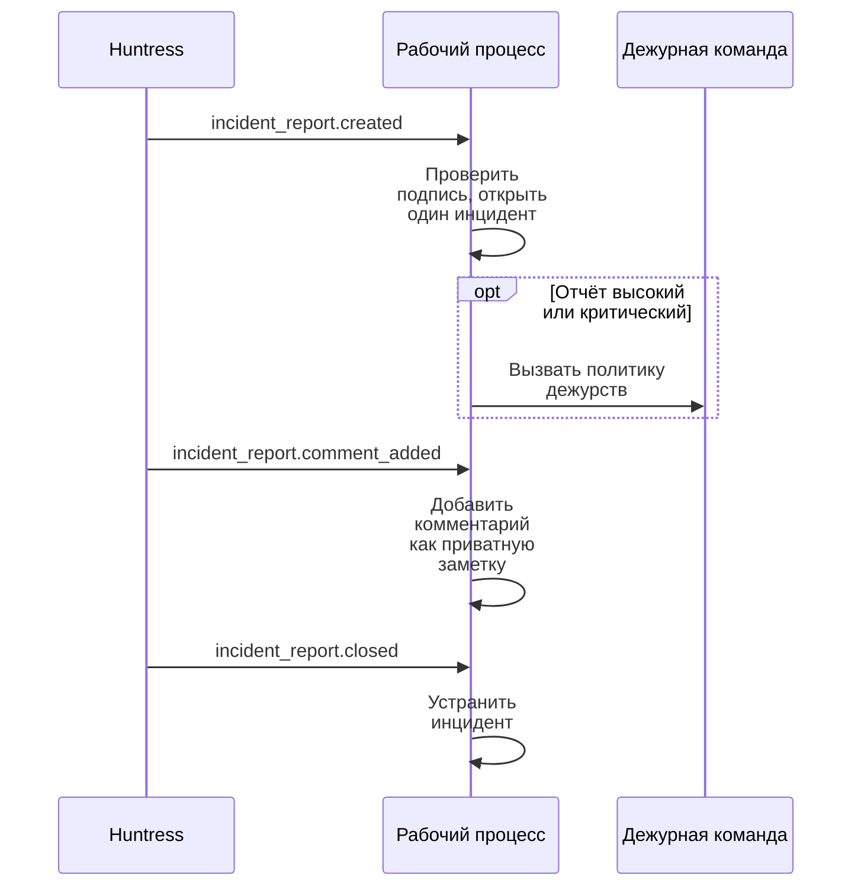

# Интеграция с Huntress

Вызывайте дежурную команду по отчётам об инцидентах Huntress с помощью рабочего процесса. Когда SOC Huntress присылает отчёт об инциденте на конечном устройстве или в учётной записи, рабочий процесс открывает для него один инцидент, вызывает выбранную вами политику дежурств, добавляет комментарии из Huntress как приватные заметки и устраняет инцидент, когда отчёт закрывают в Huntress.

Эта интеграция **входящая**: Huntress отправляет каждое событие отчёта об инциденте на собственный URL рабочего процесса и подписывает его секретом подписи конечной точки. OneUptime никогда не обращается к Huntress, поэтому ключ API Huntress не нужен.

:::cards
- [Как это работает](#как-это-работает): Что рабочий процесс делает с каждым событием отчёта.
- [Настройка](#настройте-интеграцию): Создать рабочий процесс, добавить конечную точку в Huntress, сохранить её секрет подписи, отправить тест.
- [Триггер](#триггер-huntress-incident-report): Значения, которые отчёт передаёт рабочему процессу, и параметры триггера.
- [Устранение неполадок](#устранение-неполадок): Что означают ошибки триггера и что изменить.
:::

## Как это работает

Huntress отправляет событие отчёта об инциденте, когда отчёт отправлен, когда его кто-то комментирует и когда его закрывают. Триггер **Huntress Incident Report** запускает рабочий процесс один раз на каждое событие, а его **Event** говорит, какое это было событие: `created`, `comment-added` или `closed`.

1. **Проверить.** Запрос должен быть подписан секретом подписи конечной точки не раньше чем за пять минут до его прихода. Всё остальное отклоняется, а параметры триггера объясняют почему.
2. **Запустить рабочий процесс.** Каждое событие запускает одно выполнение, а поля отчёта становятся значениями триггера. Событие, которое Huntress отправляет повторно, больше ничего не запускает.
3. **Открыть один инцидент.** При `created` рабочий процесс открывает инцидент с названием по отчёту, например `Huntress: Incident on DESKTOP-01 (Acme Corp)`. Его описание содержит сводку отчёта, его серьёзность в Huntress, организацию, затронутый хост или учётную запись, найденные Huntress индикаторы и ссылку на отчёт в Huntress. Инцидент получает метку с организацией отчёта и вызывает выбранную вами политику дежурств, когда отчёт высокий или критический.
4. **Следить за отчётом.** При `comment-added` комментарий становится приватной заметкой в инциденте. При `closed` инцидент устраняется, а причина остаётся в его хронологии.

Инцидент хранит номер отчёта в своих настраиваемых полях как `huntressReportId`: так рабочий процесс снова находит его, когда Huntress комментирует или закрывает отчёт. Открытые так инциденты никогда не показываются на странице статуса, а ваши правила для инцидентов (дежурства, владельцев, меток и приватности) применяются к ним, как к любому другому инциденту.

## Перед началом

- В OneUptime роль, которая может создавать и редактировать рабочие процессы, например **Владелец проекта**, **Администратор проекта** или **Администратор рабочих процессов**.
- В Huntress роль **Account Admin**: только администраторы учётной записи могут добавлять webhooks.
- Политика дежурств, которую нужно вызывать.
- В OneUptime Cloud тариф с рабочими процессами: Growth или выше. Каждое событие, которое отправляет Huntress, — это одно выполнение рабочего процесса.
- Для самостоятельно размещённой установки — OneUptime, доступный Huntress из интернета по HTTPS: Huntress отправляет webhooks только на URL `https://`.

## Настройте интеграцию

:::steps
### Создайте рабочий процесс

Откройте **Рабочие процессы** и нажмите **Создать рабочий процесс**. В разделе **Или начать с шаблона** выберите категорию **Huntress**, выберите **Open an incident for each Huntress incident report** и нажмите **Использовать шаблон**.

### Выберите, кого вызывать

Затем диалог спрашивает, кого вызывать: в поле **Who to page for high and critical reports** выберите политики дежурств, которые нужно вызывать, или ни одной, чтобы никого не вызывать, и нажмите **Создать рабочий процесс**. Рабочий процесс откроется в **Конструктор** выключенным. Чтобы позже изменить, кого он вызывает, нажмите на его шаг **Page an On-Call Policy** и измените **Политики дежурств**.

### Добавьте конечную точку webhook в Huntress

Нажмите на триггер **Huntress Incident Report** и в блоке **Добавьте конечную точку webhook в Huntress** нажмите **Скопировать URL**. URL выглядит как `https://oneuptime.com/workflow/huntress/<key>`; в самостоятельно размещённой установке он начинается с вашего хоста.

В Huntress откройте меню в правом верхнем углу и выберите **Integrations**. Нажмите **Add an Integration**, выберите **Webhooks** и нажмите **Add Endpoint**. Вставьте URL, включите **Incident Reports** и сохраните. Оставьте **Escalations**, **Platform Actions** и **Account Notices** выключенными: триггер принимает эти события и ничего по ним не запускает.

### Сохраните секрет подписи конечной точки

В Huntress откройте меню конечной точки (⋯) и выберите **View Signing Secret**. Скопируйте его целиком: он начинается с `whsec_`. В триггере нажмите **Сохранить секрет подписи**, вставьте его и нажмите **Сохранить секрет подписи**. Секрет шифруется и больше никогда не показывается.

Пока секрет не сохранён, триггер отклоняет все запросы. Huntress позже отправляет отклонённое событие повторно, так что событие, отклонённое сейчас, всё равно дойдёт.

### Включите рабочий процесс и отправьте тест

Включите **Включено** вверху **Конструктор**. В Huntress откройте меню конечной точки (⋯) и выберите **Send Test**. Через несколько секунд триггер покажет **Получает отчёты**.

> [!NOTE]
> Что бы ни содержал тест, триггер покажет, что он пришёл. Тест с отчётом об инциденте запускает рабочий процесс, как любой другой отчёт.
:::

## Что делает рабочий процесс

После триггера **Incident From Another Tool** делает то, что требует каждое **Event**, по номеру отчёта:

| Event | Что делает рабочий процесс |
| --- | --- |
| `created` | Открывает инцидент с **Incident Severity ID** триггера и меткой из его **Organization Label ID**. Для высокого или критического отчёта **Page an On-Call Policy** вызывает вашу политику; низкий отчёт никого не вызывает. Отчёт, у которого уже есть инцидент, другого не открывает. |
| `comment-added` | Находит инцидент отчёта и добавляет к нему комментарий как приватную заметку. |
| `closed` | Находит инцидент отчёта и устраняет его, если он ещё не устранён. Причина остаётся в его хронологии: Huntress закрыл отчёт. |

Это такой же рабочий процесс, как любой другой, поэтому его можно изменить: вызывать дежурных только по критическим отчётам, изменив то, что сравнивает **If / Else** после **Incident From Another Tool**, публиковать каждый отчёт в чат-канал шагом Slack или Microsoft Teams или направлять каждую организацию в её собственную политику дежурств через **Switch / Case** по **Organization**. Каждое выполнение видно среди выполнений рабочего процесса вместе с тем, что сделал каждый шаг.

### Серьёзность

Huntress присваивает каждому отчёту об инциденте одну из трёх серьёзностей. **Incident Severity ID** триггера — это серьёзность инцидента, с которой открывается отчёт: та, что выбрана в её параметре, а иначе — по порядку ваших уровней серьёзности инцидентов, как их перечисляет **Инциденты → Настройки → Серьёзность инцидента**:

| Серьёзность в Huntress | Что под ней понимает Huntress | Параметр | Серьёзность инцидента, когда параметр пуст |
| --- | --- | --- | --- |
| Critical | Злоумышленники за клавиатурой, опасное вредоносное ПО или активная компрометация, которую нужно сдержать немедленно. | **Серьёзность для критических отчётов** | Наивысшая |
| High | Подтверждённое вредоносное ПО, требующее срочного устранения, или компрометация учётной записи, требующая действий. | **Серьёзность для высоких отчётов** | Вторая |
| Low | Потенциально нежелательные программы, остатки вредоносного ПО и более старые находки по учётным записям. | **Серьёзность для низких отчётов** | Третья |

Проект с меньшим числом уровней использует для остальных самый низкий. Отчёт без серьёзности обрабатывается как высокий. Если выбранный вами уровень удалён, снова решает порядок.

### Организации

**Organization Label ID** триггера — это метка с названием организации Huntress из отчёта, например _Acme Corp_, которую он создаёт, когда приходит первый отчёт этой организации. Один рабочий процесс получает отчёты всех организаций вашей учётной записи Huntress, а **Только эти организации** в триггере сужает этот круг: одно название или ID организации на строку, названия без учёта регистра.

> [!TIP]
> Чтобы вызывать собственную команду каждого клиента, добавьте по правилу дежурства для инцидентов на каждую организацию, например «Если **Метки инцидента** содержит любое из _Acme Corp_», которое выполняет политику этого клиента. См. [Правила дежурства по инцидентам](/docs/incidents/settings#правила-дежурства-по-инцидентам).

## Триггер Huntress Incident Report

Триггер открывается на Huntress: его URL, отметка у каждого выполненного шага настройки и то, что Huntress прислал последним. Его параметры, все необязательные, свёрнуты в **Дополнительные поля**: **Только эти организации**, **Серьёзность для критических отчётов**, **Серьёзность для высоких отчётов** и **Серьёзность для низких отчётов**.

| Значение | Что в нём |
| --- | --- |
| **Event** | `created`, `comment-added` или `closed`. Отчёт, который уже закрыт или отклонён, — это `closed`, каким бы событием он ни пришёл. |
| **Report ID** | Номер отчёта в Huntress. |
| **Severity** | `critical`, `high` или `low`. |
| **Status** | Статус отчёта в Huntress, например `sent`, `closed` или `dismissed`. |
| **Subject** | Тема отчёта в том виде, как её пишет Huntress. |
| **Summary** | То, что написал аналитик SOC. |
| **Organization**, **Organization ID** | Организация Huntress, к которой относится отчёт. |
| **Affected** | Хост или учётная запись, к которым относится отчёт. |
| **Platform**, **Indicators** | Где Huntress это нашёл и что нашёл. |
| **Comment** | Комментарий, который кто-то добавил, при `comment-added`. |
| **Report URL** | Где отчёт открывается в Huntress. |
| **Incident Title**, **Incident Description** | Заголовок и описание в Markdown для инцидента по отчёту. |
| **Note** | Markdown для заметки о событии: комментарий или то, что Huntress закрыл отчёт. |
| **Incident Severity ID**, **Organization Label ID** | Серьёзность инцидента и метка, как описано выше. |
| **Received At** | Когда OneUptime получил событие. |

**Summary** и **Comment** — это текст, написанный аналитиками Huntress. Чтобы поместить их в инцидент или заметку, используйте **Incident Description** и **Note**: они сохраняют форматирование, и ничто в них не загружает изображение и никого не упоминает.

Чтобы попробовать рабочий процесс без Huntress, нажмите **Запустить рабочий процесс** в **Конструктор** и введите **Event**, **Report ID** и нужные поля. Используйте один и тот же **Report ID**, чтобы проследить отчёт от `created` до `closed`.

## Подключения Huntress, созданные раньше

Раньше Huntress настраивался в **Инциденты → Интеграции → Huntress**. Каждое подключение Huntress стало включённым рабочим процессом с тем же названием, который делает то же, что делало подключение: вызывает те же политики дежурств по тем же отчётам, добавляет те же метки и устраняет инциденты (или только оставляет заметку) так же. Его URL по-прежнему URL подключения, `https://oneuptime.com/api/huntress/webhook/<connection-id>`, а секрет подписи тот же, поэтому в Huntress ничего менять не нужно. Инциденты, открытые подключением, сохраняют номер своего отчёта, поэтому рабочий процесс находит их, когда Huntress комментирует или закрывает эти отчёты.

## Безопасность

- **Только подписанные запросы.** Триггер сверяет заголовки `svix-id`, `svix-timestamp` и `svix-signature`, которые отправляет Huntress, с телом запроса ровно в том виде, в каком оно пришло. Запрос, не подписанный сохранённым секретом или подписанный более чем на пять минут раньше или позже, отклоняется.
- **Секрет остаётся секретом.** Он хранится в зашифрованном виде, API его никогда не возвращает, и он больше никогда не показывается. **Заменить секрет подписи** в триггере сохраняет другой, например секрет новой конечной точки.
- **URL — это адрес, а не пароль.** Он заканчивается ключом рабочего процесса; рабочий процесс запускает только запрос, подписанный секретом конечной точки.
- **Одна конечная точка на рабочий процесс.** У каждого рабочего процесса свой URL и свой секрет. Чтобы получать отчёты второй учётной записи Huntress, создайте второй рабочий процесс.

## Использовать почту вместо этого

Huntress также рассылает отчёты об инцидентах по почте, и [мониторинг входящих писем](/docs/monitor/incoming-email-monitor) может открывать инциденты по этим письмам, например когда тема содержит `Critical Incident Report`. Но он рассматривает письма как статус одного монитора: пока его инцидент открыт, следующий отчёт нового не откроет, а инцидент устраняется по критериям монитора, а не когда Huntress закрывает отчёт. Рабочий процесс открывает по инциденту на отчёт и устраняет каждый вместе с его отчётом, поэтому лучше выбрать его. Как только рабочий процесс начнёт получать отчёты, перестаньте отправлять письма на монитор, иначе каждый отчёт будет вызывать дежурных дважды.

## Устранение неполадок

Когда триггер отклоняет запрос, его параметры показывают причину под **Последний запрос отклонён**. В Huntress пункт **View Delivery Attempts** в меню конечной точки (⋯) показывает каждую доставку с ответом OneUptime.

:::details "A request arrived but was refused, because no signing secret is saved for this workflow yet"
Сохраните секрет подписи конечной точки: см. [Настройте интеграцию](#настройте-интеграцию). Huntress отправит отклонённый запрос повторно.
:::

:::details "The request's signature does not match the signing secret"
Сохранённый секрет принадлежит не этой конечной точке. У каждой конечной точки свой секрет: в Huntress откройте меню конечной точки (⋯), выберите **View Signing Secret**, скопируйте его целиком и сохраните через **Заменить секрет подписи**.
:::

:::details "The request was signed more than five minutes from now"
Часы Huntress и вашего сервера OneUptime расходятся более чем на пять минут, или это повтор старого запроса. В самостоятельно размещённой установке проверьте, что часы сервера идут верно.
:::

:::details "A request arrived while this workflow is off"
Включите **Включено** вверху **Конструктор**. Huntress отправит отклонённый запрос повторно, и тогда он запустит рабочий процесс.
:::

:::details "No Huntress workflow has this address."
Рабочий процесс удалён или архивирован, его триггер больше не **Huntress Incident Report**, или URL конечной точки в Huntress не совпадает с URL рабочего процесса. Скопируйте URL из триггера и снова вставьте его в конечную точку в Huntress.
:::

:::details Инцидент не открылся
Откройте выполнения рабочего процесса и выполнение для отчёта. Если **Incident From Another Tool** завершился ошибкой `This project has no incident severities to put the incident at.`, добавьте уровень в **Инциденты → Настройки → Серьёзность инцидента**.
:::

:::details Никого не вызвали
Низкий отчёт открывает инцидент без вызова. В остальных случаях выполнение для отчёта показывает, что сделал **Page an On-Call Policy**, а страница **Выполнения дежурств** инцидента показывает, что сделала каждая политика.
:::

## Что дальше

:::cards
- [Триггеры рабочего процесса](/docs/workflows/triggers): Другие способы запустить рабочий процесс.
- [Правила дежурства по инцидентам](/docs/incidents/settings#правила-дежурства-по-инцидентам): Вызывать собственную команду каждой организации по её метке.
- [Состояния и уровни серьёзности инцидентов](/docs/incidents/states-and-severities): Упорядочить уровни серьёзности, с которыми открываются отчёты Huntress.
- [Обзор интеграций](/docs/integrations/index): Другие инструменты, которые можно подключить.
:::
