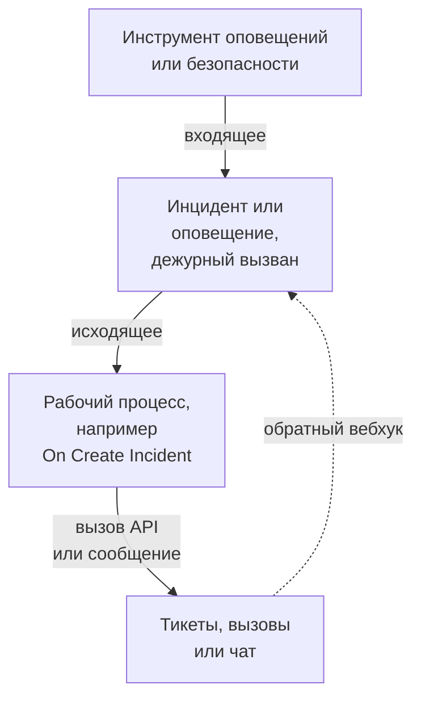

# Обзор интеграций

OneUptime работает с инструментами, которыми ваша команда уже пользуется. Инструменты оповещения создают в нём инциденты, а OneUptime создаёт тикеты, вызовы дежурных и сообщения в чатах других инструментов. Одни инструменты подключаются через форму, другие — через готовый шаблон рабочего процесса. Любой другой инструмент с вебхуком или API подключается через рабочий процесс, который вы создаёте сами.

:::cards
- [Выбор способа подключения](#выбор-способа-подключения): Четыре способа подключения и когда использовать каждый.
- [Каталог](#каталог): Все инструменты с руководствами, сгруппированные по назначению.
- [Создание собственной интеграции](#создание-собственной-интеграции): Схемы входящих и исходящих интеграций для любого другого инструмента.
- [Защита учётных данных](#защита-учётных-данных): Секретные переменные и заголовки, которые ожидает каждый инструмент.
:::

## Как работают интеграции

Каждая интеграция передаёт данные в одном направлении или в обоих. **Входящее**: другой инструмент сообщает OneUptime, что что-то не так, и OneUptime создаёт инцидент или оповещение и вызывает дежурную команду. **Исходящее**: в OneUptime что-то происходит, и рабочий процесс сообщает об этом другому инструменту: создаёт тикет, вызывает кого-то или публикует сообщение.



Двусторонняя интеграция, например Jira или Dynamics 365, использует оба направления: один рабочий процесс отправляет инцидент наружу, а другой, запускаемый вебхуком другого инструмента, возвращает изменения обратно.

## Выбор способа подключения

| Способ | Лучше всего подходит для | Примеры |
| --- | --- | --- |
| Встроенное подключение | Инструментов, к которым OneUptime подключается сам. Вы заполняете форму, и ничего не нужно создавать. | [Slack](/docs/workspace-connections/slack), [Microsoft Teams](/docs/workspace-connections/microsoft-teams), подключения [Событий безопасности](/docs/telemetry/security-events) |
| Шаблон рабочего процесса | Тикет-систем, синхронизируемых в обе стороны, проблем мониторинга, отчётов об инцидентах безопасности и сообщений в чатах. Вы выбираете шаблон и заполняете несколько настроек. | [Jira](/docs/integrations/jira), [Microsoft Dynamics 365](/docs/integrations/microsoft-dynamics-365), [Huntress](/docs/integrations/huntress), [Zabbix](/docs/integrations/zabbix) |
| Монитор Incoming Request | Инструментов оповещения, которые отправляют вебхук. Вы получаете один инцидент на оповещение, переданный дежурным и устранённый, когда оповещение восстанавливается, без рабочего процесса. | [Zabbix](/docs/integrations/zabbix), [Prometheus Alertmanager](/docs/integrations/prometheus-alertmanager), [Grafana](/docs/integrations/grafana) |
| Рабочий процесс, который вы создаёте | Любого инструмента с вебхуком или REST API и любой собственной логики. | [PagerDuty](/docs/integrations/pagerduty), [Opsgenie](/docs/integrations/opsgenie), [ServiceNow](/docs/integrations/servicenow) |

Начинайте с верха таблицы: чем выше способ, тем меньше его нужно сопровождать.

## Каталог

### Инструменты мониторинга и оповещения

| Инструмент | Направление | Что делает |
| --- | --- | --- |
| [Zabbix](/docs/integrations/zabbix) | Оба | Превращает проблемы Zabbix в инциденты или оповещения, устраняет их при восстановлении и подтверждает или закрывает проблемы из OneUptime. |
| [Prometheus Alertmanager](/docs/integrations/prometheus-alertmanager) | Входящее | Превращает уведомления Alertmanager в инциденты. |
| [Grafana](/docs/integrations/grafana) | Входящее | Превращает оповещения Grafana в инциденты. |
| [Datadog](/docs/integrations/datadog) | Входящее | Превращает оповещения мониторов Datadog в инциденты. |

### Инструменты безопасности

| Инструмент | Направление | Что делает |
| --- | --- | --- |
| [Huntress](/docs/integrations/huntress) | Входящее | Вызывает дежурных по отчётам об инцидентах Huntress и устраняет инцидент, когда отчёт закрывается. |
| [Google SecOps](/docs/integrations/google-secops) | Оба | Передаёт обнаружения и индикаторы Google SecOps в События безопасности и отправляет туда то, что находит OneUptime. |
| [Microsoft Sentinel](/docs/integrations/microsoft-sentinel) | Оба | Передаёт инциденты Microsoft Sentinel в События безопасности и отправляет туда то, что находит OneUptime. |
| [Microsoft Defender XDR](/docs/integrations/microsoft-defender-xdr) | Входящее | Передаёт оповещения Microsoft Defender XDR в События безопасности. |
| [CrowdStrike Falcon](/docs/integrations/crowdstrike-falcon) | Входящее | Передаёт оповещения CrowdStrike Falcon в События безопасности. |
| [Splunk Enterprise Security](/docs/integrations/splunk) | Оба | Передаёт notable events Splunk в События безопасности и отправляет туда то, что находит OneUptime. |
| [Elastic Security](/docs/integrations/elastic-security) | Оба | Передаёт оповещения об обнаружениях Elastic Security в События безопасности и отправляет туда то, что находит OneUptime. |
| [AWS Security Hub](/docs/integrations/aws-security-hub) | Входящее | Передаёт находки AWS Security Hub в События безопасности. |
| [Okta System Log](/docs/integrations/okta) | Входящее | Передаёт входы, изменения учётных записей и обнаружения угроз Okta в События безопасности. |
| [Microsoft Entra ID](/docs/integrations/microsoft-entra-id) | Входящее | Передаёт входы и изменения каталога Microsoft Entra ID, а также журнал аудита Microsoft 365 в События безопасности. |
| [Google Workspace](/docs/integrations/google-workspace) | Входящее | Передаёт входы, изменения администраторов и обнаружения Google Workspace в События безопасности. |

### Тикеты и управление ИТ-услугами

| Инструмент | Направление | Что делает |
| --- | --- | --- |
| [Jira](/docs/integrations/jira) | Оба | Создаёт задачу Jira для каждого инцидента или оповещения и возвращает изменения статуса и комментарии. |
| [Microsoft Dynamics 365](/docs/integrations/microsoft-dynamics-365) | Оба | Создаёт обращение Dynamics 365 для каждого инцидента или оповещения и возвращает изменения статуса и заметки. |
| [ServiceNow](/docs/integrations/servicenow) | Исходящее | Создаёт инцидент ServiceNow для каждого инцидента OneUptime и устраняет его вместе с инцидентом. |
| [GitHub](/docs/integrations/github) | Исходящее | Создаёт issue в GitHub для инцидента. |
| [GitLab](/docs/integrations/gitlab) | Исходящее | Создаёт issue в GitLab для инцидента. |

### Инструменты вызова дежурных

| Инструмент | Направление | Что делает |
| --- | --- | --- |
| [PagerDuty](/docs/integrations/pagerduty) | Исходящее | Запускает инцидент PagerDuty для каждого инцидента OneUptime и устраняет его вместе с инцидентом. |
| [Opsgenie](/docs/integrations/opsgenie) | Исходящее | Создаёт оповещение Opsgenie для каждого инцидента OneUptime и закрывает его вместе с инцидентом. |

### Чат-инструменты

| Инструмент | Направление | Что делает |
| --- | --- | --- |
| [Slack](/docs/workspace-connections/slack) | Оба | Встроенное подключение: каналы инцидентов, действия из Slack и дежурства. |
| [Microsoft Teams](/docs/workspace-connections/microsoft-teams) | Оба | Встроенное подключение: каналы инцидентов, действия из Teams и дежурства. |
| [Mattermost](/docs/workflows/components#mattermost) | Исходящее | Публикует обновления инцидентов в канале Mattermost. |
| [Discord](/docs/integrations/discord) | Исходящее | Публикует обновления инцидентов в канале Discord. |
| [Telegram](/docs/integrations/telegram) | Исходящее | Отправляет сообщение в чат Telegram, когда срабатывает оповещение. |
| [IRC](/docs/integrations/irc) | Исходящее | Публикует обновления инцидентов в канале IRC. |

> [!TIP]
> У Slack и Microsoft Teams также есть шаги рабочих процессов. Используйте встроенное подключение для каналов инцидентов и дежурств, а шаг рабочего процесса — когда вам нужно только сообщение в канале.

### Хостинг-платформы

| Инструмент | Направление | Что делает |
| --- | --- | --- |
| [Vercel](/docs/integrations/vercel) | Входящее | Добавьте OneUptime из Vercel Marketplace: трассировки, логи, мониторы доступности и страница статуса для ваших проектов Vercel. |

## Переход с другого инструмента

Чтобы уйти с другого инструмента дежурств, мониторинга доступности или страниц статуса, перенесите свою команду, а не связывайте два инструмента. **Настройки проекта → Расширенный → Импорт из другого инструмента** читает вашу учётную запись по ключу API, показывает найденное и создаёт то, что вы отметите. Для каждого инструмента есть руководство:

- Инструменты дежурств и инцидентов: [Opsgenie](/docs/moving-to-oneuptime/opsgenie), [PagerDuty](/docs/moving-to-oneuptime/pagerduty), [incident.io](/docs/moving-to-oneuptime/incident-io), [Splunk On-Call](/docs/moving-to-oneuptime/splunk-on-call) и [Grafana OnCall](/docs/moving-to-oneuptime/grafana-oncall).
- Инструменты мониторинга доступности и страниц статуса: [UptimeRobot](/docs/moving-to-oneuptime/uptimerobot), [Atlassian Statuspage](/docs/moving-to-oneuptime/atlassian-statuspage), [Better Stack](/docs/moving-to-oneuptime/better-stack), [Pingdom](/docs/moving-to-oneuptime/pingdom), [StatusCake](/docs/moving-to-oneuptime/statuscake) и [Uptime Kuma](/docs/moving-to-oneuptime/uptime-kuma).

## Создание собственной интеграции

Инструмент без руководства всё равно укладывается в одну из двух схем. Если он умеет отправлять вебхук, используйте входящую схему. Если у него есть REST API, используйте исходящую. Обе схемы — это рабочие процессы: чтобы начать, см. [Обзор рабочих процессов](/docs/workflows/index).

### Входящее: другой инструмент отправляет данные в OneUptime

Для инструмента оповещения начните с [монитора Incoming Request](/docs/monitor/incoming-request-monitor#приём-оповещений-от-другой-системы): он создаёт один инцидент на оповещение и устраняет его при восстановлении, без какой-либо сборки. Создавайте рабочий процесс, когда вам нужна собственная логика:

:::steps
1. Откройте **Рабочие процессы**, нажмите **Создать рабочий процесс**, затем **Начать с нуля**. Назовите рабочий процесс и нажмите **Создать рабочий процесс**.
2. Нажмите на пунктирный блок **Выберите, что запускает этот рабочий процесс** и выберите **Webhook**. Нажмите на триггер, затем на **Скопировать URL**.
3. В другом инструменте отправьте его вебхук на этот URL как `POST` с `Content-Type: application/json`.
4. Добавьте блоки, которые его обрабатывают. Они читают запрос по ссылкам вида `{{local.components.webhook-1.returnValues.request-body.status}}`: блок **If / Else** для проверки поля, затем **Create One Incident** для объявления инцидента.
5. Включите **Включено** вверху окна **Конструктор**, отправьте тестовый запрос из другого инструмента и откройте **Журналы → Запуски**, чтобы посмотреть, что пришло.
:::

URL — единственные учётные данные, поэтому обращайтесь с ним как с паролем. См. [Webhook](/docs/workflows/triggers#webhook).

### Исходящее: OneUptime отправляет данные в другой инструмент

:::steps
1. Сохраните ключ API инструмента как секретную глобальную переменную, как показано [ниже](#защита-учётных-данных).
2. Создайте рабочий процесс, нажмите на пунктирный блок и выберите триггер события, например **On Create Incident**. Нажмите на триггер: его **Fields to pass on** начинаются с поля **Заголовок**, поэтому нажмите **Добавить поле** и выберите остальные поля для отправки, например **Описание**.
3. Нажмите **Добавить компонент** и добавьте блок **API Post (JSON)**. Соедините с ним точку **Success** триггера.
4. Заполните его **URL**, **Request Headers** с заголовком `Authorization` и **Request Body** с полями инцидента, например `{{local.components.incident-on-create-1.returnValues.model.title}}`.
5. Нажмите **Запустить рабочий процесс**, выберите инцидент в поле **Инцидент** и запустите. Тестовый запуск действительно отправляет запрос. Затем включите **Включено**.
:::

Если инструменту нужны данные в другом виде, добавьте между ними блок [Run Custom JavaScript](/docs/workflows/components#custom-code). Рецепт одинаков для Zendesk, New Relic, AWS (через SNS), StatusCake и всех остальных: меняются только URL и тело.

## Защита учётных данных

Никогда не вставляйте ключ API или токен в блок. Сохраните его один раз как секретную глобальную переменную:

:::steps
1. Перейдите в **Рабочие процессы → Глобальные переменные** и нажмите **Создать: Рабочий процесс Переменная**.
2. Задайте имя, например `JIRA_AUTH`, и нажмите **Далее**.
3. Вставьте ключ в **Содержимое**, включите **Секрет** и нажмите **Создать: Рабочий процесс Переменная**.
:::

Любой блок читает её как `{{global.variables.JIRA_AUTH}}`. Содержимое переменной нельзя прочитать после сохранения, а содержимое секретной переменной заменяется на `[REDACTED]` в журналах запусков. Для токенов с истекающим сроком, например токенов Microsoft Entra ID, [переменная OAuth 2.0](/docs/workflows/variables#переменные-oauth-20-токены-которые-обновляются-сами) сама получает новый. См. [Переменные рабочего процесса](/docs/workflows/variables#глобальные-переменные).

### Шпаргалка по аутентификации

Большинство исходящих интеграций передают ключ в заголовке запроса. Распространённые варианты:

| Схема | Что отправлять | Кто использует |
| --- | --- | --- |
| Токен Bearer | `Authorization: Bearer {{global.variables.TOKEN}}` | GitHub и большинство современных API |
| Аутентификация Basic | `Authorization: Basic {{global.variables.BASE64_USER_PASS}}` | Jira Cloud, ServiceNow |
| Заголовок с ключом API | `Authorization: GenieKey {{global.variables.OPSGENIE_KEY}}` | Opsgenie |
| Заголовок с приватным токеном | `PRIVATE-TOKEN: {{global.variables.GITLAB_TOKEN}}` | GitLab |
| Ключ в теле | `routing_key` в теле JSON | PagerDuty Events API |
| Учётные данные клиента OAuth 2.0 | `Authorization: Bearer {{local.variables.dynamicsAccessToken}}` из переменной OAuth 2.0 | Microsoft Dynamics 365 |

Для аутентификации Basic один раз закодируйте `username:password` или `email:api_token` и сохраните результат как секрет. В macOS или Linux:

```bash
printf '%s' 'you@example.com:your_api_token' | base64 | tr -d '\n'
```

Используйте `printf`, а не `echo`: `echo` добавляет перевод строки, который кодируется вместе с остальным и ломает учётные данные. `tr` удерживает длинный результат в одной строке.

## Самостоятельно размещённые установки

Самостоятельно размещённый OneUptime обращается к другим инструментам из вашей сети, а другие инструменты обращаются к нему из своих:

- **Исходящее:** запросы рабочих процессов к адресам частной сети отклоняются, если администратор их не разрешил. См. [Исходящий сетевой доступ](/docs/workflows/configuration#исходящий-доступ-в-сеть).
- **Входящее:** вебхуки инструмента должны доходить до вашего OneUptime по HTTPS, поэтому облачному инструменту нужен публичный адрес для вызова.
- **Встроенные интеграции** имеют каждая своё руководство по настройке: [Slack](/docs/self-hosted/slack-integration), [Microsoft Teams](/docs/self-hosted/microsoft-teams-integration), [GitHub](/docs/self-hosted/github-integration), [Twilio](/docs/self-hosted/twilio-integration), [SendGrid Inbound Email](/docs/self-hosted/sendgrid-inbound-email) и [Push Notifications](/docs/self-hosted/push-notifications).

## Дальнейшие шаги

:::cards
- [Обзор рабочих процессов](/docs/workflows/index): Как выполняются рабочие процессы и как создать первый.
- [Мониторинг входящих запросов](/docs/monitor/incoming-request-monitor): Получайте оповещения от любого инструмента без рабочего процесса.
- [Jira](/docs/integrations/jira): Полная двусторонняя интеграция на основе шаблонов.
- [Переменные рабочего процесса](/docs/workflows/variables): Передавайте данные между блоками и держите секреты вне их.
:::
