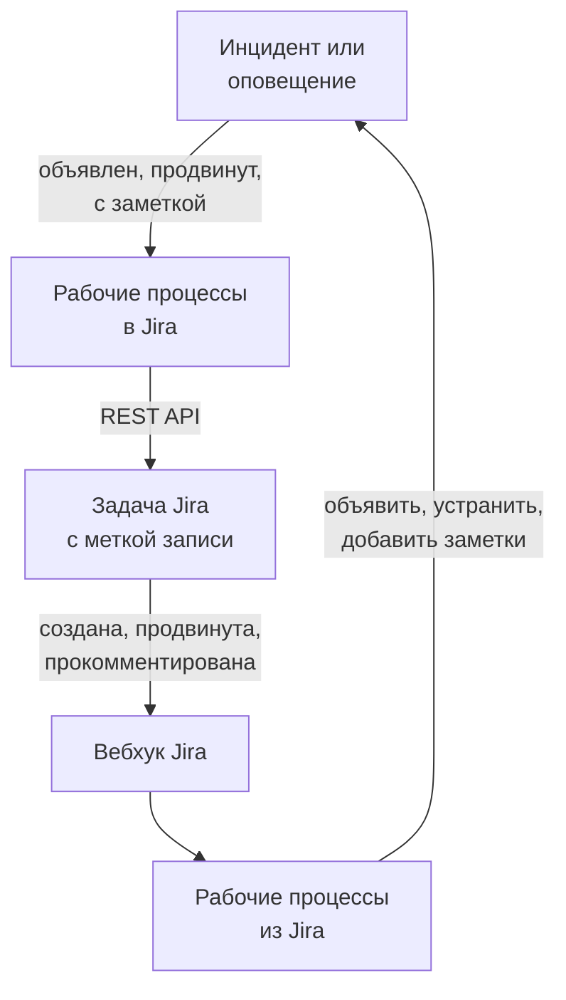

# Jira

Держите задачи [Jira](https://www.atlassian.com/software/jira) в согласии с инцидентами и оповещениями OneUptime, в обе стороны. Готовые шаблоны рабочих процессов создают задачу для каждого инцидента или оповещения, продвигают её вслед за записью и копируют в неё заметки как комментарии. Другие объявляют инциденты по новым задачам и возвращают изменения статуса, комментарии и правки. Плагина нет: рабочие процессы вызывают REST API Jira, а Jira вызывает их URL вебхуков.

:::cards
- [Начало с шаблона](#начало-с-шаблона): 17 шаблонов, что они запрашивают и как их настроить.
- [Как работают шаблоны](#как-работают-шаблоны): Как задачи и записи остаются связанными, без циклов.
- [Сборка своими силами](#сборка-своими-силами): Каждое направление вручную, если шаблон не подходит.
- [Устранение неполадок](#устранение-неполадок): Что означают ответы Jira.
:::

> [!NOTE]
> Atlassian переименовывает сущности в Jira Cloud: **проект** теперь во многих местах интерфейса называется **пространством**, а **задача** — **рабочим элементом**. На сайтах встречаются оба варианта, поэтому там, где формулировка важна, здесь приведены оба.

## Как это работает



Каждый шаблон — это небольшой рабочий процесс, поэтому вы берёте только нужные направления — для инцидентов, оповещений или того и другого. Шаблоны OneUptime → Jira запускаются от события в OneUptime и вызывают REST API Jira. Шаблоны Jira → OneUptime запускаются от вебхука Jira. Все они находят записи друг друга по двум меткам на задаче.

Всё на этой странице написано для **Jira Cloud**. В разделе [Jira Data Center](#jira-data-center) перечислено, что меняется в самостоятельно управляемой Jira.

## Перед началом работы

- Сайт Jira Cloud, например `https://your-domain.atlassian.net`, и проект, в котором создаются задачи.
- Пользователь Jira для интеграции и токен API для него. Выдайте пользователю в проекте **Browse Projects**, **Create Issues**, **Edit Issues**, **Add Comments** и **Transition Issues**.
- Администратор Jira, чтобы зарегистрировать вебхуки, которые нужны шаблонам Jira → OneUptime.
- В OneUptime — право создавать рабочие процессы. В OneUptime Cloud для рабочих процессов нужен тариф **Growth** или выше.

## Начало с шаблона

В диалоге **Создать рабочий процесс** есть 17 шаблонов Jira в категории **Jira**: девять для инцидентов, затем восемь для оповещений, каждая группа под своим заголовком. Они используют одно соглашение — метки на задаче Jira, — поэтому любые их сочетания работают вместе.

### Шаблоны для инцидентов

| Шаблон | Что делает | Что запрашивает |
| --- | --- | --- |
| **OneUptime → Jira** | | |
| Create a Jira issue when an incident is declared | Создаёт задачу для каждого нового инцидента и добавляет ей ID инцидента как метку. Инциденты, объявленные из Jira, и приватные инциденты пропускаются. | API URL, API token, project key, issue type, OneUptime URL |
| Move the Jira issue when the incident is acknowledged or resolved | Продвигает связанную задачу: в статус категории In Progress, когда инцидент подтверждён, и в статус категории Done, когда он устранён. Никогда не возвращает её назад. | API URL, API token |
| Copy incident private notes to the Jira issue | Публикует каждую новую приватную заметку как комментарий к связанной задаче — внутренний комментарий в Jira Service Management. | API URL, API token |
| Copy incident public notes to the Jira issue | Публикует каждую новую публичную заметку как комментарий к связанной задаче. | API URL, API token |
| Comment on the Jira issue when the incident is edited | Когда меняются заголовок, серьёзность, описание, первопричина или заметки об исправлении инцидента, публикует текущее состояние инцидента как внутренний комментарий в Jira Service Management. | API URL, API token |
| **Jira → OneUptime** | | |
| Declare an incident when a Jira issue is created | Объявляет инцидент для каждой новой задачи, скрытый от ваших страниц статуса, с серьёзностью по приоритету задачи, затем ставит на задачу метку, чтобы связать их. | Site URL, API URL, API token и вебхук Jira для **Issue created** |
| Acknowledge or resolve the incident when its Jira issue moves | Подтверждает инцидент, когда связанная задача переходит в статус категории In Progress, и устраняет его, когда задача переходит в статус категории Done. | Вебхук Jira для **Issue updated** |
| Add Jira comments to the incident as private notes | Копирует каждый комментарий связанной задачи в инцидент как приватную заметку. | Site URL, API URL, API token и вебхук Jira для **Comment created** |
| Add Jira issue changes to the incident as private notes | Записывает каждую правку связанной задачи, например приоритета, исполнителя или краткого описания, в инцидент как приватную заметку. Изменения статуса оставлены шаблону выше. | Site URL и вебхук Jira для **Issue updated** |

### Шаблоны для оповещений

Шаблоны для оповещений делают ту же работу для оповещений. Их на один меньше, потому что у оповещений нет публичных заметок. Остальное перечислено в разделе [Чем отличаются оповещения](#чем-отличаются-оповещения).

| Шаблон | Что делает | Что запрашивает |
| --- | --- | --- |
| **OneUptime → Jira** | | |
| Create a Jira issue when an alert is created | Создаёт задачу для каждого нового оповещения, включая каждое оповещение от монитора, и добавляет ей ID оповещения как метку. Оповещения, созданные из Jira, и приватные оповещения пропускаются. | API URL, API token, project key, issue type, OneUptime URL |
| Move the Jira issue when the alert is acknowledged or resolved | Продвигает связанную задачу: в статус категории In Progress, когда оповещение подтверждено, и в статус категории Done, когда оно устранено. Никогда не возвращает её назад. | API URL, API token |
| Copy alert private notes to the Jira issue | Публикует каждую новую приватную заметку как комментарий к связанной задаче — внутренний комментарий в Jira Service Management. | API URL, API token |
| Comment on the Jira issue when the alert is edited | Когда меняются заголовок, серьёзность, описание, первопричина или заметки об исправлении оповещения, публикует текущее состояние оповещения как внутренний комментарий в Jira Service Management. | API URL, API token |
| **Jira → OneUptime** | | |
| Create an alert when a Jira issue is created | Создаёт оповещение для каждой новой задачи с серьёзностью по приоритету задачи, затем ставит на задачу метку, чтобы связать их. | Site URL, API URL, API token и вебхук Jira для **Issue created** |
| Acknowledge or resolve the alert when its Jira issue moves | Подтверждает оповещение, когда связанная задача переходит в статус категории In Progress, и устраняет его, когда задача переходит в статус категории Done. | Вебхук Jira для **Issue updated** |
| Add Jira comments to the alert as private notes | Копирует каждый комментарий связанной задачи в оповещение как приватную заметку. | Site URL, API URL, API token и вебхук Jira для **Comment created** |
| Add Jira issue changes to the alert as private notes | Записывает каждую правку связанной задачи, например приоритета, исполнителя или краткого описания, в оповещение как приватную заметку. Изменения статуса оставлены шаблону выше. | Site URL и вебхук Jira для **Issue updated** |

Ни один из шаблонов OneUptime → Jira не отправляет в Jira инцидент с отметкой [**Приватный инцидент**](/docs/incidents/declaring-incidents#шаг-1-сведения-об-инциденте) или оповещение с отметкой **Приватное оповещение**: ни саму запись, ни её состояние, ни заметки, ни правки, если вы это не включите. См. [Ограничения](#ограничения).

### Чем отличаются оповещения

Каждый шаблон для оповещений устроен так же, как его двойник для инцидентов, шаг за шагом. Там, где оповещения отличаются от инцидентов, отличаются и шаблоны:

- **Нет публичных заметок.** У оповещений есть только приватные заметки, поэтому каждый комментарий, который публикуют шаблоны для оповещений, — внутренний комментарий в Jira Service Management.
- **Нет страницы статуса.** Оповещение никогда не попадает на страницу статуса, поэтому **Create an alert when a Jira issue is created** записывает серьёзность, заголовок, описание и `customFields.jiraIssueKey` — и ничего больше.
- **Два уровня серьёзности, поэтому Medium становится Low.** В новом проекте два уровня серьёзности оповещений, High и Low, тогда как уровней серьёзности инцидентов три. Шаблон создания распределяет приоритеты Jira по уровням серьёзности проекта. При двух уровнях по умолчанию Highest, High, Critical и Blocker становятся High, а любой другой приоритет — Low, включая Medium и Major. Чтобы отправлять Medium в High, замените `medium: 1` на `medium: 0` в `PRIORITY_RANK` в скрипте `prepare-alert-1`.
- **Ссылки и метки оповещений.** Задача ссылается на `/dashboard/<project id>/alerts/<alert id>` и получает метку `oneuptime-alert-<alert id>`.
- **Номера говорят, что они нумеруют.** С префиксом по умолчанию `#` и оповещение, и инцидент могут быть `#12`, поэтому шаблоны пишут `Alert #12` или `Incident #12`. Номер с собственным префиксом, например `ALT-12`, записывается как есть.
- **Приватные оповещения.** Оповещение с отметкой **Приватное оповещение**, поставленной вручную или правилом приватности оповещений, остаётся вне Jira, если вы не зададите `SYNC_PRIVATE_ALERTS` значение `true`.

**Мониторы создают оповещения сами, и их может быть много.** **Create a Jira issue when an alert is created** создаёт задачу для каждого. Если не каждое оповещение заслуживает задачи, поставьте условие перед шагом Jira. Чтобы создавать задачи только для оповещений High:

1. Откройте окно **Конструктор** рабочего процесса и добавьте блок **If / Else**.
2. Задайте **Value to check** значение `{{local.components.alert-on-create-1.returnValues.model.alertSeverity.name}}`, **Comparison** — **is equal to**, а **Compare with** — `High`.
3. Удалите линию от `alert-on-create-1` к `prepare-issue-1`, оттащив её конец от точки (см. [Наведение порядка](/docs/workflows/authoring#наведение-порядка)). Соедините **Success** триггера с блоком **If / Else**, а его **Yes** — с `prepare-issue-1`.

Оповещение, ушедшее по стороне **No**, на этом завершает запуск, и задача для него не создаётся.

### Что запрашивают шаблоны

Шаг **Настроить** мастера создания запрашивает до пяти значений. Таблицы выше показывают, какие нужны каждому шаблону.

- **Jira Site URL** — адрес, по которому вы открываете Jira, например `https://your-domain.atlassian.net`. В Jira Data Center — его базовый URL, например `https://jira.example.com:8443` или `https://example.com/jira`. Шаблоны, которые переносят Jira в OneUptime, ставят ссылку на задачу в описание или заметку, которые пишут, и эта ссылка всегда ведёт на этот сайт, что бы ни говорило событие. Поэтому поле принимает адрес сайта и ничего больше: схему, хост, порт, если он есть, и в Data Center — путь, под которым работает Jira. Оно отклоняет адрес страницы сайта, строку запроса или имя пользователя и подсказывает, что ввести вместо них. Косая черта в конце допустима. Если позже переменную очистить, задача будет названа без ссылки.
- **Jira API URL** — куда рабочий процесс отправляет запросы к Jira: ваш сайт, например `https://your-domain.atlassian.net`, без косой черты в конце. С токеном API с областями действия, к которым относятся все токены служебных учётных записей, используйте вместо этого `https://api.atlassian.com/ex/jira/<cloudId>`. Ваш `cloudId` указан в JSON по адресу `https://your-domain.atlassian.net/_edge/tenant_info`. С классическим токеном это тот же адрес, что и **Jira Site URL**, поэтому в шаблонах, которые запрашивают оба, мастер заполняет его из **Jira Site URL**, пока вы не введёте что-то сами.
- **Jira API Token (base64 of email:token)** — не сам токен, а электронная почта учётной записи и токен, закодированные вместе: так Jira Cloud принимает аутентификацию Basic. Как это сделать, показано в разделе [Создание токена API](#создание-токена-api). Срок действия токенов истекает — по умолчанию через год после создания, — поэтому запишите дату.
- **Jira Project Key** — проект (пространство), в котором создаются новые задачи: `OPS` в `OPS-123`.
- **Jira Issue Type** — тип создаваемой задачи, написанный точно так же, как в этом проекте, например `Task`, `Bug` или `Incident`.
- **OneUptime URL** — адрес, по которому вы открываете OneUptime: `https://oneuptime.com` или ваш собственный хост. Описание задачи ссылается с его помощью обратно на инцидент или оповещение.

### Создание токена API

:::steps
1. Создайте токен для отдельного пользователя Jira — обычной учётной записи Atlassian, которую использует только интеграция, — а не для конкретного человека: задачи и комментарии приписываются владельцу токена. Войдите под этим пользователем и создайте токен на [id.atlassian.com/manage-profile/security/api-tokens](https://id.atlassian.com/manage-profile/security/api-tokens). Классический токен (**Create API token**) работает с URL вашего сайта. Токен с областями действия (**Create API token with scopes**) работает только с адресом `api.atlassian.com`, указанным выше. Классические области `read:jira-work` и `write:jira-work` покрывают все вызовы, которые делают шаблоны.
2. Закодируйте электронную почту этой учётной записи и токен:

   ```bash
   printf '%s' 'jira-bot@example.com:your_api_token' | base64 | tr -d '\n'
   ```

   Используйте `printf`, а не `echo`: `echo` добавляет перевод строки, который кодируется вместе с остальным, и Jira перестаёт принимать учётные данные. На URL вашего сайта это редко проявляется как `401` (см. [Ограничения](#ограничения)). `tr` удерживает вывод в одной строке: GNU `base64` в Linux переносит строку каждые 76 символов, а современный токен достаточно длинный, чтобы его перенесло.

3. Вставьте вывод в **Jira API Token (base64 of email:token)**.
:::

**Служебная учётная запись** Atlassian тоже подходит. Администратор организации создаёт её и её токен в [admin.atlassian.com](https://admin.atlassian.com) в разделе **Directory → Service accounts**. У этого токена всегда есть области действия, поэтому **Jira API URL** должен быть адресом `https://api.atlassian.com/ex/jira/<cloudId>` (**Jira Site URL** остаётся вашим сайтом), а кодируемая почта — почтой самой служебной учётной записи. Выдайте служебной учётной записи перечисленные выше права в проекте, как любому другому пользователю.

### Создание рабочих процессов

:::steps
1. Откройте **Рабочие процессы → Создать рабочий процесс**. В разделе **Или начать с шаблона** выберите **Jira** в списке категорий или введите `Jira` в **Поиск шаблонов…** и нажмите на нужный шаблон. Он откроется и покажет, что делает и какие настройки запросит. Нажмите **Использовать шаблон**.
2. **Имя** заполняется из шаблона. При желании измените его.
3. **Настроить** запрашивает значения, описанные выше. Они сохраняются как собственные переменные рабочего процесса в разделе **Переменные рабочих процессов** его меню. Токен API сохраняется как секрет: он скрыт в **Журналы → Запуски** и попадает только в заголовок `Authorization` вызовов Jira.
4. Нажмите **Создать рабочий процесс**. Каждый рабочий процесс создаётся выключенным: включите **Включено** вверху окна **Конструктор**.
:::

Начните с **Create a Jira issue when an incident is declared** или, для оповещений, с **Create a Jira issue when an alert is created**: любой другой шаблон OneUptime → Jira того же вида находит задачу по метке, которую добавляет этот. Включите его, объявите тестовый инцидент или создайте тестовое оповещение и откройте **Журналы → Запуски** рабочего процесса. Последний шаг запуска должен показать `✅ Created Jira issue` и назвать новую задачу.

Каждый рабочий процесс хранит свою копию этих значений. Когда вы меняете токен, обновите `jiraBasicAuthToken` в разделе **Переменные рабочих процессов** в каждом рабочем процессе Jira, который его запрашивал. Если Jira переезжает на другой адрес, так же обновите `jiraSiteUrl` и `jiraBaseUrl`.

### Подключение шаблонов с вебхуками

Шаблоны Jira → OneUptime — четыре для инцидентов и четыре для оповещений — запускаются от [триггера Webhook](/docs/workflows/triggers#webhook), поэтому Jira нужно сообщить, куда отправлять события. Делайте это в таком порядке:

1. Создайте рабочий процесс и **сначала включите его**. Выключенный рабочий процесс отвечает Jira кодом `400`, а Jira не повторяет доставку, отклонённую с кодом `4xx`. События, отправленные до включения, теряются, а не ставятся в очередь.
2. Откройте окно **Конструктор** рабочего процесса, нажмите на блок триггера **Webhook** (`webhook-1`) и нажмите **Скопировать URL** вверху его настроек. URL выглядит так:

   ```text
   https://<your OneUptime host>/workflow/trigger/<webhook secret key>
   ```

3. В Jira перейдите в **Settings → System → WebHooks** (в разделе **Advanced**) и нажмите **Create a WebHook**. Вставьте URL, отметьте событие из таблицы ниже в разделе **Issue related events** и введите фильтр JQL, чтобы его вызывали только задачи вашего проекта. Оставьте **Exclude body** без отметки: рабочий процесс читает всё из тела.

| Шаблон | Событие Jira | Фильтр JQL |
| --- | --- | --- |
| **Инциденты** | | |
| Declare an incident when a Jira issue is created | **Issue created** | `project = OPS AND (labels is EMPTY OR labels != oneuptime)` |
| Acknowledge or resolve the incident when its Jira issue moves | **Issue updated** | `project = OPS` |
| Add Jira comments to the incident as private notes | **Comment created** | `project = OPS` |
| Add Jira issue changes to the incident as private notes | **Issue updated** | `project = OPS` |
| **Оповещения** | | |
| Create an alert when a Jira issue is created | **Issue created** | `project = OPS AND (labels is EMPTY OR labels != oneuptime)` |
| Acknowledge or resolve the alert when its Jira issue moves | **Issue updated** | `project = OPS` |
| Add Jira comments to the alert as private notes | **Comment created** | `project = OPS` |
| Add Jira issue changes to the alert as private notes | **Issue updated** | `project = OPS` |

Замените `OPS` ключом вашего проекта. Фильтр двух шаблонов, создающих запись, вообще не пропускает к ним задачи, открытые OneUptime: они бы их всё равно пропустили, но событие, которое не приходит, не стоит запуска. Одно только `labels != oneuptime` отбросило бы и все задачи без меток, поэтому здесь есть `labels is EMPTY`. Остальные шаблоны работают только со связанными задачами, поэтому для них `project = OPS AND labels = oneuptime` — более строгий фильтр.

У каждого рабочего процесса свой URL, поэтому каждому нужен свой вебхук Jira. Два шаблона на **Issue updated** означают два вебхука, а с версиями для оповещений — четыре.

**Используете оба шаблона, создающих запись?** **Declare an incident when a Jira issue is created** и **Create an alert when a Jira issue is created** оба слушают **Issue created**. Каждый проверяет метки задачи в Jira, прежде чем что-либо создать, но обе доставки приходят одновременно, поэтому новая задача может получить и инцидент, и оповещение. Регистрируйте их для разных задач — по проекту или по типу задачи:

```text
project = OPS AND issuetype = Incident AND (labels is EMPTY OR labels != oneuptime)
project = OPS AND issuetype = Alert AND (labels is EMPTY OR labels != oneuptime)
```

Используйте типы задач, существующие в вашем проекте, написанные так, как их пишет Jira.

Прежде чем на это полагаться:

- **Jira вызывает только по HTTPS и только на разрешённые порты.** OneUptime Cloud подходит. Самостоятельно размещённая установка должна быть доступна из интернета по HTTPS на порту из списка Jira.
- **Любой, у кого есть URL, может запустить рабочий процесс.** Вебхуки Jira не несут ничего, что рабочий процесс мог бы проверить, поэтому URL — единственный секрет. Тот, у кого он есть, может объявлять инциденты или создавать оповещения (шаблоны, создающие запись, спрашивают у Jira, существует ли названная задача и не связана ли она уже, но берут заголовок, описание и приоритет из запроса), а также продвигать инциденты и оповещения или добавлять к ним заметки, если знает их ID или ключ задачи Jira. Всё, что сообщает такой запрос, записывается как текст (см. [Ограничения](#ограничения)), а ссылка на задачу ведёт на сайт, указанный в вашем **Jira Site URL**, что бы ни говорил запрос. Храните URL только в Jira. Если он утёк, нажмите на триггер **Webhook** в окне **Конструктор** рабочего процесса, нажмите **Сбросить URL** и вставьте новый URL в вебхук Jira. Старый URL сразу перестаёт работать.
- **Каждое событие — это запуск.** В OneUptime Cloud каждая доставка учитывается в запусках рабочих процессов вашего тарифа, включая те, что шаблон пропускает. Фильтр JQL сдерживает это число. См. [Ограничения тарифа](/docs/workflows/configuration#ограничения-тарифного-плана).

### Проверка работы

Каждый шаблон заканчивается шагом **Log**, который сообщает, что произошло, поэтому смотреть нужно на последний шаг запуска в **Журналы → Запуски**:

- `✅` — шаблон выполнил свою работу и называет задачу, инцидент или оповещение.
- `ℹ️` — шаблон намеренно пропустил событие и объясняет почему: задача не связана с записью этого вида, заметка пришла из Jira, запись приватная или для нового состояния не задан статус Jira.
- `❌` — вызов завершился ошибкой. Для вызова Jira строка содержит ответ Jira.
- `⚠️` — шаблон, создающий запись по задаче Jira, создал её, но Jira не приняла метки связи, поэтому другие шаблоны пока не могут её найти. Добавьте метки вручную.

Пропущенный запуск всё равно завершается как **Выполнено**. Пропуски — это нормально: большинство событий Jira не относятся к тому, на что реагирует конкретный шаблон. См. [Запуски рабочего процесса](/docs/workflows/runs-and-logs).

## Как работают шаблоны

### Как стороны остаются связанными

Связь хранит Jira. Задача, принадлежащая инциденту или оповещению, несёт две метки:

- `oneuptime`, которая помечает задачу как связанную.
- `oneuptime-incident-<incident id>` для инцидента или `oneuptime-alert-<alert id>` для оповещения, которая называет запись. ID — последняя часть адреса записи в панели управления: `/dashboard/<project id>/incidents/<incident id>`.

Два шаблона, создающих задачу, добавляют обе метки при создании задачи, а два шаблона, создающих запись по задаче Jira, добавляют их, как только запись появилась. Все остальные шаблоны переходят на другую сторону по ним: шаблоны OneUptime → Jira ищут в Jira метку записи, а шаблоны Jira → OneUptime читают ID записи из меток задачи. Поэтому не переименовывайте и не удаляйте их. Чтобы связать задачу, созданную вручную, добавьте обе метки сами, но только если у записи ещё нет задачи.

**Задача связана либо с инцидентом, либо с оповещением, но не с обоими.** Шаблоны, создающие запись, пропускают любую задачу с меткой `oneuptime` или с меткой, начинающейся на `oneuptime-incident-` или `oneuptime-alert-`, а шаблоны одного вида игнорируют задачи, связанные с другим. Связывая задачу вручную, дайте ей одну метку записи, а не по одной каждого вида.

**У записи одна задача.** Шаблоны, которые публикуют в задачу или продвигают её, действуют, только когда метку записи несёт ровно одна задача. Клонирование задачи в Jira копирует её метки, поэтому клон связанной задачи претендует на ту же запись. С этого момента эти шаблоны останавливаются, и каждый запуск заканчивается пропуском с названием обеих задач:

```text
More than one Jira issue is labelled oneuptime-incident-<id> (OPS-17, OPS-30). A cloned issue copies the label: remove it from every issue except the one filed for the incident.
```

В обратном направлении такой проверки нет: изменения статуса, комментарии и правки клона попадают в запись так, будто сделаны в оригинале. Поэтому, клонируя связанную задачу, удалите с клона обе метки.

Инциденты и оповещения, созданные из Jira, также хранят ключ задачи в `customFields.jiraIssueKey`, который записывается при их создании. Так шаблоны, создающие задачу, узнают, что у записи она уже есть.

### Как шаблоны избегают циклов

Каждая запись в одном направлении — это событие в другом: комментарий, опубликованный в Jira, возвращается вебхуком **Comment created**, а заметка, добавленная в OneUptime, запускает триггер заметок. Эхо останавливают три вещи:

- **Маркеры в тексте.** Каждый комментарий, который шаблоны публикуют в Jira, начинается с `Synced from OneUptime`. Каждая заметка, записанная из Jira, и первопричина каждой смены состояния, сделанной из Jira, начинаются с `Synced from Jira`. Каждое направление пропускает текст с маркером другой стороны, даже в комментарии, где кто-то его процитировал.
- **Метки на новых задачах.** Задачи, открытые OneUptime, несут метку `oneuptime`, и шаблоны, создающие запись, их пропускают. Прежде чем что-либо создать, они спрашивают у Jira метки задачи, а не доверяют событию. Записи, созданные из Jira, несут `customFields.jiraIssueKey`, и шаблоны, создающие задачу, их пропускают.
- **Состояния двигаются только вперёд, с обеих сторон.** Шаблоны статусов добавляют новую строку во временную шкалу состояний записи, как это делает кнопка **Устранить**, и всегда в более позднее состояние. Шаблоны переходов тоже никогда не возвращают задачу назад. Поэтому, когда одна сторона устраняет, другая оказывается уже завершённой и ничего не меняет.

Сохраняйте маркеры, когда редактируете шаблоны. Это константы `FROM_ONEUPTIME` и `FROM_JIRA` во вспомогательном блоке в начале каждого скрипта. Комментарий или заметка, записанные без маркера, сразу копируются обратно.

### Как шаблон перехода выбирает статус

В Jira нет вызова «перевести в Done». Задача продвигается переходом, а набор доступных переходов зависит от её рабочего процесса и статуса. Поэтому **Move the Jira issue when the incident is acknowledged or resolved** и его двойник для оповещений читают переходы, открытые для задачи, и выбирают один по статусу, в который он ведёт:

- **Только вперёд.** Jira делит статусы на три категории — To Do, In Progress и Done, — и шаблон никогда не выбирает переход в категорию раньше категории задачи, даже для статуса, указанного в `STATE_TO_JIRA_STATUS`. Подтверждение инцидента, задача которого уже в Done, заканчивается сообщением `Jira issue OPS-17 is already Done, so it was not moved back to an In Progress status.`
- **Сначала привычные имена.** Для устранённой записи выигрывает статус с именем Done, Resolved, Closed, Complete, Completed или Fixed. Для подтверждённой — In Progress или Work in Progress. Статус с другим именем в нужной категории используется, когда подходит только он.
- **Никаких догадок, которые бросают работу.** Статус с именем вроде Canceled, Declined, Rejected, Won't Do, Duplicate, Obsolete, Waiting, Pending, Escalated, On Hold или Blocked никогда не выбирается, если его не называет `STATE_TO_JIRA_STATUS`. Поэтому запрос Jira Service Management, который может перейти в Resolved или в Canceled, переходит в Resolved.
- **Два пути к одному статусу.** Когда к одному статусу ведут два перехода, выбирается переход без экрана.

Если сомнения остаются, шаблон ничего не двигает и объясняет почему: два статуса подходят одинаково хорошо или ни один из переходов не относится к тем, что он может выбрать сам.

```text
Jira issue OPS-17 could move to Released or Deployed for a Done status. Name the one to use in STATE_TO_JIRA_STATUS.
Jira issue OPS-17 has no transition from In Review to a Done status that can be chosen without naming it in STATE_TO_JIRA_STATUS.
```

Тогда укажите статус в `STATE_TO_JIRA_STATUS` в начале скрипта `plan-transition-1`, по именам ваших состояний OneUptime. Состояние, указанное там, переводит задачу в этот статус по имени, в какой бы категории он ни был, если это не движение назад:

```javascript
const STATE_TO_JIRA_STATUS = {
  Resolved: "Resolved",
  Acknowledged: "In Progress",
};
```

### Изменение того, что делает шаблон

Откройте окно **Конструктор** рабочего процесса и нажмите на блок, который хотите изменить. Чаще всего нужно менять константы в начале скрипта — **JavaScript Code** блока **Run Custom JavaScript**, сразу под общим вспомогательным блоком. Версии шаблона для инцидентов и для оповещений хранят одни и те же константы в одних и тех же блоках:

| Константа | Шаблон и блок | Что задаёт |
| --- | --- | --- |
| `STATE_TO_JIRA_STATUS` | Move the Jira issue when the incident (or alert) is acknowledged or resolved — `plan-transition-1` | Сопоставляет имя состояния OneUptime имени статуса Jira, например `{ Resolved: 'Resolved', Acknowledged: 'In Progress' }`. Состояния, которых нет в списке, обрабатываются по смыслу: подтверждённое переводит задачу в статус категории In Progress, устранённое — в статус категории Done, а любое другое состояние пропускается. Укажите здесь статус, когда об этом просит журнал запуска, — см. [Как шаблон перехода выбирает статус](#как-шаблон-перехода-выбирает-статус). |
| `PREFERRED_STATUS`, `NEVER_GUESS` | Move the Jira issue when the incident (or alert) is acknowledged or resolved — `plan-transition-1` | Имена статусов, которые шаблон предпочитает, когда действует по смыслу, и имена, которые он никогда не выбирает, если их не называет `STATE_TO_JIRA_STATUS`. Обе — регулярные выражения, которые сравниваются с именем статуса без учёта регистра. |
| `SYNC_PRIVATE_INCIDENTS` | Каждый шаблон инцидентов OneUptime → Jira — `prepare-issue-1`, `plan-transition-1` или `build-comment-1` | `false` не пускает в Jira инциденты с отметкой **Приватный инцидент**: для них не создаётся задача, их задача не продвигается, а ни заметки, ни правки не публикуются. Задайте `true`, чтобы всё равно их отправлять. У каждого шаблона своя копия, поэтому задайте её в каждом шаблоне, который должен их отправлять. |
| `SYNC_PRIVATE_ALERTS` | Каждый шаблон оповещений OneUptime → Jira — `prepare-issue-1`, `plan-transition-1` или `build-comment-1` | То же для оповещений с отметкой **Приватное оповещение**: `false` не пускает их в Jira так же, а `true` всё равно отправляет. Задайте её в каждом шаблоне оповещений, который должен их отправлять. |
| `JIRA_STATUS_TO_STATE` | Acknowledge or resolve the incident (or alert) when its Jira issue moves — `decide-state-1` | Сопоставляет имя статуса Jira имени состояния OneUptime, например `{ 'In Review': 'Monitoring' }`. Статусы, которых нет в списке, обрабатываются по категории статуса Jira: In Progress подтверждает инцидент или оповещение, Done устраняет его, а To Do ни на что не отображается. |
| `PRIORITY_RANK` | Declare an incident when a Jira issue is created — `prepare-incident-1`; Create an alert when a Jira issue is created — `prepare-alert-1` | Сопоставляет приоритет Jira, записанный строчными буквами, с `0` (самый серьёзный уровень серьёзности), `1` или `2` (наименее серьёзный), а промежуточные уровни распределяются по диапазону. Приоритеты, которых нет в списке, попадают в середину. С двумя уровнями серьёзности оповещений нового проекта `0` — это High, а `1` и `2` — Low, поэтому Medium становится Low, если не заменить его на `medium: 0`. |
| `EVENTS` | Add Jira comments to the incident (or alert) as private notes — `read-comment-1` | События комментариев, которые становятся заметками. Добавьте `'comment_updated'`, чтобы копировать и правки — каждая правка становится новой заметкой, — и отметьте также **Comment updated** в вебхуке Jira. |
| `IGNORED_FIELDS` | Add Jira issue changes to the incident (or alert) as private notes — `read-changes-1` | Поля Jira, записанные строчными буквами, изменения которых не стоят заметки. Изменение отбрасывается, если в списке есть ID или имя его поля, — так `'rank'` ловит Rank, пользовательское поле, которое приходит с ID вроде `customfield_10019`. Статус есть в списке, потому что им занимается шаблон статусов. |

Имена состояний и статусов, используемые как ключи, нужно писать в точности так, как они называются, с учётом регистра. Не допускайте `{{` в коде: скрипт заполняется перед запуском, как любая другая настройка, поэтому две открывающие фигурные скобки подряд были бы прочитаны как ссылка.

Чтобы отправлять в новые задачи больше полей, отредактируйте **Request Body** блока `create-issue-1` шаблонов, создающих задачу. В нём находятся проект, тип, краткое описание, метки и описание задачи, а внутри `fields` можно добавить приоритет, компоненты, исполнителя или пользовательские поля в формах, описанных в разделе [Заполнение дополнительных полей](#заполнение-дополнительных-полей). Сохраните обе метки. Текст краткого описания и описания задаётся в скрипте `prepare-issue-1`. Описание приводит серьёзность, состояние и описание записи, а затем её первопричину и заметки об исправлении, если они есть: монитор заполняет их, когда создаёт инцидент или оповещение, и они часто его объясняют.

Приватные заметки и комментарии о правках помечаются как внутренние записью `properties`, `sd.public.comment`, в **Request Body** их блока `post-comment-1`. Её читает только Jira Service Management. Удаляйте её, только если клиенты должны видеть эти комментарии.

### Ограничения

- **Только Jira Cloud.** Шаблоны вызывают REST API v3 Jira Cloud с аутентификацией Basic. В Data Center нет v3, и он принимает личный токен доступа как `Bearer`, поэтому каждому блоку API нужны изменения из раздела [Jira Data Center](#jira-data-center): пути `/rest/api/2/...`, простые строки вместо тел в Atlassian Document Format и заголовок. Сильнее всего меняются блоки `find-issue-1`: в Data Center нет `/search/jql`, поэтому они должны делать `POST` на `/rest/api/2/search`.
- **Инциденты, объявленные из Jira, не публичны.** Они создаются скрытыми от ваших страниц статуса и без уведомления подписчиков страниц статуса, потому что текст задачи писался не для клиентов. Чтобы показать такой инцидент, включите **Видно на странице статуса** на странице **Настройки** инцидента (см. [Как скрыть инцидент со страницы статуса](/docs/incidents/states-and-severities#как-не-допустить-инцидент-на-страницу-статуса)) или измените `isVisibleOnStatusPage` и `shouldStatusPageSubscribersBeNotifiedOnIncidentCreated` в блоке `create-incident-1` шаблона.
- **Приватные инциденты и оповещения остаются в OneUptime.** Шаблоны OneUptime → Jira их пропускают, и каждый пропуск отражается в **Журналы → Запуски**. Чтобы всё же отправлять их, задайте `SYNC_PRIVATE_INCIDENTS` или `SYNC_PRIVATE_ALERTS` значение `true`. Если позже сделать запись приватной, синхронизация с этого момента остановится, но то, что уже есть в Jira, не будет отозвано. Шаблоны Jira → OneUptime этого не проверяют, поэтому комментарии, правки и изменения статуса связанной задачи по-прежнему доходят до приватной записи.
- **Ничто не движется назад.** Повторное открытие задачи Jira ничего не меняет в OneUptime, а статус категории To Do не отображается ни на какое состояние. См. [Порядок — это реальное ограничение](/docs/incidents/states-and-severities#порядок-это-настоящее-ограничение-а-не-настройка-отображения). Шаблоны переходов тоже никогда не переводят задачу в более раннюю категорию статуса.
- **Каждое оповещение получает задачу.** Кроме приватных оповещений, шаблон оповещений, создающий задачи, создаёт задачу для каждого оповещения, включая каждое оповещение от монитора. Как добавить условие, показано в разделе [Чем отличаются оповещения](#чем-отличаются-оповещения).
- **В первые секунды задача может не найтись.** Поиск Jira догоняет изменения задачи с небольшой задержкой, поэтому заметка, смена состояния или правка в первые секунды после создания записи могут не найти новую задачу и закончиться пропуском `No Jira issue is labelled …`. Такой запуск не повторяется. То же относится к моменту сразу после создания записи из Jira, пока не добавлены её метки.
- **«Приватное» и «публичное» в Jira означают разное.** В проекте Jira Service Management приватные заметки и комментарии о правках, содержащие первопричину и исправление, становятся внутренними комментариями, а публичные заметки инцидента — комментариями, которые видит клиент. В проекте любого другого типа все они — обычные комментарии, которые может прочитать любой, кто видит задачу.
- **Комментарии о правках следуют за сохранениями, а не за изменениями.** Формы сведений инцидентов и оповещений отправляют заголовок и серьёзность при каждом сохранении, поэтому сохранение после изменения только меток или настройки приватности тоже публикует комментарий с теми же значениями, что и предыдущий. Триггер передаёт рабочему процессу запись в её нынешнем виде, а не то, что изменилось.
- **Форматирование не переносится.** Заметки публикуются в Jira как обычный текст, поэтому Markdown приходит в виде исходных символов. Форматированный текст Jira приходит в OneUptime в виде вики-разметки, которую отправляют вебхуки Jira, например `*bold*`, и читается в точности так, как написан: изображение, ссылка, HTML, диаграмма или упоминание в чате вроде `<!channel>`, набранные в задаче, комментарии, статусе или имени, показываются как символы и ничего не делают, потому что после символа, который их начал бы, ставится невидимый word joiner. Копия текста сохраняет этот символ. Ссылка на задачу ведёт на сайт, указанный в **Jira Site URL** рабочего процесса. Рабочий процесс сохраняет скрипты, с которыми был создан, поэтому созданный из старой версии шаблона пишет текст так, как делала та версия: чтобы получить это поведение, создайте его заново из шаблона.
- **Рабочие процессы, созданные до появления Jira Site URL, ссылаются на задачу на сайте из события.** Рабочий процесс сохраняет скрипты и настройки, с которыми был создан, поэтому рабочий процесс создания по задаче, комментариев или изменений задачи, сделанный до того, как его шаблон стал запрашивать **Jira Site URL**, по-прежнему берёт сайт для ссылки из адреса задачи в событии. Чтобы ссылаться на собственный сайт, создайте рабочий процесс заново из шаблона, который запрашивает **Jira Site URL**. Включите новый рабочий процесс, вставьте его URL вебхука в вебхук Jira вместо старого (у каждого рабочего процесса свой URL), затем удалите старый рабочий процесс.
- **Неверный или просроченный токен редко сообщает об этом.** На URL вашего сайта Jira отвечает на вызов, который не может аутентифицировать, как анонимному посетителю, а не кодом `401`. Поэтому неверный или просроченный токен проявляется как `The target project doesn't exist or you don't have permission to create issues in it` шаблона создания (код `400`), как `Issue does not exist or you do not have permission to see it` (код `404`) или как пропуск `No Jira issue is labelled oneuptime-incident-<id>, or the Jira credentials cannot see it.` Чистый `401` в основном отвечает адрес `api.atlassian.com`. Чтобы проверить значение, отправьте его на `/rest/api/3/myself`: в ответ придут имя и почта учётной записи, если значение рабочее, и `401`, если нет.

  ```bash
  curl -H 'Authorization: Basic <the encoded value>' https://your-domain.atlassian.net/rest/api/3/myself
  ```

- **Одно и то же событие может прийти дважды.** Jira повторяет доставку, завершившуюся ошибкой сервера или тайм-аутом. Если OneUptime уже начал запуск, шаблоны комментариев и изменений задачи добавят вторую заметку. Шаблоны, создающие запись, вторую не создают: сначала они спрашивают у Jira метки задачи, а к приходу повтора первый запуск уже поставил метку. Это не помогает, если первый запуск создал запись, но Jira отклонила метки: запуск заканчивается строкой `⚠️`, и метки нужно добавить вручную.

## Сборка своими силами

Шаблоны покрывают типичные случаи. Чтобы собрать направление самостоятельно или изменить его сильнее, чем позволяют константы, в этом разделе оба направления собираются вручную для инцидентов. Раздел [То же для оповещений](#то-же-для-оповещений) переносит это на оповещения.

### Сохранение учётных данных Jira

Jira Cloud принимает аутентификацию Basic, собранную из электронной почты учётной записи и токена API, закодированных вместе, как в разделе [Что запрашивают шаблоны](#что-запрашивают-шаблоны).

1. Перейдите в **Рабочие процессы → Глобальные переменные** и нажмите **Создать: Рабочий процесс Переменная**. Назовите её `JIRA_AUTH`, вставьте закодированное значение в **Содержимое**, включите **Секрет** и создайте её.
2. Создайте вторую переменную, `JIRA_URL`, со значением `https://your-domain.atlassian.net` без косой черты в конце и оставьте **Секрет** выключенным.

После этого любой блок может отправлять `Basic {{global.variables.JIRA_AUTH}}` в заголовке `Authorization`, и токен никогда не появляется ни в рабочем процессе, ни в его запусках. С токеном с областями действия `JIRA_URL` вместо этого равен `https://api.atlassian.com/ex/jira/<cloudId>`, а все пути ниже без изменений добавляются к нему.

Срок действия токенов по умолчанию истекает через год, и они не обновляются. Чтобы не менять токен вручную, организация с централизованным управлением пользователями Atlassian может выдать служебной учётной записи [учётные данные OAuth 2.0](https://support.atlassian.com/user-management/docs/create-oauth-2-0-credential-for-service-accounts/): ID клиента и секрет, которые рабочий процесс обменивает на кратковременный токен, как это делается на странице [Microsoft Dynamics 365](/docs/integrations/microsoft-dynamics-365).

### Создание задачи Jira для каждого инцидента

:::steps
1. Создайте с нуля рабочий процесс с именем `Incidents to Jira`. Нажмите на пунктирный блок и добавьте триггер **On Create Incident**. Его **Fields to pass on** начинаются с поля **Заголовок**: нажмите **Добавить поле** и выберите **Описание** и **Номер инцидента**. ID передаётся всегда. Оставьте его **Identifier** равным `incident-on-create-1`.
2. Нажмите **Добавить компонент**, добавьте блок **API Post (JSON)** и соедините с ним точку **Success** триггера. Задайте его **Identifier** значение `create-issue`, его **URL** — `{{global.variables.JIRA_URL}}/rest/api/3/issue`, а в разделе **Дополнительные поля** его **Request Headers** — `{"Authorization": "Basic {{global.variables.JIRA_AUTH}}", "Accept": "application/json"}`.
3. Задайте его **Request Body** — саму задачу, заменив `OPS` и `Bug` ключом вашего проекта и типом задачи этого проекта:

   ```json
   {
     "fields": {
       "project": { "key": "OPS" },
       "issuetype": { "name": "Bug" },
       "summary": "OneUptime #{{local.components.incident-on-create-1.returnValues.model.incidentNumber}}: {{local.components.incident-on-create-1.returnValues.model.title}}",
       "labels": ["oneuptime"],
       "description": {
         "type": "doc",
         "version": 1,
         "content": [
           {
             "type": "paragraph",
             "content": [
               {
                 "type": "text",
                 "text": "{{local.components.incident-on-create-1.returnValues.model.description}}"
               }
             ]
           }
         ]
       }
     }
   }
   ```

4. Включите **Включено**, объявите тестовый инцидент и откройте **Журналы → Запуски**. Шаг `create-issue` покажет `201` и тело с `id`, `key` и `self` новой задачи.
:::

Описание выглядит громоздким, потому что API v3 Jira Cloud принимает форматированный текст в виде **Atlassian Document Format** — дерева документа, а не строки. Тело выше содержит минимальный допустимый документ: один абзац с одним текстовым узлом. То же относится к `environment` и многострочным текстовым пользовательским полям. Следующий блок читает новый ключ как `{{local.components.create-issue.returnValues.response-body.key}}`.

### Заполнение дополнительных полей

Внутри `fields` можно добавить:

- **Приоритет**: `"priority": { "id": "20000" }` с ID приоритета вашего сайта.
- **Исполнитель**: `"assignee": { "id": "<accountId>" }`. Jira Cloud обозначает людей по ID учётной записи Atlassian.
- **Метки**: `"labels": ["oneuptime", "sev1"]` — список строк без пробелов.
- **Компоненты**: `"components": [{ "id": "10000" }]`.
- **Пользовательские поля**: `"customfield_10034": "..."` — по собственному ID поля. Поле с одиночным выбором принимает `{"value": "red"}`, многострочное текстовое поле — документ, как описание.

Спрашивайте у Jira, что нужно проекту, а не угадывайте. Первый вызов перечисляет типы задач проекта, второй — поля одного из них, какие из них обязательны, и их ID `customfield_NNNNN`:

```bash
curl -u 'you@example.com:your_api_token' \
  'https://your-domain.atlassian.net/rest/api/3/issue/createmeta/OPS/issuetypes'

curl -u 'you@example.com:your_api_token' \
  'https://your-domain.atlassian.net/rest/api/3/issue/createmeta/OPS/issuetypes/10001'
```

### Передача ID инцидента в Jira

Каждой половине двусторонней синхронизации нужно, чтобы одна система хранила ID другой. Храните ID инцидента в задаче: тогда Jira возвращает его с каждым событием, а входящий рабочий процесс читает его из запроса. Поместите его в метку — ту же, что используют [шаблоны](#как-стороны-остаются-связанными), — чтобы ваши рабочие процессы и шаблоны находили задачи друг друга:

```json
"labels": ["oneuptime", "oneuptime-incident-{{local.components.incident-on-create-1.returnValues.model._id}}"]
```

Вместо этого администратор Jira может добавить короткое текстовое пользовательское поле, например с именем OneUptime Incident ID, которое вы задаёте как `"customfield_10050": "{{local.components.incident-on-create-1.returnValues.model._id}}"`. Его проще прочитать обратно, чем метку.

Чтобы у всех в Jira был путь назад, добавьте после `create-issue` блок **API Post (JSON)**, который публикует удалённую ссылку на `{{global.variables.JIRA_URL}}/rest/api/3/issue/{{local.components.create-issue.returnValues.response-body.key}}/remotelink`:

```json
{
  "globalId": "system=https://oneuptime.com&id={{local.components.incident-on-create-1.returnValues.model._id}}",
  "object": {
    "url": "https://oneuptime.com/dashboard/{{local.components.incident-on-create-1.returnValues.model.projectId.value}}/incidents/{{local.components.incident-on-create-1.returnValues.model._id}}",
    "title": "OneUptime incident #{{local.components.incident-on-create-1.returnValues.model.incidentNumber}}"
  }
}
```

Для этого в **Fields to pass on** триггера нажмите **Добавить поле**, выберите **Идентификатор проекта** и сохраните `.value`: столбец со ссылкой на ID другой записи приходит как `{"_type": "ObjectID", "value": "..."}`. `globalId` делает вызов безопасным для повтора: Jira обновляет ссылку с этим значением, а не добавляет вторую.

### Комментарии и переходы по мере продвижения инцидента

Соберите это вторым рабочим процессом, чтобы сбой здесь никогда не мешал открывать задачи.

:::steps
1. Создайте рабочий процесс с именем `Incident updates to Jira` и триггером **On Update Incident**. В **Fields to watch** нажмите **Добавить поле** и выберите **Current Incident State**. В **Fields to pass on** нажмите **Добавить поле**, откройте **Current Incident State** и выберите **Имя**.
2. Добавьте блок **If / Else**: **Value to check** `{{local.components.incident-on-update-1.returnValues.model.currentIncidentState.name}}`, **Comparison** **is equal to**, **Compare with** `Resolved` или имя вашего состояния устранения.
3. После его стороны **Yes** найдите задачу блоком **API Post (JSON)** с **Identifier** `find-issue`, который отправляет запрос на `{{global.variables.JIRA_URL}}/rest/api/3/search/jql`:

   ```json
   {
     "jql": "project = OPS AND labels = \"oneuptime-incident-{{local.components.incident-on-update-1.returnValues.model._id}}\"",
     "fields": ["key"],
     "maxResults": 1
   }
   ```

4. Читайте ID задачи как `{{local.components.find-issue.returnValues.response-body.issues[0].id}}` и используйте его в вызовах ниже.
:::

Отправляйте JQL в теле, а не в URL: URL отправляется в точности так, как записан, без кодирования за вас, а в JQL полно пробелов, кавычек и знаков `=`. Запрос должен быть ограничен, поэтому в нём есть условие `project =`. В Cloud конечная точка — `/rest/api/3/search/jql`; старой `/rest/api/3/search` больше нет.

- **Комментарий**: блок **API Post (JSON)** на `{{global.variables.JIRA_URL}}/rest/api/3/issue/<id>/comment` с документом в `body`: `{"body": {"type": "doc", "version": 1, "content": [{"type": "paragraph", "content": [{"type": "text", "text": "Resolved in OneUptime."}]}]}}`.
- **Переход**: блок **API Get (JSON)** на `{{global.variables.JIRA_URL}}/rest/api/3/issue/<id>/transitions` перечисляет переходы, открытые из статуса задачи, каждый с `id`, `name` и статусом, в который он ведёт, — `to`. Блок **API Post (JSON)** на тот же URL с `{"transition": {"id": "31"}}` выполняет переход и отвечает `204`.

ID перехода принадлежит рабочему процессу Jira задачи, поэтому администратор Jira, редактирующий этот рабочий процесс, может сломать зашитый в код ID. Чтение списка во время запуска, как делают шаблоны, этого избегает.

### Приём изменений из Jira

Сначала соберите принимающий рабочий процесс:

1. Создайте рабочий процесс с именем `Jira to OneUptime` и триггером **Webhook**.
2. Откройте окно **Конструктор** рабочего процесса, нажмите на триггер **Webhook** и нажмите **Скопировать URL** вверху его настроек. URL выглядит так:

   ```text
   https://oneuptime.com/workflow/trigger/<webhook secret key>
   ```

   Самостоятельно размещённая установка использует собственный хост. Обращайтесь с URL как с паролем: любой, у кого он есть, может запустить рабочий процесс. Если он утёк, нажмите **Сбросить URL** там же, и старый URL сразу перестанет работать.

3. Добавьте от триггера блок **Update One Incident**. Задайте его **Query** значение `{"_id": "{{local.components.webhook-1.returnValues.request-body.oneuptimeIncidentId}}"}`, а **Data (JSON Object)** — изменение, например новый `currentIncidentStateId`. Блок **Find One Incident State** с запросом `{"name": "Resolved"}` даёт этот ID как `{{local.components.incident-state-find-one-1.returnValues.model._id}}`.

Включите его, а затем настройте вызов из Jira — правилом автоматизации или вебхуком:

:::tabs
@tab Automation rule
1. В Jira откройте автоматизацию проекта: **Space settings → Automation** или **Project settings → Automation** на более старых сайтах. Для нескольких проектов используйте **Settings → System → Global automation**.
2. Создайте правило с триггером **Work item transitioned** (**Issue transitioned** на более старых сайтах), который срабатывает, когда статус переходит в **Done**. Триггер **Work item updated** не учитывает изменения статуса.
3. Добавьте действие **Send web request**: **Web request URL** — URL рабочего процесса, **HTTP method** — `POST`, заголовок `Content-Type: application/json` и тело **Custom data**:

   ```json
   {
     "oneuptimeIncidentId": "{{issue.customfield_10050}}",
     "issueKey": "{{issue.key}}",
     "status": "{{issue.status.name}}"
   }
   ```

   Если вместо пользовательского поля используется метка, отправляйте `"labels": "{{issue.labels}}"` и извлекайте ID блоком **Run Custom JavaScript**.

4. Включите правило и переведите тестовую задачу в Done. Проверьте журнал аудита правила в Jira и **Журналы → Запуски** в OneUptime.

Чтобы убедиться, что запрос пришёл от вашего правила, добавьте второй заголовок, `X-OneUptime-Secret`, с придуманным вами значением и примените к нему параметр действия **Hide**. В рабочем процессе поставьте перед обновлением блок **If / Else**: **Value to check** `{{local.components.webhook-1.returnValues.request-headers.x-oneuptime-secret}}`, **Comparison** **is equal to** и **Compare with** — то же значение, хранящееся в секретной глобальной переменной.

Send web request вызывает только порты 80, 8080, 443, 6017, 8443, 8444, 7990, 8090, 8085, 8060, 8900 и 9900. Jira Cloud засчитывает запуски правил в месячную квоту, которая зависит от вашего тарифа, поэтому правило на каждый переход в загруженном проекте быстро её расходует.
@tab Jira webhook
1. Как администратор Jira перейдите в **Settings → System → WebHooks** (в разделе **Advanced**) и нажмите **Create a WebHook**.
2. Вставьте URL рабочего процесса, отметьте **Issue updated** и введите фильтр JQL, например `project = OPS AND labels = oneuptime`.
3. В рабочем процессе читайте собственную полезную нагрузку Jira: `issue` содержит задачу, а `changelog.items` — каждое изменённое поле, до и после. Для изменения статуса берите элемент, у которого `field` равно `status`. Проще всего читать её блоком **Run Custom JavaScript**.

Вебхук может нести секрет, и тогда Jira подписывает тело в заголовке `X-Hub-Signature`. Рабочий процесс не может его проверить, потому что триггер Webhook передаёт тело, уже разобранное как JSON. Jira повторяет неудачную доставку до пяти раз, поэтому рабочий процесс должен выдерживать повторное получение одного и того же события.
:::

В любом случае URL рабочего процесса — это учётные данные: храните его в Jira и сбрасывайте при утечке.

### То же для оповещений

Начните с шаблонов для оповещений из раздела [Начало с шаблона](#начало-с-шаблона). Чтобы собрать рабочий процесс для оповещений вручную, повторите шаги выше с версией каждого блока и поля для оповещений:

| Инцидент | Оповещение |
| --- | --- |
| **On Create Incident** (`incident-on-create-1`) | **On Create Alert** (`alert-on-create-1`) |
| **On Update Incident** (`incident-on-update-1`) | **On Update Alert** (`alert-on-update-1`) |
| **On Create Incident Internal Note** | **On Create Alert Internal Note** |
| **On Create Incident Public Note** | Нет: у оповещений нет публичных заметок |
| `incidentNumber`, `currentIncidentState`, `incidentSeverity` | `alertNumber`, `currentAlertState`, `alertSeverity` |
| **Find One Incident State** | **Find One Alert State** |
| **Update One Incident** | **Update One Alert** |
| Метка `oneuptime-incident-<incident id>` | Метка `oneuptime-alert-<alert id>` |
| `/dashboard/<project id>/incidents/<incident id>` | `/dashboard/<project id>/alerts/<alert id>` |

У рабочего процесса ровно один триггер, поэтому инцидентам и оповещениям нужно по своему рабочему процессу. Чтобы выполнять одну и ту же работу с Jira для обоих, соберите её один раз в рабочем процессе с триггером **Manual** и запускайте его из обоих блоком **Execute Workflow**.

## Jira Data Center

Самостоятельно управляемая Jira работает так же, с несколькими заменами. Поддержка Jira Server закончилась в феврале 2024 года, поэтому для самостоятельного управления используется Data Center.

| Cloud | Data Center |
| --- | --- |
| `/rest/api/3/...` | `/rest/api/2/...`: в Data Center нет v3 |
| `POST /rest/api/3/search/jql` для поиска по JQL | `POST /rest/api/2/search`: в Data Center нет `/search/jql`. Тело сохраняет `jql`, `fields` и `maxResults`; отправляйте `expand` списком, `["transitions"]` |
| `description` как документ Atlassian Document Format | `description` как простая строка в вики-разметке |
| `Authorization: Basic base64(email:api_token)` | `Authorization: Bearer <personal access token>` |
| Токен API с id.atlassian.com | **Profile → Personal access tokens → Create token** в вашей учётной записи Jira |
| Действие автоматизации **Send web request** | Действие автоматизации **Send outgoing web request** |

Поэтому блок, создающий задачу, становится запросом `POST` на `/rest/api/2/issue` с простым описанием:

```json
{
  "fields": {
    "project": { "key": "OPS" },
    "issuetype": { "name": "Bug" },
    "summary": "OneUptime #123: Checkout is down",
    "description": "Plain text goes straight in here."
  }
}
```

Другие отличия, которые нужно учесть:

- **Jira Site URL — это ваш базовый URL**, как его показывает **Administration → System → General configuration**, с портом и путём, под которым работает Jira: `https://jira.example.com:8443` или `https://example.com/jira`. Шаблоны ссылаются на задачу по адресу `<base URL>/browse/<key>`. Поле принимает путь из одного сегмента, например `/jira`, и отклоняет более длинный, потому что это адрес страницы в Jira, а не её базовый URL.
- **Личные токены доступа** есть начиная с Jira Core и Jira Software 8.14 и Jira Service Management 4.15. Срок их действия истекает — по умолчанию через 365 дней. Аутентификация Basic с паролем по-прежнему работает, но несколько неудачных входов включают CAPTCHA, которая блокирует учётной записи доступ к REST API, пока кто-нибудь не пройдёт её в браузере. Предпочитайте токен.
- **Автоматизация встроена** начиная с Jira Data Center 10.0. До этого это было отдельно устанавливаемое приложение Automation for Jira.
- **Доставка вебхуков асинхронна** начиная с Data Center 10.0, поэтому события могут приходить не по порядку. Сделайте так, чтобы принимающий рабочий процесс это выдерживал.

## Устранение неполадок

Сначала откройте неудачный шаг в **Журналы → Запуски**. Jira отвечает телом JSON, в котором указано, что она отклонила, и блок API сохраняет его в `response-body`.

:::details 401 Unauthorized
Закодируйте `email:api_token` заново с помощью `printf`, а не `echo`, и обновите токен: обычная причина — перевод строки в конце. Затем убедитесь, что учётная запись токена может создавать задачи в проекте. В Data Center проверьте, что вы отправляете `Bearer`, а не `Basic`. На URL сайта Cloud неверные учётные данные чаще выглядят как следующий случай.
:::

:::details Jira говорит, что существующий проект или задача не существует, или поиск ничего не находит
На URL сайта Cloud дело обычно в учётных данных, а не в данных: Jira отвечает на вызов, который не может аутентифицировать, как анонимному посетителю. Отправьте закодированное значение на `/rest/api/3/myself`, как показано в разделе [Ограничения](#ограничения). Если в ответ приходит `401`, закодируйте значение заново или замените токен. Если приходит нужная учётная запись, ей не хватает права в проекте: **Browse Projects**, чтобы видеть его задачи, **Create Issues**, чтобы создать задачу.
:::

:::details 400 Bad Request с указанием поля
Тип задачи не существует в проекте, или в проекте есть обязательное поле, которое вы не отправляете. Выполните вызовы `createmeta` из раздела [Заполнение дополнительных полей](#заполнение-дополнительных-полей) для этого проекта и типа задачи и сравните. `400` про `description` означает, что API v3 Cloud получил строку вместо документа Atlassian Document Format.
:::

:::details 404 Not Found
Проверьте базовый URL и версию API: `/rest/api/3/...` в Cloud, `/rest/api/2/...` в Data Center.
:::

:::details 429 Too Many Requests
Jira ограничивает частоту ваших вызовов. Ответ содержит `Retry-After` в секундах. Запись в одну задачу ограничена жёстко, поэтому рабочий процесс, который быстро подряд комментирует и выполняет переход, может упереться в лимит. Поставьте между вызовами блок **Sleep** или перенесите массовую работу в рабочий процесс по расписанию.
:::

:::details Вызов перехода отвечает 400
ID перехода недоступен из текущего статуса задачи. Получите `/transitions` для этой задачи и используйте ID из ответа.
:::

:::details Jira показывает, что правило или вебхук сработали, но в OneUptime ничего не приходит
Сначала проверьте порт: Jira вызывает только разрешённые порты. Затем сами отправьте запрос на URL рабочего процесса с помощью `curl` и найдите его в **Журналы → Запуски**. Если ваш запрос доходит, а запрос Jira — нет, проблема на стороне Jira. Если запуск есть, но отклонён, убедитесь, что рабочий процесс включён.
:::

:::details Рабочий процесс запускается, но инцидент не меняется
Блок **Update One Incident** сообщает `Items Updated: 0`, когда его запрос ничего не нашёл, и это успех, а не ошибка. Убедитесь, что ID в запросе действительно принадлежит инциденту OneUptime и что запрос идёт по `_id`.
:::

:::details Ссылка появляется в задаче Jira в записанном виде
Ссылка, которая не разрешается, отправляется в записанном виде, вместе с фигурными скобками, а не очищается. На вкладке **Шаги** запуска настройка, в которой она была, помечена как **Did not resolve**: обычно это опечатка в идентификаторе блока или переименованная переменная.
:::

## Дальнейшие шаги

:::cards
- [Microsoft Dynamics 365](/docs/integrations/microsoft-dynamics-365): Та же двусторонняя синхронизация для обращений Dynamics 365.
- [Переменные рабочего процесса](/docs/workflows/variables): Секреты и чтение значений одного блока из следующего.
- [Конфигурация и безопасность рабочего процесса](/docs/workflows/configuration): Безопасность вебхуков, исходящий сетевой доступ и ограничения тарифа.
- [Обзор интеграций](/docs/integrations/index): Другие инструменты, которые можно подключить.
:::
