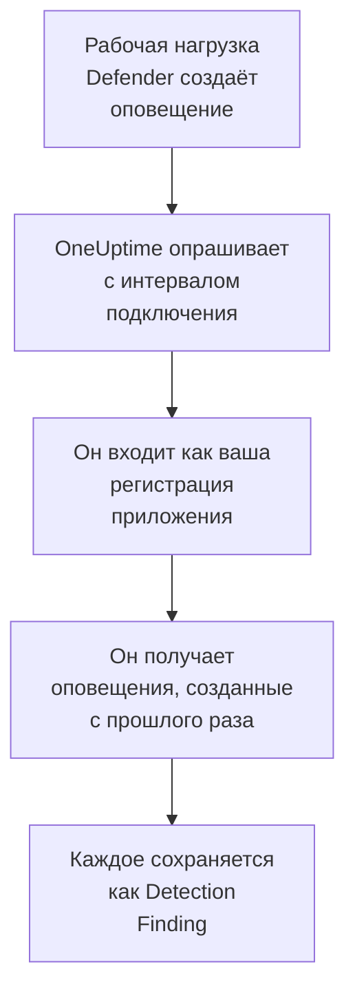

# Microsoft Defender XDR

Импортируйте оповещения каждой рабочей нагрузки [Microsoft Defender XDR](https://learn.microsoft.com/en-us/defender-xdr/) — от конечных точек, удостоверений, почты и облачных приложений — в события безопасности OneUptime. Там вы ищете их рядом со своими журналами, трассировками и метриками, сопоставляете их со всеми другими источниками и вызываете дежурных по тем, что действительно важны. OneUptime читает их через API безопасности Microsoft Graph с помощью созданной вами регистрации приложения: не нужны ни агент, ни playbook, ни рабочая область Sentinel.

:::cards
- [Настройка подключения](#настройка-подключения): Регистрация приложения, одно разрешение и форма подключения.
- [Что импортируется](#что-импортируется): Как каждое оповещение Defender становится событием безопасности.
- [Как работает опрос](#как-работает-опрос): Окно, которое читает каждый опрос, и что с ним делает загруженный тенант.
- [Устранение неполадок](#устранение-неполадок): Что означает каждая ошибка и что нужно изменить.
:::

## Как это работает



Каждую минуту OneUptime опрашивает каждое включённое подключение, интервал опроса которого истёк. Опрос входит в Microsoft Entra ID как ваша регистрация приложения, запрашивает у Microsoft Graph оповещения, созданные после предыдущего опроса ([List alerts_v2](https://learn.microsoft.com/en-us/graph/api/security-list-alerts_v2)), и сохраняет каждое как событие [OCSF](https://schema.ocsf.io/) Detection Finding (класс `2004`). Затем правила обнаружения, мониторы и панели мониторинга обрабатывают его как событие безопасности из любого другого источника.

## Перед началом работы

- В OneUptime роль Project Owner, Project Admin или Security Admin. Роли Security Member и Security Viewer видят подключения и историю их запусков, но не могут их менять.
- Тенант Microsoft Entra с лицензией Microsoft Defender XDR: любая рабочая нагрузка Defender, подключённая к порталу Microsoft Defender, например Defender for Endpoint, for Identity, for Office 365 или for Cloud Apps.
- Роль Entra, которая может регистрировать приложения, например Администратор приложений, и Глобальный администратор или Администратор привилегированных ролей для предоставления согласия администратора.
- Исходящий HTTPS от приложения и worker OneUptime к `login.microsoftonline.com` и `graph.microsoft.com` или к `login.microsoftonline.us` и `graph.microsoft.us` для Azure Government.

## Настройка подключения

Подключение выполняет вход с помощью [потока учётных данных клиента OAuth 2.0](https://learn.microsoft.com/en-us/entra/identity-platform/v2-oauth2-client-creds-grant-flow): как приложение и никогда как человек, с одним разрешением приложения.

:::steps
### Зарегистрируйте приложение

1. Войдите на [портал Azure](https://portal.azure.com) и откройте **Microsoft Entra ID**.
2. Перейдите в **App registrations → New registration**. Назовите приложение `OneUptime Security Events`, оставьте для **Supported account types** значение **Accounts in this organizational directory only**, оставьте URI перенаправления пустым и выберите **Register**.
3. На странице **Overview** приложения скопируйте **Идентификатор приложения (клиента)** и **Идентификатор каталога (клиента)**.

### Разрешите ему читать оповещения

1. Перейдите в **API permissions → Add a permission → Microsoft Graph → Application permissions**, выберите `SecurityAlert.Read.All` и нажмите **Add permissions**. Это разрешение с наименьшими привилегиями, которое вызов [List alerts_v2](https://learn.microsoft.com/en-us/graph/api/security-list-alerts_v2#permissions) принимает для приложения: не добавляйте `SecurityAlert.ReadWrite.All`.
2. Выберите **Grant admin consent for** для своего тенанта и подтвердите. Состояние разрешения должно быть **Granted**: без согласия каждое чтение отклоняется с кодом `403`.

### Создайте секрет клиента

Перейдите в **Certificates & secrets → Client secrets → New client secret**, выберите срок действия и нажмите **Add**. Скопируйте **Value** секрета, а не его **Secret ID**, прежде чем покинуть страницу: значение больше никогда не показывается.

Запомните, когда истекает срок действия секрета. В этот день опрос останавливается с ошибкой `Microsoft Defender XDR token request failed (HTTP 401)`, пока вы не замените секрет с помощью **Обновить учётные данные**.

### Добавьте подключение в OneUptime

Откройте **Продукты → Security Events → Подключения** (`/dashboard/{projectId}/security-events/connections`), нажмите **Добавить подключение**, выберите **Microsoft Defender XDR** в разделе **EDR / XDR** и нажмите **Далее**. Заполните параметры из таблицы ниже, нажмите **Далее** и вставьте значение секрета в поле **Секрет клиента**.

### Проверьте его перед сохранением

Нажмите **Проверить эти настройки** в разделе **Проверка перед сохранением**. Проверка выполняет вход и читает оповещения со значениями из формы, ничего не сохраняя, поэтому неверный секрет или отсутствующее согласие обнаруживаются ещё до создания подключения. Затем нажмите **Далее**, задайте подключению **Имя** и создайте его.
:::

| Параметр | Где его найти |
| --- | --- |
| **Идентификатор каталога (клиента)** | Страница **Overview** приложения. GUID тенанта или подтверждённый домен, например `contoso.onmicrosoft.com`. |
| **Идентификатор приложения (клиента)** | Страница **Overview** приложения. GUID приложения, у которого есть `SecurityAlert.Read.All`. |
| **Облако** | **Общедоступное облако Azure**, которое обслуживает и Microsoft 365 GCC, или **Azure Government (США)** для GCC High (`login.microsoftonline.us` и `graph.microsoft.us`). Microsoft 365 DoD и облако 21Vianet в Китае не поддерживаются. |
| **Секрет клиента** | **Value** секрета. Он шифруется, никогда не возвращается API и больше не показывается. Замените его с помощью **Обновить учётные данные** в подключении. |

На шаге **Опрос** также есть необязательное **Описание**, **Интервал опроса (минуты)** — целое число от `1` до `1440`, по умолчанию `5`, и **Включено**, изначально включённое.

## Что импортируется

Каждое [оповещение](https://learn.microsoft.com/en-us/graph/api/resources/security-alert) Defender XDR становится одним событием Detection Finding (класс OCSF `2004`) с поставщиком `Microsoft` и продуктом `Microsoft Defender XDR`, отнесённым к службе телеметрии `Microsoft Defender XDR`:

| Столбец OCSF | Поле оповещения |
| --- | --- |
| `eventUid` | `id`, идентификатор оповещения Graph, по которому также отбрасываются дубликаты |
| `time` | `firstActivityDateTime` или `createdDateTime`, если его нет |
| `message`, `ruleName` | `title` |
| `ruleId` | `detectorId` или `alertPolicyId`, если его нет |
| `severityName` | `severity`: `informational`, `low`, `medium` или `high`, а `unknown` остаётся Unknown |
| `statusName` | `status`: `new` становится New, `inProgress` — In Progress, `resolved` — Resolved |
| `mitreTechniques` | `mitreTechniques` |
| `mitreTactics` | `categories` или `category`, если это тактика ATT&CK: `CredentialAccess` становится `TA0006`. Остальные категории остаются в `attributes`. |
| `principalHost`, `principalUser`, `principalIp`, `principalProcess` | `evidence` с ролью `source`, `attacker` или `compromised`, иначе первое свидетельство каждого вида |
| `targetHost`, `targetUser`, `targetIp`, `targetResource` | `evidence` с ролью цели, например `destination` или `attacked`. URL, почтовые ящики и облачные ресурсы заполняют `targetResource`. |
| `observables` | Каждое имя хоста, IP, пользователь, имя файла, SHA-1 и SHA-256, URL, домен, почтовый ящик и идентификатор ресурса в `evidence` |
| `attributes` | Всё оповещение, развёрнутое в ключи с точками, например `evidence.0.hostName`, `serviceSource` и `incidentId` |

Импортируются оповещения из каждого `serviceSource`, включая оповещения Microsoft Sentinel, если Sentinel подключён к порталу Defender. Инциденты не импортируются, но каждое оповещение сохраняет свои `incidentId` и `incidentWebUrl` в `attributes`.

## Как работает опрос

Каждый опрос получает оповещения, созданные в его окне, по 100 на страницу, и следует по `@odata.nextLink` Graph, пока не прочитает всё окно:

```text
GET https://graph.microsoft.com/v1.0/security/alerts_v2?$filter=createdDateTime ge {start} and createdDateTime lt {end}&$top=100
```

- **Курсором служит время создания.** Defender часто создаёт оповещение через несколько часов после его `firstActivityDateTime`, и курсор по времени активности пропустил бы каждое такое оповещение.
- **Первый опрос смотрит на 24 часа назад**, чтобы новое подключение сразу показало свои недавние оповещения.
- **Каждый следующий опрос начинается за 1 минуту до сохранённого курсора**, поэтому оповещение, созданное на границе двух окон, читается дважды и импортируется один раз.
- **Опрос читает не больше 24 часов после курсора.** Подключение, курсор которого отстал, пока worker не работали или тенант был ограничен, догоняет серией 24-часовых окон.
- **Дубликаты отбрасываются по `id` оповещения** среди событий проекта от `Microsoft` / `Microsoft Defender XDR`, поэтому перекрытие, повторно прочитанное окно и импорт никогда не сохраняют оповещение дважды.
- **Неудачный запуск ничего не меняет.** После сетевой ошибки или кода ошибки от Graph курсор и длина окна остаются прежними, и следующий опрос заново читает то же окно. Единственное исключение — запрос, превысивший время ожидания: курсор остаётся на месте, но следующее окно вдвое короче, потому что слишком тяжёлое для своевременного ответа окно превышало бы время ожидания при каждой попытке.

### Когда окно содержит больше, чем может прочитать один опрос

Опрос читает не больше 20 страниц по 100 оповещений, то есть 2 000 оповещений. Если это ограничение останавливает его до конца окна, запуск получает статус **Частично** с таким предупреждением:

```text
Stopped after 20 alerts requests (the per-run request limit) before reading the whole window. Microsoft Graph lists alerts newest first and documents no way to sort them oldest first, so this run cannot name a point to resume from.
```

[List alerts_v2](https://learn.microsoft.com/en-us/graph/api/security-list-alerts_v2) документирует `$filter`, `$top`, `$skip` и `$count`, но не `$orderby`, и возвращает сначала самые новые оповещения. 2 000 оповещений, прочитанных остановленным запуском, — самые новые в его окне, поэтому перенос курсора за них пропустил бы более старые, до которых запуск так и не дошёл. Вместо этого OneUptime сокращает окно:

1. **Сузить.** Следующий опрос читает окно вдвое короче с той же начальной точки и продолжает делить его пополам, пока окно не будет прочитано целиком, вплоть до одной минуты. Предупреждение запуска говорит об этом: `This window holds more records than one poll can read; the next poll reads a {n} minute window from the same starting point.` Оповещения, уже импортированные из более длинного окна, пропускаются как дубликаты.
2. **Снова расти.** После того как окно прочитано целиком, курсор переносится на его конец, а следующее окно снова вдвое длиннее, до 24 часов.
3. **Пройти мимо одной минуты.** Если даже одна минута содержит больше 2 000 оповещений, опрос проходит мимо неё, чтобы новые оповещения продолжали поступать. Запуск остаётся **Частично**, а **Последняя ошибка** содержит `More records were created in the one minute from {cursor} to {end} than one poll can read. Polling moved past this minute so newer records keep arriving; use Import this time range in Diagnostics on this minute to recover what one run can read.` Импортируйте эту минуту с помощью **Import this time range**, чтобы восстановить то, что может прочитать один запуск.

Запуск со статусом **Частично** по другой причине, например из-за оповещения, которое не удалось прочитать как событие безопасности, повторяется так же, с той же начальной точки. Изменение **Интервал опроса (минуты)** ничего из этого не меняет: оно определяет, как часто начинается опрос, а не где начинается его окно.

### Запуск, просмотр и импорт по требованию

Нажмите **Диагностика** в подключении, чтобы увидеть его последние запуски и работать с ним вручную. Запускать эти действия может любой, кто может менять подключение; читать историю может любой, кто может его видеть.

- **Запустить сейчас** сразу запускает опрос с обычным курсором, даже если подключение не **Включено**.
- **Preview alerts** читает интервал времени до 7 дней и ничего не импортирует.
- **Import this time range** после вашего подтверждения импортирует интервал до 7 дней, не перемещая курсор. Уже импортированные оповещения пропускаются.
- **Copy diagnostics** в запуске копирует его отчёт для поддержки. Он никогда не содержит учётных данных.

## Проверка подключения

**Проверить подключение** в строке подключения и **Проверить эти настройки** в форме выполняются в процессе API, а не в фоновом worker, поэтому проверка отвечает даже тогда, когда проблема в самих worker. Она выполняет такие проверки по порядку:

| Проверка | Что она проверяет |
| --- | --- |
| **Конфигурация** | Все четыре параметра заданы и правильно оформлены. Если это не так, ни к чему не обращаются. |
| **Authenticate with Microsoft Entra** | Microsoft Entra ID выдаёт токен для Microsoft Graph в выбранном вами облаке. Проверка не проходит при неверном или просроченном секрете, неверном идентификаторе тенанта или клиента или неправильном облаке. |
| **Read alerts from Microsoft Graph** | Можно прочитать одно оповещение, созданное за последние 24 часа (`$top=1`). Код `403` здесь означает отсутствие разрешения `SecurityAlert.Read.All`, отсутствие согласия администратора или тенант без Defender XDR. |
| **Alerts available to import** | Сколько оповещений создано за последние 24 часа и за последние 7 дней, по одной странице из 100 для каждого интервала, поэтому `100+` означает больше. Отсутствие оповещений за 7 дней — предупреждение, а не ошибка. |
| **Background workers**, **Poll scheduler**, **Security event storage** | Сторона самого OneUptime: процесс забирает задания из очереди Worker, задание опроса выполняется каждую минуту, а хранилище событий безопасности отвечает. |
| **Scheduled polling** | Для сохранённого подключения: опрос включён, ни один запуск не застрял в ожидании worker, а опросы выполняются вовремя. |

У каждого запроса в проверке срок 20 секунд. Проверка никогда ничего не импортирует и не перемещает курсор, а каждая неудачная проверка сообщает, что нужно изменить.

## Устранение неполадок

**Последняя ошибка** подключения хранит полное сообщение об ошибке со скрытыми учётными данными после префикса, который называет неудавшийся шаг. Если у подключения есть ошибка, выберите **Просмотреть ошибку** в столбце **Действия**, чтобы прочитать её, и **Скопировать ошибку** в диалоговом окне, чтобы скопировать. Сначала прочитайте префикс.

:::details Last Error начинается с `Microsoft Defender XDR token request`
- `Microsoft Defender XDR token request failed (HTTP ...)`: Microsoft Entra ID отказался выдать токен, поэтому к Graph даже не обращались. Сообщение заканчивается подсказкой по коду `error` из Entra:
  - `invalid_client` (`AADSTS7000215`): секрет неверен, истёк или принадлежит другому приложению. Создайте новый в **Certificates & secrets** и сохраните его с помощью **Обновить учётные данные**.
  - `unauthorized_client` (`AADSTS700016`): **Идентификатор приложения (клиента)** отсутствует в этом **Идентификатор каталога (клиента)**, или **Облако** указано неверно.
  - `AADSTS90002`: такого тенанта нет.
  - `invalid_scope`: область Graph не существует в выбранном облаке. Проверьте **Облако**.
- `Microsoft Defender XDR token request returned ...`: Microsoft Entra ID ответил чем-то непригодным — телом не в формате JSON или без `access_token`. Обычно это прокси или шлюз посередине, а не учётные данные.
- `Microsoft Defender XDR token request did not complete: ...`: конечная точка токенов недоступна или не ответила вовремя. Проверьте исходящий HTTPS от приложения и worker OneUptime к `login.microsoftonline.com` или `login.microsoftonline.us`.
:::

:::details Last Error начинается с `Microsoft Defender XDR alerts request`
- `Microsoft Defender XDR alerts request failed (HTTP ...)`: Graph отказался вернуть список оповещений. Сообщение называет код ошибки Graph и даёт подсказку:
  - `403` (`Authorization_RequestDenied`): нет `SecurityAlert.Read.All` или согласия администратора на него, либо у тенанта нет лицензии Defender XDR. Согласие вступает в силу через несколько минут.
  - `401` (`InvalidAuthenticationToken`) после выдачи токена: обычно **Облако** не соответствует тенанту.
  - `429` (`TooManyRequests`): Graph ограничивает приложение, и следующий опрос заново читает то же окно. Сообщение не может привести `Retry-After` из Graph, потому что HTTP-клиент OneUptime не сохраняет заголовки ответа при ошибке. Если это повторяется, увеличьте **Интервал опроса (минуты)**.
  - `5xx`: проблема на стороне Graph. Следующий опрос повторит попытку.
  - `400`: Graph не стал выполнять запрос, который формирует OneUptime, а не ваши параметры. Скопируйте сообщение для поддержки OneUptime.
- `Microsoft Defender XDR alerts request returned ...`: Graph ответил `200`, но с тем, что коннектор не смог использовать: тело не в формате JSON, нет списка `value` или `@odata.nextLink` не является ссылкой `https://` на хост Graph вашего облака. Такая ссылка отклоняется, чтобы токен никогда не отправлялся куда-либо ещё. Об этом сообщается, а не считается пустым окном, чтобы курсор никогда не проходил мимо оповещений, которые никто не прочитал.
- `Microsoft Defender XDR alerts request did not complete: ...`: Graph недоступен или не ответил вовремя: 60 секунд для опроса, 20 для проверки. Проверьте исходящий HTTPS к `graph.microsoft.com` или `graph.microsoft.us`.
:::

:::details Проверка проходит, но Last Polled — Never
Задание опроса ни разу не выполнялось. Прочитайте проверки **Background workers** и **Poll scheduler**. В самостоятельно размещённой установке обычная причина — `DISABLE_QUEUE_WORKERS=true` в приложении без отдельного развёртывания worker, которое забирало бы задания: установите `false` или запустите развёртывание worker (Helm: `worker.enabled: true`, по умолчанию `false`).
:::

:::details Опросы проходят успешно, но известного вам оповещения нет
Сравните `createdDateTime` оповещения на портале Defender с окном запуска в **Диагностика**: окна строятся по времени создания, а не по времени активности.

- Оповещение, созданное до появления подключения, старше первого просмотра на 24 часа назад. Импортируйте его с помощью **Import this time range**.
- Запуск со статусом **Частично** был остановлен ограничением в 2 000 оповещений. Следующий опрос читает более короткое окно с того же начала, поэтому оповещение импортируется, как только окно, которое его содержит, будет прочитано целиком.
- Если **Последняя ошибка** называет минуту, мимо которой прошёл опрос, импортируйте эту минуту с помощью **Import this time range**.
:::

:::details Одно и то же оповещение появляется дважды
Перекрытие в 1 минуту здесь ни при чём: второе чтение считается дубликатом и не сохраняется. Два события с одинаковым `eventUid` были импортированы под разными продуктами, например одно и то же оповещение пришло ещё и через подключение Microsoft Sentinel. Дубликаты отбрасываются в пределах поставщика и продукта.
:::

## Что вы получаете

- **Поиск.** Фильтруйте оповещения Defender по серьёзности, статусу, технике MITRE, хосту, пользователю, IP или любому наблюдаемому объекту в обозревателе событий безопасности рядом с журналами и метриками этого хоста.
- **Сопоставление.** Свидетельства каждого оповещения — его устройства, пользователи, IP, файлы и URL — индексируются как наблюдаемые объекты, поэтому один поиск находит всё, что упоминает хост, во всех источниках.
- **Правила обнаружения.** Правила Sigma, которые выполняются по расписанию над вашими событиями безопасности и открывают оповещения, вызывающие дежурных.
- **Мониторы.** Мониторы событий безопасности подсчитывают совпадающие события и открывают инциденты или оповещения при превышении порога.

События безопасности тарифицируются как остальная телеметрия, за каждый принятый ГБ. См. [цены](https://oneuptime.com/pricing).

## Дальнейшие шаги

:::cards
- [События безопасности](/docs/telemetry/security-events): Поиск, сопоставление и оповещения по импортированным данным.
- [Microsoft Sentinel](/docs/integrations/microsoft-sentinel): Импортируйте также инциденты рабочей области Sentinel.
- [Роли](/docs/permissions/reference#роли): Что могут видеть и менять роли Security.
- [Обзор интеграций](/docs/integrations/index): Другие инструменты, которые можно подключить.
:::
