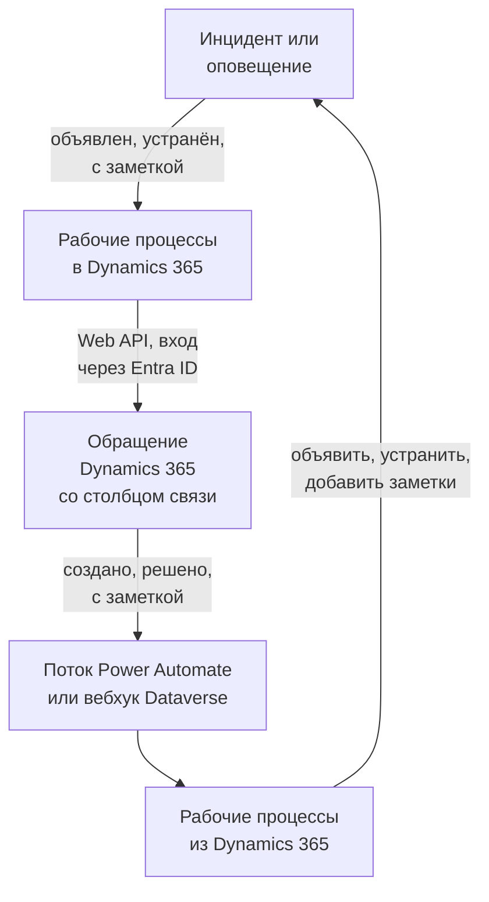

# Microsoft Dynamics 365

Держите обращения [Microsoft Dynamics 365](https://www.microsoft.com/dynamics-365) в согласии с инцидентами и оповещениями OneUptime, в обе стороны. Готовые шаблоны рабочих процессов создают обращение для каждого инцидента или оповещения, закрывают его, когда запись устранена, и копируют в него заметки. Другие объявляют инциденты по новым обращениям и возвращают решения и заметки. Плагина нет: рабочие процессы вызывают Web API Dataverse, а Dynamics 365 вызывает их URL вебхуков.

:::cards
- [Подготовка Dynamics 365](#подготовка-dynamics-365): Регистрация приложения, пользователь приложения и столбец связи.
- [Начало с шаблона](#начало-с-шаблона): 13 шаблонов, что они запрашивают и как их настроить.
- [Как работают шаблоны](#как-работают-шаблоны): Как обращения и записи остаются связанными, без циклов.
- [Сборка своими силами](#сборка-своими-силами): Каждое направление вручную, если шаблон не подходит.
:::

## Как это работает



Каждый шаблон — это небольшой рабочий процесс, поэтому вы берёте только нужные направления — для инцидентов, оповещений или того и другого. Шаблоны OneUptime → Dynamics 365 вызывают Web API Dataverse, выполняя вход как приложение через Microsoft Entra ID. Шаблоны Dynamics 365 → OneUptime запускаются, когда их вызывает поток Power Automate или вебхук Dataverse. Текстовый столбец, который вы добавляете в таблицу Case, связывает каждое обращение с его записью.

## Перед началом работы

- Среда Dynamics 365 с таблицей **Case**. Обращения появляются из Dynamics 365 Customer Service: в среде Dataverse без него нет таблицы `incident`, в которую можно писать.
- Права на регистрацию приложения в **Microsoft Entra ID** и на создание пользователя приложения в среде. Часто это два разных администратора.
- В OneUptime — право создавать рабочие процессы. В OneUptime Cloud для рабочих процессов нужен тариф **Growth** или выше.

> [!NOTE]
> На этой странице используются имена Dataverse, а не подписи в формах Dynamics. Обращение — это таблица `incident`, её коллекция в URL — `incidents`, ключ — `incidentid`, а столбец заголовка — `title`. Номер обращения, который вы видите, — это `ticketnumber`.

## Подготовка Dynamics 365

Это нужно и шаблонам, и рабочему процессу, который вы соберёте сами. OneUptime выполняет вход как приложение, а не как человек, по потоку OAuth 2.0 с учётными данными клиента.

:::steps
### Зарегистрируйте приложение в Microsoft Entra ID

1. Войдите на [портал Azure](https://portal.azure.com) как администратор клиента вашей среды Dynamics и откройте **Microsoft Entra ID**.
2. Перейдите в **App registrations → New registration**. Назовите приложение `OneUptime Integration`, оставьте для **Supported account types** значение **Accounts in this organizational directory only** и выберите **Register**.
3. На странице **Overview** приложения скопируйте **Application (client) ID** и **Directory (tenant) ID**.
4. Перейдите в **Certificates & secrets → Client secrets → New client secret** и, прежде чем уйти со страницы, скопируйте **Value** секрета, а не его ID: он больше никогда не показывается. Секрет клиента действует не более 24 месяцев, поэтому запишите, когда истекает его срок.

Не добавляйте разрешения API и не выдавайте согласие администратора: без вошедшего пользователя они ничего не делают. Что может делать приложение, решает Dynamics 365 через его пользователя приложения.

### Создайте пользователя приложения

1. В [центре администрирования Power Platform](https://admin.powerplatform.microsoft.com/) выберите **Manage → Environments**, а затем свою среду.
2. Выберите **Settings → Users + permissions → Application users**, затем **+ New app user** и **+ Add an app**. Выберите регистрацию и нажмите **Add**.
3. Выберите **Business unit**, затем назначьте пользовательскую роль безопасности значком редактирования рядом с **Security roles**. На уровне Organization роли нужны:
   - **Case**: Create, Read, Write, Append и Append To.
   - **Note**: Create, Read и Append — для шаблонов заметок.
   - **Activity**: Create, Read и Append, потому что закрытие обращения записывает Case Resolution, а это действие.
   - **Account** и **Contact**, если обращения создаются от имени контакта: Read и Append To.
4. Выберите **Save**, затем **Create**.

У пользователя приложения может быть только пользовательская роль: скопируйте существующую и урежьте её. Без этого пользователя Microsoft Entra ID всё равно выдаёт токены, но каждый вызов Dynamics 365 завершается ошибкой `403` и `0x80072560`, «The user isn't a member of the organization».

### Добавьте столбец связи в таблицу Case

В Dataverse нет ничего похожего на метки Jira, поэтому обращение и запись OneUptime находят друг друга через добавленный вами столбец.

1. На [make.powerapps.com](https://make.powerapps.com) выберите свою среду, откройте **Tables → Case → Columns** и выберите **New column**.
2. Назовите его `OneUptime Link`, оставьте **Data type** равным **Single line of text** и сохраните. Максимальной длины по умолчанию, 100, более чем достаточно: шаблоны записывают не более 55 символов.
3. Откройте новый столбец и скопируйте его **Logical name**, например `new_oneuptimelink`. Префикс задаётся издателем вашего решения, поэтому у вас он может отличаться, например `cr4f2_oneuptimelink`.

Добавьте столбец в форму Case, если агенты должны видеть связь.
:::

## Начало с шаблона

В диалоге **Создать рабочий процесс** есть 13 шаблонов Dynamics 365 в категории **Dynamics 365**: семь для инцидентов, затем шесть для оповещений, каждая группа под своим заголовком. Они используют общий столбец связи, поэтому любые их сочетания работают вместе.

### Шаблоны для инцидентов

| Шаблон | Что делает | Что запрашивает |
| --- | --- | --- |
| **OneUptime → Dynamics 365** | | |
| Create a Dynamics 365 case when an incident is declared | Создаёт обращение для каждого нового инцидента с приоритетом по его серьёзности и ID инцидента в столбце связи. Инциденты, объявленные из Dynamics 365, и приватные инциденты пропускаются. | Пять настроек Dynamics 365, клиент для новых обращений и URL OneUptime |
| Resolve the Dynamics 365 case when the incident is resolved | Закрывает связанное обращение как **Problem Solved**, когда инцидент устранён, записывая Case Resolution так же, как при ручном решении. Никогда не открывает обращение заново. | Пять настроек Dynamics 365 |
| Copy incident private notes to the Dynamics 365 case | Добавляет каждую новую приватную заметку в связанное обращение как заметку. | Пять настроек Dynamics 365 |
| Copy incident public notes to the Dynamics 365 case | Добавляет каждую новую публичную заметку в связанное обращение как заметку, чтобы агенты могли сообщать клиентам то, что говорит страница статуса. | Пять настроек Dynamics 365 |
| **Dynamics 365 → OneUptime** | | |
| Declare an incident when a Dynamics 365 case is created | Объявляет инцидент для каждого нового обращения, скрытый от ваших страниц статуса, с серьёзностью по приоритету обращения, затем записывает ID инцидента в столбец связи обращения. | Пять настроек Dynamics 365 и поток или вебхук для новых обращений |
| Resolve the incident when its Dynamics 365 case is resolved | Устраняет инцидент, когда решено связанное с ним обращение. | Пять настроек Dynamics 365 и поток или вебхук для изменений статуса обращений |
| Add Dynamics 365 case notes to the incident as private notes | Копирует каждую заметку, которую агент добавляет в связанное обращение, в инцидент как приватную заметку. | Пять настроек Dynamics 365 и поток или вебхук для новых заметок |

### Шаблоны для оповещений

Шаблоны для оповещений делают ту же работу для оповещений. Их на один меньше, потому что у оповещений нет публичных заметок, а **Create an alert when a Dynamics 365 case is created** не записывает настроек страницы статуса, потому что оповещение никогда не попадает на страницу статуса.

| Шаблон | Что делает | Что запрашивает |
| --- | --- | --- |
| **OneUptime → Dynamics 365** | | |
| Create a Dynamics 365 case when an alert is created | Создаёт обращение для каждого нового оповещения, включая каждое оповещение от монитора. Оповещения, созданные из Dynamics 365, и приватные оповещения пропускаются. | Пять настроек Dynamics 365, клиент для новых обращений и URL OneUptime |
| Resolve the Dynamics 365 case when the alert is resolved | Закрывает связанное обращение как **Problem Solved**, когда оповещение устранено. | Пять настроек Dynamics 365 |
| Copy alert private notes to the Dynamics 365 case | Добавляет каждую новую приватную заметку в связанное обращение как заметку. | Пять настроек Dynamics 365 |
| **Dynamics 365 → OneUptime** | | |
| Create an alert when a Dynamics 365 case is created | Создаёт оповещение для каждого нового обращения с серьёзностью по приоритету обращения, затем записывает ID оповещения в столбец связи обращения. | Пять настроек Dynamics 365 и поток или вебхук для новых обращений |
| Resolve the alert when its Dynamics 365 case is resolved | Устраняет оповещение, когда решено связанное с ним обращение. | Пять настроек Dynamics 365 и поток или вебхук для изменений статуса обращений |
| Add Dynamics 365 case notes to the alert as private notes | Копирует каждую заметку, которую агент добавляет в связанное обращение, в оповещение как приватную заметку. | Пять настроек Dynamics 365 и поток или вебхук для новых заметок |

Ни один из шаблонов OneUptime → Dynamics 365 не отправляет в Dynamics 365 инцидент с отметкой **Приватный инцидент** или оповещение с отметкой **Приватное оповещение**: ни саму запись, ни её состояние, ни заметки, если вы это не включите. См. [Изменение того, что делает шаблон](#изменение-того-что-делает-шаблон).

**Мониторы создают оповещения сами, и их может быть много.** **Create a Dynamics 365 case when an alert is created** создаёт обращение для каждого. Если не каждое оповещение заслуживает обращения, поставьте между триггером и остальной частью рабочего процесса блок **If / Else**, например по `{{local.components.alert-on-create-1.returnValues.model.alertSeverity.name}}`, и подключайте дальше только его сторону **Yes**.

### Что запрашивают шаблоны

Шаг **Настроить** мастера создания запрашивает до семи значений: каждый шаблон запрашивает первые пять — настройки Dynamics 365, — а два шаблона, создающих обращение, ещё и последние два. Шаг проверяет вид каждой настройки Dynamics 365, прежде чем что-либо создать, и подсказывает, что ввести вместо неё, потому что значение неверного вида нигде не вызывает ошибки до запуска.

- **Dynamics 365 Environment URL** — адрес вашей среды, например `https://yourorg.crm.dynamics.com`, из [центра администрирования Power Platform](https://admin.powerplatform.microsoft.com/) в разделе **Environments**, ваша среда, **Environment URL**. Только адрес: не конечная точка Web API, которая заканчивается на `/api/data/v9.2`, и без косой черты в конце.
- **Directory (Tenant) ID** — со страницы **Overview** регистрации приложения.
- **Application (Client) ID** — с той же страницы.
- **Client Secret Value** — **Value** секрета клиента из **Certificates & secrets**. Не его **Secret ID**, который является GUID: здесь мастер отклоняет GUID.
- **Case Link Column** — логическое имя столбца связи, например `new_oneuptimelink`.
- **Customer for New Cases** — его запрашивают только два шаблона, создающих обращение. Каждому обращению нужен клиент, а у инцидента OneUptime его нет, поэтому все новые обращения создаются от имени одного клиента: вставьте ID организации или `contacts(<id>)` для контакта. Откройте запись в Dynamics 365: её ID — часть адреса после `id=`.
- **OneUptime URL** — его запрашивают только два шаблона, создающих обращение: адрес, по которому вы открываете OneUptime, например `https://oneuptime.com`. Описание обращения ссылается с его помощью обратно на инцидент или оповещение.

**Как шаблоны выполняют вход.** Мастер сохраняет клиента, ID клиента и секрет в одной [переменной OAuth 2.0](/docs/workflows/variables#переменные-oauth-20-токены-которые-обновляются-сами), `dynamicsAccessToken`, в разделе **Переменные рабочих процессов** рабочего процесса: Client Credentials, URL токена `https://login.microsoftonline.com/<tenant>/oauth2/v2.0/token`, область `<environment URL>/.default` и секрет клиента, который отправляется в теле запроса и хранится в зашифрованном виде. Каждый вызов Dynamics 365 отправляет `Authorization: Bearer {{local.variables.dynamicsAccessToken}}`. OneUptime получает токен в первый раз, когда он нужен шагу, получает новый до истечения срока и заменяет его на `[REDACTED]` в журналах запусков и трассировках шагов.

Чтобы проверить вход до любого запуска, откройте **Переменные рабочих процессов**, нажмите **Просмотр** у `dynamicsAccessToken` и нажмите **Обновить сейчас**. **Access Token Fetched** означает, что регистрация приложения настроена верно. Иначе ошибка Microsoft Entra ID называет, что не так, например `AADSTS7000215: Invalid client secret provided`.

Каждый рабочий процесс хранит свою копию. Когда вы меняете секрет клиента, откройте `dynamicsAccessToken` в каждом рабочем процессе Dynamics 365 и воспользуйтесь **Обновить учётные данные**.

### Создание рабочих процессов

:::steps
1. Откройте **Рабочие процессы → Создать рабочий процесс**. В разделе **Или начать с шаблона** выберите **Dynamics 365** в списке категорий или введите `Dynamics` в **Поиск шаблонов…** и нажмите на нужный шаблон. Он откроется и покажет, что делает и какие настройки запросит. Нажмите **Использовать шаблон**.
2. **Имя** заполняется из шаблона. При желании измените его.
3. **Настроить** запрашивает значения, описанные выше.
4. Нажмите **Создать рабочий процесс**. Каждый рабочий процесс создаётся выключенным: включите **Включено** вверху окна **Конструктор**.
:::

Начните с **Create a Dynamics 365 case when an incident is declared** или, для оповещений, с **Create a Dynamics 365 case when an alert is created**: любой другой шаблон OneUptime → Dynamics 365 того же вида находит обращение по связи, которую записывает этот. Включите его, объявите тестовый инцидент или создайте тестовое оповещение и откройте **Журналы → Запуски** рабочего процесса. Последний шаг запуска должен показать `✅ Opened Dynamics 365 case CAS-01001-X1Y2Z3 for INC-42, linked as oneuptime-incident-<id>.`

### Подключение шаблонов Dynamics 365 → OneUptime

Шаблоны Dynamics 365 → OneUptime — три для инцидентов и три для оповещений — запускаются от [триггера Webhook](/docs/workflows/triggers#webhook), поэтому Dynamics 365 нужно сообщить, куда отправлять события. Делайте это в таком порядке:

1. Создайте рабочий процесс и **сначала включите его**. Выключенный рабочий процесс отклоняет доставки, и они не ставятся в очередь.
2. Откройте окно **Конструктор** рабочего процесса, нажмите на блок триггера **Webhook** (`webhook-1`) и нажмите **Скопировать URL** вверху его настроек. URL выглядит так:

   ```text
   https://<your OneUptime host>/workflow/trigger/<webhook secret key>
   ```

3. Настройте отправку в него из Dynamics 365 — потоком Power Automate или вебхуком Dataverse.

Каждому шаблону нужно знать только, какая строка изменилась. Прежде чем что-либо делать, он заново читает эту строку из Dynamics 365, поэтому никогда не берёт заголовок, статус или связь обращения из запроса, и ему всё равно, кто из двух его отправил.

:::tabs
@tab Power Automate flow
В [Power Automate](https://make.powerautomate.com) создайте **Automated cloud flow** с триггером **When a row is added, modified or deleted** коннектора **Microsoft Dataverse**, настроенным как показано ниже, с **Scope** равным **Organization**. Добавьте встроенное действие **HTTP**: **Method** — `POST`, **URI** — URL рабочего процесса, заголовок `Content-Type: application/json` и тело ниже, с ID строки, выбранным из динамического содержимого триггера.

| Шаблон | Change type | Table name | Select columns | Body |
| --- | --- | --- | --- | --- |
| Объявить инцидент / создать оповещение при создании обращения | Added | Cases | | `{"incidentid": "<Case>"}` |
| Устранить инцидент / оповещение, когда решено его обращение | Modified | Cases | `statecode,statuscode` | `{"incidentid": "<Case>"}` |
| Добавить заметки обращения в инцидент / оповещение как приватные | Added | Notes | | `{"annotationid": "<Note>"}` |

Чтобы отправлять только некоторые обращения, используйте **Filter rows** триггера, например `prioritycode eq 1` для обращений с высоким приоритетом. Можно также отправлять весь вывод триггера: шаблоны так же читают из него ID строки и её `SdkMessage`.
@tab Dataverse webhook
Зарегистрируйте URL с помощью [Plug-in Registration Tool](https://learn.microsoft.com/en-us/power-apps/developer/data-platform/register-web-hook): **Register New WebHook** с аутентификацией **HttpHeader** и собственным заголовком; секретом служит сам URL. Затем зарегистрируйте на нём шаг для каждого события ниже, с **Event Pipeline Stage of Execution** равным **PostOperation** и **Execution Mode** равным **Asynchronous**.

| Шаблон | Message | Primary Entity | Filtering Attributes |
| --- | --- | --- | --- |
| Объявить инцидент / создать оповещение при создании обращения | `Create` | `incident` | |
| Устранить инцидент / оповещение, когда решено его обращение | `Close`, а также `Update` для изменений статуса другими | `incident` | `statecode, statuscode` (Update) |
| Добавить заметки обращения в инцидент / оповещение как приватные | `Create` | `annotation` | |

Решение обращения вызывает сообщение **Close**, а не **Update**, поэтому этому шаблону нужны оба. Вебхук отправляет контекст выполнения подключаемого модуля, в котором строка указана в `PrimaryEntityId`, а для **Close** — в его `IncidentResolution`, и шаблоны читают её оттуда. Вебхук Dataverse вызывает только порты 80 и 443 и не имеет собственного фильтра строк: каждое новое обращение доходит до шаблона создания, если вы не сузите его с помощью `ONLY_PRIORITIES`.
:::

Прежде чем полагаться на любой из вариантов:

- **Любой, у кого есть URL, может запустить рабочий процесс.** Поскольку шаблоны заново читают каждую строку из Dynamics 365, запрос может лишь заставить их посмотреть на настоящее обращение или заметку. Но он всё же может заставить шаблоны создания обработать обращение, которое ещё не связано. Храните URL только в потоке или вебхуке. Если он утёк, нажмите на триггер **Webhook** в окне **Конструктор** рабочего процесса, нажмите **Сбросить URL** и вставьте новый URL в поток или вебхук. Старый URL сразу перестаёт работать.
- **Каждое событие — это запуск**, включая те, что шаблон пропускает. В OneUptime Cloud каждое из них учитывается в запусках рабочих процессов вашего тарифа, и фильтрация в потоке сдерживает это число. См. [Ограничения тарифа](/docs/workflows/configuration#ограничения-тарифного-плана).
- **Используете оба шаблона, создающих запись по обращению?** **Declare an incident when a Dynamics 365 case is created** и **Create an alert when a Dynamics 365 case is created** оба обрабатывают каждое полученное обращение. Каждый сначала проверяет столбец связи, но две доставки для одного нового обращения приходят одновременно, поэтому обращение может получить и инцидент, и оповещение. Отправляйте им разные обращения, например по типу обращения.

### Проверка работы

Каждый шаблон заканчивается шагом **Log**, который сообщает, что произошло, поэтому смотреть нужно на последний шаг запуска в **Журналы → Запуски**:

- `✅` — шаблон выполнил свою работу и называет обращение, инцидент или оповещение.
- `ℹ️` — шаблон намеренно пропустил событие и объясняет почему: обращение не связано с записью этого вида, заметка пришла с другой стороны, запись приватная или для нового состояния не задан статус обращения.
- `❌` — вызов завершился ошибкой. Для вызова Dynamics 365 строка содержит ответ Dynamics 365.
- `⚠️` — шаблон, создающий запись по обращению, создал её, но Dynamics 365 не приняла связь, поэтому другие шаблоны пока не могут её найти. Впишите связь в столбец обращения вручную.

Если запуск останавливается на первом шаге Dynamics 365 с `Could not get an OAuth 2.0 access token for {{local.variables.dynamicsAccessToken}}`, настройки входа неверны, а сообщение цитирует ответ Microsoft Entra ID. См. [Что запрашивают шаблоны](#что-запрашивают-шаблоны).

## Как работают шаблоны

### Как стороны остаются связанными

Связь хранит обращение. У обращения, принадлежащего инциденту, в столбце связи записано `oneuptime-incident-<incident id>`, а у принадлежащего оповещению — `oneuptime-alert-<alert id>`. ID — последняя часть адреса записи в панели управления.

Шаблоны, создающие обращение, записывают её при создании обращения, а шаблоны, создающие запись по обращению, — как только запись появилась. Все остальные шаблоны переходят на другую сторону по ней: шаблоны OneUptime → Dynamics 365 ищут обращение по связи, а шаблоны Dynamics 365 → OneUptime читают ID записи из обращения. Чтобы связать обращение, созданное вручную, сами впишите значение в его столбец связи, но только если у записи ещё нет обращения.

**Обращение связано либо с инцидентом, либо с оповещением, но не с обоими.** Один столбец служит обоим видам. Шаблоны для инцидентов игнорируют обращение, связанное с оповещением, и наоборот, а шаблоны, создающие запись по обращению, не трогают обращение, в столбце связи которого есть хоть что-то.

**У записи одно обращение.** Шаблоны, которые пишут в обращение, действуют, только когда связь записи содержит ровно одно обращение. Если связь скопирована во второе обращение, они останавливаются, и каждый запуск заканчивается пропуском с названием обоих:

```text
More than one Dynamics 365 case holds the link oneuptime-incident-<id> (CAS-01001-X1Y2Z3, CAS-01002-K4L5M6). Clear it on every case except the one opened for the incident.
```

Инциденты и оповещения, созданные по обращению, также хранят ID и номер обращения в `customFields.dynamicsCaseId` и `customFields.dynamicsCaseNumber`, которые записываются при их создании. Так шаблоны, создающие обращение, узнают, что у записи оно уже есть.

### Как шаблоны избегают циклов

Каждая запись в одном направлении — это событие в другом: заметка, добавленная в обращение, возвращается как новая заметка, а приватная заметка, добавленная в OneUptime, запускает триггер заметок. Эхо останавливают четыре вещи:

- **Маркеры в тексте.** Каждая заметка, которую шаблоны добавляют в обращение, озаглавлена `Synced from OneUptime: …`, как и тема каждой записываемой ими Case Resolution. Каждая заметка, записанная из Dynamics 365, и первопричина каждой смены состояния, сделанной оттуда, начинаются с `Synced from Dynamics 365`. Каждое направление пропускает текст с маркером другой стороны, даже в заметке, где кто-то его процитировал.
- **Связь с первого сохранения.** Обращение, созданное OneUptime, содержит связь с момента появления, поэтому, когда возвращается его **Create**, шаблон, создающий запись по обращению, видит его связанным и ничего не делает.
- **`customFields.dynamicsCaseId`.** Это поле есть у записи, созданной по обращению, и шаблоны, создающие обращение, пропускают такие записи.
- **Состояния двигаются только вперёд, с обеих сторон.** Устранение записи закрывает обращение, и **Close** обращения застаёт запись уже устранённой. Когда первым решается обращение, устраняется запись, и её обновление застаёт обращение уже закрытым. Решённое или отменённое обращение никогда не открывается заново.

Сохраняйте маркеры, когда редактируете шаблоны. Это константы `FROM_ONEUPTIME` и `FROM_DYNAMICS` во вспомогательном блоке в начале каждого скрипта.

### Изменение того, что делает шаблон

Откройте окно **Конструктор** рабочего процесса и нажмите на блок, который хотите изменить. Чаще всего нужно менять константы в начале скрипта — **JavaScript Code** блока **Run Custom JavaScript**, сразу под общим вспомогательным блоком. Версии для инцидентов и для оповещений хранят одни и те же константы в одних и тех же блоках.

| Константа | Шаблон и блок | Что задаёт |
| --- | --- | --- |
| `SYNC_PRIVATE_INCIDENTS`, `SYNC_PRIVATE_ALERTS` | Каждый шаблон OneUptime → Dynamics 365 — `prepare-case-1`, `plan-case-1`, `build-note-1` | `false` не пускает приватные записи в Dynamics 365: для них не создаётся обращение, их обращение не меняется, а заметки не добавляются. Задайте `true` в каждом шаблоне, который должен их отправлять. |
| `SEVERITY_TO_PRIORITY`, `DEFAULT_PRIORITY` | Создание обращения Dynamics 365 — `prepare-case-1` | Уровни серьёзности проекта распределяются по приоритетам обращений по порядку: самый серьёзный создаёт обращение High (`1`), наименее серьёзный — Low (`3`), а промежуточные — Normal (`2`). Укажите уровень серьёзности по имени строчными буквами, чтобы самостоятельно выбрать его приоритет, например `{ 'major incident': 1 }`. `DEFAULT_PRIORITY` (`2`) используется для уровня серьёзности, которого нет в списке проекта, или для проекта только с одним уровнем. |
| `CASE_ORIGIN`, `CASE_TYPE` | Создание обращения Dynamics 365 — `prepare-case-1` | `caseorigincode` (`3`, Web) и `casetypecode` (`2`, Problem) нового обращения. Чтобы задать любой другой столбец, добавьте его в `CASE` в том же скрипте под его логическим именем. |
| `MAX_TITLE_LENGTH`, `MAX_DESCRIPTION_LENGTH` | Создание обращения Dynamics 365 — `prepare-case-1` | Собственные ограничения таблицы Case: 200 и 2000 символов. Описание сохраняет ссылку обратно на OneUptime, сколько бы ни было обрезано. Увеличьте их, если ваша таблица Case допускает больше. |
| `RESOLVED_CASE_STATUS` | Решение обращения Dynamics 365 — `plan-case-1` | Статус, с которым устранённая запись закрывает своё обращение: `5` — Problem Solved, `1000` — Information Provided. |
| `STATE_TO_CASE_STATUS` | Решение обращения Dynamics 365 — `plan-case-1` | Переводит обращение, когда запись достигает другого состояния, по имени состояния: `{ Acknowledged: 4 }` переводит его в Researching, когда инцидент подтверждён. Активные статусы Dynamics 365: `1` In Progress, `2` On Hold, `3` Waiting for Details и `4` Researching. Состояние устранения, указанное здесь, закрывает обращение с названным статусом. |
| `PRIORITY_RANK` | Создание по обращению Dynamics 365 — `prepare-incident-1`, `prepare-alert-1` | Сопоставляет приоритет обращения (`1` High, `2` Normal, `3` Low) с `0` (самый серьёзный уровень), `1` или `2` (наименее серьёзный). Приоритеты, которых нет в списке, попадают в середину. С двумя уровнями серьёзности оповещений нового проекта Normal становится Low, если не заменить `2: 1` на `2: 0`. |
| `ONLY_PRIORITIES` | Создание по обращению Dynamics 365 — `prepare-incident-1`, `prepare-alert-1` | Пустая — принимает каждое обращение, которое отправляет поток или вебхук. `[1]` создаёт записи только для обращений с высоким приоритетом. |
| `CASE_STATUS_TO_STATE`, `CASE_STATE_TO_STATE_FLAG` | Устранение при решении обращения Dynamics 365 — `decide-state-1` | Статус обращения по имени — в состояние OneUptime, например `{ Researching: 'Acknowledged' }`. Иначе решает состояние обращения: Resolved устраняет запись. Добавьте `2: 'isResolvedState'`, чтобы устранять её и при отмене обращения. |
| `MESSAGES` | Каждый шаблон Dynamics 365 → OneUptime — `read-event-1` | События, которые обрабатывает шаблон. Добавьте `'Update'` в список шаблона заметок, чтобы копировать и отредактированные заметки: каждая правка становится новой заметкой. |
| `MAX_NOTE_LENGTH` | Шаблоны заметок — `build-note-1`, `read-note-1` | Самая длинная заметка, которую пишет каждый из них: 100 000 символов в Dynamics 365 — собственный предел заметки — и 30 000 в OneUptime. |

Имена состояний и статусов, используемые как ключи, нужно писать в точности так, как они называются, с учётом регистра. Не допускайте `{{` в коде: скрипт заполняется перед запуском, как любая другая настройка, поэтому две открывающие фигурные скобки подряд были бы прочитаны как ссылка.

### Ограничения

- **Коммерческое облако Microsoft.** URL токена — `login.microsoftonline.com`. Для облаков US Government (GCC High, DoD) или Китая откройте `dynamicsAccessToken`, воспользуйтесь **Изменить настройки** и замените URL токена хостом входа вашего облака, например `login.microsoftonline.us`.
- **Dynamics 365 может отказаться решать обращение.** Ваши настройки Customer Service могут запрещать решение обращения, пока у него есть открытые действия или открытые дочерние обращения, а бизнес-правило или подключаемый модуль тоже могут отказать. Запуск заканчивается строкой `❌ Dynamics 365 did not resolve the case` с причиной от Dynamics 365, а обращение остаётся как было.
- **Записи и обращения никогда не движутся назад.** Повторное открытие обращения ничего не меняет в OneUptime, а устранённая запись никогда не открывается заново. Решённое или отменённое обращение никогда не открывается заново ради повторного закрытия.
- **Заметки и описания — обычный текст.** Заметка, написанная в редакторе форматированного текста Dynamics 365, приходит в OneUptime в виде текста, который он показывает, как и описание обращения, написанное в редакторе или взятое из письма: абзацы и переводы строк сохраняются, а форматирование, изображения и стили письма теряются. Заметка OneUptime приходит в Dynamics 365 в виде исходных символов, вместе с Markdown. Текст из Dynamics 365 — заголовок и описание обращения, заметка, имена статусов, приоритетов, клиентов и людей — читается в точности так, как написан: изображение, ссылка, HTML, диаграмма или упоминание в чате вроде `<!channel>`, набранные в нём, показываются как символы и ничего не делают, потому что после символа, который их начал бы, ставится невидимый word joiner. Копия текста сохраняет этот символ. Рабочий процесс сохраняет скрипты, с которыми был создан, поэтому созданный из старой версии шаблона пишет текст так, как делала та версия: чтобы получить это поведение, создайте его заново из шаблона. Вложения остаются в Dynamics 365; заметка в OneUptime называет файл.
- **Отредактированные заметки не копируются**, только новые, если вы не добавите `'Update'` в `MESSAGES`.
- **Приватные инциденты и оповещения остаются в OneUptime**, но шаблоны Dynamics 365 → OneUptime этого не проверяют: заметки и изменения статуса связанного обращения по-прежнему доходят до приватной записи.
- **Каждое обращение получает запись.** Если не фильтровать поток и не задать `ONLY_PRIORITIES`, шаблоны, создающие запись по обращению, создают инцидент или оповещение для каждого полученного нового обращения. В загруженной службе поддержки это очень много.
- **Одно и то же событие может прийти дважды.** Вебхук Dataverse повторяет доставку один раз, когда OneUptime отвечает `502`, `503` или `504`. Повторный **Create**, пришедший после того, как первый запуск связал обращение, остаётся без последствий. Повтор, пришедший, пока первый запуск ещё идёт, может создать вторую запись.

## Сборка своими силами

Шаблоны покрывают типичные случаи. Чтобы собрать направление самостоятельно, в этом разделе оба направления собираются вручную для инцидентов, после [Подготовки Dynamics 365](#подготовка-dynamics-365). Раздел [То же для оповещений](#то-же-для-оповещений) переносит это на оповещения.

### Вход с помощью переменной OAuth 2.0

Создайте токен один раз для всех рабочих процессов в виде [переменной OAuth 2.0](/docs/workflows/variables#переменные-oauth-20-токены-которые-обновляются-сами):

1. Перейдите в **Рабочие процессы → Глобальные переменные**, откройте меню **Ещё** (**⋯**) рядом с **Создать: Рабочий процесс Переменная** и выберите **Create OAuth 2.0 Variable**. Назовите её `DYNAMICS_TOKEN`.
2. В разделе **Провайдер** выберите **Microsoft Entra ID**, замените `{tenant-id}` в **URL токена** своим Directory (tenant) ID и выберите **Client Credentials**.
3. В разделе **Учётные данные** введите **Client ID** и **Client Secret**. В разделе **Расширенный** задайте область `https://yourorg.crm.dynamics.com/.default`, затем создайте переменную.

После этого любой блок отправляет `Bearer {{global.variables.DYNAMICS_TOKEN}}` в заголовке `Authorization`. OneUptime получает токен, получает новый до истечения срока и не пускает его в журналы запусков.

Область должна быть URL вашей среды с `/.default` в конце. Неверный URL среды — обычная причина ошибки `AADSTS70011: The provided value for the input parameter 'scope' is not valid`.

### Создание обращения для каждого инцидента

:::steps
1. Создайте с нуля рабочий процесс с именем `Incidents to Dynamics 365`. Нажмите на пунктирный блок и добавьте триггер **On Create Incident**. Его **Fields to pass on** начинаются с поля **Заголовок**: нажмите **Добавить поле** и выберите **Описание** и **Номер инцидента**. ID передаётся всегда.
2. Нажмите **Добавить компонент**, добавьте блок **API Post (JSON)** и соедините с ним точку **Success** триггера. Задайте его **Identifier** значение `create-case`, а **URL** — `https://yourorg.crm.dynamics.com/api/data/v9.2/incidents?$select=incidentid,ticketnumber`.
3. В разделе **Дополнительные поля** задайте его **Request Headers** так:

   ```json
   {
     "Authorization": "Bearer {{global.variables.DYNAMICS_TOKEN}}",
     "OData-MaxVersion": "4.0",
     "OData-Version": "4.0",
     "Accept": "application/json",
     "If-None-Match": "null",
     "Prefer": "return=representation"
   }
   ```

4. Задайте его **Request Body** — само обращение с GUID организации, к которой относятся ваши обращения:

   ```json
   {
     "title": "OneUptime #{{local.components.incident-on-create-1.returnValues.model.incidentNumber}}: {{local.components.incident-on-create-1.returnValues.model.title}}",
     "description": "{{local.components.incident-on-create-1.returnValues.model.description}}",
     "caseorigincode": 3,
     "prioritycode": 1,
     "new_oneuptimelink": "oneuptime-incident-{{local.components.incident-on-create-1.returnValues.model._id}}",
     "customerid_account@odata.bind": "/accounts(00000000-0000-0000-0000-000000000000)"
   }
   ```

5. Включите **Включено**, объявите тестовый инцидент и откройте **Журналы → Запуски**. Шаг `create-case` покажет `201` и тело с новыми `incidentid` и `ticketnumber`.
:::

Каждому обращению нужен клиент, поэтому `customerid` обязателен. Он может указывать на организацию или на контакт, поэтому вы пишете `customerid_account@odata.bind` или `customerid_contact@odata.bind` в точности так. `Prefer: return=representation` делает ответ `201` с самим обращением, чтобы следующий блок мог прочитать `{{local.components.create-case.returnValues.response-body.incidentid}}`. Без него Dynamics 365 отвечает `204` без тела.

`new_oneuptimelink` — это столбец связи из раздела [Подготовка Dynamics 365](#подготовка-dynamics-365) с тем же значением, что записывают шаблоны, чтобы ваши рабочие процессы и шаблоны находили обращения друг друга. Используйте логическое имя своего столбца.

### Сопоставление приоритета и статуса

Dynamics 365 поставляется с `severitycode`, у которого всего один вариант, поэтому задавайте `prioritycode`, а для приоритета по каждой серьёзности ветвитесь по серьёзности инцидента блоком **If / Else**. Отправляйте эти столбцы числами:

| Столбец | Значения |
| --- | --- |
| `prioritycode` | `1` High, `2` Normal, `3` Low |
| `caseorigincode` | `1` Phone, `2` Email, `3` Web, `2483` Facebook, `3986` Twitter, `700610000` IoT |
| `casetypecode` | `1` Question, `2` Problem, `3` Request |
| `statecode` | `0` Active, `1` Resolved, `2` Cancelled |
| `statuscode` | `1` In Progress, `2` On Hold, `3` Waiting for Details, `4` Researching, `5` Problem Solved, `6` Cancelled, `1000` Information Provided, `2000` Merged |

`statuscode` можно настраивать, поэтому в вашей среде могут быть собственные значения.

### Решение обращения при устранении инцидента

Соберите это вторым рабочим процессом, чтобы сбой здесь никогда не мешал открывать обращения.

:::steps
1. Создайте рабочий процесс с именем `Close Dynamics 365 cases` и триггером **On Update Incident**. В **Fields to watch** нажмите **Добавить поле** и выберите **Current Incident State**. В **Fields to pass on** нажмите **Добавить поле**, откройте **Current Incident State** и выберите **Is Resolved State**.
2. Добавьте блок **If / Else**: **Value to check** `{{local.components.incident-on-update-1.returnValues.model.currentIncidentState.isResolvedState}}`, **Comparison** **is true**.
3. После его стороны **Yes** добавьте блок **API Get (JSON)** с **Identifier** `find-case`, теми же заголовками без `Prefer` и таким **URL**:

   ```text
   https://yourorg.crm.dynamics.com/api/data/v9.2/incidents?$select=incidentid&$filter=new_oneuptimelink%20eq%20'oneuptime-incident-{{local.components.incident-on-update-1.returnValues.model._id}}'
   ```

4. Добавьте после него блок **API Post (JSON)** на `https://yourorg.crm.dynamics.com/api/data/v9.2/CloseIncident` с теми же заголовками и таким телом:

   ```json
   {
     "IncidentResolution": {
       "@odata.type": "Microsoft.Dynamics.CRM.incidentresolution",
       "subject": "Resolved in OneUptime",
       "incidentid@odata.bind": "/incidents({{local.components.find-case.returnValues.response-body.value[0].incidentid}})"
     },
     "Status": 5
   }
   ```
:::

URL отправляется в точности так, как записан, поэтому пробелы в `$filter` записаны как `%20`. Запрос отвечает списком `value`, и `value[0]` — его первое обращение. `Status` — это `statuscode` состояния Resolved: `5` означает Problem Solved.

Для решения используйте `CloseIncident`, а не `PATCH` поля `statecode`: он записывает Case Resolution, которая должна быть у решённого обращения, а `PATCH` отклоняется там, где администратор настроил переходы статусов. Для всего остального, например приоритета или заголовка, отправляйте блок **API Patch (JSON)** на `https://yourorg.crm.dynamics.com/api/data/v9.2/incidents(<the case id>)` с заголовком `If-Match: *`, который не даёт создать новое обращение, и только изменяемыми столбцами.

### Приём изменений из Dynamics 365

Сначала соберите принимающий рабочий процесс:

1. Создайте рабочий процесс с именем `Dynamics 365 to OneUptime` и триггером **Webhook**.
2. Откройте окно **Конструктор** рабочего процесса, нажмите на триггер **Webhook** и нажмите **Скопировать URL** вверху его настроек. URL выглядит так:

   ```text
   https://oneuptime.com/workflow/trigger/<webhook secret key>
   ```

   В самостоятельно размещённой установке в URL указан ваш собственный хост. Обращайтесь с URL как с паролем: любой, у кого он есть, может запустить рабочий процесс. Если он утёк, нажмите **Сбросить URL** там же, и старый URL сразу перестанет работать.

3. Добавьте блок **If / Else**, который прежде всего проверяет общий секрет: **Value to check** `{{local.components.webhook-1.returnValues.request-headers.x-oneuptime-secret}}`, **Comparison** **is equal to**, **Compare with** — придуманное вами значение, хранящееся в секретной глобальной переменной.
4. После его стороны **Yes** добавьте блок **Update One Incident**. Задайте его **Query** значение `{"_id": "{{local.components.webhook-1.returnValues.request-body.oneuptimeIncidentId}}"}`, а **Data (JSON Object)** — изменение, например новый `currentIncidentStateId`. Блок **Find One Incident State** с запросом `{"name": "Resolved"}` даёт этот ID как `{{local.components.incident-state-find-one-1.returnValues.model._id}}`.

Включите его, а затем настройте вызов из Dynamics 365:

:::tabs
@tab Power Automate flow
1. В [Power Automate](https://make.powerautomate.com) создайте **Automated cloud flow** с триггером **When a row is added, modified or deleted** коннектора **Microsoft Dataverse**: **Change type** `Modified`, **Table name** `Cases`, **Scope** `Organization` и **Select columns** `statecode,statuscode`, чтобы он срабатывал только при изменении статуса.
2. Добавьте **Get a row by ID** для `Cases` с ID строки из триггера: обновление несёт только изменившиеся столбцы.
3. Добавьте встроенное действие **HTTP**: **Method** — `POST`, **URI** — URL рабочего процесса, заголовки `Content-Type: application/json` и `X-OneUptime-Secret: <your secret>` и тело, собранное из строки: `oneuptimeIncidentId` — это столбец связи без `oneuptime-incident-`, например `replace(<link column>, 'oneuptime-incident-', '')`, рядом с `ticketnumber` и `statecode`.
4. Сохраните поток и включите его.

Коннектор Microsoft Dataverse — премиальный: владельцу потока нужна лицензия, и поток останавливается, если её срок истекает. Доставка обычно занимает секунды.
@tab Dataverse webhook
1. Зарегистрируйте URL рабочего процесса с помощью [Plug-in Registration Tool](https://learn.microsoft.com/en-us/power-apps/developer/data-platform/register-web-hook): **Register New WebHook** с аутентификацией **HttpHeader** и заголовком `X-OneUptime-Secret`.
2. Зарегистрируйте шаг для сообщения **Update** по `incident` с **Filtering Attributes**, ограниченными нужными столбцами, **PostOperation** и **Asynchronous**.
3. В рабочем процессе читайте полезную нагрузку: это контекст выполнения подключаемого модуля, в котором `InputParameters` — список пар `{key, value}`, а изменённая строка находится в `Target`. Проще всего читать её блоком **Run Custom JavaScript**.

Dataverse вызывает только порты 80 и 443, ждёт ответа 60 секунд и повторяет попытку один раз, только при `502`, `503` и `504`. Обновление несёт только изменившиеся столбцы, поэтому для остальных зарегистрируйте post-image.
:::

### То же для оповещений

Оповещения работают так же. Поменяйте тип записи — больше ничего не меняется:

| Инцидент | Оповещение |
| --- | --- |
| **On Create Incident** (`incident-on-create-1`) | **On Create Alert** (`alert-on-create-1`) |
| **On Update Incident** (`incident-on-update-1`) | **On Update Alert** (`alert-on-update-1`) |
| `incidentNumber`, `currentIncidentState`, `incidentSeverity` | `alertNumber`, `currentAlertState`, `alertSeverity` |
| **Find One Incident State** | **Find One Alert State** |
| **Update One Incident** | **Update One Alert** |

У рабочего процесса ровно один триггер, поэтому инцидентам и оповещениям нужно по своему рабочему процессу. Чтобы выполнять одну и ту же работу с Dynamics 365 для обоих, соберите её один раз в рабочем процессе с триггером **Manual** и запускайте его из обоих блоком **Execute Workflow**.

## Устранение неполадок

Сначала откройте неудачный шаг в **Журналы → Запуски**. Обе конечные точки Microsoft отвечают телом JSON, объясняющим проблему, и блок API сохраняет его в `response-body`.

:::details 400 с AADSTS70011, область недействительна
Область — это не URL вашей среды с `/.default` в конце. Скопируйте URL из центра администрирования Power Platform и удалите косую черту в конце и любой путь `/api/data/...`.
:::

:::details 401 Unauthorized от Dynamics 365
Заголовок `Authorization` отсутствует или сформирован неверно. Он должен содержать `Bearer`, один пробел и затем токен.
:::

:::details 403 Forbidden с 0x80072560
«The user isn't a member of the organization»: пользователь приложения отсутствует или относится к другой регистрации приложения. С токеном всё в порядке. Создайте пользователя, как в разделе [Подготовка Dynamics 365](#подготовка-dynamics-365).
:::

:::details 403 Forbidden с ошибкой привилегии
Пользователь приложения существует, но его роли безопасности не хватает привилегии, нужной вызову, например Create, Read или Write для **Case**.
:::

:::details 400 Bad Request о клиенте
`customerid` обязателен. Отправьте `customerid_account@odata.bind` или `customerid_contact@odata.bind` в точности так, с адресом вида `/accounts(<guid>)`.
:::

:::details 404 Not Found для CloseIncident
`CloseIncident` поставляется с Dynamics 365 Customer Service, а не с одним только Dataverse. Найдите его в `$metadata` вашей среды.
:::

:::details 412 Precondition Failed с DuplicateRecord
Сработало правило обнаружения дубликатов. Сузьте правило или перестаньте отправлять поле, по которому оно срабатывает.
:::

:::details 429 Too Many Requests
Ограничения защиты службы Dataverse допускают около 6000 запросов и 20 минут времени выполнения на пользователя за любые пять минут. Ответ содержит `Retry-After` в секундах. Поставьте блок **Sleep** в рабочий процесс, который шлёт запросы пачками, или перенесите работу в рабочий процесс по расписанию.
:::

:::details В OneUptime ничего не приходит
Сами отправьте запрос на URL вебхука с помощью `curl` и найдите его в **Журналы → Запуски**. Если ваш запрос доходит, а запрос Dynamics 365 — нет, ищите выше по цепочке: в собственной истории запусков потока или в неудачных System Jobs вебхука Dataverse.
:::

:::details Рабочий процесс запускается, но инцидент не меняется
Блок **Update One Incident** сообщает `Items Updated: 0`, когда его запрос ничего не нашёл, и это успех, а не ошибка. Убедитесь, что ID в запросе действительно принадлежит инциденту OneUptime и что запрос идёт по `_id`.
:::

## Дальнейшие шаги

:::cards
- [Jira](/docs/integrations/jira): Та же двусторонняя синхронизация для задач Jira.
- [Переменные рабочего процесса](/docs/workflows/variables#переменные-oauth-20-токены-которые-обновляются-сами): Переменные OAuth 2.0 и токены, которые они поддерживают актуальными.
- [Конфигурация и безопасность рабочего процесса](/docs/workflows/configuration): Безопасность вебхуков, исходящий сетевой доступ и ограничения тарифа.
- [IP-адреса](/docs/configuration/ip-addresses): Исходящие адреса OneUptime, если Dynamics 365 находится за списком разрешённых адресов.
:::
