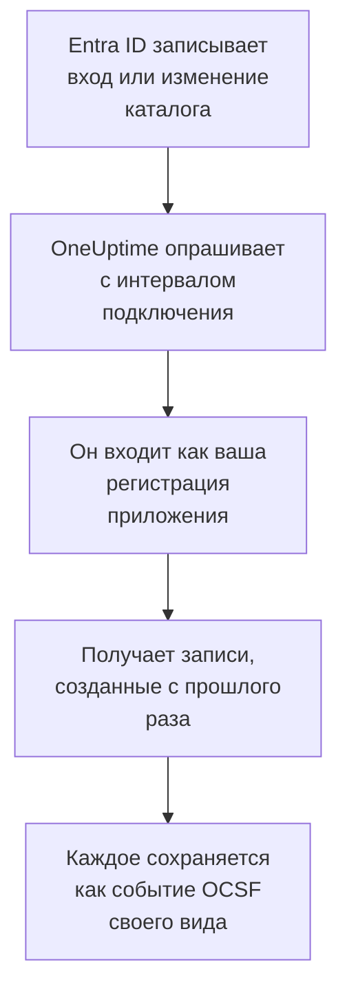

# Microsoft Entra ID

Импортируйте входы и изменения каталога [Microsoft Entra ID](https://learn.microsoft.com/en-us/entra/identity/) в события безопасности OneUptime и, если хотите, активность Exchange, SharePoint, OneDrive и Teams из [журнала аудита Microsoft 365](https://learn.microsoft.com/en-us/purview/audit-log-activities). Там вы ищете их рядом со своими журналами, трассировками и метриками, сопоставляете их со всеми другими источниками и вызываете дежурных по тем, что действительно важны. OneUptime читает их с помощью созданной вами регистрации приложения и ничего не меняет в вашем тенанте.

:::cards
- [Настройка подключения](#настройка-подключения): Регистрация приложения, её разрешения и форма подключения.
- [Что импортируется](#что-импортируется): Какие записи импортируются и как каждая становится событием безопасности.
- [Как работает опрос](#как-работает-опрос): Окно, которое читает каждый опрос, и почему оно перекрывает предыдущее на 30 минут.
- [Устранение неполадок](#устранение-неполадок): Что означает каждая ошибка и что нужно изменить.
:::

## Как это работает

Каждую минуту OneUptime опрашивает каждое включённое подключение, интервал опроса которого истёк. Опрос входит в Microsoft Entra ID как ваша регистрация приложения и читает по порядку изменения каталога ([List directoryAudits](https://learn.microsoft.com/en-us/graph/api/directoryaudit-list)) и входы ([List signIns](https://learn.microsoft.com/en-us/graph/api/signin-list)), записанные после предыдущего опроса, а затем, когда включён параметр **Журнал аудита Microsoft 365**, новое содержимое журнала аудита ([Office 365 Management Activity API](https://learn.microsoft.com/en-us/office/office-365-management-api/office-365-management-activity-api-reference)). Каждая запись сохраняется как событие [OCSF](https://schema.ocsf.io/): вход — как событие Authentication, назначенная роль — как событие User Access Management, вердикт о фишинге — как Detection Finding.

## Перед началом работы

- В OneUptime роль Project Owner, Project Admin или Security Admin. Роли Security Member и Security Viewer видят подключения и историю их запусков, но не могут их менять.
- Для входов — Microsoft Entra ID P1 или P2, которые входят в Microsoft 365 E3, E5 и Business Premium: Microsoft Graph отдаёт входы только таким тенантам. Изменения каталога читаются в любом тенанте.
- Роль Entra, которая может регистрировать приложения, например Администратор приложений, и Глобальный администратор или Администратор привилегированных ролей для предоставления согласия администратора.
- Для журнала аудита Microsoft 365 — аудит, включённый для тенанта, как и бывает по умолчанию: на [портале Microsoft Purview](https://purview.microsoft.com) раздел **Audit** не должен предлагать **Start recording user and admin activity**.
- Исходящий HTTPS от приложения и worker OneUptime к `login.microsoftonline.com`, `graph.microsoft.com` и `manage.office.com` или к `login.microsoftonline.us`, `graph.microsoft.us` и `manage.office365.us` для Azure Government.

## Настройка подключения

Подключение выполняет вход с помощью [потока учётных данных клиента OAuth 2.0](https://learn.microsoft.com/en-us/entra/identity-platform/v2-oauth2-client-creds-grant-flow): как приложение и никогда как человек, с разрешениями только на чтение.

:::steps
### Зарегистрируйте приложение

1. Войдите в [центр администрирования Microsoft Entra](https://entra.microsoft.com) и откройте **App registrations**.
2. Выберите **New registration**. Назовите приложение `OneUptime Security Events`, оставьте для **Supported account types** значение **Accounts in this organizational directory only**, оставьте URI перенаправления пустым и выберите **Register**.
3. На странице **Overview** приложения скопируйте **Идентификатор приложения (клиента)** и **Идентификатор каталога (клиента)**.

### Разрешите ему читать журналы

1. Перейдите в **API permissions → Add a permission → Microsoft Graph → Application permissions**, выберите `AuditLog.Read.All` и нажмите **Add permissions**. Microsoft указывает, что список входов может также требовать `Directory.Read.All`: добавьте его, если после предоставления согласия входы отклоняются с кодом `403`.
2. Для журнала аудита Microsoft 365 добавьте второе разрешение: **Add a permission → Office 365 Management APIs → Application permissions**, затем `ActivityFeed.Read`.
3. Выберите **Grant admin consent for** для своего тенанта и подтвердите. Состояние каждого разрешения должно быть **Granted**: без согласия каждое чтение отклоняется с кодом `403`.

### Создайте секрет клиента

Перейдите в **Certificates & secrets → Client secrets → New client secret**, выберите срок действия и нажмите **Add**. Скопируйте **Value** секрета, а не его **Secret ID**, прежде чем покинуть страницу: значение больше никогда не показывается. В день истечения срока опрос останавливается с ошибкой `Microsoft Entra ID token request failed (HTTP 401)`, пока вы не замените секрет с помощью **Обновить учётные данные**.

### Добавьте подключение в OneUptime

Откройте **Продукты → Security Events → Подключения** (`/dashboard/{projectId}/security-events/connections`), нажмите **Добавить подключение**, выберите **Microsoft Entra ID** в разделе **Идентификация** и нажмите **Далее**. Заполните параметры из таблицы ниже, нажмите **Далее** и вставьте значение секрета в поле **Секрет клиента**. На шаге **Опрос** включите **Журнал аудита Microsoft 365**, чтобы читать и его.

### Проверьте его перед сохранением

Нажмите **Проверить эти настройки** в разделе **Проверка перед сохранением**. Проверка выполняет вход и читает каждый журнал со значениями из формы, ничего не сохраняя, поэтому неверный секрет или отсутствующее согласие обнаруживаются ещё до создания подключения. Затем нажмите **Далее**, задайте подключению **Имя** и создайте его.
:::

| Параметр | Где его найти |
| --- | --- |
| **Идентификатор каталога (клиента)** | Страница **Overview** приложения. GUID тенанта или подтверждённый домен, например `contoso.onmicrosoft.com`. При включённом параметре **Журнал аудита Microsoft 365** — GUID: Management API называет тенант только по нему. |
| **Идентификатор приложения (клиента)** | Страница **Overview** приложения. GUID приложения, у которого есть `AuditLog.Read.All`. |
| **Облако** | **Общедоступное облако Azure** или **Azure Government (США)** для GCC High (`login.microsoftonline.us`, `graph.microsoft.us` и `manage.office365.us`). |
| **Журнал аудита Microsoft 365** | Необязательный, по умолчанию выключен. Если включён, каждый опрос читает и журнал аудита Microsoft 365. Приложению нужно `ActivityFeed.Read`. |
| **Секрет клиента** | **Value** секрета. Он шифруется, никогда не возвращается API и больше не показывается. Замените его с помощью **Обновить учётные данные** в подключении. |

На шаге **Опрос** также есть необязательное **Описание**, **Интервал опроса (минуты)** — целое число от `1` до `1440`, по умолчанию `5`, и **Включено**, изначально включённое.

## Что импортируется

У каждого события поставщик `Microsoft` и продукт `Microsoft Entra ID`. Его атрибут `entra.log` говорит, из какого журнала пришёл вход или изменение, а `microsoft365.contentType` записи Microsoft 365 — её тип содержимого.

| Запись | Класс OCSF | Серьёзность |
| --- | --- | --- |
| Успешный вход | Authentication (`3002`), статус `Success` | Informational |
| Вход, ожидающий второго шага, например MFA (`50074`, `50076`) или запроса на смену пароля | Authentication (`3002`), статус `Interrupted` | Informational: шаг, а не сбой |
| Неудачный вход с причиной и кодом ошибки Entra | Authentication (`3002`), статус `Failure` | Low |
| Вход, который Identity Protection оценила как средний или высокий риск | Authentication (`3002`) | Medium или High |
| Изменённый пользователь, группа или роль, по их категории | Account Change (`3001`), Group Management (`3006`), User Access Management (`3005`) или Entity Management (`3004`) для остального | Medium для привилегированной роли, например Global Administrator; Low для неудавшегося изменения |

При включённом параметре **Журнал аудита Microsoft 365** из него импортируются записи, по которым действует команда безопасности, а остальные, например открытый файл или прочитанное письмо, только подсчитываются:

| Запись Microsoft 365 | Класс OCSF | Серьёзность |
| --- | --- | --- |
| Командлет Exchange, например `New-InboxRule` или `Set-Mailbox`, правило папки «Входящие», созданное в Outlook, или письмо, отправленное от имени другого человека | API Activity (`6003`) | Medium, если оно пересылает почту, с `microsoft365.forwardsMail`, равным `true` |
| Выданное разрешение на почтовый ящик, например `Add-MailboxPermission` | User Access Management (`3005`) | Low |
| Файл, к которому открыт доступ в SharePoint или OneDrive | File Hosting Activity (`6006`) | Low для гостя или ссылки, которую может открыть кто угодно, с `microsoft365.sharedOutside`, равным `true` |
| Добавленный или удалённый администратор семейства веб-сайтов | User Access Management (`3005`) | Low |
| Письмо с вредоносным ПО или фишингом, найденное Microsoft Defender for Office 365 | Detection Finding (`2004`) | High для вредоносного ПО, Medium для фишинга |
| Оповещение, созданное Microsoft 365 | Detection Finding (`2004`) | Серьёзность самого оповещения |
| Приложение, бот или соединитель, добавленные в команду | Application Lifecycle (`6002`) | Low |

Собственное обслуживание Exchange, выполняемое от его системной учётной записи, не учитывается, если только оно не пересылает почту. Каждое событие хранит запись целиком, развёрнутую в ключи с точками, например `status.errorCode` или `Parameters.ForwardTo`, поэтому правило читает любое поле под тем именем, которое ему даёт Microsoft. Правила библиотеки для Entra ID читают их в том виде, в каком они импортируются здесь.

Те же входы и изменения каталога могут попадать в OneUptime и как логи, экспортированные параметром диагностики Azure и прочитанные карточкой [Ваши логи](/docs/telemetry/security-events#поиск-событий-безопасности-в-ваших-логах). Каждая запись получает один и тот же идентификатор события обоими путями, но запись, прочитанная обоими путями, сохраняется дважды: читайте Entra ID одним путём.

## Как работает опрос

- **Записи читаются по времени, когда их записал Entra ID**: `activityDateTime` для изменения и `createdDateTime` для входа.
- **Первый опрос смотрит на 24 часа назад**, чтобы новое подключение сразу показало свои недавние записи.
- **Каждый следующий опрос начинается за 30 минут до сохранённого курсора.** Microsoft указывает, что оба журнала поступают с опозданием на минуты, поэтому перекрытие читает опоздавшую запись при следующем опросе, а дубликаты отбрасываются по идентификатору записи в пределах проекта.
- **Опрос читает не больше 24 часов после курсора.** Подключение, курсор которого отстал, догоняет серией 24-часовых окон.
- **Тенант без Microsoft Entra ID P1 или P2** импортирует свои изменения каталога, а проверка **Read sign-ins** каждого запуска предупреждает, что входы не прочитаны.
- **Неудачный запуск ничего не меняет.** После сетевой ошибки или кода ошибки от Graph курсор и длина окна остаются прежними, и следующий опрос заново читает то же окно. Единственное исключение — запрос, превысивший время ожидания: курсор остаётся на месте, но следующее окно вдвое короче, потому что слишком тяжёлое для своевременного ответа окно превышало бы время ожидания при каждой попытке.

Журнал аудита Microsoft 365 читается по времени, когда Microsoft сделала доступным каждый блоб содержимого, по одному дню за раз и не дальше 7 дней, в течение которых Microsoft его хранит. Первый опрос подписывает приложение на `Audit.Exchange`, `Audit.SharePoint` и `Audit.General`, и Microsoft делает первые записи новой подписки доступными в течение 12 часов. Журнал аудита никогда не останавливает журналы Entra ID: отсутствующее разрешение — это предупреждение, и окно продвигается дальше, а сбой на стороне Microsoft, например `HTTP 503`, делает запуск **Частично**, чтобы окно было прочитано снова.

### Когда окно содержит больше, чем может прочитать один опрос

У каждого журнала свой бюджет: 10 страниц по 500 изменений каталога, 20 страниц по 500 входов и для журнала аудита Microsoft 365 — 120 запросов и 10 000 записей. Опрос останавливается через 4 минуты. Когда бюджет останавливает журнал до конца его окна, запуск получает состояние **Частично**, а его предупреждение называет журнал и бюджет. Microsoft Graph отдаёт сначала самые новые записи, поэтому OneUptime сокращает окно, а не переносит курсор за записи, до которых так и не дошёл:

1. **Сузить.** Следующий опрос читает окно вдвое короче с той же начальной точки и продолжает делить его пополам, пока окно не будет прочитано целиком, вплоть до одной минуты. Предупреждение запуска говорит об этом: `This window holds more records than one poll can read; the next poll reads a {n} minute window from the same starting point.` Записи, уже импортированные из более длинного окна, пропускаются как дубликаты.
2. **Снова расти.** После того как окно прочитано целиком, курсор переносится на его конец, а следующее окно снова вдвое длиннее, до 24 часов.
3. **Пройти мимо одной минуты.** Если даже одна минута содержит больше, чем может прочитать один опрос, опрос проходит мимо неё, чтобы новые записи продолжали поступать. Запуск остаётся **Частично**, а **Последняя ошибка** содержит `More records were created in the one minute from {cursor} to {end} than one poll can read. Polling moved past this minute so newer records keep arriving; use Import this time range in Diagnostics on this minute to recover what one run can read.` Импортируйте эту минуту с помощью **Import this time range**, чтобы восстановить то, что может прочитать один запуск.

Изменение **Интервал опроса (минуты)** ничего из этого не меняет: оно определяет, как часто начинается опрос, а не где начинается его окно.

### Запуск, просмотр и импорт по требованию

Нажмите **Диагностика** в подключении, чтобы увидеть его последние запуски и работать с ним вручную. Запускать эти действия может любой, кто может менять подключение; читать историю может любой, кто может его видеть.

- **Запустить сейчас** сразу запускает опрос с обычным курсором, даже если подключение не **Включено**.
- **Preview records** читает интервал времени до 7 дней и ничего не импортирует.
- **Import this time range** после вашего подтверждения импортирует интервал до 7 дней, не перемещая курсор. Уже импортированные записи пропускаются. Microsoft Entra ID хранит 30 дней входов и изменений каталога с P1 или P2 и 7 дней без них.
- **Copy diagnostics** в запуске копирует его отчёт для поддержки. Он никогда не содержит учётных данных.

## Проверка подключения

**Проверить подключение** в строке подключения и **Проверить эти настройки** в форме выполняются в процессе API, а не в фоновом worker, поэтому проверка отвечает даже тогда, когда проблема в самих worker. Она выполняет такие проверки по порядку:

| Проверка | Что она проверяет |
| --- | --- |
| **Конфигурация** | Каждый параметр задан и правильно оформлен. Если это не так, ни к чему не обращаются. |
| **Authenticate with Microsoft Entra** | Entra ID выдаёт приложению токен для Microsoft Graph в выбранном вами облаке. |
| **Read sign-ins** | Входы за последние 24 часа можно прочитать. Предупреждение, а не сбой, в тенанте без P1 или P2. |
| **Read directory changes** | Изменения каталога за последние 24 часа можно прочитать. |
| **Read the Microsoft 365 audit log** | Только при включённом параметре: Management API отвечает, и на какие типы содержимого подписано приложение. |
| **Records available to import** | Сколько входов и изменений каталога содержат последние 24 часа, не больше 500 каждого вида, поэтому `500+` означает больше. Ни одного — это предупреждение. |
| **Background workers**, **Poll scheduler**, **Security event storage** | Сторона самого OneUptime: процесс забирает задания из очереди Worker, задание опроса выполняется каждую минуту, а хранилище событий безопасности отвечает. |
| **Scheduled polling** | Для сохранённого подключения: опрос включён, ни один запуск не застрял в ожидании worker, а опросы выполняются вовремя. |

У каждого запроса в проверке срок 20 секунд. Проверка никогда ничего не импортирует и не перемещает курсор, а каждая неудачная проверка сообщает, что нужно изменить.

## Устранение неполадок

**Последняя ошибка** подключения хранит полное сообщение об ошибке со скрытыми учётными данными. Если у подключения есть ошибка, выберите **Просмотреть ошибку** в столбце **Действия**, чтобы прочитать её, и **Скопировать ошибку** в диалоговом окне, чтобы скопировать. Каждое сообщение начинается с `Microsoft Entra ID`, затем называет неудавшийся запрос и цитирует код ошибки Microsoft, если он есть.

:::details Последняя ошибка сообщает `token request failed`
- `HTTP 401` с `invalid_client`: секрет клиента неверен или истёк. Создайте новый и сохраните его с помощью **Обновить учётные данные**.
- `HTTP 400` с упоминанием идентификатора приложения (клиента) или тенанта: проверьте оба на странице **Overview** приложения, а также что **Облако** — это облако тенанта.
:::

:::details Последняя ошибка сообщает `sign-ins request failed (HTTP 403)` или `audit logs request failed (HTTP 403)`
- Код ошибки `Authorization_RequestDenied`: у приложения нет `AuditLog.Read.All` или согласие не предоставлено. Предоставьте согласие администратора, подождите несколько минут и проверьте снова. Для входов также предоставьте `Directory.Read.All`.
- Код ошибки `Authentication_RequestFromNonPremiumTenantOrB2CTenant`: у тенанта нет Microsoft Entra ID P1 или P2. Изменения каталога по-прежнему импортируются.
:::

:::details Журнал аудита Microsoft 365 не читается
- `subscriptions request failed (HTTP 401)` или `(HTTP 403)` с `AF10001`: у приложения нет `ActivityFeed.Read` из Office 365 Management APIs или согласие не предоставлено.
- От `AF20010` до `AF20013`: Management API не знает **Идентификатор каталога (клиента)**. Используйте GUID тенанта.
- `subscription start failed` с `AF20023`: администратор отключил подписку. Тип содержимого, на который нельзя подписаться, называется в предупреждениях запуска, а остальные по-прежнему читаются.
- Нет записей в течение нескольких часов после первого опроса: Microsoft делает первое содержимое новой подписки доступным в течение 12 часов.
:::

:::details Последняя ошибка сообщает `did not complete`
Запрос не получил ответа: истекло время ожидания, имя не разрешается или адрес отклонён. Проверьте, что приложение и worker OneUptime могут связаться с узлами из раздела [Перед началом работы](#перед-началом-работы) через любой используемый вами прокси.
:::

:::details Проверка проходит, но Last Polled — Never
Задание опроса ни разу не выполнялось. Прочитайте проверки **Background workers** и **Poll scheduler**. В самостоятельно размещённой установке обычная причина — `DISABLE_QUEUE_WORKERS=true` в приложении без отдельного развёртывания worker, которое забирало бы задания: установите `false` или запустите развёртывание worker (Helm: `worker.enabled: true`, по умолчанию `false`).
:::

## Дальнейшие шаги

:::cards
- [События безопасности](/docs/telemetry/security-events): Поиск, сопоставление и оповещения по импортированным данным.
- [Системный журнал Okta](/docs/integrations/okta): Импортируйте входы другого поставщика удостоверений.
- [Google Workspace](/docs/integrations/google-workspace): Импортируйте входы и изменения администраторов Google.
- [Обзор интеграций](/docs/integrations/index): Другие инструменты, которые можно подключить.
:::
