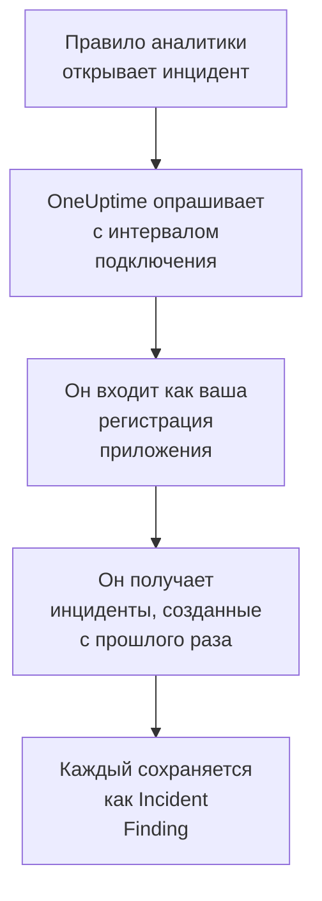

# Microsoft Sentinel

Импортируйте инциденты, которые открывают ваши правила аналитики [Microsoft Sentinel](https://learn.microsoft.com/en-us/azure/sentinel/overview), в события безопасности OneUptime. Там вы ищете их рядом со своими журналами, трассировками и метриками, сопоставляете их со всеми другими источниками и вызываете дежурных по тем, что действительно важны. OneUptime читает их с помощью созданной вами регистрации приложения и ничего не меняет в Azure.

:::cards
- [Настройка подключения](#настройка-подключения): Регистрация приложения, роль и форма подключения.
- [Что импортируется](#что-импортируется): Как каждый инцидент Sentinel становится событием безопасности.
- [Как работает опрос](#как-работает-опрос): Окно, которое читает каждый опрос, и что с ним делает загруженная рабочая область.
- [Устранение неполадок](#устранение-неполадок): Что означает каждая ошибка и что нужно изменить.
:::

## Как это работает



Каждую минуту OneUptime опрашивает каждое включённое подключение, интервал опроса которого истёк. Опрос входит в Microsoft Entra ID как ваша регистрация приложения, запрашивает у Azure Resource Manager инциденты, созданные после предыдущего опроса, и сохраняет каждый как событие [OCSF](https://schema.ocsf.io/) Incident Finding (класс `2005`). Затем правила обнаружения, мониторы и панели мониторинга обрабатывают его как событие безопасности из любого другого источника.

## Перед началом работы

- В OneUptime роль Project Owner, Project Admin или Security Admin. Роли Security Member и Security Viewer видят подключения и историю их запусков, но не могут их менять.
- Рабочая область Log Analytics с включённым Microsoft Sentinel в общедоступном облаке Azure или в Azure Government (US).
- В Microsoft Entra ID право создавать регистрацию приложения и секрет клиента.
- В группе ресурсов, содержащей рабочую область, право назначать роли, например Владелец или Администратор доступа пользователей.

## Настройка подключения

Подключение выполняет вход с помощью потока учётных данных клиента OAuth 2.0: как приложение и никогда как человек. Доступ ему даёт роль Azure, поэтому регистрации приложения не нужны разрешения API.

:::steps
### Зарегистрируйте приложение

1. Войдите на [портал Azure](https://portal.azure.com) и откройте **Microsoft Entra ID**.
2. Перейдите в **App registrations → New registration**. Назовите приложение `OneUptime Sentinel connector`, оставьте для **Supported account types** значение **Accounts in this organizational directory only**, оставьте URI перенаправления пустым и выберите **Register**.
3. На странице **Overview** приложения скопируйте **Идентификатор приложения (клиента)** и **Идентификатор каталога (клиента)**.
4. Перейдите в **Certificates & secrets → Client secrets → New client secret**, выберите срок действия и нажмите **Add**. Скопируйте **Value** секрета, а не его **Secret ID**, прежде чем покинуть страницу: значение больше никогда не показывается.

### Разрешите ему читать инциденты

1. На портале Azure откройте группу ресурсов, содержащую вашу рабочую область Log Analytics.
2. Выберите **Access control (IAM) → Add → Add role assignment**.
3. На вкладке **Role** выберите **Microsoft Sentinel Reader**.
4. На вкладке **Members** выберите **User, group, or service principal**, нажмите **Select members** и выберите регистрацию приложения по имени.
5. Выберите **Review + assign**.

Роль позволяет приложению читать инциденты (`Microsoft.SecurityInsights/incidents/read`) и ничего не записывать. Microsoft рекомендует назначать её на группу ресурсов, а не на рабочую область, чтобы она охватывала и решение `SecurityInsights`, из которого поступают инциденты. Новое назначение может вступить в силу через несколько минут.

### Найдите данные рабочей области

Откройте рабочую область Log Analytics на портале Azure. Её страница **Overview** показывает **Идентификатор подписки**, **Resource group** и имя рабочей области. Идентификатор ресурса рабочей области содержит все три значения:

```text
/subscriptions/{Subscription ID}/resourceGroups/{Resource group}/providers/Microsoft.OperationalInsights/workspaces/{Workspace name}
```

### Добавьте подключение в OneUptime

Откройте **Продукты → Security Events → Подключения** (`/dashboard/{projectId}/security-events/connections`), нажмите **Добавить подключение**, выберите **Microsoft Sentinel** и нажмите **Далее**. Заполните параметры из таблицы ниже, нажмите **Далее** и вставьте значение секрета в поле **Секрет клиента**.

### Проверьте его перед сохранением

Нажмите **Проверить эти настройки** в разделе **Проверка перед сохранением**. Проверка выполняет вход и читает инциденты со значениями из формы, ничего не сохраняя, поэтому неверный секрет или отсутствующая роль обнаруживаются ещё до создания подключения. Затем нажмите **Далее**, задайте подключению **Имя** и создайте его.
:::

| Параметр | Где его найти |
| --- | --- |
| **Идентификатор каталога (клиента)** | Страница **Overview** приложения. GUID тенанта или подтверждённый домен, например `contoso.onmicrosoft.com`. |
| **Идентификатор приложения (клиента)** | Страница **Overview** приложения. GUID. |
| **Идентификатор подписки** | Страница **Overview** рабочей области. GUID. |
| **Resource group** | Страница **Overview** рабочей области. От 1 до 90 букв, цифр, подчёркиваний, дефисов, точек или скобок, без точки в конце. |
| **Workspace name** | Страница **Overview** рабочей области. От 3 до 90 букв, цифр или дефисов, начинается и заканчивается буквой или цифрой. |
| **Облако** | **Общедоступное облако Azure** (`login.microsoftonline.com`, `management.azure.com`) или **Azure Government (США)** (`login.microsoftonline.us`, `management.usgovcloudapi.net`). |
| **Секрет клиента** | **Value** секрета. Он шифруется, никогда не возвращается API и больше не показывается. Замените его с помощью **Обновить учётные данные** в подключении. |

На шаге **Опрос** также есть необязательное **Описание**, **Интервал опроса (минуты)** — целое число от `1` до `1440`, по умолчанию `5`, и **Включено**, изначально включённое.

## Что импортируется

Каждый инцидент Sentinel становится одним событием Incident Finding (класс OCSF `2005`, действие `Create`), отнесённым к службе телеметрии `Microsoft Sentinel`:

| Столбец OCSF | Поле инцидента Sentinel |
| --- | --- |
| `time` | `properties.createdTimeUtc`, время создания инцидента в Sentinel |
| `eventUid` | `name`, GUID инцидента, по которому также отбрасываются дубликаты |
| `message`, `ruleName` | `properties.title` |
| `ruleId` | GUID правила в конце первой записи `properties.relatedAnalyticRuleIds` |
| `severityName` | `properties.severity`: `High`, `Medium`, `Low` или `Informational` |
| `statusName` | `properties.status`: `New`, `Active` или `Closed` |
| `mitreTactics` | `properties.additionalData.tactics` в виде идентификаторов ATT&CK: `Persistence` становится `TA0003` |
| `principalUser` | `properties.owner.userPrincipalName` или `properties.owner.email` |
| `targetResource` | `properties.incidentUrl`, ссылка на инцидент на портале Azure |
| `observables` | UPN, адрес электронной почты и идентификатор объекта владельца, а также имя каждой метки |
| `attributes` | Весь инцидент, развёрнутый в ключи с точками, например `properties.classification` и `properties.firstActivityTimeUtc` |

Закрытые инциденты, созданные в окне опроса, тоже импортируются. Чтобы видеть только открытые, отфильтруйте по `statusName` в обозревателе событий безопасности.

## Как работает опрос

Каждый опрос получает инциденты, созданные в его окне, начиная с самых старых, по 50 на страницу, и следует по `nextLink` API, пока не прочитает всё окно:

```text
GET https://management.azure.com/subscriptions/{sub}/resourceGroups/{rg}/providers/Microsoft.OperationalInsights/workspaces/{ws}/providers/Microsoft.SecurityInsights/incidents
    ?api-version=2024-03-01
    &$filter=(properties/createdTimeUtc ge {windowStart}) and (properties/createdTimeUtc lt {windowEnd})
    &$orderby=properties/createdTimeUtc asc
    &$top=50
```

- **Курсором служит время создания.** Запланированное правило аналитики, которое запускается каждый час, открывает свой инцидент намного позже обнаруженной активности, и `firstActivityTimeUtc` инцидента может быть на несколько часов или дней раньше. Курсор по времени активности пропустил бы каждый такой инцидент. Время активности остаётся в `attributes`, а образцы в диагностике показывают оба значения.
- **Первый опрос смотрит на 24 часа назад**, чтобы новое подключение сразу показало свои недавние инциденты.
- **Каждый следующий опрос начинается за 1 минуту до сохранённого курсора**, чтобы инцидент, созданный на границе двух окон, никогда не пропускался.
- **Опрос читает не больше 24 часов после курсора.** Подключение, курсор которого отстал, догоняет серией 24-часовых окон, а его **Состояние** показывает **Catching up**.
- **Дубликаты отбрасываются по GUID инцидента** (`name`) в пределах проекта, поэтому перекрытие, повторно прочитанное окно и импорт никогда не сохраняют инцидент дважды.

### Когда окно содержит больше, чем может прочитать один опрос

Опрос читает не больше 20 страниц по 50 инцидентов, то есть 1 000 инцидентов. Если это ограничение останавливает его до конца окна, запуск получает статус **Частично** с предупреждением вроде такого:

```text
Stopped after 20 incidents requests (the per-run request limit) before reading the whole window. Incidents are read oldest first; every incident created before 2026-09-14T08:12:44.000Z was read.
```

Инциденты читаются от старых к новым, поэтому OneUptime переносит курсор на время создания последнего прочитанного инцидента, и следующий опрос начинается оттуда с той же длиной окна. Так загруженная рабочая область догоняет примерно по 1 000 инцидентов за опрос, а не читает одни и те же заново. Инциденты, созданные в тот же момент, читаются дважды, и проверка дубликатов отбрасывает вторую копию.

Если запуск вообще не может продвинуться дальше сохранённого курсора, OneUptime вместо этого сокращает окно:

1. **Сузить.** Следующий опрос читает окно вдвое короче с той же начальной точки и продолжает делить его пополам, пока окно не будет прочитано целиком, вплоть до одной минуты. Предупреждение запуска говорит об этом: `This window holds more records than one poll can read; the next poll reads a {n} minute window from the same starting point.`
2. **Снова расти.** После того как окно прочитано целиком, следующее снова вдвое длиннее, до 24 часов.
3. **Пройти мимо одной минуты.** Если даже одна минута содержит больше, чем может прочитать опрос, опрос проходит мимо неё, чтобы новые инциденты продолжали поступать. Запуск остаётся **Частично**, а **Последняя ошибка** содержит `More records were created in the one minute from {cursor} to {end} than one poll can read. Polling moved past this minute so newer records keep arriving; use Import this time range in Diagnostics on this minute to recover what one run can read.` Импортируйте эту минуту с помощью **Import this time range**, чтобы восстановить то, что может прочитать один запуск.

Запуск, который полностью завершается ошибкой Microsoft Entra ID или Azure Resource Manager, сохраняет курсор и длину окна, и следующий опрос заново читает то же окно. Единственное исключение — запрос, превысивший время ожидания: курсор остаётся на месте, но следующее окно вдвое короче, потому что слишком тяжёлое для своевременного ответа окно превышало бы время ожидания при каждой попытке. Изменение **Интервал опроса (минуты)** ничего из этого не меняет: оно определяет, как часто начинается опрос, а не где начинается его окно.

### Запуск, просмотр и импорт по требованию

Нажмите **Диагностика** в подключении, чтобы увидеть его последние запуски и работать с ним вручную. Запускать эти действия может любой, кто может менять подключение; читать историю может любой, кто может его видеть.

- **Запустить сейчас** сразу запускает опрос с обычным курсором, даже если подключение не **Включено**.
- **Preview incidents** читает интервал времени до 7 дней и ничего не импортирует.
- **Import this time range** после вашего подтверждения импортирует интервал до 7 дней, не перемещая курсор. Уже импортированные инциденты пропускаются.
- **Copy diagnostics** в запуске копирует его отчёт для поддержки. Он никогда не содержит учётных данных.

## Проверка подключения

**Проверить подключение** в строке подключения и **Проверить эти настройки** в форме выполняются в процессе API, а не в фоновом worker, поэтому проверка отвечает даже тогда, когда проблема в самих worker. Она выполняет такие проверки по порядку:

| Проверка | Что она проверяет |
| --- | --- |
| **Конфигурация** | Каждый параметр задан и правильно оформлен. Если это не так, ни к чему не обращаются. |
| **Authenticate with Microsoft Entra** | Microsoft Entra ID выдаёт вашей регистрации приложения токен для Azure Resource Manager. |
| **Read incidents** | Можно прочитать один инцидент, созданный за последние 24 часа (`$top=1`). Это подтверждает роль и данные рабочей области. |
| **Incidents available to import** | Сколько инцидентов создано за последние 24 часа и за последние 7 дней, по одной странице из 50 для каждого интервала, поэтому `50+` означает больше. Отсутствие инцидентов за 7 дней — предупреждение, а не ошибка. |
| **Background workers**, **Poll scheduler**, **Security event storage** | Сторона самого OneUptime: процесс забирает задания из очереди Worker, задание опроса выполняется каждую минуту, а хранилище событий безопасности отвечает. |
| **Scheduled polling** | Для сохранённого подключения: опрос включён, ни один запуск не застрял в ожидании worker, а опросы выполняются вовремя. |

У каждого запроса в проверке срок 20 секунд. Проверка никогда ничего не импортирует и не перемещает курсор, а каждая неудачная проверка сообщает, что нужно изменить.

## Отправка событий безопасности в Microsoft Sentinel

OneUptime также может отправлять то, что находит, в Microsoft Sentinel через Logs Ingestion API в Azure Monitor, в пользовательскую таблицу рабочей области, на которой работает Sentinel. Ваши правила аналитики, запросы охоты на угрозы и книги затем запрашивают `OneUptimeSecurityEvents_CL` рядом с вашими другими таблицами.

:::steps
### Создайте таблицу и её правило сбора данных

На портале Azure откройте в рабочей области **Tables → Create → New custom log (DCR-based)**. Назовите таблицу `OneUptimeSecurityEvents`, создайте новое правило сбора данных и конечную точку сбора данных, если форма её запросит. Загрузите пример ниже как файл примера, оставьте преобразование как есть и создайте таблицу.

### Разрешите приложению отправлять в неё

Зарегистрируйте приложение и выдайте ему секрет клиента, как в разделе [Зарегистрируйте приложение](#зарегистрируйте-приложение). Затем откройте правило сбора данных, **Access control (IAM) → Add → Add role assignment**, выберите **Monitoring Metrics Publisher** и выберите приложение.

### Добавьте получателя

Откройте **Продукты → Security Events → Подключения**. В разделе **Отправка в вашу SIEM** нажмите **Добавить получателя**, выберите Microsoft Sentinel в поле **SIEM** и нажмите **Далее**. Заполните **Идентификатор каталога (клиента)**, **Идентификатор приложения (клиента)** и **Секрет клиента**, **Конечная точка приёма журналов** со страницы **Overview** конечной точки сбора данных (или правила) и **Неизменяемый ID правила сбора данных** из **JSON View** правила. **Поток** необязателен: если оставить его пустым, это `Custom-OneUptimeSecurityEvents_CL`.

### Отправьте тестовое событие и начните отправку

Нажмите **Отправить тестовое событие**: в течение нескольких минут в таблицу попадёт одна строка. Затем в разделе **Что отправлять** оставьте **Только обнаружения** или выберите **Все события безопасности** и нажмите **Начать отправку**.
:::

Файл примера, одна строка со всеми столбцами таблицы:

```json title="oneuptime-security-events-sample.json"
[
  {
    "TimeGenerated": "2026-10-21T10:00:00.000Z",
    "EventId": "0193c0de-cccc-4aaa-8bbb-000000000001",
    "EventUid": "okta-1",
    "ClassName": "Authentication",
    "CategoryName": "Identity & Access Management",
    "ActivityName": "Logon",
    "Severity": "Medium",
    "SeverityId": 3,
    "Status": "Failure",
    "Message": "Failed sign-in for alice",
    "VendorName": "Okta",
    "ProductName": "Okta System Log",
    "RuleId": "",
    "RuleName": "",
    "MitreTactics": [],
    "MitreTechniques": [],
    "PrincipalUser": "alice@example.com",
    "PrincipalHost": "laptop-7",
    "PrincipalIp": "203.0.113.7",
    "TargetUser": "",
    "TargetHost": "app.example.com",
    "TargetIp": "198.51.100.20",
    "TargetPort": 443,
    "TargetResource": "",
    "ProcessName": "",
    "ProcessCommandLine": "",
    "ParentProcessName": "",
    "Observables": [
      "alice@example.com",
      "203.0.113.7"
    ],
    "Attributes": {
      "okta.outcome.reason": "INVALID_CREDENTIALS"
    }
  }
]
```

- Logs Ingestion API принимает до 1 МБ за вызов, поэтому строки уходят пакетами до 500. Пакет, который Azure отклоняет, делится, пока не найдётся строка, которую он не принимает, и она пропускается, а ограничение скорости (`429`) повторяется.
- `403` означает, что у приложения нет **Monitoring Metrics Publisher** на правиле, а `404` — неверный неизменяемый ID или поток.
- Инциденты, которые OneUptime импортировал из Microsoft Sentinel, никогда не отправляются обратно в него.

## Устранение неполадок

**Последняя ошибка** подключения хранит полное сообщение об ошибке со скрытыми учётными данными после префикса, который называет неудавшийся шаг. Если у подключения есть ошибка, выберите **Просмотреть ошибку** в столбце **Действия**, чтобы прочитать её, и **Скопировать ошибку** в диалоговом окне, чтобы скопировать. Сначала прочитайте префикс.

:::details Last Error начинается с `Microsoft Sentinel token request`
- `Microsoft Sentinel token request failed (HTTP ...)`: Microsoft Entra ID отказался выдать токен, поэтому к Azure даже не обращались. Сообщение приводит код Entra:
  - `AADSTS7000215` или `invalid_client`: **Секрет клиента** неверен или истёк, либо это идентификатор секрета, а не его значение. Создайте новый секрет и сохраните его с помощью **Обновить учётные данные**.
  - `AADSTS700016` или `unauthorized_client`: **Идентификатор приложения (клиента)** отсутствует в указанном **Идентификатор каталога (клиента)**. Сравните оба значения со страницей **Overview** приложения.
  - `AADSTS90002` или `HTTP 404`: такого тенанта нет. **Идентификатор каталога (клиента)** неверен или относится к другому облаку: проверьте **Облако**.
  - `HTTP 429` или `HTTP 5xx`: Microsoft Entra ID ограничивает запросы или недоступен. Следующий опрос повторит попытку.
- `Microsoft Sentinel token request returned ...`: Microsoft Entra ID ответил чем-то непригодным, например телом не в формате JSON или без `access_token`. Обычно это прокси или шлюз посередине.
- `Microsoft Sentinel token request failed:` без статуса или `Microsoft Sentinel token request timed out after ... seconds with no response`: на запрос не пришёл ответ. Проверьте DNS, TLS и исходящий HTTPS от приложения и worker OneUptime к `login.microsoftonline.com`.
:::

:::details Last Error начинается с `Microsoft Sentinel incidents list`
- `Microsoft Sentinel incidents list failed (HTTP ...)`: Azure Resource Manager отклонил запрос.
  - `HTTP 401`: он не принял токен. Почти всегда **Облако** не соответствует тенанту или регистрация приложения удалена. Токен, срок действия которого истёк между двумя страницами, обновляется и повторяется один раз автоматически.
  - `HTTP 403` или `AuthorizationFailed`: у приложения ещё нет **Microsoft Sentinel Reader** в группе ресурсов. Назначьте роль и подождите несколько минут.
  - `HTTP 404`: ни у одной рабочей области нет такого **Идентификатор подписки**, **Resource group** и **Workspace name**, или в ней не включён Microsoft Sentinel. Скопируйте их со страницы **Overview** рабочей области.
  - `HTTP 429` или `HTTP 5xx`: Azure Resource Manager ограничивает запросы или недоступен. Следующий опрос повторит попытку.
  - `HTTP 400`: Azure Resource Manager отклонил запрос, который формирует OneUptime, а не ваши параметры. Отправьте сообщение в поддержку OneUptime.
- `Microsoft Sentinel incidents list returned ...`: Azure ответил `200`, но без читаемой страницы инцидентов или со ссылкой `nextLink` на другой хост, которую подключение отклоняет, чтобы токен никогда не покидал Azure Resource Manager. Об этом сообщается, а не считается пустым окном, чтобы курсор никогда не проходил мимо инцидентов, которые никто не прочитал.
- `Microsoft Sentinel incidents list failed:` без статуса или `Microsoft Sentinel incidents list timed out after ... seconds with no response`: на запрос не пришёл ответ. Проверьте исходящий HTTPS от worker OneUptime к `management.azure.com` или `management.usgovcloudapi.net`.
:::

:::details Last Polled — Never, а Last Error пуст
Для этого подключения не завершился ни один опрос. Запустите **Проверить подключение**: его проверки **Background workers** и **Poll scheduler** называют причину. В самостоятельно размещённой установке обычная причина — `DISABLE_QUEUE_WORKERS=true` в приложении без отдельного развёртывания worker, которое забирало бы задания: установите `false` или запустите развёртывание worker (Helm: `worker.enabled: true`).
:::

:::details Запуск имеет статус Partial
- `Stopped after 20 incidents requests (the per-run request limit) before reading the whole window`: окно содержало больше 1 000 инцидентов, которые читает один запуск. Ничего не теряется: следующий опрос начинается после последнего прочитанного инцидента. Подключение, которое остаётся **Частично** опрос за опросом, догоняет отставание, а его **Последний опрос** и **Последнее импортированное событие** продолжают двигаться вперёд.
- `Microsoft Sentinel returned incidents out of creation-time order, so this run cannot name a point to resume from.`: API проигнорировал порядок от старых к новым, поэтому запуск не может перенести курсор на свой последний инцидент, и следующий опрос вместо этого читает более короткое окно. Если это повторяется, отправьте отчёт о запуске в поддержку OneUptime.
- `More records were created in the one minute from ... than one poll can read`: опрос прошёл мимо этой минуты. Импортируйте её с помощью **Import this time range** в **Диагностика**. Импорт читает столько же, сколько опрос.
:::

:::details Проверка проходит, но ничего не импортируется
Прочитайте **Incidents available to import** в отчёте проверки. `0` за последние 7 дней означает, что правила аналитики рабочей области не открыли ни одного инцидента, и это не ошибка подключения. В Microsoft Sentinel убедитесь, что правила включены и настроены на создание инцидентов.
:::

## Azure Government

Задайте для **Облако** значение **Azure Government (США)**. Тогда подключение выполняет вход в `login.microsoftonline.us` с областью `https://management.usgovcloudapi.net/.default` и читает инциденты из `management.usgovcloudapi.net`. Всё остальное, включая назначение роли, не меняется.

## Что вы получаете

- **Поиск.** Фильтруйте инциденты по серьёзности, статусу, владельцу, метке или тактике в обозревателе событий безопасности рядом со всеми другими источниками.
- **Сопоставление.** Владелец и метки каждого инцидента индексируются как наблюдаемые объекты, поэтому один поиск находит всё, что их упоминает.
- **Правила обнаружения.** Правила Sigma, которые выполняются по расписанию над вашими событиями безопасности и открывают оповещения, вызывающие дежурных.
- **Мониторы.** Мониторы событий безопасности подсчитывают совпадающие события, например новые инциденты High, и открывают инциденты или оповещения при превышении порога.

События безопасности тарифицируются как остальная телеметрия, за каждый принятый ГБ. См. [цены](https://oneuptime.com/pricing).

## Дальнейшие шаги

:::cards
- [События безопасности](/docs/telemetry/security-events): Поиск, сопоставление и оповещения по импортированным данным.
- [Microsoft Defender XDR](/docs/integrations/microsoft-defender-xdr): Импортируйте также оповещения каждой рабочей нагрузки Defender.
- [Роли](/docs/permissions/reference#роли): Что могут видеть и менять роли Security.
- [Обзор интеграций](/docs/integrations/index): Другие инструменты, которые можно подключить.
:::
