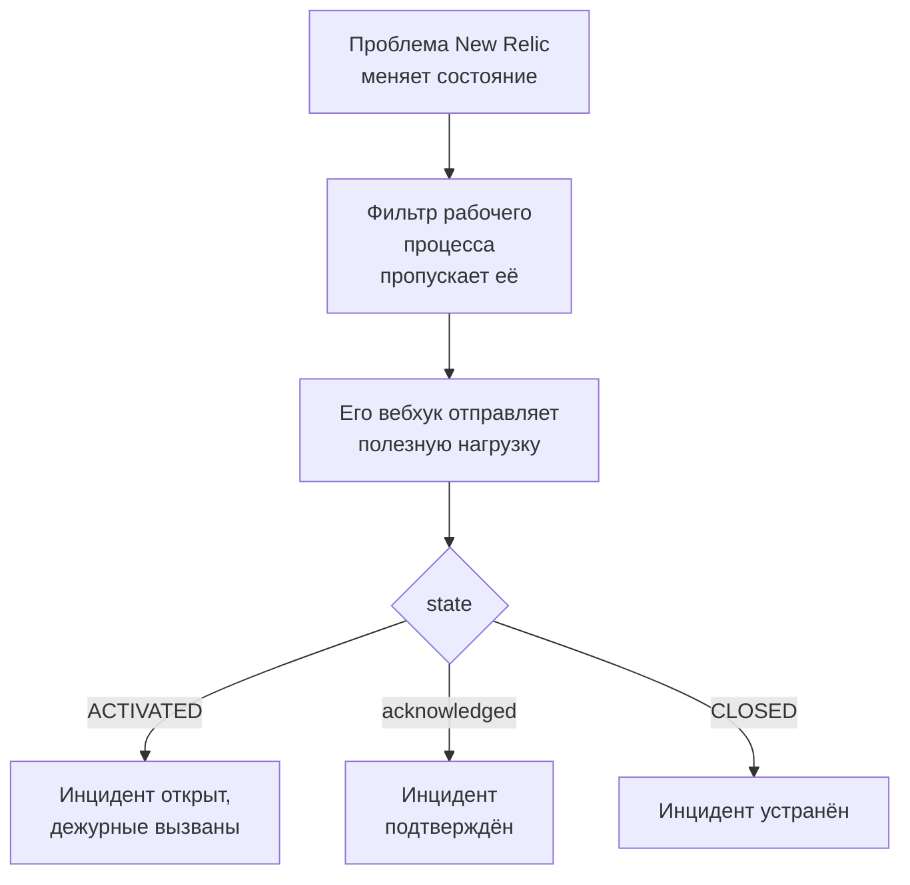

# New Relic

Отправляйте проблемы [New Relic](https://newrelic.com) в OneUptime, чтобы каждая проблема становилась инцидентом или оповещением, вызывала вашу дежурную команду, подтверждалась, когда кто-то подтверждает проблему, и устранялась, когда проблема закрывается. New Relic отправляет проблемы через [получателя-вебхук](https://docs.newrelic.com/docs/alerts/get-notified/notification-integrations/), поэтому ни на одной стороне ничего не нужно устанавливать.

:::cards
- [Начните с шаблона](#начните-с-шаблона): Выберите, кого вызывать, скопируйте URL и посмотрите, что делает каждая проблема.
- [Настройка New Relic](#настройка-new-relic): Получатель-вебхук и рабочий процесс, который его уведомляет.
- [Проверка](#проверка): Отправьте проблему сами, а затем из New Relic.
- [Устранение неполадок](#устранение-неполадок): Когда проблемы не приходят или инциденты остаются открытыми.
:::

## Как это работает



Рабочий процесс New Relic выбирает проблемы для отправки с помощью своего фильтра и уведомляет получателя-вебхук, когда проблема активирована, подтверждена или закрыта, с JSON-полезной нагрузкой, которую заполняет New Relic. По ID проблемы OneUptime находит открытый им инцидент.

## Перед началом работы

- Аккаунт New Relic, в котором вы можете создавать получателей и рабочие процессы.
- В OneUptime право создавать рабочие процессы. В OneUptime Cloud рабочим процессам нужен план **Growth** или выше.

## Начните с шаблона

Сначала настройте OneUptime: он выдаст URL, на который отправляет New Relic. В диалоге **Создать рабочий процесс** есть два шаблона New Relic, в категории **New Relic** его списка категорий: **Declare an incident for each New Relic issue** и, для оповещений, **Create an alert for each New Relic issue**. Оба делают одно и то же, каждый со своим видом записи.

:::steps
1. Перейдите в **Рабочие процессы** и нажмите **Создать рабочий процесс**. В разделе **Или начать с шаблона** выберите **New Relic** в списке категорий, нажмите **Declare an incident for each New Relic issue** или **Create an alert for each New Relic issue**, а затем **Использовать шаблон**.
2. В поле **Who to page for new New Relic issues** выберите политики дежурств, которые нужно вызывать, или ни одной, чтобы никого не вызывать, и нажмите **Создать рабочий процесс**. Рабочий процесс откроется в окне **Конструктор** выключенным.
3. Нажмите на триггер **Webhook**, затем на **Скопировать URL** и сохраните URL для New Relic.
4. Включите **Включено** вверху окна **Конструктор**. Выключенный рабочий процесс отвечает New Relic кодом `400`.
:::

Затем [настройте New Relic](#настройка-new-relic), чтобы он отправлял свои проблемы на этот URL. Шаг `read-event-1` рабочего процесса открывается с теми же настройками, если вы вернётесь к нему в окне **Конструктор**.

### Что делает рабочий процесс

После триггера **Webhook** шаг **Check With JavaScript** `read-event-1` читает `state`, который отправляет New Relic, а **Incident From Another Tool** (в шаблоне для оповещений — **Alert From Another Tool**) делает то, что оно означает, по ID проблемы. Инцидент хранит ID в своём настраиваемом поле `newRelicIssueId`.

| Что присылает New Relic | Что делает рабочий процесс |
| --- | --- |
| `state` равен `ACTIVATED` или `CREATED` | Объявляет инцидент с заголовком `New Relic: <issue>` и серьёзностью, которой соответствует приоритет проблемы, не показывая его на ваших страницах статуса. Его описание ссылается на проблему в New Relic и перечисляет приоритет, сущности, политики и условия. Вызывает выбранные вами политики дежурств. Та же проблема снова, например когда New Relic повышает её до CRITICAL, второй инцидент не открывает и никого не вызывает повторно. |
| `state` равен `ACTIVATED`, а `isAcknowledged` равен `true` | Подтверждает инцидент проблемы, и дежурные перестают его эскалировать. Причина видна в его хронологии. |
| `state` равен `CLOSED` | Устраняет инцидент проблемы, если он ещё не устранён. Причина видна в его хронологии. |

Подтверждение или закрытие проблемы без инцидента ничего не меняет. Всё остальное, например запрос от другого инструмента, остаётся без изменений: `read-event-1` переходит на **No**, а **Шаги** запуска объясняют почему. В New Relic ничего не возвращается: он сам закрывает свои проблемы, когда сигнал восстанавливается, и именно это устраняет инцидент.

### Приоритеты и вызов дежурных

Каждая новая проблема вызывает выбранные вами политики дежурств, каким бы ни был её приоритет: New Relic повышает проблему с HIGH до CRITICAL на месте, в той же проблеме, поэтому ожидание CRITICAL никогда не вызвало бы дежурных для проблемы, которая открылась как HIGH и ухудшилась. Чтобы вызывать дежурных реже, сузьте фильтр рабочего процесса в New Relic: в OneUptime попадает только то, что его проходит. В новом проекте приоритеты сопоставляются с такими уровнями серьёзности инцидентов и оповещений:

| Приоритет в New Relic | Инцидент | Оповещение | Дежурные |
| --- | --- | --- | --- |
| CRITICAL | Critical Incident | High | Вызваны |
| HIGH | Major Incident | Low | Вызваны |
| MEDIUM | Minor Incident | Low | Вызваны |
| LOW | Minor Incident | Low | Вызваны |

Если у вас свои уровни серьёзности, CRITICAL идёт к самому серьёзному, HIGH — к среднему, а MEDIUM и LOW — к наименее серьёзному. Инцидент сохраняет серьёзность, с которой он открылся, когда New Relic повышает его проблему.

Чтобы сопоставить приоритет с одним из ваших по имени, измените `SEVERITY_BY_NAME` в шаге `read-event-1`, например `{ HIGH: 'Critical Incident' }`.

## Настройка New Relic

:::steps
### Добавьте получателя-вебхук

В New Relic перейдите в **Alerts → Destinations** и добавьте получателя **Webhook**. Задайте для **Webhook name** значение `OneUptime`, а для **Endpoint URL** — URL, скопированный из OneUptime, и сохраните его. Оставьте **Use authorization** выключенным: единственные учётные данные — это URL.

### Добавьте рабочий процесс

Перейдите в **Alerts → Workflows** и нажмите **Add a workflow**. Назовите его `OneUptime`. Его фильтр решает, какие проблемы попадают в OneUptime, например только CRITICAL или проблемы одной команды.

### Уведомите получателя

Добавьте в рабочий процесс созданного получателя **Webhook**. Оставьте полезную нагрузку, которую заполняет New Relic, и добавьте строку для `isAcknowledged` после `state`, чтобы инцидент подтверждался вместе с проблемой:

```json
{
  "id": {{ json issueId }},
  "issueUrl": {{ json issuePageUrl }},
  "title": {{ json annotations.title.[0] }},
  "priority": {{ json priority }},
  "impactedEntities": {{ json entitiesData.names }},
  "totalIncidents": {{ json totalIncidents }},
  "state": {{ json state }},
  "isAcknowledged": {{ json isAcknowledged }},
  "trigger": {{ json triggerEvent }},
  "isCorrelated": {{ json isCorrelated }},
  "createdAt": {{ createdAt }},
  "updatedAt": {{ updatedAt }},
  "sources": {{ json accumulations.source }},
  "alertPolicyNames": {{ json accumulations.policyName }},
  "alertConditionNames": {{ json accumulations.conditionName }},
  "workflowName": {{ json workflowName }}
}
```

Строка для добавления: `"isAcknowledged": {{ json isAcknowledged }},`. Затем нажмите **Update message**.

### Уведомляйте при активации, подтверждении и закрытии

Нажмите на три точки у получателя и выберите **Notify when**. Оставьте включёнными **Activated**, **Acknowledged** и **Closed**.

### Активируйте рабочий процесс

Нажмите **Activate workflow**.
:::

Рабочий процесс OneUptime читает эти поля полезной нагрузки и не трогает остальные:

| Поле | Что в него записывает New Relic |
| --- | --- |
| `id` | ID проблемы. |
| `issueUrl` | Ссылка на проблему в New Relic. |
| `title` | Заголовок проблемы. |
| `priority` | Насколько срочна проблема: `CRITICAL`, `HIGH`, `MEDIUM` или `LOW`. |
| `state` | На каком этапе проблема: `CREATED`, `ACTIVATED` или `CLOSED`. |
| `isAcknowledged` | `true`, когда кто-то подтверждает проблему в New Relic. |
| `impactedEntities` | Названия сущностей, к которым относится проблема. |
| `alertPolicyNames` | Названия политик, из-за которых возникла проблема. |
| `alertConditionNames` | Названия условий, из-за которых возникла проблема. |

## Проверка

Отправьте проблему на скопированный URL, как это сделал бы New Relic:

```bash
curl -X POST "<url>" \
  -H "Content-Type: application/json" \
  -d '{
    "id": "7d4a2e1c-3b5f-4c8e-9a1d-2f6b8c0e4a71",
    "issueUrl": "https://radar-api.service.newrelic.com/accounts/1234567/issues/7d4a2e1c-3b5f-4c8e-9a1d-2f6b8c0e4a71?notifier=WEBHOOK",
    "title": "High CPU on checkout-service",
    "priority": "CRITICAL",
    "impactedEntities": ["checkout-service"],
    "state": "ACTIVATED",
    "isAcknowledged": false,
    "alertPolicyNames": ["Production"],
    "alertConditionNames": ["CPU above 90%"]
  }'
```

Открывается инцидент с заголовком `New Relic: High CPU on checkout-service`, и вызываются выбранные вами политики дежурств. Отправьте тот же запрос со значением `true` для `isAcknowledged`, и инцидент будет подтверждён. Отправьте его со значением `CLOSED` для `state`, и инцидент будет устранён.

Затем проверьте из New Relic: откройте сообщение вебхука рабочего процесса и нажмите **Send test notification**. Чтобы убедиться, что оно пришло, откройте **Журналы → Запуски** рабочего процесса OneUptime.

## Устранение неполадок

:::details В OneUptime ничего не приходит
- Убедитесь, что рабочий процесс в New Relic активен и его фильтр пропускает проблему.
- Убедитесь, что **Endpoint URL** получателя — это URL триггера **Webhook**.
- Выключенный рабочий процесс отвечает `400`. Включите **Включено** в верхней части его окна **Конструктор**.
:::

:::details Рабочий процесс запускается, но ничего не открывает
Откройте запуск в **Журналы → Запуски**. Запись `read-event-1` на вкладке **Шаги** объясняет, почему он перешёл на **No**.

- `New Relic named no issue ID`: оставьте в полезной нагрузке строку `"id": {{ json issueId }},`.
- `is in no state`: оставьте в полезной нагрузке строку `"state": {{ json state }},`.
:::

:::details Инциденты не подтверждаются
- В полезной нагрузке нужна строка `"isAcknowledged": {{ json isAcknowledged }},`. Без неё инцидент открывается и устраняется вместе с проблемой, но никогда не подтверждается.
- В рабочем процессе New Relic в **Notify when** должен быть включён **Acknowledged**.
:::

:::details Инциденты открываются, но никогда не устраняются
- В рабочем процессе New Relic в **Notify when** должен быть включён **Closed**.
- Откройте запуск закрытия в **Журналы → Запуски**: его последний шаг объясняет причину. `id` закрытия должен совпадать с ID проблемы, поэтому оставьте `"id": {{ json issueId }},` в полезной нагрузке как есть.
:::

:::details Дежурные вызываются для слишком многих проблем
Каждая новая проблема, которая попадает в OneUptime, вызывает дежурных. Сузьте фильтр рабочего процесса в New Relic, чтобы до него доходили только проблемы, которые должны вызывать. См. [Приоритеты и вызов дежурных](#приоритеты-и-вызов-дежурных).
:::

:::details Дежурные не вызваны
- Уведомление для проблемы, у которой уже есть инцидент, никого не вызывает повторно, поэтому повышение до CRITICAL никого не вызывает.
- Если в диалоге **Создать рабочий процесс** никто не выбран, в рабочем процессе нет шага, который вызывает.
:::

## Безопасность

- **Обращайтесь с URL как с паролем.** Любой, у кого он есть, может открывать инциденты. Если он утёк, нажмите **Сбросить URL** в триггере **Webhook** рабочего процесса. Затем обновите **Endpoint URL** получателя в New Relic.
- **Ссылки ведут на New Relic.** Шаблон ссылается на проблему только на сайте New Relic, что бы ни говорил запрос, и записывает присланное New Relic как текст.
- **Самостоятельное размещение?** New Relic отправляет вебхуки из интернета, поэтому ваш OneUptime должен быть доступен оттуда по HTTPS.

## Дальнейшие шаги

:::cards
- [Шаблоны рабочих процессов](/docs/workflows/authoring): Создайте рабочий процесс из шаблона и измените его в Конструкторе.
- [Datadog](/docs/integrations/datadog): Тот же шаблон, для мониторов Datadog.
- [Правила эскалации](/docs/on-call/escalation-rules): Решите, кого и когда вызывает политика дежурств.
- [Обзор интеграций](/docs/integrations/index): Другие инструменты, которые можно подключить.
:::
