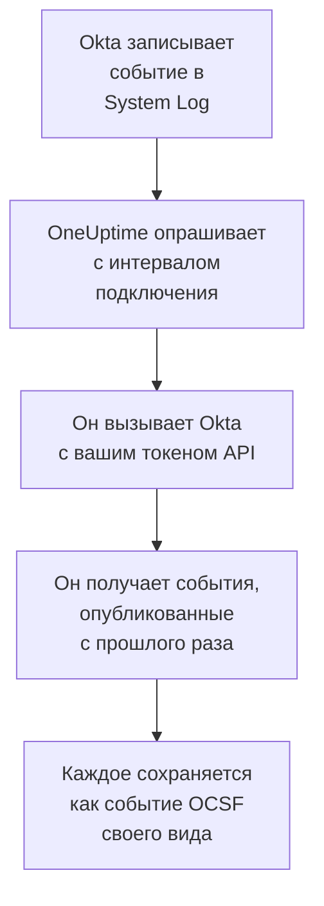

# Системный журнал Okta

Импортируйте [Okta System Log](https://developer.okta.com/docs/reference/system-log-query/) в события безопасности OneUptime: входы, запросы MFA, изменения учётных записей и групп и собственные обнаружения угроз Okta. Там вы ищете их рядом со своими логами, трассировками и метриками, сопоставляете с любыми другими источниками и вызываете дежурных по тем, что важны. OneUptime читает их с токеном API, который вы создаёте, и ничего не меняет в Okta.

:::cards
- [Настройка подключения](#настройка-подключения): Токен API и форма подключения.
- [Что импортируется](#что-импортируется): Какие события и как каждое из них становится событием безопасности.
- [Как работает опрос](#как-работает-опрос): Окно, которое читает каждый опрос, и почему оно перекрывает предыдущее на 15 минут.
- [Устранение неполадок](#устранение-неполадок): Что означает каждая ошибка и что нужно изменить.
:::

## Как это работает



Каждую минуту OneUptime опрашивает каждое включённое подключение, интервал опроса которого истёк. Опрос запрашивает у Okta события System Log, опубликованные после предыдущего опроса, и сохраняет каждое как событие [OCSF](https://schema.ocsf.io/): вход — как событие Authentication, изменение учётной записи — как Account Change, а обнаружение Okta — как Detection Finding. Затем правила обнаружения, мониторы и панели мониторинга обрабатывают его как событие безопасности из любого другого источника. Это работает с каждой ячейкой Okta, `okta.com`, `oktapreview.com` и `okta-emea.com`, а также с организацией на собственном домене.

## Перед началом работы

- В OneUptime роль Project Owner, Project Admin или Security Admin. Роли Security Member и Security Viewer видят подключения и историю их запусков, но не могут их менять.
- Администратор Okta, который может просматривать System Log, чтобы создать токен. Токен может то же, что и его администратор, поэтому используйте Read-only Administrator: он читает System Log и ничего не меняет. Администратор только для чтения видит также пользователей, группы, приложения и настройки, поэтому храните токен так же надёжно, как пароль.
- В идеале — служебная учётная запись для этого администратора. Okta деактивирует токен, когда деактивируется его администратор и когда токен не используется 30 дней. Опрос использует его каждые несколько минут, поэтому он остаётся в использовании, пока подключение включено.
- Если ваша организация принимает вызовы API только из сетевой зоны, — зона, в которую входят адреса, с которых вызывает OneUptime: в OneUptime Cloud — его исходящие адреса, а в самостоятельно размещённой установке — публичный адрес ваших хостов приложения и worker.

## Настройка подключения

:::steps
### Создайте токен API

1. Войдите в **Admin Console** Okta как администратор только для чтения.
2. Откройте **Security → API**, затем вкладку **Tokens**, и выберите **Create token**.
3. Задайте ему имя, например `OneUptime security events`. Оставьте **Any IP** в качестве источника его вызовов, если только вашей организации не нужна зона.
4. Выберите **Create token** и скопируйте **Token Value**. Okta показывает его только один раз.

Каждый токен может использовать долю лимита частоты API организации, которую показывает его строка на вкладке **Tokens**. Опрос делает не больше 20 запросов, поэтому доли по умолчанию более чем достаточно, если только тот же токен не используют другие инструменты.

### Добавьте подключение в OneUptime

Откройте **Продукты → Security Events → Подключения** (`/dashboard/{projectId}/security-events/connections`), нажмите **Добавить подключение**, выберите **Okta System Log** и нажмите **Далее**. Заполните настройки из таблицы ниже, нажмите **Далее** и вставьте токен в **API token**.

### Проверьте его перед сохранением

Нажмите **Проверить эти настройки** в разделе **Проверка перед сохранением**. Проверка выполняет вход и читает события со значениями из формы, ничего не сохраняя, поэтому неверный URL или неправильный фильтр обнаруживаются до того, как подключение будет создано. Затем нажмите **Далее**, задайте подключению **Имя** и создайте его.
:::

| Параметр | Что ввести |
| --- | --- |
| **Okta organization URL** | Адрес, по которому входят ваши пользователи, например `https://acme.okta.com`, `https://acme.oktapreview.com` или `https://login.example.com`. Он должен использовать `https`, без пути. Не адрес `-admin` консоли Admin Console, который не обслуживает API. |
| **Event filter** | Необязательно. [Фильтр System Log](https://developer.okta.com/docs/reference/core-okta-api/#filter), который выбирает события для импорта, например `eventType sw "user.session" or eventType sw "security"`. Пустой импортирует семейства ниже. Не больше 2 000 символов, в одну строку и не по `published`: OneUptime сам задаёт интервал времени. |
| **API token** | Значение токена, само по себе: OneUptime сам добавляет схему `SSWS`. Оно шифруется, никогда не возвращается API и больше не показывается. Замените его с помощью **Обновить учётные данные** в подключении. |

На шаге **Опрос** также есть необязательное **Описание**, **Интервал опроса (минуты)** — целое число от `1` до `1440`, по умолчанию `5`, и **Включено**, изначально включённое.

## Что импортируется

Без **Event filter** OneUptime импортирует семейства событий, за которыми следит команда безопасности, по префиксу `eventType`. Собственный фильтр заменяет этот список, а не дополняет его:

| Префикс | События |
| --- | --- |
| `user.session` | Входы и выходы, доступ к Admin Console, олицетворение |
| `user.authentication` | Результаты аутентификации, включая единый вход |
| `user.mfa` | Регистрация, запросы и сбросы факторов |
| `user.account` | Изменения и сбросы паролей, блокировки, изменения профиля и привилегий |
| `user.lifecycle` | Созданные, активированные, приостановленные, деактивированные и удалённые пользователи |
| `security.` | ThreatInsight, сообщения о подозрительной активности и другие обнаружения Okta |
| `policy.` | Оценки политик входа и изменения политик |
| `system.api_token` | Созданные и отозванные токены API |
| `application.user_membership` | Назначения приложений |
| `group.user_membership` | Изменения членства в группах |

Каждое событие становится одним событием OCSF с поставщиком `Okta` и продуктом `Okta System Log` того класса, который требует его `eventType`:

| `eventType` | Класс OCSF | Активность |
| --- | --- | --- |
| `user.session.start` | Authentication (`3002`) | `Logon` |
| `user.session.end` | Authentication (`3002`) | `Logoff` |
| `user.authentication.*` | Authentication (`3002`) | `Logon` |
| `user.mfa.*` | Authentication (`3002`) | `Authentication Ticket` |
| Другие события `user.session.*` | Authentication (`3002`) | `Other` |
| `user.account.*`, `user.lifecycle.*` | Account Change (`3001`) | Последняя часть типа события, например `Update Password` |
| `group.*` | Group Management (`3006`) | Последняя часть типа события, например `Add` |
| `security.*` и `policy.evaluate_sign_on`, отказавшее в доступе | Detection Finding (`2004`) | `Create` с типом события в качестве имени правила |
| Всё остальное | `0`, с именем по типу события | Последняя часть типа события |

Событие, которое не относится ни к одному из этих классов, всё равно сохраняет каждое поле и остаётся доступным для поиска по любому из них. Каждое событие заполняет эти столбцы:

| Поле Okta | Столбец OneUptime |
| --- | --- |
| `uuid` | UID события, по которому также отбрасываются дубликаты |
| `published` — когда произошло событие | Время события |
| `displayMessage`, иначе тип события и `outcome.reason` | Сообщение |
| `severity`: `DEBUG` и `INFO` — Informational, `WARN` — Medium, `ERROR` — High | Серьёзность |
| `outcome.result`, например `SUCCESS`, `FAILURE`, `ALLOW` или `DENY` | Статус |
| `actor.alternateId`, иначе `actor.displayName`; `client.ipAddress` | Пользователь и IP субъекта |
| `alternateId` объекта `User` в `target` | Целевой пользователь |
| `alternateId` объекта `AppInstance` в `target` | Целевой ресурс |
| Субъект, каждая цель и IP клиента | Наблюдаемые объекты |
| Всё событие, развёрнутое в ключи с точками, например `client.userAgent.browser` и `debugContext.debugData.requestUri` | `attributes` |

Неудачный или отклонённый вход с уровнем `INFO` повышается до Low, чтобы выделяться на фоне успешного. System Log не содержит ссылок на MITRE ATT&CK, поэтому эти столбцы остаются пустыми.

## Как работает опрос

Каждый опрос получает события, опубликованные в его окне, начиная с самых старых, по 1 000 на страницу и следует по ссылке `next`, которую отправляет Okta, до последней страницы:

```text
GET {Okta organization URL}/api/v1/logs?since={window start}&until={window end}&sortOrder=ASCENDING&limit=1000&filter={Event filter}
```

- **Курсором служит время публикации.** Событие System Log — это сама активность, поэтому `published` — это и момент, когда она произошла, и то, что читает опрос.
- **Первый опрос смотрит на 24 часа назад**, чтобы новое подключение сразу показало свои недавние события.
- **Каждый следующий опрос начинается за 15 минут до сохранённого курсора.** Okta предупреждает, что запрос со временем окончания может пропустить задержанные события, что, по её словам, бывает редко. Перекрытие читает их при следующем опросе. Событие, задержанное больше чем на 15 минут, может оказаться позади курсора: импортируйте его интервал времени, чтобы вернуть его.
- **Опрос читает не больше 24 часов после курсора.** Подключение, курсор которого отстал, догоняет серией 24-часовых окон, а его **Состояние** показывает **Catching up**.
- **Дубликаты отбрасываются по `uuid`** в пределах проекта, поэтому перекрытие, повторно прочитанное окно и импорт никогда не сохраняют событие дважды.

Ссылка `next`, указывающая куда-либо, кроме вашего **Okta organization URL**, никогда не используется, поскольку токен передаётся с каждым запросом.

### Когда окно содержит больше, чем может прочитать один опрос

Опрос читает не больше 10 000 событий, не больше чем за 20 запросов. Если окно содержит больше, запуск получает статус **Частично** с предупреждением вроде такого:

```text
Stopped after collecting 10000 events; the window holds more. The last event read was published at 2026-09-14T08:12:44.000Z.
```

События читаются начиная с самых старых, поэтому OneUptime переносит курсор на время публикации последнего прочитанного события, и следующий опрос начинается оттуда, без 15-минутного перекрытия, с той же длиной окна. Загруженная организация догоняет по 10 000 событий за опрос, вместо того чтобы заново читать одни и те же. Перекрытие возвращается, когда курсор уйдёт на 15 минут дальше этой точки.

Если запуск вообще не может продвинуться дальше сохранённого курсора, например потому что одни только 15 минут перекрытия содержат больше 10 000 событий, OneUptime вместо этого укорачивает окно:

1. **Сузить.** Следующий опрос читает окно вдвое короче с той же начальной точки и продолжает делить его пополам, пока окно не будет прочитано целиком, вплоть до одной минуты. Предупреждение запуска говорит об этом: `This window holds more records than one poll can read; the next poll reads a {n} minute window from the same starting point.`
2. **Снова расти.** После того как окно прочитано целиком, следующее снова вдвое длиннее, до 24 часов.
3. **Пройти мимо одной минуты.** Если даже одна минута содержит больше, чем может прочитать опрос, опрос проходит мимо неё, чтобы новые события продолжали поступать, а перекрытие последующих опросов больше не дотягивается до неё. Запуск остаётся в статусе **Частично**, а **Последняя ошибка** сообщает `More records were created in the one minute from {cursor} to {end} than one poll can read. Polling moved past this minute so newer records keep arriving; use Import this time range in Diagnostics on this minute to recover what one run can read.` Импортируйте эту минуту с помощью **Import this time range**, чтобы получить то, что может прочитать один запуск, или сузьте **Event filter**.

Запуск, который полностью завершается ошибкой Okta, сохраняет курсор и длину окна, и следующий опрос заново читает то же окно. Единственное исключение — запрос, превысивший время ожидания: курсор остаётся на месте, но следующее окно вдвое короче, потому что слишком тяжёлое для своевременного ответа окно превышало бы время ожидания при каждой попытке. Изменение **Интервал опроса (минуты)** ничего из этого не меняет: оно определяет, как часто начинается опрос, а не где начинается его окно.

### Запуск, просмотр и импорт по требованию

Нажмите **Диагностика** в подключении, чтобы увидеть его последние запуски и работать с ним вручную. Запускать эти действия может любой, кто может менять подключение; читать историю может любой, кто может его видеть.

- **Запустить сейчас** сразу запускает опрос с обычным курсором, даже если подключение не **Включено**.
- **Preview log events** читает интервал времени до 7 дней и ничего не импортирует.
- **Import this time range** после вашего подтверждения импортирует интервал до 7 дней, не перемещая курсор. Уже импортированные события пропускаются. Okta хранит 90 дней System Log.
- **Copy diagnostics** в запуске копирует его отчёт для поддержки. Он никогда не содержит учётных данных.

## Проверка подключения

**Проверить подключение** в строке подключения и **Проверить эти настройки** в форме выполняются в процессе API, а не в фоновом worker, поэтому проверка отвечает даже тогда, когда проблема в самих worker. Она выполняет такие проверки по порядку:

| Проверка | Что она проверяет |
| --- | --- |
| **Конфигурация** | Каждый параметр задан и правильно оформлен. Если это не так, ни к чему не обращаются. |
| **Authenticate with Okta** | Okta принимает токен для System Log, с одним прочитанным событием и без фильтра. |
| **Read System Log events** | Можно прочитать одно событие за последние 24 часа через фильтр, который использует опрос, ваш или фильтр по умолчанию, поэтому неправильный **Event filter** проваливается здесь, а не при первом опросе. |
| **Events available to import** | Сколько событий опубликовано за последние 24 часа и за последние 7 дней, по одной странице из 1 000 на каждый интервал, поэтому `1000+` означает больше. Ни одного за 7 дней — это предупреждение, а не сбой. |
| **Background workers**, **Poll scheduler**, **Security event storage** | Сторона самого OneUptime: процесс забирает задания из очереди Worker, задание опроса выполняется каждую минуту, а хранилище событий безопасности отвечает. |
| **Scheduled polling** | Для сохранённого подключения: опрос включён, ни один запуск не застрял в ожидании worker, а опросы выполняются вовремя. |

У каждого запроса в проверке срок 20 секунд. Проверка никогда ничего не импортирует и не перемещает курсор, а каждая неудачная проверка сообщает, что нужно изменить.

## Устранение неполадок

**Последняя ошибка** подключения хранит полное сообщение об ошибке со скрытыми учётными данными после префикса, который называет неудавшийся шаг. Если у подключения есть ошибка, выберите **Просмотреть ошибку** в столбце **Действия**, чтобы прочитать её, и **Скопировать ошибку** в диалоговом окне, чтобы скопировать. Каждое сообщение начинается с `Okta System Log events request` и после статуса цитирует собственный код ошибки Okta; читайте то, что идёт дальше.

:::details Last Error сообщает `failed (HTTP 400)`
Okta отклонила параметры запроса, `E0000053`. Если токен сработал, это почти всегда **Event filter**: проверьте его операторы, `eq`, `ne`, `co`, `sw`, `ew`, `pr`, `gt`, `ge`, `lt` и `le`, его `and` и `or` и двойные кавычки вокруг значений, или очистите его, чтобы использовать семейства по умолчанию. При импорте это может также означать, что интервал начинается больше 180 дней назад.
:::

:::details Last Error сообщает `failed (HTTP 401)` или `failed (HTTP 403)`
- `HTTP 401`: Okta не приняла токен, `E0000011`. Он отозван, не использовался 30 дней или деактивирован вместе со своим администратором; либо он вставлен с `SSWS` или с лишним символом. Создайте новый токен от имени администратора только для чтения и сохраните его с помощью **Обновить учётные данные**.
- `HTTP 403`: токен проходит вход, но его администратор не может читать System Log, `E0000006`. Создайте его от имени Read-only Administrator или Super Administrator и проверьте, что его сетевая зона разрешает адреса, с которых вызывает OneUptime.
:::

:::details Last Error сообщает `failed (HTTP ...)` с другим статусом
- `HTTP 404`: URL не обслуживает API Okta. Используйте собственный адрес организации, например `https://acme.okta.com`, без пути и не адрес `-admin`.
- `HTTP 3xx`: Okta перенаправила запрос, а перенаправления отклоняются, поскольку токен передаётся с каждым запросом. Используйте собственный адрес организации.
- `HTTP 429`: Okta ограничивает токен, `E0000047`. Следующий опрос повторит попытку. Если это повторяется, увеличьте долю лимита частоты для токена на вкладке **Tokens**, дайте OneUptime собственный токен или опрашивайте реже.
- `HTTP 5xx`: Okta дала сбой, или запрос превысил 30-секундный лимит Okta, `E0000009`. Следующий опрос повторит попытку; если это повторяется, проверьте [status.okta.com](https://status.okta.com).
:::

:::details Last Error сообщает `returned` или `did not complete`
- `returned a non-JSON body.` или `returned an unrecognized response shape`: ответил не API Okta, а что-то другое, например страница входа или прокси, либо Okta ответила ошибкой. Об этом сообщается, а не считается пустым окном, чтобы курсор никогда не проходил мимо событий, которые никто не прочитал.
- `returned a next link outside the Okta organization URL`: ссылка `next` указывала в другое место, и по ней не перешли. Сама Okta никогда так не делает: ищите прокси, который переписывает заголовки.
- `did not complete`: запрос не получил ответа: истекло время ожидания, имя не разрешается, OneUptime не доверяет сертификату или адрес отклонён. Проверьте, что приложение и worker OneUptime могут добраться до вашей организации по HTTPS через прокси, если вы его используете.
:::

:::details Last Polled — Never, а Last Error пуст
Для этого подключения не завершился ни один опрос. Запустите **Проверить подключение**: его проверки **Background workers** и **Poll scheduler** называют причину. В самостоятельно размещённой установке обычная причина — `DISABLE_QUEUE_WORKERS=true` в приложении без отдельного развёртывания worker, которое забирало бы задания: установите `false` или запустите развёртывание worker (Helm: `worker.enabled: true`).
:::

:::details Запуск имеет статус Partial
- `Stopped after collecting 10000 events`: окно содержало больше 10 000 событий, которые читает один запуск. Ничего не теряется: следующий опрос начинается после последнего прочитанного события. Подключение, которое остаётся в статусе **Частично** опрос за опросом, догоняет накопившийся объём, и его **Последний опрос** и **Последнее импортированное событие** продолжают двигаться вперёд. Если оно никогда не догоняет, организация публикует больше подходящих событий, чем вмещает интервал опроса: сузьте **Event filter** или сократите **Интервал опроса (минуты)**.
- `More records were created in the one minute from ... than one poll can read`: опрос прошёл мимо этой минуты. Импортируйте её с помощью **Import this time range** в **Диагностика**. Импорт читает столько же, сколько опрос.
:::

:::details Проверка проходит, но ничего не импортируется
Прочитайте **Events available to import** в отчёте проверки. С фильтром по умолчанию организация с пользователями постоянно публикует входы, поэтому `0` за последние 7 дней означает, что URL — это песочница или неиспользуемая организация. С вашим собственным **Event filter** это означает, что фильтр ничего не нашёл: сравните его с типами событий в System Log консоли Admin Console.
:::

## Что вы получаете

- **Поиск.** Фильтруйте входы, результаты MFA, изменения учётных записей и обнаружения Okta по серьёзности, статусу, пользователю, IP или любому наблюдаемому объекту в обозревателе событий безопасности, рядом со всеми другими источниками.
- **Сопоставление.** Пользователи, приложения и IP каждого события индексируются как наблюдаемые объекты, поэтому один поиск находит всё, что сделал один пользователь, рядом с собственными логами его приложения.
- **Правила обнаружения.** Правила Sigma, которые выполняются по расписанию над вашими событиями безопасности, например неудачные входы по IP или отказы MFA по пользователю, и открывают оповещения, вызывающие дежурных.
- **Мониторы.** Мониторы событий безопасности подсчитывают совпадающие события и открывают инциденты или оповещения при превышении порога.

События безопасности тарифицируются как остальная телеметрия, за каждый принятый ГБ. См. [цены](https://oneuptime.com/pricing).

## Дальнейшие шаги

:::cards
- [События безопасности](/docs/telemetry/security-events): Поиск, сопоставление и оповещения по импортированным данным.
- [AWS Security Hub](/docs/integrations/aws-security-hub): Импортируйте также находки из вашего облака.
- [Роли](/docs/permissions/reference#роли): Что могут видеть и менять роли Security.
- [Обзор интеграций](/docs/integrations/index): Другие инструменты, которые можно подключить.
:::
