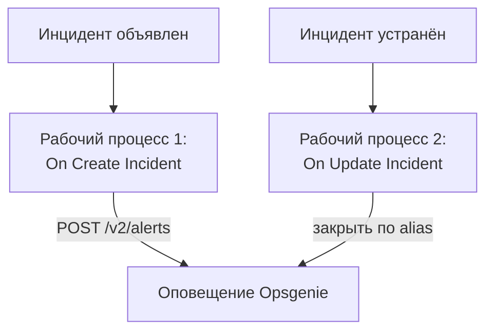

# Opsgenie

Отправляйте инциденты OneUptime в [Opsgenie](https://www.atlassian.com/software/opsgenie). Один рабочий процесс создаёт оповещение Opsgenie, когда объявляется инцидент OneUptime, а второй закрывает его, когда инцидент OneUptime устранён. Используйте это, пока дежурных ещё вызывает Opsgenie, а за системами следит OneUptime.

:::cards
- [Сохранение ключа API](#сохранение-ключа-api): Держите ключ Opsgenie вне рабочих процессов.
- [Создание оповещений Opsgenie](#создание-оповещения-opsgenie-для-каждого-инцидента): Один рабочий процесс, два блока.
- [Их закрытие](#закрытие-оповещения-opsgenie): Второй рабочий процесс, который следит за состоянием инцидента.
- [Устранение неполадок](#устранение-неполадок): Когда Opsgenie отклоняет запрос.
:::

> [!IMPORTANT]
> Atlassian прекратила продажи Opsgenie в июне 2025 года и завершает его поддержку в апреле 2027 года. OneUptime тоже вызывает людей — с политиками дежурств, расписаниями и правилами эскалации. Чтобы перевести команду, см. [Переход с Opsgenie](/docs/moving-to-oneuptime/opsgenie): импорт переносит ваших пользователей, команды, расписания и эскалации.

## Как это работает



Оба рабочих процесса вызывают [Alert API Opsgenie](https://docs.opsgenie.com/docs/alert-api). Первый присваивает оповещению `alias`, составленный из ID инцидента OneUptime, а второй закрывает оповещение по этому alias.

## Перед началом работы

- Интеграция Opsgenie типа **API** и её **API Key**. Добавьте её в **Settings → Integrations** в Opsgenie или в **Integrations** команды, чтобы отправлять оповещения этой команде.
- Ваш регион Opsgenie. Учётные записи в Европе, которые входят через `app.eu.opsgenie.com`, используют `api.eu.opsgenie.com`. Все остальные используют `api.opsgenie.com`.
- В OneUptime — право создавать рабочие процессы и глобальные переменные. В OneUptime Cloud для рабочих процессов нужен тариф **Growth** или выше.

## Сохранение ключа API

:::steps
1. Перейдите в **Рабочие процессы → Глобальные переменные** и нажмите **Создать: Рабочий процесс Переменная**.
2. Назовите её `OPSGENIE_KEY` и нажмите **Далее**.
3. Вставьте ключ API в **Содержимое**, включите **Секрет** и нажмите **Создать: Рабочий процесс Переменная**.
:::

Секретная переменная заменяется на `[REDACTED]` в журналах запусков, поэтому ключ никогда не появляется в запуске.

## Создание оповещения Opsgenie для каждого инцидента

:::steps
### Создайте рабочий процесс

Перейдите в **Рабочие процессы**, нажмите **Создать рабочий процесс**, затем **Начать с нуля**. Назовите его `Incidents to Opsgenie` и нажмите **Создать рабочий процесс**.

### Добавьте триггер

Нажмите на пунктирный блок **Выберите, что запускает этот рабочий процесс** и выберите **On Create Incident**. Нажмите на триггер: его **Fields to pass on** начинаются с поля **Заголовок**, поэтому нажмите **Добавить поле** и выберите **Описание**.

### Создайте оповещение

Нажмите **Добавить компонент**, добавьте блок **API Post (JSON)** и соедините с ним точку **Success** триггера. Задайте его **URL** значение `https://api.opsgenie.com/v2/alerts` или `https://api.eu.opsgenie.com/v2/alerts` в Европе. В разделе **Дополнительные поля** задайте его **Request Headers** так:

```json
{ "Authorization": "GenieKey {{global.variables.OPSGENIE_KEY}}" }
```

А его **Request Body** — так:

```json
{
  "message": "{{local.components.incident-on-create-1.returnValues.model.title}}",
  "alias": "oneuptime-{{local.components.incident-on-create-1.returnValues.model._id}}",
  "description": "{{local.components.incident-on-create-1.returnValues.model.description}}",
  "priority": "P1",
  "source": "OneUptime"
}
```

### Проверьте, затем включите

Нажмите **Запустить рабочий процесс**, выберите тестовый инцидент в поле **Инцидент** и запустите. Шаг **API Post (JSON)** покажет ответ `202`, а оповещение появится в Opsgenie чуть позже. Затем включите **Включено** вверху окна **Конструктор**.
:::

Схема Opsgenie — это слово `GenieKey`, пробел и затем ключ. Opsgenie ограничивает `message` 130 символами, а его приоритеты идут от `P1` до `P5`: чтобы отправлять приоритет каждого инцидента, см. [Сопоставление приоритетов](#сопоставление-приоритетов).

## Закрытие оповещения Opsgenie

У рабочего процесса только один триггер, поэтому для закрытия нужен второй рабочий процесс, который запускается при смене состояния инцидента.

:::steps
### Добавьте триггер On Update Incident

Создайте рабочий процесс с именем `Close Opsgenie alerts` и выберите триггер **On Update Incident**. В **Fields to watch** нажмите **Добавить поле** и выберите **Current Incident State**, чтобы он запускался только при смене состояния. В **Fields to pass on** запросите, является ли новое состояние состоянием устранения: нажмите **Добавить поле**, откройте **Current Incident State** и выберите **Is Resolved State**. Или нажмите **Изменить как JSON** и замените JSON на:

```json
{ "_id": true, "currentIncidentState": { "isResolvedState": true } }
```

### Проверьте, что инцидент устранён

Добавьте после триггера блок **If / Else**. Задайте **Value to check** значение `{{local.components.incident-on-update-1.returnValues.model.currentIncidentState.isResolvedState}}`, а **Comparison** — **is true**.

### Закройте оповещение

Добавьте после стороны **Yes** блок **API Post (JSON)** с теми же **Request Headers** и таким **URL**:

```text
https://api.opsgenie.com/v2/alerts/oneuptime-{{local.components.incident-on-update-1.returnValues.model._id}}/close?identifierType=alias
```

Задайте его **Request Body** значение `{ "source": "OneUptime", "note": "Resolved in OneUptime" }`.

### Включите его

Включите **Включено**, затем устраните тестовый инцидент в OneUptime. Opsgenie закроет своё оповещение.
:::

`identifierType=alias` сообщает Opsgenie, что адрес указывает оповещение по его alias, а не по его собственному ID.

## Сопоставление приоритетов

Чтобы отправлять серьёзность каждого инцидента как приоритет Opsgenie, добавьте между триггером и блоком **API Post (JSON)** блок **Run Custom JavaScript**.

1. В **Fields to pass on** триггера нажмите **Добавить поле**, откройте **Серьёзность инцидента** и выберите **Имя**.
2. Задайте **Arguments** блока значение `{ "severity": "{{local.components.incident-on-create-1.returnValues.model.incidentSeverity.name}}" }`, а его **JavaScript Code** — следующий код:

   ```javascript
   // Your incident severities, by name, to Opsgenie's priorities.
   const PRIORITY = {
     "Critical Incident": "P1",
     "Major Incident": "P2",
     "Minor Incident": "P3",
   };

   return { priority: PRIORITY[args.severity] || "P3" };
   ```

3. В теле запроса задайте `"priority"` значение `"{{local.components.javascript-1.returnValues.returnValue.priority}}"`.

Имена выше — три уровня серьёзности, с которыми начинается новый проект. Если вы их переименовали, используйте свои.

## Устранение неполадок

:::details Opsgenie отвечает 401 или 403
Ключ неверен или относится к другому региону. Убедитесь, что заголовок содержит `GenieKey`, пробел и ключ, что ключ принадлежит интеграции **API** и что хост соответствует вашему региону: `api.opsgenie.com` или `api.eu.opsgenie.com`.
:::

:::details Закрытие отвечает 404
Ни у одного оповещения нет такого alias. Оба рабочих процесса должны составлять alias одинаково — `oneuptime-` и `_id` инцидента, — а URL должен заканчиваться на `?identifierType=alias`.
:::

:::details Оповещение так и не появляется, хотя шаг показывает 202
Opsgenie отвечает `202` до обработки запроса, поэтому запрос, отклонённый позже, всё равно показывает `202`. Найдите запрос в журналах Opsgenie, чтобы узнать причину отказа, например выключенную интеграцию.
:::

:::details Рабочий процесс никогда не запускается
Убедитесь, что он включён: **Включено** вверху окна **Конструктор**. Затем откройте **Журналы → Запуски**: запуск, пошедший по стороне **No** блока **If / Else**, — это обновление, которое не было устранением.
:::

## Дальнейшие шаги

:::cards
- [Переход с Opsgenie](/docs/moving-to-oneuptime/opsgenie): Перенесите команду, расписания и эскалации до закрытия Opsgenie.
- [Правила эскалации](/docs/on-call/escalation-rules): Вызывайте людей прямо из OneUptime.
- [PagerDuty](/docs/integrations/pagerduty): Те же два рабочих процесса для PagerDuty.
- [Обзор интеграций](/docs/integrations/index): Схемы, на которых строится каждая интеграция.
:::
