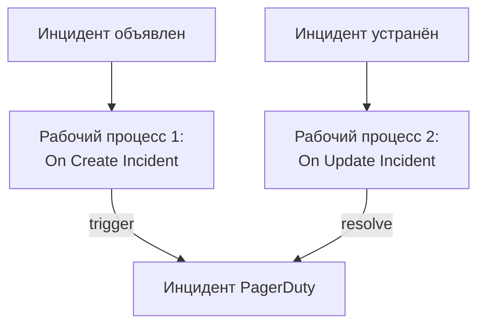

# PagerDuty

Отправляйте инциденты OneUptime в [PagerDuty](https://www.pagerduty.com). Один рабочий процесс запускает инцидент PagerDuty, когда объявляется инцидент OneUptime, а второй устраняет его, когда инцидент OneUptime устранён. Используйте это, когда дежурных вызывает PagerDuty, а за системами следит OneUptime.

:::cards
- [Сохранение routing key](#сохранение-routing-key): Держите ключ PagerDuty вне рабочих процессов.
- [Запуск инцидентов PagerDuty](#запуск-инцидента-pagerduty-для-каждого-инцидента): Один рабочий процесс, два блока.
- [Их устранение](#устранение-инцидента-pagerduty): Второй рабочий процесс, который следит за состоянием инцидента.
- [Устранение неполадок](#устранение-неполадок): Когда PagerDuty отклоняет событие.
:::

> [!TIP]
> OneUptime тоже вызывает людей — с политиками дежурств, расписаниями и правилами эскалации. Чтобы перевести команду с PagerDuty, см. [Переход с PagerDuty](/docs/moving-to-oneuptime/pagerduty): импорт переносит ваших пользователей, расписания и политики эскалации.

## Как это работает



Оба рабочих процесса вызывают [Events API v2](https://developer.pagerduty.com/docs/events-api-v2/overview/) PagerDuty с одним и тем же `dedup_key`, составленным из ID инцидента OneUptime. Именно по этому ключу PagerDuty понимает, что событие resolve закрывает инцидент, открытый событием trigger.

## Перед началом работы

- Сервис PagerDuty с интеграцией Events API v2. В PagerDuty откройте сервис, затем **Integrations**, нажмите **Add an integration** и выберите **Events API V2**. Скопируйте его **Integration Key**: Events API называет его routing key.
- В OneUptime — право создавать рабочие процессы и глобальные переменные. В OneUptime Cloud для рабочих процессов нужен тариф **Growth** или выше.

## Сохранение routing key

:::steps
1. Перейдите в **Рабочие процессы → Глобальные переменные** и нажмите **Создать: Рабочий процесс Переменная**.
2. Назовите её `PAGERDUTY_ROUTING_KEY` и нажмите **Далее**.
3. Вставьте ключ интеграции в **Содержимое**, включите **Секрет** и нажмите **Создать: Рабочий процесс Переменная**.
:::

Секретная переменная заменяется на `[REDACTED]` в журналах запусков, поэтому ключ никогда не появляется в запуске.

## Запуск инцидента PagerDuty для каждого инцидента

:::steps
### Создайте рабочий процесс

Перейдите в **Рабочие процессы**, нажмите **Создать рабочий процесс**, затем **Начать с нуля**. Назовите его `Incidents to PagerDuty` и нажмите **Создать рабочий процесс**.

### Добавьте триггер

Нажмите на пунктирный блок **Выберите, что запускает этот рабочий процесс** и выберите **On Create Incident**. Нажмите на триггер: его **Fields to pass on** начинаются с поля **Заголовок**, поэтому нажмите **Добавить поле** и выберите **Описание**.

### Отправьте событие trigger

Нажмите **Добавить компонент**, добавьте блок **API Post (JSON)** и соедините с ним точку **Success** триггера. Задайте его **URL** значение `https://events.pagerduty.com/v2/enqueue`, а **Request Body** — следующее:

```json
{
  "routing_key": "{{global.variables.PAGERDUTY_ROUTING_KEY}}",
  "event_action": "trigger",
  "dedup_key": "oneuptime-{{local.components.incident-on-create-1.returnValues.model._id}}",
  "payload": {
    "summary": "{{local.components.incident-on-create-1.returnValues.model.title}}",
    "source": "OneUptime",
    "severity": "critical",
    "custom_details": {
      "description": "{{local.components.incident-on-create-1.returnValues.model.description}}"
    }
  }
}
```

### Проверьте, затем включите

Нажмите **Запустить рабочий процесс**, выберите тестовый инцидент в поле **Инцидент** и запустите. Шаг **API Post (JSON)** покажет ответ `202` с `"status": "success"`, а PagerDuty откроет инцидент. Затем включите **Включено** вверху окна **Конструктор**.
:::

Блок отправляет JSON, поэтому заголовок `Content-Type` ему не нужен. `severity` в PagerDuty принимает одно из значений `critical`, `error`, `warning` и `info`: чтобы отправлять серьёзность каждого инцидента, см. [Сопоставление уровней серьёзности](#сопоставление-уровней-серьёзности).

## Устранение инцидента PagerDuty

У рабочего процесса только один триггер, поэтому для устранения нужен второй рабочий процесс, который запускается при смене состояния инцидента.

:::steps
### Добавьте триггер On Update Incident

Создайте рабочий процесс с именем `Resolve PagerDuty incidents` и выберите триггер **On Update Incident**. В **Fields to watch** нажмите **Добавить поле** и выберите **Current Incident State**, чтобы он запускался только при смене состояния. В **Fields to pass on** запросите, является ли новое состояние состоянием устранения: нажмите **Добавить поле**, откройте **Current Incident State** и выберите **Is Resolved State**. Или нажмите **Изменить как JSON** и замените JSON на:

```json
{ "_id": true, "currentIncidentState": { "isResolvedState": true } }
```

### Проверьте, что инцидент устранён

Добавьте после триггера блок **If / Else**. Задайте **Value to check** значение `{{local.components.incident-on-update-1.returnValues.model.currentIncidentState.isResolvedState}}`, а **Comparison** — **is true**.

### Отправьте событие resolve

Добавьте после стороны **Yes** блок **API Post (JSON)** с тем же **URL** и таким **Request Body**:

```json
{
  "routing_key": "{{global.variables.PAGERDUTY_ROUTING_KEY}}",
  "event_action": "resolve",
  "dedup_key": "oneuptime-{{local.components.incident-on-update-1.returnValues.model._id}}"
}
```

### Включите его

Включите **Включено**, затем устраните тестовый инцидент в OneUptime. PagerDuty устранит свой инцидент.
:::

Проверка `isResolvedState` вместо имени состояния продолжает работать, когда вы переименовываете состояния. См. [Состояния и уровни серьёзности инцидентов](/docs/incidents/states-and-severities).

## Сопоставление уровней серьёзности

Чтобы отправлять серьёзность каждого инцидента, добавьте между триггером и блоком **API Post (JSON)** блок **Run Custom JavaScript** и читайте его ответ в теле.

1. В **Fields to pass on** триггера нажмите **Добавить поле**, откройте **Серьёзность инцидента** и выберите **Имя**.
2. Задайте **Arguments** блока значение `{ "severity": "{{local.components.incident-on-create-1.returnValues.model.incidentSeverity.name}}" }`, а его **JavaScript Code** — следующий код:

   ```javascript
   // Your incident severities, by name, to PagerDuty's.
   const SEVERITY = {
     "Critical Incident": "critical",
     "Major Incident": "error",
     "Minor Incident": "warning",
   };

   return { severity: SEVERITY[args.severity] || "info" };
   ```

3. В теле запроса задайте `"severity"` значение `"{{local.components.javascript-1.returnValues.returnValue.severity}}"`.

Имена выше — три уровня серьёзности, с которыми начинается новый проект. Если вы их переименовали, используйте свои.

## Устранение неполадок

:::details PagerDuty отвечает 400
Тело ответа сообщает, что именно отклонил PagerDuty, и шаг **API Post (JSON)** запуска это показывает. Обычно routing key не является ключом интеграции Events API v2: скопируйте его заново из **Integrations** сервиса. Событие без `summary`, `source` или `severity` тоже отклоняется.
:::

:::details Событие resolve ничего не закрывает
Оба события должны нести в точности один и тот же `dedup_key`. Убедитесь, что оба тела составляют его как `oneuptime-` и `_id` инцидента, и что рабочий процесс устранения включён.
:::

:::details Рабочий процесс никогда не запускается
Убедитесь, что он включён: **Включено** вверху окна **Конструктор**. Затем откройте **Журналы → Запуски**: запуск, пошедший по стороне **No** блока **If / Else**, — это обновление, которое не было устранением.
:::

:::details PagerDuty показывает ссылку вместо значения
Ссылка, которая не разрешается, отправляется в записанном виде, вместе с фигурными скобками. Проверьте идентификатор блока, имя поля и имя переменной, которое чувствительно к регистру. На вкладке **Шаги** запуска настройка с такой ссылкой помечена как **Did not resolve**.
:::

## Дальнейшие шаги

:::cards
- [Переход с PagerDuty](/docs/moving-to-oneuptime/pagerduty): Перенесите команду, расписания и политики эскалации.
- [Правила эскалации](/docs/on-call/escalation-rules): Вызывайте людей прямо из OneUptime.
- [Opsgenie](/docs/integrations/opsgenie): Те же два рабочих процесса для Opsgenie.
- [Обзор интеграций](/docs/integrations/index): Схемы, на которых строится каждая интеграция.
:::
