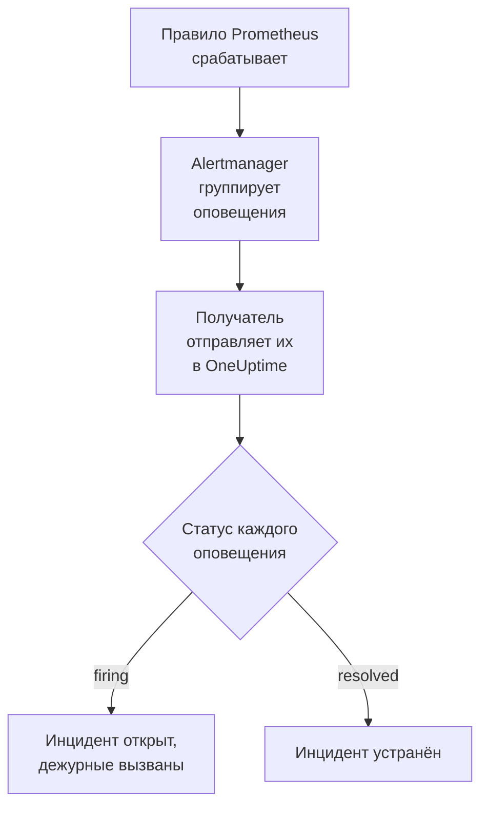

# Prometheus Alertmanager

Отправляйте оповещения [Prometheus Alertmanager](https://prometheus.io/docs/alerting/latest/alertmanager/) в OneUptime, чтобы каждое сработавшее оповещение становилось инцидентом, который вызывает вашу дежурную команду и устраняется, когда оповещение восстанавливается. Alertmanager отправляет свои уведомления на получателя-вебхук, поэтому ни на одной стороне ничего не нужно устанавливать.

:::cards
- [Выбор способа приёма оповещений в OneUptime](#выбор-способа-приёма-оповещений-в-oneuptime): Монитор Incoming Request или собственный рабочий процесс.
- [Приём оповещений монитором](#приём-оповещений-монитором): Один инцидент на оповещение, устраняемый при восстановлении.
- [Настройка Alertmanager](#настройка-alertmanager): Получатель-вебхук и маршрут, который его использует.
- [Устранение неполадок](#устранение-неполадок): Когда оповещения не приходят или инциденты остаются открытыми.
:::

## Как это работает



Prometheus вычисляет ваши правила оповещений и отправляет сработавшие оповещения в Alertmanager. Alertmanager группирует их по меткам из `group_by` вашего маршрута и отправляет каждую группу получателю-вебхуку одним JSON-уведомлением. Список `alerts` в уведомлении содержит все оповещения группы, у каждого из которых есть собственный `status`, `firing` или `resolved`, свои метки и аннотации и `fingerprint`, который его идентифицирует.

## Перед началом работы

- Alertmanager, файл `alertmanager.yml` которого вы можете редактировать и который может обращаться к вашему OneUptime по HTTPS.
- В OneUptime право создавать мониторы или рабочие процессы, если вы выберете этот путь.

## Выбор способа приёма оповещений в OneUptime

Сначала настройте OneUptime: он выдаст URL, на который будет отправлять Alertmanager.

| Способ | Когда использовать |
| --- | --- |
| Монитор Incoming Request (рекомендуется) | Вы хотите, чтобы каждое оповещение становилось инцидентом, который вызывает дежурных и устраняется, когда оповещение восстанавливается. Ничего строить не нужно. |
| Рабочий процесс с триггером Webhook | Вам нужна собственная логика: фильтровать оповещения, преобразовывать их или сначала вызывать другие системы. Рабочий процесс открывает один инцидент на уведомление, а не на оповещение, и не устраняет его при восстановлении. |

Оба способа получают один и тот же JSON от одного и того же получателя, поэтому можно начать с одного и позже перейти на другой, изменив один URL в `alertmanager.yml`.

## Приём оповещений монитором

[Монитор Incoming Request](/docs/monitor/incoming-request-monitor) выдаёт вам URL, а его критерии определяют, что делает каждое уведомление.

:::steps
### Создайте монитор

Откройте **Мониторы** и нажмите **Создать монитор**. Выберите **Incoming Request** в поле **Тип монитора**, назовите монитор `Alertmanager` и нажмите **Далее**.

### Объявляйте инцидент для каждого сработавшего оповещения

На шаге **Критерии** откройте первый критерий, тот, что переводит монитор в состояние «не в сети». Задайте для его фильтра **Тело запроса**, **Содержит**, `"status":"firing"`. Этот критерий уже объявляет инцидент, когда его фильтр совпадает. Заполните инцидент:

- **Заголовок инцидента**: `{{requestBody.commonLabels.alertname}} on {{requestBody.commonLabels.instance}}`.
- **Серьёзность**: серьёзность инцидента, которая должна быть у этих оповещений.
- **Политики дежурств**, в разделе **Дежурство**: политики, которые нужно вызывать.
- **Автоустранение инцидента**, в разделе **Дополнительные поля**: оставьте включённым, как по умолчанию. Без него восстановления игнорируются, а инциденты остаются открытыми.

### Открывайте один инцидент на оповещение

В том же критерии откройте **Настройки** и включите **Group incidents and alerts by a payload field**. Заполните его, как показано ниже, чтобы у каждого оповещения был свой инцидент и его восстановление устраняло этот инцидент:

| Поле | Значение |
| --- | --- |
| **Open a separate incident for each…** | `requestBody.alerts[*].fingerprint` |
| **Field that signals recovery** | `requestBody.alerts[*].status` |
| **Value that means recovered** | `resolved` |

### Возвращайте монитор в сеть

Откройте второй критерий, тот, что переводит монитор в состояние «в сети», и задайте для его фильтра **Тело запроса**, **Содержит**, `"status":"resolved"`.

### Скопируйте URL

Нажмите **Создать монитор**. Страница **Обзор** монитора показывает его **Heartbeat URL**. Скопируйте его для Alertmanager:

```text
https://oneuptime.com/heartbeat/<secret key>
```

У самостоятельно размещённой установки вместо `oneuptime.com` указан собственный хост.
:::

`[*]` читает каждое оповещение уведомления, поэтому уведомление с тремя оповещениями может открыть три инцидента, но не больше значения **Max incidents per request** (`100`, если вы его не измените). Собственный `status` каждого оповещения определяет, что произойдёт с его инцидентом: когда одно оповещение уведомления устранено, а два ещё срабатывают, закрывается только инцидент устранённого оповещения. Что делает каждая настройка, описано в разделе [Приём оповещений от другой системы](/docs/monitor/incoming-request-monitor#приём-оповещений-от-другой-системы).

> [!WARNING]
> Группируйте по значению, которое различается от оповещения к оповещению внутри одного уведомления. `fingerprint` в Alertmanager — это хеш всего набора меток оповещения, поэтому он всегда различается. Метка из `group_by` вашего маршрута никогда не различается: именно она собирает оповещения в одно уведомление. Группировка по `requestBody.alerts[*].labels.alertname` с маршрутом ниже сводит все оповещения уведомления в один инцидент, который получает статус первого оповещения.

## Названия инцидентов

Заголовок выше читает метки, общие для всех оповещений уведомления: `commonLabels` содержит эти метки, а `commonAnnotations` — общие для них аннотации. С маршрутом ниже, который группирует по `alertname` и `instance`, есть и то и другое. В разделе **Описание** задайте для инцидента **Описание инцидента**, например:

```text
{{requestBody.commonAnnotations.summary}}

{{requestBody.commonAnnotations.description}}
Severity: {{requestBody.commonLabels.severity}}
Alertmanager: {{requestBody.externalURL}}
```

- Ключ группировки тоже является переменной и называется по последнему сегменту своего пути: `{{fingerprint}}`. Это хеш, поэтому дежурному он ничего не говорит.
- `{{requestBody.alerts[0].annotations.summary}}` читает первое оповещение уведомления, а это не всегда то оповещение, для которого был открыт инцидент.
- Ссылка на поле, которого нет в уведомлении, остаётся в том виде, как написана, вместе с фигурными скобками, а не заменяется пустым значением.

Все переменные, которые можно использовать, перечислены в разделе [Шаблоны инцидентов и оповещений](/docs/monitor/incident-alert-templating).

## Настройка Alertmanager

:::steps
### Добавьте получателя-вебхук

В `alertmanager.yml` добавьте получателя, который отправляет на скопированный URL, и сделайте его получателем маршрута:

```yaml title="alertmanager.yml"
route:
  receiver: oneuptime
  group_by: ["alertname", "instance"]

receivers:
  - name: oneuptime
    webhook_configs:
      - url: "https://oneuptime.com/heartbeat/<secret key>"
        send_resolved: true
```

`send_resolved: true` — значение Alertmanager по умолчанию, записанное явно, чтобы оно оставалось включённым: без него OneUptime никогда не узнает, что оповещение восстановилось. Alertmanager отправляет `Content-Type: application/json`, который нужен монитору, чтобы читать поля уведомления.

### Перезагрузите Alertmanager

Перезагрузите конфигурацию или перезапустите Alertmanager:

```bash
curl -X POST http://localhost:9093/-/reload
```
:::

Маршрут сохраняет стандартные интервалы Alertmanager. Он ждёт `30s` перед отправкой новой группы (`group_wait`), `5m` перед повторной отправкой группы, в которой появились новые оповещения (`group_interval`), и `4h` перед повтором уведомления, которое не изменилось (`repeat_interval`).

## Проверка

Отправьте в OneUptime уведомление с двумя сработавшими оповещениями, как это сделал бы Alertmanager:

```bash
curl -X POST "https://oneuptime.com/heartbeat/<secret key>" \
  -H "Content-Type: application/json" \
  -d '{
    "version": "4",
    "status": "firing",
    "receiver": "oneuptime",
    "groupLabels": { "alertname": "DiskFull", "instance": "web-1" },
    "commonLabels": { "alertname": "DiskFull", "instance": "web-1", "severity": "critical" },
    "commonAnnotations": { "summary": "Disk almost full on web-1" },
    "externalURL": "http://alertmanager:9093",
    "alerts": [
      {
        "status": "firing",
        "labels": { "alertname": "DiskFull", "instance": "web-1", "severity": "critical", "device": "/dev/sda1" },
        "fingerprint": "a1b2c3d4e5f60001"
      },
      {
        "status": "firing",
        "labels": { "alertname": "DiskFull", "instance": "web-1", "severity": "critical", "device": "/dev/sdb1" },
        "fingerprint": "a1b2c3d4e5f60002"
      }
    ]
  }'
```

Открываются два инцидента, по одному на `fingerprint`, каждый с заголовком `DiskFull on web-1`. Отправьте тот же запрос, указав для каждого `status` значение `resolved`, и оба будут устранены.

Чтобы проверить весь путь от Alertmanager, вызовите оповещение с помощью `amtool`. Alertmanager отправит его после `group_wait`, а затем отправит его восстановление, когда через несколько минут истечёт срок действия оповещения:

```bash
amtool alert add test_alert severity=warning \
  --annotation=summary="Test from Alertmanager" \
  --alertmanager.url=http://localhost:9093
```

## Приём оповещений рабочим процессом

Используйте [рабочий процесс](/docs/workflows/index), когда между Alertmanager и инцидентом нужны собственные шаги.

:::steps
### Создайте рабочий процесс

Откройте **Рабочие процессы**, нажмите **Создать рабочий процесс**, затем **Начать с нуля**. Назовите его `Alertmanager alerts` и нажмите **Создать рабочий процесс**.

### Добавьте триггер Webhook

Нажмите на пунктирный блок **Выберите, что запускает этот рабочий процесс** и выберите **Webhook**. Нажмите на триггер, затем **Скопировать URL** и укажите этот URL в получателе в `alertmanager.yml`.

### Проверьте, что уведомление сработало

Нажмите **Добавить компонент**, добавьте блок **If / Else** и подключите к нему точку **Out** триггера. Задайте для **Value to check** значение `{{local.components.webhook-1.returnValues.request-body.status}}`, для **Comparison** значение **is equal to**, а для **Compare with** значение `firing`.

### Объявите инцидент

Добавьте блок **Create One Incident** и подключите к нему сторону **Yes** блока **If / Else**. В поле **Incident Template** выберите шаблон, который задаёт серьёзность и политики дежурств для вызова (см. [Шаблоны инцидентов](/docs/incidents/settings#шаблоны-инцидентов)). В поле **JSON Object** задайте то, что приходит от Alertmanager:

```json
{
  "title": "{{local.components.webhook-1.returnValues.request-body.commonLabels.alertname}}",
  "description": "{{local.components.webhook-1.returnValues.request-body.commonAnnotations.summary}}\nAlertmanager: {{local.components.webhook-1.returnValues.request-body.externalURL}}"
}
```

Без шаблона **JSON Object** также должен содержать `incidentSeverityId` — идентификатор одного из уровней серьёзности инцидентов проекта.

### Включите рабочий процесс

Включите **Включено** в верхней части окна **Конструктор**. Выключенный рабочий процесс отвечает Alertmanager кодом `400`.
:::

Один запуск обрабатывает одно уведомление, поэтому он объявляет один инцидент независимо от того, сколько оповещений содержит уведомление. Уведомление со статусом `resolved` уходит по стороне **No** блока **If / Else**, к которой ничего не подключено, поэтому запуск на этом заканчивается. Чтобы получать один инцидент на оповещение с устранением при восстановлении, используйте монитор.

## Наблюдение за самим Alertmanager

Ни один из способов не замечает, когда Prometheus или Alertmanager перестают работать: отсутствие оповещений выглядит точно так же, как если бы всё было в порядке. Поэтому отправляйте постоянно срабатывающее оповещение на второй монитор, который объявляет инцидент, когда это оповещение перестаёт приходить. [kube-prometheus-stack](https://github.com/prometheus-community/helm-charts/tree/main/charts/kube-prometheus-stack) поставляется с таким оповещением под названием `Watchdog`. В обычном Prometheus добавьте правило оповещения с именем `Watchdog`, выражение которого всегда истинно, например `vector(1)`.

:::steps
### Создайте монитор-сторож

Создайте второй монитор Incoming Request с именем `Alertmanager watchdog`. Задайте для фильтра его первого критерия, который переводит монитор в состояние «не в сети», значения **Incoming Request**, **Not Recieved In Minutes**, `10`, а для фильтра второго критерия — **Incoming Request**, **Recieved In Minutes**, `10`. Панель управления пишет оба именно так. Скопируйте **Heartbeat URL** нового монитора.

### Направьте на него сторожевое оповещение

Добавьте получателя для URL монитора-сторожа и маршрут, который отправляет туда `Watchdog` каждые пять минут. Дочерний маршрут проверяется раньше получателя своего родителя, поэтому `Watchdog` уходит на монитор-сторож, а все остальные оповещения по-прежнему уходят на первый монитор:

```yaml title="alertmanager.yml"
route:
  receiver: oneuptime
  group_by: ["alertname", "instance"]
  routes:
    - receiver: oneuptime-watchdog
      matchers:
        - alertname = "Watchdog"
      group_wait: 0s
      group_interval: 5m
      repeat_interval: 5m

receivers:
  - name: oneuptime
    webhook_configs:
      - url: "https://oneuptime.com/heartbeat/<secret key>"
        send_resolved: true
  - name: oneuptime-watchdog
    webhook_configs:
      - url: "https://oneuptime.com/heartbeat/<watchdog secret key>"
```
:::

Когда сторожевое оповещение не приходит десять минут, монитор-сторож переходит в состояние «не в сети» и объявляет инцидент. Следующее сторожевое уведомление возвращает монитор в сеть и устраняет инцидент.

## Устранение неполадок

:::details В OneUptime ничего не приходит
- Проверьте журнал Alertmanager на ошибки доставки получателю.
- Монитор сразу отвечает `200`, ещё до каких-либо проверок, даже при неверном секретном ключе. Посмотрите на временную шкалу монитора, чтобы понять, доходят ли уведомления.
- Выключенный рабочий процесс отвечает `400`. Включите **Включено** в верхней части его окна **Конструктор**.
:::

:::details Инциденты открываются, но никогда не устраняются
- Убедитесь, что ни один получатель не задаёт `send_resolved: false`: в этом случае Alertmanager никогда не отправляет восстановление.
- Инциденту критерия нужно **Автоустранение инцидента** в разделе **Дополнительные поля**.
- **Field that signals recovery** должно быть `requestBody.alerts[*].status`, а **Value that means recovered** — точно `resolved`. Сравнение учитывает регистр.
- Оповещения уведомления сверх значения **Max incidents per request** вообще не читаются, поэтому их восстановления тоже теряются.
- Восстановление, пропущенное во время всплеска (см. ниже), оставляет свой инцидент открытым навсегда: Alertmanager повторяет сработавшие оповещения, но никогда не повторяет восстановление. Устраните такой инцидент вручную.
:::

:::details Инциденты не открываются
Пути группировки должны начинаться с `requestBody.`, и только первый `[*]` в пути читает список. Путь, нарушающий любое из этих правил, ни с чем не совпадает, причём без ошибки.
:::

:::details Один инцидент на уведомление, полное оповещений
Вы сгруппировали по метке, одинаковой для всех оповещений уведомления, чаще всего по метке из `group_by` вашего маршрута. Вместо этого группируйте по `requestBody.alerts[*].fingerprint`.
:::

:::details Инцидент показывает ссылку вместо значения
Ссылка на поле, которого нет в уведомлении, остаётся в том виде, как написана, вместе с фигурными скобками. Правила задают разные аннотации, поэтому используйте поля, которые задают ваши правила: в `commonAnnotations` или в `annotations` каждого оповещения.
:::

:::details Слишком много инцидентов
Группируйте маршрут по меньшему числу меток или увеличьте `group_interval`, чтобы Alertmanager отправлял связанные оповещения вместе. Уменьшение **Max incidents per request** ограничивает число инцидентов от одного уведомления, но оповещения сверх лимита не читаются, поэтому их восстановления тоже теряются.
:::

:::details Уведомления пропускаются во время всплеска
Когда более новый запрос приходит на монитор раньше, чем обработан предыдущий, OneUptime обрабатывает только самый новый, чтобы один отправитель не мог перегрузить монитор. Последнее уведомление всплеска обрабатывается всегда, но более раннее, о других оповещениях, может быть пропущено, потому что Alertmanager отправляет каждую группу на один и тот же URL. Увеличьте `group_wait` и `group_interval`, чтобы разнести уведомления во времени. В самостоятельно размещённой установке задайте `INCOMING_REQUEST_INGEST_COALESCE_ENABLED=false` в окружении приложения OneUptime, чтобы обрабатывался каждый запрос.
:::

## Безопасность

- **Обращайтесь с URL как с паролем.** Любой, у кого он есть, может открывать инциденты. Если он утёк, сбросьте его: **Сбросить секретный ключ входящего запроса** на странице **Настройки** монитора или **Сбросить URL** в триггере **Webhook** рабочего процесса. Затем обновите `url` получателя в `alertmanager.yml`.
- **Самостоятельное размещение?** Разрешите Alertmanager обращаться к вашему OneUptime по HTTPS через ваш файрвол.

## Дальнейшие шаги

:::cards
- [Мониторинг входящих запросов](/docs/monitor/incoming-request-monitor): Все настройки монитора, который принимает ваши оповещения.
- [Grafana](/docs/integrations/grafana): Та же настройка для оповещений Grafana.
- [Правила эскалации](/docs/on-call/escalation-rules): Решите, кого и когда вызывает политика дежурств.
- [Обзор интеграций](/docs/integrations/index): Другие инструменты, которые можно подключить.
:::
