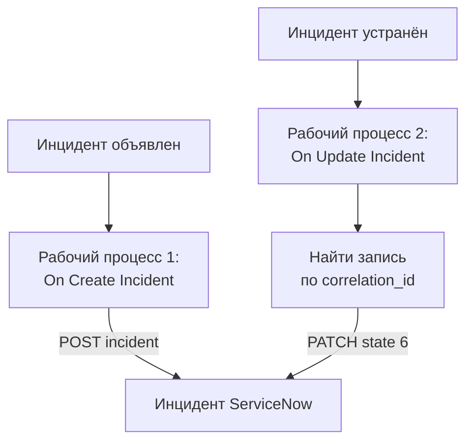

# ServiceNow

Открывайте инцидент [ServiceNow](https://www.servicenow.com) для каждого инцидента OneUptime и устраняйте его, когда устранён инцидент OneUptime, чтобы ваша служба поддержки видела то же, что и ваш мониторинг. Два рабочих процесса вызывают [Table API](https://developer.servicenow.com/dev.do#!/reference/api/latest/rest/c_TableAPI) ServiceNow.

:::cards
- [Сохранение учётных данных](#сохранение-учётных-данных): Держите пароль ServiceNow вне рабочих процессов.
- [Открытие инцидентов ServiceNow](#открытие-инцидента-servicenow-для-каждого-инцидента): Один рабочий процесс, два блока.
- [Их устранение](#устранение-инцидента-servicenow): Найти запись, затем закрыть её.
- [Устранение неполадок](#устранение-неполадок): Когда ServiceNow отклоняет запрос.
:::

## Как это работает



Первый рабочий процесс записывает ID инцидента OneUptime в `correlation_id` записи. Второй находит запись по этому ID, затем устраняет её.

## Перед началом работы

- Экземпляр ServiceNow, например `https://your-instance.service-now.com`.
- Пользователь ServiceNow для интеграции, который может создавать и обновлять записи в таблице `incident`, обычно с ролью `itil`. Его имя и пароль подписывают запросы.
- В OneUptime — право создавать рабочие процессы и глобальные переменные. В OneUptime Cloud для рабочих процессов нужен тариф **Growth** или выше.

## Сохранение учётных данных

Table API принимает аутентификацию Basic: имя и пароль пользователя, закодированные вместе.

:::steps
1. Закодируйте их один раз, в macOS или Linux:

   ```bash
   printf '%s' 'integration.user:password' | base64 | tr -d '\n'
   ```

   Используйте `printf`, а не `echo`: `echo` добавляет перевод строки, который кодируется вместе с остальным и ломает учётные данные.

2. В OneUptime перейдите в **Рабочие процессы → Глобальные переменные** и нажмите **Создать: Рабочий процесс Переменная**. Назовите её `SERVICENOW_AUTH` и нажмите **Далее**.
3. Вставьте закодированное значение в **Содержимое**, включите **Секрет** и нажмите **Создать: Рабочий процесс Переменная**.
:::

## Открытие инцидента ServiceNow для каждого инцидента

:::steps
### Создайте рабочий процесс

Перейдите в **Рабочие процессы**, нажмите **Создать рабочий процесс**, затем **Начать с нуля**. Назовите его `Incidents to ServiceNow` и нажмите **Создать рабочий процесс**.

### Добавьте триггер

Нажмите на пунктирный блок **Выберите, что запускает этот рабочий процесс** и выберите **On Create Incident**. Нажмите на триггер: его **Fields to pass on** начинаются с поля **Заголовок**, поэтому нажмите **Добавить поле** и выберите **Описание**.

### Создайте запись

Нажмите **Добавить компонент**, добавьте блок **API Post (JSON)** и соедините с ним точку **Success** триггера. Задайте его **URL** значение `https://your-instance.service-now.com/api/now/table/incident`. В разделе **Дополнительные поля** задайте его **Request Headers** так:

```json
{
  "Authorization": "Basic {{global.variables.SERVICENOW_AUTH}}",
  "Accept": "application/json"
}
```

А его **Request Body** — так:

```json
{
  "short_description": "OneUptime: {{local.components.incident-on-create-1.returnValues.model.title}}",
  "description": "{{local.components.incident-on-create-1.returnValues.model.description}}",
  "urgency": "1",
  "impact": "1",
  "correlation_id": "oneuptime-{{local.components.incident-on-create-1.returnValues.model._id}}"
}
```

### Проверьте, затем включите

Нажмите **Запустить рабочий процесс**, выберите тестовый инцидент в поле **Инцидент** и запустите. Шаг **API Post (JSON)** покажет ответ `201` с новой записью, её `sys_id` и `number`, например `INC0012345`. Затем включите **Включено** вверху окна **Конструктор**.
:::

`urgency` и `impact` принимают `1` для высокого, `2` для среднего и `3` для низкого уровня, а приоритет ServiceNow вычисляет по ним. Любой другой столбец таблицы `incident` можно передать в теле под его именем.

## Устранение инцидента ServiceNow

У рабочего процесса только один триггер, поэтому для устранения нужен второй рабочий процесс, который запускается при смене состояния инцидента.

:::steps
### Добавьте триггер On Update Incident

Создайте рабочий процесс с именем `Resolve ServiceNow incidents` и выберите триггер **On Update Incident**. В **Fields to watch** нажмите **Добавить поле** и выберите **Current Incident State**, чтобы он запускался только при смене состояния. В **Fields to pass on** запросите, является ли новое состояние состоянием устранения: нажмите **Добавить поле**, откройте **Current Incident State** и выберите **Is Resolved State**. Или нажмите **Изменить как JSON** и замените JSON на:

```json
{ "_id": true, "currentIncidentState": { "isResolvedState": true } }
```

### Проверьте, что инцидент устранён

Добавьте после триггера блок **If / Else**. Задайте **Value to check** значение `{{local.components.incident-on-update-1.returnValues.model.currentIncidentState.isResolvedState}}`, а **Comparison** — **is true**.

### Найдите запись

Добавьте после стороны **Yes** блок **API Get (JSON)** с теми же **Request Headers** и таким **URL**:

```text
https://your-instance.service-now.com/api/now/table/incident?sysparm_query=correlation_id=oneuptime-{{local.components.incident-on-update-1.returnValues.model._id}}&sysparm_fields=sys_id&sysparm_limit=1
```

### Устраните запись

Добавьте после **Success** блока поиска блок **API Patch (JSON)** с теми же **Request Headers** и таким **URL**:

```text
https://your-instance.service-now.com/api/now/table/incident/{{local.components.api-get-1.returnValues.response-body.result[0].sys_id}}
```

Задайте его **Request Body** так:

```json
{
  "state": "6",
  "close_code": "Solution provided",
  "close_notes": "Resolved in OneUptime"
}
```

### Включите его

Включите **Включено**, затем устраните тестовый инцидент в OneUptime. Его инцидент ServiceNow перейдёт в Resolved.
:::

`state` `6` означает Resolved в стандартных состояниях инцидентов ServiceNow. `close_code` должен быть одним из кодов закрытия вашего экземпляра. Многие экземпляры не устраняют инцидент без кода закрытия и заметок, поэтому отправляйте и то и другое.

## Устранение неполадок

:::details ServiceNow отвечает 401
Учётные данные неверны. Закодируйте `username:password` заново с помощью `printf`, а не `echo`, и замените содержимое `SERVICENOW_AUTH`.
:::

:::details ServiceNow отвечает 403
Пользователь не может записывать в таблицу `incident`. Выдайте ему роль `itil` или роль с такими же правами и убедитесь, что никакое правило контроля доступа не блокирует ему Table API.
:::

:::details ServiceNow отвечает 400, или устранение ничего не меняет
Имя столбца или значение не подходит вашему экземпляру: изменённый список `state` или `close_code`, которого в вашем экземпляре нет. Сверьтесь с таблицей `incident` в **System Definition → Tables** в ServiceNow и с формой самой записи.
:::

:::details Устранение отвечает 404
Шаг поиска не нашёл записи, поэтому URL сохранил ссылку в записанном виде. Убедитесь, что первый рабочий процесс записал `correlation_id` и что оба рабочих процесса составляют его одинаково: `oneuptime-` и `_id` инцидента.
:::

## Дальнейшие шаги

:::cards
- [Jira](/docs/integrations/jira): Двусторонняя интеграция, которую поддерживают в актуальном состоянии готовые шаблоны.
- [Компоненты рабочего процесса](/docs/workflows/components#api): Все настройки блоков API.
- [Запуски рабочего процесса](/docs/workflows/runs-and-logs): Смотрите, что каждый запрос отправил и получил в ответ.
- [Обзор интеграций](/docs/integrations/index): Схемы, на которых строится каждая интеграция.
:::
