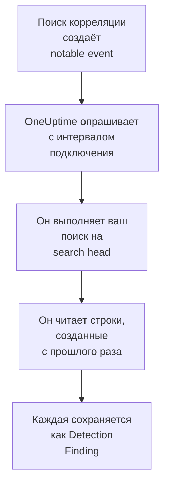

# Splunk Enterprise Security

Импортируйте notable events, которые создают поиски корреляции [Splunk Enterprise Security](https://www.splunk.com/en_us/products/enterprise-security.html), в события безопасности OneUptime. Там вы ищете их рядом со своими логами, трассировками и метриками, сопоставляете с любыми другими источниками и вызываете дежурных по тем, что важны. OneUptime читает их, выполняя поиск на вашем search head от имени пользователя Splunk, которого вы создаёте, и ничего не меняет в Splunk. Поскольку это обычный поиск, он импортирует любой индекс или вывод любого сохранённого поиска, а не только notable events.

:::cards
- [Настройка подключения](#настройка-подключения): Токен, роль и форма подключения.
- [Что импортируется](#что-импортируется): Как каждая строка поиска становится событием безопасности.
- [Как работает опрос](#как-работает-опрос): Окно, которое читает каждый опрос, и что с ним делает загруженный search head.
- [Устранение неполадок](#устранение-неполадок): Что означает каждая ошибка и что нужно изменить.
:::

## Как это работает



Каждую минуту OneUptime опрашивает каждое включённое подключение, интервал опроса которого истёк. Опрос выполняет ваш поиск через REST API search head по строкам, созданным после предыдущего опроса, и сохраняет каждую строку как событие [OCSF](https://schema.ocsf.io/) Detection Finding (класс `2004`). Затем правила обнаружения, мониторы и панели мониторинга обрабатывают его как событие безопасности из любого другого источника.

## Перед началом работы

- В OneUptime роль Project Owner, Project Admin или Security Admin. Роли Security Member и Security Viewer видят подключения и историю их запусков, но не могут их менять.
- Search head с Splunk Enterprise 9.0.1 или новее либо Splunk Cloud Platform. OneUptime обращается к его REST API на порту управления, обычно `8089`. Splunk Web на порту `8000` не обслуживает REST API.
- Пользователь Splunk для OneUptime, чья роль имеет возможность `search` и может читать индекс, который читает поиск: `notable` для notable events. Роли Enterprise Security `ess_analyst` и `ess_user` дают и то и другое. Подключение только читает, поэтому роли больше ничего не нужно.
- Search head, до которого OneUptime может добраться по HTTPS. OneUptime Cloud подключается из интернета, поэтому search head нужен публичный адрес: частные адреса отклоняются. Самостоятельно размещённый OneUptime подключается из своих контейнеров приложения и worker и может добраться до search head в вашей частной сети, если только `DATA_SOURCE_BLOCK_PRIVATE_ADDRESSES` не равно `true`.

## Настройка подключения

Подключение проходит аутентификацию с токеном аутентификации Splunk либо с именем пользователя и паролем.

:::steps
### Создайте токен аутентификации

1. В Splunk Web откройте **Settings → Tokens**. Если Splunk сообщает, что аутентификация по токенам отключена, сначала выберите **Enable Token Authentication**.
2. Выберите **New Token**. В поле **User** укажите пользователя Splunk, созданного для OneUptime, а в **Audience** — для чего нужен токен, например `OneUptime security events`.
3. Выберите **Expiration** или оставьте без срока. Токен с истёкшим сроком останавливает подключение, пока вы его не замените.
4. Выберите **Create** и скопируйте токен. Splunk показывает его только один раз.

Чтобы вместо этого проходить аутентификацию с паролем, пропустите этот шаг и держите под рукой имя и пароль пользователя.

### Добавьте подключение в OneUptime

Откройте **Продукты → Security Events → Подключения** (`/dashboard/{projectId}/security-events/connections`), нажмите **Добавить подключение**, выберите **Splunk Enterprise Security** и нажмите **Далее**. Заполните настройки из таблицы ниже, нажмите **Далее** и вставьте токен в **Authentication token** или пароль в **Пароль**.

### Проверьте его перед сохранением

Нажмите **Проверить эти настройки** в разделе **Проверка перед сохранением**. Проверка проходит аутентификацию и выполняет ваш поиск со значениями из формы, ничего не сохраняя, поэтому неверный порт или недостающая роль обнаруживаются до того, как подключение будет создано. Затем нажмите **Далее**, задайте подключению **Имя** и создайте его.
:::

| Параметр | Что ввести |
| --- | --- |
| **Splunk management URL** | REST API search head, например `https://splunk.example.com:8089`. Он должен использовать `https`, без строки запроса. Путь сохраняется — для обратного прокси, который обслуживает API по пути. |
| **Поиск** | Поиск, который выбирает, что импортировать: `index=notable`, пока вы его не измените. Сузьте его, например так: `index=notable urgency IN (high, critical)`. OneUptime сам добавляет интервал времени, поэтому поиск не может задавать `earliest` или `latest` и не может начинаться с вертикальной черты. Начальный `search` удаляется. |
| **Имя пользователя** | Имя пользователя Splunk, только если он проходит аутентификацию с паролем. |
| **Authentication token** | Токен из первого шага. Если токен сохранён, используется он, а не имя пользователя и пароль. |
| **Пароль** | Пароль пользователя Splunk, только если токен не используется. |

**Authentication token** и **Пароль** шифруются, никогда не возвращаются API и больше не показываются. Замените любой из них с помощью **Обновить учётные данные** в подключении. Чтобы перейти с одного способа аутентификации на другой, введите там новый и включите **Remove the stored Authentication token** или **Remove the stored Password**.

На шаге **Опрос** также есть необязательное **Описание**, **Интервал опроса (минуты)** — целое число от `1` до `1440`, по умолчанию `5`, и **Включено**, изначально включённое.

## Что импортируется

Каждая строка, которую возвращает поиск, становится событием Detection Finding (класс OCSF `2004`) с поставщиком `Splunk` и продуктом `Splunk Enterprise Security`. Для notable event:

| Поле Splunk | Столбец OneUptime |
| --- | --- |
| `event_id`, иначе `_bkt` и `_cd`, иначе хеш строки | UID события, по которому также отбрасываются дубликаты |
| `_time` — когда поиск корреляции создал notable event | Время события |
| `rule_name`, иначе `search_name`, иначе `source` | Имя правила |
| `search_name`, иначе `source`, иначе `rule_name` | Идентификатор правила |
| `rule_title`, иначе `rule_description`, иначе имя правила | Сообщение |
| `urgency`, иначе `severity` | Серьёзность |
| `status_label`, иначе `status_description`, иначе имя статуса проверки, который содержит `status` | Статус |
| `annotations.mitre_attack` и поля вроде `mitre_technique_id` и `mitre_tactic` | Тактики и техники MITRE ATT&CK |
| `user` или `src_user`; `src`, `src_ip` или `src_host`; `process`, `process_name` или `parent_process` | Пользователь, IP, хост и процесс субъекта |
| `process_name` или `process_exec`, `process_path` и `process`; `parent_process_name` или `parent_process_exec`, `parent_process_path` и `parent_process` | Имя, путь и командная строка процесса; имя, путь и командная строка родительского процесса |
| `dest_user`; `dest`, `dest_ip` или `dest_host`; `dest_port` | Пользователь, IP, хост и порт цели |
| `file_path`, `url` или `risk_object` | Целевой ресурс |
| Каждый пользователь, хост и IP, а также `dvc`, `host`, `file_hash`, `file_name`, `url`, `domain`, `query` и `risk_object` | Наблюдаемые объекты |
| Каждое поле строки, например `security_domain`, `owner`, `orig_sid` и `_raw` | `attributes` под собственным именем поля |

Строка из другого индекса импортируется так же. Столбцы, которые её поля не заполняют, остаются пустыми, и каждое поле по-прежнему доступно для поиска в `attributes`.

## Как работает опрос

Каждый опрос выполняет экспортный поиск по своему окну, начиная с самых старых:

```text
POST {Splunk management URL}/services/search/v2/jobs/export
    search=search index=notable | fields * | sort 0 _time | head 10001
    earliest_time={window start}
    latest_time={window end}
    output_mode=json
```

- **Курсором служит время создания.** Окно задаётся по `_time`, которое для notable event означает момент, когда поиск корреляции его создал, а не когда произошла найденная активность. Поиск, который выполняется раз в час, датирует свои notable events временем своего запуска, поэтому ни один не оказывается позади курсора.
- **Первый опрос смотрит на 24 часа назад**, чтобы новое подключение сразу показало свои недавние notable events.
- **Каждый следующий опрос начинается за 1 минуту до сохранённого курсора**, чтобы строка, созданная на границе двух окон, никогда не терялась.
- **Опрос читает не больше 24 часов после курсора.** Подключение, курсор которого отстал, догоняет серией 24-часовых окон, а его **Состояние** показывает **Catching up**.
- **Дубликаты отбрасываются по `event_id`** или по собственным `_bkt` и `_cd` Splunk в пределах проекта, поэтому перекрытие, повторно прочитанное окно и импорт никогда не сохраняют строку дважды.

Search head старше 9.0.1 отвечает `404` на запрос к `search/v2/jobs/export`. Тогда OneUptime отправляет его на устаревший `search/jobs/export`, и запуск сообщает об этом в предупреждении. Обновите search head: в текущих версиях эта конечная точка отключена.

### Когда окно содержит больше, чем может прочитать один опрос

Опрос читает не больше 10 000 строк. Если окно содержит больше, запуск получает статус **Частично** с предупреждением вроде такого:

```text
Stopped after collecting 10000 records; the window holds more. Records are read oldest first, and the last one read was created at 2026-09-14T08:12:44.000Z, where the next poll can resume.
```

Поиск сортирует окно по `_time`, начиная с самых старых, поэтому OneUptime переносит курсор на время создания последней прочитанной строки, и следующий опрос начинается оттуда с той же длиной окна. Загруженный search head догоняет по 10 000 строк за опрос, вместо того чтобы заново читать одни и те же. Строки, созданные в один и тот же момент, читаются дважды, и проверка дубликатов отбрасывает вторую копию. Splunk сортирует всё окно, прежде чем вернуть хоть одну строку, поэтому поиск в поле **Поиск**, который находит гораздо больше нужного, замедляет каждый опрос. Держите его узким.

Если запуск вообще не может продвинуться дальше сохранённого курсора, OneUptime вместо этого сокращает окно:

1. **Сузить.** Следующий опрос читает окно вдвое короче с той же начальной точки и продолжает делить его пополам, пока окно не будет прочитано целиком, вплоть до одной минуты. Предупреждение запуска говорит об этом: `This window holds more records than one poll can read; the next poll reads a {n} minute window from the same starting point.`
2. **Снова расти.** После того как окно прочитано целиком, следующее снова вдвое длиннее, до 24 часов.
3. **Пройти мимо одной минуты.** Если даже одна минута содержит больше, чем может прочитать опрос, опрос проходит мимо неё, чтобы новые notable events продолжали поступать. Запуск остаётся в статусе **Частично**, а **Последняя ошибка** сообщает `More records were created in the one minute from {cursor} to {end} than one poll can read. Polling moved past this minute so newer records keep arriving; use Import this time range in Diagnostics on this minute to recover what one run can read.` Импортируйте эту минуту с помощью **Import this time range**, чтобы получить то, что может прочитать один запуск.

Запуск, который полностью завершается ошибкой Splunk, сохраняет курсор и длину окна, и следующий опрос заново читает то же окно. Единственное исключение — запрос, превысивший время ожидания: курсор остаётся на месте, но следующее окно вдвое короче, потому что слишком тяжёлое для своевременного ответа окно превышало бы время ожидания при каждой попытке. Изменение **Интервал опроса (минуты)** ничего из этого не меняет: оно определяет, как часто начинается опрос, а не где начинается его окно.

### Запуск, просмотр и импорт по требованию

Нажмите **Диагностика** в подключении, чтобы увидеть его последние запуски и работать с ним вручную. Запускать эти действия может любой, кто может менять подключение; читать историю может любой, кто может его видеть.

- **Запустить сейчас** сразу запускает опрос с обычным курсором, даже если подключение не **Включено**.
- **Preview notable events** читает интервал времени до 7 дней и ничего не импортирует.
- **Import this time range** после вашего подтверждения импортирует интервал до 7 дней, не перемещая курсор. Уже импортированные строки пропускаются.
- **Copy diagnostics** в запуске копирует его отчёт для поддержки. Он никогда не содержит учётных данных.

## Проверка подключения

**Проверить подключение** в строке подключения и **Проверить эти настройки** в форме выполняются в процессе API, а не в фоновом worker, поэтому проверка отвечает даже тогда, когда проблема в самих worker. Она выполняет такие проверки по порядку:

| Проверка | Что она проверяет |
| --- | --- |
| **Конфигурация** | Каждый параметр задан и правильно оформлен. Если это не так, ни к чему не обращаются. |
| **Authenticate with Splunk** | Splunk принимает токен или имя пользователя и пароль и называет пользователя и его роли, чтобы вы сравнили их с ролью, которую хотели выдать. |
| **Run the search on Splunk** | Поиск из поля **Поиск** выполняется за последние 24 часа для одной строки и сообщает, какая конечная точка экспорта ответила. |
| **Notable events available to import** | Сколько строк поиск из поля **Поиск** находит за последние 24 часа и за последние 7 дней. Ни одной за 7 дней — это предупреждение, а не сбой. |
| **Background workers**, **Poll scheduler**, **Security event storage** | Сторона самого OneUptime: процесс забирает задания из очереди Worker, задание опроса выполняется каждую минуту, а хранилище событий безопасности отвечает. |
| **Scheduled polling** | Для сохранённого подключения: опрос включён, ни один запуск не застрял в ожидании worker, а опросы выполняются вовремя. |

У каждого запроса в проверке срок 20 секунд. Проверка никогда ничего не импортирует и не перемещает курсор, а каждая неудачная проверка сообщает, что нужно изменить.

## Отправка событий безопасности в Splunk

OneUptime также может отправлять то, что находит, в Splunk через его HTTP Event Collector (HEC), чтобы ваши поиски и дашборды видели обнаружения OneUptime рядом с вашими собственными. Каждое событие безопасности — это одно событие HEC с sourcetype `oneuptime:security`, а его поля названы так, как их называет Common Information Model Splunk: `src`, `src_ip`, `src_user`, `dest`, `dest_ip`, `dest_port`, `user`, `signature` и `severity`.

:::steps
### Создайте токен HEC

В Splunk Web откройте **Settings → Data inputs → HTTP Event Collector** и нажмите **New Token**. Дайте ему имя, выберите индексы, в которые он может писать, и его индекс по умолчанию, и скопируйте значение токена. В Splunk Cloud HEC слушает на `https://http-inputs-<stack>.splunkcloud.com`; в Splunk Enterprise — на порту `8088`, после того как **Global Settings** включит токены.

### Добавьте получателя

Откройте **Продукты → Security Events → Подключения**. В разделе **Отправка в вашу SIEM** нажмите **Добавить получателя**, выберите Splunk в поле **SIEM** и нажмите **Далее**. Заполните **URL HEC** и вставьте токен в **Токен HEC**. **Индекс** и **Тип источника** необязательны: если оставить их пустыми, события идут в индекс токена по умолчанию с sourcetype `oneuptime:security`.

### Отправьте тестовое событие и начните отправку

Нажмите **Отправить тестовое событие**: одно информационное событие уходит в Splunk с настройками формы, и ничего не сохраняется. Найдите его по `sourcetype="oneuptime:security"`. Затем в разделе **Что отправлять** оставьте **Только обнаружения** или выберите **Все события безопасности** и нажмите **Начать отправку**.
:::

- **URL HEC** должен использовать `https` с сертификатом, которому доверяет OneUptime: проверки сертификата никогда не пропускаются.
- События уходят пакетами до 500. Событие, которое Splunk отклоняет, пропускается и называется в **Просмотреть ошибку**, занятый коллектор (`503`) повторяется, а отклонённый токен или индекс останавливает отправку, пока вы его не исправите.
- Notable events, которые OneUptime импортировал из Splunk, никогда не отправляются обратно в него.

## Устранение неполадок

**Последняя ошибка** подключения хранит полное сообщение об ошибке со скрытыми учётными данными после префикса, который называет неудавшийся шаг. Если у подключения есть ошибка, выберите **Просмотреть ошибку** в столбце **Действия**, чтобы прочитать её, и **Скопировать ошибку** в диалоговом окне, чтобы скопировать. Сначала прочитайте префикс.

:::details Last Error начинается с `Splunk Enterprise Security authentication request`
- `Splunk Enterprise Security authentication request failed (HTTP ...)`: Splunk отказался сообщить, кто вызывающий.
  - `HTTP 401`: Splunk не принял учётные данные. Токен неверен, истёк или удалён, аутентификация по токенам отключена на search head, либо неверны имя пользователя или пароль. Создайте новый токен и сохраните его с помощью **Обновить учётные данные**.
  - `HTTP 404`: **Splunk management URL** — это не REST API. Он указывает на Splunk Web на порту `8000` или содержит путь, который search head не обслуживает.
- `Splunk Enterprise Security authentication request returned ...`: ответил не REST API search head, а что-то другое, например HTML Splunk Web на порту `8000` или страница прокси. Направьте URL на порт управления.
:::

:::details Last Error начинается с `Splunk Enterprise Security search export` или `Splunk Enterprise Security count search`
- `Splunk Enterprise Security search export failed (HTTP ...)`: Splunk отказался выполнить поиск.
  - `HTTP 400`: Splunk не может разобрать поиск. Выполните поиск из поля **Поиск** в Splunk Web, чтобы прочитать его ошибку.
  - `HTTP 403`: роли пользователя не хватает возможности `search`, или она не может читать индекс. Добавьте `notable` или свой индекс в индексы, по которым роль может искать.
  - `HTTP 404`: ни одной из двух конечных точек экспорта по этому URL нет, значит, это не порт управления search head.
  - `HTTP 429` или `HTTP 5xx`: Splunk ограничивает пользователя, перегружен, или поиск упёрся в один из своих лимитов. Следующий опрос повторит попытку.
- `Splunk Enterprise Security search export was rejected by Splunk on an HTTP 200`: Splunk ответил, но остановил поиск с ошибкой. Сообщение её цитирует.
- `Splunk Enterprise Security search export returned a body that is not newline-delimited JSON.`: ответил не REST API, а что-то другое, например Splunk Web или страница входа прокси. Об этом сообщается, а не считается пустым окном, чтобы курсор никогда не проходил мимо строк, которые никто не прочитал.
- `Splunk Enterprise Security count search ...`: те же сбои при подсчёте для **Notable events available to import**, который выполняет только проверка.
:::

:::details Last Error заканчивается на `did not complete`
`Splunk Enterprise Security search export did not complete`, как и для других шагов, означает, что запрос не получил ответа: истекло время ожидания, имя не разрешается, OneUptime не доверяет сертификату или частный адрес отклонён. Проверьте, что приложение OneUptime и worker могут открыть HTTPS-подключение к порту управления. Search head, который отвечает на другие запросы, но превышает время ожидания на поиске, сортирует слишком много: следующий опрос читает окно вдвое короче, а более узкий поиск в поле **Поиск** решает проблему окончательно.
:::

:::details Last Polled — Never, а Last Error пуст
Для этого подключения не завершился ни один опрос. Запустите **Проверить подключение**: его проверки **Background workers** и **Poll scheduler** называют причину. В самостоятельно размещённой установке обычная причина — `DISABLE_QUEUE_WORKERS=true` в приложении без отдельного развёртывания worker, которое забирало бы задания: установите `false` или запустите развёртывание worker (Helm: `worker.enabled: true`).
:::

:::details Запуск имеет статус Partial
- `Stopped after collecting 10000 records; the window holds more`: окно содержало больше 10 000 строк, которые читает один запуск. Ничего не теряется: следующий опрос начинается после последней прочитанной строки. Подключение, которое остаётся в статусе **Частично** опрос за опросом, догоняет накопившийся объём, и его **Последний опрос** и **Последнее импортированное событие** продолжают двигаться вперёд. Если оно никогда не догоняет, поиск из поля **Поиск** находит больше 10 000 строк за интервал опроса: сузьте его или сократите **Интервал опроса (минуты)**.
- `More records were created in the one minute from ... than one poll can read`: опрос прошёл мимо этой минуты. Импортируйте её с помощью **Import this time range** в **Диагностика**. Импорт читает столько же, сколько опрос.
:::

:::details Проверка проходит, но ничего не импортируется
Прочитайте **Notable events available to import** в отчёте проверки. `0` за последние 7 дней означает, что поиск из поля **Поиск** ничего не нашёл в Splunk: проверьте в Incident Review, что поиски корреляции включены и создают notable events, а поиск из поля **Поиск** не уже, чем задумано.
:::

## Что вы получаете

- **Поиск.** Фильтруйте notable events по срочности, статусу, правилу, пользователю, хосту или любому наблюдаемому объекту в обозревателе событий безопасности, рядом со всеми другими источниками.
- **Сопоставление.** Пользователи, хосты, IP и домены каждой строки индексируются как наблюдаемые объекты, поэтому один поиск находит всё, где они упоминаются.
- **Правила обнаружения.** Правила Sigma, которые выполняются по расписанию над вашими событиями безопасности и открывают оповещения, вызывающие дежурных.
- **Мониторы.** Мониторы событий безопасности подсчитывают совпадающие события, например новые критические notable events, и открывают инциденты или оповещения при превышении порога.

События безопасности тарифицируются как остальная телеметрия, за каждый принятый ГБ. См. [цены](https://oneuptime.com/pricing).

## Дальнейшие шаги

:::cards
- [События безопасности](/docs/telemetry/security-events): Поиск, сопоставление и оповещения по импортированным данным.
- [Elastic Security](/docs/integrations/elastic-security): Импортируйте также оповещения об обнаружениях из стека Elastic.
- [Роли](/docs/permissions/reference#роли): Что могут видеть и менять роли Security.
- [Обзор интеграций](/docs/integrations/index): Другие инструменты, которые можно подключить.
:::
