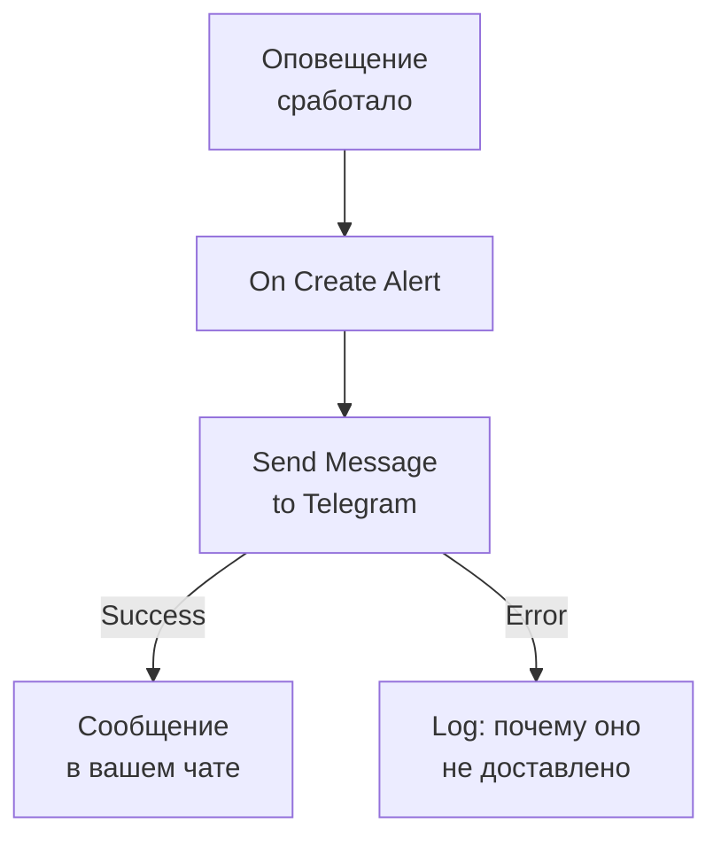

# Telegram

Отправляйте сообщение в чат, группу или канал [Telegram](https://telegram.org), когда срабатывает оповещение или открывается инцидент. Шаг рабочего процесса **Send Message to Telegram** в OneUptime отправляет его от имени бота, которого вы создаёте, а готовый шаблон создаёт рабочий процесс для оповещений. Эта интеграция **исходящая**: бот отправляет сообщения и не читает, что говорят в чате.

:::cards
- [Как это работает](#как-это-работает): Что делает рабочий процесс, когда срабатывает оповещение.
- [Настройка](#настройка-интеграции): Бот, его чат, затем рабочий процесс: из шаблона или с нуля.
- [Советы](#советы): Обычный текст, длинные сообщения и инциденты.
- [Устранение неполадок](#устранение-неполадок): Что означают ошибки Telegram и что изменить.
:::

## Как это работает



Шаг отправляет **Message Text** в чат от имени вашего бота через Bot API Telegram. Он переходит на выход **Success**, когда Telegram принимает сообщение, и на выход **Error** с причиной от Telegram, когда Telegram его отклоняет. Шаблон подключает шаг **Log** к **Error**, чтобы запуск, который не смог отправить сообщение, объяснял почему.

## Перед началом работы

- Учётная запись Telegram, чтобы создать бота и добавить его в чат.
- В OneUptime — право создавать рабочие процессы и переменные. В OneUptime Cloud для рабочих процессов нужен тариф **Growth** или выше.

## Настройка интеграции

:::steps
### Создайте бота

В Telegram отправьте `/newbot` боту [@BotFather](https://t.me/BotFather) и ответьте на его вопросы. Он выдаст токен бота, например `123456789:ABCdefGhIJKlmnoPQRstuVWxyz`. Любой, у кого есть токен, может отправлять сообщения от имени вашего бота, поэтому храните его так же надёжно, как пароль.

### Найдите идентификатор чата

1. Добавьте бота в группу или сделайте его администратором канала. Чтобы писать человеку, он должен сначала начать чат с ботом.
2. Отправьте в группе сообщение, упоминающее бота, например `/start@your_bot`, чтобы бот его увидел.
3. Откройте `https://api.telegram.org/bot<token>/getUpdates` в браузере, подставив токен бота вместо `<token>`.
4. Найдите `"chat":{"id":` в ответе. Число после этого — идентификатор чата. Идентификатор группы начинается с `-`, а большой группы — с `-100`.

Публичный канал можно указать по его `@username` вместо идентификатора.

### Создайте рабочий процесс

Начните с шаблона, который создаёт весь рабочий процесс для оповещений, или с нуля.

:::tabs
@tab Из шаблона
1. Откройте **Рабочие процессы** и нажмите **Создать рабочий процесс**.
2. Введите `Telegram` в **Поиск шаблонов…**, нажмите **Tell Telegram when an alert fires**, затем **Использовать шаблон**.
3. Оставьте имя **Notify Telegram on new alert** или измените его и нажмите **Далее**.
4. Вставьте токен в **Telegram Bot Token**, а идентификатор в **Telegram Chat ID** и нажмите **Создать рабочий процесс**.

Рабочий процесс открывается в окне **Конструктор** с тремя шагами: **On Create Alert**; **Send Message to Telegram**, который отправляет номер, заголовок, серьёзность и состояние оповещения; и шаг **Log** на его выходе **Error**. Токен сохраняется как секретная переменная рабочего процесса `telegramBotToken`, а идентификатор — как `telegramChatId`.
@tab С нуля
1. Сохраните токен как секретную глобальную переменную: перейдите в **Рабочие процессы → Глобальные переменные**, нажмите **Создать: Рабочий процесс Переменная**, назовите её `TELEGRAM_BOT_TOKEN` и нажмите **Далее**. Вставьте токен в **Содержимое**, включите **Секрет** и нажмите **Создать: Рабочий процесс Переменная**.
2. Перейдите в **Рабочие процессы**, нажмите **Создать рабочий процесс**, выберите **Начать с нуля**, задайте имя рабочего процесса и нажмите **Создать рабочий процесс**.
3. В окне **Конструктор** нажмите **Выберите, что запускает этот рабочий процесс** и выберите **On Create Alert** в разделе **Популярные**. Нажмите на триггер: его **Fields to pass on** начинаются с поля **Заголовок**, поэтому нажмите **Добавить поле** и выберите остальные поля, которые показывает ваше сообщение, например **Alert Number With Prefix**.
4. Нажмите **Добавить компонент**, найдите `telegram` и нажмите **Send Message to Telegram**. Соедините выход **Success** триггера с этим шагом.
5. Нажмите на новый шаг. В **Telegram Bot Token** нажмите **{ }** и выберите `TELEGRAM_BOT_TOKEN` в разделе **Global variables**. Введите идентификатор чата в **Chat ID**, напишите сообщение в **Message Text** и вставьте поля оповещения с помощью **{ }**.
:::

Сообщение, созданное с нуля, читает поля оповещения по ссылкам вроде этих:

```text
🚨 Alert {{local.components.alert-on-create-1.returnValues.model.alertNumberWithPrefix}} fired
Title: {{local.components.alert-on-create-1.returnValues.model.title}}
```

### Включите и проверьте

Включите переключатель **Включено** в верхней части окна **Конструктор**. С этого момента каждое новое оповещение отправляется в чат.

Чтобы проверить без срабатывания оповещения, нажмите **Запустить рабочий процесс** и выберите уже существующее оповещение в поле **Оповещение**: последние показаны в списке, а другое можно найти, введя его номер или часть заголовка. Нажмите **Запустить рабочий процесс вручную** и подтвердите кнопкой **Запустить**. Панель **Запуск рабочего процесса** отслеживает запуск, и сообщение появляется в чате. Если шаг вместо этого переходит в **Error**, строка шага **Log** объясняет почему: см. [Устранение неполадок](#устранение-неполадок).
:::

## Советы

- **Обычный текст.** Шаг отправляет текст так, как он набран, без форматирования Telegram, поэтому `*` и `_` отображаются как есть.
- **Учитывайте лимит в 4 096 символов.** Telegram принимает сообщения длиной до 4 096 символов. Более длинное обрезается и заканчивается на "… (truncated — see OneUptime for the full text)", а не отклоняется.
- **Инциденты тоже.** Создайте такой же рабочий процесс на **On Create Incident** или на **On Update Incident** для смены состояния. Чтобы отправлять только некоторые оповещения, поставьте перед шагом блок **If / Else**.
- **Форма токена проверяется.** Токен, который не похож на `123456789:ABCdef…`, останавливает запуск до любой отправки, а сам токен никогда не записывается в журнал.

## Устранение неполадок

Когда шаг переходит в **Error**, запуск объясняет почему: шаг **Log** шаблона записывает `❌ Telegram could not deliver the alert notification:`, причину от Telegram и напоминание, что бот должен быть в чате.

:::details Telegram отвечает "Bad Request: chat not found"
**Chat ID** указан неверно, или бот не видит чат: добавьте бота в группу, сделайте его администратором канала или попросите человека начать чат с ботом. Идентификатор группы начинается с `-`.
:::

:::details Telegram отвечает "Forbidden: bot was blocked by the user" или "bot is not a member"
Человек заблокировал бота, или бота удалили из группы или канала. Добавьте его снова или отправляйте в другой чат.
:::

:::details Telegram отвечает "Unauthorized"
Telegram не принял токен: его отозвали в @BotFather или скопировали неправильно. Скопируйте текущий токен бота из @BotFather и замените значение переменной.
:::

:::details Telegram отвечает "Too Many Requests: retry after"
Telegram ограничивает скорость отправки одного бота, особенно в группу. Всплеск оповещений может упереться в этот лимит: отправляйте меньше сообщений, например только для некоторых уровней серьёзности.
:::

## Дальнейшие шаги

:::cards
- [Компоненты рабочего процесса](/docs/workflows/components#telegram): Каждая настройка шага и что означают его выходы.
- [Discord](/docs/integrations/discord): Та же идея в канале Discord.
- [Запуски рабочего процесса](/docs/workflows/runs-and-logs): Посмотрите, что сделал каждый запуск рабочего процесса.
- [Обзор интеграций](/docs/integrations/index): Исходящий шаблон и другие инструменты, которые можно подключить.
:::
