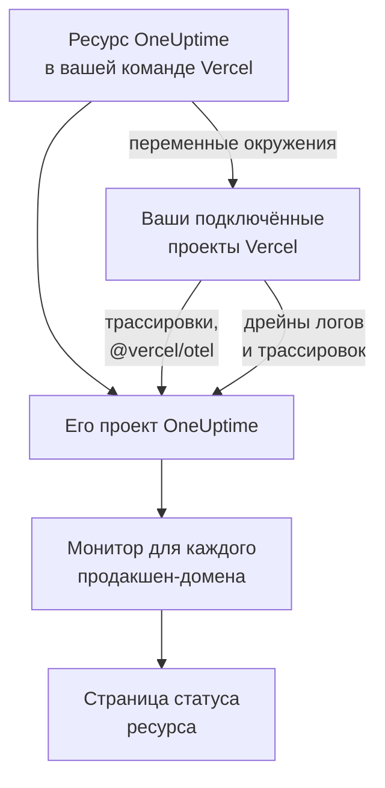

# Vercel

Добавьте OneUptime в свою команду Vercel из [Vercel Marketplace](https://vercel.com/marketplace). Вы входите через учётную запись Vercel, оплата идёт через ваш счёт Vercel, а ваши проекты Vercel получают в OneUptime трассировки, логи, мониторинг доступности и страницу статуса без всякой ручной настройки.

:::cards
- [Добавление OneUptime в команду Vercel](#добавление-oneuptime-в-команду-vercel): Ресурс, план и ваши проекты, в панели управления Vercel.
- [Отправка трассировок через @vercel/otel](#отправка-трассировок-через-vercelotel): Переменные окружения уже на месте.
- [Отправка логов и трассировок через дрейны](#отправка-логов-и-трассировок-через-дрейны): Собственные логи и спаны Vercel, на планах Pro и Enterprise.
- [Планы и оплата](#планы-и-оплата): Планы OneUptime в вашем счёте Vercel.
:::

## Как это работает

Каждый ресурс OneUptime, который вы добавляете в Vercel, — это отдельный проект OneUptime. Каждому проекту Vercel, который вы подключаете к ресурсу, Vercel передаёт переменные окружения ресурса, и с ними проект отправляет свои трассировки в OneUptime. Дрейны отправляют логи и спаны Vercel, а продакшен-домен каждого подключённого проекта получает монитор доступности на странице статуса ресурса.



Интеграция предназначена для OneUptime Cloud (`oneuptime.com`). Самостоятельно размещённый OneUptime нельзя добавить из Vercel Marketplace: см. [Самостоятельно размещённый OneUptime](#самостоятельно-размещённый-oneuptime).

## Перед началом

- **Команда Vercel** на любом плане. Дрейнам логов и трассировок нужен план Vercel Pro или Enterprise; трассировки из `@vercel/otel` работают на любом плане.
- **Подтверждённый адрес электронной почты** в учётной записи Vercel. OneUptime использует этот адрес для входа и создаёт с ним вашу учётную запись OneUptime, если у вас её ещё нет.
- **Способ оплаты в Vercel** для любого плана: мониторы и телеметрия оплачиваются по мере использования, в том числе на плане Free. См. [Планы и оплата](#планы-и-оплата).

## Добавление OneUptime в команду Vercel

:::steps
### Откройте OneUptime в Vercel Marketplace

В панели управления Vercel откройте **Integrations**, затем **Browse Marketplace** и найдите OneUptime в разделе **Observability**. Нажмите **Установка** и примите условия OneUptime.

### Выберите план

Выберите **Бесплатно**, **Growth** или **Scale**. Это собственные планы OneUptime, по ценам с [oneuptime.com/pricing](https://oneuptime.com/pricing).

### Назовите ресурс и выберите его настройки

Назовите ресурс по тому, за чем он следит, например `storefront`: его проект OneUptime и его страница статуса получат то же имя. Две настройки изначально включены:

- **Monitor production domains**: монитор веб-сайта для продакшен-домена каждого проекта Vercel, который вы подключаете.
- **Create a status page**: публичная страница статуса ресурса, на которой показаны эти мониторы.

### Подключите проекты

Выберите проекты Vercel, которые будут отправлять данные в этот ресурс, и среды, которые получат его переменные окружения. Не задавайте подключению свой префикс: `@vercel/otel` читает переменные по их собственным именам.
:::

Ресурс будет готов через несколько секунд. Нажмите **Open in OneUptime**, чтобы открыть его проект.

## Что даёт каждый ресурс

| Что | Где это найти |
| --- | --- |
| Проект OneUptime с именем ресурса | Вы его владелец. Участники вашей команды присоединяются к нему, когда открывают его из Vercel. |
| Ключ приема с именем `Vercel` | **Настройки проекта → Телеметрия и APM → Ключи приема** |
| Переменные окружения в каждом подключённом проекте Vercel | **Settings → Environment Variables** проекта в Vercel |
| Монитор веб-сайта для каждого подключённого проекта | **Мониторы**, с именем проекта Vercel |
| Публичная страница статуса | **Страницы состояния**, с именем ресурса |

Переменные окружения одинаковы во всех подключённых проектах:

| Переменная | Значение |
| --- | --- |
| `OTEL_EXPORTER_OTLP_ENDPOINT` | `https://oneuptime.com/otlp` |
| `OTEL_EXPORTER_OTLP_HEADERS` | `x-oneuptime-token=` и ключ приема ресурса |
| `OTEL_EXPORTER_OTLP_PROTOCOL` | `http/protobuf` |
| `ONEUPTIME_TELEMETRY_INGESTION_KEY` | Сам ключ приема, который отправляют дрейны |

Развёртывание получает переменные при сборке: подключив проект, разверните его заново.

## Отправка трассировок через @vercel/otel

`@vercel/otel` — это пакет OpenTelemetry от Vercel для Next.js и других фреймворков, которые запускает Vercel. Он читает переменные `OTEL_EXPORTER_OTLP_*`, поэтому проекту, подключённому к ресурсу, нужен только этот пакет.

:::steps
### Установите пакет

```bash
npm install @vercel/otel @opentelemetry/api @opentelemetry/api-logs
```

### Зарегистрируйте его

Создайте `instrumentation.ts` в корне проекта или в `src`, если такая папка в проекте есть, и задайте имя сервиса:

```ts title="instrumentation.ts"
import { registerOTel } from "@vercel/otel";

export function register(): void {
  registerOTel({ serviceName: "storefront" });
}
```

### Разверните проект

Разверните проект. Его трассировки появятся в разделе **Трассировки** под именем сервиса.
:::

На планах Vercel Pro и Enterprise добавьте также дрейн трассировок: тогда Vercel отправляет в OneUptime собственные спаны каждого запроса вместе со спанами вашего приложения, а `@vercel/otel` оставляет их дрейну, поэтому ничего не приходит дважды.

## Отправка логов и трассировок через дрейны

Дрейн отправляет в OneUptime то, что Vercel записывает о ваших проектах: дрейн логов — их логи сборки, функций, edge и запросов, а дрейн трассировок — их спаны. Дрейнам нужен план Vercel Pro или Enterprise, и плату за отправленные ими данные Vercel включает в ваш счёт Vercel.

:::steps
### Добавьте дрейн

В Vercel откройте **Team Settings → Drains** и нажмите **Add Drain**. Выберите **Logs** или **Traces**, а затем OneUptime в разделе **Native Integrations**.

### Выберите проекты

Выберите проекты, а для логов ещё и источники и среды. Дрейн отправляет данные с ключом приема ресурса: вводить ничего не нужно.
:::

Каждый проект Vercel становится в OneUptime сервисом с именем этого проекта. Лог сохраняет своё время, уровень и сообщение, а сведения о своём запросе — под именами OpenTelemetry:

| Поле Vercel | В OneUptime |
| --- | --- |
| `projectName` | Сервис, `service.name` |
| `timestamp`, `level`, `message` | Время, серьёзность и тело лога |
| `deploymentId`, `environment` | `vercel.deployment.id`, `deployment.environment.name` |
| `proxy.method`, `proxy.path`, `proxy.statusCode` | `http.request.method`, `url.path`, `vercel.proxy.status_code` |
| `traceId`, `spanId` | Трассировка лога, связанная с трассировкой в разделе **Трассировки** |
| Любое другое поле | Атрибут под `vercel.`, например `vercel.source` |

## Мониторы доступности и страница статуса

Когда вы подключаете проект Vercel, OneUptime создаёт для его продакшен-домена монитор веб-сайта, который проверяется с зондов OneUptime, и добавляет его на страницу статуса ресурса. У проекта, подключённого до первого продакшен-развёртывания, домена ещё нет: его монитор создаётся при этом развёртывании. Отключение проекта удаляет его монитор.

Каждый такой монитор — активный монитор, оплачивается как любой другой и работает так же, как созданный вами самостоятельно: см. [Мониторинг веб-сайта](/docs/monitor/website-monitor). Чтобы мониторы не создавались, выключите **Monitor production domains** в настройках ресурса в Vercel. Если снова включить эту настройку, будут созданы ещё недостающие мониторы.

## Открытие OneUptime из Vercel

Нажмите **Open in OneUptime** на ресурсе или любую из его ссылок в Vercel, и вы войдёте в OneUptime под адресом электронной почты своей учётной записи Vercel. При первом входе вы присоединяетесь к проекту ресурса: как администратор, если вы владелец или участник команды Vercel, и как участник, если у вас одна из её ролей только для чтения.

Если учётная запись OneUptime с этим адресом уже есть, вы входите именно в неё. В учётную запись, в которой включена двухфакторная аутентификация или которая принадлежит администратору OneUptime, вместо этого входят с её паролем. В проекте вы окажетесь в любом случае.

## Планы и оплата

| | Как это работает |
| --- | --- |
| Планы | **Бесплатно**, **Growth** и **Scale**, по ценам на oneuptime.com: цена плана за пользователя, активные мониторы по $1 за монитор в месяц и телеметрия за каждый GB. |
| Где вы платите | В счёте Vercel, раз в месяц, за каждый ресурс. Vercel показывает на ресурсе использование за текущий месяц, обновляя его каждый час. |
| Пробные периоды | Пока длится пробный период плана, плата не взимается: ни за пользователей, ни за мониторы, ни за телеметрию. |
| Смена плана | В Vercel на ресурсе или в OneUptime в разделе **Настройки проекта → Биллинг и счета → Биллинг**. Смена в любом из этих мест меняет план в обоих. |
| Неоплаченные счета | Vercel повторяет попытки оплаты в течение 15 дней. После этого проект перестаёт обслуживаться, пока счёт не будет оплачен: его данные сохраняются, и ничего не удаляется. |

В счёте у каждого ресурса есть строки для его пользователей, активных мониторов, телеметрии и пополнений баланса, если они были, в единицах использования по $0.01.

## Удаление OneUptime

| Вы | Что происходит |
| --- | --- |
| Удаляете ресурс в Vercel | Его проект удаляется после того, как выставлен счёт за использование до этого момента. Подключённые проекты Vercel теряют его переменные окружения при следующем развёртывании. |
| Удаляете OneUptime из команды | Проекты всех ресурсов удаляются, и отправляется последний счёт. |
| Удаляете проект в OneUptime | Ресурс удаляется и в Vercel. |

> [!CAUTION]
> Удаление проекта безвозвратно удаляет его мониторы, страницу статуса, инциденты и телеметрию. Сначала экспортируйте всё, что хотите сохранить.

## Самостоятельно размещённый OneUptime

Самостоятельно размещённый OneUptime нельзя добавить из Vercel Marketplace, который подключает только OneUptime Cloud. Но ваши проекты Vercel всё равно могут отправлять в него данные:

- **Трассировки**: в **Settings → Environment Variables** проекта Vercel задайте переменные из раздела [Что даёт каждый ресурс](#что-даёт-каждый-ресурс), указав `https://YOUR-ONEUPTIME-HOST/otlp` в качестве конечной точки и ключ приема своего проекта.
- **Логи**: добавьте пользовательский дрейн логов в **Team Settings → Drains** с адресом `https://YOUR-ONEUPTIME-HOST/telemetry/vercel/v1/logs` в формате JSON или NDJSON. Добавьте заголовок `x-oneuptime-token` со своим ключом приема и задайте тот же ключ в качестве секрета подписи дрейна: OneUptime принимает только доставки, которые Vercel подписал этим ключом.

Такой же пользовательский дрейн работает и с OneUptime Cloud, если указать хост `oneuptime.com`.

## Устранение неполадок

:::details Трассировки не приходят
- Разверните проект заново: в развёртывании, собранном до подключения проекта, нет переменных `OTEL_EXPORTER_OTLP_*`.
- Проверьте имена переменных в **Settings → Environment Variables** проекта. Подключение со своим префиксом переименовывает их, и `@vercel/otel` их больше не читает: подключите проект заново без префикса.
- Проверьте, что `instrumentation.ts` вызывает `registerOTel`, а в Next.js 14 и более ранних версиях — что в `next.config.js` включён `experimental.instrumentationHook`.
:::

:::details Vercel показывает ошибку дрейна
Vercel показывает ответ OneUptime на доставки дрейна:

- `403` с `x-vercel-signature` в сообщении: Vercel подписал доставку не тем ключом, который отправляет. Для пользовательского дрейна проверьте его заголовок `x-oneuptime-token` и задайте тот же ключ в качестве его секрета подписи.
- `401`: OneUptime не знает проекта с ключом, который отправляет дрейн: ключ удалён или набран с ошибкой в обоих местах. Используйте ключ из **Настройки проекта → Телеметрия и APM → Ключи приема**.
- `422`: ключ отключён. Включите его снова на той же странице или используйте другой.
:::

:::details У подключённого проекта нет монитора
- В настройках ресурса в Vercel выключена настройка **Monitor production domains**.
- У проекта ещё нет продакшен-домена: его монитор создаётся при первом продакшен-развёртывании.
- В проекте уже столько активных мониторов, сколько разрешает его план: перейдите на план выше, затем выключите и снова включите **Monitor production domains**.
:::

:::details Vercel просит подтвердить адрес электронной почты
OneUptime нужен адрес электронной почты, подтверждённый в Vercel, а у существующей учётной записи OneUptime с этим адресом он тоже должен быть подтверждён. Подтвердите адрес, затем снова добавьте ресурс или откройте OneUptime.
:::

## Дальнейшие шаги

:::cards
- [Обозреватель трассировок](/docs/telemetry/traces-explorer): Найдите медленный запрос и его спаны.
- [Обозреватель журналов](/docs/telemetry/logs-explorer): Ищите в своих логах Vercel.
- [Страницы статуса](/docs/status-pages/index): Оформите страницу статуса ресурса в своём стиле и добавьте подписчиков.
- [Ключи приема](/docs/telemetry/ingestion-keys): Смените или отключите ключ ресурса.
:::
