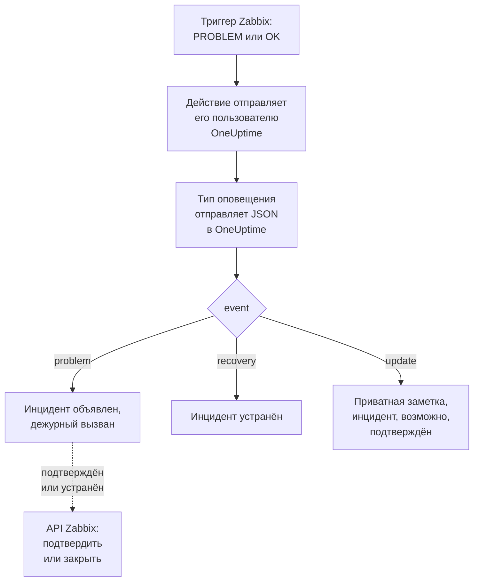

# Zabbix

Отправляйте проблемы [Zabbix](https://www.zabbix.com) в OneUptime, чтобы каждая проблема становилась инцидентом, который вызывает вашу дежурную команду и устраняется, когда Zabbix фиксирует восстановление. Готовые шаблоны рабочих процессов синхронизируют обе стороны: то, что люди делают в Zabbix, записывается в инцидент, а подтверждение или устранение инцидента подтверждает или закрывает проблему в Zabbix. Zabbix отправляет каждую проблему через тип оповещения с вебхуком, поэтому ни на одной стороне ничего не нужно устанавливать.

:::cards
- [Выбор способа приёма проблем в OneUptime](#выбор-способа-приёма-проблем-в-oneuptime): Шаблоны рабочих процессов или монитор Incoming Request.
- [Начните с шаблонов](#начните-с-шаблонов): Шесть шаблонов, что они делают и что запрашивают.
- [Настройка Zabbix](#настройка-zabbix): Тип оповещения, пользователь и действие.
- [Устранение неполадок](#устранение-неполадок): Когда проблемы не доходят или инциденты остаются открытыми.
:::

## Как это работает



Zabbix отправляет проблему пользователю через его способы оповещения. Здесь способ оповещения — тип оповещения с вебхуком под названием **OneUptime**: его скрипт отправляет в OneUptime небольшой JSON-документ для каждой проблемы, для её восстановления и для каждого обновления, которое кто-то вносит в неё в Zabbix, с ID события, именем, узлом и серьёзностью проблемы. По ID события OneUptime находит инцидент, открытый проблемой.

## Перед началом работы

- Сервер Zabbix, который вы администрируете. Это руководство написано для Zabbix 6.0 LTS и 7.0 LTS. Типы оповещений с вебхуком работают так же, начиная с Zabbix 5.0. Шаблонам, которые вызывают API Zabbix, нужен Zabbix 6.4 или новее либо [одно изменение в Zabbix 6.0](#в-zabbix-60).
- Сервер Zabbix, который может достучаться до вашего OneUptime по HTTPS, а для шаблонов, которые вызывают Zabbix, — OneUptime, который может достучаться до Zabbix.
- В OneUptime — право создавать рабочие процессы или мониторы, если вы выберете этот путь. В OneUptime Cloud рабочим процессам нужен план **Growth** или выше.

## Выбор способа приёма проблем в OneUptime

Сначала настройте OneUptime: он выдаст URL, на который отправляет Zabbix.

| Способ | Когда использовать |
| --- | --- |
| Шаблоны рабочих процессов (рекомендуется) | Вы хотите получать каждую проблему как инцидент или оповещение с её серьёзностью из Zabbix, с вызовом дежурных для High и Disaster, устранением при восстановлении, записью того, что люди делают в Zabbix, и подтверждением или закрытием проблемы в Zabbix из OneUptime. |
| Монитор Incoming Request | Вы хотите инциденты без рабочего процесса, на любом плане, и монитор, статус которого следует за Zabbix. Ничего не возвращается в Zabbix. |

Оба получают одинаковый JSON от одного и того же типа оповещения, поэтому можно начать с одного и позже перейти на другой, поменяв один URL в Zabbix.

## Начните с шаблонов

В диалоге **Создать рабочий процесс** есть шесть шаблонов Zabbix, в категории **Zabbix** его списка категорий: три для инцидентов, затем те же три для оповещений.

| Шаблон | Что он делает | Что он запрашивает |
| --- | --- | --- |
| **Инциденты** | | |
| Declare an incident for each Zabbix problem | Рабочий процесс, в который Zabbix отправляет каждое событие. Он объявляет инцидент для каждой проблемы, вызывает дежурных для High и Disaster, записывает обновления, сделанные в Zabbix, и устраняет инцидент при восстановлении. | Zabbix URL |
| Acknowledge or close the Zabbix problem with the incident | Когда инцидент подтверждён, подтверждает его проблему. Когда он устранён, закрывает проблему или подтверждает её там, где Zabbix не разрешает закрыть её вручную. | Zabbix URL, Zabbix API Token |
| Copy incident private notes to the Zabbix problem | Добавляет каждую приватную заметку инцидента к его проблеме как сообщение. | Zabbix URL, Zabbix API Token |
| **Оповещения** | | |
| Create an alert for each Zabbix problem | То же, что для инцидентов, с оповещением для каждой проблемы. | Zabbix URL |
| Acknowledge or close the Zabbix problem with the alert | То же, что для инцидентов, по состоянию оповещения. | Zabbix URL, Zabbix API Token |
| Copy alert private notes to the Zabbix problem | Добавляет каждую приватную заметку оповещения к его проблеме как сообщение. | Zabbix URL, Zabbix API Token |

Начните с **Declare an incident for each Zabbix problem** или, для оповещений, с **Create an alert for each Zabbix problem**: открытый им инцидент или оповещение хранит ID события проблемы в своём настраиваемом поле `zabbixEventId`, и два других шаблона находят проблему по нему.

### Что запрашивают шаблоны

- **Zabbix URL**: адрес, по которому вы открываете Zabbix, например `https://zabbix.example.com` или `https://example.com/zabbix`, когда Zabbix работает по пути. Ссылки на проблему ведут туда, а шаблоны, которые вызывают Zabbix, отправляют запросы на его `api_jsonrpc.php`. Поле не принимает адрес страницы внутри Zabbix.
- **Zabbix API Token**: API-токен пользователя Zabbix, от имени которого действует рабочий процесс. Как его получить, показано в разделе [Создайте API-токен](#создайте-api-токен). Он сохраняется как секретная переменная и отправляется только в Zabbix: в заголовке `Authorization`, а для Zabbix 6.0 — в теле запроса.

### Приём проблем шаблоном

:::steps
1. Перейдите в **Рабочие процессы** и нажмите **Создать рабочий процесс**. В разделе **Или начать с шаблона** выберите **Zabbix** в списке категорий, нажмите **Declare an incident for each Zabbix problem**, а затем **Использовать шаблон**.
2. Заполните **Zabbix URL**. В поле **Who to page for High and Disaster problems** выберите политики дежурства, которые нужно вызывать, или ни одной, чтобы никого не вызывать, и нажмите **Создать рабочий процесс**. Рабочий процесс откроется в окне **Конструктор** выключенным.
3. Нажмите на триггер **Webhook**, затем на **Скопировать URL** и сохраните URL для Zabbix.
4. Включите **Включено** вверху окна **Конструктор**. Выключенный рабочий процесс отвечает Zabbix кодом `400`.
:::

Затем [настройте Zabbix](#настройка-zabbix), чтобы он отправлял свои проблемы на этот URL.

### Что делает рабочий процесс

После триггера **Webhook** шаг **Check With JavaScript** `read-event-1` читает `event`, который отправляет тип оповещения, а **Incident From Another Tool** (в шаблоне для оповещений — **Alert From Another Tool**) делает то, что оно означает, по ID события проблемы:

| Событие | Что делает рабочий процесс |
| --- | --- |
| `problem` | Объявляет инцидент с заголовком `Zabbix: <problem> on <host>` и серьёзностью, которой соответствует серьёзность Zabbix, не показывая его на ваших страницах статуса. Его описание ссылается на проблему в Zabbix и перечисляет узел, серьёзность, время начала, операционные данные и теги. Для проблемы High или Disaster вызывает выбранную вами политику дежурств. Проблема, которую Zabbix отправляет снова с тем же ID события, второй инцидент не открывает. |
| `recovery` | Устраняет инцидент проблемы, если он ещё не устранён. Причина видна в его хронологии. |
| `update` | Добавляет в инцидент приватную заметку о том, что было сделано в Zabbix: кто это сделал, что сделал и что написал. Если обновление подтвердило проблему, подтверждает и инцидент, и дежурные перестают его эскалировать. |

Всё остальное, например запрос от другого инструмента, остаётся без изменений: `read-event-1` переходит на **No**, а **Шаги** запуска объясняют почему. Шаг, завершившийся ошибкой, делает запуск неудачным, и его запись на вкладке **Шаги** объясняет почему.

### Уровни серьёзности

В новом проекте шаблон сопоставляет шесть уровней серьёзности Zabbix с этими уровнями серьёзности инцидентов и оповещений:

| Серьёзность в Zabbix | Инцидент | Оповещение | Дежурные |
| --- | --- | --- | --- |
| Disaster | Critical Incident | High | Вызваны |
| High | Critical Incident | High | Вызваны |
| Average | Major Incident | Low | Не вызваны |
| Warning | Major Incident | Low | Не вызваны |
| Information | Minor Incident | Low | Не вызваны |
| Not classified | Minor Incident | Low | Не вызваны |

Если у вас свои уровни серьёзности, Disaster и High идут к самому серьёзному, Average и Warning — к среднему, а Information и Not classified — к наименее серьёзному. Zabbix нумерует свои уровни серьёзности от 0 (Not classified) до 5 (Disaster), и шаблон читает номер, поэтому переименование уровня серьёзности в Zabbix ничего не меняет.

- Чтобы сопоставить уровень серьёзности с одним из ваших по имени, измените `SEVERITY_BY_NAME` в шаге `read-event-1`, например `{ 2: 'Minor Incident' }` для Warning.
- Чтобы вызывать дежурных и для проблем Average, задайте **Compare with** шага `if-page-1` **If / Else** значение `3`.

### Отправка подтверждений и заметок обратно в Zabbix

:::steps
1. [Создайте API-токен](#создайте-api-токен).
2. Создайте рабочий процесс из шаблона **Acknowledge or close the Zabbix problem with the incident**. Заполните **Zabbix URL** и **Zabbix API Token**, нажмите **Создать рабочий процесс** и включите **Включено**.
3. Если вам нужны и заметки в Zabbix, сделайте то же самое с **Copy incident private notes to the Zabbix problem**.
:::

Шаблон состояния сначала спрашивает Zabbix о проблеме, поэтому проблема, которую Zabbix уже подтвердил или устранил, остаётся как есть. Чтобы закрыть проблему, её триггеру нужен параметр **Allow manual close** в Zabbix. Без него проблема вместо этого подтверждается с сообщением о том, что инцидент устранён, а Zabbix закроет её при восстановлении. Инциденты, которые не открыла ни одна проблема Zabbix, и инциденты с отметкой **Приватный инцидент** никогда не отправляются в Zabbix.

### Создайте API-токен

:::steps
1. Используйте пользователя `OneUptime`, который [получает проблемы](#создайте-пользователя-который-получает-проблемы). Zabbix не отправляет пользователю его собственные обновления, поэтому с токеном этого пользователя подтверждения и сообщения OneUptime никогда не возвращаются в OneUptime как обновления.
2. Проверьте роль пользователя в **Users → User roles**. Ей нужен включённый **Access to API** и разрешённые **Acknowledge problems**, **Add problem comments** и **Close problems**. Роль **User role** разрешает их, если её никто не менял.
3. Проверьте группу пользователя в **Users → User groups**. Права **Read** на группы узлов достаточно, чтобы подтверждать проблемы и добавлять сообщения. Чтобы закрывать проблемы, нужно право **Read-write**.
4. Перейдите в **Users → API tokens** и нажмите **Create API token**. Выберите пользователя `OneUptime`, снимите флажок **Set expiration date and time** или запишите дату и нажмите **Add**.
5. Скопируйте **Auth token**: Zabbix показывает его только один раз. Вставьте его в **Zabbix API Token**.
:::

### В Zabbix 6.0

Zabbix 6.0 читает API-токен из тела запроса, а не из заголовка `Authorization`. В шаге **Update Zabbix Problem** каждого шаблона, который вызывает Zabbix, включите **Zabbix 6.0** в разделе **Дополнительные поля**. Zabbix 7.2 и новее отклоняют токен в теле, поэтому при обновлении выключите его снова.

## Приём проблем монитором

[Монитор Incoming Request](/docs/monitor/incoming-request-monitor) выдаёт вам URL, а его критерии определяют, что делает каждый запрос.

:::steps
### Создайте монитор

Перейдите в **Мониторы** и нажмите **Создать монитор**. Выберите **Incoming Request** в поле **Тип монитора**, назовите его `Zabbix` и нажмите **Далее**.

### Объявляйте инцидент для каждой проблемы

На шаге **Критерии** откройте первый критерий — тот, что помечает монитор как недоступный. Задайте его фильтр: **Тело запроса**, **Содержит**, `"status":"1"`. Этот критерий уже объявляет инцидент, когда фильтр срабатывает. Заполните инцидент:

- **Заголовок инцидента**: `Zabbix: {{requestBody.name}} on {{requestBody.host}}`.
- **Серьёзность**: серьёзность инцидента, которую должны получать проблемы Zabbix.
- **Политики дежурств**, в разделе **Дежурство**: политики, которые нужно вызывать.
- **Автоустранение инцидента**, в разделе **Дополнительные поля**: оставьте включённым, как по умолчанию. Без него восстановления игнорируются, и инциденты остаются открытыми.

### Открывайте по одному инциденту на проблему

В том же критерии откройте **Настройки** и включите **Group incidents and alerts by a payload field**. Заполните его, как показано ниже, чтобы у каждой проблемы был свой инцидент, а её восстановление его устраняло:

| Поле | Значение |
| --- | --- |
| **Open a separate incident for each…** | `requestBody.event_id` |
| **Field that signals recovery** | `requestBody.status` |
| **Value that means recovered** | `0` |

### Возвращайте монитор в доступное состояние

Откройте второй критерий — тот, что помечает монитор как доступный, — и задайте его фильтр: **Тело запроса**, **Содержит**, `"status":"0"`.

### Скопируйте URL

Нажмите **Создать монитор**. На странице **Обзор** монитора показан его **Heartbeat URL**. Скопируйте его для Zabbix:

```text
https://oneuptime.com/heartbeat/<secret key>
```

В самостоятельно размещённой установке вместо `oneuptime.com` указан ваш собственный хост.
:::

Монитор читает JSON запроса так, как он записан: `"status":"1"`, без пробелов. Что делает каждая настройка, см. в разделе [Приём оповещений из другой системы](/docs/monitor/incoming-request-monitor#приём-оповещений-от-другой-системы). Обновление, сделанное в Zabbix, тоже отправляется с `"status":"1"`, и монитор снова читает его как проблему, не открывая второй инцидент.

## Настройка Zabbix

Zabbix нужны три вещи: тип оповещения, который отправляет данные в OneUptime, пользователь, которому их отправлять, и действие, которое отправляет проблемы этому пользователю.

:::steps
### Создайте тип оповещения OneUptime

1. Перейдите в **Alerts → Media types** или в **Administration → Media types** в Zabbix 6.0 и нажмите **Create media type**.
2. Задайте **Name** значение `OneUptime`, а **Type** — **Webhook**.
3. Добавьте эти **Parameters**. Каждый из них передаёт в запрос [макрос](https://www.zabbix.com/documentation/current/en/manual/appendix/macros/supported_by_location) Zabbix:

   | Имя | Значение |
   | --- | --- |
   | `url` | `{ALERT.SENDTO}` |
   | `event_id` | `{EVENT.ID}` |
   | `event_name` | `{EVENT.NAME}` |
   | `event_value` | `{EVENT.VALUE}` |
   | `event_severity` | `{EVENT.SEVERITY}` |
   | `event_nseverity` | `{EVENT.NSEVERITY}` |
   | `host` | `{HOST.NAME}` |
   | `event_date` | `{EVENT.DATE}` |
   | `event_time` | `{EVENT.TIME}` |
   | `event_opdata` | `{EVENT.OPDATA}` |
   | `event_tags` | `{EVENT.TAGSJSON}` |
   | `trigger_id` | `{TRIGGER.ID}` |
   | `event_update_status` | `{EVENT.UPDATE.STATUS}` |
   | `event_update_action` | `{EVENT.UPDATE.ACTION}` |
   | `event_update_message` | `{EVENT.UPDATE.MESSAGE}` |
   | `event_update_user` | `{USER.FULLNAME}` |

4. Вставьте это в **Script**:

   ```javascript
   var params = JSON.parse(value);

   // Zabbix leaves a macro it has no value for as it is written, such as
   // {EVENT.UPDATE.MESSAGE} on a problem: it is sent as nothing.
   function given(text) {
     var written = String(text === undefined || text === null ? "" : text);
     return /^\{[A-Z0-9_.]+\}$/.test(written) || written === "*UNKNOWN*"
       ? ""
       : written;
   }

   var isUpdate = given(params.event_update_status) === "1";
   var payload = {
     source: "zabbix",
     // "problem", "recovery" or "update".
     event: isUpdate
       ? "update"
       : params.event_value === "0"
         ? "recovery"
         : "problem",
     event_id: params.event_id,
     name: params.event_name,
     host: params.host,
     severity: params.event_severity,
     // 0 Not classified, 1 Information, 2 Warning, 3 Average, 4 High, 5 Disaster.
     severity_number: params.event_nseverity,
     // "1" for a problem, "0" for its recovery.
     status: params.event_value,
     date: params.event_date,
     time: params.event_time,
     opdata: given(params.event_opdata),
     tags: [],
     trigger_id: params.trigger_id,
   };

   try {
     var tags = JSON.parse(given(params.event_tags) || "[]");
     payload.tags = Array.isArray(tags) ? tags : [];
   } catch (error) {
     payload.tags = [];
   }

   if (isUpdate) {
     payload.update = {
       action: given(params.event_update_action),
       message: given(params.event_update_message),
       user: given(params.event_update_user),
     };
   }

   var request = new HttpRequest();
   request.addHeader("Content-Type: application/json");

   var response = request.post(params.url, JSON.stringify(payload));

   if (request.getStatus() < 200 || request.getStatus() >= 300) {
     throw (
       "OneUptime responded with HTTP " + request.getStatus() + ": " + response
     );
   }

   return "OK";
   ```

5. На вкладке **Message templates** добавьте шаблон для **Problem**, шаблон для **Problem recovery** и шаблон для **Problem update**. Оставьте их текст пустым: запрос собирает скрипт. Zabbix использует тип оповещения только для тех видов событий, для которых у него есть шаблон.
6. Нажмите **Add**.

### Создайте пользователя, который получает проблемы

1. Перейдите в **Users → Users** или в **Administration → Users** в Zabbix 6.0 и нажмите **Create user**. Назовите его `OneUptime` и назначьте ему группу пользователей и роль, которая может получать уведомления, например **User role**.
2. На вкладке **Media** нажмите **Add**. Задайте **Type** значение `OneUptime`, а **Send to** — URL, скопированный из OneUptime. Оставьте **When active** и уровни серьёзности как есть или снимите отметки с тех уровней, которые OneUptime получать не должен.
3. Нажмите **Add**, затем ещё раз **Add**, чтобы сохранить пользователя.

### Отправляйте проблемы в OneUptime с помощью действия

1. Перейдите в **Alerts → Actions → Trigger actions** или в **Configuration → Actions** в Zabbix 6.0 и нажмите **Create action**. Назовите его `Notify OneUptime`.
2. При желании сузьте его в разделе **Conditions**, например условием **Trigger severity is greater than or equals Warning**. Без условий отправляется каждая проблема.
3. На вкладке **Operations** добавьте операцию, которая отправляет пользователю `OneUptime` через тип оповещения `OneUptime`.
4. Добавьте ту же операцию в разделе **Recovery operations**, чтобы восстановления тоже отправлялись, и в разделе **Update operations**, чтобы отправлялись подтверждения и комментарии, сделанные в Zabbix.
5. Нажмите **Add** и убедитесь, что действие включено.
:::

Чтобы отправлять одни проблемы в шаблон для инцидентов, а другие — в шаблон для оповещений, дайте пользователю `OneUptime` два способа оповещения с типом `OneUptime`: каждый отправляет на URL своего рабочего процесса, с теми уровнями серьёзности, которые он должен получать.

## Проверка

1. В Zabbix откройте **Alerts → Media types** и нажмите **Test** рядом с `OneUptime`. Укажите скопированный URL и примерные значения, например `event_id` `12345`, `event_name` `Test problem`, `host` `web-1`, `event_nseverity` `4` и `event_value` `1`. Нажмите **Test**: Zabbix покажет ответ скрипта, `OK`, или выброшенную им ошибку.
2. В OneUptime откройте **Журналы → Запуски** рабочего процесса и проверьте запуск или откройте монитор и убедитесь, что инцидент открыт.
3. Проверьте снова с `event_value` `0` и тем же `event_id`. Инцидент будет устранён.

Затем дайте сработать настоящему триггеру, например ненадолго понизив порог, и посмотрите, как приходит проблема. Чтобы проверить обновление, подтвердите проблему в Zabbix с сообщением: инцидент получит приватную заметку и будет подтверждён.

## Сопоставление уровней серьёзности Zabbix

Zabbix отправляет серьёзность текстом: `Not classified`, `Information`, `Warning`, `Average`, `High` или `Disaster`.

- **С шаблонами** уровни серьёзности сопоставляются за вас: см. [Уровни серьёзности](#уровни-серьёзности).
- **С монитором** нажмите **Добавить критерии** для каждой группы уровней серьёзности и перетащите новый критерий выше первого: критерии проверяются сверху, и решает первый сработавший. Задайте каждому два фильтра, `"status":"1"` и серьёзность, например `"severity":"Disaster"`, с **Условие совпадения** в значении **Все**. Задайте каждому инцидент с собственной **Серьёзность** и **Автоустранение инцидента** и те же настройки группировки.

## Устранение неполадок

:::details В OneUptime ничего не приходит
- В Zabbix откройте **Reports → Action log** и проверьте, отправило ли действие проблему и что вернулось в ответ.
- Отправьте запрос сами с сервера Zabbix: `curl -i -X POST <url> -H 'Content-Type: application/json' -d '{"source":"zabbix","event":"problem","event_id":"1","name":"Test","host":"test","severity_number":"4","status":"1"}'`.
- Монитор сразу отвечает `200`, ещё ничего не проверив, даже при неверном секретном ключе. Посмотрите на временную шкалу монитора, чтобы понять, доходят ли запросы.
- Выключенный рабочий процесс отвечает `400`. Включите **Включено** вверху окна **Конструктор**.
:::

:::details Zabbix сообщает об ошибке скрипта
Откройте тип оповещения и воспользуйтесь **Test**: Zabbix покажет результат скрипта или выброшенную им ошибку. Любой ответ OneUptime, отличный от `2xx`, скрипт выбрасывает вместе с его статусом, поэтому сначала проверьте URL.
:::

:::details Инциденты открываются, но никогда не устраняются
- Действию нужны **Recovery operations**, иначе Zabbix никогда не отправит восстановление.
- С шаблоном откройте **Журналы → Запуски** рабочего процесса и запуск восстановления: его последний шаг объясняет причину. Восстановление проблемы, которая не открыла инцидент, ничего не меняет.
- С монитором инциденту критерия нужно **Автоустранение инцидента** в разделе **Дополнительные поля**. **Field that signals recovery** должно быть `requestBody.status`, а **Value that means recovered** — ровно `0`.
:::

:::details Проблема в Zabbix не подтверждается и не закрывается
Откройте запуск шаблона состояния в **Журналы → Запуски**: его последний шаг сообщает, что ответил Zabbix.

- `Not authorized`: API-токен неверен, истёк или отключён, либо Zabbix старше 6.4 (см. [В Zabbix 6.0](#в-zabbix-60)).
- `Cannot close problem: trigger does not allow manual closing`: включите **Allow manual close** у триггера. Шаблон уже подтверждает такие проблемы вместо закрытия.
- `No permissions to referred object or it does not exist!`: пользователь видит проблему, но для её закрытия ему нужно право **Read-write**.
- `Zabbix has no problem with event ID`: пользователь не видит узел проблемы. Дайте его группе пользователей право **Read** на группу узлов.
:::

:::details Инцидент показывает ссылку вместо значения
Ссылка на поле, которого нет в запросе, остаётся в записанном виде, вместе с фигурными скобками, а не очищается. Убедитесь, что Zabbix отправляет `Content-Type: application/json` и что используемые имена полей (`name`, `host`, `severity`, `status`, `event_id`) совпадают с полезной нагрузкой скрипта. Для рабочего процесса откройте запуск в **Журналы → Запуски** и сравните с тем, что получил триггер. См. [Подводные камни](/docs/workflows/variables#подвохи).
:::

:::details Каждая проблема приходит дважды
Вероятно, у действия две операции, отправляющие одному и тому же пользователю, например первый шаг и шаг эскалации. Шаблон открывает один инцидент на ID события, что бы ни пришло, но каждая доставка — это отдельный запуск. Проверьте **Operations** действия.
:::

## Безопасность

- **Обращайтесь с URL как с паролем.** Любой, у кого он есть, может открывать инциденты. Если он утёк, сбросьте его: **Сбросить URL** в триггере **Webhook** рабочего процесса или **Сбросить секретный ключ входящего запроса** на странице **Настройки** монитора. Затем обновите **Send to** в способе оповещения пользователя Zabbix.
- **Ссылки ведут на ваш Zabbix.** Шаблон ссылается на проблему на сайте, который указан в его **Zabbix URL**, что бы ни говорил запрос, и записывает присланное Zabbix как текст.
- **Ограничьте API-токен тем, что делает рабочий процесс.** Это секретная переменная, скрытая в журналах запусков и отправляемая только в Zabbix, в заголовке `Authorization`, если не включено **Zabbix 6.0**. Дайте его пользователю роль, в которой нет ничего, кроме перечисленных выше действий, и удалите токен в **Users → API tokens**, если он утёк.
- **Отправляйте только то, что требует инцидента.** Используйте условия действия или уровни серьёзности в способе оповещения пользователя, чтобы проблемы низкой серьёзности оставались в Zabbix.
- **Самостоятельное размещение?** Разрешите серверу Zabbix обращаться к вашему OneUptime по HTTPS через межсетевой экран. Чтобы вызывать Zabbix в частной сети, рабочему процессу нужен [исходящий сетевой доступ](/docs/workflows/configuration#исходящий-доступ-в-сеть).

## Дальнейшие шаги

:::cards
- [Шаблоны рабочих процессов](/docs/workflows/authoring): Создайте рабочий процесс из шаблона и измените его в Конструкторе.
- [Мониторинг входящих запросов](/docs/monitor/incoming-request-monitor): Все настройки монитора, который принимает проблемы Zabbix.
- [Правила эскалации](/docs/on-call/escalation-rules): Решите, кого и когда вызывает политика дежурств.
- [Обзор интеграций](/docs/integrations/index): Другие инструменты, которые можно подключить.
:::
