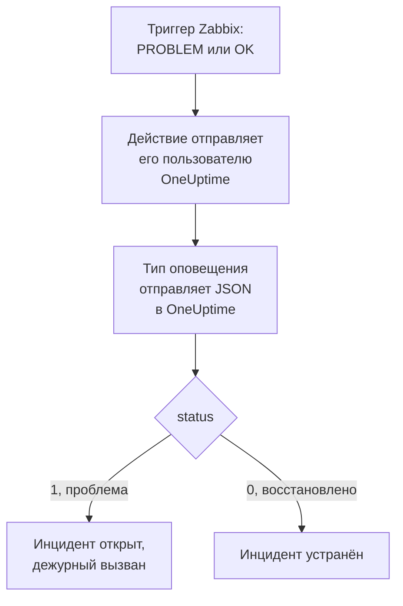

# Zabbix

Отправляйте проблемы [Zabbix](https://www.zabbix.com) в OneUptime, чтобы каждая проблема становилась инцидентом, который вызывает вашу дежурную команду и устраняется, когда Zabbix фиксирует восстановление. Zabbix отправляет каждую проблему через тип оповещения с вебхуком, поэтому ни на одной стороне ничего не нужно устанавливать.

:::cards
- [Выбор способа приёма проблем в OneUptime](#выбор-способа-приёма-проблем-в-oneuptime): Монитор Incoming Request или собственный рабочий процесс.
- [Приём проблем монитором](#приём-проблем-монитором): Один инцидент на проблему, устраняемый при восстановлении.
- [Настройка Zabbix](#настройка-zabbix): Тип оповещения, пользователь и действие.
- [Устранение неполадок](#устранение-неполадок): Когда проблемы не доходят или инциденты остаются открытыми.
:::

## Как это работает



Zabbix отправляет проблему пользователю через его способы оповещения. Здесь способ оповещения — тип оповещения с вебхуком под названием **OneUptime**: его скрипт отправляет в OneUptime небольшой JSON-документ с ID события, именем, узлом, серьёзностью и статусом проблемы. Статус равен `1` для проблемы и `0` для её восстановления.

## Перед началом работы

- Сервер Zabbix, который вы администрируете. Это руководство написано для Zabbix 6.0 LTS и 7.0 LTS. Типы оповещений с вебхуком работают так же, начиная с Zabbix 5.0.
- Сервер Zabbix, который может достучаться до вашего OneUptime по HTTPS.
- В OneUptime — право создавать мониторы или рабочие процессы, если вы выберете этот путь.

## Выбор способа приёма проблем в OneUptime

Сначала настройте OneUptime: он выдаст URL, на который отправляет Zabbix.

| Способ | Когда использовать |
| --- | --- |
| Монитор Incoming Request (рекомендуется) | Вы хотите, чтобы каждая проблема Zabbix становилась инцидентом, который вызывает дежурных и устраняется при восстановлении в Zabbix. Ничего не нужно создавать. |
| Рабочий процесс с триггером Webhook | Вам нужна собственная логика: фильтровать проблемы, менять их вид или сначала вызывать другие системы. Рабочий процесс сам не устраняет инцидент при восстановлении. |

Оба получают одинаковый JSON от одного и того же типа оповещения, поэтому можно начать с одного и позже перейти на другой, поменяв один URL в Zabbix.

## Приём проблем монитором

[Монитор Incoming Request](/docs/monitor/incoming-request-monitor) выдаёт вам URL, а его критерии определяют, что делает каждый запрос.

:::steps
### Создайте монитор

Перейдите в **Мониторы** и нажмите **Создать монитор**. Выберите **Incoming Request** в поле **Тип монитора**, назовите его `Zabbix` и нажмите **Далее**.

### Объявляйте инцидент для каждой проблемы

На шаге **Критерии** откройте первый критерий — тот, что помечает монитор как недоступный. Задайте его фильтр: **Тело запроса**, **Содержит**, `"status":"1"`. Этот критерий уже объявляет инцидент, когда фильтр срабатывает. Заполните инцидент:

- **Заголовок инцидента**: `Zabbix: {{requestBody.name}} on {{requestBody.host}}`.
- **Серьёзность**: серьёзность инцидента, которую должны получать проблемы Zabbix.
- **Политики дежурств**, в разделе **Дежурство**: политики, которые нужно вызывать.
- **Автоустранение инцидента**, в разделе **Дополнительные поля**: оставьте включённым, как по умолчанию. Без него восстановления игнорируются, и инциденты остаются открытыми.

### Открывайте по одному инциденту на проблему

В том же критерии откройте **Настройки** и включите **Group incidents and alerts by a payload field**. Заполните его, как показано ниже, чтобы у каждой проблемы был свой инцидент, а её восстановление его устраняло:

| Поле | Значение |
| --- | --- |
| **Open a separate incident for each…** | `requestBody.event_id` |
| **Field that signals recovery** | `requestBody.status` |
| **Value that means recovered** | `0` |

### Возвращайте монитор в доступное состояние

Откройте второй критерий — тот, что помечает монитор как доступный, — и задайте его фильтр: **Тело запроса**, **Содержит**, `"status":"0"`.

### Скопируйте URL

Нажмите **Создать монитор**. На странице **Обзор** монитора показан его **Heartbeat URL**. Скопируйте его для Zabbix:

```text
https://oneuptime.com/heartbeat/<secret key>
```

В самостоятельно размещённой установке вместо `oneuptime.com` указан ваш собственный хост.
:::

Монитор читает JSON запроса так, как он записан: `"status":"1"`, без пробелов. Что делает каждая настройка, см. в разделе [Приём оповещений из другой системы](/docs/monitor/incoming-request-monitor#приём-оповещений-от-другой-системы).

## Приём проблем рабочим процессом

Используйте [рабочий процесс](/docs/workflows/index), когда между Zabbix и инцидентом нужны собственные шаги.

:::steps
### Создайте рабочий процесс

Перейдите в **Рабочие процессы**, нажмите **Создать рабочий процесс**, затем **Начать с нуля**. Назовите его `Zabbix problems` и нажмите **Создать рабочий процесс**.

### Добавьте триггер Webhook

Нажмите на пунктирный блок **Choose what starts this workflow** и выберите **Webhook**. Нажмите на триггер, затем на **Скопировать URL** и сохраните URL для Zabbix.

### Проверьте, что это проблема

Нажмите **Добавить компонент**, добавьте блок **If / Else** и соедините с ним точку **Out** триггера. Задайте **Value to check** значение `{{local.components.webhook-1.returnValues.request-body.status}}`, **Comparison** — **is equal to**, а **Compare with** — `1`.

### Объявите инцидент

Добавьте блок **Create One Incident** и соедините с ним сторону **Yes** блока **If / Else**. В поле **Incident Template** выберите шаблон, который задаёт серьёзность и вызываемые политики дежурств (см. [Шаблоны инцидентов](/docs/incidents/settings#шаблоны-инцидентов)). В поле **JSON Object** задайте то, что приходит из Zabbix:

```json
{
  "title": "Zabbix: {{local.components.webhook-1.returnValues.request-body.name}}",
  "description": "Host: {{local.components.webhook-1.returnValues.request-body.host}}\nSeverity: {{local.components.webhook-1.returnValues.request-body.severity}}\nZabbix event: {{local.components.webhook-1.returnValues.request-body.event_id}}"
}
```

Без шаблона полю **JSON Object** также нужен `incidentSeverityId` — ID одного из уровней серьёзности инцидентов проекта.

### Включите его

Включите **Включено** вверху окна **Конструктор**. Выключенный рабочий процесс отвечает Zabbix кодом `400`.
:::

Восстановление идёт по стороне **No** блока **If / Else**, к которой ничего не подключено, поэтому запуск на этом заканчивается. Чтобы устранять инциденты при восстановлении, используйте монитор.

## Настройка Zabbix

Zabbix нужны три вещи: тип оповещения, который отправляет данные в OneUptime, пользователь, которому их отправлять, и действие, которое отправляет проблемы этому пользователю.

:::steps
### Создайте тип оповещения OneUptime

1. Перейдите в **Alerts → Media types** или в **Administration → Media types** в Zabbix 6.0 и нажмите **Create media type**.
2. Задайте **Name** значение `OneUptime`, а **Type** — **Webhook**.
3. Добавьте эти **Parameters**. Каждый из них передаёт в запрос [макрос](https://www.zabbix.com/documentation/current/en/manual/appendix/macros/supported_by_location) Zabbix:

   | Имя | Значение |
   | --- | --- |
   | `url` | `{ALERT.SENDTO}` |
   | `event_id` | `{EVENT.ID}` |
   | `event_name` | `{EVENT.NAME}` |
   | `event_value` | `{EVENT.VALUE}` |
   | `event_severity` | `{EVENT.SEVERITY}` |
   | `host` | `{HOST.NAME}` |
   | `event_date` | `{EVENT.DATE}` |
   | `event_time` | `{EVENT.TIME}` |

4. Вставьте это в **Script**:

   ```javascript
   var params = JSON.parse(value);
   var request = new HttpRequest();
   request.addHeader("Content-Type: application/json");

   var payload = {
     source: "zabbix",
     event_id: params.event_id,
     name: params.event_name,
     host: params.host,
     severity: params.event_severity,
     // "1" for a problem, "0" for its recovery.
     status: params.event_value,
     date: params.event_date,
     time: params.event_time,
   };

   var response = request.post(params.url, JSON.stringify(payload));

   if (request.getStatus() < 200 || request.getStatus() >= 300) {
     throw (
       "OneUptime responded with HTTP " + request.getStatus() + ": " + response
     );
   }

   return "OK";
   ```

5. На вкладке **Message templates** добавьте шаблон для **Problem** и шаблон для **Problem recovery**. Оставьте их текст пустым: запрос собирает скрипт. Zabbix использует тип оповещения только для тех видов событий, для которых у него есть шаблон.
6. Нажмите **Add**.

### Создайте пользователя, который получает проблемы

1. Перейдите в **Users → Users** или в **Administration → Users** в Zabbix 6.0 и нажмите **Create user**. Назовите его `OneUptime` и назначьте ему группу пользователей и роль, которая может получать уведомления, например **User role**.
2. На вкладке **Media** нажмите **Add**. Задайте **Type** значение `OneUptime`, а **Send to** — URL, скопированный из OneUptime. Оставьте **When active** и уровни серьёзности как есть или снимите отметки с тех уровней, которые OneUptime получать не должен.
3. Нажмите **Add**, затем ещё раз **Add**, чтобы сохранить пользователя.

### Отправляйте проблемы в OneUptime с помощью действия

1. Перейдите в **Alerts → Actions → Trigger actions** или в **Configuration → Actions** в Zabbix 6.0 и нажмите **Create action**. Назовите его `Notify OneUptime`.
2. При желании сузьте его в разделе **Conditions**, например условием **Trigger severity is greater than or equals Warning**. Без условий отправляется каждая проблема.
3. На вкладке **Operations** добавьте операцию, которая отправляет пользователю `OneUptime` через тип оповещения `OneUptime`.
4. Добавьте ту же операцию в разделе **Recovery operations**, чтобы восстановления тоже отправлялись.
5. Нажмите **Add** и убедитесь, что действие включено.
:::

## Проверка

1. В Zabbix откройте **Alerts → Media types** и нажмите **Test** рядом с `OneUptime`. Укажите скопированный URL и примерные значения, например `event_id` `12345`, `event_name` `Test problem`, `host` `web-1` и `event_value` `1`. Нажмите **Test**: Zabbix покажет ответ скрипта, `OK`, или выброшенную им ошибку.
2. В OneUptime откройте монитор и убедитесь, что инцидент открыт, или откройте **Журналы → Запуски** рабочего процесса и проверьте запуск.
3. Проверьте снова с `event_value` `0` и тем же `event_id`. С монитором инцидент будет устранён.

Затем дайте сработать настоящему триггеру, например ненадолго понизив порог, и посмотрите, как приходит проблема.

## Сопоставление уровней серьёзности Zabbix

Zabbix отправляет серьёзность текстом: `Not classified`, `Information`, `Warning`, `Average`, `High` или `Disaster`.

- **С монитором** нажмите **Добавить критерии** для каждой группы уровней серьёзности и перетащите новый критерий выше первого: критерии проверяются сверху, и решает первый сработавший. Задайте каждому два фильтра, `"status":"1"` и серьёзность, например `"severity":"Disaster"`, с **Условие совпадения** в значении **Все**. Задайте каждому инцидент с собственной **Серьёзность** и **Автоустранение инцидента** и те же настройки группировки.
- **С рабочим процессом** добавьте блок [Switch / Case](/docs/workflows/components#switch-case) по `{{local.components.webhook-1.returnValues.request-body.severity}}` с вариантом для каждого уровня серьёзности, а после каждого варианта — блок **Create One Incident** с собственным шаблоном.

## Устранение неполадок

:::details В OneUptime ничего не приходит
- В Zabbix откройте **Reports → Action log** и проверьте, отправило ли действие проблему и что вернулось в ответ.
- Отправьте запрос сами с сервера Zabbix: `curl -i -X POST <url> -H 'Content-Type: application/json' -d '{"status":"1","event_id":"1","name":"Test","host":"test"}'`.
- Монитор сразу отвечает `200`, ещё ничего не проверив, даже при неверном секретном ключе. Посмотрите на временную шкалу монитора, чтобы понять, доходят ли запросы.
- Выключенный рабочий процесс отвечает `400`. Включите **Включено** вверху окна **Конструктор**.
:::

:::details Zabbix сообщает об ошибке скрипта
Откройте тип оповещения и воспользуйтесь **Test**: Zabbix покажет результат скрипта или выброшенную им ошибку. Любой ответ OneUptime, отличный от `2xx`, скрипт выбрасывает вместе с его статусом, поэтому сначала проверьте URL.
:::

:::details Инциденты открываются, но никогда не устраняются
- Действию нужны **Recovery operations**, иначе Zabbix никогда не отправит восстановление.
- Инциденту критерия нужно **Автоустранение инцидента** в разделе **Дополнительные поля**.
- **Field that signals recovery** должно быть `requestBody.status`, а **Value that means recovered** — ровно `0`.
- Рабочий процесс не устраняет инциденты при восстановлении. Используйте монитор.
:::

:::details Инцидент показывает ссылку вместо значения
Ссылка на поле, которого нет в запросе, остаётся в записанном виде, вместе с фигурными скобками, а не очищается. Убедитесь, что Zabbix отправляет `Content-Type: application/json` и что используемые имена полей (`name`, `host`, `severity`, `status`, `event_id`) совпадают с полезной нагрузкой скрипта. Для рабочего процесса откройте запуск в **Журналы → Запуски** и сравните с тем, что получил триггер. См. [Подводные камни](/docs/workflows/variables#подвохи).
:::

:::details Каждая проблема приходит дважды
Вероятно, у действия две операции, отправляющие одному и тому же пользователю, например первый шаг и шаг эскалации. Проверьте **Operations** действия.
:::

## Безопасность

- **Обращайтесь с URL как с паролем.** Любой, у кого он есть, может открывать инциденты. Если он утёк, сбросьте его: **Сбросить секретный ключ входящего запроса** на странице **Настройки** монитора или **Сбросить URL** в триггере **Webhook** рабочего процесса. Затем обновите **Send to** в способе оповещения пользователя Zabbix.
- **Отправляйте только то, что требует инцидента.** Используйте условия действия или уровни серьёзности в способе оповещения пользователя, чтобы проблемы низкой серьёзности оставались в Zabbix.
- **Самостоятельное размещение?** Разрешите серверу Zabbix обращаться к вашему OneUptime по HTTPS через межсетевой экран.

## Дальнейшие шаги

:::cards
- [Мониторинг входящих запросов](/docs/monitor/incoming-request-monitor): Все настройки монитора, который принимает проблемы Zabbix.
- [Правила эскалации](/docs/on-call/escalation-rules): Решите, кого и когда вызывает политика дежурств.
- [Триггеры рабочего процесса](/docs/workflows/triggers#webhook): Как работает URL вебхука рабочего процесса.
- [Обзор интеграций](/docs/integrations/index): Другие инструменты, которые можно подключить.
:::
