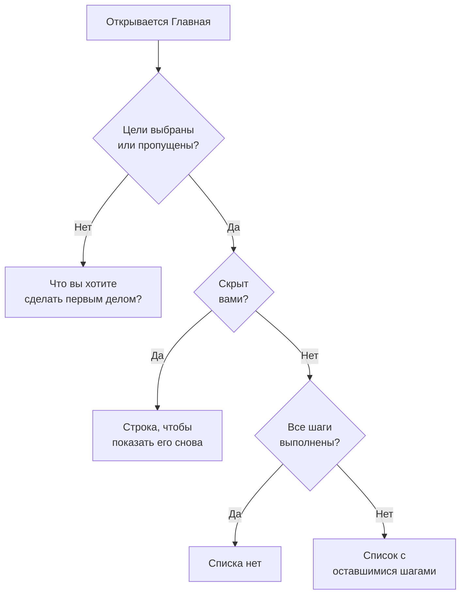

# Главная страница и сочетания клавиш

Главная — первая страница, которую вы видите в проекте. Она с одного взгляда показывает, требует ли что-то вашего внимания прямо сейчас, и проводит новый проект через первую настройку. Здесь описано, что показывает главная страница, как найти любой продукт, страницу или действие в панели и какие сочетания клавиш избавляют от лишних переходов по меню.

:::cards
- [Что показывает главная страница](#что-показывает-главная-страница): Есть ли проблемы, что требует вашего внимания, из чего состоит проект и все продукты.
- [Как ориентироваться](#как-ориентироваться): Меню «Продукты» и панели вверху каждой страницы.
- [Поиск](#поиск-страницы-настройки-или-действия): Найти любую страницу, настройку или действие, набрав название.
- [Сочетания клавиш](#сочетания-клавиш): Перейти на главную, к мониторам или инцидентам двумя клавишами.
:::

## Что показывает главная страница

Откройте **Главная** на панели вверху или нажмите `g`, а затем `h` из любого места. Главная страница — это обзор вашего проекта, одна страница без бокового меню. Сверху вниз на ней показаны:

1. Поле поиска, а рядом с ним **Объявить инцидент** и **Создать**.
2. Строка, которая говорит, есть ли проблемы, а под ней пять чисел, которые считают то, что требует внимания.
3. **Добро пожаловать в OneUptime 👋** — список для нового проекта, пока он не выполнен.
4. **Требует внимания** — все проблемы, открытые прямо сейчас, по названию.
5. **Ваш проект** — из чего состоит проект, и **Предстоящее обслуживание**, если что-то запланировано.
6. **Изучите OneUptime** — все продукты, по одной категории за раз.

### Поиск и создание

Поле поиска открывает поиск, так же как `Mod` + `K`: введите название любой страницы, монитора, инцидента, оповещения, страницы статуса или политики дежурства. См. [Поиск](#поиск-страницы-настройки-или-действия). **Объявить инцидент** открывает форму, в которой объявляется инцидент. **Создать** предлагает **Создать монитор**, **Запланировать обслуживание** и **Создать объявление**. Каждое из этих действий видят только те, кому оно разрешено.

### Заголовок

Строка вверху называет самое срочное из того, что сейчас открыто, и окрашена в соответствующий цвет:

| Когда | Главная страница показывает |
| --- | --- |
| Открыт инцидент | Число активных инцидентов, красным |
| Открытых инцидентов нет, но есть открытые оповещения, неработающие мониторы или SLO под угрозой | Число проблем, требующих внимания, оранжевым |
| Проблем нет, но идёт обслуживание | Число идущих сейчас событий обслуживания |
| Мониторы работают, и ничего не открыто | **Все системы работают** |
| В проекте ещё нет мониторов | **Пока ничего не отслеживается** |

Рядом главная страница показывает, когда она в последний раз загружала данные проекта, а **Обновить** загружает их снова. Если вы возвращаетесь на вкладку с главной страницей через минуту или позже, она обновляется сама.

Пока ничего не отслеживается, строка заканчивается кнопкой **Создайте первый монитор**, которая открывает пошаговую настройку **Узнавать, когда мой сайт или API недоступен**. Её видят только те, кому разрешено создавать мониторы.

### Пять чисел

Каждое число что-то считает, говорит, нужно ли ваше внимание, и открывает список, стоящий за ним, в том продукте, к которому он относится.

| Число | Что считает | Когда число равно нулю | Открывает |
| --- | --- | --- | --- |
| **Активные инциденты** | Неустранённые инциденты | **Всё в порядке** | **Инциденты → Активные инциденты** |
| **Активные оповещения** | Неустранённые оповещения | **Всё в порядке** | **Оповещения → Активные оповещения** |
| **Неработающие мониторы** | Мониторы, состояние которых не относится к рабочим. Архивные мониторы и мониторы с выключенным мониторингом не учитываются. | **Все работают** | **Мониторы → Не работает** |
| **Текущее обслуживание** | Идущие сейчас события планового обслуживания | **Сейчас нет** | **Плановое обслуживание → Текущие события обслуживания** |
| **SLO под угрозой** | Включённые SLO, которые под угрозой или израсходовали бюджет ошибок | **Бюджеты в норме** | **SLOs** |

Если число больше нуля, рядом написано **Требует внимания**, а для обслуживания и SLO — **Идёт сейчас** и **Бюджет расходуется**. Пока хотя бы один SLO под угрозой, **SLO под угрозой** открывает список **SLOs**, отфильтрованный по этим SLO. Проект без мониторов видит **Мониторов пока нет**, а проект без SLO — **SLO пока нет**: пустой проект — не то же самое, что здоровый. Тогда эти два числа открывают списки **Мониторы** и **SLOs**, где вы создаёте первый.

### Приветственный список

Когда владелец или администратор проекта впервые открывает Главную нового проекта, карточка спрашивает **Что вы хотите сделать первым делом?** Отметьте одну или несколько целей, например **Узнавать, когда мой сайт или API недоступен** или **Просто осматриваюсь**, и нажмите **Продолжить**: в списке появятся шаги, нужные этим целям. **Пропустить** даёт четыре шага, которые получает любой проект. Чтобы ответить заново позже, нажмите **Изменить** в списке. Проект, где уже работают мониторы, телеметрия или дежурства, этот вопрос не получает.

Каждый шаг отмечается сам, когда всё работает, а не когда появилась запись, и все, кто настраивает проект, видят один и тот же список на любом устройстве:

| Шаг | Выполнен, когда | Открывает |
| --- | --- | --- |
| **Импорт из вашего текущего инструмента** | Завершается импорт из другого инструмента. | **Импорт из другого инструмента** |
| **Создайте первый монитор** | Приходит его первая проверка. | Пошаговая настройка **Узнавать, когда мой сайт или API недоступен** или список **Мониторы** для того, кто не может создавать мониторы. |
| **Подключить сервер или кластер** | Приходят его первые метрики. | **Хосты** |
| **Отправить первые логи, метрики или трассировки** | Приходят первые логи, метрики, трассировки, исключения или профили проекта. | Пошаговая настройка **Отправьте журналы, метрики и трассировки и получайте оповещения** |
| **Настройте политику дежурств** | Тестовое оповещение подтверждено, оповещение до кого-то дошло, или правило дежурств запускает политику, которая может до кого-то дойти. | Пошаговая настройка **Оповещать нужного человека, когда что-то ломается** |
| **Опубликуйте страницу статуса** | Страница статуса показывает монитор. | Пошаговая настройка **Опубликуйте страницу статуса** или список **Страницы состояния** для того, кто не может создавать страницы статуса. |
| **Пригласите команду** | Кто-то принимает ваше приглашение. | **Пользователи** |

Шаг, с которого стоит начать, отмечен **Следующий шаг**. На тарифе Free в OneUptime Cloud, рассчитанном на одного человека, **Пригласите команду** говорит, что нужен тариф Growth, и открывает **Биллинг**. На собственном сервере, который пока не может отправлять почту, администраторы сервера сначала видят **Этот сервер пока не может отправлять почту**; этот шаг открывает панель администратора.

Пошаговая настройка делает всю работу на одной странице, шаг за шагом, и в конце показывает, что она настроила и что делать дальше. Чтобы позже открыть её снова, найдите её по названию в поиске.

Под шагами блок **Как работает OneUptime** показывает четыре основных продукта в том порядке, в каком через них проходит проблема: **Мониторы**, **Инциденты и оповещения**, **Дежурство** и **Страницы состояния**. Нажмите на любой, чтобы открыть его. Под ними сказано, что питает этот цикл, — телеметрия и инфраструктура, и есть ссылки на разделы [Основные понятия](/docs/introduction/core-concepts) и [Глоссарий](/docs/introduction/glossary).

Список исчезает для всех, когда выполнен каждый шаг. Чтобы скрыть его раньше, нажмите **Скрыть**: он скроется только для вас, на всех устройствах, и останется строка с **Показать** и **Как работает OneUptime**. Те, кого пригласили в проект как участников, списка не видят. **Как работает OneUptime** остаётся в одном клике в любом проекте: откройте его из меню **Справка** или кнопкой рядом с **Изучите OneUptime**.

### Требует внимания

**Требует внимания** перечисляет по названию то, что считают числа: открытые инциденты, открытые оповещения, неработающие мониторы, SLO под угрозой и идущее обслуживание, начиная с самого срочного. Каждая строка показывает серьёзность или состояние, говорит, когда начался инцидент или оповещение и когда закончится обслуживание, и открывает запись. Каждого вида показывается до пяти, а остальные открывает **Показать все**, в том же списке, что и число этого вида. Когда ничего не открыто, там написано **Ничто не требует вашего внимания**.

### Состояние настройки

Когда что-то в настройке проекта помешает людям узнать о проблеме, раздел **Требует внимания** заканчивается строкой **Настройка**: сколько вещей стоит проверить. Она открывает **Состояние настройки** — список того, что настроено неправильно, самое серьёзное первым, в группах **Вызовы не дойдут**, **Стоит исправить** и **Предложения**: монитор, который никого не вызывает, политика дежурства, которую ничто не запускает, человек, которого нельзя вызвать, отключённые SMS, расписание дежурства, в котором никто не дежурит, страница статуса без единого монитора. Каждая находка в одном предложении говорит, что не так, и рядом кнопка, которая открывает место исправления; находки монитора — это разрывы, которые называет его карточка **Когда он упадёт**. Находку, которую ваша команда намеренно оставляет как есть, можно скрыть с указанием причины — для всех — и вернуть из раздела **Отклонено**. Поиск находит страницу как **Состояние настройки**, а «Спросить ИИ» по ней отвечает на вопрос «Всё ли в порядке с моей настройкой?».

### Ваш проект

**Ваш проект** показывает, сколько в проекте элементов каждого вида: **Мониторы**, **Страницы состояния**, **Политики дежурств**, **SLOs**, **Сервисы**, **Панели** и **Рабочие процессы**; архивные не учитываются. Каждая строка открывает свой список. Если элементов какого-то вида в проекте нет, вместо числа стоит **Настроить**.

**Предстоящее обслуживание** перечисляет три ближайших окна планового обслуживания, начиная с самого раннего. Если ничего не запланировано, этого блока нет.

### Изучите OneUptime

**Изучите OneUptime** показывает продукты из меню **Продукты** по одной категории за раз, начиная с основных. У каждого продукта написано, для чего он нужен, и он открывается по нажатию. Продукты, которые ваш проект скрывает, там не показываются.

## Как ориентироваться

Всё в OneUptime находится в меню **Продукты** на верхней панели. Меню показывает свои группы как строки одного списка и всегда открывается с первой из них, основными, в развёрнутом виде: Мониторы, Инциденты, Оповещения, Дежурство, Страницы статуса, Плановое обслуживание и SLOs. Каждая из остальных групп (Наблюдаемость, Безопасность, ИИ, Код, Ресурсы, Инфраструктура, Облако, Дашборды и автоматизация и Настройки) свёрнута в строку того же списка. Каждая строка называет продукты группы и говорит, сколько их. Нажмите на строку, чтобы развернуть или свернуть её, или перейдите к ней стрелками и нажмите **Enter**.

- **Поиск находит всё.** Начните печатать в поле поиска меню, чтобы найти любой продукт по названию, по тому, что он делает, или по знакомому слову вроде `k8s` или `RUM`. Поиск заглядывает и в свёрнутые группы.
- **Вы начинаете там, где находитесь.** Группа страницы, на которой вы находитесь, разворачивается сама, а недавно открытые продукты перечислены вверху.
- **Ваш выбор сохраняется.** Меню запоминает в вашем браузере, какие из остальных групп вы развернули или свернули. Основные снова развёрнуты при каждом открытии меню, даже если вы их сворачивали.
- **На телефоне** кнопка меню показывает продукты так же: основные развёрнуты вверху, а каждая другая группа — одна строка, которая открывается касанием.
- **Продукты, которыми проект не пользуется.** Владелец или администратор проекта может скрыть их в **Настройки проекта → Базовый → Продукты**. Скрытый продукт переносится в **Другие продукты** — последнюю строку меню: поиск по-прежнему находит его, его страницы работают, а данные продолжают поступать. Когда в один из них начинают поступать данные, главная страница сообщает об этом тем, кто может снова его показать.
- **Закрепление.** Держите продукт на верхней панели рядом с **Главная** и **Продукты**: нажмите на булавку на его карточке в меню или на **Закрепить** рядом с заголовком его страницы. Можно закрепить пять продуктов, и они следуют за вами в любой браузер. На телефоне закреплённые продукты идут в меню первыми.
- **Что используется.** В каждой группе, кроме основных и настроек, продукты, которыми пользуется ваш проект, идут первыми, а у ещё не настроенного написано **Не настроено**. В OneUptime Cloud продукт, который не входит в ваш тариф, называет тариф, в который он входит.

### Панели вверху

По верху каждой страницы проходят две панели.

| Где | Что там |
| --- | --- |
| Слева вверху | Выбор проекта: переключиться на другой ваш проект или создать новый. |
| Справа вверху | **Поиск** и **Спросить ИИ**, колокольчик уведомлений с тем, что ждёт вас сейчас (активные инциденты и оповещения, политики дежурства, где вы на смене, ожидающие приглашения), **Справка** и ваше фото, которое открывает меню вашей [учётной записи](/docs/introduction/your-account). |
| Под ними | **Главная** и **Продукты** слева, **Настройки пользователя** справа: как OneUptime связывается с вами в этом проекте. |

**Справка** начинается с того, что помогает разобраться: **Быстрый старт**, **Как работает OneUptime**, **Глоссарий** и эта документация (**Документация**). Ниже — список **Сочетания клавиш** и поддержка по почте и в Slack. На планшете или в узком окне **Спросить ИИ** убирается, чтобы сэкономить место: эта кнопка есть среди действий в окне **Поиск**. На телефоне **Поиск** и **Справка** переходят в список кнопки меню, в самый верх и в самый низ; колокольчик и ваше фото остаются.

Слово с пунктирной линией под ним, например **Зонды** в форме нового монитора, объясняет, что оно значит, когда вы наводите на него указатель, переходите к нему клавишей Tab или касаетесь его. Ссылка **Читать дальше** открывает это слово в разделе [Глоссарий](/docs/introduction/glossary).

### Страницы и списки

Над заголовком каждой страницы цепочка вроде *Проект › Docker › Настройки › Правила владельца* показывает, где находится страница. Каждый шаг перед последним открывает свою страницу.

- **Списки обновляются сами.** Когда где-либо создаётся, подтверждается или разрешается инцидент или оповещение, списки инцидентов, оповещений и эпизодов показывают это за считаные секунды, без перезагрузки. Пока вы заняты чем-то в списке, например отметили строки или открыли диалог, он ждёт и догоняет, когда вы закончите.
- **На телефоне фильтры-чипы сворачиваются** за кнопку **Фильтр**, чтобы список начинался выше. Чипы, которые вы задали, остаются на виду вместе с **Очистить всё**. Нажмите **Фильтр**, чтобы увидеть все чипы, и ещё раз, чтобы свернуть их.
- Пункт **Столбцы** в меню **⋯** списка выбирает, какие столбцы показывает список и в каком порядке, и запоминает их для вас в этом браузере. Владелец или администратор проекта может также отметить там **Показывать эти столбцы всем в этом проекте**: все, кто не выбрал свои столбцы для этого списка, видят эти, а кнопка **Сбросить к настройкам проекта по умолчанию** возвращает ваши столбцы к ним.
- Пункт **Компактные строки** в том же меню делает строки всех списков ниже, так что длинный список показывает примерно на пятую часть больше строк. Выбор запоминается в этом браузере.
- **На телефоне, а также в карточке, слишком узкой для своих строк, список показан карточками, по одной на строку.** Полоса над ними говорит, в каком они порядке, например **Сортировка: Имя**. Нажмите на неё, чтобы выбрать столбец для сортировки и **По возрастанию** или **По убыванию**.
- **Страницы инцидента начинаются с его номера.** Заголовок, его шаг в цепочке и вкладка браузера показывают `INC-42 Checkout is down`, как и диалоги, которые его называют, так что инциденты с одинаковым названием легко различить. Оповещения, события планового обслуживания и эпизоды устроены так же.

## Поиск страницы, настройки или действия

Нажмите **Cmd+K** (Mac) или **Ctrl+K** (Windows и Linux) или значок поиска на верхней панели и начните печатать. Поиск находит:

- **Каждую страницу в меню** под тем названием, которое дало ей меню: Ключи API, Опасная зона, Расписания дежурств, Серьёзность инцидента, ваши собственные Методы уведомлений. Каждый результат показывает, где он находится, например *Настройки проекта › Расширенный*, так что страницы с одинаковым названием (Пользовательские поля в инцидентах, оповещениях и мониторах) легко различить.
- **Настройки на странице** по названию, которое показывает их карточка или переключатель: *Требовать SSO для входа* находит SSO, а *Пользовательские конфигурации SMTP* находит Каналы уведомлений. Вводите название по-английски или на своём языке.
- **Действия** — по тому, что вы хотите сделать: Объявить инцидент, Создать монитор или Delete Project, которое открывает Опасную зону. Действие, которое что-то меняет, предлагается только тем, кому оно разрешено.
- **Ваши мониторы, инциденты, оповещения, страницы статуса и политики дежурства** — по названию, а инциденты и оповещения ещё и по номеру, например `INC-42`. Каждый результат для инцидента или оповещения начинается с его номера, так что два с одинаковым названием легко различить.
- **Документация**: в группе *Документация* под всем остальным — страницы и разделы, слова которых совпадают с тем, что вы ввели, на вашем языке, даже с опечаткой. Каждая открывается в новой вкладке, чтобы вы не потеряли своё место.

Поиск понимает то, что вы печатаете, так, как вы это имеете в виду:

- Регистр, диакритика, пробелы и дефисы не важны: *on-call*, *on call* и *oncall* находят одни и те же страницы, а слова можно писать в любом порядке.
- Он знает другие слова для многих страниц, на английском: *pager* или *escalation* для политик дежурства, *rota* для расписаний дежурств, *2fa* для двухфакторной аутентификации, *delete project* для Опасной зоны.
- Добавьте название продукта, чтобы сузить поиск: *incident custom fields* находит страницу пользовательских полей инцидентов.
- Небольшая опечатка, например *incidnet*, всё равно находит то, что вы имели в виду, если точных совпадений нет.

Когда поле поиска пустое, поиск показывает недавно открытые страницы, действия и продукты.

## Сочетания клавиш

Нажмите `?` в любом месте панели, чтобы увидеть все сочетания клавиш, или откройте **Справка** и выберите **Сочетания клавиш**. На Mac `Mod` — это клавиша Command, в Windows и Linux — Ctrl.

| Клавиши | Что делают |
| --- | --- |
| `Mod` + `K` | Открыть палитру команд: найти любую страницу, настройку или действие. |
| `Mod` + `I` | Спросить ИИ о том, что вы сейчас смотрите. |
| `/` | Искать в списке на этой странице. |
| `?` | Показать сочетания клавиш. |
| `Esc` | Закрыть диалог или панель. |

### Переход к продукту

Нажмите `g`, а затем букву, чтобы сразу перейти к продукту. Букву нужно нажать в течение полутора секунд после `g`.

| Клавиши | Куда ведут |
| --- | --- |
| `g`, затем `h` | Главная |
| `g`, затем `m` | Мониторы |
| `g`, затем `i` | Инциденты |
| `g`, затем `a` | Оповещения |
| `g`, затем `o` | Дежурство |
| `g`, затем `s` | Страницы статуса |
| `g`, затем `e` | Плановое обслуживание |
| `g`, затем `d` | Дашборды |
| `g`, затем `l` | Логи |
| `g`, затем `t` | Трассировка |

Сочетания клавиш не мешают работе. `?`, `/` и `g` ничего не делают, пока вы печатаете в поле, и ничто не уводит со страницы, пока открыт диалог, так что случайное нажатие не лишит вас наполовину заполненной формы. Любой другой продукт — в одном поиске от вас через `Mod` + `K`.

## Дальнейшие шаги

:::cards
- [Быстрый старт](/docs/introduction/quickstart): Пройти приветственный список шаг за шагом.
- [Ваша учётная запись](/docs/introduction/your-account): Профиль, безопасность входа, язык и тема.
- [Спросить ИИ](/docs/ai/ask-ai): На что Ask AI может ответить и что может для вас сделать.
- [Основные понятия](/docs/introduction/core-concepts): Что такое мониторы, инциденты, оповещения и дежурства.
:::
