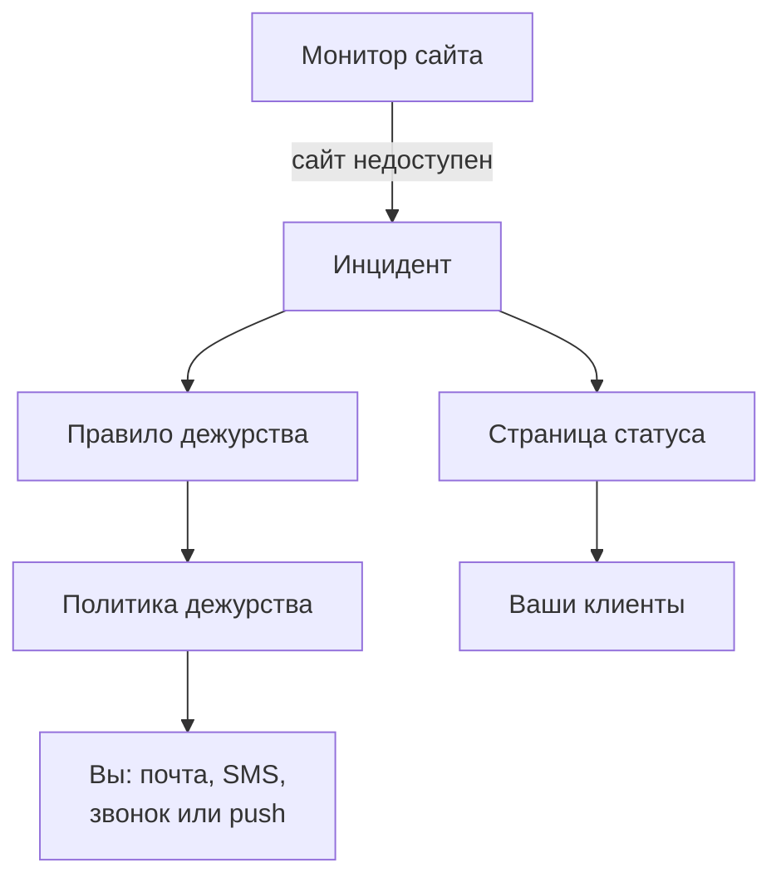

# Быстрый старт

Это руководство примерно за пятнадцать минут проведёт вас от новой учётной записи к работающей настройке: монитор проверяет ваш сайт каждые пять минут, политика дежурства вызывает вас, когда сайт падает, а страница статуса сообщает об этом клиентам. Руководство следует списку **Добро пожаловать в OneUptime 👋** на главной странице вашего проекта и пошаговым настройкам, которые открывают его шаги.

Переходите с другого инструмента? Сначала [импортируйте всё оттуда](/docs/introduction/getting-started#если-вы-переходите-с-другого-инструмента): ваши мониторы, расписания дежурств и страницы статуса перейдут вместе с вами.

## Перед началом

- **Учётная запись.** В OneUptime Cloud зарегистрируйтесь на [oneuptime.com](https://oneuptime.com/accounts/register) и откройте ссылку из письма, которое придёт. В своей установке откройте её в браузере и зарегистрируйтесь: первая учётная запись становится главным администратором. Как установить OneUptime, описано в разделе [Docker Compose](/docs/installation/docker-compose).
- **Сайт, за которым нужно следить.** Любой адрес, который отвечает по HTTP или HTTPS, например главная страница вашей компании.

## Создайте проект

В OneUptime всё находится в проекте: мониторы, инциденты, политики дежурства, страницы статуса и люди, которые с ними работают.

:::steps
### Начните новый проект

При первом входе OneUptime показывает **Нет проектов**. Нажмите **Создать новый проект**. Если кто-то уже пригласил вас в проект, примите приглашение на той же странице.

### Дайте ему имя

Введите **Имя проекта**, например название вашей компании. В OneUptime Cloud ниже выберите и тариф: Free уже выбран, а платные тарифы начинаются с бесплатного пробного периода.

### Создайте его

Нажмите **Создать проект**. Откроется главная страница проекта со списком **Добро пожаловать в OneUptime 👋** вверху. Сначала она спрашивает **Что вы хотите сделать первым делом?**: отметьте **Узнавать, когда мой сайт или API недоступен**, **Оповещать нужного человека, когда что-то ломается** и **Сообщать клиентам через страницу статуса** и нажмите **Продолжить**.
:::

## Отслеживайте свой сайт

:::steps
### Откройте настройку сайта

В списке нажмите **Создайте первый монитор**. Откроется пошаговая настройка **Узнавать, когда мой сайт или API недоступен**: она проверяет ваш сайт, выбирает, кого уведомлять, и отправляет тест — всё на одной странице. Тот, кому нельзя создавать мониторы, вместо неё попадает в список **Мониторы**.

### Введите адрес

В разделе **Что нам проверить?** введите полный адрес сайта в поле **Адрес сайта или API**, например `https://example.com`, и нажмите **Начать проверку**. Зонды проверяют его сразу, а затем каждые 5 минут: если сайт не отвечает или отвечает ошибкой, монитор переходит в состояние **Не в сети** и объявляет инцидент. Нажмите **Продолжить**.

На тарифе Free в OneUptime Cloud мониторы оплачиваются по использованию, поэтому проекту нужен способ оплаты, прежде чем он сможет проверять ваш сайт: без него шаг попросит вас [добавить способ оплаты](/docs/configuration/billing#способы-оплаты).

### Выберите, кого уведомлять

В разделе **Кого нужно уведомить?** вы уже есть в списке **Кого вызывают**. Нажмите **Сохранить и продолжить**: так создаётся `Default on-call policy`, которая вызывает вас при каждом новом инциденте и оповещении в проекте, для начала по почте. Чтобы вызывать и участников команды, которые уже есть в проекте, сначала нажмите **Добавить участников команды**.

### Отправьте тест себе

В разделе **Отправьте тест** нажмите **Отправить мне тестовый вызов**, выберите **Серьёзность** и нажмите **Отправить тестовый вызов**. Откройте ссылку в письме, где написано TEST, и подтвердите вызов там. Затем нажмите **Готово** в диалоге и **Продолжить**: настройка заканчивается сводкой того, что она настроила.
:::

Чтобы задать каждый параметр самостоятельно или проверять не сайт, а что-то другое, откройте **Мониторы** в меню **Продукты** и нажмите **Создать монитор**. Раздел [Создание монитора](/docs/monitor/create-monitor) описывает форму и каждый тип мониторов.

Чтобы проверять ещё и API и узнать, что делать, если первая проверка так и не вернулась, пройдите руководство [Узнавать, когда ваш сайт или API падает](/docs/guides/website-down).

## Получайте вызов при сбое

Настройка сайта уже создала `Default on-call policy`, которая вызывает вас по почте при каждом новом инциденте и оповещении, поэтому список отмечает шаг **Настройте политику дежурств** как выполненный. Его пошаговая настройка всё равно добавляет ваш телефон, людей, которых вызывают вместе с вами, и то, что происходит, если никто не отвечает.

:::steps
### Откройте настройку дежурства

Нажмите `Ctrl+K` (`Cmd+K` на Mac), введите `get paged` и выберите **Оповещать нужного человека, когда что-то ломается**. Пока список не отметил шаг **Настройте политику дежурств**, этот шаг открывает ту же пошаговую настройку.

### Выберите, как с вами связываться

В разделе **Как с вами связаться?** почта, с которой вы входите, уже указана. Для push-уведомлений установите приложение OneUptime On-Call из App Store или Google Play, войдите и нажмите **Проверить снова**. Чтобы получать ещё и SMS и звонки, нажмите **Включить SMS и звонки**, введите номер в поле **Ваш номер телефона** и нажмите **Прислать код по SMS**: в OneUptime Cloud SMS и звонки оплачиваются с баланса проекта, поэтому шаг сначала просит его пополнить. Нажмите **Продолжить**.

### Выберите, кого ещё вызывать

В разделе **Кто ещё дежурит?** оставьте `Default on-call policy` в поле **Политика дежурства**. Чтобы вызывать участников команды вместе с вами, добавьте их в разделе **Добавить в первое правило эскалации**. Нажмите **Сохранить и продолжить**.

### Решите, что делать, если никто не ответит

В разделе **Что, если никто не ответит?** выберите **Снова вызвать тех же людей**, пока вы единственный человек в проекте. Когда в проекте появятся участники команды, вариант **Вызвать другого человека** вызывает того, кого вы выберете в поле **Вызываются следующими**. В OneUptime Cloud этот вариант есть только на платных тарифах. Нажмите **Сохранить и продолжить**.

### Отправьте тестовый вызов

В разделе **Отправить тестовый вызов** нажмите **Проверить эту политику**, выберите **Серьёзность** и нажмите **Отправить тестовый вызов**. Подтвердите вызов из письма, SMS или звонка, затем нажмите **Готово** в диалоге и **Продолжить**. Настройка заканчивается экраном **Вызовы настроены**.
:::

> [!NOTE]
> SMS и телефонные звонки в новом проекте выключены. Владелец проекта, Billing Admin или человек с правом Manage Billing включает их в карточке **Каналы уведомлений** в разделе **Настройки проекта → Уведомления → Каналы уведомлений**.

Политику запускают два правила дежурства: одно при каждом новом инциденте и одно при каждом новом оповещении. Чтобы увидеть первое, откройте **Инциденты** в меню **Продукты**, разверните **Правила** в боковом меню и выберите **Правила дежурства**: оно срабатывает на **Все инциденты**. Чтобы политика срабатывала только на некоторые инциденты, например критические, измените правило там или нажмите **Создать: Incident On-Call Rule**, чтобы добавить своё.

Чтобы вместо этого собрать политику поле за полем, откройте **Дежурство** в меню **Продукты** и нажмите **Создать: Политика дежурства**. Об уровнях, ротациях и о том, сколько ждёт каждый уровень, читайте в разделах [Правила эскалации](/docs/on-call/escalation-rules) и [Расписания дежурств](/docs/on-call/schedules).

Каждый экран настройки и то, что делать, если вызов не пришёл, описывает руководство [Получать оповещения звонком, SMS или push](/docs/guides/paging).

## Опубликуйте страницу статуса

:::steps
### Откройте настройку страницы статуса

В списке нажмите **Опубликуйте страницу статуса**. Откроется пошаговая настройка **Опубликуйте страницу статуса**: она даёт странице название, добавляет на неё ваш монитор и показывает, что видят ваши клиенты. Тот, кому нельзя создавать страницы статуса, вместо неё попадает в список **Страницы состояния**. Сводка настройки сайта открывает ту же настройку кнопкой **Показать на странице статуса**.

### Назовите её и выберите свой монитор

В разделе **Назовите её и выберите, что она показывает** оставьте предложенное **Название страницы статуса** или введите своё. В разделе **Что она показывает** отметьте монитор своего сайта и нажмите **Создать страницу статуса**. С этого момента страница публична по своей ссылке: открыть её может любой, у кого есть адрес.

### Откройте страницу

В разделе **Вот что видят ваши клиенты** откройте адрес из поля **Публичная ссылка**: ваш сайт показан как работающий. Вернувшись в настройку, нажмите **Всё верно**. Настройка заканчивается сводкой того, что делать дальше.
:::

Чтобы вместо этого создать страницу вручную, откройте **Страницы состояния** в меню **Продукты** и нажмите **Создать страницу статуса**, затем добавьте монитор кнопкой **Добавить мониторы** на её экране **Обзор**. Как добавить на страницу свой логотип и цвета, описано в разделе [Оформление и домены страницы статуса](/docs/status-pages/branding-and-domains).

Чтобы разместить страницу статуса на своём домене по HTTPS, пройдите руководство [Опубликовать страницу статуса](/docs/guides/status-page).

## Пригласите команду

В списке нажмите **Пригласите команду** или откройте **Пользователи** в меню **Продукты**, в группе **Настройки**. Нажмите **Пригласить пользователя**, в поле **Электронная почта** введите адрес человека, а в поле **Команда** выберите команду: изначально выбрана команда участников. Нажмите **Пригласить**. OneUptime отправит приглашение по почте, а команда определяет, что человеку можно делать. См. [Пользователи, команды и разрешения](/docs/permissions/index).

## Проверьте

Объявите тестовый инцидент, чтобы увидеть всю цепочку в работе.

:::steps
### Объявите тестовый инцидент

Откройте **Инциденты** и нажмите **Объявить инцидент**. Введите **Заголовок**, например `Test incident`, выберите **Серьёзность инцидента** и нажмите **Далее**. В поле **Мониторы** выберите монитор сайта, чтобы инцидент появился на вашей странице статуса. Нажимайте **Далее**, пока не дойдёте до сводки, затем нажмите **Объявить инцидент**.

### Посмотрите, что произойдёт

В течение минуты-двух ваша политика дежурства вызовет вас, а инцидент появится на странице статуса.

### Устраните его

На странице инцидента нажмите **Устранить**. Вызовы прекратятся, и инцидент исчезнет со страницы статуса.
:::

> [!WARNING]
> Любой, кто откроет вашу страницу статуса, увидит тестовый инцидент, пока вы его не устраните. Проводите проверку до того, как поделитесь адресом страницы.

## Устранение неполадок

:::details Меня не вызвали
Откройте инцидент и выберите **Выполнения дежурств** в его боковом меню: там видно, запустилась ли ваша политика и кого она вызвала. Если не запустилась, проверьте, что правило дежурства включено и указывает эту политику. Если запустилась, проверьте, что ваши методы в разделе **Настройки пользователя → Методы уведомлений** подтверждены.
:::

:::details Инцидента нет на моей странице статуса
Страница статуса показывает инцидент, когда один из мониторов инцидента есть на странице. Проверьте, что в затронутых ресурсах инцидента указан ваш монитор и что монитор есть на странице статуса.
:::

:::details Монитор показывает, что сайт не в сети, но сайт работает
Откройте монитор и посмотрите, что получили зонды. См. раздел об устранении неполадок в статье [Мониторинг веб-сайта](/docs/monitor/website-monitor).
:::

## Дальнейшие шаги

:::cards
- [Основные понятия](/docs/introduction/core-concepts): Идеи, на которых держится то, что вы только что настроили.
- [Глоссарий](/docs/introduction/glossary): Каждое слово, которое встретилось вам по пути, в одном-двух предложениях.
- [Расписания дежурств](/docs/on-call/schedules): Распределить дежурства по команде.
- [Оформление и домены страницы статуса](/docs/status-pages/branding-and-domains): Сделать страницу статуса своей.
- [OpenTelemetry](/docs/telemetry/open-telemetry): Отправлять логи, метрики и трассировки из ваших приложений.
:::
