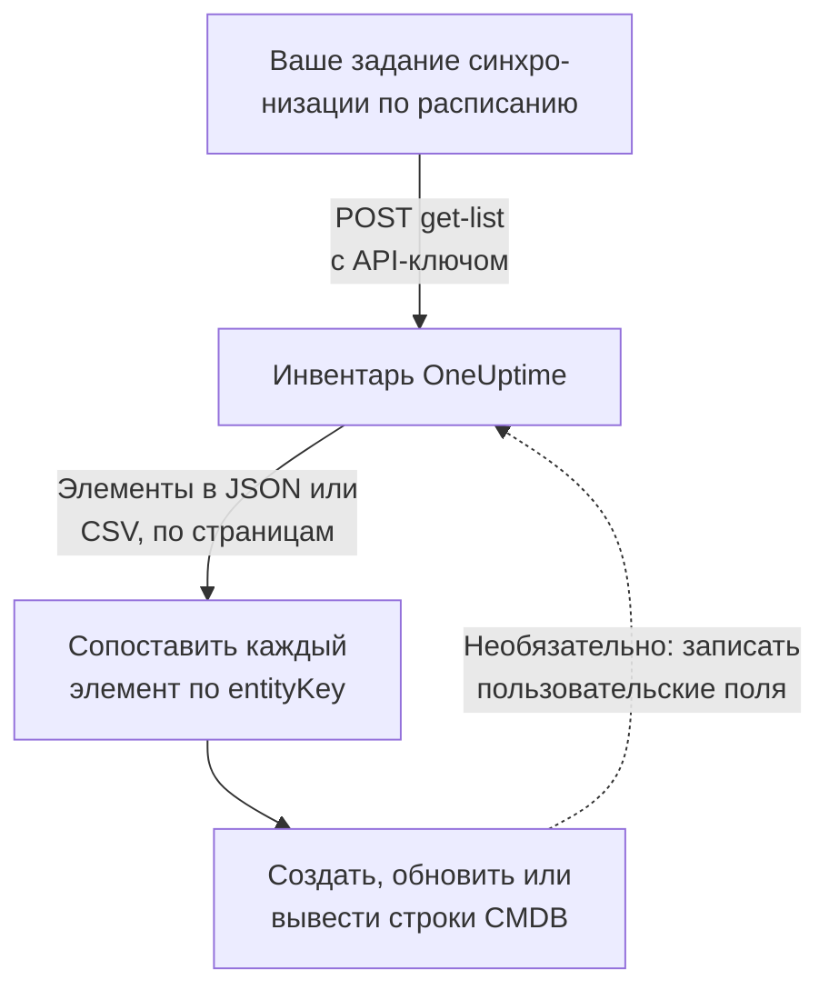

# Экспорт в CMDB

Если у вас уже есть CMDB или реестр активов, OneUptime не пытается его заменить. У него есть то, чего обычно не хватает CMDB: картина того, что на самом деле работает, которая остаётся актуальной без чьего-либо участия, потому что она обнаружена по телеметрии и поллерами, которые уже наблюдают за вашей сетью и облачными аккаунтами. Эта страница — рецепт того, как перенести эту картину в вашу собственную учётную систему.

:::cards
- [Как работает синхронизация](#как-работает-синхронизация): Задание по расписанию, которое читает список и сопоставляет по стабильному ключу.
- [Получение каталога](#получение-каталога): Запрос, страница за страницей, в JSON или CSV.
- [Сведения об активе](#сведения-об-активе): Одни и те же сведения и ключи для хостов и сетевых устройств.
- [Обратная запись](#обратная-запись): Передайте свои инвентарные номера в OneUptime и добавьте то, чего он не видит.
:::

## Как работает синхронизация

Синхронизация — это задание, которое вы запускаете по расписанию. Оно читает список инвентаря через REST API с API-ключом, сопоставляет каждый элемент со строкой вашей CMDB по его ключу идентичности и создаёт, обновляет или выводит из эксплуатации строки, чтобы они совпадали. Оно также может записывать значения обратно в пользовательские поля элементов.



## Что можно получить

Три ресурса REST, у каждого стандартные эндпоинты [API OneUptime](/docs/api-reference/api-reference):

| Ресурс | Эндпоинт | Что в нём хранится |
| --- | --- | --- |
| Элемент инвентаря | `/api/inventory-item` | Одна строка на каждую вещь в инфраструктуре |
| Определения пользовательских полей | `/api/inventory-item-custom-field` | Собственный словарь полей вашего проекта |
| Связи | `/api/inventory-item-relationship` | Направленные связи между элементами |

Полезные столбцы элемента инвентаря:

| Столбец | Значение |
| --- | --- |
| `_id` | ID в OneUptime: используйте его как внешнюю ссылку |
| `entityType` | `host`, `k8s.pod`, `network.device`, `appliance`, … |
| `entityKey` | Стабильный хеш идентичности. Он переживает переименования, поэтому по нему лучше сопоставлять |
| `displayName` | Имя, которое читают люди |
| `source` | `discovered`, `inventory` или `manual` |
| `description` | Свободный текст |
| `identifyingAttributes` | Атрибуты, которые делают элемент тем, что он есть, и никогда не меняются |
| `descriptiveAttributes` | Всё остальное, что на нём замечено: см. [Сведения об активе](#сведения-об-активе), [Атрибуты активов хостов](#атрибуты-активов-хостов) и [Атрибуты активов сетевых устройств](#атрибуты-активов-сетевых-устройств) ниже |
| `customFields` | Ваши собственные поля по имени поля |
| `resourceType` / `resourceId` | Указатель на более подробную запись OneUptime, если она есть |
| `firstSeenAt` / `lastSeenAt` | Когда элемент был замечен впервые и в последний раз |
| `isArchived` | Убран ли элемент из активного списка |

## Перед началом

Синхронизации нужен API-ключ, которому разрешено читать инвентарь. В OneUptime Cloud для API-ключей нужен план **Growth** или выше.

:::steps
### Создайте API-ключ

Откройте **Настройки проекта → Расширенный → Ключи API** и нажмите **Создать: API-ключ**. Задайте ему **Имя**, а в разделе **Доступ** выберите **Зритель**, чтобы читать всё в проекте, или **Выбрать разрешения позже**, чтобы дать ему только то, что нужно синхронизации.

### Дайте ему только необходимое

Экспорту только для чтения нужно одно разрешение, **Read Telemetry Service**: инвентарь использует разрешения телеметрии, а не собственные. На странице ключа нажмите **Добавить разрешение** и выберите его. Чтобы записывать значения обратно, добавьте также **Edit Telemetry Service**.

### Скопируйте ключ

Скопируйте **API-ключ** со страницы ключа и сделайте его доступным для своего задания:

```bash
export ONEUPTIME_API_KEY="your-api-key"
```
:::

Ключ передаётся в заголовке `ApiKey` каждого запроса и читает инвентарь своего проекта, поэтому запрос не называет проект.

## Получение каталога

Отправьте `POST` на эндпоинт списка с нужными столбцами. `select` обязателен: API возвращает только то, что вы запросили.

```bash
curl -X POST 'https://oneuptime.com/api/inventory-item/get-list' \
  -H "ApiKey: $ONEUPTIME_API_KEY" \
  -H 'Content-Type: application/json' \
  -d '{
    "query": { "isArchived": false },
    "select": {
      "_id": true,
      "entityType": true,
      "entityKey": true,
      "displayName": true,
      "source": true,
      "customFields": true,
      "descriptiveAttributes": true,
      "lastSeenAt": true
    },
    "sort": { "displayName": "ASC" },
    "limit": 100,
    "skip": 0
  }'
```

В самостоятельно размещённой установке используйте собственный адрес OneUptime вместо `https://oneuptime.com`. Ответ имеет вид `{ "data": [...], "count": ... }`, где `count` — сколько элементов подходит всего. Листайте, увеличивая `skip` на ваш `limit`, пока не получите все; `limit` может быть до 10 000. Даты и идентификаторы, кроме `_id`, возвращаются в обёртке, как `{ "_type": "DateTime", "value": "..." }` и `{ "_type": "ObjectID", "value": "..." }`: читайте их из `value`.

### Только сетевые устройства

Сузьте список по `entityType`:

```bash
curl -X POST 'https://oneuptime.com/api/inventory-item/get-list' \
  -H "ApiKey: $ONEUPTIME_API_KEY" \
  -H 'Content-Type: application/json' \
  -d '{
    "query": { "entityType": "network.device", "isArchived": false },
    "select": { "_id": true, "entityKey": true, "displayName": true, "customFields": true },
    "limit": 100,
    "skip": 0
  }'
```

`descriptiveAttributes` каждого сетевого устройства содержат его имя хоста, IP-адрес, серийный номер, MAC-адрес, производителя, модель, прошивку, операционную систему, роль, площадку и расположение: см. [Атрибуты активов сетевых устройств](#атрибуты-активов-сетевых-устройств) ниже. Остальное, что знает поллер, например интерфейсы и соседи, хранится в самой записи Network Device: перейдите по `resourceId` к `/api/network-device/:id/get-item` или получите `/api/network-device/get-list` напрямую.

### В формате CSV

Любой эндпоинт списка отвечает в CSV вместо JSON с `?output-type=csv`:

```bash
curl -X POST 'https://oneuptime.com/api/inventory-item/get-list?output-type=csv' \
  -H "ApiKey: $ONEUPTIME_API_KEY" \
  -H 'Content-Type: application/json' \
  -d '{ "query": {}, "select": { "displayName": true, "entityType": true, "customFields": true }, "limit": 500, "skip": 0 }' \
  -o inventory.csv
```

Список **All Items** в панели управления экспортируется так же, с теми столбцами пользовательских полей, которые вы включили. Каждое [сведение об активе](#сведения-об-активе) там тоже является столбцом: **Имя хоста**, **IP-адрес**, **Серийный номер**, **Модель** и остальные сначала скрыты, поэтому включите их в выборе столбцов, и экспорт будет содержать по столбцу на каждое сведение, будь строка хостом или сетевым устройством.

## Сведения об активе

Хосты и сетевые устройства описываются одними и теми же сведениями, которые хранятся под одними и теми же ключами. Один столбец CMDB содержит серийный номер, будь строка сервером или коммутатором, а карточка элемента **Сведения об активе** в панели управления показывает все сведения в одном и том же порядке для обоих. Сведение, о котором ничего не сообщено, отображается как **Неизвестно**, а не пропускается, поэтому пробел виден.

| Сведение | Ключ | На хосте | На сетевом устройстве |
| --- | --- | --- | --- |
| Имя хоста | `host.name` | Имя хоста. Это идентичность хоста, поэтому оно находится в `identifyingAttributes` | Собственное имя устройства: его SNMP `sysName`, иначе имя NetBIOS или DNS, найденное при обнаружении. Никогда не его IP-адрес |
| IP-адрес | `host.ip` | Каждый адрес, который сообщает коллектор | Адрес, который опрашивает OneUptime, если это IP-адрес, иначе адрес, в который его зонд разрешил это DNS-имя |
| MAC-адрес | `host.mac` | Определяется | Введён на устройстве или получен из таблицы ARP пройденного маршрутизатора |
| Серийный номер | `host.serial_number` | Проставляется | ENTITY-MIB |
| Производитель | `device.manufacturer` | Проставляется | ENTITY-MIB, иначе то, что называет `sysDescr` или `sysObjectID` |
| Модель | `device.model.name` | Проставляется | ENTITY-MIB, иначе то, что называет `sysDescr` |
| Версия прошивки | `device.firmware.version` | Проставляется | ENTITY-MIB, иначе то, что называет `sysDescr` |
| Операционная система | `os.name` | `os.description` (или `os.type`) | То, что называет `sysDescr`: Cisco IOS, Junos OS, Arista EOS, Linux |
| Версия ОС | `os.version` | Определяется | ENTITY-MIB, иначе то, что называет `sysDescr` |
| Device Type | `device.type` | Проставляется. Иначе карточка классифицирует его по ОС и имени (Сервер, Межсетевой экран, ...) | Его роль: назначенная вами, иначе та, с которой его рисует карта топологии |
| Расположение | `device.location` | Проставляется. Иначе карточка показывает его облачную зону | `sysLocation`. Карточка сначала показывает его площадку |

[Таблица хостов](#атрибуты-активов-хостов) и [таблица сетевых устройств](#атрибуты-активов-сетевых-устройств) ниже подробно говорят, откуда берётся каждое значение.

## Атрибуты активов хостов

`descriptiveAttributes` хоста содержат сведения об активе, которые обычно нужны строке CMDB, по их именам атрибутов OpenTelemetry:

| Поле | Ключ | Собирается по умолчанию? |
| --- | --- | --- |
| IP-адреса | `host.ip` | Да: через запятую, если у машины их несколько |
| MAC-адреса | `host.mac` | Да: через запятую, по одному на каждый активный интерфейс, в виде `AC-DE-48-23-45-67` |
| Архитектура | `host.arch` | Да |
| ID машины | `host.id` | Да: GUID машины в Windows, `/etc/machine-id` в Linux |
| Операционная система | `os.type`, `os.description`, `os.version` | Да |
| Размещение в облаке | `cloud.provider`, `cloud.region`, `cloud.availability_zone` | Только с облачным детектором |
| Серийный номер | `host.serial_number` | Нужен один шаг настройки |
| Производитель | `device.manufacturer` | Нужен один шаг настройки |
| Модель | `device.model.name` | Нужен один шаг настройки |
| Версия прошивки (BIOS или UEFI) | `device.firmware.version` | Нужен один шаг настройки |
| Название операционной системы | `os.name` | Только от SDK, которые его сообщают: иначе ОС называет `os.description` |
| Тип устройства | `device.type` | Необязательно: проставьте его так же (`Hypervisor`, `Workstation`) |
| Расположение | `device.location` | Необязательно: проставьте его так же (`Frankfurt DC, Rack B4`) |

Всё, что отмечено «Да», поступает от процессора `resourcedetection` коллектора и уже есть в конфигурации, которую OneUptime генерирует для вас.

Ключам `cloud.*` нужен облачный детектор в этом процессоре: `detectors: [system, env, ec2]`, либо `gcp` или `azure` для остальных. Поставляемая конфигурация запускает только `[system, env]`, поэтому эти три ключа остаются пустыми, пока вы не добавите детектор.

У серийного номера, производителя, модели и прошивки нет детектора ресурсов: они хранятся в прошивке машины и читаются через WMI в Windows и DMI в Linux, поэтому их проставляют на ресурс один раз, при подготовке машины. Тип устройства или расположение, которые вы хотите видеть в строке, проставляются так же. В разделе [Атрибуты инвентаря](/docs/telemetry/host-otel-collector#атрибуты-инвентаря-ip-mac-серийный-номер-производитель-модель-прошивка) есть точный фрагмент для каждой операционной системы. `host.manufacturer`, `host.model.name`, `host.firmware.version` и `host.bios.version` принимаются как другие написания и сохраняются под ключами `device.*` (а `device.serial_number` — под `host.serial_number`), так что синхронизация всегда читает только один ключ на каждое сведение.

`host.id` стоит рассмотреть как ключ для сопоставления, если ваша CMDB уже использует аппаратный идентификатор: в отличие от `entityKey`, это собственный ID машины, поэтому он совпадает с тем, что сообщает инструмент управления конечными точками для той же машины.

Атрибуты добавляются и никогда не очищаются: атрибут, о котором перестали сообщать, остаётся в строке, поэтому значение, которое ваша синхронизация уже прочитала, никогда не исчезает незаметно.

## Атрибуты активов сетевых устройств

Сетевое устройство (`entityType: network.device`) зеркалируется из своей записи Network Device, и его `descriptiveAttributes` используют те же ключи, что и хост для тех же сведений, поэтому один столбец CMDB содержит серийный номер, будь строка сервером или коммутатором:

| Поле | Ключ | Откуда берётся |
| --- | --- | --- |
| Имя хоста | `host.name` | Собственное имя устройства: его SNMP `sysName`, иначе имя NetBIOS или обратного DNS, найденное при обнаружении. Отсутствует, когда устройство называет только его IP-адрес |
| IP-адрес | `host.ip` | Адрес, который опрашивает OneUptime, если это IP-адрес. Для устройства, опрашиваемого по DNS-имени, адрес, в который его зонд в последний раз разрешил это имя |
| Имя DNS | `net.device.dns_name` | Имя обратного DNS, найденное при обнаружении, или имя DNS, которое опрашивает OneUptime |
| MAC-адрес | `host.mac` | Введён на устройстве или получен из таблицы ARP пройденного маршрутизатора |
| Производитель | `device.manufacturer` | ENTITY-MIB `entPhysicalMfgName`, иначе производитель, которого называет `sysDescr`, иначе поставщик `sysObjectID` |
| Модель | `device.model.name` | ENTITY-MIB `entPhysicalModelName`, иначе модель, которую называет `sysDescr` |
| Серийный номер | `host.serial_number` | ENTITY-MIB `entPhysicalSerialNum` |
| Версия прошивки | `device.firmware.version` | ENTITY-MIB `entPhysicalFirmwareRev`, иначе прошивка, которую называет `sysDescr` на устройствах Ubiquiti, HPE и Aruba |
| Операционная система | `os.name` | Операционная система, которую называет `sysDescr` |
| Версия ПО или ОС | `os.version` | ENTITY-MIB `entPhysicalSoftwareRev`, иначе выпуск, который называет `sysDescr` |
| Системное описание | `os.description` | `sysDescr` |
| Тип устройства | `device.type` | Роль, которую вы назначили устройству, иначе роль, к которой его относит карта топологии, под названием, которое ей дал ваш проект |
| Расположение | `device.location` | `sysLocation`, если это не значение агента по умолчанию, например «Sitting on the Dock of the Bay» у Net-SNMP |
| Площадка | `oneuptime.site.name` | Network Site, к которой привязано устройство |
| Опрашиваемый адрес | `net.device.hostname` | Адрес, который опрашивает OneUptime: IP-адрес или имя DNS. Сохранён для синхронизаций, написанных до появления `host.name` и `host.ip` |

Строки ENTITY-MIB заполняются после первого обхода SNMP устройства. Устройство, которое не обходится, потому что мониторится только пингом или ещё не опрошено, всё равно получает имя, производителя, операционную систему и расположение из того, что последнее сканирование обнаружения его адреса прочитало по SNMP, а MAC-адрес — из таблицы ARP пройденного маршрутизатора. Устройство, которое не реализует ENTITY-MIB, не может сообщить серийный номер или прошивку. Его `sysDescr` всё же называет модель и операционную систему для многих платформ: Cisco Meraki MX сообщает `Meraki MX85`, что заполняет производителя и модель. Платформа, чей `sysDescr` не имеет известного вида, ничего не добавляет, вместо того чтобы гадать.

Устройство Meraki берёт из панели Meraki то, что его собственный опрос оставляет пустым, когда [подключение Meraki](/docs/monitor/network-traffic#cisco-meraki-без-netflow) читает его организацию: серийный номер, модель, прошивку и производителя, MAC-адрес, имя, адрес управления, почтовый адрес, под которым оно числится, и тип. Устройство считается одним из устройств организации, если у него серийный номер или MAC-адрес устройства Meraki или если OneUptime опрашивает его по адресу управления устройства Meraki и у него то же имя. Значение, сохранённое на устройстве, и то, что читает его собственный опрос, имеют приоритет.

Значение, сохранённое на устройстве, введённое вручную или заданное через API, никогда не заменяется тем, что читает обнаружение. Из значения, прочитанного собственным обходом устройства, и значения, прочитанного сканированием, используется более новое. Прочитанное сканированием используется, только если сканирование нашло по адресу ту же машину: если прочитанное им имя системы, `sysObjectID` или имя NetBIOS противоречит имени устройства, ничего из прочитанного там не используется. Карточка элемента **Сведения об активе** показывает, откуда взялось каждое значение и когда.

Имя хоста никогда не является IP-адресом. Устройство, которое называет только его адрес, имеет `host.ip` и не имеет `host.name`. Как только обход SNMP сообщит системное имя, `host.name` появится при следующем проходе.

Эти значения копируются из записи Network Device каждые пятнадцать минут и **заменяют** предыдущие значения, а не добавляются к ним, поэтому значение, очищенное на устройстве (например, удалённый MAC-адрес), исчезает и из элемента инвентаря.

Версии *доступного обновления* нет: в SNMP для неё нет стандартного объекта, поэтому OneUptime записывает версию, на которой работает устройство.

## Сопоставление элементов со строками CMDB

Сопоставляйте по `entityKey`, а не по `displayName`. Это хеш идентифицирующих атрибутов элемента, поэтому он переживает переименования и новые теги: хост, который получил новую метку, сохраняет тот же ключ, хотя его отображаемое имя меняется. `_id` так же стабилен и является самым простым внешним ключом, если вы работаете только с одним проектом.

Даты в `customFields` — это строки ISO-8601 в UTC, и экспорт CSV записывает их именно так, а не в более дружелюбном виде, который показывает панель управления, поэтому они импортируются без сюрпризов при разборе.

## Поддержание актуальности

Ленты изменений нет. Опрашивайте эндпоинт списка с удобным вам интервалом и сравнивайте по `entityKey`. `lastSeenAt` говорит, когда элемент был замечен в последний раз, и обычно это самый дешёвый способ заметить, что затихло после вашего последнего запуска.

Чтобы прочитать сетевое устройство заново прямо сейчас, не дожидаясь его следующего опроса и следующего копирования, нажмите **Обновить** на карточке **Сведения об активе** его элемента или отправьте `POST /api/network-device/{id}/refresh` с ключом, у которого есть **Edit Network Device**. Его зонд опросит его в течение минуты, его подключение Meraki снова прочитает организацию, а его элемент будет скопирован, как только придут новые данные.

Элемент, который исчез между запусками, либо устарел (обнаруженный элемент, который молчал дольше своего окна), либо лишился своей исходной записи. Зеркалируемый элемент со значениями пользовательских полей архивируется, а не удаляется, когда исчезает его запись, поэтому запрашивайте с `"isArchived": true`, чтобы увидеть, что выведено из эксплуатации, не теряя привязанных к нему данных об активе.

## Обратная запись

Те же эндпоинты принимают запись, поэтому синхронизация может передавать значения в `customFields`: например, инвентарный номер, которым уже владеет ваша CMDB, проставленный на соответствующий элемент OneUptime. Для этого ключу нужно **Edit Telemetry Service**.

Можно также добавлять элементы для того, чего OneUptime не видит, с помощью `POST /api/inventory-item`, указав `entityType` — `external.service`, `external.database` или `appliance` — и `displayName`. OneUptime сам вычисляет ключ идентичности, и такие элементы никогда не устаревают. Для этого ключу нужно **Create Telemetry Service**.

## Устранение неполадок

:::details Каждый запрос отклоняется с 402 Payment Required
В OneUptime Cloud API-ключи работают, только пока проект находится на плане **Growth** или выше. Ничего не удаляется: ключ снова работает как есть, как только проект вернётся на план. См. [API-ключи и SCIM ниже их плана](/docs/api-reference/api-reference#api-ключи-и-scim-ниже-их-плана).
:::

:::details Каждый запрос отвечает 422 You do not have permissions
У ключа нет разрешения, которое читает инвентарь. Ключ, созданный с вариантом **Выбрать разрешения позже**, ничего не может, пока не получит разрешение: добавьте **Read Telemetry Service** на его странице, как в разделе [Перед началом](#перед-началом).
:::

:::details Список возвращается без нужных мне столбцов
Список возвращает только столбцы, которые называет `select`, и `_id`. Добавьте в `select` каждый столбец, который читаете, включая `descriptiveAttributes` и `customFields`.
:::

:::details Нет элемента, который я ожидал
Заархивированные элементы не возвращаются, когда вы отправляете `"isArchived": false`. Обнаруженный элемент удаляется, когда молчит дольше своего окна, а зеркалируемый исчезает вместе со своей записью. Запросите `"isArchived": true`, чтобы увидеть заархивированные.
:::

## Дальнейшие шаги

:::cards
- [Обзор инвентаря](/docs/inventory/overview): Откуда берутся элементы и как долго каждый остаётся.
- [Пользовательские поля инвентаря](/docs/inventory/custom-fields): Определите поля, которые читает и записывает ваша синхронизация.
- [Справочник API OneUptime](/docs/api-reference/api-reference): Запросы, коды состояния и правила, которым следует каждая запись.
:::
