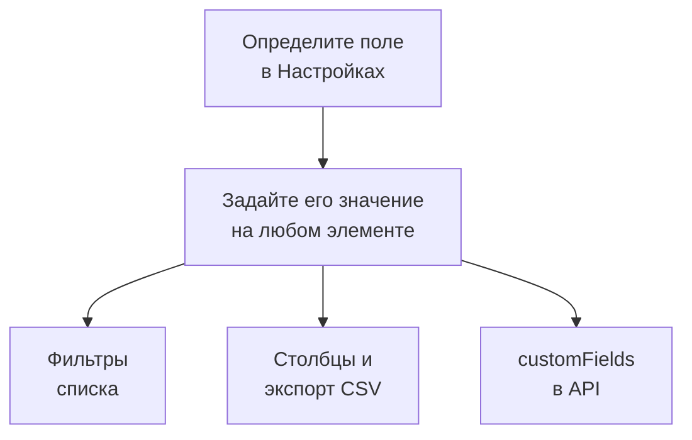

# Пользовательские поля инвентаря

OneUptime обнаруживает, что есть в вашей инфраструктуре. Пользовательские поля записывают то, чего никакое наблюдение не скажет: серийный номер на наклейке, дату окончания гарантии, какая команда владеет вещью, в работе ли она или лежит в ящике с запчастями. Определите поля один раз для проекта, а затем заполняйте их на каждом элементе.

:::cards
- [Как работают пользовательские поля](#как-работают-пользовательские-поля): Один словарь на каждом элементе, независимо от источника.
- [Определение полей](#определение-полей): Создайте поле, выберите его тип, перечислите варианты выпадающего списка.
- [Фильтрация списка](#фильтрация-списка): Найдите то, что истекает в следующем квартале, в два щелчка.
- [Примечания и ограничения](#примечания-и-ограничения): Переименования, дубликаты, даты и удалённые поля.
:::

## Как работают пользовательские поля

Поле определяется один раз для проекта, и каждый элемент может хранить для него значение: и те, что OneUptime обнаружил, и те, что он зеркалирует, и те, что вы добавили вручную. Поле становится фильтром над списком, необязательным столбцом и столбцом экспорта CSV. API читает и записывает те же значения в поле `customFields` каждого элемента.

> [!NOTE]
> В OneUptime Cloud пользовательские поля входят в план **Growth** и выше. Ниже него поля нельзя определить, перечислить или изменить: API отвечает `402 Payment Required`, а список не показывает ни фильтров, ни столбцов пользовательских полей.

## Определение полей

:::steps
### Откройте страницу пользовательских полей

Перейдите в **Продукты → Ресурсы → Инвентарь**, откройте **Настройки** в боковом меню, затем **Пользовательские поля**.

### Создайте поле

Нажмите **Создать: Inventory Item Custom Field**. Задайте ему **Имя поля**, необязательное **Описание поля** и **Тип поля** из таблицы ниже.

### Перечислите варианты выпадающего списка

Для типа «выпадающий список» добавьте его варианты в **Параметры раскрывающегося списка**. У каждого варианта может быть цвет, который одинаково используется в ячейке таблицы и в фильтре: выберите один из именованных цветов, **Без цвета** или **Свой цвет** для точного кода цвета. Перетащите вариант за маркер, чтобы изменить его место в списке.
:::

| Тип | Для чего подходит |
| --- | --- |
| **Текст** | Серийный номер, инвентарный номер, позиция в стойке, номер заказа на закупку |
| **Число** | Стоимость, юнит в стойке, количество портов |
| **Логический** | На поддержке, в области PCI |
| **Выпадающий список (один вариант)** | Стадия жизненного цикла, окружение, критичность: один ответ из фиксированного списка |
| **Выпадающий список (несколько вариантов)** | Области соответствия, теги: несколько ответов из фиксированного списка |
| **Дата** | Дата покупки, окончание гарантии, дата окончания жизненного цикла |
| **Дата и время** | Последний аудит, вывод из эксплуатации |
| **Длинный текст** | Инструкции по доступу, заметки: несколько строк простого текста |
| **Форматированный текст (Markdown)** | Заметки с форматированием и ссылками, написанные в редакторе Markdown |
| **Файл** | Гарантийный сертификат, подписанный заказ на закупку, фото этикетки стойки: один файл |
| **Несколько файлов** | Руководства, счета и фотографии: до 10 файлов |

## Пример словаря активов

Типичный реестр аппаратных активов напрямую ложится на эти поля:

| Имя поля | Тип | Пример |
| --- | --- | --- |
| `Serial Number` | Текст | `FDO24160ABC` |
| `Asset Tag` | Текст | `IT-004821` |
| `Purchase Date` | Дата | 2024-03-11 |
| `Warranty Expiry` | Дата | 2027-03-10 |
| `Lifecycle Status` | Выпадающий список | В работе, Резерв, В ремонте, Списан |
| `Assigned Site` | Выпадающий список | ЦОД Лондон, ЦОД Франкфурт, Головной офис |
| `Owner Team` | Выпадающий список | Сеть, Платформа, Безопасность |
| `Cost Centre` | Текст | `CC-4410` |

Задайте значения на странице элемента **Пользовательские поля**. Их принимает любой элемент, независимо от источника, поэтому коммутаторы, которые обнаружил OneUptime, и сетевые устройства, которые он зеркалирует, несут тот же словарь активов, что и устройства, добавленные вами вручную.

## Фильтрация списка

Каждое пользовательское поле становится фильтром над списком **All Items**, и фильтр предлагает сравнения, подходящие его типу:

| Тип поля | Сравнения |
| --- | --- |
| **Текст**, **Длинный текст**, **Форматированный текст (Markdown)** | равно, не равно, содержит, не содержит, начинается с, заканчивается на, пусто, не пусто |
| **Число** | равно, не равно, больше чем, больше или равно, меньше чем, меньше или равно, пусто, не пусто |
| **Логический**, **Выпадающий список (один вариант)**, **Выпадающий список (несколько вариантов)** | равно, не равно, пусто, не пусто |
| **Дата**, **Дата и время** | равно, до, после, между, пусто, не пусто |
| **Файл**, **Несколько файлов** | равно |

Фильтр по полю **Файл** или **Несколько файлов** спрашивает только одно: **Есть файлы** в поле или **Нет файлов**.

Фильтры объединяются через И, поэтому «Warranty Expiry до 2026-10-01 И Lifecycle Status равно В работе» — это одно представление списка. Именно на этот вопрос существует реестр активов, и именно поэтому стоит использовать типы дат, а не дату в текстовом поле: текстовое поле охотно сохранит `2026-10-01`, но потом не сможет сказать, что истекает в следующем квартале.

Столбцы пользовательских полей сначала скрыты: включите их в выборе столбцов. Их нельзя сортировать, потому что значения хранятся вместе в одном столбце JSON, по которому список не умеет упорядочивать.

## Примечания и ограничения

- Значения хранятся на каждом элементе под именем поля. Переименование поля не переносит значения, уже сохранённые под старым именем. Исключение — пользовательские поля инцидентов: при переименовании такого поля его значения переносятся (см. [Переименование поля](/docs/incidents/settings#переименование-поля)).
- Варианты выпадающего списка можно добавлять, переименовывать, перетаскивать в новый порядок и убирать после того, как у элементов появились значения. Переименованный вариант меняется на каждом элементе, где он выбран; убранный вариант остаётся на элементах, где он выбран, и показывается как больше не доступный, если вы не выберете для них другой (см. [Изменение вариантов раскрывающегося списка](/docs/incidents/settings#изменение-вариантов-раскрывающегося-списка)).
- Ничто не делает значение уникальным. Два элемента могут иметь один и тот же серийный номер, и ничто вам не помешает.
- Даты хранятся как метки времени ISO-8601 в UTC и показываются в вашем часовом поясе.
- Удаление поля убирает его из списка и из панели фильтров. Уже записанные значения остаются на элементах.
- Поле **Файл** или **Несколько файлов** принимает файлы размером до 10 МБ каждый, тех видов, что перечислены в разделе [Поля с файлами](/docs/incidents/settings#поля-с-файлами), загруженные в этом проекте. Скачать их может только тот, кому разрешено видеть элемент, а файл удаляется, как только его больше ничто не держит.

## Дальнейшие шаги

:::cards
- [Обзор инвентаря](/docs/inventory/overview): Откуда берутся элементы и что показывает каждая страница.
- [Экспорт в CMDB](/docs/inventory/cmdb-sync): Перенесите элементы и их пользовательские поля в другую систему.
- [Пользовательские поля инцидентов](/docs/incidents/settings#пользовательские-поля): Те же типы полей на инцидентах, с несколькими дополнительными.
:::
