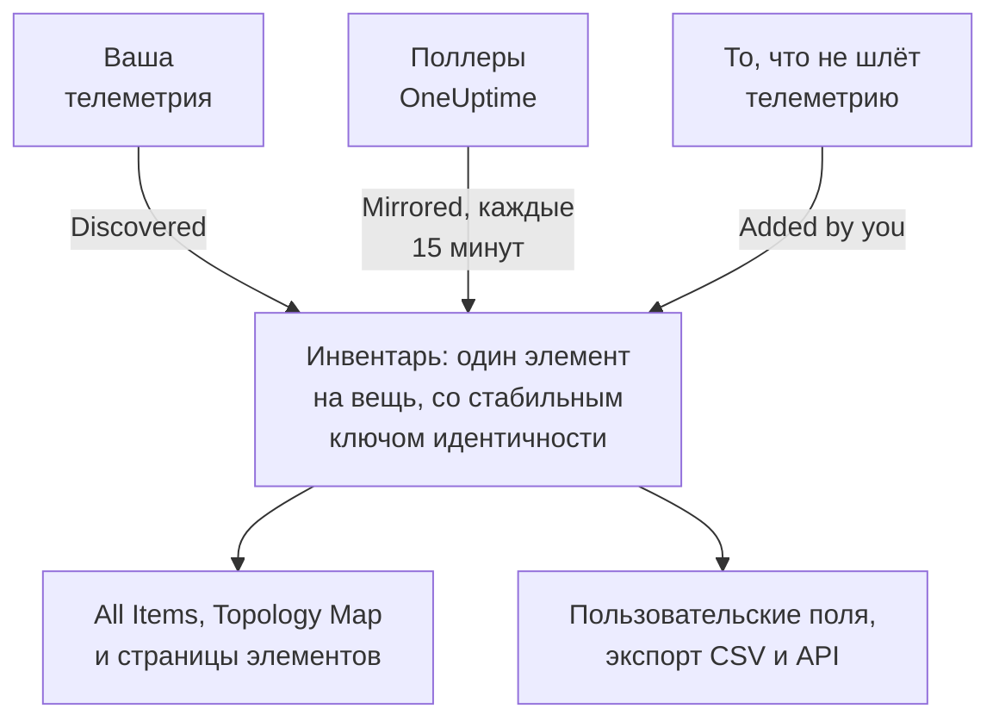

# Обзор инвентаря

Инвентарь — это единый список всего, что OneUptime знает о вашей инфраструктуре: сервисы, хосты, объекты Kubernetes, виртуальные машины, сетевые устройства, облачные ресурсы, IoT-устройства, бессерверные функции и то, что вообще не отправляет телеметрию. Большая часть списка заполняется сама из того, за чем OneUptime уже наблюдает. Вы добавляете то, чего наблюдение не скажет: для чего нужна вещь, кто ею владеет, когда истекает её гарантия.

:::cards
- [Как элементы попадают в инвентарь](#как-элементы-попадают-в-инвентарь): Обнаруженные, зеркалируемые или добавленные вами.
- [Как здесь ориентироваться](#как-здесь-ориентироваться): Страницы инвентаря и собственные страницы каждого элемента.
- [Добавить что-то вручную](#добавить-что-то-вручную): Сторонний API, внешняя база данных или устройство.
- [Архивируйте вместо удаления](#архивируйте-вместо-удаления): Способ навести порядок в списке, который сохраняется.
:::

## Как элементы попадают в инвентарь

OneUptime уже наблюдает за вашей инфраструктурой, чтобы мониторить её, поэтому каталог строится из того, что он видит, а не из того, что кто-то не забыл ввести. У каждого элемента есть источник, и источник решает, кому принадлежит элемент: можете ли вы его редактировать и может ли он исчезнуть сам по себе.

| Источник | В API | Откуда он берётся | Как долго он остаётся |
| --- | --- | --- | --- |
| **Discovered** | `discovered` | Атрибуты ресурсов OpenTelemetry, считываемые по мере поступления телеметрии: сервис, хост, объект Kubernetes или виртуальная машина, которые отправляют телеметрию. | Регистрируется заново с каждым пакетом. Удаляется, когда молчит дольше окна своего вида (см. ниже). |
| **Mirrored** | `inventory` | Запись, которую ведёт поллер OneUptime: сетевые устройства, облачные ресурсы, IoT-устройства, бессерверные функции, RUM-приложения, хосты Docker и хосты Podman. Копируется каждые 15 минут. | Пока существует его запись. Удалите запись, и элемент исчезнет вместе с ней. |
| **Added by you** | `manual` | Добавлен вами для того, что OneUptime не видит: сторонний API, база данных под управлением поставщика, устройство в стойке. | Пока вы его не удалите. Срок его жизни ничем не ограничен. |

Обнаруженный или зеркалируемый элемент нельзя переименовать или сменить ему тип: источник перезапишет изменение при следующем проходе. Страница элемента **Настройки** подсказывает, где внести изменение, которое сохранится. Что вы всегда можете добавить к любому элементу, независимо от источника, — это значения пользовательских полей: см. [Пользовательские поля инвентаря](/docs/inventory/custom-fields).

### Как долго остаётся молчащий элемент

У обнаруженного элемента есть пульс. Каждый раз, когда для него поступает телеметрия, время последнего появления сдвигается вперёд, а столбец списка **Статус** показывает, насколько это было недавно. У зеркалируемых элементов и добавленных вами пульса нет, поэтому их статус остаётся пустым, а не тревожным.

| Статус | Что это значит |
| --- | --- |
| **В реальном времени** | Виден за последние 30 минут. |
| **Recent** | Виден за последние сутки. |
| **Устарело** | Не виден больше суток. Такие элементы перечисляет страница **Gone Quiet**. |

Каждые три часа OneUptime удаляет обнаруженные элементы, которые молчат дольше окна своего вида, включая архивированные, и значения их пользовательских полей исчезают вместе с ними. Зеркалируемые элементы и добавленные вами так никогда не удаляются.

| Вид элемента | Удаляется, если нет телеметрии в течение |
| --- | --- |
| Поды, развёртывания, гостевые системы Proxmox и виртуальные машины VMware | 1 день |
| Узлы и пространства имён Kubernetes, узлы Proxmox, хосты, кластеры и хранилища данных VMware, а также базы данных и удалённые сервисы, которые вызывают ваши трассировки | 7 дней |
| Сервисы, хосты, кластеры Kubernetes, Proxmox и Ceph, массивы хранения, vCenter и кластеры Docker Swarm | 30 дней |

Связь, которую обнаружил OneUptime, удаляется, если её не видели снова 30 дней.

## Как здесь ориентироваться

Откройте **Продукты → Ресурсы → Инвентарь**. В его боковом меню есть эти страницы. **By Source**, **Настройки**, **Справка** и **Расширенный** сначала свёрнуты: нажмите на заголовок раздела, чтобы открыть его.

| Страница | Что там |
| --- | --- |
| **Обзор** | Сколько у вас элементов, что это за элементы, сколько из них затихли и что добавлено последним. |
| **All Items** | Все элементы. Ищите по имени, описанию или ключу идентичности, сужайте список по типу, источнику, статусу или пользовательскому полю и добавляйте элемент вручную. |
| **Topology Map** | Как связаны элементы: сервисы, что они вызывают, и хосты, поды и устройства, на которых они работают. |
| **Gone Quiet** | Обнаруженные элементы, которые не отправляли телеметрию больше суток. |
| **By Source** | Элементы одного источника: **Discovered**, **Mirrored** или **Added by You**. |
| **Настройки → Пользовательские поля** | Поля, которые ваш проект ведёт для каждого элемента. |
| **Справка → Документация** | Краткое руководство по инвентарю с видами элементов, которые он распознаёт. |
| **Расширенный → Архивировано** | Элементы, которые вы заархивировали. Разархивируйте их отсюда. |

Откройте элемент, и в его собственном боковом меню будут его **Обзор** (тип, источник и статус, а также каждый атрибут, замеченный на нём), его **Подключения** и его **Пользовательские поля**; его **Журналы**, **Трассировки**, **Метрики**, **Профили производительности** и **Исключения**; и его **Инциденты**, **Оповещения** и **Плановое обслуживание**. В разделе **Расширенный** находятся его **Настройки**, его **Журналы аудита** и **Delete Item**. Страницы телеметрии показывают то, что отправил сам элемент. Инциденты, оповещения и события обслуживания — это события сервиса, хоста или кластера Kubernetes, который представляет элемент; на любом другом элементе эти страницы подсказывают, на какой ресурс смотреть вместо этого.

### Сведения об активе

У хоста или сетевого устройства есть карточка **Сведения об активе**, которая описывает их одинаково: имя хоста, IP-адрес, MAC-адрес, серийный номер, производитель, модель, версия прошивки, операционная система, версия ОС, тип устройства и расположение. Сведение, о котором ничего не сообщено, отображается как **Неизвестно**, а карточка объясняет, как заполняются неизвестные.

- Сведения хоста берутся из атрибутов ресурса в его телеметрии: IP- и MAC-адреса, архитектура и операционная система — сразу, а серийный номер, производитель, модель и прошивка — после того, как вы их проставите.
- Сведения сетевого устройства берутся из его опроса SNMP, его роли и его площадки. То, чего не прочитал его опрос, берётся из обнаружения: последнего сканирования его адреса, таблицы ARP маршрутизатора или DNS-запроса его зонда. Устройство без ENTITY-MIB, например Meraki MX, всё равно получает производителя и модель из своего системного описания. Его IP-адрес никогда не показывается как имя хоста.

Карточка показывает, откуда взялось каждое сведение и когда. Источник, общий для большинства сведений, например коллектор хоста, собственный опрос SNMP сетевого устройства или сканирование обнаружения, которое его прочитало, называется один раз, под сведениями. Любой другой источник, например таблица ARP маршрутизатора или значение, сохранённое на устройстве, называется под своим сведением. Значение, сохранённое на сетевом устройстве, никогда не заменяется тем, что читает обнаружение, а когда они расходятся, карточка показывает оба.

Те же сведения — это столбцы списка **All Items**, скрытые, пока вы их не включите, и они попадают в его экспорт CSV. Их ключи перечислены в разделе [Экспорт в CMDB](/docs/inventory/cmdb-sync#сведения-об-активе).

### Связи

Страница элемента **Подключения** перечисляет его соседей в обоих направлениях, сгруппированных в **Вызовы**, **Вызывается из**, **Работает на** и **Связанное**. Каждая группа показывает свой итог (группа, где больше 100 000 связей, показывает «100 000+»), а **Показать больше** пролистывает остальное, так что загруженный кластер, пространство имён или узел показывает каждую связь, а не только первые несколько. Страница не ограничена временным диапазоном: она включает связи, добавленные вручную через API, и соседей, которые были заархивированы. Сосед, которого больше нет в инвентаре, показывается по его ключу.

## Добавить что-то вручную

Добавьте элемент для того, что OneUptime никогда не увидит сам, чтобы зависимость заканчивалась на чём-то реальном, а вещь могла нести ваши пользовательские поля.

:::steps
### Откройте All Items

Перейдите в **Продукты → Ресурсы → Инвентарь**, затем в **All Items**.

### Добавьте элемент

Нажмите **Добавить: Item**. Выберите его **Тип**, задайте **Имя** и, если нужно, **Описание**. Имя и тип вместе составляют идентичность элемента, поэтому два элемента одного типа не могут иметь одинаковое имя.

### Заполните его пользовательские поля

Откройте новый элемент. Его источник указан как **Added by you**, а его страница **Пользовательские поля** принимает значения, которые отслеживает ваш проект.
:::

Вручную можно добавить три типа:

- `external.service` (**Внешний сервис**): сторонний API или зависимость от SaaS-сервиса.
- `external.database` (**Внешняя база данных**): база данных, которая не является сервером, который OneUptime может смоделировать. Сервер баз данных, самостоятельно размещённый или управляемый, от PostgreSQL до Snowflake, вместо этого добавляется через **Databases → Создать: База данных** ([Базы данных](/docs/telemetry/databases)): такая запись связывается с трассировками, контейнерами и метриками движка, которые называют тот же адрес, чего элемент инвентаря никогда не делает, а если добавить один и тот же сервер обоими способами, останутся две несвязанные записи.
- `appliance` (**Специализированное устройство**): оборудование или программное обеспечение без агента.

Это ограничение предотвращает дубликаты. Созданный вручную элемент того типа, который OneUptime может наблюдать, например хост, получил бы ключ по введённому вами имени, а обнаруженный элемент для той же машины получает ключ по атрибутам, которые она сообщает. Эти два элемента никогда бы не слились, и один и тот же хост навсегда остался бы в вашем списке дважды.

## Архивируйте вместо удаления

Архивирование убирает элемент из списка, сохраняя его идентичность, историю и значения пользовательских полей. Оно говорит: я это видел, и мне это не нужно в моём списке. Заархивированный элемент продолжает собирать телеметрию.

| Источник | Архивировать | Удалить |
| --- | --- | --- |
| **Discovered** | Остаётся в архиве. | Возвращается со следующим пакетом своей телеметрии. |
| **Mirrored** | Остаётся в архиве. | Возвращается со следующей копией. Вместо этого удалите исходную запись. |
| **Added by you** | Остаётся в архиве. | Удаляется навсегда. |

Чтобы заархивировать элементы, выберите их в **All Items** и заархивируйте за один раз либо откройте элемент и используйте карточку **Архивировать** на его странице **Настройки**. Заархивированные элементы находятся в **Инвентарь → Расширенный → Архивировано**, где их можно выбрать и разархивировать.

> [!NOTE]
> Когда зеркалируемое устройство удаляется из своей исходной записи, OneUptime удаляет и его элемент, если только элемент не несёт введённые вами значения пользовательских полей. Эти значения — единственная копия, и отменить удаление нельзя, поэтому элемент архивируется, а не удаляется. Вы найдёте его в **Расширенный → Архивировано** со всем, что вы ввели.

## Связи и топология

OneUptime связывает элементы направленными связями по мере того, как их наблюдает. **Инвентарь → Topology Map** рисует их, а страница элемента **Подключения** перечисляет его собственные. См. [Топология](/docs/telemetry/topology).

| Связь | Например |
| --- | --- |
| `runs-on` | Под работает на узле; виртуальная машина работает на своём хосте. |
| `member-of` | Под, узел или пространство имён входит в кластер. |
| `hosted-on` | Сервис размещён на хосте. |
| `part-of` | Под — часть своего развёртывания. |
| `depends-on` | Сервис вызывает другой сервис, что видно по спанам, которые проходят между ними. |

## Дальнейшие шаги

:::cards
- [Пользовательские поля инвентаря](/docs/inventory/custom-fields): Отслеживайте серийные номера, даты гарантии, владельцев и стадию жизненного цикла.
- [Экспорт в CMDB](/docs/inventory/cmdb-sync): Перенесите каталог в собственную учётную систему.
- [Базы данных](/docs/telemetry/databases): Мониторьте серверы баз данных, которыми пользуются ваши сервисы.
:::
