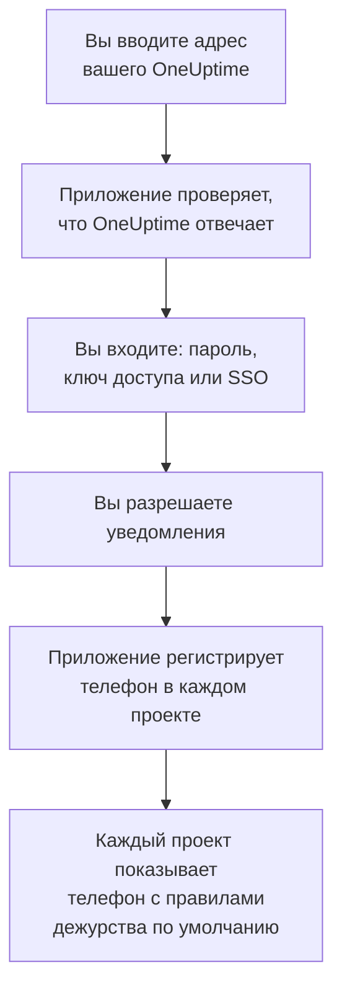

# Установка на Android

Установите **OneUptime On-Call** на телефон или планшет Android, подключите приложение к вашему OneUptime и войдите. Затем отправьте себе тестовое уведомление и разрешите срочным вызовам дежурных звучать в беззвучном режиме и в режиме «Не беспокоить».

:::cards
- [Установите приложение](#установите-приложение): Из Google Play или APK на телефоне без Google Play.
- [Войдите](#войдите): Адрес вашего OneUptime, затем ваша учётная запись.
- [Проверьте, что вызовы доходят до телефона](#проверьте-что-вызовы-доходят-до-телефона): Найдите телефон в панели управления и проверьте его.
- [Звонок в беззвучном режиме](#звонок-в-беззвучном-режиме): Критические оповещения и сигнал тревоги.
- [Устранение неполадок](#устранение-неполадок): Проблемы со входом, уведомлениями и установкой.
:::

## Перед началом

- Телефон или планшет с Android 7.0 или новее.
- Учётная запись в проекте OneUptime. Чтобы получать вызовы, нужно ещё и быть на дежурстве: см. [Правила эскалации](/docs/on-call/escalation-rules).
- Адрес вашего OneUptime: `https://oneuptime.com` в OneUptime Cloud или ваш собственный, например `https://oneuptime.example.com`. Приложение подключается только по HTTPS.

## Установите приложение

:::tabs
@tab Google Play
1. Откройте на телефоне [OneUptime On-Call в Google Play](https://play.google.com/store/apps/details?id=com.oneuptime.oncall) или найдите OneUptime On-Call в Google Play.
2. Нажмите **Установить**, затем **Открыть**.

Google Play сам обновляет приложение.
@tab APK
Для телефона без Google Play. APK собирается из того же кода для каждого выпуска OneUptime и прикрепляется к выпуску на GitHub.

1. Откройте на телефоне [последний APK](https://github.com/OneUptime/oneuptime/releases/latest/download/oneuptime-on-call-android-app.apk).
2. Откройте скачанный файл. Если Android спросит, разрешите браузеру устанавливать неизвестные приложения, затем нажмите **Установить**.
3. Откройте OneUptime On-Call из списка приложений.

APK не обновляется сам: время от времени устанавливайте поверх него последний. Вход и настройки сохраняются.
:::

## Войдите



:::steps
### Введите адрес вашего OneUptime
Откройте приложение. На экране **Connect your workspace** оставьте `https://oneuptime.com` для OneUptime Cloud или введите адрес своего OneUptime и нажмите **Connect**. Приложение продолжит, как только ответит `https://<your-oneuptime>/api/status`.

### Войдите в учётную запись
Используйте тот способ входа, который есть у вашей учётной записи:

- Адрес электронной почты и пароль, затем **Sign In**. **Forgot password?** присылает на почту ссылку, чтобы задать новый пароль.
- **Sign in with a passkey**, после того как вы добавили ключ доступа в панели управления: см. [Добавьте ключ доступа](/docs/introduction/your-account#добавьте-ключ-доступа). Открывается браузер, чтобы подтвердить его, и затем возвращает вас в приложение.
- **Sign in with SSO**, если ваша организация использует единый вход. Выберите своего поставщика или введите рабочий адрес электронной почты и нажмите **Continue**. Открывается защищённый браузер, и после входа вы возвращаетесь в приложение.

Если включена двухфакторная аутентификация, введите шестизначный код из приложения-аутентификатора или один из резервных кодов. Ключ безопасности в приложении использовать нельзя. Если администратор требует двухфакторную аутентификацию, а вы её ещё не настроили, приложение сначала вместе с вами настроит приложение-аутентификатор.

### Разрешите уведомления
Когда Android спросит, можно ли OneUptime On-Call отправлять уведомления, нажмите **Разрешить**. Android 13 и новее спрашивают; более ранние версии разрешают их, пока вы их не отключите.

Затем приложение регистрирует телефон в каждом из ваших проектов. Каждый проект показывает его среди ваших push-устройств с правилами дежурства по умолчанию, так что с этого момента ваши вызовы доходят до него.
:::

Приложение показывает один проект за раз: чтобы переключиться, нажмите название проекта вверху экрана. Проект, требующий единого входа, отмечен **SSO Required** в разделе **Settings → Manage Projects**, пока вы не нажмёте там **Authenticate with SSO**.

## Проверьте, что вызовы доходят до телефона

:::steps
### Найдите телефон в панели управления
В панели управления откройте **Настройки пользователя → Методы уведомлений** и вкладку **Push Notifications**. Телефон указан в списке **Устройства для push-уведомлений** под названием своей модели. У каждого проекта свой список.

### Отправьте тест
Нажмите **Тестовое уведомление** в строке телефона. На телефон приходит уведомление; нажмите его, чтобы открыть приложение.
:::

Ваши правила дежурства решают, какие вызовы приходят на телефон и как быстро: см. **Настройки пользователя → Правила дежурства**. Новый телефон получает те же правила по умолчанию, что и любой другой добавленный вами способ.

## Звонок в беззвучном режиме

По умолчанию вызов дежурного подчиняется настройкам звука телефона: телефон без звука остаётся беззвучным, а режим «Не беспокоить» задерживает вызов. Критические оповещения позволяют вызовам дежурных звучать в обход обоих. Они выключены, пока вы их не включите, на каждом телефоне отдельно.

```mermaid title="Звучит ли вызов дежурного на Android в обход беззвучного режима"
flowchart TB
    Page["Вызов дежурного<br/>на этот телефон"]
    Rule{"Правило в режиме<br/>«Критическое оповещение»?"}
    Device{"Critical On-Call<br/>Alerts включены?"}
    Quiet["Подчиняется звуку<br/>телефона и режиму<br/>«Не беспокоить»"]
    Loud["Звучит ваш сигнал<br/>тревоги в обход<br/>беззвучного режима<br/>и «Не беспокоить»"]
    Page --> Rule
    Rule -->|"нет: Обычное"| Quiet
    Rule -->|"да"| Device
    Device -->|"нет"| Quiet
    Device -->|"да"| Loud
```

:::steps
### Включите Critical On-Call Alerts
В приложении откройте **Settings** и включите **Critical On-Call Alerts** в разделе **Notifications**.

### Разрешите доступ к режиму «Не беспокоить»
Android открывает свой список **Доступ к режиму «Не беспокоить»**. Включите доступ для OneUptime On-Call и вернитесь в приложение: оно проверяет доступ и пишет под переключателем, будут ли вызовы звучать в обход беззвучного режима.

### Выберите сигнал тревоги
Нажмите **Alarm sound** под переключателем. Кроме собственного звука телефона, приложение предлагает Klaxon, Siren, Digital alarm, Smoke alarm и Rising alarm, который начинается тихо и становится всё громче. Нажмите кнопку воспроизведения рядом со звуком, чтобы его прослушать. Критический вызов звучит с громкостью будильника телефона, поэтому не убавляйте её.
:::

В обход звучат только вызовы дежурных и только от правил дежурства в режиме **Критическое оповещение**, который задан по умолчанию. Правило в режиме **Обычное** подчиняется настройкам телефона, что бы ни показывал переключатель, так что критический инцидент может вас разбудить, а о незначительном вам сообщат тихо. Отправьте **Тестовое уведомление** на телефон с выключенным звуком, чтобы услышать, как прозвучит вызов.

## Чтобы вызовы не опаздывали

OneUptime отправляет вызовы дежурных с высоким приоритетом, и Android доставляет их даже на телефон, который часами лежал без дела. Телефон, который ограничивает приложению расход батареи, всё же может их задерживать:

- Откройте **Настройки → Приложения → OneUptime On-Call → Батарея** и выберите **Без ограничений**. На некоторых телефонах это называется **Использование батареи приложением**.
- Проверьте, что уведомления приложения включены, в разделе **Настройки → Приложения → OneUptime On-Call → Уведомления**.
- Не добавляйте OneUptime On-Call ни в какие списки экономии заряда или спящих приложений на вашем телефоне.

## Заблокируйте приложение

Включите **Biometrics Login** в разделе **Settings** приложения, и при каждом запуске оно будет запрашивать отпечаток пальца, лицо или блокировку экрана телефона. Переключатель появляется, когда на телефоне настроена разблокировка по отпечатку пальца или лицу. **Appearance** на том же экране выбирает светлое или тёмное оформление либо следует настройке телефона.

## Обновление, выход или удаление

- **Обновление.** Google Play обновляет приложение. Если вы ставили APK, установите поверх него последний. Версия приложения указана внизу его экрана **Settings**.
- **Выход.** **Settings → Log Out** выполняет выход и удаляет телефон из ваших push-устройств во всех проектах вместе с его правилами дежурства. Когда вы снова войдёте, он вернётся с правилами по умолчанию.
- **Удаление.** Удалите приложение, как любое другое. Если вы при этом оставались в системе, телефон остаётся в вашем списке, пока push-уведомление на него не завершится ошибкой: тогда OneUptime помечает его как **Уведомления не приходят**. Удалите эту запись кнопкой **Удалить**: если снова установить приложение и войти, телефон добавится как новая запись с правилами по умолчанию.

## Устранение неполадок

:::details «Could not connect to the server»
Приложению не удалось связаться с `https://<your-oneuptime>/api/status`. Проверьте адрес, включая `https://`. Если ваш OneUptime находится в частной сети, сначала подключите к ней телефон, например через VPN. Откройте этот адрес в браузере телефона: если телефон может связаться с OneUptime, там будет `{"status":"ok"}`.
:::

:::details Не приходят уведомления
- Проверьте, что в настройках Android уведомления приложения включены, а режим «Не беспокоить» выключен или включены критические оповещения.
- Проверьте, что телефон указан на вкладке **Push Notifications** в разделе **Настройки пользователя → Методы уведомлений**, и отправьте ему **Тестовое уведомление**.
- Если телефон помечен как **Уведомления не приходят**, откройте приложение, войдя в систему. Оно зарегистрирует телефон заново; см. [Когда телефону нужно зарегистрироваться заново](/docs/mobile-desktop-apps/faq-troubleshooting#когда-телефону-нужно-зарегистрироваться-заново).
- Проверьте правила дежурства в разделе **Настройки пользователя → Правила дежурства**.
- В OneUptime на своём сервере проверьте, что сервер может связаться со своим push-ретранслятором: см. [Push-уведомления](/docs/self-hosted/push-notifications#сетевой-доступ).
:::

:::details Критические оповещения молчат в режиме «Не беспокоить»
Откройте **Settings** приложения: строка под **Critical On-Call Alerts** говорит, чего не хватает. Обычно не был разрешён доступ к режиму «Не беспокоить»: разрешите его в разделе **Настройки → Уведомления → Доступ к режиму «Не беспокоить»** и вернитесь в приложение. Если вы выбрали сигнал тревоги, каналу уведомлений этого звука тоже нужно разрешить обходить режим «Не беспокоить».
:::

:::details «Приложение не установлено» при установке APK
OneUptime On-Call уже установлен на телефоне из другого источника, например из Google Play, и Android не ставит одно поверх другого. Удалите его, установите APK и войдите снова.
:::

:::details Нет переключателя Biometrics Login
Переключатель появляется, когда в настройках Android настроена разблокировка по отпечатку пальца или лицу.
:::

## Дальнейшие шаги

:::cards
- [Часто задаваемые вопросы и устранение неполадок](/docs/mobile-desktop-apps/faq-troubleshooting): Что делать, если телефон перестал получать вызовы.
- [Установка на iOS](/docs/mobile-desktop-apps/ios-installation): То же приложение на iPhone или iPad.
- [Правила эскалации](/docs/on-call/escalation-rules): Решите, кого вызывать и когда.
- [Push-уведомления](/docs/self-hosted/push-notifications): Как OneUptime на своём сервере отправляет вызовы на телефоны.
:::
