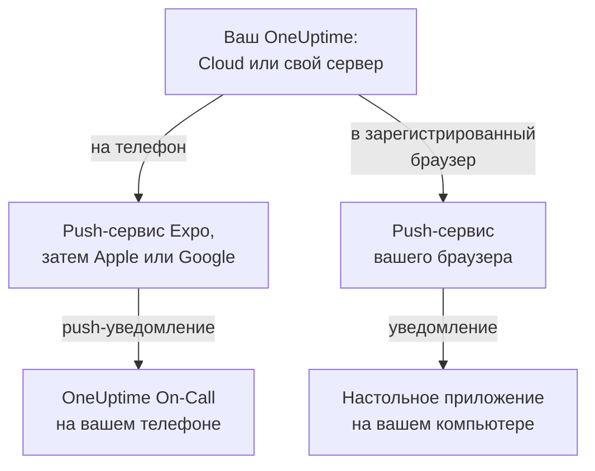

# Обзор приложений

У OneUptime есть приложение для телефона и приложение для компьютера. **OneUptime On-Call** для iPhone, iPad и Android вызывает вас, когда вы на дежурстве, и позволяет подтверждать и решать инциденты, где бы вы ни были. В Windows, macOS и Linux панель управления OneUptime устанавливается из браузера как настольное приложение со своим окном. Оба работают с OneUptime Cloud и с OneUptime, который вы размещаете сами.

:::cards
- [Выберите приложение](#выберите-приложение): Для чего нужно каждое приложение, рядом.
- [Как приложения связываются с OneUptime](#как-приложения-связываются-с-oneuptime): Какой путь проходят вход и вызовы дежурных.
- [Получите мобильное приложение](#получите-мобильное-приложение): Из App Store, Google Play или GitHub.
- [Получите настольное приложение](#получите-настольное-приложение): Установите панель управления из Edge, Chrome или Safari.
:::

## Выберите приложение

|  | Мобильное приложение | Настольное приложение |
| --- | --- | --- |
| Что это | OneUptime On-Call, нативное приложение для iPhone, iPad и Android | Панель управления OneUptime, установленная из браузера |
| Где взять | App Store, Google Play или APK с GitHub | Ваш собственный OneUptime: скачивать ничего не нужно |
| Вызовы дежурных | Push-уведомления, которые могут звучать в беззвучном режиме и в режиме «Не беспокоить» | Уведомления браузера, после регистрации браузера |
| Что можно делать | Инциденты, оповещения, кейсы безопасности, мониторы и кто на дежурстве; подтверждать, решать, одобрять шаги плейбуков и добавлять заметки | Всё, что умеет панель управления |
| Обновления | Из магазина или установкой более новой версии APK | При каждом открытии загружает панель управления с вашего OneUptime |
| Работает на | iOS 16.4 или новее, Android 7.0 или новее | Windows, macOS и Linux, с Edge или Chrome, или Safari на macOS Sonoma 14 или новее |

Можно пользоваться обоими: держите настольное приложение открытым на работе, а ночью пусть вас будит телефон.

## Как приложения связываются с OneUptime

Мобильное приложение входит в ваш OneUptime и регистрирует телефон в каждом проекте, участником которого вы являетесь. С этого момента OneUptime отправляет push-уведомления телефона, в том числе вызовы дежурных, через push-сервис Expo, который передаёт их Apple или Google для доставки. По умолчанию OneUptime на своём сервере отправляет их через push-ретранслятор OneUptime, поэтому ему не нужна собственная учётная запись Apple, Google или Expo: см. [Push-уведомления](/docs/self-hosted/push-notifications).

Настольное приложение — это сама панель управления в отдельном окне. Оно показывает уведомления, когда вы зарегистрируете его браузер для push-уведомлений: как это сделать, показывают страницы о Windows, macOS и Linux.

## Перед началом

- Учётная запись в проекте OneUptime. Чтобы получать вызовы, нужно ещё и быть на дежурстве: см. [Правила эскалации](/docs/on-call/escalation-rules).
- Адрес вашего OneUptime. В OneUptime Cloud это `https://oneuptime.com`; у OneUptime на своём сервере свой адрес, например `https://oneuptime.example.com`.
- Ваш OneUptime по HTTPS. Мобильное приложение не подключается по обычному HTTP, а браузеры показывают уведомления, а Edge и Chrome устанавливают приложения, только для сайтов на HTTPS.

## Получите мобильное приложение

:::steps
### Установите OneUptime On-Call
Скачайте его из [App Store](https://apps.apple.com/us/app/oneuptime-on-call/id6759615391) на iPhone или iPad или из [Google Play](https://play.google.com/store/apps/details?id=com.oneuptime.oncall) на Android. На телефон Android без Google Play установите вместо этого [APK](https://github.com/OneUptime/oneuptime/releases/latest/download/oneuptime-on-call-android-app.apk). Те же ссылки есть в панели управления в разделе **Настройки проекта → Уведомления → Мобильные приложения**.

### Подключите его к вашему OneUptime
Откройте приложение, оставьте `https://oneuptime.com` для OneUptime Cloud или введите адрес своего OneUptime и войдите с паролем, ключом доступа или через единый вход.

### Разрешите уведомления
Разрешите их, когда телефон спросит. Приложение зарегистрирует телефон в каждом из ваших проектов, и вызовы дежурных начнут на него приходить.
:::

Каждый шаг подробно, с тем, что проверить потом: [Установка на Android](/docs/mobile-desktop-apps/android-installation) и [Установка на iOS](/docs/mobile-desktop-apps/ios-installation).

## Получите настольное приложение

:::steps
### Откройте панель управления
Войдите в свой OneUptime в Microsoft Edge или Google Chrome либо в Safari на Mac.

### Установите её
В Edge или Chrome нажмите значок установки справа в адресной строке. В Safari выберите **Файл → Добавить в Dock**.

### Открывайте её как любое другое приложение
Она открывается в своём окне из меню «Пуск», Dock или средства запуска приложений.
:::

Каждый браузер шаг за шагом: [Установка на Windows](/docs/mobile-desktop-apps/windows-installation), [Установка на macOS](/docs/mobile-desktop-apps/macos-installation) и [Установка на Linux](/docs/mobile-desktop-apps/linux-installation).

## Дальнейшие шаги

:::cards
- [Установка на Android](/docs/mobile-desktop-apps/android-installation): Установите приложение на Android, войдите и убедитесь, что вызовы приходят.
- [Установка на iOS](/docs/mobile-desktop-apps/ios-installation): Установите приложение на iPhone или iPad и включите критические оповещения.
- [Установка на Windows](/docs/mobile-desktop-apps/windows-installation): Установите панель управления из Edge или Chrome.
- [Установка на macOS](/docs/mobile-desktop-apps/macos-installation): Добавьте панель управления в Dock из Safari, Chrome или Edge.
- [Установка на Linux](/docs/mobile-desktop-apps/linux-installation): Установите панель управления из Chrome, Chromium или Edge.
- [Часто задаваемые вопросы и устранение неполадок](/docs/mobile-desktop-apps/faq-troubleshooting): Ответы, решения и что делать, если телефон перестал получать вызовы.
:::
