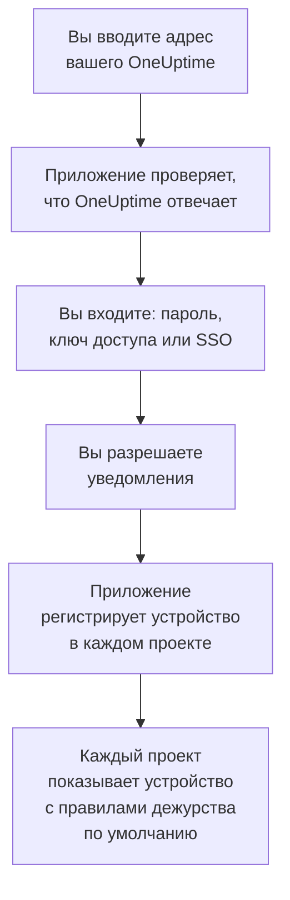

# Установка на iOS

Установите **OneUptime On-Call** на iPhone или iPad из App Store, подключите приложение к вашему OneUptime и войдите. Затем отправьте себе тестовое уведомление и разрешите срочным вызовам дежурных звучать в обход беззвучного режима и фокусирования.

:::cards
- [Установите приложение](#установите-приложение): Из App Store.
- [Войдите](#войдите): Адрес вашего OneUptime, затем ваша учётная запись.
- [Проверьте, что вызовы доходят до устройства](#проверьте-что-вызовы-доходят-до-устройства): Найдите его в панели управления и проверьте.
- [Звонок в беззвучном режиме](#звонок-в-беззвучном-режиме): Критические оповещения, сигнал тревоги и его громкость.
- [Устранение неполадок](#устранение-неполадок): Проблемы со входом, уведомлениями и критическими оповещениями.
:::

## Перед началом

- iPhone или iPad с iOS 16.4 или новее либо с iPadOS 16.4 или новее.
- Учётная запись в проекте OneUptime. Чтобы получать вызовы, нужно ещё и быть на дежурстве: см. [Правила эскалации](/docs/on-call/escalation-rules).
- Адрес вашего OneUptime: `https://oneuptime.com` в OneUptime Cloud или ваш собственный, например `https://oneuptime.example.com`. Приложение подключается только по HTTPS.

## Установите приложение

1. Откройте на iPhone или iPad [OneUptime On-Call в App Store](https://apps.apple.com/us/app/oneuptime-on-call/id6759615391) или найдите OneUptime On-Call в App Store.
2. Нажмите **Загрузить** и подтвердите с помощью Face ID, Touch ID или пароля аккаунта Apple.
3. Нажмите **Открыть** или откройте OneUptime On-Call с экрана «Домой».

App Store сам обновляет приложение, пока включены **Обновления ПО** в разделе **Настройки → App Store**.

## Войдите



:::steps
### Введите адрес вашего OneUptime
Откройте приложение. На экране **Connect your workspace** оставьте `https://oneuptime.com` для OneUptime Cloud или введите адрес своего OneUptime и нажмите **Connect**. Приложение продолжит, как только ответит `https://<your-oneuptime>/api/status`.

### Войдите в учётную запись
Используйте тот способ входа, который есть у вашей учётной записи:

- Адрес электронной почты и пароль, затем **Sign In**. **Forgot password?** присылает на почту ссылку, чтобы задать новый пароль.
- **Sign in with a passkey**, после того как вы добавили ключ доступа в панели управления: см. [Добавьте ключ доступа](/docs/introduction/your-account#добавьте-ключ-доступа). Открывается окно браузера, чтобы подтвердить его, и затем возвращает вас в приложение.
- **Sign in with SSO**, если ваша организация использует единый вход. Выберите своего поставщика или введите рабочий адрес электронной почты и нажмите **Continue**. Открывается защищённый браузер, и после входа вы возвращаетесь в приложение.

Если включена двухфакторная аутентификация, введите шестизначный код из приложения-аутентификатора или один из резервных кодов. Ключ безопасности в приложении использовать нельзя. Если администратор требует двухфакторную аутентификацию, а вы её ещё не настроили, приложение сначала вместе с вами настроит приложение-аутентификатор.

### Разрешите уведомления
Когда iOS спросит, можно ли OneUptime On-Call отправлять вам уведомления, нажмите **Разрешить**.

Затем приложение регистрирует iPhone или iPad в каждом из ваших проектов. Каждый проект показывает его среди ваших push-устройств с правилами дежурства по умолчанию, так что с этого момента ваши вызовы доходят до него.
:::

Приложение показывает один проект за раз: чтобы переключиться, нажмите название проекта вверху экрана. Проект, требующий единого входа, отмечен **SSO Required** в разделе **Settings → Manage Projects**, пока вы не нажмёте там **Authenticate with SSO**.

## Проверьте, что вызовы доходят до устройства

:::steps
### Найдите устройство в панели управления
В панели управления откройте **Настройки пользователя → Методы уведомлений** и вкладку **Push Notifications**. iPhone или iPad указан в списке **Устройства для push-уведомлений** под названием своей модели. У каждого проекта свой список.

### Отправьте тест
Нажмите **Тестовое уведомление** в строке устройства. На устройство приходит уведомление; нажмите его, чтобы открыть приложение.
:::

Ваши правила дежурства решают, какие вызовы приходят на устройство и как быстро: см. **Настройки пользователя → Правила дежурства**. Новое устройство получает те же правила по умолчанию, что и любой другой добавленный вами способ.

## Звонок в беззвучном режиме

По умолчанию вызов дежурного подчиняется настройкам звука устройства: беззвучный режим оставляет его тихим, а фокусирование, например «Не беспокоить», его задерживает. Критические оповещения позволяют вызовам дежурных звучать в обход обоих. Они выключены, пока вы их не включите, на каждом устройстве отдельно.

```mermaid title="Звучит ли вызов дежурного на iPhone или iPad в обход беззвучного режима"
flowchart TB
    Page["Вызов дежурного<br/>на это устройство"]
    Rule{"Правило в режиме<br/>«Критическое<br/>оповещение»?"}
    Device{"Critical On-Call<br/>Alerts включены?"}
    Quiet["Подчиняется звуку<br/>устройства и режиму<br/>фокусирования"]
    Loud["Звучит ваш сигнал<br/>тревоги с вашей<br/>громкостью в обход<br/>беззвучного режима<br/>и фокусирования"]
    Page --> Rule
    Rule -->|"нет: Обычное"| Quiet
    Rule -->|"да"| Device
    Device -->|"нет"| Quiet
    Device -->|"да"| Loud
```

:::steps
### Включите Critical On-Call Alerts
В приложении откройте **Settings** и включите **Critical On-Call Alerts** в разделе **Notifications**.

### Разрешите критические оповещения
Когда iOS спросит, можно ли OneUptime On-Call отправлять важные предупреждения, нажмите **Разрешить**. Затем iOS добавляет для приложения переключатель **Важные предупреждения** в разделе **Настройки → Уведомления → OneUptime On-Call**, где позже можно передумать. Строка под переключателем приложения говорит, будут ли вызовы звучать в обход беззвучного режима.

### Выберите сигнал тревоги и его громкость
Нажмите **Alarm sound** под переключателем. Кроме собственного звука важных предупреждений устройства, приложение предлагает Klaxon, Siren, Digital alarm, Smoke alarm и Rising alarm, который начинается тихо и становится всё громче. Нажмите кнопку воспроизведения рядом со звуком, чтобы его прослушать. Затем выберите громкость вызова: 25 %, 50 %, 75 % или 100 % (по умолчанию).
:::

В обход звучат только вызовы дежурных и только от правил дежурства в режиме **Критическое оповещение**, который задан по умолчанию. Правило в режиме **Обычное** подчиняется настройкам устройства, что бы ни показывал переключатель, так что критический инцидент может вас разбудить, а о незначительном вам сообщат тихо. Отправьте **Тестовое уведомление** на устройство в беззвучном режиме, чтобы услышать, как прозвучит вызов. Прослушивание на экране **Alarm sound** звучит с громкостью звонка, а в беззвучном режиме не звучит вовсе; настоящий вызов звучит в обход беззвучного режима с выбранной вами громкостью.

> [!NOTE]
> Для критических оповещений нужен OneUptime On-Call 1.5.0 или новее из App Store. Более ранние версии собраны без разрешения Apple на критические оповещения, поэтому iOS никогда не предлагала им этот переключатель.

## Чтобы вызовы не задерживались

Без критических оповещений вызовы может задержать фокусирование или сводка:

- **Фокусирование.** Добавьте OneUptime On-Call в приложения, которые разрешает каждый режим фокусирования, в разделе **Настройки → Фокусирование**.
- **Доставка по расписанию.** Не включайте в неё OneUptime On-Call, в разделе **Настройки → Уведомления → Доставка по расписанию**: уведомление из сводки ждёт её следующего времени.
- **Уведомления.** Оставьте включённым **Допуск уведомлений** в разделе **Настройки → Уведомления → OneUptime On-Call**.

## Заблокируйте приложение

Включите **Biometrics Login** в разделе **Settings** приложения, и при каждом запуске оно будет запрашивать Face ID, Touch ID или код-пароль. Переключатель появляется, когда на устройстве настроен Face ID или Touch ID. **Appearance** на том же экране выбирает светлое или тёмное оформление либо следует настройке устройства.

## Обновление, выход или удаление приложения

- **Обновление.** App Store обновляет приложение; обновить его можно и вручную из своего аккаунта в App Store. Версия приложения указана внизу его экрана **Settings**.
- **Выход.** **Settings → Log Out** выполняет выход и удаляет устройство из ваших push-устройств во всех проектах вместе с его правилами дежурства. Когда вы снова войдёте, оно вернётся с правилами по умолчанию.
- **Удаление.** Нажмите и удерживайте значок приложения, затем нажмите **Удалить приложение** и подтвердите **Удалить приложение**. Если вы при этом оставались в системе, устройство остаётся в вашем списке, пока push-уведомление на него не завершится ошибкой: тогда OneUptime помечает его как **Уведомления не приходят**. Если снова установить приложение и войти, обычно возвращается та же запись с её правилами; если устройство вам больше не нужно, удалите запись кнопкой **Удалить**.

## Устранение неполадок

:::details «Could not connect to the server»
Приложению не удалось связаться с `https://<your-oneuptime>/api/status`. Проверьте адрес, включая `https://`. Если ваш OneUptime находится в частной сети, сначала подключите к ней устройство, например через VPN. Откройте этот адрес в Safari на устройстве: если устройство может связаться с OneUptime, там будет `{"status":"ok"}`.
:::

:::details Не приходят уведомления
- Проверьте, что **Допуск уведомлений** включён в разделе **Настройки → Уведомления → OneUptime On-Call** и что никакой режим фокусирования не задерживает вызовы.
- Проверьте, что устройство указано на вкладке **Push Notifications** в разделе **Настройки пользователя → Методы уведомлений**, и отправьте ему **Тестовое уведомление**.
- Если устройство помечено как **Уведомления не приходят**, откройте приложение, войдя в систему. Оно зарегистрирует устройство заново; см. [Когда телефону нужно зарегистрироваться заново](/docs/mobile-desktop-apps/faq-troubleshooting#когда-телефону-нужно-зарегистрироваться-заново).
- Проверьте правила дежурства в разделе **Настройки пользователя → Правила дежурства**.
- В OneUptime на своём сервере проверьте, что сервер может связаться со своим push-ретранслятором: см. [Push-уведомления](/docs/self-hosted/push-notifications#сетевой-доступ).
:::

:::details В настройках iOS нет переключателя «Важные предупреждения»
Сначала включите **Critical On-Call Alerts** в приложении: iOS добавляет свой переключатель только после того, как приложение запросило критические оповещения. Если приложение пишет, что эта версия не может получать критические оповещения, обновите OneUptime On-Call из App Store.
:::

:::details Критические оповещения не звучат
Откройте **Settings** приложения: строка под **Critical On-Call Alerts** говорит, чего не хватает. Проверьте, что **Важные предупреждения** включены в разделе **Настройки → Уведомления → OneUptime On-Call** и что громкость на экране **Alarm sound** приложения не убавлена.
:::

:::details Нет переключателя Biometrics Login
Переключатель появляется, когда Face ID или Touch ID настроен в разделе **Настройки → Face ID и код-пароль** или **Настройки → Touch ID и код-пароль**.
:::

## Дальнейшие шаги

:::cards
- [Часто задаваемые вопросы и устранение неполадок](/docs/mobile-desktop-apps/faq-troubleshooting): Что делать, если телефон перестал получать вызовы.
- [Установка на Android](/docs/mobile-desktop-apps/android-installation): То же приложение на Android.
- [Правила эскалации](/docs/on-call/escalation-rules): Решите, кого вызывать и когда.
- [Push-уведомления](/docs/self-hosted/push-notifications): Как OneUptime на своём сервере отправляет вызовы на телефоны.
:::
