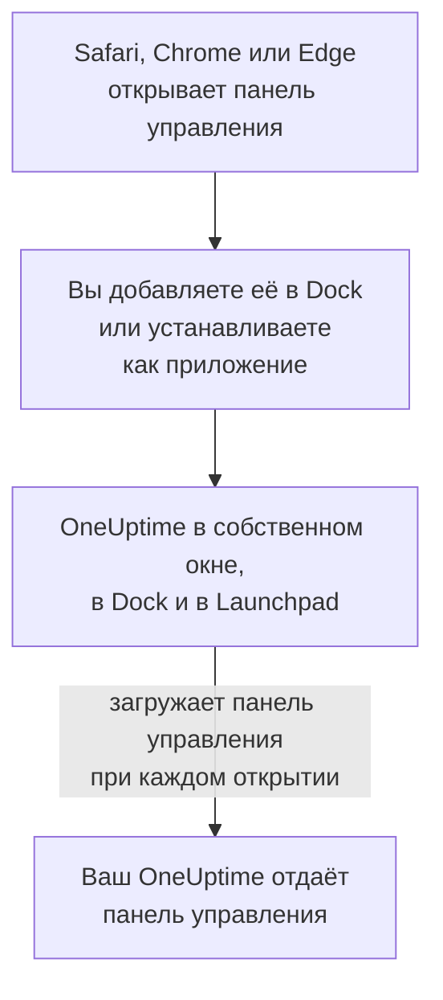

# Установка на macOS

Панель управления OneUptime устанавливается на Mac как приложение: добавьте её в Dock из Safari или установите из Google Chrome или Microsoft Edge. Она открывается в собственном окне, со своим значком в Dock и в Launchpad, и может показывать уведомления. Скачивать ничего не нужно: приложение — это панель управления вашего OneUptime, и оно всегда так же актуально, как ваш OneUptime.

:::cards
- [Установите приложение](#установите-приложение): Из Safari, Chrome или Edge.
- [Оставьте его в Dock](#оставьте-его-в-dock): Открывайте его одним щелчком или при входе.
- [Получайте уведомления на этом Mac](#получайте-уведомления-на-этом-mac): Зарегистрируйте приложение для push-уведомлений.
- [Устранение неполадок](#устранение-неполадок): Нет «Добавить в Dock», нет уведомлений, повторный вход.
:::

## Как работает настольное приложение

Веб-приложение Safari хранит собственный вход, файлы cookie и настройки отдельно от Safari. Приложение, установленное из Chrome или Edge, использует их вместе с этим браузером.

## Перед началом

- macOS Sonoma 14 или новее для Safari. Chrome и Edge устанавливают приложения в любой версии macOS, на которой работают.
- Адрес вашего OneUptime по HTTPS: `https://oneuptime.com` в OneUptime Cloud или ваш собственный, например `https://oneuptime.example.com`.
- Учётная запись, с которой вы можете войти в панель управления.

## Установите приложение

:::tabs
@tab Safari
1. Откройте свой OneUptime в Safari и войдите.
2. На любой странице панели управления выберите **Файл → Добавить в Dock** или нажмите кнопку «Поделиться» на панели инструментов, а затем **Добавить в Dock**.
3. Оставьте название или измените его и нажмите **Добавить**.
4. Откройте OneUptime из Dock и войдите ещё раз: веб-приложение не использует вход Safari.
@tab Chrome
1. Откройте свой OneUptime в Chrome и войдите.
2. На любой странице панели управления нажмите значок установки справа в адресной строке, затем **Установить**. Или откройте **⋮ → Транслировать, сохранить, поделиться → Установить страницу как приложение…**.
3. Chrome открывает OneUptime в собственном окне и добавляет его в Launchpad.
@tab Edge
1. Откройте свой OneUptime в Edge и войдите.
2. На любой странице панели управления нажмите значок установки справа в адресной строке, затем **Установить**. Или откройте **Параметры и другое (…) → Дополнительные инструменты → Приложения → Установить этот сайт как приложение**.
3. Edge открывает OneUptime в собственном окне и добавляет его в Launchpad.
:::

Устанавливайте со страницы панели управления после входа: страница входа — это не приложение. Safari сохраняет веб-приложение в папке «Программы» вашей папки пользователя.

## Оставьте его в Dock

- **Dock.** Пока приложение открыто, нажмите его значок в Dock, удерживая Control, и выберите **Параметры → Оставить в Dock**. Веб-приложение Safari уже находится в Dock.
- **Открытие при входе.** Нажмите значок в Dock, удерживая Control, и выберите **Параметры → Открывать при входе**.
- **Spotlight.** Нажмите Command-пробел и введите OneUptime.

## Получайте уведомления на этом Mac

Приложение показывает уведомления, после того как вы зарегистрируете его для push-уведомлений в каждом проекте, из которого хотите их получать. Регистрируйте веб-приложение Safari изнутри самого веб-приложения: это отдельный браузер. Приложение, установленное из Chrome или Edge, регистрируется вместе со своим браузером.

:::steps
### Откройте свои push-устройства
В приложении откройте **Настройки пользователя → Методы уведомлений** и вкладку **Push Notifications**.

### Зарегистрируйте это приложение
Нажмите **Зарегистрировать устройство**, оставьте в поле **Имя устройства** предложенное значение, например `Safari on macOS`, или измените его и снова нажмите **Зарегистрировать устройство**. Когда macOS или браузер спросит, можно ли OneUptime отправлять уведомления, выберите **Разрешить**.

### Отправьте тест
В диалоге **Browser Registered** нажмите **Send Test Notification**. Если ничего не появилось, проверьте настройки уведомлений на Mac: см. [Устранение неполадок](#устранение-неполадок).
:::

Браузер не может звучать в обход фокусирования, например режима «Не беспокоить». Для вызовов, которые должны вас будить, используйте мобильное приложение с критическими оповещениями: см. [Установка на iOS](/docs/mobile-desktop-apps/ios-installation#звонок-в-беззвучном-режиме).

В OneUptime на своём сервере для уведомлений браузера нужны VAPID-ключи сервера: см. [Push-уведомления](/docs/self-hosted/push-notifications#настройка-при-самостоятельном-размещении).

## Обновления

Обновлять ничего не нужно. Приложение загружает панель управления с вашего OneUptime при каждом открытии, поэтому оно меняется, когда обновляется ваш OneUptime. Если окно было открыто с момента обновления, перезагрузите его клавишами Command-R.

## Удаление

:::tabs
@tab Safari
В Finder откройте папку пользователя, затем её папку «Программы» и перетащите OneUptime в Корзину.
@tab Chrome
В окне приложения откройте меню **⋮**, выберите пункт, который удаляет приложение, затем **Удалить**.
@tab Edge
Откройте `edge://apps` в Edge, выберите **Сведения** у OneUptime, затем **Удалить**.
:::

Удаление приложения не отменяет его регистрацию: его браузер по-прежнему получает уведомления. Чтобы их остановить, удалите его в разделе **Настройки пользователя → Методы уведомлений** на вкладке **Push Notifications** кнопкой **Удалить**.

## Устранение неполадок

:::details В Safari нет «Добавить в Dock»
Safari добавляет веб-приложения в Dock начиная с macOS Sonoma 14. Обновите macOS или установите приложение из Chrome или Edge.
:::

:::details Уведомления не появляются
- В разделе **Настройки пользователя → Методы уведомлений** на вкладке **Push Notifications** проверьте, что приложение или его браузер есть в списке, и отправьте ему **Тестовое уведомление**.
- На Mac откройте **Системные настройки → Уведомления** и проверьте, что OneUptime или браузеру, из которого он установлен, разрешено отправлять уведомления и что никакой режим фокусирования их не задерживает.
- Если браузер блокирует уведомления от OneUptime, разрешите их в настройках браузера для этого сайта и зарегистрируйте заново.
- В OneUptime на своём сервере диалог **Зарегистрировать устройство** сообщает, если у сервера нет VAPID-ключей.
:::

:::details Приложение просит войти снова
Веб-приложение Safari хранит собственный вход: войдите внутри приложения. Приложение, установленное из Chrome или Edge, использует вход своего браузера, поэтому выход в браузере или очистка его файлов cookie выполняет выход и в нём.
:::

## Дальнейшие шаги

:::cards
- [Установка на iOS](/docs/mobile-desktop-apps/ios-installation): Получайте вызовы на iPhone, с критическими оповещениями.
- [Установка на Windows](/docs/mobile-desktop-apps/windows-installation): То же приложение в Windows.
- [Часто задаваемые вопросы и устранение неполадок](/docs/mobile-desktop-apps/faq-troubleshooting): Ответы об обоих приложениях.
- [Ваша учётная запись](/docs/introduction/your-account): Как OneUptime связывается с вами в каждом проекте.
:::
