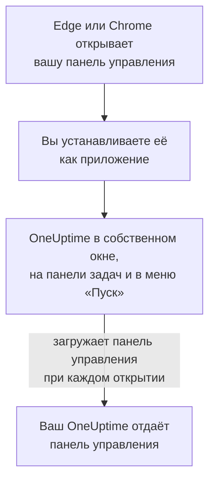

# Установка на Windows

Панель управления OneUptime устанавливается в Windows как приложение из Microsoft Edge или Google Chrome. Она открывается в собственном окне, со своим значком на панели задач и в меню «Пуск», и может показывать уведомления. Скачивать ничего не нужно: приложение — это панель управления вашего OneUptime, и оно всегда так же актуально, как ваш OneUptime.

:::cards
- [Установите приложение](#установите-приложение): Из Edge или Chrome, в несколько щелчков.
- [Закрепите его и запускайте вместе с Windows](#закрепите-его-и-запускайте-вместе-с-windows): Пусть оно будет в одном щелчке.
- [Получайте уведомления на этом компьютере](#получайте-уведомления-на-этом-компьютере): Зарегистрируйте браузер для push-уведомлений.
- [Устранение неполадок](#устранение-неполадок): Нет значка установки, нет уведомлений, повторный вход.
:::

## Как работает настольное приложение

Установленное приложение использует тот же вход, настройки и разрешение на уведомления, что и его браузер. Закройте браузер, и приложение продолжит работать в своём окне.

## Перед началом

- Windows 10 или Windows 11 с актуальной версией Microsoft Edge или Google Chrome.
- Адрес вашего OneUptime по HTTPS: `https://oneuptime.com` в OneUptime Cloud или ваш собственный, например `https://oneuptime.example.com`.
- Учётная запись, с которой вы можете войти в панель управления.

## Установите приложение

:::tabs
@tab Edge
1. Откройте свой OneUptime в Edge и войдите.
2. На любой странице панели управления нажмите значок установки справа в адресной строке, затем **Установить**. Или откройте **Параметры и другое (…) → Дополнительные инструменты → Приложения → Установить этот сайт как приложение**.
3. Edge открывает OneUptime в собственном окне и может предложить закрепить его на панели задач или на начальном экране.
@tab Chrome
1. Откройте свой OneUptime в Chrome и войдите.
2. На любой странице панели управления нажмите значок установки справа в адресной строке, затем **Установить**. Или откройте **⋮ → Транслировать, сохранить, поделиться → Установить страницу как приложение…**.
3. Chrome открывает OneUptime в собственном окне и добавляет его в меню «Пуск».
:::

Устанавливайте со страницы панели управления после входа: страница входа — это не приложение. Чтобы потом открыть приложение, найдите OneUptime в меню «Пуск».

## Закрепите его и запускайте вместе с Windows

- **Панель задач.** Пока приложение открыто, щёлкните правой кнопкой мыши его значок на панели задач и выберите **Закрепить на панели задач**.
- **Запуск вместе с Windows.** В Edge откройте `edge://apps`, выберите **Сведения** у OneUptime и включите **Автозапуск при входе в устройство**. На той же странице можно закрепить приложение на панели задач или на начальном экране либо создать ярлык на рабочем столе.

## Получайте уведомления на этом компьютере

Приложение показывает уведомления через свой браузер, после того как вы зарегистрируете браузер для push-уведомлений в каждом проекте, из которого хотите их получать.

:::steps
### Откройте свои push-устройства
В приложении откройте **Настройки пользователя → Методы уведомлений** и вкладку **Push Notifications**.

### Зарегистрируйте этот браузер
Нажмите **Зарегистрировать устройство**, оставьте в поле **Имя устройства** предложенное значение, например `Edge on Windows`, или измените его и снова нажмите **Зарегистрировать устройство**. Когда браузер спросит, можно ли OneUptime показывать уведомления, выберите **Разрешить**.

### Отправьте тест
В диалоге **Browser Registered** нажмите **Send Test Notification**. Если ничего не появилось, проверьте собственные настройки уведомлений Windows: см. [Устранение неполадок](#устранение-неполадок).
:::

Браузер звучит не громче, чем позволяет Windows: он не может обойти режим «Не беспокоить». Для вызовов, которые должны вас будить, используйте мобильное приложение с критическими оповещениями: см. [Установка на Android](/docs/mobile-desktop-apps/android-installation#звонок-в-беззвучном-режиме) или [Установка на iOS](/docs/mobile-desktop-apps/ios-installation#звонок-в-беззвучном-режиме).

В OneUptime на своём сервере для уведомлений браузера нужны VAPID-ключи сервера: см. [Push-уведомления](/docs/self-hosted/push-notifications#настройка-при-самостоятельном-размещении).

## Обновления

Обновлять ничего не нужно. Приложение загружает панель управления с вашего OneUptime при каждом открытии, поэтому оно меняется, когда обновляется ваш OneUptime. Если окно было открыто с момента обновления, перезагрузите его клавишами Ctrl+R.

## Удаление

:::tabs
@tab Edge
Откройте `edge://apps`, выберите **Сведения** у OneUptime, затем **Удалить**.
@tab Chrome
В окне приложения откройте меню **⋮**, выберите пункт, который удаляет приложение, затем **Удалить**.
:::

Windows также показывает приложение в разделе **Параметры → Приложения → Установленные приложения**, где его тоже удаляет кнопка **Удалить**.

Удаление приложения не отменяет регистрацию его браузера: он по-прежнему получает уведомления. Чтобы их остановить, удалите браузер в разделе **Настройки пользователя → Методы уведомлений** на вкладке **Push Notifications** кнопкой **Удалить**.

## Устранение неполадок

:::details Нет значка установки в адресной строке
Откройте страницу панели управления после входа, а не страницу входа, и проверьте, что адрес начинается с `https://`: браузеры устанавливают приложения только с защищённых сайтов. Если значок всё равно не появляется, воспользуйтесь меню браузера, как описано выше. Другие браузеры могут не устанавливать сайты как приложения; используйте Edge или Chrome.
:::

:::details Уведомления не появляются
- В разделе **Настройки пользователя → Методы уведомлений** на вкладке **Push Notifications** проверьте, что этот браузер есть в списке, и отправьте ему **Тестовое уведомление**.
- В Windows откройте **Параметры → Система → Уведомления**: уведомления должны быть включены, в том числе для браузера, а режим «Не беспокоить» выключен. В Windows 10 эта страница называется «Уведомления и действия».
- Если браузер блокирует уведомления от OneUptime, нажмите значок слева в адресной строке, разрешите уведомления для сайта и зарегистрируйте браузер заново.
- В OneUptime на своём сервере диалог **Зарегистрировать устройство** сообщает, если у сервера нет VAPID-ключей.
:::

:::details Приложение просит войти снова
Приложение использует вход своего браузера. Выход в браузере или очистка его файлов cookie выполняет выход и в приложении.
:::

## Дальнейшие шаги

:::cards
- [Установка на macOS](/docs/mobile-desktop-apps/macos-installation): То же приложение на Mac.
- [Установка на Android](/docs/mobile-desktop-apps/android-installation): Получайте вызовы на телефон.
- [Часто задаваемые вопросы и устранение неполадок](/docs/mobile-desktop-apps/faq-troubleshooting): Ответы об обоих приложениях.
- [Ваша учётная запись](/docs/introduction/your-account): Как OneUptime связывается с вами в каждом проекте.
:::
