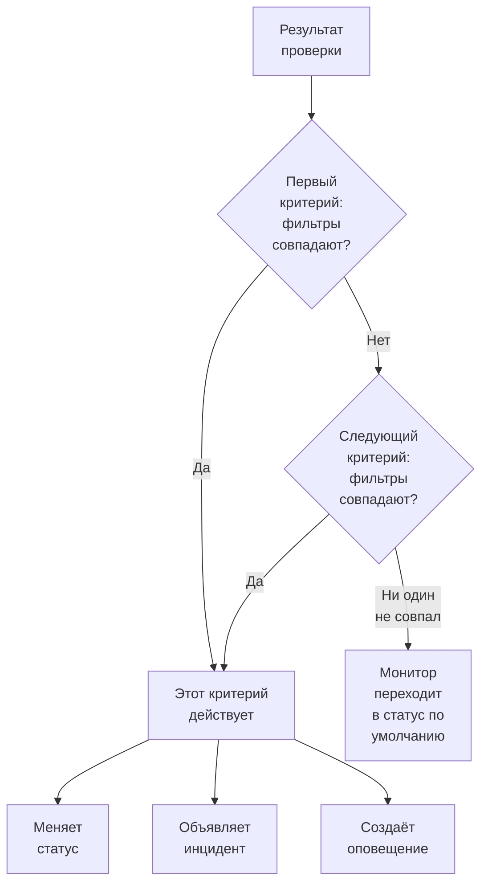
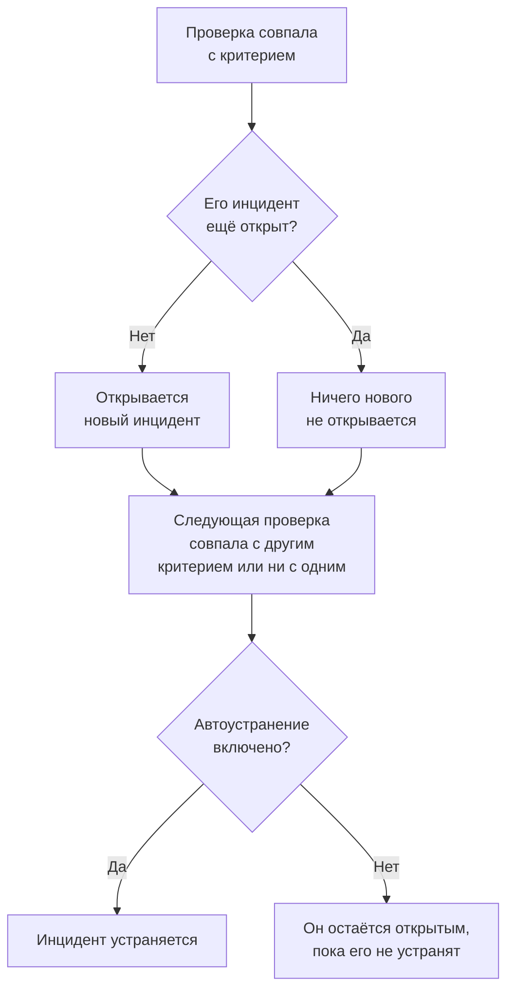

# Критерии и статусы

Критерии монитора решают, что означает каждая проверка: работает монитор или нет, и объявляет ли OneUptime инцидент или создаёт оповещение. Статусы — это список вашего проекта с тем, каким может быть монитор, от **Работает** до **Не в сети**. Эта страница объясняет и то и другое для всех типов мониторов; страница каждого типа перечисляет фильтры, которые он предлагает.

:::cards
- [Как решают критерии](#как-решают-критерии): Сверху вниз, и побеждает первое совпадение.
- [Из чего состоит критерий](#из-чего-состоит-критерий): Фильтры, условие совпадения, действия и настройки.
- [Оценка окна проверок](#оценка-окна-проверок): Считать неудачные проверки, замечать нестабильность, читать перцентиль.
- [Изменение критериев монитора](#изменение-критериев-монитора): Редактирование, добавление, порядок и проверка критериев.
- [Статусы мониторов](#статусы-мониторов): Встроенные статусы и ваши собственные.
:::

## Как решают критерии

При каждой проверке монитора его критерии оценивают результат сверху вниз по списку. Первый критерий, фильтры которого совпадают, решает, что произойдёт, а критерии ниже для этой проверки уже не рассматриваются. Если ни один не совпал, монитор переходит в свой **Статус монитора по умолчанию**. Если же критерий, который возвращает его обратно, ещё не совпал, монитор сохраняет свой статус: см. [Когда критерий восстанавливается](#когда-критерий-восстанавливается).

Порядок — часть правила. Новый монитор перечисляет свои критерии начиная с худшего случая: не в сети, затем предупреждение, если у его типа оно есть (сертификат или домен, срок которого скоро истекает), затем в сети. Широкий «здоровый» критерий, например **В сети** со значением **Истина**, совпадает почти с каждой проверкой, поэтому он стоит последним: окажись он выше остальных, он совпадал бы первым каждый раз, и остальные никогда бы не сработали.

Критерий, который совпал, но не меняет статус, всё равно решает исход проверки: монитор сохраняет свой статус, а критерии ниже ждут следующей проверки. **Статус монитора по умолчанию** применяется, только когда не совпал ни один критерий. У нового монитора это **Работает**; изменить его можно в разделе **Дополнительные поля** под критериями.

> [!NOTE]
> Монитор, который открывает отдельный инцидент или оповещение для каждого хоста, контейнера, диска или интерфейса, оценивает все критерии при каждой проверке, поэтому два хоста могут одновременно совпасть с двумя разными критериями. Это монитор, запрос которого содержит **Группировать по**, например монитор метрик или логов, или критерий, указывающий `*` для каждого диска или интерфейса. Таков же и монитор метрик, который следит за выражением PromQL: каждый ряд, который возвращает выражение, оценивается сам по себе. Монитор входящих запросов, который группирует инциденты по полю полезной нагрузки, всё равно останавливается на первом совпадении.
>
> У такого монитора всё равно один статус, и его задаёт первый совпавший критерий. Критерий, который только возвращает его в **Статус монитора по умолчанию** и не открывает ни инцидента, ни оповещения, ждёт хосты, для которых выполнился критерий, задающий другой статус: он срабатывает, когда выполнится для каждого из них, что бы ни происходило с другими хостами. До тех пор монитор сохраняет свой статус, даже если не совпал ни один критерий, а инциденты и оповещения каждого хоста по-прежнему закрываются по отдельности.

## Из чего состоит критерий

Откройте критерий: у него есть название и три раздела, каждый из которых сворачивается в краткую сводку в одну строку.

| Часть | Что в ней |
| --- | --- |
| **Название критериев** | Название в списке критериев и в первопричине каждого инцидента и оповещения, которые открывает критерий. **Добавить критерии** называет новый критерий по его фильтрам, и название следует за ними, пока вы не введёте своё. |
| **Фильтры** | Что должна показать проверка, в виде одного или нескольких фильтров. Мониторы Kubernetes и метрик называют их **Правила оповещений**. |
| **Действия** | Что происходит, когда фильтры совпадают: изменить статус, создать оповещение, объявить инцидент или любое их сочетание. |
| **Настройки** | **Включить этот критерий**, необязательное **Описание**, когда он восстанавливается и когда оценивается, а для мониторов входящих запросов — **Group incidents and alerts by a payload field**. |

### Фильтры

Фильтр читает одно значение из проверки и сравнивает его: **Тип фильтра** (что читается, например **Код статуса ответа**), **Условие фильтра** (как сравнивается, например **Больше**) и **Значение**. Мониторы, сравнивающие метрики, например мониторы Kubernetes и метрик, вместо этого запрашивают **Условие** и **Порог**. Каждый тип монитора предлагает свои типы фильтров, перечисленные на его странице, например [Мониторинг веб-сайта](/docs/monitor/website-monitor#критерии-мониторинга).

Начиная с двух фильтров, под ними появляется **Условие совпадения**: **Все** означает, что должен совпасть каждый фильтр, **Любой** — что достаточно одного. Новый критерий начинает со значения **Все**.

Фильтры, которые измеряют каждую проверку, например **В сети**, **Код статуса ответа** и **Время ответа (в мс)**, предлагают **Оценивать этот критерий в течение определённого периода времени**. Тогда оценивается окно недавних проверок, а не только последняя, и по умолчанию это последние 5 минут с **Все значения**: такой фильтр совпадает, только когда совпала каждая проверка в окне. См. Окно может длиться до 24 часов и считать проверки, как объясняет раздел [Оценка окна проверок](#оценка-окна-проверок). [Оценка за период времени](/docs/monitor/website-monitor#оценка-за-период-времени).

### Действия

Каждое действие — это переключатель в разделе **Действия**:

| Переключатель | Что он делает |
| --- | --- |
| **Когда фильтры совпадают, изменить статус монитора.** | Переводит монитор в статус, выбранный в **Изменить статус монитора на**. |
| **Когда фильтры совпадают, создать оповещение.** | Создаёт оповещения, настроенные в **Создать оповещение**. Оповещение сообщает вашей команде и никогда не показывается на странице статуса. |
| **Когда фильтры совпадают, объявить инцидент.** | Объявляет инциденты, настроенные в **Создать инцидент**. Ваши страницы статуса могут их показывать. |

Инцидент или оповещение запрашивает заголовок, **Серьёзность** и, в свёрнутых разделах, описание, владельцев, метки и политики дежурств. Заголовки и описания могут содержать значения из проверки, например `{{monitorName}}`: см. [Шаблоны инцидентов и оповещений](/docs/monitor/incident-alert-templating). Чтобы вызвать кого-то, когда критерий совпадает, выберите политику в разделе **Дежурство**: см. [Политики дежурств](/docs/on-call/policies).

### Настройки

**Включить этот критерий** включён у каждого нового критерия. Выключите его, чтобы сохранить критерий, не используя его: он пропускается при каждой проверке, не меняет статус, ничего не открывает, а в его заголовке видно **Отключено**.

**Group incidents and alerts by a payload field** открывает отдельный инцидент для каждого значения, найденного во входящем запросе, так что один адрес вебхука может держать открытыми несколько инцидентов. См. [Включение группировки инцидентов](/docs/monitor/incoming-request-monitor#включение-группировки-инцидентов).

**Восстанавливаться, только когда выполнено собственное условие** и **Оценивать этот критерий только в определённые дни и часы** выключены у нового критерия. См. [Когда критерий восстанавливается](#когда-критерий-восстанавливается) и [Только в определённые дни и часы](#только-в-определённые-дни-и-часы).

## Оценка окна проверок

Когда отмечено **Оценивать этот критерий в течение определённого периода времени**, **Оценить** задаёт, как оцениваются проверки окна, а **За последние** — длину окна, от 2 минут до 24 часов. Собственное условие фильтра, например **В сети** со значением **Ложь**, говорит, что должна показать каждая проверка.

| Оценить | Совпадает, когда |
| --- | --- |
| **Все значения** | Каждая проверка окна соответствовала условию. |
| **Любое значение** | Хотя бы одна проверка окна соответствовала условию. |
| **Среднее**, **Сумма**, **Максимальное значение**, **Минимальное значение** | Этот показатель по значениям окна соответствует условию, например среднее время ответа выше 300 мс. |
| **Перцентиль** | Перцентиль, выбранный в **Перцентиль**, от p50 до p99, соответствует условию: p95 выше 300 мс означает, что самые медленные 5 % проверок дольше 300 мс. |
| **Количество** | Число проверок, соответствовавших условию, сравнивается так, как задано в **Совпавшие проверки**: например, **Больше** 30. |
| **Процент** | Их доля среди проверок окна сравнивается так, как задано в **Доля совпавших проверок**: например, **Больше** 10 %. |
| **Смены статуса** | Число переходов проверок между соответствием условию и несоответствием сравнивается так, как задано в **Число смен**. Устройство, которое падает и снова поднимается, меняется дважды. |

Фраза под настройками окна пересказывает фильтр так, как он задан: «Проверить: "В сети" ложно; таких проверок за последние 8 ч.: больше 30».

- **Каждый зонд отдельно.** **Количество**, **Процент** и **Смены статуса** считают проверки того зонда, который выполнил проверку, поэтому монитор, проверяемый с трёх зондов, не считает втрое быстрее, а его зонды затем должны согласиться, как для любого критерия.
- **Окно, которое ещё не заполнено.** Пока проверки не дотягиваются до начала окна, у только что запущенного монитора меньше проверок, чем будет. **Количество** и **Смены статуса** срабатывают раньше, когда уже превысили **Больше** или **Больше или равно**, ведь новые проверки их только увеличивают; всё остальное ждёт полного окна.
- **Окно без проверок.** Пока в окне нет проверок или оно ещё не заполнено, решает **Если нет данных**: **Ignore** ждёт, **Триггер** срабатывает, а **Treat As Zero** оценивает окно так, будто недостающие проверки не соответствовали условию.

Средние и перцентили читают значения проверок всех зондов, как всегда делало **Среднее**. **Количество**, **Процент** и **Смены статуса** предлагаются для каждого фильтра, которому предлагается окно: в мониторах Website, API, Ping, IP и Port, для CPU, памяти, дисков и нагрузки сервера, для **Устройство SNMP в сети** и времени ответа сетевого устройства, а также в мониторах DNS, NTP, баз данных, внешних страниц статуса и статуса зондов. **В сети** монитора сервера не считается: он оценивается по времени с последнего отчёта сервера. Мониторы метрик и другой телеметрии вместо этого оценивают временной диапазон своего запроса с собственной агрегацией запроса, которая тоже читает перцентили.

### Пример: точка доступа, которая не работает, и точка доступа, которая нестабильна

Монитор Ping проверяет точку доступа в офисе каждую минуту. Пока окна не умели считать проверки, точка доступа, которая то и дело пропадала, выглядела как неработающая или как будто ничего не происходит. Эти три критерия, в таком порядке, различают эти два случая:

| Критерий | Фильтр | Оценить | Меняет статус на |
| --- | --- | --- | --- |
| Точка доступа не работает | **В сети** — **Ложь** | **Все значения**, **За последние** 5 минут | **Не в сети**, и объявляет инцидент сбоя |
| Точка доступа нестабильна | **В сети** — **Ложь** | **Смены статуса**, **Больше** 5, **За последние** 1 час | **Деградация**, и объявляет инцидент нестабильности |
| Точка доступа в сети | **В сети** — **Истина** | Не за период времени | **Работает** |

Для второго включите **Восстанавливаться, только когда выполнено собственное условие** с **Смены статуса**, **Меньше или равно** 1, **За последние** 1 час: инцидент нестабильности остаётся открытым, пока точка доступа не проработает стабильно час, а не закрывается в первую же минуту, когда она доступна. Чтобы получать оповещение, когда она не отвечает больше чем на 30 пингов за 8 часов, задайте второму критерию **Количество**, **Больше** 30, **За последние** 8 часов.

## Когда критерий восстанавливается

Критерий перестаёт действовать, как только его фильтры перестают совпадать: на этой проверке его инцидент и оповещение устраняются, если включены **Автоустранение инцидента** и **Автоустранение оповещения**, а монитор переходит к следующему совпадающему критерию.

**Восстанавливаться, только когда выполнено собственное условие** оставляет критерий в силе после того, как его фильтры перестали совпадать, пока не совпадут фильтры в **Восстанавливается, когда**. Они начинаются как противоположность фильтров критерия за последние 10 минут и могут использовать всё, что предлагает фильтр, например окно, которое считает проверки. Критерий в силе, пока у монитора статус, который он задаёт, или открыт объявленный им инцидент или оповещение. Пока он держится, он считается совпадением на своём месте в списке: совпавший критерий выше него всё равно берёт верх.

Когда ни один критерий не совпадает, монитор, который критерий увёл из его **Статус монитора по умолчанию**, сохраняет текущий статус, пока у него есть и критерий, который только возвращает его в этот статус и ничего не открывает. Это запас восстановления: шаблоны срабатывают выше 90 % и возвращаются при 81 % или ниже, поэтому при 89 % монитор остаётся там, где он есть. Его инциденты и оповещения всё равно устраняются, когда их собственный критерий перестаёт совпадать. Монитор без такого критерия переходит в свой **Статус монитора по умолчанию**, как и всегда.

## Только в определённые дни и часы

**Оценивать этот критерий только в определённые дни и часы** задаёт дни, **Время начала** и **Время окончания**, а также **Часовой пояс**, который сначала совпадает с вашим. Вне этих часов критерий пропускается, как отключённый: он ни с чем не совпадает, поэтому открытое им устраняется, а журнал оценки сообщает, что проверка была вне его часов. Часы читаются по часам этого часового пояса, поэтому 08:00 остаётся 08:00 после перевода часов, а часы, которые заканчиваются раньше, чем начинаются, продолжаются до следующего утра.

## Когда открываются и закрываются инциденты и оповещения

Критерий, объявляющий инциденты, открывает инцидент, когда совпадает. Когда монитор восстанавливается, инцидент закрывается сам, если так задано в критерии.

- **По одному.** Пока инцидент, объявленный критерием, ещё открыт, тот же критерий при новом совпадении не объявляет другой. Оповещения работают так же. Монитор, группирующий по хосту или полю полезной нагрузки, держит по одному открытому на хост или значение, а критерий монитора входящей почты с **Открывать новый инцидент для каждого письма** открывает по одному на письмо.
- **Закрытие.** При следующей проверке, где совпал другой критерий или ни один, устраняется инцидент, у критерия которого включено **Автоустранение инцидента**, а также оповещение с **Автоустранение оповещения**. Оба параметра находятся в **Дополнительные поля** внутри инцидента или оповещения, и в критериях, с которых начинается новый монитор, они включены.
- **Несколько зондов.** Монитор, который проверяют несколько зондов, меняется только тогда, когда его зонды согласны. См. [Как оцениваются критерии](/docs/monitor/create-monitor#как-оцениваются-критерии).
- **Родительский монитор не работает.** На странице монитора **Конфигурация → Зависимости** поле **Зависит от мониторов** называет мониторы, от которых он зависит. Пока один из них находится в статусе из **Подавлять, когда статус родителя** (любой статус «не в сети», если поле пустое), монитор не открывает инциденты и оповещения. Его статус по-прежнему меняется, а открытое по-прежнему устраняется.
- **Плановое обслуживание.** Монитор в идущем событии обслуживания не проверяется, поэтому его критерии не выполняются. См. [Обзор планового обслуживания](/docs/scheduled-maintenance/index).

Чтобы увидеть, как была оценена проверка, откройте **Обзор** монитора: карточка **Сводка монитора** показывает, какой критерий совпал и что сделал каждый, включая инцидент, пропущенный потому, что один уже был открыт.

## Кому сообщают, когда он падает

**Когда он упадёт** в нескольких предложениях говорит, что происходит, когда монитор отказывает, и кому сообщают: какой статус он ставит, какой инцидент или оповещение открывает, кто получает письмо и кого он вызывает, по именам. Всё, что помешало бы кому-то узнать о сбое, стоит на отдельной строке со ссылкой на страницу, где это исправляется. Карточка есть на странице **Обзор** монитора, под его критериями на странице **Критерии**, на шаге критериев в **Создать монитор** для монитора, который вы настраиваете, и в пошаговой настройке для сайтов.

Она строит цепочку так, как это делает настоящий инцидент или оповещение: с правилами владельца, правилами конфиденциальности, правилами меток и правилами дежурства вашего проекта, правилом инцидентов для оповещений, которое превращает оповещение в инцидент, и тем, кого прямо сейчас достигает первое правило эскалации каждой политики дежурства. Правило дежурства, которое спрашивает, кто владеет оповещением (**Владелец оповещения**), сопоставляется с владельцами, которые будут у оповещения: людьми и командами, которых называют его критерии, владельцами сетевого устройства, которое проверяет монитор, и теми, кого добавляют правила владельца. Переменная в заголовке, которую заполняет только проверка, показывается так, как написана. **Показать цепочку** открывает цепочку строка за строкой:

| Строка | Что она говорит |
| --- | --- |
| **Статус** | Статус, который ставят критерии. |
| **Открывает** | Инцидент или оповещение, его важность в скобках и заголовок. |
| **Email** | Кому приходит письмо о создании: его владельцам, владельцам, которых добавляют правила владельца, или Владельцам проекта, если владельцев нет. Тому, кого первым достигает вызов дежурного, письмо как владельцу не приходит. |
| **Правила владельца** | Правила владельца, которые добавляют владельцев. |
| **Приватный** | Почему запись приватная: правило конфиденциальности или критерии. Приватный инцидент не показывается ни на одной странице статуса и не уведомляет подписчиков, а видеть его могут только его владельцы, Владельцы проекта и Администраторы проекта. |
| **Правила меток** | Правила меток, чьи метки меняют то, какие правила дежурства срабатывают. |
| **Правила дежурства** | Правила дежурства, которые к нему подходят. Для правила, которое сопоставляет, кто владеет оповещением, указано, какой владелец заставляет его подойти. |
| **Политика дежурства** | Каждая политика, которую запускают эти правила: кого прямо сейчас достигает её первое правило эскалации и каким способом, кого она не достигает и почему. |
| **Страницы статуса** | Страницы статуса, которые его показывают, каждая с группой мониторов, через которую она показывает монитор. |
| **Правило инцидентов** | Для оповещения: правило инцидентов для оповещений, которое объявляет из него инцидент — сразу или когда оповещение остаётся открытым, — и этот инцидент, описанный как любой инцидент. |

### Что мешает сообщить

| Что мешает | Ссылка |
| --- | --- |
| Ни один критерий не меняет статус и не открывает инцидент или оповещение. | **Открыть критерии** |
| Никого не оповещают: ни одно правило дежурства не подходит, или в проекте ещё нет политики дежурства. | **Настроить вызовы** |
| Монитор открывает оповещения, а правила дежурства есть только у инцидентов. | **Настроить вызовы** |
| У политики дежурства нет правил эскалации. | **Открыть политику дежурств** |
| Политика дежурства сейчас никого не достигает. | **Открыть политику дежурств** |
| До человека, которого вызывает политика, не дозвониться: он отказался от вызовов, у него нет подтверждённого метода или нет правила для этой важности в проекте без резервного способа. | **Открыть готовность** |
| SMS, звонки, WhatsApp или Telegram отключены в проекте. | **Открыть каналы уведомлений** |
| У проекта закончился баланс для SMS и звонков (OneUptime Cloud). | **Открыть оплату** |
| Сервер пока не может отправлять письма и SMS и звонить. | **Открыть панель администратора**, для администраторов сервера |

Оповещение, которое правило инцидентов для оповещений превращает в инцидент, вызывающий кого-то, — не разрыв: вместо этого проверяются политики самого инцидента.

Владельцы, которым не приходит письмо, перечислены после разрывов, каждый с причиной и местом, где он указан: человек, который не состоит в проекте, команда, в которой нет участников проекта (**Открыть команду**), или команда другого проекта, указанные в критериях (**Открыть критерии**), на сетевом устройстве, которое проверяет монитор (**Открыть сетевое устройство**), или правилом владельца (**Открыть правила владельца**). Письмо всё равно уходит — владельцам, до которых оно доходит, или Владельцам проекта, — поэтому это не разрывы. Состояние настройки тоже перечисляет их, как то, что стоит исправить.

### Проверить снова и что вам видно

Ответу не больше минуты, а **Проверить снова** вычисляет его заново. Если повторная проверка не удалась, карточка сохраняет последний ответ и пишет под ним почему.

Карточка называет только то, что вам разрешено читать. Политика дежурства, правило, страница статуса или группа мониторов, которые вам не видны, сохраняют своё место без названия, а о приватном инциденте или оповещении, которые вам не будут видны, говорится только, что они открываются и что они приватные.

## Что инцидент или оповещение сохраняет из проверки

Инцидент или оповещение, открытые монитором, сохраняют проверку, которая их открыла, чтобы вы могли увидеть причину спустя долгое время после того, как собственные журналы монитора удалены. Под корневой причиной раздел **Подробности оценки** называет совпавший критерий и для каждого совпавшего фильтра — что нашла проверка. Кнопка **Показать подробности** добавляет остальные доказательства, несовпавшие фильтры и саму проверку: запрос, когда она выполнялась, с какого зонда и что вернулось. То, что нашёл фильтр, может быть:

- **Поле.** Место в теле JSON, где совпал фильтр **Тело ответа**, например `checks[1].status`, или заголовок, в котором совпал фильтр **Значение заголовка ответа**.
- **Значения.** Что содержало каждое значение, которое читает **Выражение JavaScript**, в момент вычисления, например `responseBody.status = "down"`.
- **Фрагмент.** Короткий кусок ответа вокруг совпадения, с отмеченным совпадением: никогда не всё тело.

Секреты и персональные данные скрываются до того, как что-либо сохраняется: заголовки вроде `Authorization`, `Cookie` и `Set-Cookie`, поля, имена которых говорят `password`, `token`, `key`, `session` или `email`, и текст, похожий на токен bearer, JWT, номер карты или адрес электронной почты. URL запроса — тот, с которым был настроен монитор, поэтому `{{monitorSecrets.NAME}}` остаётся именем, а секретное значение параметра запроса скрывается. **Журналы мониторинга** монитора и любое значение, которое цитирует корневая причина, скрываются так же. У инцидента или оповещения, открытых вручную или до того, как начали сохраняться подробности оценки, их нет.

> [!TIP]
> Если ответы монитора веб-сайта или API конфиденциальны сами по себе, выключите **Сохранять содержимое ответа** в карточке **Содержимое ответа** на его странице **Расширенный → Настройки**. Тогда его журналы мониторинга, инциденты и оповещения сохраняют, какие фильтры совпали, код статуса и время ответа, и никакой части ответа. У монитора входящих запросов есть такой же переключатель для запросов, которые он получает: **Сохранять содержимое запроса**, в карточке **Содержимое запроса**. Переключатель действует для проверок, выполненных после его изменения, и для инцидентов и оповещений, открытых после него. Последний запрос в обзоре монитора входящих запросов сразу следует переключателю.

## Сколько длится каждая проверка

Сводка оценки каждой проверки, по кнопке **Просмотреть сводку** на странице **Журналы мониторинга** монитора и для последней проверки на странице **Обзор**, сообщает, когда проверка была оценена, сколько длилась её оценка и, для монитора, который оценивает каждый хост, контейнер или группу отдельно, сколько рядов она оценила. Время отсчитывается с момента, когда OneUptime начал читать данные, которые оценивает проверка, до записи её журнала: чтение данных, оценку критериев и открытие инцидентов и оповещений.

Когда оценка длится слишком долго для своего монитора, её сводка предупреждает вас. Слишком долго — это больше десятой части времени между проверками монитора, но не меньше 5 секунд и не больше минуты:

| Монитор проверяется | Порог предупреждения |
| --- | --- |
| Каждую минуту | 6 секунд |
| Каждые 5 минут | 30 секунд |
| Каждые 10 минут или реже | 1 минута |
| По мере поступления результатов, как у входящих запросов и писем | 5 секунд |

Десятая часть оставляет монитору запас, чтобы вырасти в десять раз, прежде чем его проверки начнут наталкиваться друг на друга и отставать, поэтому вы узнаёте об этом заранее. Меньше 5 секунд — нормально для проверки любого размера: оценка 16 000 рядов занимает около 2,5 секунды. Дольше минуты проверка всё это время занимает обработчик и базы данных, которые читает, каким бы ни был её интервал. Чтобы ускорить её, сузьте фильтры её запросов, группируйте по меньшему числу атрибутов или проверяйте реже.

## Изменение критериев монитора

:::steps
### Откройте страницу критериев

Перейдите в **Мониторы** и откройте монитор. Разверните **Конфигурация** в его боковом меню и нажмите **Критерии**. Карточка **Критерии** показывает каждый критерий, что он проверяет и что делает.

### Нажмите Edit Monitoring Criteria

Редактор показывает каждый критерий развёрнутым. Нажмите на заголовок критерия, чтобы свернуть его в одну строку: название, число фильтров и что он делает.

### Добавьте, измените или переставьте критерии

**Добавить критерии** добавляет критерий в конец, развёрнутым и названным по его фильтру. Перетащите критерий за маркер слева, чтобы переместить его: побеждает первое совпадение, поэтому ставьте худший случай первым. **Удалить критерии** удаляет один; у монитора остаётся хотя бы один критерий.

### Сохраните критерии

Нажмите **Сохранить изменения**. Следующая проверка оценивается по новым критериям.

### Проверьте монитор

У монитора, который проверяют зонды, нажмите **Протестировать монитор** на карточке: тест начинается на зонде, который проверяет монитор. При желании выберите другой в **Выберите зонд**, затем нажмите **Запустить тест**. **Результат теста монитора** показывает, что нашла проверка. Он также говорит, какому критерию соответствует ответ и что последовало бы за ним: статус, инцидент или оповещение и кому сообщат.
:::

У ручного монитора нет критериев: его статус задаёте вы сами. См. [Обновление статуса](/docs/monitor/manual-monitor#обновление-статуса).

## Статусы мониторов

Монитор всегда находится в одном из статусов вашего проекта. У нового проекта их три, от самого здорового до худшего:

| Статус | Место | Цвет | Что с ним делает OneUptime |
| --- | --- | --- | --- |
| **Работает** | 1 | Зелёный | Новые мониторы начинают в нём, и это **Статус монитора по умолчанию** нового монитора. Встроенный. |
| **Деградация** | 2 | Жёлтый | Ничего сам по себе: монитор сюда переводит ваш критерий. |
| **Не в сети** | 3 | Красный | Сюда монитор переводит его критерий «не в сети», и OneUptime считает монитор в этом статусе неработающим. Встроенный. |

Список — это порядок. Там, где мониторы показаны вместе, побеждает статус, стоящий ниже всех в списке: группа мониторов, группа страницы статуса и общий статус страницы статуса показывают худший статус среди своих мониторов.

### Где учитывается статус

| Где | Что решает статус |
| --- | --- |
| Список **Мониторы** | Текущий статус каждого монитора. **Не работает** перечисляет мониторы в любом статусе, кроме рабочего, с красным счётчиком рядом. Мониторы с выключенным мониторингом туда не попадают: их никто не проверяет, и их перечисляет **Отключено**. **Отключено** находится в боковом меню под **Все мониторы**, с серым счётчиком: выключить мониторинг — это выбор, а не сбой. Рядом с **Не работает**, под **Требуется внимание**, **Зонды отключены** перечисляет мониторы, у которых все включённые зонды потеряли связь, а **Нет включённых зондов** — мониторы, которые не проверяет ни один включённый зонд: все их зонды выключены или их нет вовсе. |
| Страницы статуса | Цвет каждой строки и её доступность: против неё учитываются только статусы из **Считается простоем** этой страницы. Новая страница статуса начинает со всех статусов, кроме рабочего. См. [Выбор того, что показывается на странице](/docs/status-pages/index#выбор-того-что-показывается-на-странице). |
| Группы мониторов | Статус группы: худший среди её мониторов. См. [Группы мониторов](/docs/monitor/monitor-groups). |
| SLO | Простой, который учитывает SLO, по его собственному списку статусов. См. [Какие статусы считаются простоем](/docs/slo/introduction#какие-статусы-считаются-простоем). |
| Зависимости | Сдерживает ли родительский монитор инциденты и оповещения зависящих от него мониторов: по умолчанию — пока он в статусе «не в сети». |

Статус, который вы добавите позже, не попадает в список **Считается простоем** существующей страницы статуса: добавьте его туда сами.

### Добавление своего статуса

:::steps
### Откройте «Статус монитора»

Перейдите в **Мониторы → Настройки → Статус монитора**. Раздел **Настройки** в боковом меню свёрнут: сначала разверните его. Карточка **Статусы мониторов** перечисляет статусы от самого здорового до худшего.

### Создайте статус

Нажмите **Создать: Статус монитора** и заполните **Имя**, **Описание** и **Цвет**. Новый статус встаёт прямо над статусом «не в сети», чтобы сбой по-прежнему считался худшим.

### Поставьте его на место

Перетащите статус за маркер. Статус ниже в списке считается хуже любого статуса над ним.

### Используйте его в критерии

Статус ничего не делает, пока критерий не переведёт в него мониторы. Выберите его в **Изменить статус монитора на** у критерия, который должен его устанавливать.
:::

Рабочий статус и статус «не в сети» помечены как **Встроенный**: их можно переименовать и сменить им цвет, но нельзя удалить. В OneUptime Cloud для создания или изменения статуса нужен план Growth. Управлять статусами может роль Владелец проекта, Администратор проекта или Администратор мониторов либо пользовательская роль с соответствующим разрешением на статусы мониторов.

### Хронология статусов

Каждое изменение статуса сохраняется в **Хронология статуса** монитора: когда оно началось, сколько длилось, и **Просмотреть причину** для критерия, который его установил. **Создать: Событие статуса монитора** добавляет статус вручную. У монитора, который проверяют зонды, следующая проверка, совпавшая с критерием со статусом, снова устанавливает этот статус.

Изменение статуса уведомляет владельцев монитора, только если они включили **Статус монитора изменён** в своих настройках уведомлений: изначально это выключено. Монитор, вернувшийся в свой **Статус монитора по умолчанию** потому, что ни один критерий не совпал, никого не уведомляет. См. [Что включено для нового участника](/docs/notifications/notification-settings#что-включено-для-нового-участника).

## Архивирование статуса монитора

Архивируйте статус, которым ваша команда больше не должна пользоваться, вместо удаления. Архивирование не меняет ни одного монитора: монитор с этим статусом сохраняет его, пока его статус не изменится, а хронология статусов по-прежнему его показывает.

- **Архивировать** находится в меню **⋯** строки. Сначала запрашивается подтверждение и перечисляются критерии мониторов, шаблоны и страницы статуса, настроенные на этот статус: они продолжают его использовать, пока вы их не измените.
- **Никто не сможет выбрать его снова.** Критерий, меню статуса монитора, статус монитора у инцидента или события обслуживания и статусы простоя страницы статуса его не предлагают. API, Terraform и MCP его отклоняют.
- **Статусы из архива показаны отдельно**, в свёрнутом разделе **Статусы мониторов в архиве** под таблицей. **Извлечь из архива** возвращает статус в прежнем виде.
- **Встроенные статусы нельзя архивировать.** Новые мониторы начинают с рабочего статуса, а монитор в статусе «не в сети» OneUptime считает недоступным. Их **Архивировать** заблокировано, с указанием причины.

## Устранение неполадок

:::details Сайт не работает, а монитор остаётся в статусе «Работает»
Сначала совпал критерий выше по списку. Откройте **Конфигурация → Критерии** и проверьте порядок: «здоровый» критерий стоит последним. Также проверьте, что у критерия «не в сети» включено **Включить этот критерий** и что его действие **Когда фильтры совпадают, изменить статус монитора.** включено с выбранным статусом.
:::

:::details Инцидент не открылся, когда монитор упал
Проверьте совпавший критерий: **Когда фильтры совпадают, объявить инцидент.** должно быть включено. Инцидент не объявляется, пока ещё открыт инцидент того же критерия, пока не работает родительский монитор из **Зависит от мониторов** или пока монитор находится на плановом обслуживании. Карточка **Сводка монитора** в **Обзор** монитора говорит, что именно произошло.
:::

:::details Инцидент остаётся открытым после восстановления монитора
Откройте критерий инцидента и разверните **Дополнительные поля** в его инциденте: **Автоустранение инцидента** должно быть включено. Инцидент критерия, который вы потом удалили, монитор не устраняет: устраните его вручную.
:::

:::details Кнопка удаления статуса «Не в сети» заблокирована
**Работает** и **Не в сети** встроенные: OneUptime переводит в них мониторы, поэтому их можно переименовать, но нельзя удалить. Удалите вместо этого свой собственный статус или переименуйте встроенный.
:::

## Дальнейшие шаги

:::cards
- [Создание монитора](/docs/monitor/create-monitor): Три шага нового монитора.
- [Шаблоны инцидентов и оповещений](/docs/monitor/incident-alert-templating): Подставляйте значения из проверки в заголовки и описания.
- [Группы мониторов](/docs/monitor/monitor-groups): Объединяйте несколько мониторов в один статус.
- [Обзор инцидентов](/docs/incidents/index): Что происходит после того, как критерий объявил инцидент.
:::
