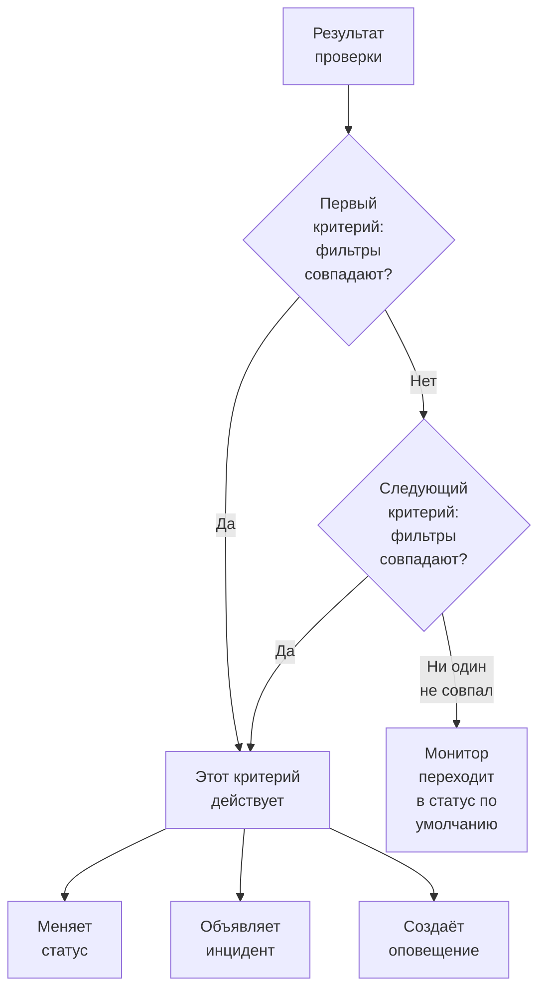
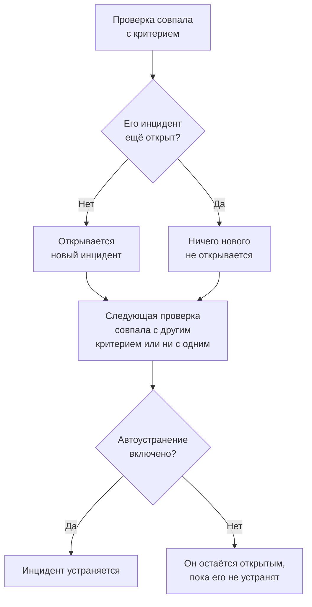

# Критерии и статусы мониторов

Критерии монитора решают, что означает каждая проверка: работает монитор или нет, и объявляет ли OneUptime инцидент или создаёт оповещение. Статусы — это список вашего проекта с тем, каким может быть монитор, от **Работает** до **Не в сети**. Эта страница объясняет и то и другое для всех типов мониторов; страница каждого типа перечисляет фильтры, которые он предлагает.

:::cards
- [Как решают критерии](#как-решают-критерии): Сверху вниз, и побеждает первое совпадение.
- [Из чего состоит критерий](#из-чего-состоит-критерий): Фильтры, условие совпадения, действия и настройки.
- [Изменение критериев монитора](#изменение-критериев-монитора): Редактирование, добавление, порядок и проверка критериев.
- [Статусы мониторов](#статусы-мониторов): Встроенные статусы и ваши собственные.
:::

## Как решают критерии

При каждой проверке монитора его критерии оценивают результат сверху вниз по списку. Первый критерий, фильтры которого совпадают, решает, что произойдёт, а критерии ниже для этой проверки уже не рассматриваются. Если ни один не совпал, монитор переходит в свой **Статус монитора по умолчанию**.

Порядок — часть правила. Новый монитор перечисляет свои критерии начиная с худшего случая: не в сети, затем предупреждение, если у его типа оно есть (сертификат или домен, срок которого скоро истекает), затем в сети. Широкий «здоровый» критерий, например **Is Online** со значением **Истина**, совпадает почти с каждой проверкой, поэтому он стоит последним: окажись он выше остальных, он совпадал бы первым каждый раз, и остальные никогда бы не сработали.

Критерий, который совпал, но не меняет статус, всё равно решает исход проверки: монитор сохраняет свой статус, а критерии ниже ждут следующей проверки. **Статус монитора по умолчанию** применяется, только когда не совпал ни один критерий. У нового монитора это **Работает**; изменить его можно в разделе **Дополнительные поля** под критериями.

> [!NOTE]
> Монитор, который открывает отдельный инцидент или оповещение для каждого хоста, контейнера, диска или интерфейса, оценивает все критерии при каждой проверке, поэтому два хоста могут одновременно совпасть с двумя разными критериями. Это монитор, запрос которого содержит **Группировать по**, например монитор метрик или логов, или критерий, указывающий `*` для каждого диска или интерфейса. Монитор входящих запросов, который группирует инциденты по полю полезной нагрузки, всё равно останавливается на первом совпадении.

## Из чего состоит критерий

Откройте критерий: у него есть название и три раздела, каждый из которых сворачивается в краткую сводку в одну строку.

| Часть | Что в ней |
| --- | --- |
| **Название критериев** | Название в списке критериев и в первопричине каждого инцидента и оповещения, которые открывает критерий. **Добавить критерии** называет новый критерий по его фильтрам, и название следует за ними, пока вы не введёте своё. |
| **Фильтры** | Что должна показать проверка, в виде одного или нескольких фильтров. Мониторы Kubernetes и метрик называют их **Alert Rules**. |
| **Действия** | Что происходит, когда фильтры совпадают: изменить статус, создать оповещение, объявить инцидент или любое их сочетание. |
| **Настройки** | **Включить этот критерий**, необязательное **Описание** и, у мониторов входящих запросов, **Group incidents and alerts by a payload field**. |

### Фильтры

Фильтр читает одно значение из проверки и сравнивает его: **Тип фильтра** (что читается, например **Код статуса ответа**), **Условие фильтра** (как сравнивается, например **Больше**) и **Значение**. Мониторы, сравнивающие метрики, например мониторы Kubernetes и метрик, вместо этого запрашивают **Условие** и **Порог**. Каждый тип монитора предлагает свои типы фильтров, перечисленные на его странице, например [Мониторинг веб-сайта](/docs/monitor/website-monitor#критерии-мониторинга).

Начиная с двух фильтров, под ними появляется **Условие совпадения**: **Все** означает, что должен совпасть каждый фильтр, **Любой** — что достаточно одного. Новый критерий начинает со значения **Все**.

Фильтры, которые измеряют каждую проверку, например **Is Online**, **Код статуса ответа** и **Время ответа (в мс)**, предлагают **Оценивать этот критерий в течение определённого периода времени**. Тогда оценивается окно недавних проверок, а не только последняя, и по умолчанию это последние 5 минут с **All Values**: такой фильтр совпадает, только когда совпала каждая проверка в окне. См. [Оценка за период времени](/docs/monitor/website-monitor#оценка-за-период-времени).

### Действия

Каждое действие — это переключатель в разделе **Действия**:

| Переключатель | Что он делает |
| --- | --- |
| **Когда фильтры совпадают, изменить статус монитора.** | Переводит монитор в статус, выбранный в **Изменить статус монитора на**. |
| **Когда фильтры совпадают, создать оповещение.** | Создаёт оповещения, настроенные в **Создать оповещение**. Оповещение сообщает вашей команде и никогда не показывается на странице статуса. |
| **Когда фильтры совпадают, объявить инцидент.** | Объявляет инциденты, настроенные в **Создать инцидент**. Ваши страницы статуса могут их показывать. |

Инцидент или оповещение запрашивает заголовок, **Серьёзность** и, в свёрнутых разделах, описание, владельцев, метки и политики дежурств. Заголовки и описания могут содержать значения из проверки, например `{{monitorName}}`: см. [Шаблоны инцидентов и оповещений](/docs/monitor/incident-alert-templating). Чтобы вызвать кого-то, когда критерий совпадает, выберите политику в разделе **Дежурство**: см. [Политики дежурств](/docs/on-call/policies).

### Настройки

**Включить этот критерий** включён у каждого нового критерия. Выключите его, чтобы сохранить критерий, не используя его: он пропускается при каждой проверке, не меняет статус, ничего не открывает, а в его заголовке видно **Отключено**.

**Group incidents and alerts by a payload field** открывает отдельный инцидент для каждого значения, найденного во входящем запросе, так что один адрес вебхука может держать открытыми несколько инцидентов. См. [Включение группировки инцидентов](/docs/monitor/incoming-request-monitor#включение-группировки-инцидентов).

## Когда открываются и закрываются инциденты и оповещения

Критерий, объявляющий инциденты, открывает инцидент, когда совпадает. Когда монитор восстанавливается, инцидент закрывается сам, если так задано в критерии.

- **По одному.** Пока инцидент, объявленный критерием, ещё открыт, тот же критерий при новом совпадении не объявляет другой. Оповещения работают так же. Монитор, группирующий по хосту или полю полезной нагрузки, держит по одному открытому на хост или значение, а критерий монитора входящей почты с **Открывать новый инцидент для каждого письма** открывает по одному на письмо.
- **Закрытие.** При следующей проверке, где совпал другой критерий или ни один, устраняется инцидент, у критерия которого включено **Автоустранение инцидента**, а также оповещение с **Автоустранение оповещения**. Оба параметра находятся в **Дополнительные поля** внутри инцидента или оповещения, и в критериях, с которых начинается новый монитор, они включены.
- **Несколько зондов.** Монитор, который проверяют несколько зондов, меняется только тогда, когда его зонды согласны. См. [Как оцениваются критерии](/docs/monitor/create-monitor#как-оцениваются-критерии).
- **Родительский монитор не работает.** На странице монитора **Конфигурация → Зависимости** поле **Depends On Monitors** называет мониторы, от которых он зависит. Пока один из них находится в статусе из **Suppress When Parent Status Is** (любой статус «не в сети», если поле пустое), монитор не открывает инциденты и оповещения. Его статус по-прежнему меняется, а открытое по-прежнему устраняется.
- **Плановое обслуживание.** Монитор в идущем событии обслуживания не проверяется, поэтому его критерии не выполняются. См. [Обзор планового обслуживания](/docs/scheduled-maintenance/index).

Чтобы увидеть, как была оценена проверка, откройте **Обзор** монитора: карточка **Сводка монитора** показывает, какой критерий совпал и что сделал каждый, включая инцидент, пропущенный потому, что один уже был открыт.

## Изменение критериев монитора

:::steps
### Откройте страницу критериев

Перейдите в **Мониторы** и откройте монитор. Разверните **Конфигурация** в его боковом меню и нажмите **Критерии**. Карточка **Критерии мониторинга** показывает каждый критерий, что он проверяет и что делает.

### Нажмите Edit Monitoring Criteria

Редактор показывает каждый критерий развёрнутым. Нажмите на заголовок критерия, чтобы свернуть его в одну строку: название, число фильтров и что он делает.

### Добавьте, измените или переставьте критерии

**Добавить критерии** добавляет критерий в конец, развёрнутым и названным по его фильтру. Перетащите критерий за маркер слева, чтобы переместить его: побеждает первое совпадение, поэтому ставьте худший случай первым. **Удалить критерии** удаляет один; у монитора остаётся хотя бы один критерий.

### Сохраните критерии

Нажмите **Сохранить изменения**. Следующая проверка оценивается по новым критериям.

### Проверьте монитор

У монитора, который проверяют зонды, нажмите **Протестировать монитор** на карточке, выберите зонд в **Выберите зонд** и нажмите **Запустить тест**. **Результат теста монитора** показывает, что нашла проверка.
:::

У ручного монитора нет критериев: его статус задаёте вы сами. См. [Обновление статуса](/docs/monitor/manual-monitor#обновление-статуса).

## Статусы мониторов

Монитор всегда находится в одном из статусов вашего проекта. У нового проекта их три, от самого здорового до худшего:

| Статус | Место | Цвет | Что с ним делает OneUptime |
| --- | --- | --- | --- |
| **Работает** | 1 | Зелёный | Новые мониторы начинают в нём, и это **Статус монитора по умолчанию** нового монитора. Встроенный. |
| **Деградация** | 2 | Жёлтый | Ничего сам по себе: монитор сюда переводит ваш критерий. |
| **Не в сети** | 3 | Красный | Сюда монитор переводит его критерий «не в сети», и OneUptime считает монитор в этом статусе неработающим. Встроенный. |

Список — это порядок. Там, где мониторы показаны вместе, побеждает статус, стоящий ниже всех в списке: группа мониторов, группа страницы статуса и общий статус страницы статуса показывают худший статус среди своих мониторов.

### Где учитывается статус

| Где | Что решает статус |
| --- | --- |
| Список **Мониторы** | Текущий статус каждого монитора. **Не работает** перечисляет мониторы в любом статусе, кроме рабочего, с красным счётчиком рядом. |
| Страницы статуса | Цвет каждой строки и её доступность: против неё учитываются только статусы из **Считается простоем** этой страницы. Новая страница статуса начинает со всех статусов, кроме рабочего. См. [Выбор того, что показывается на странице](/docs/status-pages/index#выбор-того-что-показывается-на-странице). |
| Группы мониторов | Статус группы: худший среди её мониторов. См. [Группы мониторов](/docs/monitor/monitor-groups). |
| SLO | Простой, который учитывает SLO, по его собственному списку статусов. См. [Какие статусы считаются простоем](/docs/slo/introduction#какие-статусы-считаются-простоем). |
| Зависимости | Сдерживает ли родительский монитор инциденты и оповещения зависящих от него мониторов: по умолчанию — пока он в статусе «не в сети». |

Статус, который вы добавите позже, не попадает в список **Считается простоем** существующей страницы статуса: добавьте его туда сами.

### Добавление своего статуса

:::steps
### Откройте «Статус монитора»

Перейдите в **Мониторы → Настройки → Статус монитора**. Раздел **Настройки** в боковом меню свёрнут: сначала разверните его. Карточка **Монитор Статусы** перечисляет статусы от самого здорового до худшего.

### Создайте статус

Нажмите **Создать: Статус монитора** и заполните **Имя**, **Описание** и **Цвет**. Новый статус встаёт прямо над статусом «не в сети», чтобы сбой по-прежнему считался худшим.

### Поставьте его на место

Перетащите статус за маркер. Статус ниже в списке считается хуже любого статуса над ним.

### Используйте его в критерии

Статус ничего не делает, пока критерий не переведёт в него мониторы. Выберите его в **Изменить статус монитора на** у критерия, который должен его устанавливать.
:::

Рабочий статус и статус «не в сети» помечены как **Встроенный**: их можно переименовать и сменить им цвет, но нельзя удалить. В OneUptime Cloud для создания или изменения статуса нужен план Growth. Управлять статусами может роль Project Owner, Project Admin или Monitor Admin либо пользовательская роль с соответствующим разрешением на статусы мониторов.

### Хронология статусов

Каждое изменение статуса сохраняется в **Хронология статуса** монитора: когда оно началось, сколько длилось, и **Просмотреть причину** для критерия, который его установил. **Создать: Монитор Статус Событие** добавляет статус вручную. У монитора, который проверяют зонды, следующая проверка, совпавшая с критерием со статусом, снова устанавливает этот статус.

Изменение статуса уведомляет владельцев монитора, только если они включили **Статус монитора изменён** в своих настройках уведомлений: изначально это выключено. Монитор, вернувшийся в свой **Статус монитора по умолчанию** потому, что ни один критерий не совпал, никого не уведомляет. См. [Что включено для нового участника](/docs/notifications/notification-settings#что-включено-для-нового-участника).

## Архивирование статуса монитора

Архивируйте статус, которым ваша команда больше не должна пользоваться, вместо удаления. Архивирование не меняет ни одного монитора: монитор с этим статусом сохраняет его, пока его статус не изменится, а хронология статусов по-прежнему его показывает.

- **Архивировать** находится в меню **⋯** строки. Сначала запрашивается подтверждение и перечисляются критерии мониторов, шаблоны и страницы статуса, настроенные на этот статус: они продолжают его использовать, пока вы их не измените.
- **Никто не сможет выбрать его снова.** Критерий, меню статуса монитора, статус монитора у инцидента или события обслуживания и статусы простоя страницы статуса его не предлагают. API, Terraform и MCP его отклоняют.
- **Статусы из архива показаны отдельно**, в свёрнутом разделе **Статусы мониторов в архиве** под таблицей. **Извлечь из архива** возвращает статус в прежнем виде.
- **Встроенные статусы нельзя архивировать.** Новые мониторы начинают с рабочего статуса, а монитор в статусе «не в сети» OneUptime считает недоступным. Их **Архивировать** заблокировано, с указанием причины.

## Устранение неполадок

:::details Сайт не работает, а монитор остаётся в статусе «Работает»
Сначала совпал критерий выше по списку. Откройте **Конфигурация → Критерии** и проверьте порядок: «здоровый» критерий стоит последним. Также проверьте, что у критерия «не в сети» включено **Включить этот критерий** и что его действие **Когда фильтры совпадают, изменить статус монитора.** включено с выбранным статусом.
:::

:::details Инцидент не открылся, когда монитор упал
Проверьте совпавший критерий: **Когда фильтры совпадают, объявить инцидент.** должно быть включено. Инцидент не объявляется, пока ещё открыт инцидент того же критерия, пока не работает родительский монитор из **Depends On Monitors** или пока монитор находится на плановом обслуживании. Карточка **Сводка монитора** в **Обзор** монитора говорит, что именно произошло.
:::

:::details Инцидент остаётся открытым после восстановления монитора
Откройте критерий инцидента и разверните **Дополнительные поля** в его инциденте: **Автоустранение инцидента** должно быть включено. Инцидент критерия, который вы потом удалили, монитор не устраняет: устраните его вручную.
:::

:::details Кнопка удаления статуса «Не в сети» заблокирована
**Работает** и **Не в сети** встроенные: OneUptime переводит в них мониторы, поэтому их можно переименовать, но нельзя удалить. Удалите вместо этого свой собственный статус или переименуйте встроенный.
:::

## Дальнейшие шаги

:::cards
- [Создание монитора](/docs/monitor/create-monitor): Три шага нового монитора.
- [Шаблоны инцидентов и оповещений](/docs/monitor/incident-alert-templating): Подставляйте значения из проверки в заголовки и описания.
- [Группы мониторов](/docs/monitor/monitor-groups): Объединяйте несколько мониторов в один статус.
- [Обзор инцидентов](/docs/incidents/index): Что происходит после того, как критерий объявил инцидент.
:::
