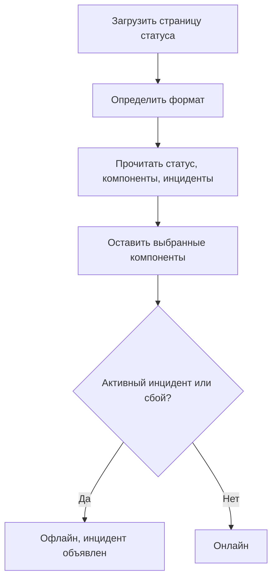

# Мониторинг внешней страницы статуса

Монитор внешней страницы статуса следит за публичной страницей статуса сервиса, от которого вы зависите, — AWS, GCP, Azure, GitHub, OpenAI, Anthropic и многих других — и оповещает вас, когда провайдер сообщает о сбое или снижении производительности. Используйте его, чтобы узнавать о проблемах у поставщиков сразу, как только они о них сообщают, и отличать их от собственных.

Он читает и страницы статуса, созданные в OneUptime, ресурс за ресурсом, и отличает плановые работы от сбоя: следите за проектом другой команды или за поставщиком, чья страница статуса работает на OneUptime.

:::cards
- [Создайте монитор](#создание-монитора-внешней-страницы-статуса): Вставьте URL страницы статуса и выберите, за чем следить.
- [Выберите компоненты](#компоненты): Следите только за компонентами, от которых вы зависите.
- [Критерии](#критерии-мониторинга): Что по умолчанию считается сбоем.
- [Страницы статуса OneUptime](#страницы-статуса-oneuptime): Ресурсы другого проекта и его плановые работы.
- [Популярные страницы статуса](#url-популярных-страниц-статуса): URL сервисов, от которых зависит большинство команд.
:::

## Как это работает

При каждой проверке зонд загружает страницу статуса, определяет её формат и считывает общий статус, компоненты и активные инциденты. Если вы выбрали компоненты или группу компонентов, учитываются только они. Затем критерии решают, онлайн монитор или офлайн.

С его помощью можно:

- Отслеживать доступность сторонних сервисов, от которых зависит ваше приложение
- Получать оповещения, когда у поставщиков случаются сбои
- Отслеживать статусы отдельных компонентов
- Следить только за компонентами, от которых вы зависите (например, Git Operations и Pull Requests у GitHub или группа "APIs" у OpenAI), чтобы посторонние инциденты в других частях страницы не срабатывали в вашем мониторе
- Замечать снижение производительности до того, как оно затронет ваших пользователей
- Сопоставлять собственные инциденты с проблемами поставщиков

## Поддерживаемые провайдеры

| Провайдер | Описание |
| ------------------------ | ---------------------------------------------------------------------- |
| **Auto** (по умолчанию) | Автоматически определяет формат страницы статуса |
| **Atlassian Statuspage** | Страницы статуса на Atlassian Statuspage (JSON API) |
| **incident.io** | Страницы статуса на incident.io (например, `https://status.openai.com`) |
| **OneUptime Status Page** | Страницы статуса, созданные в OneUptime: статус каждого ресурса и то, что сейчас на обслуживании |
| **RSS** | Страницы статуса с лентой RSS |
| **Atom** | Страницы статуса с лентой Atom |

### Автоопределение

Когда выбран **Auto**, OneUptime автоматически определяет формат страницы статуса в таком порядке:

1. Сначала пробует API страниц статуса incident.io (`/proxy/<host>`).
2. Затем пробует JSON API Atlassian Statuspage (`/api/v2/status.json`, `/api/v2/components.json` и `/api/v2/incidents/unresolved.json`).
3. Затем запрашивает сводку страницы статуса OneUptime (`/status-page-api/summary/<page>`).
4. Если не получилось, пытается разобрать страницу как ленту RSS или Atom.
5. В крайнем случае выполняет простую проверку доступности по HTTP.

> [!NOTE]
> incident.io проверяется первым, потому что некоторые страницы статуса incident.io (например, `https://status.openai.com`) также предоставляют ограниченный совместимый с Atlassian эндпоинт без групп компонентов и активных инцидентов. Проверка incident.io в первую очередь гарантирует, что используются более полные данные с группами.

Проверка доступности — это также запасной вариант, когда явно выбранный вами провайдер не срабатывает. Она сообщает только, отвечает ли страница (онлайн при ответе `2xx` или `3xx`), и не сообщает ни компонентов, ни инцидентов.

## Создание монитора внешней страницы статуса

:::steps
### Начните новый монитор

Откройте **Мониторы** и нажмите **Создать монитор**. В разделе **Тип монитора** нажмите **Другие типы мониторов** и выберите **External Status Page** в группе **Basic Monitoring** или введите `statuspage` в поле поиска. Укажите **Имя** и нажмите **Далее**.

### Введите URL страницы статуса

Введите **URL страницы статуса**. Оставьте **Провайдер** в значении **Auto**, если не знаете формат.

### При необходимости выберите компоненты

Откройте **Компоненты** и выберите в списке самой страницы компоненты, от которых вы зависите, например `Git Operations` и `Pull Requests` на странице GitHub; оставьте поле пустым, чтобы следить за всей страницей. Чтобы вместо этого следить за одной группой, откройте **Дополнительные поля** и введите **Component Group Filter**, например `APIs`.

### Протестируйте его

Нажмите **Протестировать монитор**, чтобы один раз загрузить страницу, и проверьте найденные провайдер, компоненты и инциденты.

### Проверьте критерии

Шаг критериев начинается с [критериев по умолчанию](#критерии-по-умолчанию), которые помечают монитор как офлайн, когда провайдер сообщает об активном инциденте или сбое в пределах области. При необходимости измените их, затем нажмите **Далее**.

### Выберите зонды и создайте монитор

Выберите **Зонды** и **Интервал мониторинга** (по умолчанию **Каждые 5 минут**), затем нажмите **Создать монитор**.
:::

## Параметры конфигурации

| Параметр | Что ввести | По умолчанию |
| --- | --- | --- |
| **URL страницы статуса** | URL страницы статуса. Для сайтов на Atlassian Statuspage и incident.io это обычно корневой URL (например, `https://status.example.com`). Для лент RSS/Atom введите URL самой ленты. | — |
| **Провайдер** | **Auto**, чтобы определить формат автоматически, или **Atlassian Statuspage**, **incident.io**, **OneUptime Status Page**, **RSS** либо **Atom**, если он известен. | **Auto** |
| **Компоненты** | Компоненты, за которыми нужно следить, выбранные из списка страницы или введённые вручную. | Вся страница |
| **Component Group Filter** | Группа, которой ограничивается монитор. В **Дополнительные поля**. | Все группы |
| **Тайм-аут (ms)** | Максимальное время ожидания страницы статуса. В **Дополнительные поля**. | `10000` (10 секунд) |
| **Повторные попытки** | Сколько раз повторять с интервалом в секунду после неудачной первой попытки; `0` означает одну попытку. В **Дополнительные поля**. | `3` (до 4 попыток) |

### Компоненты

Выберите компоненты, от которых вы зависите, и монитор будет следить только за ними: **External Status Page Component Status** сравнивает только их статусы, общий статус — худший из их статусов, а **External Status Page Active Incidents** считает только инциденты, затрагивающие хотя бы один из них. Это по-прежнему одна проверка страницы, сколько бы компонентов вы ни выбрали.

Когда вы открываете **Компоненты**, ваш браузер читает список самой страницы с Atlassian Statuspage, страницы incident.io или страницы статуса OneUptime и показывает его по группам страницы; каждый неработающий компонент сообщает своё состояние. Выбранное имя отслеживает компонент ровно с таким именем, без учёта регистра: `Copilot` на странице GitHub — это не `Copilot AI Model Providers`.

Если список прочитать нельзя (внутренняя страница, страница, которая не делится списком с вашим браузером, лента RSS или Atom), введите имя и нажмите Enter. Символ `*` означает любой текст: `*us-east-1*` отслеживает каждый компонент с `us-east-1` в имени. В ленте RSS или Atom запись учитывается, если её заголовок содержит одно из имён.

Инцидент, который не называет ни одного компонента, не учитывается, пока вы следите за выбранными компонентами: ничто не говорит, что он их затрагивает. Если ничего не выбрано, монитор следит за всей страницей и учитывает каждый инцидент.

Монитор, сохранённый со старым Фильтром по имени компонента, продолжает следить за тем же: фильтр показан в **Компоненты** как это имя между звёздочками, например `*API*`, что совпадает с каждым компонентом, имя которого его содержит.

> [!WARNING]
> Имя, которое ни с чем не совпадает, ни за чем не следит и выглядит как исправное. И **Компоненты**, и **Протестировать монитор** называют выбранные компоненты, которых нет в списке страницы.

### Component Group Filter

Если страница статуса распределяет компоненты по группам, монитор можно ограничить одной группой. Например, на `https://status.openai.com` значение `APIs` ограничивает монитор сервисами API OpenAI.

Когда задана группа компонентов, **число активных инцидентов** и **общий статус** вычисляются только по компонентам этой группы: инцидент в посторонней группе (например, ChatGPT) не сработает в мониторе, ограниченном группой "APIs". Если выбраны и компоненты, учитываются только выбранные компоненты группы.

Фильтрация по группе компонентов поддерживается для провайдеров **Atlassian Statuspage**, **incident.io** и **OneUptime Status Page**. Ленты RSS и Atom групп компонентов не предоставляют.

## Критерии мониторинга

Вы можете настроить критерии, которые решают, когда внешний сервис считается онлайн или офлайн, на основе:

| Тип фильтра | Что он проверяет | Условия фильтра |
| --- | --- | --- |
| **External Status Page Is Online** | Доступна ли страница статуса и возвращает ли она данные о статусе | Истина или Ложь |
| **External Status Page Overall Status** | Общий статус, о котором сообщает страница | Равно, Не равно, Содержит, Не содержит, Начинается с, Заканчивается на |
| **External Status Page Component Status** | Статус каждого компонента в пределах области (выбранных компонентов или компонентов группы, если они заданы): Работает, Under Maintenance, Degraded Performance, Partial Outage, Major Outage или Full Outage | Равно, Не равно, Содержит, Не содержит, Начинается с, Заканчивается на |
| **External Status Page Active Incidents** | Число активных сейчас инцидентов на странице статуса (только затрагивающих компонент в пределах области, если выбраны компоненты или группа) | Равно, Не равно и числовые сравнения |
| **External Status Page Response Time (in ms)** | Сколько времени занимает загрузка данных страницы статуса | Больше, Меньше, Больше или равно, Меньше или равно |

Общий статус — это то, что пишет сама страница, поэтому его значения зависят от провайдера: Atlassian Statuspage сообщает собственное описание, например `All Systems Operational`; страница статуса OneUptime — худший статус среди своих компонентов в охвате, например `under_maintenance`; лента сообщает `operational` или `degraded_performance`; проверка доступности сообщает `reachable` или `unreachable`. Если выбраны компоненты или группа, это худший статус среди них, на любой странице. Эти сравнения учитывают регистр. Сводка монитора показывает общий статус словами и цветом, как и статус каждого компонента (`under_maintenance` выглядит как **Under Maintenance**), а критерии сравнивают значение, которое сообщает страница. Для оповещений о сбоях обычно надёжнее **External Status Page Active Incidents** и **External Status Page Component Status**.

В ленте RSS или Atom активными инцидентами считаются элементы за последние 24 часа: элемент RSS — по дате публикации, запись Atom — по дате обновления. Элемент с датой в будущем не учитывается до этой даты.

### Критерии по умолчанию

По умолчанию OneUptime создаёт критерии на основе того, что действительно важно для страницы статуса, — её активных инцидентов и состояния компонентов, а не просто доступности:

| Критерий | Фильтры | Действие |
| --- | --- | --- |
| Offline | **Любой** из: страница не в сети; в пределах области есть хотя бы один активный инцидент; компонент в пределах области сообщает Degraded Performance, Partial Outage, Major Outage или Full Outage | Помечает монитор как офлайн и объявляет инцидент, который закрывается сам, когда критерий перестаёт совпадать |
| Online | **Все** из: страница в сети; в пределах области нет активных инцидентов | Помечает монитор как онлайн |

Поскольку число активных инцидентов и статусы компонентов учитывают выбранные компоненты и группу, эти критерии по умолчанию автоматически нацелены только на важные для вас компоненты.

## Страницы статуса OneUptime

Выберите провайдер **OneUptime Status Page** или оставьте **Auto**, чтобы следить за страницей статуса, созданной в OneUptime: проектом другой команды или страницей поставщика в OneUptime Cloud или в самостоятельно развёрнутом OneUptime. Введите собственный адрес страницы в **URL страницы статуса**: её домен, например `https://status.example.com`, или `https://oneuptime.com/status-page/<status-page-id>` для страницы без своего домена.

Монитор читает сводку страницы, `/status-page-api/summary/<page>` (см. [Чтение сводки](/docs/status-pages/public-api#чтение-сводки)): только то, что страница показывает посетителям, и ничего больше из другого проекта. Каждый ресурс страницы, монитор или группа мониторов, — это компонент с тем именем, которое ему даёт страница, в группе страницы; группа внутри другой группы называется `Core / Databases`. Выбирайте ресурсы в **Компоненты** или следите за одной группой с помощью **Component Group Filter**.

Статус компонента — это значение, которое означает его статус на странице, поэтому критерии статуса компонента работают как на любой странице статуса:

| На странице | Статус компонента |
| --- | --- |
| Рабочий статус проекта | `operational` |
| Статус с именем `Degraded` | `degraded_performance` |
| Статус с именем `Offline`, `Down` или `Major Outage` | `major_outage` |
| Статус с именем `Partial Outage` | `partial_outage` |
| Статус с именем `Full Outage` | `full_outage` |
| Статус с именем `Maintenance` | `under_maintenance` |
| Любой другой статус | `degraded_performance` |
| Статус, который страница скрывает, когда **Show current status** выключен | `unknown` |

Пока идущее событие плановых работ затрагивает ресурс, потому что называет один из его мониторов или монитор в его группе мониторов, компонент находится в `under_maintenance`, каким бы ни был статус его мониторов: монитор не проверяется, пока событие его удерживает. Событие, которое ещё не началось или уже закончилось, ничего не меняет. Активные инциденты страницы учитываются для ресурсов, которые они затрагивают.

[Критерии по умолчанию](#критерии-по-умолчанию) никогда не принимают плановые работы за сбой: монитор остаётся в сети во время плановых работ другого проекта.

### Показать плановые работы другого проекта на своём мониторе

:::steps
### Добавьте критерий

В критериях монитора нажмите **Добавить критерии**. Задайте ему фильтр **External Status Page Component Status**, **Равно**, **Under Maintenance** и выберите свой статус обслуживания в **Изменить статус монитора на**.

### Перетащите его наверх

Перетащите новый критерий выше остальных: срабатывает первый подходящий критерий.

### Проверьте через Протестировать монитор

Нажмите **Протестировать монитор**, пока у другого проекта идут плановые работы: затронутый компонент показывает **Under Maintenance**.
:::

### Что страница статуса OneUptime позволяет прочитать монитору

Страница, которую может открыть любой, читается так, как её видят посетители. Частную страницу, которая требует входа, SSO или пароля, прочитать нельзя: при выбранном **OneUptime Status Page** проверка завершается ошибкой и называет причину. Страница со списком разрешённых IP-адресов должна пропускать адрес зонда: следите за ней с зонда внутри этой сети.

## Переменные шаблона

При создании инцидентов или оповещений из мониторов внешней страницы статуса в заголовках, описаниях и заметках по устранению можно использовать такие переменные (см. [Шаблоны инцидентов и оповещений](/docs/monitor/incident-alert-templating)):

| Переменная | Описание |
| ------------------------- | ------------------------------------------------------------------------------- |
| `{{isOnline}}`            | Доступна ли страница статуса (true/false) |
| `{{responseTimeInMs}}`    | Время ответа в миллисекундах |
| `{{failureCause}}`        | Причина сбоя, если есть |
| `{{overallStatus}}`       | Значение индикатора общего статуса |
| `{{activeIncidentCount}}` | Число активных инцидентов (у компонентов, за которыми он следит, если они выбраны) |
| `{{componentStatuses}}`   | Массив JSON со статусами компонентов (`name`, `status`, `description`, `groupName`) |
| `{{provider}}`            | Определённый провайдер (Atlassian Statuspage, incident.io, OneUptime Status Page, RSS, Atom); пусто после проверки доступности |
| `{{componentGroup}}`      | Группа компонентов, которой ограничен монитор, если задана |
| `{{componentName}}`       | Компоненты, за которыми следит монитор, через запятую, если они выбраны |

## URL популярных страниц статуса

Вот список страниц статуса популярных сервисов. Многие из них используют Atlassian Statuspage или incident.io, поэтому провайдер **Auto** определяет их автоматически. Страница, построенная ни на том, ни на другом и не являющаяся лентой, получает только проверку доступности; для таких страниц лучше отслеживать ленту RSS или Atom провайдера, если он её публикует.

| Сервис | URL страницы статуса |
| ---------------------------- | --------------------------------------------- |
| AWS                          | `https://health.aws.amazon.com/health/status` |
| Google Cloud Platform        | `https://status.cloud.google.com`             |
| Microsoft Azure              | `https://status.azure.com`                    |
| GitHub                       | `https://www.githubstatus.com`                |
| OpenAI                       | `https://status.openai.com`                   |
| Anthropic                    | `https://status.anthropic.com`                |
| Cloudflare                   | `https://www.cloudflarestatus.com`            |
| Datadog                      | `https://status.datadoghq.com`                |
| PagerDuty                    | `https://status.pagerduty.com`                |
| Twilio                       | `https://status.twilio.com`                   |
| Stripe                       | `https://status.stripe.com`                   |
| Slack                        | `https://status.slack.com`                    |
| Atlassian (Jira, Confluence) | `https://status.atlassian.com`                |
| Vercel                       | `https://www.vercel-status.com`               |
| Netlify                      | `https://www.netlifystatus.com`               |
| DigitalOcean                 | `https://status.digitalocean.com`             |
| Heroku                       | `https://status.heroku.com`                   |
| MongoDB Atlas                | `https://status.cloud.mongodb.com`            |
| Fastly                       | `https://status.fastly.com`                   |
| New Relic                    | `https://status.newrelic.com`                 |
| Sentry                       | `https://status.sentry.io`                    |
| CircleCI                     | `https://status.circleci.com`                 |

## Рекомендации

- **Используйте провайдер Auto**, если не знаете точный формат: автоопределение хорошо работает для большинства страниц статуса.
- **Выбирайте компоненты, от которых зависите** (например, Git Operations и Pull Requests у GitHub), чтобы посторонние инциденты не создавали шума.
- **Следите за целой группой**, если зависите от неё всей (например, от "APIs" у OpenAI), чтобы отслеживались и компоненты, которые появятся в ней позже.
- **Сочетайте с собственными мониторами** — используйте мониторы внешних страниц статуса вместе со своими мониторами API и сайтов. Когда оба падают одновременно, страница статуса поставщика быстрее укажет на первопричину.

## Устранение неполадок

:::details Монитор офлайн, но инцидент касается части сервиса, которой я не пользуюсь
Выберите в **Компоненты** компоненты, от которых вы зависите, или одну группу в **Component Group Filter**. Тогда число активных инцидентов и статусы компонентов будут учитывать только их; инцидент, который не называет ни одного компонента, не учитывается.
:::

:::details Монитор не переходит в офлайн даже во время сбоя
Возможно, выбранное имя ни с чем на странице не совпадает, что выглядит как исправность, или страница получает только проверку доступности. Запустите **Протестировать монитор**: он покажет найденные провайдер и компоненты и назовёт каждый выбранный компонент, которого нет в списке страницы.
:::

:::details Auto выбирает не тот формат или не находит компонентов
Задайте в **Провайдер** тот, который, как вы знаете, использует страница. Для ленты RSS или Atom введите URL самой ленты, а не страницы статуса.
:::

:::details Список в Компоненты не загружается
Ваш браузер читает список прямо со страницы статуса. У внутренней страницы, до которой ваш браузер не может достучаться, у страницы, которая не делится списком с другими сайтами, и у ленты RSS или Atom нет списка для выбора: введите имя каждого компонента так, как его показывает страница, и нажмите Enter. Зонды читают страницу, как и раньше.
:::

:::details Страница статуса OneUptime не показывает компонентов
Выберите **OneUptime Status Page** как **Провайдер** и нажмите **Протестировать монитор**: результат скажет, частная ли страница и не закрывает ли её список разрешённых IP-адресов доступ зонду. Самостоятельно развёрнутый OneUptime, который давно не обновлялся, ещё не отдаёт сводку: пока его не обновят, страница получает проверку доступности или читается как лента.
:::

:::details Внутренняя страница статуса недоступна
Зонд отклоняет адреса частных сетей, если ему не разрешено к ним обращаться. Задайте `PROBE_ALLOW_PRIVATE_NETWORK_MONITORS=true` на зонде внутри вашей сети — см. [Доступ к частной сети](/docs/self-hosted/private-network-access).
:::

## Следующие шаги

:::cards
- [Шаблоны инцидентов и оповещений](/docs/monitor/incident-alert-templating): Добавляйте статус провайдера в заголовки инцидентов.
- [Мониторинг API](/docs/monitor/api-monitor): Проверяйте свои эндпоинты рядом со статусом провайдера.
- [Создание монитора](/docs/monitor/create-monitor): Шаги, общие для всех типов мониторов.
:::
