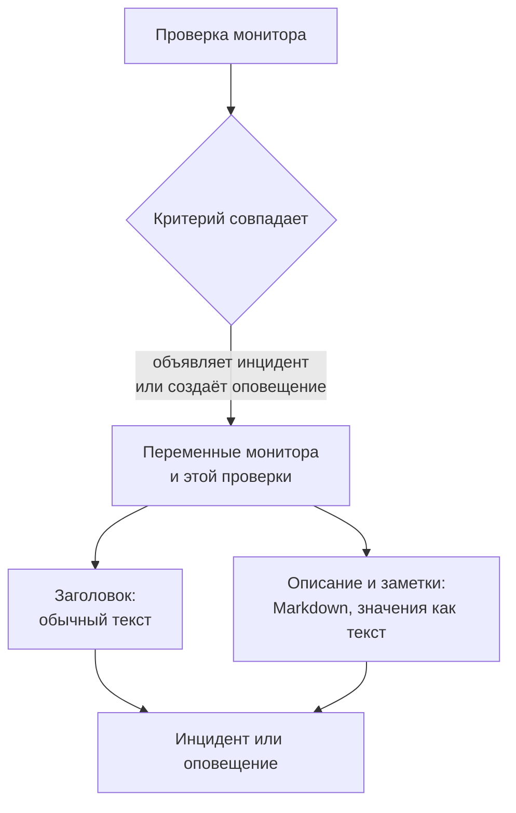

# Шаблоны инцидентов и оповещений

Когда критерий монитора объявляет инцидент или создаёт оповещение, он заполняет заголовок, описание и заметки об исправлении по шаблону, который пишете вы. Вставьте в них заполнители `{{variable}}`, например `{{monitorName}}` или `{{responseStatusCode}}`, и каждый инцидент будет сообщать, что пошло не так, со значениями из проверки, которая его открыла.

:::cards
- [Где писать шаблон](#где-писать-шаблон): Заголовок, описание и заметки об исправлении инцидента или оповещения, которые создаёт критерий.
- [Базовое использование](#базовое-использование): Заполнители, пути в объекты и списки.
- [Переменные всех мониторов](#переменные-всех-мониторов): Имя монитора и ресурс, превысивший порог.
- [Переменные по типам мониторов](#переменные-по-типам-мониторов): Что сообщает каждый вид проверки.
:::

## Как работают шаблоны

Шаблон заполняется один раз — когда критерий создаёт инцидент или оповещение. OneUptime собирает переменные из монитора и из совпавшей проверки, подставляет каждое значение на место его заполнителя и сохраняет результат. Если позже изменить шаблон, изменятся инциденты и оповещения, созданные после этого, но не те, что уже открыты.



- **Заголовок — обычный текст.** Где бы он ни показывался, он читается ровно так, как его отрисовал шаблон.
- **Описание и заметки об исправлении — это Markdown.** Markdown, который пишете вы, отрисовывается, а каждое значение, присланное наблюдаемой системой, подставляется как текст, поэтому ничто в нём не может добавить ссылку, изображение или упоминание. См. [Значения в описаниях и заметках об исправлении](#значения-в-описаниях-и-заметках-об-исправлении).
- **Сгруппированный монитор заполняет каждый инцидент для своей серии.** Монитор, который открывает по инциденту на каждый хост, под или устройство, заполняет каждый шаблон значениями этой серии и добавляет имя серии в заголовок, если ваш шаблон его ещё не называет.

## Где писать шаблон

:::steps
### Откройте критерии монитора

Перейдите в **Мониторы**, откройте монитор и нажмите **Критерии** в его боковом меню. Нажмите **Редактировать: Критерии мониторинга**.

### Включите инцидент или оповещение

В критерии, в разделе **Действия**, включите **Когда фильтры совпадают, объявить инцидент.** или **Когда фильтры совпадают, создать оповещение.** Под ним откроется форма инцидента или оповещения.

### Напишите заголовок

Введите заголовок в **Заголовок инцидента** или **Заголовок оповещения**, например `{{monitorName}} is down`. **Learn about dynamic templates** рядом с ним открывает **Dynamic Template Variables**: все переменные этого типа монитора и что в каждой хранится. Нажмите на переменную, чтобы скопировать её.

### Напишите описание и заметки об исправлении

Откройте **Описание** для **Описание инцидента** или **Описание оповещения**, и **Дополнительные поля** для **Заметки об исправлении**. Эти редакторы сами предлагают переменные: **Переменные шаблона** перечисляет их под редактором, **Вставить переменную** на его панели инструментов открывает тот же список, а ввод `{{` открывает его у курсора.

### Сохраните критерии

Нажмите **Сохранить изменения**. Следующий инцидент или следующее оповещение, созданные этим критерием, используют новые шаблоны.
:::

## Базовое использование

Заполнитель — это имя переменной в двойных фигурных скобках. При создании инцидента OneUptime заменяет его значением переменной, а текст вокруг оставляет таким, как вы его написали.

```text title="Title template"
{{monitorName}} returned {{responseStatusCode}} in {{responseTimeInMs}} ms
```

Если монитор называется `Checkout API`, код статуса ответа — `502`, а ответ занял `842` миллисекунды, инцидент получит заголовок:

```text title="Title as created"
Checkout API returned 502 in 842 ms
```

### Пути в объекты и списки

Переменная, которая содержит объект или список, читается по пути — так же, как в [выражениях JavaScript](/docs/monitor/javascript-expression):

| Что написать | Что читается | Пример |
| --- | --- | --- |
| `{{object.field}}` | Поле объекта, на любой глубине | `{{responseBody.error.message}}` |
| `{{list[0]}}` или `{{list.0}}` | Элемент списка, считая с 0 | `{{diskMetrics[0].usagePercent}}` |
| `{{list[last]}}` | Последний элемент списка | `{{processes[last].name}}` |
| `{{object}}` | Весь объект или весь список, в виде JSON | `{{responseBody}}` |

Имя поля может содержать дефис, как в `{{responseHeaders.content-type}}`. Отрицательный индекс, например `[-1]`, ничего не читает: используйте `[last]`.

### Если значения нет

Заполнитель, путь которого никуда не ведёт, остаётся в тексте в том виде, в каком вы его написали, вместе со скобками: если в ответе нет поля `error`, `{{responseBody.error.id}}` так и появится в заголовке. То же происходит с переменной, о которой эта проверка не сообщила, например с `failureCause` у проверки, которая не провалилась. Значение, которое проверка сообщила как пустой текст, заменяется ничем.

Чтобы написать один шаблон, который работает и со сгруппированным монитором, и без группировки, используйте переменные [затронутого ресурса](#затронутый-ресурс): они существуют всегда и пусты, когда монитор не сгруппирован.

### Значения в описаниях и заметках об исправлении

Описание и заметки об исправлении — это Markdown: они показываются на странице инцидента или оповещения, в письмах и в его каналах Slack и Microsoft Teams. Значения, которые шаблон туда подставляет, — это то, что прислала наблюдаемая система: тело или заголовок ответа, входящий запрос или письмо, метки устройства или серии, — поэтому каждое из них подставляется как текст. Оно читается ровно так, как было прислано, где бы шаблон его ни поставил, а ссылка, изображение, HTML-тег или упоминание Slack вроде `<!channel>` в нём показываются как текст, а не срабатывают. Голый веб-адрес в значении всё же становится ссылкой — такой, которая показывает, куда ведёт. Markdown, который вы пишете в самом шаблоне, отрисовывается так, как вы его написали.

Значение может быть любого размера — тело ответа или журнал на много мегабайт, — и уведомление всё равно уходит с ним. Каждый канал несёт столько, сколько принимает, а слишком длинное для него описание обрезается — по переводу строки, если он есть, — и заканчивается на "… (truncated — see OneUptime for the full text)":

- **Электронная почта**: каждое описание, заметка или первопричина несёт до примерно 256 КБ текста письма, а пометка в конце более длинного текста ведёт на инцидент или оповещение. Всё письмо — его текст и снимки экрана — остаётся меньше 3 МБ, что принимают все почтовые серверы и Microsoft Graph: снимок экрана, который не помещается рядом с текстом, опускается, а на его месте остаётся пометка.
- **Страница инцидента или оповещения** показывает всё целиком. Описание больше 128 КБ, вёрстка которого заняла бы много времени, показывается как обычный текст, строка за строкой.
- **Slack** несёт не больше, чем Slack показывает из сообщения (около 30 000 символов). **Microsoft Teams** несёт около 40 000 символов в сообщении от приложения OneUptime и около 12 000 через входящий вебхук (подписчики страниц статуса, рабочие процессы) — по замеру при отправке сообщения, так что таблица считается как HTML, в который она превращается.
- **SMS, телефонные звонки, push-уведомления, WhatsApp и Telegram** несут то, что принимают их провайдеры: см. [Как уровни вызывают людей](/docs/on-call/escalation-rules#как-уровни-оповещают-людей).

Каждый канал отрисовывает текст за время, которое растёт с его длиной. Часть, которая заняла бы у отрисовщика гораздо больше времени, — строка длиннее 64 КБ, длинный абзац из простых строк, абзац, полный `*`, `_` или `[`, которые никогда не закрываются, цитаты или списки с вложенностью больше шестнадцати уровней, а на странице инцидента или оповещения — таблица или список длиннее тысячи строк, — читается как обычный текст там, где она стоит, а остальное описание отрисовывается как обычно.

## Расширенное использование

### Перебор списка

`{{#each path}}` повторяет текст до `{{/each}}` по одному разу для каждого элемента списка по пути `path`:

```text title="Loop syntax"
{{#each arrayPath}}
  ...text with {{field}} placeholders for each item...
{{/each}}
```

Внутри цикла:

- `{{field}}` и `{{field.nested}}` читают текущий элемент. Имя, которого у элемента нет, ищется в охватывающем элементе, а затем в переменных всего шаблона.
- `{{@index}}` — позиция элемента, считая с 0.
- `{{this}}` — сам элемент, для списка простых значений, например строк.
- Цикл по пути, который не является списком, или по пустому списку ничего не пишет.
- Циклы вкладываются друг в друга: `{{#each}}` внутри другого читает внутренний список каждого внешнего элемента.

Например, [монитор входящих запросов](/docs/monitor/incoming-request-monitor), который получает это уведомление об оповещениях:

```json title="Request body"
{
  "receiver": "payments",
  "alerts": [
    { "status": "firing", "labels": { "alertname": "HighLatency" } },
    { "status": "resolved", "labels": { "alertname": "DiskFull" } }
  ]
}
```

и имеет такой шаблон описания:

```text title="Description template"
Alerts for {{requestBody.receiver}}:
{{#each requestBody.alerts}}
- {{@index}}: {{labels.alertname}} ({{status}})
{{/each}}
```

создаёт инцидент с описанием, показанным ниже. Каждый элемент сохраняет переводы строк вокруг себя, поэтому элементы разделяет пустая строка, а описание всё равно показывает один список:

```text title="Description as created"
Alerts for payments:

- 0: HighLatency (firing)

- 1: DiskFull (resolved)
```

### Значения сгруппированного монитора

Монитор на основе метрик с атрибутами **Group by** открывает по инциденту на каждую серию, и значение каждого атрибута — это переменная с именем атрибута. Группировка по `host.name` даёт `{{host.name}}`, а группировка по `resource.k8s.pod.name` даёт `{{resource.k8s.pod.name}}`. `{{seriesLabels}}` содержит их все, в виде объекта.

Сгруппированный [монитор журналов](/docs/monitor/logs-monitor) работает так же: значение каждого атрибута группировки — это переменная с его ключом.

## Переменные всех мониторов

### Монитор

| Переменная | Что содержит | Пример |
| --- | --- | --- |
| `monitorName` | Имя монитора. | `Checkout API` |
| `monitorId` | ID монитора. | `a0f78958-da0a-4775-9fd9-c9fc63d3456f` |
| `monitorType` | Тип монитора. | `Website`, `Synthetic Monitor` |

### Затронутый ресурс

Эти переменные описывают серию, для которой сгруппированный монитор открыл инцидент: под, контейнер, хост, диск. У монитора без группировки они пусты, поэтому шаблон может использовать их в любом мониторе.

| Переменная | Что содержит |
| --- | --- |
| `seriesResourceSuffix` | Идентификация серии, начинающаяся с разделителя, — чтобы поставить её в конец заголовка. |
| `seriesResourceSummary` | Та же идентификация без разделителя — чтобы вставить её в предложение. |
| `seriesResourceBlock` | Все метки серии в виде списка Markdown. Лучше всего подходит для описания. |
| `seriesDebugCommands` | Команды только для чтения для именно этого ресурса, например `kubectl` или `docker`, в виде списка Markdown. |

## Переменные по типам мониторов

### Мониторы сайтов и API

| Переменная | Что содержит | Тип |
| --- | --- | --- |
| `responseBody` | Тело ответа: объект, если это JSON, иначе текст. | `JSON` или `string` |
| `responseHeaders` | Заголовки ответа, по имени в нижнем регистре. | `Dictionary<string>` |
| `responseStatusCode` | Код статуса HTTP. | `number` |
| `responseTimeInMs` | Время ответа в миллисекундах. | `number` |
| `isOnline` | Посчитал ли монитор ответ признаком того, что цель в сети. | `boolean` |

### Мониторы входящих запросов

| Переменная | Что содержит | Тип |
| --- | --- | --- |
| `requestBody` | Тело запроса: объект, если это JSON. | `JSON` или `string` |
| `requestHeaders` | Заголовки запроса, по имени в нижнем регистре. | `Dictionary<string>` |
| `requestMethod` | Метод HTTP, например `POST`. | `string` |
| `incomingRequestReceivedAt` | Когда запрос был получен, в виде метки времени ISO 8601. | `string` |

Когда в критерии включено **Group incidents and alerts by a payload field**, ключ группировки тоже становится переменной, названной по **последнему сегменту** пути группировки: группировка по `requestBody.alerts[*].labels.alertname` даёт `{{alertname}}`, а группировка по `requestBody.alerts[*].fingerprint` даёт `{{fingerprint}}`. Весь `requestBody` по-прежнему доступен рядом с ней.

> [!NOTE]
> `[*]` работает только в полях пути группировки. В шаблоне он ничего не читает, поэтому заполнитель остаётся таким, как написан. `{{requestBody.alerts[0].annotations.summary}}` всегда читает первое оповещение из полезной нагрузки, а не то, для которого открыт инцидент: используйте переменную группировки и общие поля полезной нагрузки, например `commonLabels` и `commonAnnotations`. См. [Монитор входящих запросов](/docs/monitor/incoming-request-monitor).

### Мониторы входящей почты

| Переменная | Что содержит | Тип |
| --- | --- | --- |
| `emailSubject` | Тема письма. | `string` |
| `emailFrom` | Адрес отправителя. | `string` |
| `emailTo` | Кому было отправлено письмо, с замаскированным собственным адресом монитора. | `string` |
| `emailBody` | Тело письма в виде обычного текста. | `string` |
| `emailReceivedAt` | Когда письмо было получено, в виде метки времени ISO 8601 в UTC. | `string` |

В заголовке каждая из них обрезается до одной строки длиной не более 150 символов. Описания и заметки об исправлении получают полное значение. См. [Монитор входящей почты](/docs/monitor/incoming-email-monitor#переменные-шаблона).

### Мониторы Ping, IP и портов

| Переменная | Что содержит | Тип |
| --- | --- | --- |
| `isOnline` | Ответила ли цель. | `boolean` |
| `responseTimeInMs` | Время ответа в миллисекундах. Для порта — DNS-запрос и TCP-соединение вместе. | `number` |
| `failureCause` | Почему проверка провалилась, если это произошло. | `string` |
| `isTimeout` | Истекло ли время ожидания проверки. | `boolean` |

### Мониторы NTP

| Переменная | Что содержит | Тип |
| --- | --- | --- |
| `isOnline` | Ответил ли сервер времени на запрос зонда. | `boolean` |
| `isSynchronized` | Ответил ли он со stratum от 1 до 15, без сигнала leap и с настоящими метками времени. | `boolean` |
| `stratum` | Stratum, о котором сообщил сервер: 1 для первичного сервера, 16, когда он не синхронизирован, 0 для kiss-o'-death. | `number` |
| `clockOffsetInMs` | Насколько часы сервера отличаются от часов зонда, в миллисекундах. Положительное значение означает, что сервер спешит. | `number` |
| `referenceId` | С чем синхронизируется сервер: источник вроде `GPS` на stratum 1 или адрес его вышестоящего сервера. | `string` |
| `leapIndicator` | От 0 до 2, когда всё в порядке, 3, когда сервер сообщает, что его часы не синхронизированы. | `number` |
| `kissCode` | При stratum 0 — четырёхбуквенный код, который сервер прислал вместо времени, например `RATE`. | `string` |
| `responseTimeInMs` | Время от запроса до ответа в миллисекундах. | `number` |
| `roundTripDelayInMs` | Сетевое время приёма-передачи для обмена, без собственного времени обработки на сервере. | `number` |
| `rootDelayInMs` | Время приёма-передачи от сервера до его эталонных часов, в миллисекундах. | `number` |
| `rootDispersionInMs` | Собственная оценка сервером его максимальной ошибки, в миллисекундах. | `number` |
| `serverTime` | Часы сервера в момент отправки ответа, в виде метки времени ISO 8601. | `string` |
| `referenceTime` | Когда часы сервера в последний раз были установлены или скорректированы, в виде метки времени ISO 8601. | `string` |
| `serverAddress` | Адрес, на который ушёл запрос. | `string` |
| `port` | UDP-порт, на который ушёл запрос. | `number` |
| `failureCause` | Почему сервер не ответил или почему он не синхронизирован. | `string` |
| `isTimeout` | Не ответил ли сервер вовремя. | `boolean` |

### Мониторы SSL-сертификатов

| Переменная | Что содержит | Тип |
| --- | --- | --- |
| `isOnline` | Успешна ли проверка сертификата. | `boolean` |
| `isSelfSigned` | Является ли сертификат самоподписанным. | `boolean` |
| `createdAt` | Когда сертификат был выпущен, в виде метки времени ISO 8601. | `string` |
| `expiresAt` | Когда истекает срок действия сертификата, в виде метки времени ISO 8601. | `string` |
| `commonName` | Общее имя сертификата (CN). | `string` |
| `organizationalUnit` | Его подразделение (OU). | `string` |
| `organization` | Его организация (O). | `string` |
| `locality` | Его населённый пункт (L). | `string` |
| `state` | Его штат или область (ST). | `string` |
| `country` | Его страна (C). | `string` |
| `serialNumber` | Его серийный номер. | `string` |
| `fingerprint` | Его отпечаток SHA-1. | `string` |
| `fingerprint256` | Его отпечаток SHA-256. | `string` |
| `failureCause` | Почему проверка провалилась, если это произошло. | `string` |

### Мониторы DNS

| Переменная | Что содержит | Тип |
| --- | --- | --- |
| `isOnline` | Получен ли ответ на запрос. | `boolean` |
| `responseTimeInMs` | Время запроса в миллисекундах. | `number` |
| `isTimeout` | Истекло ли время ожидания запроса. | `boolean` |
| `isDnssecValid` | Результат проверки DNSSEC. | `boolean` |
| `records` | Возвращённые записи, каждая в виде `{type, value, ttl}`. | `Array<Object>` |
| `recordValues` | Только значения записей. | `Array<string>` |
| `failureCause` | Почему запрос не удался, если это произошло. | `string` |

### Мониторы DNSSEC

| Переменная | Что содержит | Тип |
| --- | --- | --- |
| `isOnline` | Завершилась ли проверка. | `boolean` |
| `domainName` | Проверенная зона. | `string` |
| `isZoneSigned` | Есть ли у зоны записи DNSKEY. | `boolean` |
| `isParentDsPresent` | Есть ли у родительской зоны записи DS для неё. | `boolean` |
| `isChainValid` | Проходит ли проверку цепочка доверия. | `boolean` |
| `resolverConsensusAd` | Вернул ли каждый резолвер флаг AD. | `boolean` |
| `isNameserverConsistent` | Вернул ли каждый авторитетный сервер имён один и тот же серийный номер SOA. | `boolean` |
| `earliestSignatureExpiration` | Когда истекает первая подпись RRSIG, в виде метки времени ISO 8601. | `string` |
| `daysUntilSignatureExpiry` | Сколько дней осталось до истечения этой подписи. | `number` |
| `dnskeyCount` | Количество записей DNSKEY. | `number` |
| `dsRecordCount` | Количество записей DS у родительской зоны. | `number` |
| `rrsigCount` | Количество увиденных записей RRSIG. | `number` |
| `responseTimeInMs` | Сколько времени заняла проверка, в миллисекундах. | `number` |
| `failureCause` | Почему проверка провалилась, если это произошло. | `string` |

### Мониторы доменов

| Переменная | Что содержит | Тип |
| --- | --- | --- |
| `isOnline` | Успешен ли поиск регистрации. | `boolean` |
| `domainName` | Домен, который искали. | `string` |
| `lookupMethod` | Протокол, который ответил: RDAP или WHOIS. | `string` |
| `registrar` | Регистратор. | `string` |
| `createdDate` | Когда домен был зарегистрирован. | `string` |
| `updatedDate` | Когда регистрация в последний раз менялась. | `string` |
| `expiresDate` | Когда истекает регистрация. | `string` |
| `nameServers` | Серверы имён домена. | `Array<string>` |
| `domainStatus` | Коды статуса реестра, например `clientTransferProhibited`. | `Array<string>` |
| `dnssec` | Статус DNSSEC в реестре. | `string` |
| `responseTimeInMs` | Сколько времени занял поиск, в миллисекундах. | `number` |
| `failureCause` | Почему поиск не удался, если это произошло. | `string` |

### Мониторы серверов и ВМ

| Переменная | Что содержит | Тип |
| --- | --- | --- |
| `hostname` | Имя хоста сервера. | `string` |
| `requestReceivedAt` | Когда был получен отчёт сервера, в виде метки времени ISO 8601. | `string` |
| `cpuUsagePercent` | Используемый CPU, от 0 до 100. | `number` |
| `cpuCores` | Количество ядер CPU. | `number` |
| `memoryUsagePercent` | Используемая память, от 0 до 100. | `number` |
| `memoryFreePercent` | Свободная память, от 0 до 100. | `number` |
| `memoryTotalBytes` | Общий объём памяти в байтах. | `number` |
| `diskMetrics` | По одной записи на каждый смонтированный диск. | `Array<Object>` |
| `diskMetrics[].diskPath` | Точка монтирования диска. | `string` |
| `diskMetrics[].usagePercent` | Занятое место на диске, от 0 до 100. | `number` |
| `diskMetrics[].freePercent` | Свободное место на диске, от 0 до 100. | `number` |
| `diskMetrics[].totalBytes` | Размер диска в байтах. | `number` |
| `processes` | Запущенные процессы, о которых сообщил агент. | `Array<Object>` |
| `processes[].pid` | ID процесса. | `number` |
| `processes[].name` | Имя процесса. | `string` |
| `processes[].command` | Команда, которой был запущен процесс. | `string` |
| `failureCause` | Почему проверка провалилась, если это произошло. | `string` |

### Синтетические мониторы

Синтетический монитор запускает свой скрипт по одному разу для каждого браузера и размера экрана, которые для него заданы, например Chromium на экране настольного компьютера и Firefox на мобильном. `syntheticResponses` содержит по одной записи на запуск: читайте один запуск по его позиции, как в `{{syntheticResponses[0].browserType}}`, или все запуски через `{{#each syntheticResponses}}`.

| Переменная | Что содержит | Тип |
| --- | --- | --- |
| `failureCause` | Почему проверка провалилась, если это произошло. | `string` |
| `syntheticResponses` | По одной записи на каждый браузер и размер экрана, на которых выполнялся скрипт. | `Array<Object>` |
| `syntheticResponses[].executionTimeInMs` | Сколько длился запуск, в миллисекундах. | `number` |
| `syntheticResponses[].result` | Что вернул скрипт. | `string`, `number`, `boolean` или `JSON` |
| `syntheticResponses[].scriptError` | Ошибка, которой завершился запуск, если она была. | `string` |
| `syntheticResponses[].logMessages` | Что запуск записал в журнал. | `Array<string>` |
| `syntheticResponses[].screenshots` | Снимки экрана, сделанные запуском, по имени, каждый в виде текста base64. См. [Показ снимка экрана](#показ-снимка-экрана). | `Object` |
| `syntheticResponses[].browserType` | Браузер запуска. | `string` |
| `syntheticResponses[].screenSizeType` | Размер экрана запуска. | `string` |

#### Показ снимка экрана

Каждая запись `screenshots` — это снимок экрана, сделанный скриптом, под именем, которое ему дал скрипт (`screenshots["login-page"] = await page.screenshot()`), в виде текста base64. Чтобы показать его в описании или заметках об исправлении инцидента или оповещения, оберните его в изображение:

```text title="Description template"
{{syntheticResponses[0].scriptError}}


```

Тогда снимок экрана появится на странице инцидента или оповещения, на страницах статуса, которые показывают инцидент, в уведомлениях о нём по электронной почте и в сообщениях о нём в Slack и Microsoft Teams. В письме он прикрепляется и показывается в теле письма, что отображают Gmail, Outlook и Apple Mail, поэтому дежурный может увидеть, как выглядела страница, не открывая OneUptime.

- Показываются снимки экрана в форматах PNG, JPEG, GIF и WebP. `image/png` подходит и для снимка в JPEG (`page.screenshot({ type: "jpeg" })`).
- Одно письмо несёт не более 2 МБ изображений и не более 20 изображений. Изображение, которое не помещается, заменяется пометкой с его alt-текстом, поэтому давайте каждому изображению alt-текст. Снимок в JPEG намного меньше снимка в PNG, а один снимок проваленного запуска обычно говорит больше, чем все снимки всех запусков.
- В Slack и Microsoft Teams снимок экрана показывается там, где он стоит в описании: изображение на отдельной строке занимает место этой строки, а изображение посреди предложения, списка или таблицы оставляет там свой alt-текст и показывается после него. Slack показывает снимки в форматах PNG, JPEG и GIF, не более 10 штук и 10 МБ на сообщение; приложение OneUptime загружает каждый из них в ваше рабочее пространство Slack, приватно, и показывает в сообщении. Teams показывает снимки в форматах PNG, JPEG и GIF размером до 1 МБ каждый внутри карточки сообщения, не более 10 штук и 2 МБ на сообщение.
- Для загрузки в Slack приложению нужно разрешение `files:write`. Если ваше рабочее пространство подключило Slack до того, как OneUptime стал его запрашивать, подключите Slack заново в **Настройки проекта → Рабочее пространство → Slack** (на собственном сервере сначала добавьте разрешение в своё приложение Slack — см. [Интеграция со Slack](/docs/self-hosted/slack-integration#изображения-в-сообщениях)).
- Снимок экрана, который чат не может показать, — WebP, снимок сверх этих ограничений, снимок, который отклоняет Slack или Teams, или любой снимок в сообщении, отправленном через входящий вебхук, — показывается как его alt-текст или как "[image]", если alt-текста нет, поэтому давайте каждому изображению alt-текст. Base64 изображения никогда не попадает в чат.
- Показывается только изображение, которое вы пишете в шаблоне. Изображение в значении, о котором сообщила наблюдаемая страница или скрипт, — сообщение об ошибке, строка журнала — по-прежнему показывается как текст (см. [Значения в описаниях и заметках об исправлении](#значения-в-описаниях-и-заметках-об-исправлении)).
- OneUptime AI читает текст вокруг снимка экрана, а не сам снимок. В том, что расследование, черновик постмортема или заметки, шаг ИИ в ранбуке или шаг ИИ в рабочем процессе передают модели, на месте изображения стоит короткая пометка, например `[image omitted: PNG, 340 KB]`: модель читает текст, а не изображения, а base64 снимка экрана — это сотни тысяч токенов при каждом вызове. В активности расследования указано, что было опущено.

Чтобы показать снимок экрана каждого проваленного запуска, поместите изображение в цикл. Здесь скрипт сохраняет каждый снимок как `screenshots["failure"]`:

```text title="Description template"
### What the page looked like
{{#each syntheticResponses}}
**{{browserType}} / {{screenSizeType}}**: {{scriptError}}


{{/each}}
```

### Мониторы пользовательского кода JavaScript

| Переменная | Что содержит | Тип |
| --- | --- | --- |
| `result` | Что вернул скрипт. Читайте поле по пути, как в `{{result.status}}`. | `string`, `number`, `boolean` или `JSON` |
| `executionTimeInMs` | Сколько выполнялся скрипт, в миллисекундах. | `number` |
| `scriptError` | Ошибка, которой завершился скрипт, если она была. | `string` |
| `logMessages` | Что скрипт записал через `console.log`. | `Array<string>` |
| `failureCause` | Почему проверка провалилась, если это произошло. | `string` |

### Мониторы сетевых устройств

| Переменная | Что содержит | Тип |
| --- | --- | --- |
| `isOnline` | Доступно ли устройство — по ping **или** по SNMP. Устанавливается при каждом опросе. | `boolean` |
| `responseTimeInMs` | Время ответа **обхода** SNMP, в миллисекундах. Никогда не время приёма-передачи ping. | `number` |
| `failureCause` | Почему обход SNMP не удался, если это произошло. | `string` |
| `isTimeout` | Истекло ли время ожидания обхода SNMP. | `boolean` |
| `oidResponses` | Запрошенные OID, каждый в виде `{oid, name, value, type}`. | `Array<Object>` |
| `{{OID_NAME}}` | Значение именованного OID, по его имени, как в `{{sysUpTime}}`. | `string` или `number` |
| `sysName` | Имя устройства из системной группы SNMP. | `string` |
| `sysDescr` | Описание устройства из системной группы SNMP. | `string` |
| `sysObjectId` | Зарегистрированный корпоративный OID производителя: отпечаток устройства. | `string` |
| `sysLocation` | Расположение устройства из системной группы SNMP. | `string` |
| `downInterfaces` | Интерфейсы, которые административно включены, но в рабочем состоянии не работают, каждый в виде `{name, alias, interfaceIndex}`. Требует мониторинга интерфейсов. | `Array<Object>` |
| `interfacesTotal` | Количество обойдённых интерфейсов. | `number` |
| `interfacesUp` | Интерфейсы, включённые и административно, и в рабочем состоянии. | `number` |
| `interfacesDown` | Интерфейсы, которые административно включены, но в рабочем состоянии не работают. | `number` |
| `interfaceWalkFailure` | Ошибка, если обход интерфейсов не удался. | `string` |
| `tables` | Таблицы SNMP устройства по ключу: `rowCount`, `rows`, `unhealthyRowCount` и `unhealthyRows` каждой, как в `{{tables.ipsec_tunnels.unhealthyRowCount}}`. | `Object` |
| `snmpTable` | Таблица SNMP, к которой относится построчное оповещение. | `string` |
| `snmpTableRow` | Строка, к которой относится построчное оповещение: туннель, радиомодуль, сосед. | `string` |
| `trapOid` | OID трапа. Только когда проверку запустил трап SNMP. | `string` |
| `trapSourceIp` | Адрес, с которого пришёл трап. Только когда проверку запустил трап SNMP. | `string` |
| `trapVarbinds` | Varbind-записи трапа, каждая в виде `{oid, value}`. Только когда проверку запустил трап SNMP. | `Array<Object>` |

Сетевое устройство пингуется при каждом опросе, а обходится по SNMP, только если у него есть учётные данные, поэтому **`isOnline` — единственная переменная выше, которую заполняет устройство только с ping**: все остальные приходят из обхода SNMP и без него остаются такими, как написаны. Начинайте с `{{isOnline}}` и имени устройства в шаблонах, которые могут использоваться для устройств без учётных данных. Что собирает каждый вид опроса, см. в [Мониторинг сетевых устройств](/docs/monitor/network-device-monitor#what-a-poll-actually-does).

### Мониторы состояния баз данных

| Переменная | Что содержит | Тип |
| --- | --- | --- |
| `isOnline` | Смог ли зонд подключиться и выполнить базовый запрос. Отсутствующие метрики никогда не делают это значение ложным. | `boolean` |
| `responseTimeInMs` | Время на подключение и выполнение базового запроса, в миллисекундах. | `number` |
| `failureCause` | Почему проверка провалилась, если это произошло. | `string` |
| `connectionError` | Ошибка подключения, без учётных данных и строки подключения. | `string` |
| `engineVersion` | Версия, о которой сообщил сервер базы данных. | `string` |
| `collectedGroups` | Группы метрик, давшие значения в этой проверке. | `Array<string>` |
| `unavailableGroups` | Группы, которые не удалось собрать, каждая в виде `{group, reason, message, remediation}`. | `Array<Object>` |
| `collectionIssueSummary` | Одна строка обо всех недоступных группах, готовая для заголовка. Пуста, если всё собрано. | `string` |
| `metrics` | Собранные значения по имени серии. | `Object` |

Имена серий в `metrics` содержат точки, например `oneuptime.monitor.database.connections.used.percent`, а путь читает каждую точку как шаг внутрь объекта, поэтому шаблон не может выбрать одно значение из `metrics`. Подставляйте `{{metrics}}` целиком, в виде JSON, или используйте `{{collectionIssueSummary}}`. Несобранной метрики в `metrics` просто нет, она не равна нулю. Чтобы действовать по одному значению, сравните его в критерии с помощью [выражения JavaScript](/docs/monitor/javascript-expression).

### Мониторы внешних страниц статуса

| Переменная | Что содержит | Тип |
| --- | --- | --- |
| `overallStatus` | Общий статус страницы статуса, например `major_outage`. | `string` |
| `activeIncidentCount` | Количество инцидентов, открытых на странице статуса. | `number` |
| `componentStatuses` | Её компоненты, каждый в виде `{name, status, description, groupName}`. | `Array<Object>` |
| `provider` | Вид страницы статуса: Atlassian Statuspage, incident.io, RSS или Atom. | `string` |
| `componentGroup` | Группа компонентов, за которой следит монитор, если он за ней следит. | `string` |
| `componentName` | Компонент, за которым следит монитор, если он за ним следит. | `string` |
| `isOnline` | Ответила ли страница статуса. | `boolean` |
| `responseTimeInMs` | Сколько времени страница статуса отвечала, в миллисекундах. | `number` |
| `failureCause` | Почему проверка провалилась, если это произошло. | `string` |

### Мониторы метрик и инфраструктуры

У мониторов Metrics, Kubernetes, Docker, Host, Podman, Docker Swarm, Proxmox, VMware, Ceph, Storage Array и IoT Device есть одна собственная переменная:

| Переменная | Что содержит | Тип |
| --- | --- | --- |
| `metricName` | Имя метрики, которую читает первый запрос монитора, например `container.cpu.time`. | `string` |

Сгруппированные, они также содержат значение каждого атрибута **Group by** и `seriesLabels`: см. [Значения сгруппированного монитора](#значения-сгруппированного-монитора). Шаблоны монитора IoT Device группируют по устройству, поэтому у монитора, созданного из такого шаблона, есть и `{{device.id}}`.

### Другие типы мониторов

У мониторов Logs, Traces, Exceptions, Security Events, AI / LLM и SQL Query нет собственных переменных. Используйте [переменные всех мониторов](#переменные-всех-мониторов), а в сгруппированном мониторе Logs — [значения группы](#значения-сгруппированного-монитора).

## Примеры

### Медленный API

```text title="Title"
{{monitorName}} is slow: {{responseTimeInMs}} ms
```

```text title="Description"
### API error
Status: **{{responseStatusCode}}**
Latency: **{{responseTimeInMs}} ms**
Message: `{{responseBody.error.message}}`
```

### Сертификат, срок которого скоро истечёт

```text title="Title"
Certificate for {{commonName}} expires {{expiresAt}}
```

### Сервер, у которого заканчивается место

```text title="Description"
### {{hostname}}
CPU: **{{cpuUsagePercent}}%**
Memory: **{{memoryUsagePercent}}%**

**Disks:**
{{#each diskMetrics}}
- {{diskPath}}: {{usagePercent}}% used ({{freePercent}}% free)
{{/each}}

**Processes:**
{{#each processes}}
- [{{pid}}] {{name}}: {{command}}
{{/each}}
```

### Неудачная проверка Ping, IP или порта

```text title="Description"
{{monitorName}} could not be reached: {{failureCause}}
Timed out: {{isTimeout}}
Response time: {{responseTimeInMs}} ms
```

### Каждый запуск синтетического монитора

```text title="Description"
### Synthetic monitor results
{{#each syntheticResponses}}
- **{{browserType}} / {{screenSizeType}}**: {{result}} in {{executionTimeInMs}} ms
  - Script error: {{scriptError}}
  - First log line: {{logMessages[0]}}
{{/each}}
```

### Проверка пользовательским кодом

```text title="Description"
The script ran for {{executionTimeInMs}} ms and returned {{result}}.
Last log line: {{logMessages[last]}}
```

### Сетевое устройство

Здесь предполагается, что у устройства есть учётные данные SNMP: на устройстве только с ping всё, кроме `{{isOnline}}`, остаётся таким, как написано.

```text title="Title"
{{sysName}}: {{interfacesDown}} interfaces down
```

```text title="Description"
### {{sysName}} ({{sysLocation}})
Online: {{isOnline}}
SNMP walk: {{responseTimeInMs}} ms

{{#each downInterfaces}}
- {{name}} ({{alias}}) is down
{{/each}}
```

### Оповещения Alertmanager или Grafana

```text title="Title"
[{{requestBody.status}}] {{requestBody.receiver}}
```

```text title="Description"
### Alerts from {{requestBody.receiver}}
{{#each requestBody.alerts}}
**Alert {{@index}}**: {{labels.alertname}}
- Status: {{status}}
- Summary: {{annotations.summary}}
- Source: {{generatorURL}}
{{/each}}
```

## Устранение неполадок

:::details Заголовок показывает заполнитель вместе со скобками
Путь не ведёт к значению в этой проверке. Сверьте имя переменной и регистр с таблицами выше или откройте **Learn about dynamic templates** в критерии: там перечислены переменные этого типа монитора. Путь в тело ответа или запроса должен совпадать с телом в том виде, в каком оно было отправлено, а `[*]` и отрицательные индексы вроде `[-1]` ничего не читают: используйте `[0]` или `[last]`.
:::

:::details Значение показывается как JSON
Путь останавливается на объекте или списке, поэтому он подставляется целиком, в виде JSON. Добавьте в путь нужное поле, как в `{{responseBody.error.message}}`, или переберите список через `{{#each}}`.
:::

:::details Цикл ничего не пишет
Путь после `#each` в этой проверке не является списком, или список пуст. Сверьте путь с полезной нагрузкой и проверьте, что у каждого `{{#each}}` есть свой `{{/each}}`.
:::

:::details Markdown в значении показывается как текст
Так и задумано: значение, присланное наблюдаемой системой, подставляется как текст, поэтому оно никогда не может добавить в описание ссылку, изображение или упоминание. Вместо этого пишите форматирование в шаблоне вокруг значения. См. [Значения в описаниях и заметках об исправлении](#значения-в-описаниях-и-заметках-об-исправлении).
:::

:::details Снимок экрана не показывается в Slack, Microsoft Teams или почте
Сверьте формат и размер изображения с разделом [Показ снимка экрана](#показ-снимка-экрана). В Slack приложению OneUptime нужно разрешение `files:write`: подключите Slack заново в **Настройки проекта → Рабочее пространство → Slack**, если ваше рабочее пространство подключило его до того, как OneUptime стал его запрашивать.
:::

## Дальнейшие шаги

:::cards
- [Выражения JavaScript](/docs/monitor/javascript-expression): Те же заполнители — в условиях критерия.
- [Объявление инцидента](/docs/incidents/declaring-incidents): Что происходит после того, как критерий объявил инцидент.
- [Синтетический мониторинг](/docs/monitor/synthetic-monitor): Делайте снимки экрана, которые может показать описание.
- [Мониторинг входящих запросов](/docs/monitor/incoming-request-monitor): Превращайте вебхуки в инциденты, названные по каждому оповещению.
:::
