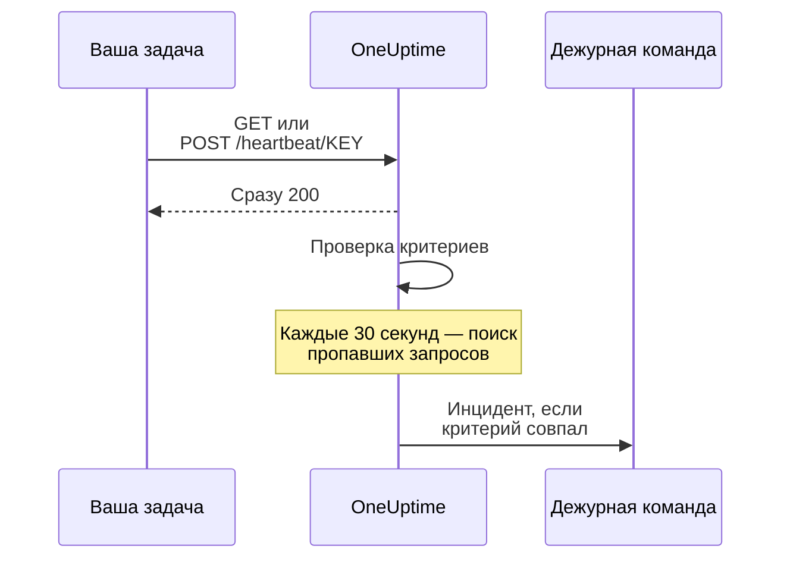

# Мониторинг входящих запросов

Монитор входящих запросов даёт вам URL, на который другие системы отправляют HTTP-запросы. OneUptime проверяет каждый запрос по вашим критериям и может менять статус монитора, объявлять инциденты и вызывать дежурную смену.

Он закрывает две разные задачи:

- **Мониторинг по heartbeat** — cron-задача, воркер или устройство обращается к URL по расписанию, и OneUptime открывает инцидент, когда сигналы перестают приходить.
- **Приём оповещений от другой системы** — Prometheus Alertmanager, Grafana или что угодно, что умеет отправлять JSON методом POST, присылает оповещения, а OneUptime превращает каждое из них в инцидент с эскалацией на дежурных и автоматическим закрытием при восстановлении.

Обе задачи используют один и тот же тип монитора. Различают их критерии, которые вы настраиваете.

:::cards
- [Создайте монитор](#создание-монитора-входящих-запросов): Получите URL для heartbeat за несколько шагов.
- [Отправьте heartbeat](#отправка-heartbeat): Из curl, cron, Node.js, Python или Go.
- [Оповещайте, когда сигналы пропадают](#пометить-как-офлайн-если-heartbeat-не-приходил-10-минут-выключатель-мертвеца): Превратите монитор в «выключатель мертвеца».
- [Принимайте оповещения](#приём-оповещений-от-другой-системы): Один инцидент на каждое оповещение Alertmanager или Grafana.
- [Подпишитесь на SNS или Event Grid](#подписка-на-amazon-sns-или-azure-event-grid): Подтвердите подписку одним нажатием.
:::

## Как это работает

Никто не проверяет вашу систему снаружи: ваша система обращается к URL монитора, OneUptime сразу отвечает, а затем проверяет запрос по критериям монитора. Критерий, который отслеживает запросы, *переставшие* приходить, к тому же перепроверяется в фоне каждые 30 секунд, так что инцидент может открыть и тишина.



Используйте его, чтобы:

- Отслеживать cron-задачи и запланированные задания
- Проверять, что фоновые воркеры работают
- Отслеживать сервисы за файрволом, недоступные снаружи
- Принимать оповещения от Prometheus Alertmanager, Grafana и других систем оповещения
- Отслеживать heartbeat-сигналы от любой системы, умеющей работать с HTTP

## Создание монитора входящих запросов

:::steps
### Начните новый монитор

Откройте **Мониторы** и нажмите **Создать монитор**.

### Выберите Входящий запрос

В разделе **Тип монитора** выберите **Входящий запрос** — это один из распространённых типов вверху. Укажите **Имя** и нажмите **Далее**.

### Проверьте критерии

Шаг **Критерии** начинается с [критериев по умолчанию](#что-вы-получаете-сразу). Для heartbeat нажмите **Добавить критерии** и задайте новому критерию фильтр **Входящий запрос** / **Не получено в течение (мин)**, который меняет статус на офлайн и объявляет инцидент, с включённым **Автоустранение инцидента**. Затем перетащите его в начало списка; почему, объясняет раздел [Примеры критериев](#примеры-критериев).

### Создайте монитор

Нажмите **Создать монитор**. Монитор открывается на странице **Обзор**, где карточка **Send the first heartbeat** показывает **Heartbeat URL** с кнопкой копирования и пример команды `curl`.

### Отправьте первый запрос

Настройте свой сервис на отправку запросов на этот URL (см. [Отправка heartbeat](#отправка-heartbeat)). Когда придёт первый запрос, карточка уступит место истории монитора, а карточка **Heartbeat URL** покажет URL и время последнего запроса.
:::

> [!NOTE]
> URL содержит секретный ключ монитора, поэтому его видят только те, кто может редактировать мониторы. Его всегда можно снова найти на странице монитора **Документация** в разделе **Конфигурация** бокового меню.

## URL для запросов

У вашего монитора есть уникальный URL в таком формате:

```text
https://oneuptime.com/heartbeat/YOUR_SECRET_KEY
```

Если вы размещаете OneUptime самостоятельно, замените `https://oneuptime.com` на URL своего экземпляра OneUptime.

Отправляйте на этот URL запросы **GET** или **POST**. HEAD принимается и обрабатывается как GET; PUT, PATCH и DELETE возвращают 404. Секретный ключ в пути — это учётные данные: ни заголовок, ни токен не нужны, если только проект не [требует секрет в каждом запросе](#требовать-секрет-в-каждом-запросе). Строки запроса игнорируются: передавайте то, что должны читать критерии, в теле или в заголовках.

> [!WARNING]
> Любой, кто знает этот URL, может пометить монитор как работающий, поэтому храните его как секрет. Если он утёк, откройте страницу монитора **Настройки** и нажмите **Сбросить секретный ключ входящего запроса**, а затем обновите каждого отправителя. Обзор монитора показывает последний запрос так, как его хранят журналы: с замаскированными секретами и персональными данными, а при выключенном **Сохранять содержимое запроса** — без заголовков и тела. Маскирование находит только известные ему имена и шаблоны, поэтому не передавайте этому эндпоинту ключи API и токены.

> [!IMPORTANT]
> OneUptime сразу отвечает `200` с пустым объектом JSON (`{}`) и обрабатывает запрос через очередь. Этот ответ записывается до любой проверки, поэтому `200` **не** подтверждает, что запрос принят: неверный секретный ключ, удалённый монитор и отключённый монитор тоже возвращают `200`. Чтобы убедиться, что запросы доходят, смотрите временную шкалу самого монитора. Проект, который требует секрет в каждом запросе, отвечает на запрос без секрета `401`, а сервис, который проверяет URL, прежде чем что-то доставлять, получает ожидаемый ответ: см. [Сервисы, которые сначала проверяют URL](#сервисы-которые-сначала-проверяют-url).

### Отправка тела запроса

Если вам нужно обращаться к полям внутри тела — `{{requestBody.status}}` в заголовке инцидента, путь JSON в группировке инцидентов или критерий с выражением JavaScript, — отправляйте `Content-Type: application/json`. Эта документация везде исходит из этого формата. Тело должно быть объектом или массивом JSON: некорректный JSON или одиночное значение вроде `"error"` отклоняется с кодом `500`.

| Тип содержимого | Что видят критерии и шаблоны |
| --- | --- |
| `application/json` | Разобранный JSON. |
| `application/x-www-form-urlencoded` | Разобранную форму. Ключи в квадратных скобках становятся вложенными (`alerts[0][status]=firing`), и каждое значение — строка. |
| `text/plain` | Разобранный JSON, если текст — объект или массив JSON: так Amazon SNS отправляет свои сообщения. Любой другой текст — это сам текст, поэтому `backup failed: error 42` переводит монитор в офлайн по критериям по умолчанию. |
| `application/cloudevents+json` или другой тип `+json` | Разобранный JSON: так Azure Event Grid доставляет CloudEvents. |
| Любой другой или никакого | Пустое тело (`{}`), поэтому ни одна ссылка на `requestBody` не разрешается, и шаблон выводит её дословно. |

Принимаются тела размером до 50 МБ; более крупное отклоняется с кодом `413`. Не сжимайте тело с помощью `Content-Encoding: gzip`: тогда оно не сохраняется как JSON, и пути внутрь него не разрешаются.

### Отправка heartbeat

Каждый пример отправляет один запрос. Замените `YOUR_SECRET_KEY` ключом из URL вашего монитора.

:::tabs
@tab curl
```bash
# Simple GET request
curl https://oneuptime.com/heartbeat/YOUR_SECRET_KEY

# POST request with a JSON body
curl -X POST https://oneuptime.com/heartbeat/YOUR_SECRET_KEY \
  -H "Content-Type: application/json" \
  -d '{"status": "healthy", "version": "1.2.3"}'
```
@tab Cron
```bash
# Send a heartbeat every 5 minutes
*/5 * * * * curl -fsS https://oneuptime.com/heartbeat/YOUR_SECRET_KEY > /dev/null

# Or ping only when the job succeeds, so a failed run counts as a missed heartbeat
0 2 * * * /usr/local/bin/backup.sh && curl -fsS https://oneuptime.com/heartbeat/YOUR_SECRET_KEY > /dev/null
```
@tab Node.js
```javascript title="heartbeat.mjs"
// Node.js 18 or later: fetch is built in. Run with `node heartbeat.mjs`.
const response = await fetch(
  "https://oneuptime.com/heartbeat/YOUR_SECRET_KEY",
  {
    method: "POST",
    headers: { "Content-Type": "application/json" },
    body: JSON.stringify({ status: "healthy", version: "1.2.3" }),
  },
);

console.log(response.status); // 200
```
@tab Python
```python title="heartbeat.py"
# Python 3, standard library only. Run with `python3 heartbeat.py`.
import json
import urllib.request

request = urllib.request.Request(
    "https://oneuptime.com/heartbeat/YOUR_SECRET_KEY",
    data=json.dumps({"status": "healthy", "version": "1.2.3"}).encode(),
    headers={"Content-Type": "application/json"},
    method="POST",
)

with urllib.request.urlopen(request, timeout=10) as response:
    print(response.status)  # 200
```
@tab Go
```go title="heartbeat.go"
// Run with `go run heartbeat.go`.
package main

import (
	"bytes"
	"fmt"
	"net/http"
)

func main() {
	body := []byte(`{"status": "healthy", "version": "1.2.3"}`)

	resp, err := http.Post(
		"https://oneuptime.com/heartbeat/YOUR_SECRET_KEY",
		"application/json",
		bytes.NewReader(body),
	)
	if err != nil {
		panic(err)
	}
	defer resp.Body.Close()

	fmt.Println(resp.StatusCode) // 200
}
```
@tab PowerShell
```powershell
# Windows PowerShell 5.1 or PowerShell 7
Invoke-RestMethod -Method Post `
  -Uri "https://oneuptime.com/heartbeat/YOUR_SECRET_KEY" `
  -ContentType "application/json" `
  -Body '{"status": "healthy", "version": "1.2.3"}'
```
:::

## Требовать секрет в каждом запросе

Любой, у кого есть URL монитора, может отправлять ему запросы. Владелец проекта или Администратор проекта может сделать так, чтобы каждый монитор входящих запросов в проекте дополнительно требовал один из собственных секретов проекта, кто бы ни настроил монитор: включите **Требовать секрет в каждом запросе**. Запрос без секрета отклоняется с кодом `401` и причиной, прежде чем засчитаться как heartbeat-сигнал, сохраниться как последний запрос монитора или дойти до критериев. Запрос с секретом, как и раньше, проходит дальше к собственным критериям монитора.

Секретами и переключателем управляют Владельцы проекта и Администраторы проекта, а также пользовательская роль с разрешениями Create, Read, Edit и Delete Incoming Request Secret: Read показывает значения секретов, а Edit ещё и включает и выключает переключатель.

:::steps
### Создайте секрет

Перейдите в **Мониторы → Настройки → Секреты входящих запросов** и создайте секрет. Дайте ему имя, и OneUptime создаст значение; скопируйте его из списка.

### Отправляйте его с каждого отправителя

Передавайте секрет в заголовке `X-OneUptime-Secret` или как Bearer-токен в заголовке `Authorization` — смотря что умеет задавать ваш отправитель. Отправитель, который не может задать собственный заголовок, может вместо этого подписывать каждый запрос секретом: см. [Подписывайте запросы секретом](#подписывайте-запросы-секретом).

### Найдите забытых отправителей

Как только у проекта появляется секрет, OneUptime проверяет каждый запрос на его наличие, пока ничего не отклоняя. Список **Запросы без секрета** на той же странице показывает каждый монитор входящих запросов, получивший за последние 24 часа запрос без действительного секрета, и причину: секрет не передан или передан неверный. Исправьте этих отправителей. У монитора, чьи отправители исправлены, время в **Последний с секретом** позже, чем в **Последний без секрета**, и в течение 24 часов он исчезает из списка.

### Включите требование

Включите **Требовать секрет в каждом запросе**. Пока у проекта нет ни одного секрета, требование нельзя включить, поэтому ни один отправитель не будет отклонён по ошибке. Перед включением OneUptime сообщает, сколько мониторов входящих запросов получили за последние 24 часа запрос без действительного секрета, если такие есть: их отправители с этого момента отклоняются.
:::

```bash
curl -X POST https://oneuptime.com/heartbeat/YOUR_SECRET_KEY \
  -H "X-OneUptime-Secret: YOUR_PROJECT_SECRET"

# Or as a bearer token
curl -X POST https://oneuptime.com/heartbeat/YOUR_SECRET_KEY \
  -H "Authorization: Bearer YOUR_PROJECT_SECRET"
```

OneUptime никогда не хранит секрет: он убирает заголовок из запроса и маскирует Bearer-токен, который является одним из секретов проекта, прежде чем что-либо сохранить.

Адрес, который отправил одному монитору больше 10 разных неверных секретов за 15 минут, затем получает отказ с кодом `429` на любой отправленный секрет, верный или нет, до времени, указанного в его заголовке `Retry-After`, — не больше 15 минут. Отправителей с других адресов это не затрагивает, а отправитель, который продолжает передавать один старый секрет, по-прежнему получает `401`, объясняющий, что не так.

> [!TIP]
> Чтобы заменить секрет, никому не отказывая, создайте второй, переведите на него отправителей, а затем удалите старый, когда его **Последнее использование** перестанет меняться. Принимается любой из секретов проекта, если он не ограничен другими мониторами, а последний секрет, охватывающий какой-либо монитор, нельзя удалить, пока требование включено.

### Подписывайте запросы секретом

Отправитель может подписывать каждый запрос секретом вместо того, чтобы передавать его, и это безопаснее: ничего секретного не передаётся, а перехваченный запрос нельзя будет отправить повторно позже. Предпочитайте этот способ везде, где отправитель умеет подписывать. OneUptime проверяет эти подписи — каждая является HMAC-SHA256 в шестнадцатеричном виде с секретом в качестве ключа:

| Отправитель | Заголовок | Что подписывается |
| --- | --- | --- |
| Ваш собственный код | `X-OneUptime-Signature: t=<time>,v1=<signature>` | `<time>.<body>` |
| Вебхуки GitHub | `X-Hub-Signature-256` | Тело запроса |
| Slack | `X-Slack-Signature` вместе с `X-Slack-Request-Timestamp` | `v0:<time>:<body>` |
| Stripe | `Stripe-Signature` | `<time>.<body>` |

`<time>` — момент подписи запроса в секундах с 1970 года. Подпись, отстоящая от часов OneUptime больше чем на 5 минут, отклоняется, как и подписанный запрос, отправленный повторно; в подписи GitHub нет времени, поэтому OneUptime помнит каждую такую подпись сутки. Для GitHub укажите в вебхуке один из секретов проекта как его секрет. Slack и Stripe создают собственный секрет подписи: создайте секрет проекта с этим значением в разделе **Дополнительные поля**.

```bash
body='{"status":"healthy"}'
t=$(date +%s)
sig=$(printf '%s.%s' "$t" "$body" | openssl dgst -sha256 -hmac "YOUR_PROJECT_SECRET" | sed 's/^.* //')

curl -X POST https://oneuptime.com/heartbeat/YOUR_SECRET_KEY \
  -H "Content-Type: application/json" \
  -H "X-OneUptime-Signature: t=$t,v1=$sig" \
  -d "$body"
```

Секрет в строке запроса URL не принимается: прокси и журналы доступа сохраняют URL целиком, рядом с собственным ключом монитора. Ingress для входящих запросов зонда пересылает тело подписанного запроса в том виде, в каком оно пришло, поэтому подпись остаётся верной и на этом пути.

### Ограничьте секрет некоторыми мониторами

Секрет принимается каждым монитором входящих запросов проекта, если вы его не ограничите, как это делает проект, где каждый арендатор отправляет собственный секрет: в разделе **Дополнительные поля** выберите **Определённые мониторы** или **Мониторы с метками**. Любой другой монитор отклоняет его с кодом `401`, как отклоняет неверный секрет, а **Запросы без секрета** указывает причину: **Секрет не для этого монитора**. Пока требование включено, у проекта остаётся хотя бы один секрет, который охватывает какой-либо монитор.

## Критерии мониторинга

Вы можете настроить критерии, которые решают, когда сервис считается онлайн, деградировавшим или офлайн. У каждого фильтра критерия есть **Тип фильтра** (на что смотреть), **Условие фильтра** (как сравнивать) и **Значение**.

### Что вы получаете сразу

Новый монитор входящих запросов создаётся с двумя критериями, которые читают тело запроса:

| Критерий | Тип фильтра | Условие фильтра | Значение | Действие |
| -------- | ------------ | ---------------- | ------- | -------------------------------------------- |
| Offline  | Тело запроса | Содержит | `error` | Помечает монитор как офлайн, открывает инцидент |
| Online   | Тело запроса | Не содержит | `error` | Помечает монитор как онлайн |

Это подходит для частого случая, когда отправитель сам сообщает о своём состоянии в полезной нагрузке: запрос, в теле которого упоминается `error`, переводит монитор в офлайн, а следующий запрос без этого слова возвращает монитор в онлайн и закрывает инцидент. Запрос совсем без тела считается «не содержащим `error`», поэтому простой heartbeat-сигнал держит монитор онлайн.

Замените значение на то, что ваш отправитель действительно присылает (`"status":"firing"`, `FAILED` и так далее): сравнение — это поиск подстроки с учётом регистра по всему телу, включая ключи, так что `{"error":null}` тоже совпадает с `error`.

> [!NOTE]
> Эти критерии по умолчанию — **не** «выключатель мертвеца»: ничто здесь не срабатывает, когда запросы перестают приходить. Если нужно оповещение о тишине, добавьте критерий **Входящий запрос** / **Не получено в течение (мин)**, как описано ниже.

### Доступные типы фильтров

| Тип фильтра | Проверяет | Примечания |
| --------------------- | ------------------------------------------------------ | -------------------------------------------------------------------------------------------- |
| Входящий запрос | Был ли получен запрос в пределах временного окна | Единственная проверка, которая может сработать, когда ничего не приходит |
| Тело запроса | Тело запроса | Поиск подстроки. Тела-объекты сравниваются как компактный JSON |
| Заголовок запроса | Имена заголовков запроса | Точное сравнение с целым именем заголовка без учёта регистра |
| Значение заголовка запроса | Значения заголовков запроса | Точное сравнение с целым значением заголовка без учёта регистра |
| Выражение JavaScript | Любое выражение над `requestBody` и `requestHeaders` | Самый гибкий вариант: см. [Выражения JavaScript](/docs/monitor/javascript-expression) |

### Условия фильтров

У каждого типа фильтра свой набор условий:

| Тип фильтра | Условия |
| --- | --- |
| **Входящий запрос** | **Получено в течение (мин)** — запрос получен за указанное число минут. **Не получено в течение (мин)** — за указанное число минут не получено ни одного запроса. |
| **Тело запроса**, **Заголовок запроса**, **Значение заголовка запроса** | **Содержит** и **Не содержит** |
| **Выражение JavaScript** | **Возвращает истину** |

> [!NOTE]
> Имена и значения заголовков сравниваются в нижнем регистре и целиком, а не как подстрока: `application/json` не совпадает с `application/json; charset=utf-8`. Подстроку ищет только **Тело запроса**. Заголовки, которые добавляет ваш прокси или собственный балансировщик нагрузки OneUptime (`x-forwarded-for`, `x-real-ip`), тоже сохраняются.

Тела-объекты сравниваются как компактный JSON без пробелов, поэтому фильтр **Тело запроса** / **Содержит** нужно писать как `"status":"firing"`: если скопировать `"status": "firing"` из отформатированной полезной нагрузки, совпадения не будет никогда.

### Примеры критериев

#### Пометить как офлайн, если heartbeat не приходил 10 минут («выключатель мертвеца»)

| Поле | Значение |
| --- | --- |
| **Тип фильтра** | Входящий запрос |
| **Условие фильтра** | Не получено в течение (мин) |
| **Значение** | `10` |

#### Пометить как деградировавший по содержимому тела запроса

| Поле | Значение |
| --- | --- |
| **Тип фильтра** | Тело запроса |
| **Условие фильтра** | Содержит |
| **Значение** | `"status":"degraded"` |

> [!IMPORTANT]
> Поставьте «выключатель мертвеца» **выше** критериев по умолчанию. Критерии проверяются сверху вниз, и решает первый совпавший. Фоновая проверка перечитывает последний запрос, поэтому онлайн-критерий по умолчанию ("Тело запроса Не содержит `error`") продолжает с ним совпадать, и критерий ниже него никогда не получает очереди. **Добавить критерии** добавляет критерий в конец: перетащите его наверх.

> [!WARNING]
> Монитор перепроверяется в фоне, только если хотя бы один из его критериев проверяет **Входящий запрос**. Монитор, критерии которого проверяют только тело запроса, Заголовок запроса или выражение JavaScript, проверяется, когда приходит запрос, и больше никогда, поэтому сам по себе он не может перейти в офлайн. Если нужна тревога о пропавшем heartbeat, нужен критерий **Входящий запрос**.

Фоновая проверка считает целые минуты и срабатывает, как только прошло *больше* заданного значения: "Не получено в течение (мин): 10" срабатывает примерно через 11 минут после последнего запроса (проверка выполняется каждые 30 секунд). Монитор, который ещё не получил ни одного запроса, рассматривается так, будто время его создания — это последний запрос, поэтому такой же критерий на совсем новом мониторе срабатывает примерно через 11 минут после создания, даже если отправителя так и не подключили. В значение засчитываются только минуты, когда OneUptime принимал данные: минуты, пока сам OneUptime перезапускается, обновляется или навёрстывает отставание, не считаются, как объясняет раздел [Когда OneUptime не получает данные](/docs/monitor/when-oneuptime-is-not-receiving).

## Приём оповещений от другой системы

Alertmanager, Grafana и похожие инструменты отправляют методом POST документ JSON, описывающий одно или несколько оповещений. По умолчанию критерий открывает **один** инцидент, поэтому полезная нагрузка с пятью оповещениями дала бы один инцидент. Группировка инцидентов меняет это: она извлекает значение из полезной нагрузки и открывает **отдельный инцидент для каждого уникального значения**, и все они могут быть открыты одновременно.

```mermaid title="Группировка инцидентов: один инцидент на оповещение в полезной нагрузке"
flowchart TB
    payload["Полезная нагрузка вебхука"] --> keys["Один ключ на оповещение"]
    keys --> state{"Оповещение устранено?"}
    state -->|Нет| open["Открыть или оставить его инцидент"]
    state -->|Да| resolve["Закрыть его инцидент"]
```

### Включение группировки инцидентов

:::steps
1. Откройте критерий и разверните **Настройки**.
2. Включите **Group incidents and alerts by a payload field**.
3. Заполните **Open a separate incident for each…**. Чтобы каждый инцидент закрывался сам, заполните также поле и значение в **Auto-resolve each incident when…** (см. ниже). Затем сохраните монитор.
:::

| Поле | Пример | Что делает |
| ---------------------------------- | ---------------------------------------- | ---------------------------------------------------------------------- |
| Open a separate incident for each… | `requestBody.alerts[*].labels.alertname` | Путь, уникальные значения которого разделяют инциденты |
| Field that signals recovery | `requestBody.alerts[*].status` | Путь, по которому решается, что оповещение восстановилось |
| Value that means recovered | `resolved` | Точное значение, означающее восстановление |
| Max incidents per request | `100` (по умолчанию) | Предохранитель, чтобы поле с множеством значений не открыло неограниченное число инцидентов |

Группировка принадлежит критерию, в котором она включена. Остальные критерии монитора не группируют: когда один из них совпадает с запросом, он открывает свой инцидент и оповещение так же, как на мониторе, где ни один критерий не группирует.

### Синтаксис путей

Пути должны начинаться с буквального префикса `requestBody.`. Путь без него — `alerts[*].labels.alertname` — не находит значения ни в одном запросе. Обёртка `{{ }}` необязательна: `requestBody.status` и `{{requestBody.status}}` работают одинаково.

- `[*]` разворачивается по массиву — один инцидент на каждое **уникальное** значение. Два элемента с одинаковым значением сливаются в один инцидент, а его состояние (активно/устранено) берётся из **первого** совпавшего элемента. **Подстановочным знаком является только первый `[*]` в пути**; `requestBody.groups[*].alerts[*].name` ни с чем не совпадает.
- `[0]` и `[last]` выбирают один элемент и могут стоять после `[*]`.
- Значения-объекты и массивы, пустые строки и null пропускаются. `0` и `false` — допустимые ключи.
- Тело должно быть объектом JSON; полезная нагрузка, верхний уровень которой — массив, не группируется.

### Запросы без этого поля

Запрос, который совпадает с группирующим критерием, но не имеет значения по его пути — поле отсутствует или пусто, содержит объект или список, либо тело не является объектом JSON, — всё равно открывает инцидент и оповещение этого критерия: по одному на весь монитор, как сделал бы критерий без группировки. Так же поступает группирующий критерий, который совпал потому, что запросы перестали приходить. Заголовок, где упомянута переменная группировки, например `{{alertname}}`, показывает её как написано, поскольку подставить нечего.

Если включено **Автоустранение инцидента**, такой инцидент закрывается, когда более поздний запрос без этого поля сообщает о восстановлении или когда более поздний запрос совпадает с другим критерием. Такое восстановление ничего нового не открывает.

Когда у одних элементов массива есть значение, а у других нет, каждое значение открывает собственный инцидент, а элементы без значения сами ничего не открывают.

Карточка **Сводка монитора** на странице **Обзор** монитора показывает, что сделал каждый запрос, в том числе когда критерий обработал его для всего монитора или не открыл ничего нового.

### Закрытие управляется событиями

Вебхук описывает только то, что есть в этой полезной нагрузке, поэтому OneUptime никогда не закрывает инцидент из-за того, что его ключ перестал появляться. Инцидент закрывается, только когда полезная нагрузка явно сообщает, что этот ключ восстановился. Должны выполняться оба условия:

1. **Field that signals recovery** и **Value that means recovered** заполнены и совпадают с полезной нагрузкой. Сравнение точное и с учётом регистра: `Resolved` не совпадает с `resolved`.
2. В инциденте критерия включено **Автоустранение инцидента** (в **Дополнительные поля** формы инцидента). Без этого совпавшие события восстановления игнорируются, и инциденты остаются открытыми. (То же относится к оповещениям и **Автоустранение оповещения**.) У офлайн-критерия по умолчанию эта настройка изначально включена; у инцидента, который вы сами добавляете в критерий, — выключена.

У оповещения, которое вы сами добавляете в критерий, **Автоустранение оповещения** тоже изначально выключено, поэтому восстановление оставляет оповещение открытым, пока эта настройка не включена. **Auto-resolve each incident when…** показывает, какие инциденты и оповещения критерия устраняет восстановление, и называет каждое, которое оно оставило бы открытым, с кнопкой, включающей нужную настройку. Карточка **Сводка монитора** на странице **Обзор** монитора называет каждый инцидент и оповещение, которые восстановление оставило открытыми, и почему.

Восстановление устраняет только инциденты и оповещения критерия, который его читает: того, у которого **Field that signals recovery** и **Value that means recovered** совпадают с полезной нагрузкой. Инциденты и оповещения другого критерия для того же значения остаются открытыми, а инциденты и оповещения критерия, у которого эти поля пусты, устраняются вручную.

**Max incidents per request** ограничивает извлечение, а не только создание. Ключи сверх лимита невидимы и для восстановления, поэтому в полезной нагрузке, где уникальных ключей больше лимита, оповещение со статусом `resolved` за пределами лимита не закроет свой инцидент.

> [!NOTE]
> Монитор, у которого критерий группирует по полю полезной нагрузки, проверяет каждый полученный запрос по одному и в порядке поступления, поэтому всплеск оповещений и восстановлений открывает и устраняет инцидент и оповещение каждого значения. Проверки ждут до 1 000 запросов, или 16 МБ; сверх этого самые старые из ожидающих пропускаются, а карточка **Сводка монитора** сообщает, сколько их было. Монитор без группировки проверяет только самый новый из ожидающих его запросов.

> [!NOTE]
> Если **Field that signals recovery** содержит `[*]`, а **Open a separate incident for each…** — нет, запрос считается восстановленным, только когда об этом сообщает каждый элемент этого массива. С `requestBody.alerts[*].status` и `resolved` инцидент, сгруппированный по `requestBody.groupLabels.alertname`, закрывается, когда закрыты все оповещения запроса, и остаётся открытым, пока хотя бы одно ещё активно.

> [!WARNING]
> Путь восстановления без `[*]` вычисляется по всей полезной нагрузке, поэтому `status: resolved` на уровне полезной нагрузки закрывает каждый ключ в ней, включая оповещения, собственный статус которых всё ещё активен.

### Названия инцидентов

Ключ группировки доступен шаблонам инцидентов и оповещений как переменная, названная по **последнему сегменту пути**:

| Путь | Переменная |
| ---------------------------------------- | ----------------- |
| `requestBody.alerts[*].labels.alertname` | `{{alertname}}`   |
| `requestBody.alerts[*].fingerprint`      | `{{fingerprint}}` |
| `requestBody.commonLabels.severity`      | `{{severity}}`    |

Рядом доступна и вся полезная нагрузка, поэтому работают и заголовок инцидента `{{alertname}}`, и описание со ссылкой на `{{requestBody.commonAnnotations.summary}}`. См. [Шаблоны инцидентов и оповещений](/docs/monitor/incident-alert-templating).

> [!WARNING]
> Имя переменной — часть идентификатора, по которому OneUptime сопоставляет событие восстановления с открытым инцидентом. Если сменить путь группировки на путь с другим последним сегментом, все инциденты, открытые по старому пути, останутся «сиротами»: их уже нельзя закрыть автоматически, и закрывать их придётся вручную.

`[*]` работает **только** в двух полях путей группировки. В других местах он не разрешается, а неразрешённый заполнитель выводится **дословно**, а не заменяется пустотой: заголовок `{{requestBody.alerts[*].labels.alertname}}` отображается с фигурными скобками. Заголовок `{{requestBody.alerts[0].annotations.summary}}` разрешается, но всегда читает первое оповещение в полезной нагрузке, а не то, ради которого открыт этот инцидент. Предпочитайте переменную группировки плюс общие поля `commonAnnotations` полезной нагрузки.

### Разобранный пример

Полную конфигурацию Alertmanager см. в разделе [Prometheus Alertmanager](/docs/integrations/prometheus-alertmanager). Для Grafana см. [Grafana](/docs/integrations/grafana).

## Сервисы, которые сначала проверяют URL

Некоторые сервисы проверяют новый эндпоинт, прежде чем что-то ему доставлять: они отправляют ему запрос и начинают доставку, только когда он отвечает так, как они ждут. OneUptime сам отвечает на такие проверки, поэтому достаточно вставить в сервис **Heartbeat URL** монитора.

| Сервис | Проверка | Что отвечает OneUptime |
| --- | --- | --- |
| Azure Event Grid, схема Event Grid | `SubscriptionValidationEvent` | Его `validationCode` как `validationResponse` |
| Azure Event Grid, схема CloudEvents | Запрос `OPTIONS`, который называет свой источник | `WebHook-Allowed-Origin` с этим источником |
| Slack Events API | Запрос `url_verification` | Его `challenge` |
| Уведомления об изменениях Microsoft Graph | `POST` с `validationToken` | Токен как `text/plain` |
| Event hooks Okta | `GET` с `X-Okta-Verification-Challenge` | Значение заголовка как `verification` |

На проверку отвечает только собственный URL монитора, и только когда запрос засчитывается: в проекте, который требует секрет в каждом запросе, проверка без секрета отклоняется с `401`, как и любой запрос, поэтому сервис должен отправлять секрет в заголовке. Ответ содержит то, что сервис прислал, чтобы получить обратно, и больше ничего из запроса, и только если оно имеет форму, которую ему даёт сервис.

Проверка доходит до монитора, как любой запрос: его критерии её оценивают, и она видна на странице **Обзор** монитора; на проверку CloudEvents приходит ответ, и только. Ingress для входящих запросов зонда отвечает на проверку, как на любой запрос, `{}`, поэтому направляйте эти сервисы на собственный URL OneUptime.

## Подписка на Amazon SNS или Azure Event Grid

Amazon SNS ничего не отправляет на новый эндпоинт, пока кто-нибудь не подтвердит подписку, открыв ссылку, которую SNS туда присылает. Azure Event Grid тоже присылает такую ссылку, если эндпоинт не отвечает на его проверку, а OneUptime на неё отвечает. Когда приходит ссылка, которую ещё нужно открыть, карточка **Сводка монитора** на странице **Обзор** монитора показывает, чего ждёт сервис, тему и одну кнопку, которая открывает ссылку в новой вкладке.

| Сервис | Запрос | Кнопка | Срок действия ссылки |
| --- | --- | --- | --- |
| Amazon SNS | `SubscriptionConfirmation`, для новой подписки HTTPS | **Подтвердить подписку** | Два дня |
| Amazon SNS | `UnsubscribeConfirmation`, когда подписка удалена | **Восстановить подписку** | Два дня |
| Azure Event Grid | `SubscriptionValidationEvent`, для новой подписки на события через вебхук | **Проверить подписку** | 10 минут |

Кнопка остаётся, пока монитор не получит следующий запрос, даже после того как вы откроете ссылку. Когда срок ссылки истекает, карточка вместо кнопки объясняет, как получить новую ссылку. Если уже пришли более новые запросы, откройте **Журналы мониторинга** и нажмите **Просмотреть сводку** в строке этого запроса.

Ссылка и токен в ней хранятся без маскирования везде, где хранится запрос: в его подробностях, в его журналах и в инцидентах и оповещениях, которые он открывает. Всё, что может эта ссылка, — запустить доставку сообщений в этот монитор. Учитывается только ссылка на собственный адрес сервиса: любая другая маскируется как обычно и кнопки не получает.

### Amazon SNS

:::steps
1. В консоли Amazon SNS откройте тему и выберите **Create subscription**. Выберите протокол `HTTPS` и вставьте **Heartbeat URL** монитора в качестве эндпоинта.
2. Откройте страницу **Обзор** монитора и нажмите **Подтвердить подписку** в карточке **Сводка монитора**. В консоли SNS статус подписки сменится с **Pending confirmation** на подтверждённый.
:::

SNS отправляет свои сообщения как JSON с типом `text/plain`, а монитор читает их как JSON, поэтому критерии, шаблоны и группировка инцидентов могут использовать их поля, например `{{requestBody.Subject}}` и `{{requestBody.Message}}`. Собственный JSON уведомления, например сигнала тревоги CloudWatch, приходит текстом в `Message`.

Если карточка сообщает, что ссылку больше нельзя открыть, выберите подписку в консоли SNS и нажмите **Request confirmation**. SNS удаляет подписку, которую не подтвердили в течение 48 часов; если так случилось, создайте подписку заново.

### Azure Event Grid

:::steps
1. На портале Azure откройте ресурс, события которого вам нужны, и добавьте подписку на события. Выберите **Event Grid Schema** или **Cloud Event Schema v1.0** в качестве схемы событий, **Web Hook** в качестве типа эндпоинта и **Heartbeat URL** монитора в качестве эндпоинта.
2. Создайте подписку на события. OneUptime отвечает на проверку Event Grid, поэтому подписка проходит проверку при создании, и её события начинают приходить.
:::

Event Grid проверяет эндпоинт, который возвращает ему код, или владелец которого открывает присланную ссылку. OneUptime возвращает код, поэтому карточка **Сводка монитора** предлагает **Проверить подписку** только для проверки, на которую OneUptime не ответил: откройте ссылку в течение 10 минут. Ссылка ведёт на Event Grid через порт 553, который должен пропускать файрвол перед вашим браузером. Если 10 минут пройдут раньше, подписка на события завершится ошибкой: создайте её заново.

## Рекомендации

1. **Задайте подходящее временное окно** — если ваша cron-задача запускается каждые 5 минут, установите порог "Не получено в течение (мин)" на 10–15 минут, чтобы учесть случайные задержки, и поставьте этот критерий первым.
2. **Передавайте полезные данные** — отправляйте информацию о состоянии в теле запроса, чтобы настраивать детальные критерии.
3. **Используйте POST с `Content-Type: application/json`** — от этого зависит всё, что читает содержимое тела.
4. **Не смешивайте две задачи в одном мониторе** — у монитора, принимающего событийные оповещения, нет регулярного ритма, поэтому критерий "Не получено в течение (мин)" на нём будет постоянно переключаться. Для «выключателя мертвеца» используйте отдельный монитор.
5. **Следите за самим мониторингом** — убедитесь, что сервис, отправляющий запросы, правильно обрабатывает ошибки, чтобы неудачные запросы не оставались незамеченными.

## Устранение неполадок

:::details Отправитель получает 200, но в мониторе ничего не появляется
`200` отправляется до проверки запроса, поэтому не доказывает, что запрос принят. Убедитесь, что секретный ключ в URL совпадает с **Heartbeat URL** монитора и что монитор не отключён. Затем посмотрите на временной шкале монитора, доходят ли запросы.
:::

:::details Мой отправитель получает 401
Проект требует секрет в каждом запросе, а запрос не передал ни одного или передал секрет, который не принадлежит проекту: ответ говорит, что именно. Передайте один из секретов проекта в заголовке `X-OneUptime-Secret` или как Bearer-токен, как показано в разделе [Требовать секрет в каждом запросе](#требовать-секрет-в-каждом-запросе). Отклонённый запрос никогда не доходит до монитора. Код `401` приходит и с секретом проекта, ограниченным другими мониторами, и для подписанного запроса, подпись которого старше 5 минут, уже отправлялась или была сделана другим секретом либо над телом, изменившимся по пути.
:::

:::details Мой отправитель получает 429
Его адрес отправил одному монитору больше 10 разных неверных секретов или подписей за 15 минут, поэтому каждый запрос с секретом, который он отправляет этому монитору, отклоняется до времени в его заголовке `Retry-After`. Отправитель, подписывающий неверным секретом, каждый раз создаёт новую неверную подпись и быстро оказывается здесь: дайте ему секрет, который принимает монитор, как показано в разделе [Требовать секрет в каждом запросе](#требовать-секрет-в-каждом-запросе), и его запросы будут приниматься, когда время истечёт.
:::

:::details Монитор перестал получать запросы после того, как стал требоваться секрет
Его отправители не передают секрет или передают неверный, поэтому каждый их запрос отклоняется. Строка под **Heartbeat URL** монитора показывает, когда пришёл последний отклонённый запрос, а список **Запросы без секрета** показывает каждый монитор, получивший такой запрос за последние 24 часа, и причину. Передавайте с этих отправителей один из секретов проекта, как показано в разделе [Требовать секрет в каждом запросе](#требовать-секрет-в-каждом-запросе).
:::

:::details Монитор не переходит в офлайн, когда heartbeat перестаёт приходить
Тишину может заметить только критерий **Входящий запрос** (**Не получено в течение (мин)**). Добавьте его, если его нет, и перетащите выше критериев по умолчанию: онлайн-критерий по умолчанию совпадает с последним запросом при каждой фоновой проверке, а решает первый совпавший критерий.
:::

:::details Фильтр «Тело запроса» никогда не срабатывает
Отправляйте `Content-Type: application/json` и пишите значение как компактный JSON — `"status":"firing"`, без пробела после двоеточия. Без типа содержимого JSON, формы или `text/plain` тело пустое, и фильтр по нему никогда не срабатывает.
:::

:::details Сервис сообщает, что URL не ответил на его проверку
Дайте сервису **Heartbeat URL** монитора на самом OneUptime, а не на зонде. Если проект требует секрет в каждом запросе, проверка отклоняется с `401`, пока сервис не отправит секрет. Затем попросите сервис проверить URL ещё раз: ответ приходит сразу.
:::

:::details Фильтр «Заголовок запроса» никогда не срабатывает
Имена и значения заголовков сравниваются целиком. Указывайте полное значение, например `application/json; charset=utf-8`, а не его часть.
:::

:::details Amazon SNS сообщает, что подписка ожидает подтверждения
Нажмите **Подтвердить подписку** в карточке **Сводка монитора** на странице **Обзор** монитора. Если уже пришли более новые запросы, откройте **Журналы мониторинга** и нажмите **Просмотреть сводку** в строке подтверждения. При выключенном **Сохранять содержимое запроса** монитор не хранит тело, а значит, и ссылку: включите эту настройку на странице **Настройки** монитора, и последний запрос снова будет показан вместе со ссылкой.
:::

:::details Отправитель получает 500
В запросе указан `Content-Type: application/json`, но его тело не является объектом или массивом JSON. Отправьте корректный JSON или другой тип содержимого.
:::

## Следующие шаги

:::cards
- [Prometheus Alertmanager](/docs/integrations/prometheus-alertmanager): Полная настройка приёма входящих оповещений.
- [Grafana](/docs/integrations/grafana): То же самое для оповещений Grafana.
- [Шаблоны инцидентов и оповещений](/docs/monitor/incident-alert-templating): Все переменные, доступные в заголовках и описаниях.
- [Выражения JavaScript](/docs/monitor/javascript-expression): Синтаксис выражений и правила кавычек.
:::
