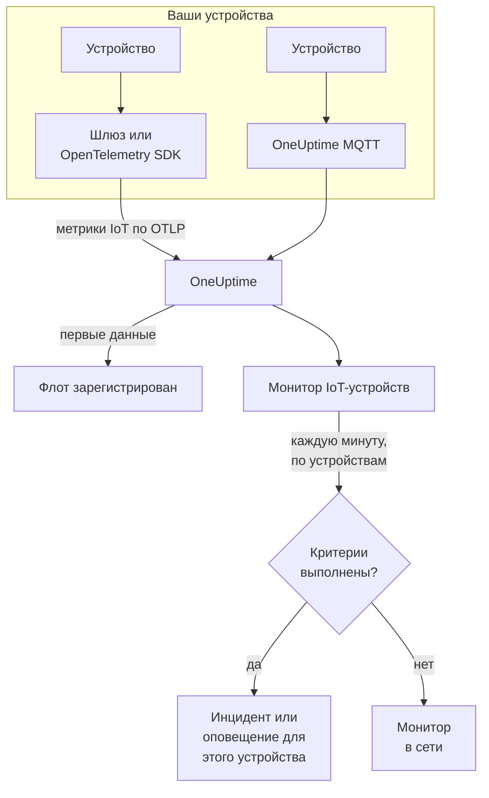

# Мониторинг IoT-устройств

Монитор IoT-устройств следит за одним флотом устройств и сообщает, когда устройство отключается, у него садится батарея, ослабевает сигнал, оно перегревается или его процессор остаётся занятым. Он читает метрики `iot_*`, которые ваши устройства отправляют в OneUptime по OpenTelemetry или MQTT, поэтому ничего не проверяется извне и зонды не участвуют.

:::cards
- [Создайте монитор](#создание-монитора-iot-устройств): Шесть шагов в панели управления.
- [Шаблоны](#готовые-шаблоны-оповещений): Пять готовых оповещений, по инциденту на устройство.
- [Обнаружение отключения](#обнаружение-отключения): Как замечают мёртвое или молчащее устройство.
- [Метрики](#собираемые-метрики): Серии `iot_*`, которые читает монитор.
:::

## Как это работает

Ваши устройства или шлюз, с которым они работают, отправляют показания в OneUptime: по OpenTelemetry или напрямую на MQTT-эндпоинт OneUptime. Каждое показание несёт имя флота, `iot.fleet.name`, и собственный ID устройства, `device.id`. Первые данные регистрируют флот.

Монитор IoT-устройств привязан к одному флоту. Каждую минуту он выполняет свой запрос по метрикам этого флота и сравнивает результат со своими критериями. Шаблоны группируют по `device.id`, поэтому 30 отключившихся датчиков открывают 30 инцидентов, каждый из которых называет своё устройство и разрешается сам, когда его устройство восстанавливается.



## Перед началом работы

- **Настройте отправку данных с устройств.** [Руководство по IoT-устройствам](/docs/telemetry/iot-devices) показывает, как отправлять метрики с помощью OpenTelemetry SDK или Collector либо по MQTT.
- **Убедитесь, что флот зарегистрирован.** Он появляется в разделе **Продукты → Инфраструктура → IoT → All Fleets** под именем из `iot.fleet.name`, которое отправляют устройства.
- **Зарегистрируйте ожидаемые устройства** в **Device Registry** флота, чтобы узнавать, когда одно из них замолкает: см. [Обнаружение отключения](#обнаружение-отключения).

## Создание монитора IoT-устройств

:::steps
### Создайте новый монитор

Перейдите в **Мониторы** и нажмите **Создать монитор**.

### Выберите IoT Device

В разделе **Тип монитора** нажмите **Другие типы мониторов** и выберите **IoT Device** в группе **Инфраструктура** или введите `iot` в поле поиска. Введите **Имя** — оно используется в заголовках инцидентов и оповещений — и нажмите **Далее**.

### Выберите флот

В разделе **IoT Monitor Configuration** выберите флот в поле **IoT Fleet**. В списке есть каждый флот, который отправлял данные.

### Выберите, что отслеживать

Выберите одну из трёх вкладок:

- **Quick Setup** — нажмите на [шаблон](#готовые-шаблоны-оповещений). Он задаёт метрику, агрегацию, диапазон времени, группировку по `device.id` и пороги и заменяет критерии ниже своими. **Диапазон времени** по-прежнему можно изменить.
- **Custom Metric** — выберите одну метрику в **IoT Metric**, затем задайте **Агрегация** и **Диапазон времени**. [Фильтры](#настройки-монитора) сужают её до одного устройства или одного типа устройств. Пользовательская метрика не группируется: она оценивает флот в целом.
- **Расширенный** — стройте запросы и формулы сами в разделе **Выберите метрики**, в том числе по собственным именам метрик, например используемую память в процентах от объёма памяти устройства. Используйте **Group by** `device.id`, чтобы оценивать каждое устройство отдельно.

### Проверьте критерии

Откройте каждый критерий в разделе **Критерии монитора** и проверьте поля **Select Metric Variable**, **Агрегация**, **Условие** и **Threshold**. Шаблон заполняет их сам. С **Custom Metric** или **Расширенный** монитор начинает с [критериев по умолчанию](#критерии-по-умолчанию), которые замечают только падение метрики до нуля, поэтому задайте свой порог.

### Создайте монитор

Нажмите **Создать монитор**. OneUptime открывает страницу монитора и оценивает его каждую минуту. Инциденты и оповещения, которые он поднимает, попадают в ваши политики дежурств, Slack, Microsoft Teams, электронную почту, SMS и вебхуки, как и у любого другого монитора.
:::

> [!TIP]
> Чтобы настроить сразу несколько шаблонов, откройте флот из **Продукты → Инфраструктура → IoT** и перейдите в **Recommendations**. Выберите нужные шаблоны, укажите, кого вызывать, и OneUptime создаст по монитору на каждый шаблон.

## Настройки монитора

| Поле | Вкладка | Что делает |
| --- | --- | --- |
| **IoT Fleet** | Все | Обязательно. Ограничивает каждый запрос атрибутом `resource.iot.fleet.name`. |
| **Область ресурса** | Custom Metric, Расширенный | Необязательно. **Устройство** или **Fleet**: точное совпадение по атрибуту `iot.scope`. Выбор метрики устанавливает значение **Устройство**. |
| **Device ID** | Custom Metric, Расширенный | Необязательно. Одно устройство по его `device.id`, например `sensor-001`. |
| **Device Type** | Custom Metric, Расширенный | Необязательно. Устройства, которые сообщают этот `iot.device.type`, например `sensor` или `gateway`. |
| **IoT Metric** | Custom Metric | Одна метрика из [каталога](#собираемые-метрики). |
| **Агрегация** | Custom Metric | Как объединяются выборки: **Среднее**, **Максимум**, **Минимум**, **Сумма** или **Количество**. Начинается с обычной агрегации метрики. |
| **Диапазон времени** | Все | Скользящее окно, которое читает запрос, от **Past 1 Minute** до **Past 365 Days**. Новый монитор начинается с **Past 1 Minute**; шаблоны задают своё. |
| **Выберите метрики** | Расширенный | Конструктор запросов: **Метрика**, **Aggregate by**, **Filter by attributes**, **Group by**, а также **Добавить метрику** и **Добавить формулу** для объединения запросов. |

Фильтры работают вместе: если заданы **Device ID** и **Device Type**, устройство другого типа ни с чем не совпадёт.

## Готовые шаблоны оповещений

**Quick Setup** предлагает 5 шаблонов. Каждый строит полный монитор: запрос метрики, группировку по `device.id`, критерий, который срабатывает, и критерий, который восстанавливает. Пороги — это отправные точки, которые можно изменить.

Критерий срабатывает, только когда условие выполняется для каждой минуты его окна, — кроме **Device Offline**, который срабатывает на первом же показании ниже 1. Пороговый критерий восстанавливается на 10 % дальше своего порога, поэтому значение, колеблющееся у этой границы, не переключает состояние туда и обратно.

| Шаблон | Категория | Серьёзность | Что отслеживает | Срабатывает, когда | Восстанавливается, когда |
| --- | --- | --- | --- | --- | --- |
| Device Offline | Доступность | Критический | `iot_device_up`, Min по `device.id`, последние 30 минут | Любое показание ниже 1 или зарегистрированное устройство ничего не отправляет в течение всего окна | Снова 1 |
| Low Battery | Power | Warning | `iot_battery_percent`, Avg по `device.id`, последние 5 минут | Ниже 20 % | 22 % или выше |
| Weak Signal | Connectivity | Warning | `iot_signal_strength_dbm`, Avg по `device.id`, последние 5 минут | Ниже -100 dBm | -90 dBm или выше |
| High Temperature | Окружение | Критический | `iot_temperature_celsius`, Max по `device.id`, последние 5 минут | Выше 70 °C | 63 °C или ниже |
| High CPU Usage | System | Warning | `iot_cpu_usage_ratio`, Avg по `device.id`, последние 5 минут | Выше 0.9 (90 % его CPU) | 0.81 или ниже |

**Серьёзность** — это метка, которую показывает список выбора. Инцидент и оповещение, которые создаёт шаблон, начинаются с самой высокой серьёзности инцидентов и оповещений вашего проекта; измените их в критерии.

- **Device Offline читает 30 минут**, чтобы устройство, которое отчитывается раз в несколько минут, не считалось отключённым между двумя отчётами. Устройству, которое отчитывается реже, чем примерно раз в 15 минут, нужно более длинное окно.
- **High Temperature использует Max** в каждой минуте, чтобы горячее показание не скрывалось более холодными в ту же минуту. Устройство всё равно должно оставаться горячим в каждую минуту окна.
- **High CPU Usage сравнивает долю:** `iot_cpu_usage_ratio` изменяется от 0 до 1, поэтому 0.9 — это 90 %.

## Обнаружение отключения

**Device Offline** срабатывает, когда устройство сообщает `iot_device_up = 0`. Мёртвое или молчащее устройство вызывает его тремя способами:

| Как | Что происходит |
| --- | --- |
| **Об этом сообщает шлюз** | Шлюз или коллектор отправляет `iot_device_up = 0` для устройства, до которого больше не может достучаться. |
| **MQTT Last Will** | Устройство, подключённое к MQTT-эндпоинту OneUptime, регистрирует Last Will в своём топике `status`. Когда устройство умирает, брокер отправляет для него `iot_device_up = 0` в момент обрыва сессии: без опроса и без ожидания пропущенного отчёта. См. [Отправка метрик через MQTT](/docs/telemetry/iot-devices#отправка-метрик-через-mqtt). |
| **Устройство зарегистрировано** | Устройство из **Device Registry** флота ожидается. Если оно ничего не отправляет в течение всего окна, монитор считает, что оно сообщило `0`, поэтому для него открывается собственный инцидент, который разрешается сам, когда устройство снова начинает отчитываться. |

Зарегистрированное устройство также остаётся в инвентаре флота как отключённое, а незарегистрированное удаляется после 15 минут тишины. Для обнаружения тишины нужна политика отсутствия данных **Treat As Zero** на критерии `iot_device_up`, которая есть у мониторов Device Offline, созданных из шаблона. Монитору Device Offline, созданному до появления регистрации устройств, её нужно задать вручную, либо его нужно заново создать из шаблона.

> [!NOTE]
> Незарегистрированное устройство, которое замолкает без Last Will или отчёта шлюза, просто перестаёт отправлять данные, и монитор, сгруппированный по устройствам, не может его выделить. Зарегистрируйте свои устройства или дайте критически важному устройству собственный монитор (**Custom Metric** с его **Device ID**) и задайте для **Если нет данных** значение **Триггер**. Для обнаружения тишины также нужно, чтобы хотя бы одно другое устройство флота продолжало отчитываться: флот, который полностью замолкает, например при сбое шлюза, поднимает один инцидент для монитора, а не по одному на устройство.

## Собираемые метрики

Каждая серия несёт метку устройства `device.id` и атрибуты `iot.scope`, `iot.device.type` и `iot.device.kind`.

| Метрика | Единица | Описание |
| --- | --- | --- |
| `iot_device_up` | — | 1, когда устройство работает, 0, когда оно не работает или не в сети. |
| `iot_battery_percent` | `%` | Оставшийся заряд батареи, от 0 до 100. Падающий уровень означает, что устройство скоро перестанет отчитываться. |
| `iot_signal_strength_dbm` | `dBm` | Мощность беспроводного сигнала. Чем ближе к 0, тем сильнее; слабый сигнал предшествует потере соединений. |
| `iot_temperature_celsius` | `°C` | Температура устройства. Высокое показание может означать перегрев оборудования или проблему вокруг него. |
| `iot_cpu_usage_ratio` | `ratio` | Используемый CPU, от 0 до 1, где 1 — полная загрузка. |
| `iot_memory_usage_bytes` | `bytes` | Используемая память. Сравните её с объёмом памяти устройства, чтобы увидеть нехватку памяти. |
| `iot_uptime_seconds` | `s` | Сколько времени устройство работает. Падает до нуля при перезапуске. |

## Критерии мониторинга

Критерий сравнивает один из запросов или формул монитора с порогом. Критерии монитора IoT-устройств предлагают один **Тип фильтра**, **Metric Value**: каждое правило проверяет значение метрики с помощью этих полей.

| Поле | Что делает |
| --- | --- |
| **Тип фильтра** | Всегда **Metric Value** — единственная проверка, которую предлагает этот монитор. |
| **Select Metric Variable** | Запрос или формула для проверки, по имени переменной. |
| **Агрегация** | Как значения в окне превращаются в один ответ: **Среднее**, **Сумма**, **Maximum Value**, **Minimum Value**, **All Values** (каждое значение должно совпасть) или **Any Value** (достаточно одного). |
| **Условие** | **Greater Than**, **Less Than**, **Greater Than Or Equal To**, **Less Than Or Equal To** или **Equal To** — или условие аномалии: **Anomalously High**, **Anomalously Low** или **Anomalous**. |
| **Threshold** | Значение, с которым идёт сравнение. Рядом есть список единиц, если у метрики есть единица. Не показывается для условий аномалии. |
| **Чувствительность** | Только условия аномалии. **Низкий** (4σ), **Средний** (3σ, по умолчанию) или **Высокий** (2σ). |
| **Окно базовой линии** | Только условия аномалии. 14 дней (по умолчанию), 28, 60 или 90 дней истории. |
| **Если нет данных** | В разделе **Дополнительные поля**. Что происходит, когда у серии нет выборок в окне: **Ignore** (по умолчанию) пропускает её, **Treat As Zero** читает её как `0`, а **Триггер** заставляет критерий совпасть. |

Условия аномалии сравнивают каждое значение с тем же часом недели в базовой линии. Они остаются в состоянии "Learning" и ничего не поднимают, пока в окне базовой линии не накопится достаточно истории.

### Критерии по умолчанию

Монитор, который вы строите не из шаблона, начинает с двух критериев:

| Порядок | Критерий | Совпадает, когда | Затем |
| --- | --- | --- | --- |
| 1 | Check if _monitor name_ is offline | Любое значение первого запроса равно `0` | Помечает монитор как **Не в сети** и объявляет инцидент "_monitor name_ is offline", который разрешается сам, когда монитор восстанавливается. |
| 2 | Check if _monitor name_ is online | Любое значение больше `0` | Помечает монитор как **Работает**. |

> [!IMPORTANT]
> Тишина не совпадает ни с одним из критериев: флот, который перестаёт отправлять данные, оставляет монитор в прежнем состоянии. Чтобы узнавать, когда данные перестают поступать, задайте в критерии для **Если нет данных** значение **Триггер**. Время, когда сам OneUptime ничего не получал, никогда не считается отсутствием данных: проверка, в окно которой оно попадает, вместо этого ждёт, как объясняется в разделе [Когда OneUptime не получает данные](/docs/monitor/when-oneuptime-is-not-receiving).

## Terraform

[Terraform-провайдер OneUptime](/docs/terraform/monitor-steps) передаёт конфигурацию шага монитора IoT-устройств в атрибуте `iot_monitor`: сырой JSON конфигурации `iotMonitor` (`fleetIdentifier`, `resourceFilters`, `metricViewConfig`, `rollingTime`), записанный с помощью `jsonencode()`:

```hcl title="main.tf"
monitor_steps = [{
  iot_monitor = jsonencode({
    fleetIdentifier = "building-a-sensors"
    resourceFilters = {}
    rollingTime     = "Past 5 Minutes"
    metricViewConfig = {
      queryConfigs = [{
        metricAliasData = { metricVariable = "battery_percent", title = "Battery", description = "", legend = "" }
        metricQueryData = {
          filterData = {
            metricName     = "iot_battery_percent"
            attributes     = {}
            aggegationType = "Avg"
            aggregateBy    = {}
          }
          groupByAttributeKeys = ["device.id"]
        }
      }]
      formulaConfigs = []
    }
  })
  criteria = [ /* ... */ ]
}]
```

`fleetIdentifier` — это `iot.fleet.name` флота, а не его ID в OneUptime.

## Устранение неполадок

:::details Флота нет в списке IoT Fleet
Флоты регистрируются сами по данным устройств. Проверьте, что устройства отправляют `iot.fleet.name`, и следуйте [руководству по IoT-устройствам](/docs/telemetry/iot-devices), чтобы убедиться, что данные поступают.
:::

:::details Один инцидент срабатывает на весь флот, а не по одному на устройство
Запрос не сгруппирован. Мониторы с **Custom Metric** оценивают флот в целом; используйте шаблон или **Расширенный** с **Group by** `device.id`.
:::

:::details Устройство умерло, но Device Offline не сработал
Устройство не отправило Last Will, и шлюз о нём не сообщил, поэтому оно просто замолчало. Зарегистрируйте его в **Device Registry** флота и проверьте, что для **Если нет данных** в критерии `iot_device_up` задано **Treat As Zero**. См. [Обнаружение отключения](#обнаружение-отключения).
:::

:::details Device Offline срабатывает для исправных устройств
Они отчитываются реже, чем охватывает окно в 30 минут, поэтому в некоторых окнах от них ничего нет. Увеличьте **Диапазон времени** или пусть устройства отчитываются чаще. На MQTT-эндпоинте через WebSocket держите keepalive MQTT меньше 5 минут: OneUptime закрывает простаивающие соединения WebSocket через 300 секунд, а это отправляет Last Will.
:::

:::details Шаблон не показывает данных
Шаблоны читают имена метрик `iot_*` точно и группируют по метке `device.id`. Сравните то, что отправляют ваши устройства, на странице флота **Метрики** с [соглашениями о метриках](/docs/telemetry/iot-devices#соглашения-о-метриках).
:::

## Дальнейшие шаги

:::cards
- [IoT-устройства](/docs/telemetry/iot-devices): Отправляйте метрики устройств по OpenTelemetry или MQTT.
- [Мониторинг метрик](/docs/monitor/metrics-monitor): Оповещения по любой метрике, а не только по метрикам IoT.
- [Шаблоны инцидентов и оповещений](/docs/monitor/incident-alert-templating): Вставляйте ID устройства в заголовки инцидентов.
:::
