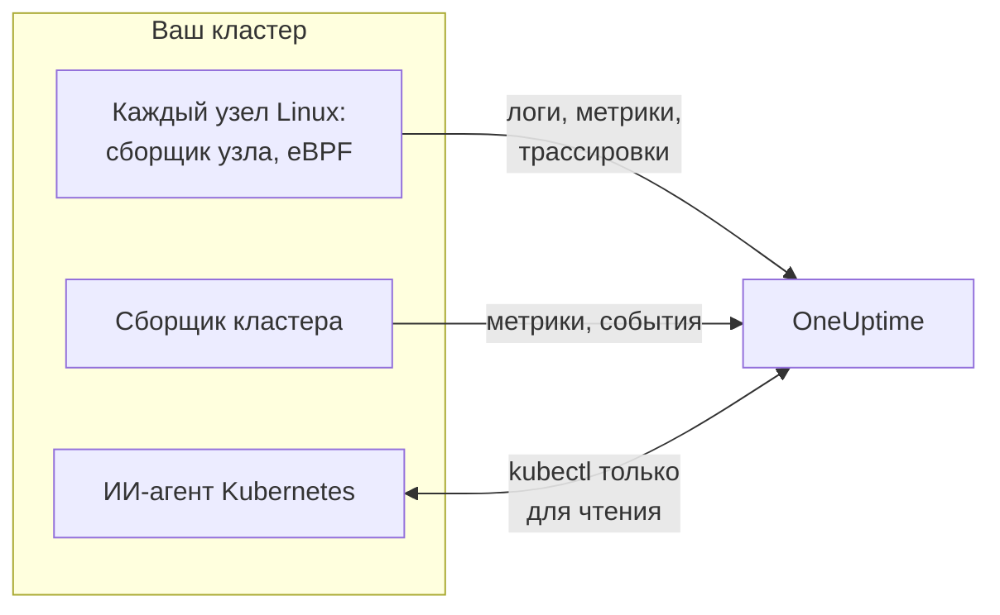

# Агент Kubernetes (установка через Helm)

Агент Kubernetes от OneUptime — это Helm-чарт, который собирает метрики, события и логи подов вашего кластера, трассировки приложений, захваченные с помощью eBPF, и метрики ОС каждого узла и отправляет их в OneUptime. Одна команда `helm install` разворачивает его без изменений в коде ваших приложений. [Мониторы Kubernetes](/docs/monitor/kubernetes-monitor) создают оповещения на основе того, что он отправляет.

:::cards
- [Установите агент](#установка-агента): Четыре шага с Helm.
- [Выберите пресет](#выбор-пресета): Стандартные кластеры, GKE Autopilot или EKS Fargate.
- [Основные параметры](#основные-параметры): Настройки, которые меняют в большинстве кластеров.
- [Устранение неполадок](#устранение-неполадок): Диагностический скрипт и типичные проблемы.
:::

## Что устанавливает чарт

Чарт запускает несколько рабочих нагрузок в собственном пространстве имён. Каждая отправляет собранное на ваш URL OneUptime по OTLP с ключом приема, который вы ей передали.



| Рабочая нагрузка | Тип | Что делает | Включено по умолчанию |
| --- | --- | --- | --- |
| Сборщик кластера | Deployment | Метрики кластера, события Kubernetes и полные спецификации подов, узлов и рабочих нагрузок из Kubernetes API. | Да |
| Сборщик узла | DaemonSet | Логи подов из `/var/log/pods`, метрики kubelet и cAdvisor и метрики ОС узла. | Да |
| eBPF-инструментирование (OBI) | DaemonSet | Трассировки HTTP, gRPC, SQL и Redis и метрики запросов от каждого пода, а также карта сервисов. | Да |
| ИИ-агент Kubernetes | Deployment | Позволяет OneUptime AI выполнять `kubectl` только для чтения, пока он расследует инцидент или оповещение в этом кластере. | Да |
| Считыватель логов | Deployment | Логи подов через Kubernetes API там, где сборщик узла не может их прочитать. | С пресетами `gke-autopilot` и `eks-fargate` |
| eBPF-профилировщик | DaemonSet | Непрерывные flame-графы CPU для каждого процесса. | Нет |
| kube-state-metrics | Deployment | Фазы подов, причины ожидания контейнеров и квоты ресурсов. | Нет |

Каждый образ агента работает только в Linux, поэтому каждая рабочая нагрузка привязана к узлам Linux.

## Перед началом работы

- **Ключ приема.** Создайте его в OneUptime в разделе **Настройки проекта → Телеметрия и APM → Ключи приема**. Агент отправляет его в заголовке `x-oneuptime-token`, поэтому ключ API проекта здесь не подойдёт.
- **Helm 3** и доступ `kubectl` к кластеру. Обновления используют `--reset-then-reuse-values`, для чего нужен Helm 3.14 или новее.
- **Имя кластера**, уникальное в вашем проекте. Без него чарт отказывается устанавливаться: два кластера с одинаковым именем отображались бы как один.
- **Исходящий HTTPS** из кластера на ваш URL OneUptime.

## Установка агента

:::steps
### Добавьте репозиторий Helm

```bash
helm repo add oneuptime https://helm-chart.oneuptime.com
helm repo update
```

### Установите чарт

Замените URL на ваш URL OneUptime, а два заполнителя — на ваш ключ приема и имя кластера:

```bash
helm install oneuptime-agent oneuptime/kubernetes-agent \
  --namespace oneuptime-kubernetes-agent \
  --create-namespace \
  --set oneuptime.url=https://oneuptime.com \
  --set oneuptime.apiKey=<YOUR_API_KEY> \
  --set clusterName=<A_UNIQUE_NAME_FOR_THIS_CLUSTER>
```

Здесь используется пресет `standard`. В GKE Autopilot или EKS Fargate вместо этого [выберите их пресет](#выбор-пресета).

### Проверьте, что поды запущены

```bash
kubectl get pods -n oneuptime-kubernetes-agent
```

Каждый под должен перейти в состояние `Running` в течение минуты-двух.

### Найдите кластер в OneUptime

Откройте **Продукты → Инфраструктура → Kubernetes → Все кластеры**. Кластер появится под своим именем в течение нескольких минут, и в нём заполнятся узлы, поды и рабочие нагрузки.
:::

## Выбор пресета

Некоторые платформы Kubernetes не позволяют рабочей нагрузке монтировать том `hostPath` или запускать DaemonSet, а сборщик узла использует и то и другое. Настройка `preset` выбирает то, что работает на вашей платформе:

| Пресет | Для чего | Логи подов | На каждом узле |
| --- | --- | --- | --- |
| `standard` (по умолчанию) | Самостоятельно управляемые кластеры, **EKS on EC2**, **GKE Standard**, **AKS**, minikube, kind, k3s | Сборщик узла читает `/var/log/pods` | Метрики kubelet, cAdvisor и ОС |
| `gke-autopilot` | **GKE Autopilot** | Считыватель логов читает их через Kubernetes API | Метрики kubelet и cAdvisor, без `hostPath` |
| `eks-fargate` | **EKS Fargate** | Считыватель логов читает их через Kubernetes API | Ничего: Fargate не запускает DaemonSet |

Если не уверены, оставьте `preset` пустым, чтобы получить `standard`. Если установка завершается ошибкой Pod Security с упоминанием `hostPath`, установите заново с `gke-autopilot` или с `eks-fargate` в EKS Fargate.

GKE Autopilot и EKS Fargate также отклоняют привилегированные поды, которые нужны eBPF-инструментированию, поэтому отключите его там с помощью `--set ebpf.enabled=false`:

:::tabs
@tab Standard
```bash
helm install oneuptime-agent oneuptime/kubernetes-agent \
  --namespace oneuptime-kubernetes-agent --create-namespace \
  --set oneuptime.url=https://oneuptime.com \
  --set oneuptime.apiKey=<YOUR_API_KEY> \
  --set clusterName=prod
```
@tab GKE Autopilot
```bash
helm install oneuptime-agent oneuptime/kubernetes-agent \
  --namespace oneuptime-kubernetes-agent --create-namespace \
  --set oneuptime.url=https://oneuptime.com \
  --set oneuptime.apiKey=<YOUR_API_KEY> \
  --set clusterName=prod-gke-autopilot \
  --set preset=gke-autopilot \
  --set ebpf.enabled=false
```
@tab EKS Fargate
```bash
helm install oneuptime-agent oneuptime/kubernetes-agent \
  --namespace oneuptime-kubernetes-agent --create-namespace \
  --set oneuptime.url=https://oneuptime.com \
  --set oneuptime.apiKey=<YOUR_API_KEY> \
  --set clusterName=prod-eks-fargate \
  --set preset=eks-fargate \
  --set ebpf.enabled=false
```
:::

## Метки для кластера

Метки, которые вы передаёте при установке, прикрепляются к кластеру, а также к сервисам и хостам, о которых сообщает этот агент. `--set oneuptime.labels.<key>=<value>` становится меткой проекта с именем `<key>:<value>`:

```bash
helm install oneuptime-agent oneuptime/kubernetes-agent \
  --namespace oneuptime-kubernetes-agent \
  --create-namespace \
  --set oneuptime.url=https://oneuptime.com \
  --set oneuptime.apiKey=<YOUR_API_KEY> \
  --set clusterName=prod \
  --set oneuptime.labels.team=payments \
  --set oneuptime.labels.env=production \
  --set oneuptime.labels.region=us-east-1
```

Или храните их в файле values:

```yaml title="values.yaml"
oneuptime:
  url: https://oneuptime.com
  apiKey: <YOUR_API_KEY>
  labels:
    team: payments
    env: production
    region: us-east-1
clusterName: prod
```

```bash
helm install oneuptime-agent oneuptime/kubernetes-agent \
  --namespace oneuptime-kubernetes-agent --create-namespace \
  -f values.yaml
```

Тогда каждая запись, которую отправляет этот агент, — логи, метрики, трассировки и профили — несёт `team:payments`, `env:production` и `region:us-east-1`. Каждая метка — это атрибут ресурса `oneuptime.label.<key>=<value>`, и OneUptime превращает в метку каждый атрибут, начинающийся с `oneuptime.label.`. Метки сравниваются без учёта регистра, поэтому существующая метка `Production` используется повторно, а не дублируется. Агент никогда не удаляет метку, которую вы добавили в OneUptime.

## Логи подов

`preset` задаёт `logs.mode`, который можно задать и самостоятельно:

| `logs.mode` | Как читаются логи | Плюсы | На что обратить внимание |
| --- | --- | --- | --- |
| `daemonset` | Один сборщик узла на каждом узле читает файлы в `/var/log/pods`. | Минимальные накладные расходы, масштабируется вместе с узлами, не нагружает сервер Kubernetes API, отслеживает ротацию логов. | Нужны `hostPath` и DaemonSet. |
| `api` | Один считыватель логов получает поток лога каждого контейнера из Kubernetes API, как это делает `kubectl logs -f`. | Работает там, где `hostPath` заблокирован или действует стандарт Pod Security `restricted`. | Каждый поток контейнера — это долгоживущее соединение с сервером API. Одна реплика обслуживает несколько тысяч контейнеров. |
| `disabled` | Ничего. | Для приложений, которые уже отправляют логи другим способом. | |

Чтобы отключить сбор логов, задайте `--set logs.enabled=false` и отправляйте логи приложений через SDK [OpenTelemetry](/docs/telemetry/open-telemetry). На метрики это не влияет: сборщик узла продолжает работать.

### Кластеры со смешанными ОС (пулы узлов Windows)

На узлах Windows никогда не запускается под агента. Данные уровня кластера о них и их подах всё равно поступают, потому что они приходят из Kubernetes API: состояния узлов, фазы подов, события Kubernetes и kube-state-metrics. Узлам Windows недостаёт того, что собирается на самом узле: метрик ОС, метрик kubelet и cAdvisor, трассировок eBPF, профилей и, в режиме логов `daemonset`, логов подов.

Чтобы собирать и логи подов на узлах Windows, включите гибридный режим:

```bash
helm upgrade oneuptime-agent oneuptime/kubernetes-agent \
  --namespace oneuptime-kubernetes-agent --reset-then-reuse-values \
  --set logs.windowsPods.enabled=true
```

Тогда считыватель логов работает рядом со сборщиками узлов, только для подов на узлах Windows. Поды Linux по-прежнему используют более дешёвое чтение файлов, а два компонента делят поды по ОС узла, поэтому ни одна строка лога не отправляется дважды.

- **Версия образа считывателя.** Разделение только для Windows встроено в образ `kubernetes-log-tailer`. Старый образ его игнорирует и читает *каждый* под, отправляя логи каждого пода Linux дважды. Не закрепляйте `logs.api.image.tag` на версии старше релиза чарта, а если на узле может быть закеширован старый образ `release`, добавьте к обновлению `--set logs.api.image.pullPolicy=Always`.
- **Фильтрация по важности.** Если задан `filters.logs.minSeverity`, строка без распознаваемой важности отбрасывается на пути сборщика узла, но сохраняется на пути считывателя логов — см. [Фильтрация по важности логов](/docs/telemetry/kubernetes-agent#фильтрация-по-важности-логов). Тогда поды Windows могут отправлять больше строк без уровня, чем поды Linux.

## Трассировки приложений с eBPF

Чарт запускает [OpenTelemetry eBPF Instrumentation (OBI)](https://opentelemetry.io/docs/zero-code/obi/) на каждом узле. OBI загружает программы eBPF в ядро Linux и наблюдает за сетевым трафиком каждого пода, поэтому может восстанавливать вызовы HTTP и HTTPS, gRPC, а также SQL и Redis без каких-либо изменений в ваших приложениях: без SDK и без sidecar. Он отправляет их в OneUptime как трассировки и метрики запросов.

Ваши сервисы появятся в разделе **Продукты → Трассировка** и на карте сервисов в течение минуты-двух, с `k8s.cluster.name`, равным имени кластера, поэтому их можно фильтровать по кластеру.

### Когда отключать eBPF

eBPF включён по умолчанию. Отключите его с помощью `--set ebpf.enabled=false`, когда:

- Кластер — **GKE Autopilot** или **EKS Fargate**. Они отклоняют привилегированные поды, а OBI должен быть привилегированным, чтобы загружать свои программы.
- На узлах работает ядро старше **Linux 5.8** без BTF. Debian 11, Ubuntu 20.10, Fedora 34, RHEL 9 и новее подходят.
- Ваши приложения уже отправляют трассировки через SDK OpenTelemetry, и вам не нужны дубликаты.

### Что отправляет eBPF

OBI отправляет несколько видов сигналов. Каждый можно отключить с помощью `--set ebpf.features.<key>=false`:

| Настройка | По умолчанию | Что добавляет |
| --- | --- | --- |
| `ebpf.features.httpMetrics` | вкл. | Метрики запросов HTTP и gRPC по сервисам: частота запросов, гистограммы задержек и ошибки. |
| `ebpf.features.spanMetrics` | вкл. | Метрики спанов: вызовы и длительность по сервису, маршруту или операции, виду спана и статусу — `traces.span.metrics.calls` и `traces.span.metrics.duration` (секунды). |
| `ebpf.features.serviceGraph` | вкл. | Частота и задержка каждого вызова от одного сервиса к другому, по которым рисуется карта сервисов. |
| `ebpf.features.networkMetrics` | вкл. | Байты и пакеты между каждой парой подов по TCP и UDP, с их именами в Kubernetes. Показывает каждую пару общающихся подов, даже по протоколам, которые OBI не может прочитать. |
| `ebpf.features.networkInterZoneMetrics` | выкл. | То же самое между зонами. Удваивает количество серий: включайте, только если планируете размещение по зонам. |
| `ebpf.features.tcpStats` | вкл. | Статистика TCP по узлам: время приёма-передачи, неудачные соединения и повторные передачи. |

### Связывание трассировок между сервисами

OBI также может переносить трассировку через вызов: когда под A вызывает под B по HTTP или gRPC, спан на стороне B присоединяется к трассировке A без SDK в обоих приложениях. **По умолчанию это выключено.** Включите это с помощью `--set ebpf.contextPropagation=true`, прочитав предупреждение ниже.

| Параметр | По умолчанию | Что делает |
| --- | --- | --- |
| `ebpf.contextPropagation` | выкл. | Записывает W3C `traceparent` в исходящий трафик, чтобы спаны связывались между сервисами. |
| `ebpf.contextPropagationMode` | `headers` | Как: `headers` (заголовки запросов HTTP/1.1, самый узкий вариант), `tcp` (опция TCP через Linux Traffic Control) или `all` (оба). Учитывается, только когда `contextPropagation` включён. |
| `ebpf.trackRequestHeaders` | вкл. | Отслеживает заголовки запросов в ядре, чтобы принимающая сторона находила `traceparent` и на простых HTTP-серверах. Действует, только когда `contextPropagation` включён. |

> [!WARNING]
> Каждый режим распространения изменяет трафик, который уже передаётся. Для простого HTTP OBI расширяет исходящий запрос в ядре, чтобы вместить заголовок; для TLS и сырого TCP он добавляет опцию TCP из хука Traffic Control, переписывая пакет и его контрольную сумму. Если учёт байтов соединения после этого не исправляется точно, поток **рассинхронизируется**: передачи через прокси, например nginx, зависают на полпути, как только ответ превышает примерно 64 КБ, пока соединение не завершится по тайм-ауту. Небольшие запросы продолжают работать, поэтому это выглядит как ошибка приложения или прокси. Ни одна версия ядра не избавляет от этой перезаписи. Трассировки, метрики запросов и карта сервисов работают без неё; SDK OpenTelemetry в ваших сервисах связывает трассировки вообще без перезаписи в ядре. Если вы всё же включаете её, сначала попробуйте на кластере, который не является производственным, и проверьте большие передачи через ваш прокси.

### Связывание логов с трассировками

**По умолчанию выключено.** Когда оно включено, OBI подключает зонд к системному вызову `write()` каждого процесса, который он инструментирует, и:

- **Строка лога в JSON** получает поля `trace_id` и `span_id` (поля, которые в строке уже есть, сохраняются). Сборщик узла переносит их в собственные поля трассировки записи лога, поэтому логи спана в OneUptime находятся в одном клике от него, как и трассировка строки лога.
- **Любая другая строка лога** собирается без изменений, без связи.

```bash
helm upgrade oneuptime-agent oneuptime/kubernetes-agent \
  --namespace oneuptime-kubernetes-agent --reset-then-reuse-values \
  --set ebpf.logToTraceCorrelation=true
```

| Параметр | По умолчанию | Что делает |
| --- | --- | --- |
| `ebpf.logToTraceCorrelation` | `false` | Включает обогатитель логов OBI и перенос `trace_id` в сборщике узла. |
| `ebpf.logEnricher.services` | `[{service: [{exe_path: "*"}]}]` | Какие процессы затрагивает обогатитель. Каждая запись — это селектор OBI [GlobAttributes](https://opentelemetry.io/docs/zero-code/obi/configure/options/#service-discovery) с полями вроде `exe_path`, `languages`, `k8s_pod_labels`, `k8s_pod_annotations`, `open_ports` и `cmd_args`. |

#### APM-агенты, которые с этим падают

Обогатитель перезаписывает выходной буфер приложения **внутри процесса**: когда подходящий процесс вызывает `write()`, OBI затирает исходные байты и записывает обогащённую копию. APM-агенты, которые загружаются через `LD_PRELOAD` и сами оборачивают `write()`, этого не переживают:

| APM-агент | Библиотека | Что происходит |
| --- | --- | --- |
| Dynatrace OneAgent | `liboneagentproc.so` | Приложение падает с SIGSEGV (код выхода 139). Собственный `write()` сторожевого процесса Dynatrace зависает дольше своего 10-секундного лимита, и OneAgent перезапускается в цикле. |
| New Relic | `libnewrelic*.so` | Такой же сбой. |
| AppDynamics | `libappdynamics*.so` | Такой же сбой. |
| Datadog | `libdd*.so` | Такой же сбой. |
| Instana | `libinstana*.so` | Такой же сбой. |

**Приложения .NET уязвимее всего:** агент Dynatrace для .NET всегда загружается через `LD_PRELOAD`, а консольный лог Microsoft.Extensions.Logging не буферизуется, поэтому каждая строка идёт этим путём. Приложения на Python и Go обычно не затронуты.

Чтобы использовать это рядом с одним из этих агентов, направьте `logEnricher.services` только на поды без такого агента. Исключать обогатитель не умеет, поэтому перечислите те, которые нужно обогащать:

```yaml title="values.yaml"
ebpf:
  logToTraceCorrelation: true
  logEnricher:
    services:
      # Enrich only pods with the apm-agent=none label
      - service:
          - k8s_pod_labels:
              apm-agent: "none"
```

Или выбирайте по среде выполнения. Загрузка Dynatrace через `LD_PRELOAD` нацелена на .NET, поэтому обогащение только Python, Go, Ruby и Node.js её обходит:

```yaml title="values.yaml"
ebpf:
  logToTraceCorrelation: true
  logEnricher:
    services:
      - service:
          - languages: "python,go,ruby,nodejs"
```

#### Логи должны быть в JSON и без буферизации

- **`trace_id` получают только строки JSON.** Переключите логгер на формат JSON: `structlog`, `pino`, `winston`, `serilog`, `logback-json`, klog `--logging-format=json` и тому подобные.
- **Буферизованный вывод разрывает связь**, потому что `write()` тогда происходит в другом потоке, чем запрос. В **Python** задайте `PYTHONUNBUFFERED=1`. В **.NET** вызовите `Console.SetOut(new StreamWriter(Console.OpenStandardOutput()) { AutoFlush = true })` при запуске; `AddConsole()` из Microsoft.Extensions.Logging и асинхронные приёмники Serilog не работают, а обычный `WriteTo.Console()` из Serilog работает.
- Greenlet, gevent, Tornado и другие собственные асинхронные среды выполнения не поддерживаются.

### Настройка eBPF

| Параметр | По умолчанию | Что делает |
| --- | --- | --- |
| `ebpf.enabled` | `true` | Запускает DaemonSet eBPF. `false` его не устанавливает. |
| `ebpf.image.tag` | `v0.14.0` | Образ OBI. OBI ещё не достиг версии 1.0: закрепите проверенную версию и проверьте заново, прежде чем её менять. |
| `ebpf.autoTargetExe` | `*` | Glob-шаблоны исполняемых файлов для инструментирования, через запятую. Сузьте его, как в `*/python,*/java`, чтобы инструментировать меньше сред выполнения. |
| `ebpf.excludeExePaths` | Оболочки, служебные компоненты кластера, sidecar-контейнеры service mesh, агенты CNI, браузеры, ClickHouse, сборщики и сам OBI | Glob-шаблоны исполняемых файлов, которые нужно пропускать, через запятую. Широкий шаблон пропустит и ваши собственные бинарные файлы. |
| `ebpf.logLevel` | `info` | `debug`, `info`, `warn` или `error`. |
| `ebpf.printTraces` | `false` | Также выводит спаны в собственный лог OBI, чтобы проверить, что он захватывает. |
| `ebpf.resources.*` | Запрос `100m` CPU и `512Mi` памяти, лимиты `2000m` и `2Gi` | Увеличьте их для узлов с интенсивным трафиком или множеством короткоживущих процессов. |

Чтобы проверить, что OBI работает и видит трафик:

```bash
kubectl get pods -n oneuptime-kubernetes-agent -l component=ebpf-instrument
kubectl logs -n oneuptime-kubernetes-agent -l component=ebpf-instrument --tail=200
```

## Непрерывное профилирование CPU

[OpenTelemetry eBPF Profiler](https://github.com/open-telemetry/opentelemetry-ebpf-profiler) тоже может работать на каждом узле, в виде образа `otel/opentelemetry-collector-ebpf-profiler`. Он 19 раз в секунду снимает выборку того, что выполняет каждый процесс, на Go, Java, .NET, Python, Ruby, Node.js, PHP, Perl, C, C++ и Rust, и отправляет профили в OneUptime. Они появляются в разделе **Продукты → Профили производительности** и в виде flame-графа на каждом спане трассировки.

**Профилирование по умолчанию выключено:** оно требует больше CPU и памяти на узел, чем eBPF-инструментирование. Включите его с помощью `--set profiling.enabled=true`.

Если eBPF-инструментирование тоже включено (по умолчанию), каждая выборка несёт трассировку, к которой относится, поэтому у спана есть собственный flame-граф. Для этого чарт просит OBI держать текущий контекст трассировки доступным (`OTEL_EBPF_BPF_POPULATE_TRACE_CONTEXT=true`), что немного стоит инструментированным приложениям при каждом асинхронном переключении контекста. Задайте `profiling.obiProcessContext=false`, чтобы получать flame-графы без связи со спанами.

Профилированию нужен **Linux 5.10** или новее и привилегированный под с идентификаторами процессов узла: оно не может работать в GKE Autopilot или EKS Fargate. На узлах, которые сами являются контейнерами, например в kind или k3d, оно не может различать процессы, и почти ни одна выборка не связывается со спаном.

| Параметр | По умолчанию | Что делает |
| --- | --- | --- |
| `profiling.enabled` | `false` | Запускает DaemonSet профилировщика. |
| `profiling.image.tag` | `0.152.0` | Образ профилировщика. Он ещё не достиг версии 1.0: закрепите проверенную версию. |
| `profiling.samplesPerSecond` | `19` | Сколько выборок в секунду. 19 позволяет не совпадать с распространёнными частотами таймеров. |
| `profiling.offCpuThreshold` | `0` | Значение больше 0 и до 1 также профилирует время вне CPU, что показывает конкуренцию за блокировки и блокирующий ввод-вывод, за некоторую дополнительную цену. |
| `profiling.tracers` | `""` (каждая среда выполнения) | Языковые трассировщики для загрузки, через запятую, например `go,python`. |
| `profiling.obiProcessContext` | `true` | Связывает выборки с трассировками OBI и заставляет OBI держать для этого контекст трассировки доступным. |

## Сбор других данных

| Параметр | По умолчанию | Что добавляет |
| --- | --- | --- |
| `hostMetrics.enabled` | вкл. | Метрики ОС каждого узла из `/proc` и `/sys`: очереди дискового ввода-вывода, inode файловых систем, ошибки сетевых интерфейсов, подкачка и средняя нагрузка. Работает в сборщике узла, без дополнительных подов. |
| `kubeletstats.utilizationMetrics.enabled` | вкл. | CPU и память контейнеров и подов в процентах от их request и limit, которые читают мониторы насыщения CPU и памяти. Всегда 0 для пода без request или limit. |
| `kubeletstats.volumeMetrics.enabled` | вкл. | Свободное и общее место каждого PVC (`k8s.volume.available`, `k8s.volume.capacity`), которое читает монитор PVC Low Disk Space. Одна серия на PVC на под. |
| `cadvisor.enabled` | вкл. | Троттлинг CPU и завершения по OOM из `/metrics/cadvisor` каждого kubelet: `container_cpu_cfs_throttled_seconds_total`, `container_cpu_cfs_periods_total` и `container_oom_events_total`, и ничего больше. |
| `kubeStateMetrics.enabled` | выкл. | Фазы подов (Pending, Terminating), поды, которые не удаётся запланировать, причины ожидания контейнеров (CrashLoopBackOff, ImagePullBackOff) и использование квот ресурсов из kube-state-metrics. `kubeStateMetrics.mode: bundled` (по умолчанию) запускает для вас небольшой kube-state-metrics; `external` читает уже работающий у вас, по адресу `kubeStateMetrics.endpoint`. |
| `auditLogs.enabled` | выкл. | Журнал аудита Kubernetes, `/var/log/kubernetes/audit.log`: каждый запрос к API — кто его сделал и к чему. Только самостоятельно управляемые кластеры: управляемые (EKS, GKE, AKS, DOKS) отправляют его облачному провайдеру. |
| `csi.enabled` | выкл. | Метрики драйверов хранилища CSI из подов с метками `app=csi-driver` или `app.kubernetes.io/component=csi-driver`: время подключения и отключения томов, ошибки выделения, IOPS. |
| `coreDns.enabled` | выкл. | Метрики CoreDNS на `:9153/metrics`: частота запросов, задержка, попадания в кеш и ошибки. |
| `controlPlane.enabled` | выкл. | etcd, сервер API, планировщик и controller manager. Только самостоятельно управляемые кластеры: управляемые их не открывают. |
| `cost.enabled` | выкл. | Сколько стоит каждая рабочая нагрузка. См. [Наблюдаемость затрат Kubernetes](/docs/telemetry/kubernetes-cost). |

## Основные параметры

| Параметр | По умолчанию | Что делает |
| --- | --- | --- |
| `oneuptime.url` | (обязательно) | Ваш URL OneUptime. |
| `oneuptime.apiKey` | (обязательно) | Ключ приема из **Настройки проекта → Телеметрия и APM → Ключи приема**. Отправляется в заголовке `x-oneuptime-token`; ключ API проекта не подойдёт. |
| `clusterName` | (обязательно) | Имя кластера, уникальное в проекте. Каждая запись несёт его как `k8s.cluster.name`. |
| `preset` | (пусто: `standard`) | `standard`, `gke-autopilot` или `eks-fargate`. См. [Выбор пресета](#выбор-пресета). |
| `oneuptime.labels` | `{}` | Метки для каждой записи от этого агента. См. [Метки для кластера](#метки-для-кластера). |
| `namespaceFilters.rules` | Исключает `kube-system` из `podLogs` и `ebpfDiscovery` | Правила, которые включают или исключают пространства имён, для `podLogs`, `ebpfDiscovery`, `metrics` и `traces`. Шаблоны могут использовать `*`, и исключение всегда побеждает. |
| `filters.logs.minSeverity` | `""` | Отбрасывает строки логов подов ниже этого уровня: `TRACE`, `DEBUG`, `INFO`, `WARN`, `ERROR` или `FATAL`. |
| `filters.metrics.exclude` | `[]` | Имена метрик, которые нужно отбрасывать. |
| `sampling.traces.percentage` | `100` | Доля трассировок, которые нужно сохранять, от 0 до 100. Трассировки сохраняются или отбрасываются целиком. |
| `logs.enabled` | `true` | Собирает логи подов. |
| `logs.mode` | (из `preset`) | `daemonset`, `api` или `disabled`. Переопределяет пресет. |
| `logs.windowsPods.enabled` | `false` | Также читает поды на узлах Windows. См. [Кластеры со смешанными ОС](#кластеры-со-смешанными-ос-пулы-узлов-windows). |
| `logs.api.replicas` | `1` | Реплики считывателя логов в режиме `api`. |
| `ebpf.enabled` | `true` | Трассировки eBPF и метрики запросов. См. [Трассировки приложений с eBPF](#трассировки-приложений-с-ebpf). |
| `profiling.enabled` | `false` | Flame-графы CPU. См. [Непрерывное профилирование CPU](#непрерывное-профилирование-cpu). |
| `kubeStateMetrics.enabled` | `false` | Состояние кластера из kube-state-metrics. |
| `aiAgent.enabled` | `true` | ИИ-агент Kubernetes. Что ему разрешено делать, см. в [ИИ-агент Kubernetes](/docs/telemetry/kubernetes-agent). |

[`values.yaml`](https://github.com/OneUptime/oneuptime/blob/master/HelmChart/Public/kubernetes-agent/values.yaml) чарта перечисляет и объясняет каждый параметр, а [Агент Kubernetes](/docs/telemetry/kubernetes-agent) рассказывает о фильтрации, сэмплировании и о том, как сократить объём данных.

## Обновление

```bash
helm repo update
helm upgrade oneuptime-agent oneuptime/kubernetes-agent \
  --namespace oneuptime-kubernetes-agent \
  --reset-then-reuse-values
```

`--reset-then-reuse-values` (Helm 3.14 и новее) сохраняет заданные вами значения — пресет, имя кластера, фильтры — и берёт все остальные значения из нового чарта. Добавьте после него любые новые `--set`. В Helm 3.13 или старше обновляйтесь вместо этого с заданными вами значениями:

```bash
helm repo update
helm get values oneuptime-agent --namespace oneuptime-kubernetes-agent -o yaml > values.yaml && \
  helm upgrade oneuptime-agent oneuptime/kubernetes-agent \
  --namespace oneuptime-kubernetes-agent -f values.yaml
```

Не обновляйтесь с `--reuse-values`: он сохраняет и значения по умолчанию того чарта, с которого вы обновляетесь, поэтому значения по умолчанию более нового чарта, в том числе его образ eBPF, никогда не применяются. Когда релиз работает на значениях по умолчанию старого чарта, заметки, которые Helm выводит после установки или обновления, заканчиваются предупреждением и командой, которая это исправляет.

> [!WARNING]
> **У метрик спанов eBPF новые имена.** `ebpf.features.spanMetrics` теперь отправляет `traces.span.metrics.calls` и `traces.span.metrics.duration` (секунды) вместо `traces_spanmetrics_calls_total` и `traces_spanmetrics_latency`: те же серии, под именами, которые сохраняет OBI (старые он объявил устаревшими). Панель, график или монитор метрик по старому имени после обновления не получает новых данных, без какой-либо ошибки — переведите его на новое имя и обновите каждую запись `filters.metrics`, в которой указано старое имя.

## Удаление

```bash
helm uninstall oneuptime-agent --namespace oneuptime-kubernetes-agent
kubectl delete namespace oneuptime-kubernetes-agent
```

## Устранение неполадок

:::details Кластер показывается как Disconnected, или данные не поступают
Запустите диагностический скрипт чарта. Он проверяет поды, ключ приема и путь из кластера наружу, спрашивает OneUptime, принят ли ключ, и выводит один вердикт. Он только читает и ничего не меняет:

```bash
curl -fsSL https://raw.githubusercontent.com/OneUptime/oneuptime/master/HelmChart/Public/kubernetes-agent/troubleshoot.sh \
  | bash -s -- -n oneuptime-kubernetes-agent
```

Типичная причина, особенно после переустановки, — неверный или отозванный ключ приема: OneUptime его отклоняет, и сборщик отбрасывает каждый пакет, пока его поды остаются в состоянии `Running`.
:::

:::details Установка завершается ошибкой "hostPath volumes are not allowed"
Кластер блокирует `hostPath`. Переключитесь на пресет, который читает логи через Kubernetes API, и отключите eBPF:

```bash
helm upgrade oneuptime-agent oneuptime/kubernetes-agent \
  --namespace oneuptime-kubernetes-agent \
  --reset-then-reuse-values \
  --set preset=gke-autopilot \
  --set ebpf.enabled=false
```

В EKS Fargate используйте `--set preset=eks-fargate`.
:::

:::details Поды агента зависают в ImagePullBackOff на узлах Windows
Старые чарты планировали DaemonSet-ы агента на узлы Windows, где их образы Linux никогда не могут быть загружены. Выполните `helm upgrade`: текущий чарт привязывает каждую рабочую нагрузку к узлам Linux, и зависшие поды исчезают. Чтобы собирать логи подов на узлах Windows, см. [Кластеры со смешанными ОС](#кластеры-со-смешанными-ос-пулы-узлов-windows).
:::

:::details Логи не поступают в OneUptime
Проверьте поды агента и их логи:

```bash
kubectl get pods -n oneuptime-kubernetes-agent
kubectl logs -n oneuptime-kubernetes-agent -l app.kubernetes.io/part-of=oneuptime --tail=200
```

В режиме `api` считыватель логов отвечает на `/healthz`, порт 13133, состоянием своих экспортов: обратитесь к нему через `kubectl port-forward`.
:::

:::details Поды eBPF в CrashLoopBackOff или не запускаются
Прочитайте лог OBI:

```bash
kubectl logs -n oneuptime-kubernetes-agent -l component=ebpf-instrument --tail=200
```

- **Ядро слишком старое или без BTF.** OBI нужен Linux 5.8 или новее с BTF; проверьте с помощью `uname -r` на узле. Если обновить его нельзя, отключите eBPF с помощью `--set ebpf.enabled=false`.
- **Привилегированные поды отклоняются.** Некоторые кластеры отклоняют их и за пределами Autopilot и Fargate. Отключите eBPF.
- **OBI работает, но трассировки не поступают.** Задайте `--set ebpf.printTraces=true` и снова прочитайте лог OBI. Если спаны там есть, значит, экспорт в OneUptime не удаётся: проверьте URL и ключ приема. Если спанов там нет, возможно, трафик шифруется библиотекой TLS, которую OBI не может прочитать, например статически скомпонованной.
:::

:::details Большие передачи зависают после включения связывания трассировок
Это `ebpf.contextPropagation` переписывает трафик: см. предупреждение в разделе [Связывание трассировок между сервисами](#связывание-трассировок-между-сервисами). Отключите его с помощью `--set ebpf.contextPropagation=false`.
:::

:::details Приложения падают с кодом выхода 139 после включения связывания логов
В тех же подах есть APM-агент, загружаемый через `LD_PRELOAD`: см. [APM-агенты, которые с этим падают](#apm-агенты-которые-с-этим-падают). Отключите `ebpf.logToTraceCorrelation` или направьте `ebpf.logEnricher.services` на поды без этого агента.
:::

:::details Одного считывателя логов недостаточно для кластера (режим api)
Разделите пространства имён между несколькими релизами, каждый из которых установлен со своими правилами пространств имён:

```bash
helm install oneuptime-agent-ns-a oneuptime/kubernetes-agent \
  --set preset=gke-autopilot \
  --set-json 'namespaceFilters.rules=[{"action":"include","namespaces":["app-a","app-b"],"scopes":["podLogs"]}]' \
  ...
```

Увеличение `logs.api.replicas` добавляет считыватели, но каждый из них читает все разрешённые пространства имён, поэтому всё равно нужно разделять пространства имён, чтобы избежать дубликатов.
:::

## Дальнейшие шаги

:::cards
- [Мониторинг Kubernetes](/docs/monitor/kubernetes-monitor): Оповещения на основе того, что отправляет агент.
- [Агент Kubernetes](/docs/telemetry/kubernetes-agent): Фильтрация, сэмплирование, ИИ-агент и сокращение объёма данных.
- [Наблюдаемость затрат Kubernetes](/docs/telemetry/kubernetes-cost): Узнайте, сколько стоит каждая рабочая нагрузка.
- [Мониторинг трассировок](/docs/monitor/traces-monitor): Оповещения по трассировкам, которые захватывает eBPF.
:::
