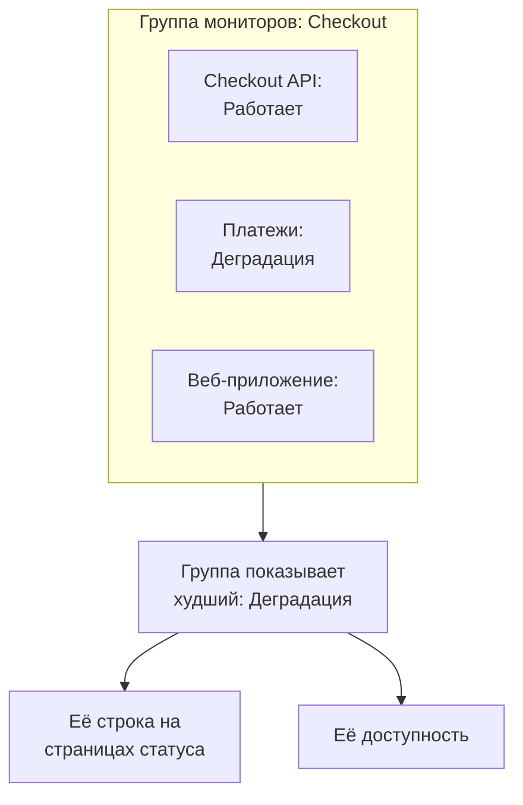

# Группы мониторов

Группа мониторов объединяет несколько мониторов в один статус. Объедините в группу мониторы, которые вместе составляют один сервис, например Checkout: его API, платёжный сервис и веб-приложение. Группа показывает худший статус среди них, ведёт собственную доступность, а страница статуса может показать всю группу одной строкой.

:::cards
- [Как вычисляется статус группы](#как-вычисляется-статус-группы): Худший статус среди её мониторов.
- [Включение групп мониторов](#включение-групп-мониторов): Один переключатель в настройках проекта.
- [Создание группы мониторов](#создание-группы-мониторов): Назовите её, затем добавьте её мониторы.
- [Показ группы на странице статуса](#показ-группы-на-странице-статуса): Одна строка для всей группы.
:::

## Как вычисляется статус группы

Группа начинает с вашего рабочего статуса и принимает худший статус среди своих мониторов: тот, что стоит ниже всех в списке статусов мониторов вашего проекта. Если один монитор переходит в статус **Деградация**, вся группа получает статус **Деградация**; если один переходит в **Не в сети**, группа тоже **Не в сети**.

- **Архивные мониторы не учитываются.** Архивный монитор не проверяется, поэтому его статус заморожен; группа его не учитывает.
- **Пустая группа работает.** Группа без мониторов или только с архивными показывает ваш рабочий статус. Пока вы не добавите монитор, панель управления показывает **Мониторов пока нет** вместо статуса группы.
- **Порядок задаёте вы.** Какой статус худший, решает порядок в **Мониторы → Настройки → Статус монитора**. См. [Статусы мониторов](/docs/monitor/criteria-and-statuses#статусы-мониторов).

Группа мониторов — это не группа страницы статуса. Группа страницы статуса — это заголовок на одной странице статуса, под которым стоят строки. Группа мониторов — это одна строка, которая представляет несколько мониторов, и её может показать любая страница статуса.

## Перед началом

- **Ваш план.** В OneUptime Cloud для групп мониторов нужен план Scale.
- **Переключатель.** Группы мониторов скрыты, пока для проекта не включён переключатель **Группы мониторов** (см. ниже). Чтобы включить его, нужна роль Project Owner или пользовательская роль с разрешением Edit Project или Manage Billing.
- **Ваша роль.** Для создания, изменения и удаления групп нужна роль Project Owner, Project Admin, Project Member, Monitor Admin или Monitor Member либо пользовательская роль с соответствующими разрешениями на группы мониторов. Viewer может видеть группы, но не может их менять.

## Включение групп мониторов

:::steps
### Откройте «Флаги функций»

Перейдите в **Настройки проекта → Расширенный → Флаги функций**. Раздел **Расширенный** в боковом меню свёрнут: сначала разверните его.

### Включите переключатель

Включите переключатель **Группы мониторов**. Он сохраняется сразу: **Группы мониторов** появляется в боковом меню **Мониторы**, а пункт **Мониторы** каждой страницы статуса переименовывается в **Ресурсы**, где можно добавить группу.
:::

Если снова выключить переключатель, **Группы мониторов** пропадёт из меню. Ни одна группа при этом не удаляется.

## Создание группы мониторов

:::steps
### Откройте «Группы мониторов»

Перейдите в **Мониторы → Группы мониторов**. Карточка **Группы мониторов** перечисляет группы: **Текущий статус**, метки и владельцы каждой.

### Создайте группу

Нажмите **Создать: Монитор Группа**, введите **Имя** и, при желании, **Описание**, затем нажмите **Создать: Монитор Группа** внизу формы. Группа создаётся без мониторов.

### Добавьте её мониторы

Откройте группу: пока в ней нет ни одного монитора, её **Обзор** предлагает **Add Monitors**. Позже нажмите **Мониторы** в её боковом меню, затем **Add Monitors**. Выберите все мониторы группы в **Мониторы** и нажмите **Add Monitors**.

### Проверьте её статус

Нажмите **Обзор**. **Текущий статус** показывает статус группы сейчас, а **График доступности** — её последние 90 дней, по одному столбцу на день.
:::

Чтобы убрать монитор из группы, нажмите **Удалить** в его строке в **Мониторы в группе**. Сам монитор не меняется. Монитор может входить в несколько групп.

## Страницы группы

Откройте группу, чтобы увидеть её страницы в боковом меню:

| Страница | Что она показывает |
| --- | --- |
| **Обзор** | **Сведения о группе мониторов**, **Текущий статус** и **График доступности** с процентом доступности группы за последние 90 дней. Группа без мониторов вместо графика предлагает **Add Monitors**. |
| **Мониторы** | **Мониторы в группе**, с кнопками **Add Monitors** и **Удалить**. |
| **Инциденты** | Инциденты любого монитора группы. |
| **Оповещения** | Оповещения любого монитора группы. |
| **Владельцы** | Люди и команды, отвечающие за группу. Страница находится в разделе **Расширенный**, который изначально свёрнут. |
| **Журналы аудита** | Кто и когда изменял группу; тоже в разделе **Расширенный**. |
| **Удалить группу** | Удаляет группу; тоже в разделе **Расширенный**. |

Доступность на странице **Обзор** считает простоем каждый статус, кроме рабочего. Страница статуса считает только статусы из своего списка **Считается простоем**: см. [Выбор того, что показывается на странице](/docs/status-pages/index#выбор-того-что-показывается-на-странице).

Список **Группы мониторов** умеет фильтровать группы по владельцу и метке, назначать метки и владельцев сразу многим группам, а также экспортировать и импортировать группы в формате JSON.

## Показ группы на странице статуса

:::steps
### Откройте ресурсы страницы статуса

Перейдите в **Страницы состояния**, откройте страницу и нажмите **Ресурсы** в её боковом меню.

### Переключите диалог на группу

Нажмите **Добавить монитор**. Под выпадающим списком мониторов нажмите **Add a Monitor Group instead.** Выпадающий список станет списком **Монитор Группа**.

### Выберите группу и добавьте её

Выберите группу. **Отображаемое имя**, которое читают посетители, заполняется названием группы, пока вы не введёте своё. Нажмите **Добавить монитор**: строка появится на странице со статусом группы.
:::

На странице статуса строка представляет каждый монитор группы:

- **Её статус.** Это статус группы: худший среди её мониторов.
- **Её инциденты.** Инцидент любого монитора группы появляется на странице, и группа указана среди затронутых ресурсов.
- **Её подписчики.** Подписчик, выбравший группу, узнаёт о каждом мониторе в ней. См. [Как дать подписчикам выбирать ресурсы и типы событий](/docs/status-pages/subscribers#как-дать-подписчикам-выбирать-ресурсы-и-типы-событий).

Об остальных настройках строки, например о её доступности и графике истории, см. [Ресурсы и группы страницы статуса](/docs/status-pages/resources-and-groups).

> [!WARNING]
> При удалении группы мониторов её строка удаляется со всех страниц статуса, которые её показывают. Мониторы группы и их инциденты не удаляются.

## API и Terraform

Группа — это `/api/monitor-group`, а каждый монитор в ней — строка `/api/monitor-group-resource`, которая связывает `monitorGroupId` с `monitorId`. В Terraform это `oneuptime_monitor_group` и `oneuptime_monitor_group_resource`: см. [Группа мониторов](/docs/terraform/examples#группа-мониторов).

## Устранение неполадок

:::details Группы мониторов нет в меню «Мониторы»
Переключатель **Группы мониторов** выключен. Включите его в **Настройки проекта → Расширенный → Флаги функций**. В OneUptime Cloud для групп также нужен план Scale.
:::

:::details Группа показывает «Не в сети», хотя большинство её мониторов работает
Таково правило: группа показывает свой худший монитор. Откройте **Мониторы** в группе, чтобы найти неработающий монитор, или уберите из группы монитор, которому в ней не место.
:::

:::details Страница статуса не может добавить группу
**Add a Monitor Group instead.** появляется в диалоге, только пока для проекта включён переключатель **Группы мониторов**.
:::

## Дальнейшие шаги

:::cards
- [Критерии и статусы мониторов](/docs/monitor/criteria-and-statuses): Что задаёт статус каждого монитора.
- [Ресурсы и группы страницы статуса](/docs/status-pages/resources-and-groups): Расположите строки на странице статуса.
- [Подписчики и объявления](/docs/status-pages/subscribers): Сообщайте клиентам об инцидентах группы.
:::
