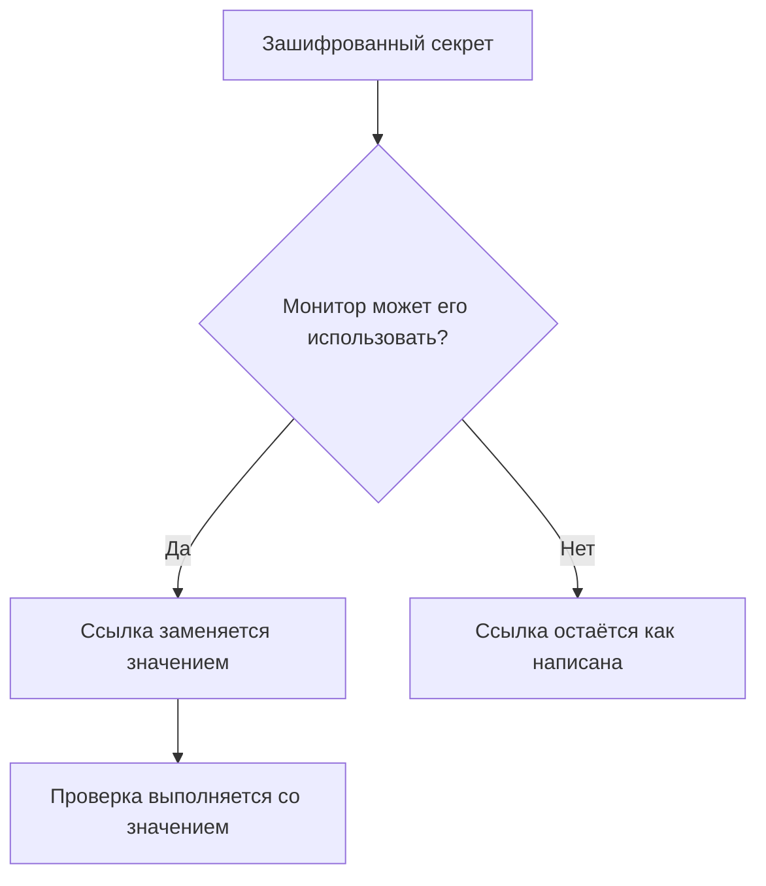

# Секреты мониторинга

Секреты мониторинга хранят пароли, API-ключи и токены, которые нужны вашим мониторам, вне самого монитора. Вы один раз сохраняете значение в зашифрованном виде, выбираете, какие мониторы могут его использовать, и ссылаетесь на него как `{{monitorSecrets.NAME}}` там, где оно нужно монитору.

:::cards
- [Добавить секрет](#добавление-секрета): Сохраните значение и выберите, кто может его использовать.
- [Выбрать доступ](#выбор-мониторов-которые-могут-использовать-секрет): Все мониторы, определённые мониторы или мониторы с метками.
- [Использовать секрет](#использование-секрета): Где работает `{{monitorSecrets.NAME}}`.
- [Войти с одноразовым кодом](#вход-с-одноразовым-кодом): Позвольте монитору пройти двухфакторную аутентификацию сайта.
:::

## Как секреты попадают в монитор

Секрет хранится в зашифрованном виде и после сохранения больше никогда не показывается. Прежде чем передать монитор зонду, OneUptime заменяет каждую ссылку, которую монитор может использовать, расшифрованным значением; ссылка, которую монитор использовать не может, остаётся как написана. Исключение — секрет для одноразовых кодов: его код создаёт зонд во время выполнения проверки (см. [Вход с одноразовым кодом](#вход-с-одноразовым-кодом)).



Зонд, выполняющий проверку, получает значение, поэтому монитор, использующий секрет, должен работать на зондах, которым вы доверяете: собственных зондах OneUptime или [пользовательском зонде](/docs/probe/custom-probe), который вы запускаете сами.

## Перед началом

- **Тариф Growth или выше** в OneUptime Cloud. У самостоятельно размещённых установок тарифов нет.
- **Роль, которая может управлять секретами**: Владелец проекта, Администратор проекта или пользовательская роль с разрешением Create Monitor Secret.

## Работа с секретами

### Добавление секрета

:::steps
1. Перейдите в **Мониторы → Настройки → Секреты** и нажмите **Создать: Секрет монитора**.
2. Введите **Имя** и **Значение секрета**. Имя — это то, на что вы ссылаетесь, например `ApiKey`. Оно может содержать только буквы, цифры, дефисы (`-`) и подчёркивания (`_`), и у двух секретов в одном проекте не может быть одинакового имени. Для ключа настройки двухфакторной аутентификации сайта сначала выберите **Одноразовый код (TOTP)** (см. [Вход с одноразовым кодом](#вход-с-одноразовым-кодом)).
3. На шаге **Доступ** выберите, какие мониторы могут его использовать (см. следующий раздел), затем нажмите **Создать: Секрет монитора**.
:::

> [!IMPORTANT]
> Секреты шифруются и надёжно хранятся. Значение секрета после сохранения больше никогда не показывается — ни в таблице, ни в форме редактирования, ни через API. Если вы потеряете значение, вам придётся получить его там, откуда оно взялось, и задать заново. Чтобы сменить секрет, используйте кнопку **Обновить значение секрета** в его строке; удалять и создавать его заново не нужно. Та же кнопка вместе с новым значением меняет и то, что хранит секрет, — **Текст** или **Одноразовый код (TOTP)**, а мониторы, использующие секрет, применяют новый тип при следующей проверке.

### Выбор мониторов, которые могут использовать секрет

У каждого секрета один из трёх вариантов доступа:

| Вариант | Какие мониторы могут использовать секрет | Для чего использовать |
| --- | --- | --- |
| **Все мониторы** | Каждый монитор в проекте, включая мониторы, которые вы создадите позже. | Учётные данные, общие для многих мониторов. |
| **Определённые мониторы** | Только выбранные вами мониторы. Это значение по умолчанию, и секреты, созданные до появления этих вариантов, работают именно так. | Учётные данные для одного или нескольких мониторов. |
| **Мониторы с метками** | Мониторы, у которых есть хотя бы одна из выбранных вами меток. Добавление одной из этих меток монитору даёт ему доступ, а удаление метки лишает доступа при следующем запуске монитора. | Учётные данные для группы мониторов, которая со временем меняется. |

Вариант можно изменить в любой момент кнопкой **Редактировать** в строке секрета. Сохраняется только список выбранного варианта: переключение на **Все мониторы** очищает списки мониторов и меток секрета, а переключение между **Определённые мониторы** и **Мониторы с метками** очищает список, с которого вы переключились.

Секрет никогда не доступен мониторам из другого проекта.

> [!WARNING]
> Любой, кто может редактировать монитор, которому доступен секрет, может отправить этот секрет туда, куда подключается монитор. При варианте **Все мониторы** это любой, кто может создавать или редактировать мониторы в проекте. При варианте **Мониторы с метками** сюда также входит любой, кто может добавить монитору одну из этих меток.

Через API вариант доступа задаётся полем `monitorAccess`: `All Monitors`, `Specific Monitors` или `Monitors With Labels`. Поля `monitors` и `labels` содержат списки. Секрет, созданный без `monitorAccess`, получает `Specific Monitors`.

### Использование секрета

Чтобы использовать секрет, напишите `{{monitorSecrets.SECRET_NAME}}` в поле, которое принимает секреты. Например, заголовок запроса `Authorization: Bearer {{monitorSecrets.ApiKey}}` отправляет значение секрета `ApiKey`.

Секреты принимают эти типы мониторов и поля:

| Тип монитора | Поля |
| --- | --- |
| API | URL, заголовки и тело запроса, а также клиентский сертификат, закрытый ключ и парольная фраза (mTLS) |
| Веб-сайт | URL, а также клиентский сертификат, закрытый ключ и парольная фраза (mTLS) |
| Ping, IP, Порт, NTP, SSL-сертификат | Проверяемый хост или URL |
| DNS | Доменное имя и DNS-сервер |
| DNSSEC, Домен | Доменное имя |
| SQL-запрос | Хост, имя базы данных, имя пользователя, пароль и запрос |
| Состояние базы данных | Хост, имя базы данных, имя пользователя и пароль |
| Внешняя страница статуса | URL страницы статуса |
| Синтетический монитор, Пользовательский код JavaScript | Скрипт |
| Сетевое устройство | Строка сообщества SNMP, а также ключи аутентификации и шифрования SNMPv3 |

Секреты подставляются до запуска скрипта монитора Синтетический монитор или Пользовательский код JavaScript, поэтому ссылка вроде `{{monitorSecrets.ApiKey}}` внутри скрипта при выполнении уже является расшифрованным значением.

Если монитор ссылается на секрет, который не может использовать, ссылка остаётся как есть и не заменяется значением.

Когда вы тестируете монитор до его сохранения, подставляются только секреты, доступные для **Все мониторы**, потому что новый монитор ещё не входит ни в один список и не имеет меток. После сохранения монитора тесты используют каждый секрет, который монитору доступен.

## Вход с одноразовым кодом

Некоторые сайты при входе запрашивают код из приложения-аутентификатора. Секрет типа **Одноразовый код (TOTP)** хранит ключ настройки такого сайта, поэтому монитор может входить так же, как вы: везде, где монитор использует секрет, зонд создаёт текущий код по собственным часам в тот момент, когда он нужен проверке. Ключ настройки, как и любое значение секрета, хранится в зашифрованном виде и больше никогда не показывается, а в сам монитор он никогда не записывается.

1. Включите двухфакторную аутентификацию для учётной записи, под которой входит монитор. Если сайт показывает QR-код, выберите вместо этого ввод ключа вручную и скопируйте ключ настройки или ссылку `otpauth://`.
2. Перейдите в **Мониторы → Настройки → Секреты**, нажмите **Создать: Секрет монитора**, выберите **Одноразовый код (TOTP)** и вставьте ключ или ссылку в поле **Ключ настройки**.
3. Убедитесь, что **Текущий код** под ним совпадает с кодом, который сейчас показывает ваше приложение-аутентификатор, затем на шаге **Доступ** выберите, какие мониторы могут использовать секрет, как и для любого другого секрета.

| Что вы вставляете | Какие коды создаёт монитор |
| --- | --- |
| Ключ настройки, например `JBSW Y3DP EHPK 3PXP` | SHA1, 6 цифр и новый код каждые 30 секунд — то, что предполагает любое приложение-аутентификатор |
| Ссылка `otpauth://totp/` | Параметры ссылки `algorithm` (`SHA1`, `SHA256` или `SHA512`), `digits` (`6` или `8`) и `period` в секундах (`30`, если в ссылке его нет) |

| Тип монитора | Куда попадает код и когда он создаётся |
| --- | --- |
| API | `{{monitorSecrets.NAME}}` в URL, заголовке или теле запроса — непосредственно перед отправкой каждой попытки |
| Синтетический монитор, Пользовательский код JavaScript | `{{monitorSecrets.NAME}}` в скрипте — при запуске скрипта, и `await oneuptime.getTotpCode("NAME")` — когда код запрашивает скрипт |

Во всех остальных полях `{{monitorSecrets.NAME}}` остаётся как написано. В теле запроса JSON заключайте ссылку на секрет в кавычки, как в `{"otp": "{{monitorSecrets.LoginCode}}"}`, потому что код может начинаться с нуля.

Обычно вход доходит до запроса кода лишь через несколько страниц после запуска скрипта, поэтому запрашивайте код именно там. Этот скрипт входит с паролем и одноразовым кодом:

```javascript
await page.goto("https://app.example.com/login");
await page.fill("#email", "monitoring@example.com");
await page.fill("#password", "{{monitorSecrets.AppPassword}}");
await page.click("button[type=submit]");

// The code is made now, when the sign-in asks for it.
await page.waitForSelector("#otp");
await page.fill("#otp", await oneuptime.getTotpCode("AppLoginCode"));
await page.click("button[type=submit]");

await page.waitForSelector(".dashboard", { timeout: 10000 });

return {
  data: { signedIn: true },
};
```

Зонд никогда не выдаёт код, которому осталось действовать меньше пяти секунд, а при более коротком периоде — меньше трети периода: вместо этого он ждёт следующий код, но не дольше пяти секунд, и не засчитывает это ожидание во время выполнения проверки. Каждый код, созданный проверкой, показывается звёздочками, например `******`, в её сообщениях лога, результате, ошибке и именах снимков экрана. Снимок экрана — это изображение страницы, поэтому делайте его до ввода кода или после того, как страница перейдёт дальше.

> [!NOTE]
> Коды создаёт зонд, поэтому пользовательскому зонду нужен OneUptime 17.0.1 или новее. На более старом проверка, которой нужен код, не выполняется и завершается неудачей с фразой о том, что зонд нужно обновить; форма монитора и страница зонда называют слишком старый зонд, а раздел [Обновите зонд](/docs/probe/custom-probe#обновите-зонд) объясняет, как это сделать. Часы зонда тоже должны быть точными, потому что зонд, часы которого расходятся на минуту, создаёт коды, которые сайт уже не принимает.

## Устранение неполадок

:::details `{{monitorSecrets.NAME}}` отправляется буквально
Монитор не может использовать секрет, или имя не совпадает. Проверьте вариант доступа секрета кнопкой **Редактировать** в его строке и убедитесь, что имя в ссылке точно совпадает с именем секрета.
:::

:::details При тестировании нового монитора секрет не подставляется
Пока монитор не сохранён, подставляются только секреты, доступные для **Все мониторы**. Сохраните монитор и протестируйте его снова.
:::

:::details Поле игнорирует секрет
Секреты принимают только поля из таблицы выше. В любом другом поле `{{monitorSecrets.NAME}}` отправляется как написано.
:::

:::details Сайт отклоняет одноразовый код
Проверьте, что **Текущий код** совпадал с кодом в приложении-аутентификаторе, когда вы сохраняли секрет, что часы зонда точны и что ссылка на секрет в теле запроса JSON заключена в кавычки. Если вход доходит до запроса кода не сразу, запрашивайте код именно там с помощью `oneuptime.getTotpCode`.
:::

:::details Проверка сообщает, что зонд слишком старый, чтобы создавать одноразовые коды
Зонд работает на версии старше OneUptime 17.0.1, которая не умеет создавать одноразовые коды, поэтому проверка на нём не выполнялась. Обновите зонд (см. [Обновите зонд](/docs/probe/custom-probe#обновите-зонд)) или проверяйте монитор зондами с 17.0.1 или новее.
:::

## Дальнейшие шаги

:::cards
- [Мониторинг API](/docs/monitor/api-monitor): Отправка секрета в заголовке запроса.
- [Синтетический мониторинг](/docs/monitor/synthetic-monitor): Использование секрета в браузерном скрипте.
- [Мониторинг SQL-запросов](/docs/monitor/sql-monitor): Хранение пароля базы данных в зашифрованном виде.
:::
