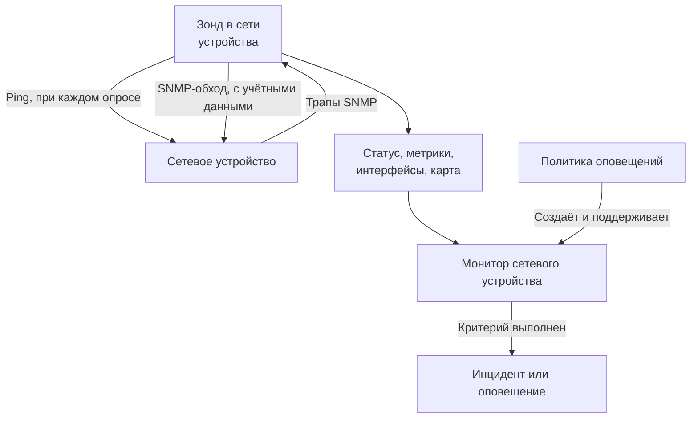
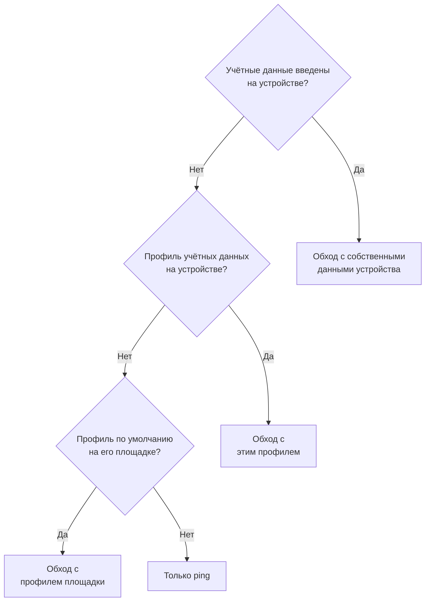
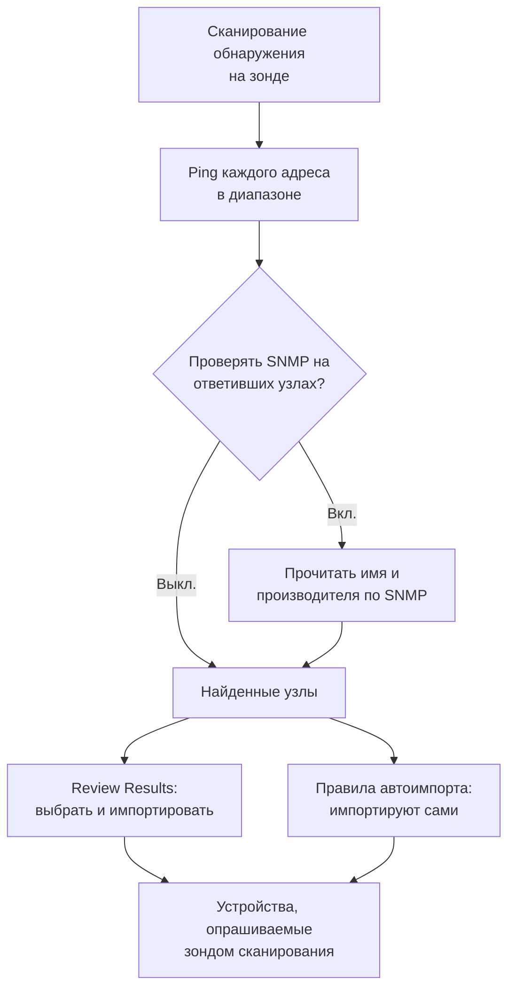
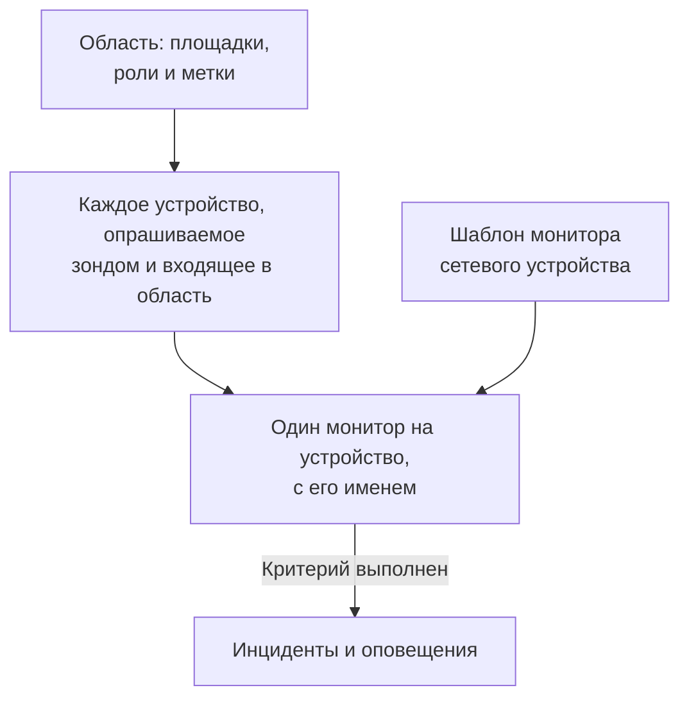
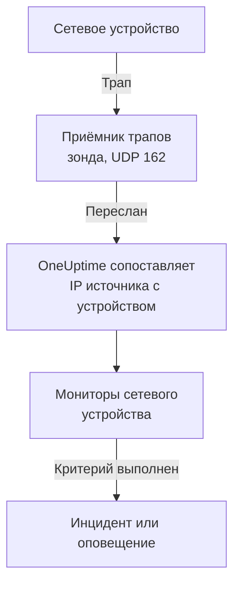

# Мониторинг сетевых устройств

Отслеживайте коммутаторы, маршрутизаторы, межсетевые экраны, точки доступа, PDU, камеры и принтеры: всё, у чего есть адрес в вашей сети, независимо от того, поддерживает ли оно SNMP.

Добавьте устройство с его адресом и зондом, и зонд будет пинговать его по расписанию: устройство получает статус «в сети» или «недоступно», место на карте сети и голос в состоянии своей площадки. Дайте ему учётные данные SNMP, и тот же зонд будет ещё и выполнять SNMP-обход: интерфейсы и оптические модули в них, аппаратную инвентаризацию, соседей LLDP и CDP и OID состояния. Добавьте монитор или политику оповещений для целого парка, и его опросы и трапы будут создавать инциденты и оповещения.

:::cards
- [Добавить устройство](#добавление-сетевого-устройства): Его адрес и зонд, на одной странице.
- [Обнаружить сеть](#обнаружение-устройств-сетевым-сканированием): Просканируйте диапазон адресов и импортируйте то, что ответит.
- [Читать устройства по SNMP](#учётные-данные-snmp-и-профили-учётных-данных): Интерфейсы, оптика, инвентаризация и состояние.
- [Получать оповещения](#оповещения): Монитор для одного устройства, политика для парка.
- [Посмотреть карту](#топология-сети): Соседи, нарисованные вживую, экспорт в PDF.
- [Решить проблему](#устранение-неполадок): Устройства в ожидании, сбои обхода, трапы, которые не приходят.
:::

## Как это работает



Устройство и монитор выполняют разную работу:

| Часть | Что делает | Когда нужна |
| --- | --- | --- |
| Устройство | Его зонд опрашивает его по собственному расписанию устройства. Каждый опрос фиксирует доступность, время отклика ping и потерю пакетов; опрос с учётными данными SNMP также считывает идентификацию устройства, интерфейсы, соседей и OID состояния. | Всегда: устройство — это то, что вы добавляете. |
| Монитор | Проверяет критерии по каждому результату опроса и каждому трапу от устройства и создаёт инциденты и оповещения. | Только для инцидентов и оповещений. Статусу, инвентаризации, графикам и карте монитор не нужен. |

## Перед началом

- **Зонд, который может достучаться до устройства.** Зонд пингует и обходит устройство из своей собственной сети, поэтому для устройства с частным адресом нужен [собственный зонд](/docs/probe/custom-probe) внутри этой сети: зонд в публичном интернете до него не достанет.
- **SNMP — чтобы получать больше, чем ping.** Необязательно. Community string v1 или v2c либо пользователь SNMPv3, настроенные на устройстве, и открытый UDP 161 от зонда. Без этого устройство только пингуется.
- **Трапы, syslog и потоки.** Необязательно. Зонд принимает трапы SNMP на UDP 162, syslog на UDP 5140, когда вы его включите, и записи потоков на UDP 2055, 4739 и 6343, поэтому откройте их от ваших устройств до зонда.

## Обзор сети

**Сеть → Обзор** — это то, с чего открывается раздел «Сеть», и он начинается с ответа: одно предложение говорит, всё ли в порядке с вашей сетью, а если нет, то что не так, начиная с худших новостей.

| Что написано | Когда |
| --- | --- |
| **Недоступных устройств: 3** | Зонд или монитор устройства не может до него достучаться. |
| **Площадок, требующих внимания: 2** | Все устройства отвечают, но состояние площадки не рабочее. |
| **Отключённых интерфейсов: 5** | Все устройства отвечают, но часть портов погашена. |
| **Устройств, не передающих сведения: 2** | Они отвечают на ping, но их SNMP-обход завершается ошибкой, поэтому их интерфейсы и состояние не обновляются: обычно дело в учётных данных. |
| **Ожидание первой проверки** | Устройства добавлены, а их зонд ещё не проверил их. |
| **Все устройства в сети: 40** | Все устройства отвечают. Устройства, всё ещё ожидающие первой проверки, считаются отдельной строкой. |

Под ним одна строка говорит, создаёт ли что-нибудь инцидент, когда устройство становится недоступным: сколько [политик оповещений](#политики-оповещений) включено, или ссылка **Set up alerts**, если ни одной нет. Кнопки **Add Device** и **Discover Devices** рядом открывают соответствующие формы, а плитки и списки ниже дают подробности: устройства и площадки, требующие внимания, парк по производителям и недавние сканирования.

Пока ничего не добавлено, обзор вместо этого показывает два способа начать: **Обнаружить устройства** сканирует диапазон адресов, чтобы вы выбрали, что добавить, — лучший вариант для целой сети или новой площадки, а **Добавить одно устройство** добавляет одно устройство по IP-адресу или имени хоста.

Меню «Сеть» держит на виду то, что вы открываете каждый день: **Обзор**, **Devices**, **Площадки**, **Map**, **Traffic** и **Discovery**. Остальное свёрнуто в разделы, и раздел раскрывается сам на любой из своих страниц:

| Раздел | Страницы |
| --- | --- |
| **Топология** | **Device Topology**, **Конечные точки**, **Latency Matrix**, **Site Links**, **Device Links** |
| **Правила** | **Auto Import Rules**, **Site Assignment Rules**, **Правила владельца**, **Правила меток**, **Link Rules** |
| **Настройки** | **Alert Policies**, **Учётные данные SNMP**, **Device Roles**, **Site Types**, **OID Collection Templates** |
| **Расширенный** | **Archived Devices** |

## Добавление сетевого устройства

:::steps
### Откройте список устройств
Перейдите в **Сеть → Devices** и нажмите **Add Device**. **Add Device** на странице **Обзор** раздела «Сеть» открывает ту же форму.

### Введите адрес устройства
В поле **Имя хоста** введите его IP-адрес или имя хоста. Оставьте **Имя** пустым, чтобы устройство получило имя по имени хоста.

### Проверьте площадку и зонд
Выберите **Site**, на которой находится устройство, если вы используете площадки. **Зонд** заполняется сам зондом площадки по умолчанию или единственным собственным зондом проекта; убедитесь, что этот зонд может достучаться до устройства.

### Добавьте устройство
Нажмите **Add Device**. В течение пары минут зонд пингует устройство, и его статус становится **Up** или **Down**. С учётными данными SNMP обзор устройства также заполняется его идентификацией, интерфейсами и состоянием после первого успешного обхода.
:::

Форма занимает одну страницу — имя хоста, имя, площадка и зонд, — а **SNMP** и **Дополнительные поля** свёрнуты под ними. Она ничего не спрашивает о том, как отслеживается устройство: каждое добавленное устройство опрашивается своим зондом, а [переопределение с привязанным монитором](#переопределение-с-привязанным-монитором) находится на странице **Настройки** устройства для тех немногих устройств, которым оно нужно.

Сведения об устройстве — имя, описание, роль, площадка, метки и адреса — потом редактируются в одном месте: на карточке **Device Settings** на его странице **Настройки**. Карточка **Сведения об устройстве** на его обзоре показывает их со ссылкой **Изменить в настройках**.

### Устройство

| Поле | Описание | Обязательно |
| --- | --- | --- |
| Имя хоста | IP-адрес или имя хоста, которое пингует зонд и обходит по SNMP, когда у устройства есть учётные данные. | Да |
| Имя | Понятное имя, например core-switch-01. Оставьте пустым, и устройство получит имя по имени хоста. API делает то же самое: устройство, созданное без имени, получает имя по имени хоста. | Нет |
| Site | [Сетевая площадка](/docs/monitor/network-sites), на которой находится устройство. Состояние площадки сводится из её устройств, а площадка с зондом по умолчанию заполняет зонд ниже. | Нет |
| Зонд | Зонд, который пингует это устройство, обходит его по SNMP, когда есть учётные данные, и принимает его трапы, syslog и [записи потоков](/docs/monitor/network-traffic). Он должен доставать до устройства напрямую: зонд в публичном интернете не достанет до частного адреса. | Да |

**Зонд** заполняется сам, где может: проект ровно с одним собственным зондом начинает с него, а выбор площадки заменяет его [зондом площадки по умолчанию](/docs/monitor/network-sites#параметры-мониторинга-по-умолчанию). Зонд, выбранный вами вручную, никогда не перезаписывается. Задайте зонд по умолчанию на своих площадках, и устройство можно будет добавить по одному адресу.

### Дополнительные поля (свёрнуты)

| Поле | Описание | Обязательно |
| --- | --- | --- |
| Описание | Произвольный текст. | Нет |
| Device Role | Коммутатор ядра, коммутатор доступа, межсетевой экран и так далее. Задаёт уровень устройства на карте и ограничивает область политик оповещений. | Нет |
| MAC-адрес | Собственный MAC устройства. Карта использует его, чтобы поместить устройство, не поддерживающее ни LLDP, ни CDP, на тот порт коммутатора, который его изучил; см. [Устройства только с ping и их порт коммутатора](#устройства-только-с-ping-и-их-порт-коммутатора). Обычно изучается для вас из ARP-таблицы маршрутизатора. | Нет |
| Также создать Ping-монитор для инцидентов | Зонд уже пингует устройство и даёт ему статус; Ping-монитор — это то, что превращает неудачные ping в инцидент. Отметьте флажок, и при сохранении будет создан монитор на имя хоста, привязанный к устройству. Он учитывается в вашем тарифе, а его инциденты остаются выключенными, пока вы не включите их на странице монитора. | Нет |

При отметке Ping-монитора появляется **Ping from probes** — собственные зонды монитора. Они должны доставать до сети устройства; оставьте поле пустым, чтобы использовать зонды проекта по умолчанию. Чтобы получать оповещения сразу по многим устройствам, используйте вместо этого [политики оповещений](#политики-оповещений).

### SNMP (свёрнуто, необязательно)

Оставьте его свёрнутым, и устройство будет только пинговаться: свёрнутый раздел говорит об этом одним предложением. Устройство всё равно получает статус с первого опроса и остаётся на своей площадке и на карте, но у него нет интерфейсов, инвентаризации и OID состояния, пока у него нет учётных данных. Раскройте раздел, чтобы ввести community string или пользователя v3 либо выбрать сохранённый профиль учётных данных.

:::tabs
@tab SNMP v1 / v2c
| Поле | Описание | Обязательно |
| --- | --- | --- |
| Версия SNMP | V1, V2c или V3. | Да, по умолчанию V2c |
| SNMP Community String | Community string v1 или v2c, например `public`. | Нет: пустое значение означает только ping |
| SNMP Port | UDP-порт, на котором слушает агент. | Нет, по умолчанию 161 |
| SNMP Credential Profile | Сохранённый набор учётных данных вместо ввода учётных данных здесь. | Нет |
@tab SNMPv3
| Поле | Описание | Обязательно |
| --- | --- | --- |
| SNMP v3 Security Level | No Auth, No Priv; Auth, No Priv; или Auth, Priv. | Да |
| SNMP v3 Username | Имя безопасности (пользователь), настроенное на устройстве. | Да: пустое значение означает только ping |
| SNMP v3 Authentication Protocol | MD5, SHA, SHA-256 или SHA-512. | С аутентификацией |
| SNMP v3 Authentication Key | Парольная фраза аутентификации. | С аутентификацией |
| SNMP v3 Privacy Protocol | DES, AES или AES-256. | С шифрованием |
| SNMP v3 Privacy Key | Парольная фраза конфиденциальности (шифрования). | С шифрованием |
:::

Учётные данные, введённые на устройстве, имеют приоритет над профилем учётных данных, выбранным рядом с ними, а площадка устройства тоже может задавать профиль по умолчанию. Учётные данные в профиле хранятся в зашифрованном виде. Учётные данные, введённые на устройстве, защищены теми же правами на чтение, но не шифруются при хранении: ещё одна причина держать общие учётные данные в профиле.

## Изменение многих устройств сразу

Сканирование обнаружения в сети клиента приносит десятки устройств, которые относятся к одной площадке, имеют одну роль и выпущены одним производителем. Не открывайте их по одному: выделите их в списке **Devices**, отметив строки или выбрав все устройства, подходящие под фильтры, и откройте **Массовые действия**.

| Действие | Что делает |
| --- | --- |
| **Задать площадку** / **Убрать площадку** | Переносит каждое выделенное устройство на выбранную площадку, где оно учитывается в её состоянии; устройство без собственного зонда получает зонд площадки по умолчанию. **Убрать площадку** выводит их из площадок. Устройство, подходящее под правило назначения площадок, при следующем опросе возвращается на площадку правила, поэтому для устройств, которые обнаружение продолжает находить, лучше добавить правило в **Сеть → Правила → Site Assignment Rules**; диалог **Задать площадку** ведёт туда. |
| **Задать роль устройства** / **Сбросить роль устройства** | Даёт всем выделенным устройствам одну роль, например двадцати коммутаторам, которые все являются «Access Switch». Роли — это роли проекта в **Сеть → Настройки → Device Roles**, куда ведёт диалог. **Сбросить роль устройства** снова определяет роль каждого устройства по его SNMP-идентификации. |
| **Применить шаблон производителя** | Добавляет OID состояния и SNMP-таблицы [шаблона производителя](#шаблоны-состояния-производителей) каждому выделенному устройству. **По производителю каждого устройства**, первый вариант в диалоге, выбирает каждому устройству его собственный шаблон по тому, что сообщает его SNMP-обход, так что смешанная выборка везде получает правильный шаблон; или выберите один шаблон для всех. |

Каждое действие — это один диалог и одно сохранение для всей выборки, и каждое устройство проходит те же проверки, что и при правке на его собственной странице «Настройки»: права, область меток и владельцев вашей роли и ограничения на то, что устройство может собирать.

**Применить шаблон производителя** показывает, что будет сделано, прежде чем что-то делать: сколько устройств получит какой шаблон и сколько останется без изменений и почему. Оно добавляет к тому, что каждое устройство уже собирает, и ничего не удаляет, а устройство, в котором уже есть всё из шаблона, не перезаписывается. Без изменений остаются устройство с привязанным монитором (его никто не опрашивает), устройство, привязанное к [OID Collection Template](#oid-collection-templates) (что собирать, решает шаблон, поэтому добавьте OID производителя туда), и, при подборе, устройство, ещё не обойдённое по SNMP или чей производитель не имеет шаблона.

Когда действие завершается, оно показывает, сколько устройств изменено, какие завершились ошибкой и почему — устройство, которое ваша роль не может редактировать, список сверх лимита, — и какие не изменены и почему: устройство, которое уже было на этой площадке или в этой роли, или такое, которое шаблон производителя оставляет как есть.

Остальные массовые действия описаны там, где им место: **Set OID Collection Template** — в разделе [OID Collection Templates](#oid-collection-templates), **Set SNMP Credential Profile**, **Switch to Probe Polling** и **Create Ping Monitors** — в разделе [Массово](#массово), а **Shorten Names to Hostname** — в разделе [Как называются обнаруженные устройства](#как-называются-обнаруженные-устройства).

## Что на самом деле делает опрос

Каждый опрос устройства, опрашиваемого зондом, — это ping. Если у устройства есть пригодные учётные данные SNMP, зонд также выполняет полный SNMP-обход. Они идут параллельно, и обход никогда не ждёт ping, поэтому SNMP-оборудование за ACL, отбрасывающим ICMP, всё равно сообщает **Up**.

| Результат | Устройство только с ping | Устройство с учётными данными SNMP |
| --- | --- | --- |
| Статус (Up или Down) | По ping | По ping или обходу: достаточно ответа любого из них |
| Время отклика ping и потеря пакетов | Записываются как метрики устройства | Записываются как метрики устройства |
| Время отклика SNMP | — | Время обхода, никогда не время ping |
| Интерфейсы, соседи, конечные точки | — | По успешному обходу |
| Системная идентификация, производитель, модель, серийный номер | — | По успешному обходу |
| OID состояния и SNMP-таблицы | — | По успешному обходу |

Пригодные учётные данные — это набор v1 или v2c с community string или набор v3 с именем пользователя, найденные по [цепочке учётных данных](#учётные-данные-snmp-и-профили-учётных-данных). Пустой набор пропускается, поэтому устройство никогда не обходится с угаданным community по умолчанию.

Потеря пакетов использует ту же серию, что и [Ping-монитор](/docs/monitor/ping-monitor), поэтому читается одинаково во всём продукте. У времени отклика своя серия, `oneuptime.monitor.ping.round.trip.time`, потому что у сетевого устройства простое время отклика — это время SNMP-обхода. Страница **Метрики** устройства строит графики загрузки интерфейсов и OID состояния; время отклика за последний час рисуется в боковой панели устройства на карте.

### «SNMP failing» — это не «Down»

Устройство, которое отвечает на ping, но чей обход завершается ошибкой, находится в статусе **Up** с пометкой **SNMP failing**, и важны обе половины:

- Оно в сети, потому что по этому адресу что-то отвечает. Окрасить его в красный значило бы добавить в счётчик инцидентов устройство, которое прекрасно работает.
- Оно SNMP failing, потому что его интерфейсы, инвентаризация и OID состояния перестали обновляться — почти всегда из-за учётных данных, отключённого SNMP-агента или ACL. Больше ничто на странице не сказало бы вам, что числа застыли.

Устройство, у которого не проходят ни ping, ни обход, просто находится в статусе **Down**, поэтому пометка всегда стоит только рядом с зелёным статусом.

### Как читать статус устройства

Каждое место, где показано устройство, — список Devices, страница Devices площадки, обзор, карта — использует те же три вердикта и те же уточнения рядом с ними.

| Вердикт | Означает |
| --- | --- |
| **Up** | Последний опрос (ping или SNMP) или привязанный монитор достучался до устройства. |
| **Down** | Последний опрос (ping или SNMP) или привязанный монитор не смог достучаться до устройства. |
| **Ожидание** | Вердикта пока нет: ни разу не опрашивалось, зонд не назначен или монитор не привязан. |

| Уточнение | Показывается, когда | Что делать |
| --- | --- | --- |
| **Stale** | Опрос не выполнялся намного дольше интервала устройства. | Проверьте, что зонд устройства в сети и справляется со своим парком. |
| **No probe** | Устройство опрашивается зондом, но зонда у него нет или его опрос выключен. | Назначьте зонд, который может до него достучаться; до тех пор его никто не опрашивает. |
| **No monitor** | Устройство использует [переопределение с привязанным монитором](#переопределение-с-привязанным-монитором), а ничего не привязано. | Привяжите монитор или верните устройство к опросу зондом. |
| **SNMP failing** | В сети по ping, но последний SNMP-обход завершился ошибкой. | Проверьте учётные данные, SNMP-агент или ACL. |

В списке **Devices** есть фильтр **SNMP** с тремя значениями: **OK** (последний обход успешен), **Failing** (последний обход завершился ошибкой) и **Not configured** (только ping, нет учётных данных или ни разу не опрашивалось). «Какие устройства имеют учётные данные, которые перестали работать» — в один клик. Столбец **Interfaces (Up / Down)** списка показывает **No SNMP** вместо `0 / 0` для устройства, которое пингуется и никогда не обходится: ноль работающих портов был бы другим утверждением, причём ложным.

## Учётные данные SNMP и профили учётных данных

Устройство обходится с первым пригодным набором учётных данных, найденным в таком порядке, и поиск останавливается на первом совпадении:



Шаг площадки читает собственную площадку устройства и не дальше: устройство в Unit не берёт профиль, заданный на Region над ней. А вот зонд площадки по умолчанию спускается вниз по дереву, потому что зонд копируется на устройство один раз, тогда как учётные данные перечитываются при каждом опросе; подробности — в разделе [Сетевые площадки](/docs/monitor/network-sites#параметры-мониторинга-по-умолчанию).

### Страница «Учётные данные SNMP»

**Сеть → Настройки → Учётные данные SNMP** хранит профили учётных данных проекта. Профиль — это один именованный набор — community string v1 или v2c либо пользователь v3 с уровнем безопасности, протоколами и ключами, — на который ссылается сколько угодно устройств и площадок. На устройства ничего не копируется, поэтому смена community string — это одна правка здесь, и каждое устройство, использующее профиль, получает новое значение при следующем опросе.

Секреты профиля хранятся в зашифрованном виде, и читать их могут только роли, которым разрешено читать собственные учётные данные устройства. Устройство или площадка, показывающие свой профиль, показывают его имя и версию, но никогда не секреты.

Профиль, на который всё ещё ссылается устройство или площадка, удалить нельзя: удаление отклоняется с подсчётом того, что ему мешает. Переведите эти устройства и площадки на другой профиль или уберите с них профиль, а затем удалите его.

### Возврат устройства в режим только ping

На странице **Настройки** устройства в **Изменить настройки** на шаге **Учётные данные SNMP** есть флажок **Ping only — clear this device's own SNMP credentials**. При сохранении он очищает собственные community string и имя пользователя v3 устройства. Он существует потому, что не очевидно, какое поле нужно очистить: устройство v3 остаётся доступным для обхода, пока существует его имя пользователя, что бы вы ни очистили ещё.

Очистка собственных учётных данных устройства не очищает профиль. Если устройство или его площадка всё ещё указывают профиль, устройство продолжит обходиться с ним; уберите и профиль, чтобы устройство только пинговалось.

### Массово

Выделите устройства в списке **Devices** и используйте:

- **Set SNMP Credential Profile** / **Clear SNMP Credential Profile**: привязать профиль к выборке или снять его.
- **Switch to Probe Polling**: для устройств с переопределением с привязанным монитором. Выберите зонд, и с этого момента каждое выделенное устройство пингуется по своему расписанию, а когда появятся учётные данные — ещё и обходится. Уже привязанный монитор остаётся привязанным; статус устройства теперь берётся от зонда.
- **Create Ping Monitors**: для устройств с переопределением с привязанным монитором создаёт Ping-монитор на имя хоста каждого устройства и привязывает его, чтобы устройство показывало Up или Down.

Страница **Devices** показывает баннер, когда в проекте есть устройства с переопределением с привязанным монитором, к которым ничего не привязано, — устройства, которые никто не опрашивает и о которых ничто не сообщает, — и ведёт к выборке, которая их исправляет.

## Параметры мониторинга площадки по умолчанию

[Сетевая площадка](/docs/monitor/network-sites#параметры-мониторинга-по-умолчанию) несёт два значения по умолчанию для своих устройств. Её **Default Probe** копируется на устройство, созданное на площадке или перенесённое на неё без собственного зонда. Её **Default SNMP Credential Profile** читается при каждом опросе устройства на площадке, у которого нет собственных учётных данных. Задайте оба на площадке, и устройство там можно будет добавить по одному адресу, а затем пинговать и обходить с первого опроса. В руководстве по площадкам сказано, насколько глубоко вниз по дереву площадок доходит каждое значение по умолчанию.

## Переопределение с привязанным монитором

До некоторого оборудования ни один зонд не может достучаться или с пользой его пинговать: устройство за NAT, устройство, состояние которого лучше оценивать HTTP-проверкой, сервис, реальный сигнал которого — проверка порта. Для них в **Изменить настройки** на странице **Настройки** устройства есть **Monitoring Method**:

| Метод | Что означает |
| --- | --- |
| **Зонд** | По умолчанию. Пингуется назначенным зондом по его расписанию и обходится по SNMP, когда есть учётные данные. |
| **Bound monitor** | Статус существующего монитора — это статус данного устройства. |

Перевод устройства на **Bound monitor** прекращает его опрос. Зонд, интервал и переключатель опроса исчезают с карточки **Polling & Data Collection**, старые результаты опроса устройства очищаются, а его статус берётся от монитора, который вы привяжете. Привязывать монитор необязательно: пока вы этого не сделаете, устройство показывает **Ожидание** с пометкой **No monitor**.

Возврат к **Зонд** восстанавливает опрос и запрашивает зонд. Монитор, который был привязан, остаётся привязанным и продолжает оповещать; он просто больше не определяет статус устройства.

Большинству устройств это не нужно. У каждого устройства, опрашиваемого зондом, уже есть статус доступности, поэтому привязывать Ping-монитор ради него не нужно; привязывайте монитор, когда вам нужны инциденты этого монитора.

## Опрос и сбор данных

Опрос находится на странице **Настройки** устройства, на карточке **Polling & Data Collection** (**Редактировать: Polling**). Значения по умолчанию подходят новому устройству, так что настраивать его не нужно:

| Параметр | Описание | По умолчанию |
| --- | --- | --- |
| Зонд | Зонд, который опрашивает устройство. | Задаётся при добавлении устройства |
| Polling Enabled | Зонд опрашивает устройство по расписанию ниже. Выключите, чтобы приостановить опрос, не удаляя устройство. | Включено |
| Polling Interval (Minutes) | Как часто зонд опрашивает устройство. Не менее 1 минуты. | 5 |
| Walk Interfaces | Обходить таблицы интерфейсов (IF-MIB) при каждом опросе: статус, пропускная способность, загрузка и ошибки каждого порта, а также соседи LLDP и CDP для карты. | Включено |
| Collect Connected Endpoints | Также обходить ARP-таблицы и таблицы пересылки моста, чтобы найти, что подключено к устройству: POS-терминалы, принтеры, телефоны, ноутбуки. По ARP-таблице также заполняется MAC-адрес устройств, зарегистрированных по этим адресам. Стоит дополнительных обходов при каждом опросе. | Выключено |
| OID Collection Template | Общий именованный список OID, который собирает устройство. Правка шаблона меняет каждое привязанное устройство при его следующем опросе. | Нет |
| Device-Specific Health OIDs | Дополнительные OID, которые собирает только это устройство, сверх OID его шаблона. | Нет |
| Auto-Apply Vendor Health Template | Если производитель устройства распознан, а его собственный список OID пуст, заполнить список из шаблона производителя при следующем опросе. | Выключено; включено для устройств, которые импортирует обнаружение |
| Device-Specific SNMP Tables | Дополнительные [SNMP-таблицы](#snmp-таблицы), которые обходит только это устройство, сверх таблиц его шаблона. Таблица с тем же ключом, что и таблица шаблона, заменяет её на этом устройстве. | Нет |

Всё, начиная с **Walk Interfaces** и ниже, требует учётных данных SNMP: на устройстве только с ping эти параметры сохраняются, но обхода, к которому они могли бы примениться, нет.

### Обход интерфейсов

Когда **Walk Interfaces** включён и учётные данные найдены, каждый опрос отслеживает у каждого интерфейса рабочий и административный статус, входящие и исходящие биты, загрузку и ошибки. Тот же обход собирает соседей LLDP и CDP для карты.

Заглушите интерфейс на странице **Interfaces** устройства — для лабораторного порта или канала, отключённого намеренно, — и он останется в инвентаризации, но выйдет из оповещений и метрик. Неудачный обход никогда не очищает собранное наполовину: последний снимок интерфейсов сохраняется, а устройство получает пометку **SNMP failing**, чтобы никто не принял его за актуальный.

### Шаблоны состояния производителей

В редакторе **Health OIDs** **Vendor Health Template** применяет готовый набор OID для производителя устройства. Многие шаблоны также содержат [SNMP-таблицы](#snmp-таблицы), которые добавляются кнопкой **Add a Vendor's Tables** в редакторе **SNMP Tables**.

| Шаблон производителя | OID состояния | SNMP-таблицы |
| --- | --- | --- |
| Generic (Host Resources MIB) | Загрузка CPU, общий и доступный объём RAM, средняя нагрузка | Ядра CPU (одна строка на ядро, как бы платформа их ни нумеровала) |
| Arista EOS | Загрузка CPU, средняя нагрузка, общий и доступный объём RAM | — |
| Cambium Networks cnMatrix | CPU, RAM, флеш-память, температура, напряжение питания | Вентиляторы, порты PoE, резервный блок питания |
| Cambium Networks Enterprise Wi-Fi (cnPilot, XV, XE, XH) | CPU, свободная память, клиенты Wi-Fi, подключение к cnMaestro | Радиомодули Wi-Fi (диапазон, канал, ширина, мощность передачи, клиенты, уровень шума, эфирное время, состояние), SSID |
| Cisco IOS / IOS-XE | CPU, занятая и свободная память, температура, состояние вентиляторов, состояние блоков питания | — |
| Dell Force10 / OS9 | CPU, память | — |
| Extreme Networks EXOS / Switch Engine | CPU, температура, авария перегрева, состояние питания | Блоки питания, вентиляторы, память по слотам, члены стека |
| Extreme Networks Fabric Engine / VOSS | Сессия vIST, число I-SID | Смежности фабрики (IS-IS) с именами соседей, CPU и память по слотам, датчики температуры, вентиляторы, блоки питания |
| Extreme Networks IQ Engine (HiveOS) Access Points | CPU, память, клиенты Wi-Fi, температура | Радиомодули Wi-Fi (канал, мощность передачи, уровень шума), SSID |
| Extreme Networks Wireless Controller (XIQ-C, ExtremeWireless) | Точки доступа, активные точки доступа, клиенты Wi-Fi | Точки доступа (состояние, клиенты, адрес, ПО), радиомодули Wi-Fi (диапазон, канал, ширина, уровень шума, занятое эфирное время), WLAN (SSID, клиенты) |
| Fortinet FortiGate | CPU, память, диск | — |
| HPE / Aruba ProCurve | CPU, общий и свободный объём памяти | — |
| HPE Aruba Instant (AOS 8) | Имя кластера, версия прошивки, conductor | Точки доступа (статус, модель, CPU, память), радиомодули Wi-Fi с именами точек доступа (канал, мощность передачи, уровень шума, загрузка, клиенты, состояние), SSID (клиенты) |
| HPE Aruba Mobility Controller (AOS 8) | Точки доступа, клиенты Wi-Fi, роль контроллера | Точки доступа (статус, модель, группа AP), радиомодули Wi-Fi с именами точек доступа (диапазон, канал, мощность передачи, загрузка, клиенты, режим), SSID (клиенты, точки доступа в сети и недоступные), процессоры, память |
| Huawei VRP | CPU, память, температура | — |
| Juniper Junos | CPU, буфер памяти, температура | — |
| MikroTik RouterOS | Загрузка CPU, температура, напряжение | — |
| Palo Alto PAN-OS | CPU управления, загрузка сессий, активные сессии | — |
| Sophos Firewall (SFOS / XGS) | Память, диск, swap, состояние HA и состояние пира, служба IPsec, температура CPU (SFOS v22 и новее) | Туннели IPsec (для статуса нужна SFOS v20 и новее), ядра CPU |
| TP-Link Omada Access Points (EAP) | Клиенты Wi-Fi | — |
| Ubiquiti EdgeOS / EdgeSwitch / UniFi Switches | Загрузка CPU, общий и доступный объём RAM | — |
| Ubiquiti UniFi Access Points | Изолированное состояние, средняя нагрузка, общий и доступный объём RAM | Радиомодули Wi-Fi (диапазон, эфирное время), SSID (диапазон, канал, клиенты, мощность передачи, качество соединения), ядра CPU |

OID шаблона копируются в собственный список устройства, где их можно сократить или дополнить. После того как первый обход определит производителя, страница устройства предлагает подходящий шаблон. Подбор читает `sysObjectID` устройства, а также его `sysDescr`, когда под одним enterprise-номером работают две операционные системы: Extreme Fabric Engine на универсальном оборудовании сообщает тот же enterprise-номер (1916), что и EXOS, и различить их можно только по описанию (`…-FabricEngine (9.0.4.0)`). Точки доступа UniFi так же отличаются от маршрутизаторов Ubiquiti (`U6-Pro 6.6.50.15098`), в том числе когда старая прошивка отвечает веткой Net-SNMP, а точки доступа IQ Engine — от коммутаторов Aerohive, которые используют ту же ветку (`AP230, HiveOS 8.2r1`).

Устройства с включённым **Auto-Apply Vendor Health Template** получают OID и таблицы шаблона при первом опросе: устройства, которые приносит правило автоимпорта, и устройства, импортированные из **Review Results** с включённым переключателем шаблона производителя, — а он включён, если вы его не выключите. Чтобы выдать шаблон сразу многим устройствам, например парку, обнаруженному до появления переключателя, выделите их в списке **Devices** и используйте **Применить шаблон производителя** (см. [Изменение многих устройств сразу](#изменение-многих-устройств-сразу)).

Применение шаблона производителя — разовое копирование, поэтому при изменении шаблона ничего не распространяется. Для всего, что больше одного устройства, лучше используйте **OID Collection Template**; шаблоны производителей предлагаются как отправная точка при его создании.

### OID Collection Templates

**OID Collection Template** (**Сеть → Настройки → OID Collection Templates**) — это именованный список OID, обычно названный по типу устройства, например «Cisco Catalyst 9300», к которому привязывается сколько угодно устройств. Привязка живая, а не копия: список OID устройства собирается при каждом опросе, поэтому правка шаблона меняет то, что каждое привязанное устройство собирает при следующем опросе, без шага синхронизации.

Прежде чем создавать шаблон, убедитесь, что он нужен. Входящие и исходящие биты по портам, рабочий статус, загрузка и ошибки в секунду собираются с каждого порта при каждом опросе вообще без OID (см. [Обход интерфейсов](#обход-интерфейсов)), и по ним уже можно получать оповещения по каждому порту. Шаблоны нужны для того, что не относится к портам: CPU, память, температура, вентиляторы, блоки питания, BGP-пиры.

Если вы переходите с Zabbix:

| Zabbix | OneUptime |
| --- | --- |
| Template | OID Collection Template |
| Item | OID в этом шаблоне |
| Правило обнаружения «Network interfaces by SNMP» с прототипами элементов данных | Встроено и всегда включено для счётчиков интерфейсов: писать ничего не нужно |
| Trigger | Критерии монитора |
| Прототип триггера, по одному на обнаруженный интерфейс | Критерий с **Интерфейс**, равным `*`, который разворачивается по портам |
| Правило обнаружения по любой другой SNMP-таблице (туннели, радиомодули, вентиляторы) с прототипами элементов данных | [SNMP-таблица](#snmp-таблицы) в шаблоне |
| Прототип триггера по такой таблице | Критерий SNMP Table Value или SNMP Table Row Is Unhealthy с **Row**, равным `*` |
| Группа узлов | Метки |
| Действие «Link template on host discovery» | **OID Collection Template** правила автоимпорта |
| Действие для группы узлов («оповещать по каждому коммутатору») | [Политика оповещений](#политики-оповещений) |

OID в шаблоне собирается так, как записан, поэтому OID, указывающий на одну строку таблицы (`…ifSpeed.3`), собирает только эту строку — что бы ни оказалось в индексе 3 в день опроса. Всё, что является списком, — туннели, радиомодули, вентиляторы, соседи, — должно жить в [SNMP-таблице](#snmp-таблицы), которая обходит каждую строку и отслеживает появление и исчезновение строк. Данным интерфейсов по портам не нужно ни то, ни другое: обход интерфейсов записывает как серии рабочий статус, входящие и исходящие биты в секунду, загрузку и суммарную частоту ошибок в секунду. Ошибки по направлениям, отбрасывания, административный статус и скорость канала попадают в инвентаризацию интерфейсов устройства, но не являются сериями и не могут вызывать оповещения.

Есть три способа привязать устройства, и для парка, который обнаружение продолжает находить, важнее всего третий:

- По одному устройству — на карточке **Polling & Data Collection** устройства.
- Массово — выделив устройства в списке **Devices** и используя **Set OID Collection Template**. Столбец **Template** списка показывает, какие устройства к чему привязаны.
- Автоматически — задав OID Collection Template в правиле автоимпорта, чтобы каждое устройство, импортированное сканированием, привязывалось в момент создания.

Устройство сначала собирает OID своего шаблона, а затем свои **Device-Specific Health OIDs**. Если оба указывают один и тот же OID, он собирается один раз, побеждают имя и описание устройства, а записи шаблона сохраняют своё место, так что собственные добавления устройства никогда не могут их вытеснить.

| Ограничение | Значение |
| --- | --- |
| OID состояния, опрашиваемые устройством | 200 |
| OID в шаблоне | 150 |
| Собственные OID привязанного устройства | 50 |
| Собственные OID непривязанного устройства | 200 |

Ограничения суммируются, поэтому привязанное устройство никогда не может опрашивать больше 200 OID. Превышение — это ошибка проверки при сохранении, а не молчаливое отсечение во время опроса, а привязка устройства, у которого уже больше 50 собственных OID, отклоняется с сообщением, сколько из них удалить.

Шаблон, к которому всё ещё привязаны устройства, удалить нельзя. Сначала отвяжите их, например массовым действием **Clear OID Collection Template**, чтобы удаление никогда тихо не останавливало сбор данных во всём парке.

### Собственные OID

Добавьте любые OID, которые нужно собирать при каждом опросе, в шаблон или как собственные добавления устройства:

| Поле | Описание | Обязательно |
| --- | --- | --- |
| OID | Числовой OID, например 1.3.6.1.2.1.1.1.0. | Да |
| Имя | Понятное имя OID, например sysDescr. | Нет |
| Описание | Что представляет OID. | Нет |

Собранные значения отображаются на графиках на странице **Метрики** устройства, а критерии **SNMP OID Value** и **SNMP OID Exists** оповещают по ним. Выбор OID в этих критериях показывает OID, которые собирает выбранное устройство, — из его шаблона и его собственные, — так что вводить ничего не нужно.

Длинные списки OID разбиваются на несколько запросов SNMP GET, чтобы каждый помещался в одну UDP-дейтаграмму. Если вы держали списки OID короткими потому, что старая версия считала недоступным устройство, отвечавшее `tooBig`, больше этого делать не нужно.

### SNMP-таблицы

Часть того, что знает устройство, — это список: по одной строке на туннель IPsec, радиомодуль Wi-Fi, SSID, соседа фабрики, вентилятор или блок питания. SNMP-таблица определяется своими столбцами, и каждая строка обходится при каждом опросе, поэтому туннель, который добавлен, переименован или удалён, отслеживается без того, чтобы кто-то что-то правил.

| Поле | Что делает |
| --- | --- |
| Имя и ключ | Как называется таблица. Ключ (буквы, цифры и подчёркивания; если пуст, формируется из имени) — это то, что используют критерии, метрики и переменные шаблонов, поэтому переименование таблицы никогда не ломает оповещение. |
| Тип | Что представляют строки: VPN-туннели, точки доступа Wi-Fi, радиомодули Wi-Fi, SSID Wi-Fi, соседи маршрутизации, оборудование или общий тип. Типы Wi-Fi питают [страницу Wi-Fi](#вкладка-wi-fi) устройства. |
| Столбцы | OID столбцов для сбора (OID записи таблицы плюс номер столбца, например `1.3.6.1.4.1.2604.5.1.6.1.1.1.1.9` для статуса туннеля Sophos), каждый с именем и, по желанию, единицей измерения, ролью (статус, диапазон, канал, ширина канала, мощность передачи, клиенты, уровень шума, загрузка, SSID), метками значений и нормальными значениями. |
| Имена строк | Необязательные столбцы, значения которых дают имя каждой строке, например имя подключения туннеля. Без них строки называются по индексу. Имя может браться из родственной таблицы с тем же индексом (Fabric Engine называет смежности IS-IS по `rcIsisAdjHostName`) или из родительской таблицы, индекс которой начинает индекс этой (Aruba Instant называет каждый радиомодуль по его точке доступа). Таблица, индексированная по имени (ArubaOS индексирует свои SSID по SSID), называется по декодированному индексу. |
| Лимит строк | Сколько строк хранить: 100 по умолчанию, не более 250. |

Числа читаются как числа, а текст, начинающийся с числа, читается как это число (`"36"`, `"-95 dBm"`, `"80MHz"`), потому что многие производители кладут числа в строки. Задайте типу значения столбца **Text only** для значений, которые лишь выглядят числовыми. **Value labels** превращают коды в слова (`0=inactive, 1=active`): на графиках и в сравнениях по-прежнему используется исходное значение, а показывается метка. **Healthy values** (`1`) говорят, какие значения означают, что всё в порядке: они окрашивают строку на странице **SNMP Tables** устройства и питают критерий **SNMP Table Row Is Unhealthy**.

Некоторые столбцы шаблонов производителей также **корректируют** считанное число — для MIB, которые хранят значение в своих единицах: ArubaOS сообщает мощность передачи удвоенной (читается × 0.5), Aruba Instant — уровень шума без знака (× −1), Aerohive — уровень шума плюс 256 (− 256), а контроллер Extreme — ширину канала шагами по 20 МГц (× 20). Показывается, строится на графиках и сравнивается скорректированное число, поэтому **Noise Floor Greater Than -80** означает одно и то же у любого производителя, а редактор таблиц показывает расчёт под столбцом.

Таблицы берутся из [OID Collection Template](#oid-collection-templates), общего для всех привязанных устройств (до 10 таблиц), или из самого устройства в **Device-Specific SNMP Tables** (ещё до 10). При каждом опросе они объединяются по ключу, сначала шаблон, и таблица устройства с тем же ключом заменяет таблицу шаблона. Оба редактора предлагают **Add a Vendor's Tables**.

Зонд обходит каждый столбец как поддерево в пределах 30-секундного бюджета, общего для всех таблиц устройства. Таблица, которую не удаётся обойти, сообщает причину и никогда не роняет опрос: страница **SNMP Tables** устройства сохраняет её последние хорошие строки и сообщает, что последний обход завершился ошибкой, а критерии оценивают только то, что дал этот обход, поэтому тайм-аут никогда не принимается за пустую таблицу. Каждая числовая ячейка записывается как метрика `oneuptime.monitor.snmp.table.value` с атрибутами `snmpTableKey`, `snmpTableName`, `snmpTableColumn`, `snmpTableColumnOid`, `snmpTableRow` и `snmpTableRowIndex`, так что дашборд может показать статус каждого туннеля или мощность передачи каждого радиомодуля, а монитор метрик может группировать по `snmpTableRow`.

### Вкладка Wi-Fi

Устройство, обход которого включает таблицу Wi-Fi — точки доступа, радиомодули или SSID, как их приносят шаблоны производителей Wi-Fi, — получает страницу **Wi-Fi**. Она открывается сводкой: точки доступа в сети (на контроллере), включённые радиомодули, клиенты и SSID, — а затем перечисляет каждую точку доступа, которой управляет контроллер, с её состоянием, радиомодулями и клиентами; каждый радиомодуль с диапазоном, каналом, частотой, шириной канала, мощностью передачи, клиентами, уровнем шума и эфирным временем; и каждый SSID с его диапазоном и клиентами. Столбцы находятся по своей роли, поэтому таблицы любого производителя, размечающие свои столбцы, отображаются одинаково.

Производители раскладывают эти сведения по-разному, а страница собирает их обратно:

- Частота вычисляется по диапазону и каналу с помощью плана каналов 802.11 (2.4, 5 и 6 ГГц). Контроллер, который сообщает частоту там, где в его MIB указан канал (контроллер Extreme), читается наоборот.
- Радиомодуль, который не сообщает диапазон, определяется по каналу: от 1 до 14 — 2.4 ГГц, от 32 до 177 — 5 ГГц, а номер, который использует только 6 ГГц (37, 53, 181…), — 6 ГГц.
- UniFi сообщает канал, мощность передачи и клиентов по SSID: радиомодуль берёт их из SSID своего диапазона.
- Aruba считает клиентов по радиомодулям: клиенты точки доступа — это клиенты её радиомодулей.
- Интерфейс, который не транслирует никакую сеть (IQ Engine перечисляет все интерфейсы, указывая для таких N/A), не показывается как SSID.

На устройстве, которое пока не сообщает Wi-Fi, страница называет шаблон его производителя, подобранный по последнему опросу так же, как это делает автоприменение, и применяет его кнопкой **Применить шаблон**; радиомодули появятся после следующего опроса.

### Поддерживаемые производители Wi-Fi

Что каждый производитель Wi-Fi сообщает по SNMP и что есть только в его облаке:

| Производитель | Точки доступа и контроллеры | Шаблон производителя | Читается по SNMP | Нужен облачный API производителя (не реализовано) |
| --- | --- | --- | --- | --- |
| Cambium Networks | Корпоративные точки доступа Wi-Fi (cnPilot, XV, XE, XH) | Cambium Networks Enterprise Wi-Fi (cnPilot, XV, XE, XH) | Диапазон, канал, ширина, мощность передачи, клиенты, уровень шума, эфирное время и состояние каждого радиомодуля; SSID; CPU, память | Представления парка в cnMaestro |
| Ubiquiti UniFi | Точки доступа UniFi (UAP, U6, U7, UK) | Ubiquiti UniFi Access Points | Диапазон и эфирное время каждого радиомодуля; канал, клиенты и мощность передачи каждого SSID; CPU по ядрам, память | Данные по клиентам и представления по сайтам в приложении UniFi Network |
| HPE Aruba | Кластеры Instant (AOS 8), через их виртуальный контроллер | HPE Aruba Instant (AOS 8) | Статус, CPU и память каждой точки доступа; канал, мощность передачи, уровень шума, загрузка, клиенты и состояние каждого радиомодуля; SSID с клиентами | — |
| HPE Aruba | Mobility Controllers (AOS 8) | HPE Aruba Mobility Controller (AOS 8) | Статус каждой управляемой точки доступа; диапазон, канал, мощность передачи, загрузка и клиенты каждого радиомодуля; SSID с клиентами; CPU и память контроллера | — |
| HPE Aruba | Точки доступа на AOS 10 под управлением Aruba Central | — | Доступность (ping) | Радиомодули, SSID и клиенты: API Aruba Central |
| Extreme Networks | Точки доступа IQ Engine (HiveOS) | Extreme Networks IQ Engine (HiveOS) Access Points | Канал, мощность передачи и уровень шума каждого радиомодуля; SSID; CPU, память, клиенты, температура | Представления клиентов и парка в ExtremeCloud IQ |
| Extreme Networks | ExtremeCloud IQ Controller (ранее Extreme Campus Controller) и контроллеры ExtremeWireless | Extreme Networks Wireless Controller (XIQ-C, ExtremeWireless) | Состояние и клиенты каждой точки доступа; диапазон, канал, ширина, уровень шума и занятое эфирное время каждого радиомодуля; WLAN с клиентами | — |
| TP-Link | Точки доступа Omada (EAP) | TP-Link Omada Access Points (EAP) | Число клиентов, на прошивке с MIB клиентов EAP от TP-Link | Радиомодули, каналы и SSID: API Omada Controller |
| Juniper | Точки доступа Mist | — | Доступность (ping); включение и отключение точек доступа через вебхуки Mist | Всё остальное: облачный API Mist |

Шаблоны подбираются по `sysObjectID` и `sysDescr` каждого устройства, поэтому автоприменение, вариант **По производителю каждого устройства** массового действия **Применить шаблон производителя** и страница Wi-Fi выбирают их без подсказок — кроме шаблона TP-Link, который вы применяете сами. Включение SNMP по производителям:

- **Cambium**: в cnMaestro SNMP задаётся для группы AP (Configuration → Wi-Fi Profiles → AP Groups → Management → SNMP), с community v2c или пользователем v3. Добавьте каждую точку доступа.
- **Ubiquiti UniFi**: включите SNMP в приложении UniFi Network, которое настраивает его на управляемых устройствах. Добавьте каждую точку доступа.
- **HPE Aruba Instant**: включите SNMP для кластера и добавьте адрес его виртуального контроллера как одно устройство; он отвечает за каждую точку доступа.
- **HPE Aruba Mobility Controller**: добавьте контроллер; кампусные точки доступа сами по SNMP не отвечают.
- **Extreme IQ Engine**: включите SNMP в сетевой политике, которую ExtremeCloud IQ отправляет на точки доступа, и добавьте каждую точку доступа.
- **Extreme Wireless Controller**: включите SNMP в параметрах администрирования контроллера и добавьте контроллер.
- **TP-Link Omada**: включите SNMP для сайта в Omada Controller (Network Config → SNMP), добавьте точки доступа и примените шаблон с их страницы «Настройки» или через **Применить шаблон производителя**.
- **Juniper Mist**: точки доступа Mist не отвечают по SNMP. Добавьте их как устройства только с ping для контроля доступности и отправляйте вебхук Mist `device-updowns` на [монитор входящих запросов](/docs/monitor/incoming-request-monitor), чтобы точка доступа, ушедшая из сети, превращалась в инцидент.

Таблица контроллера хранит до 250 строк: на контроллере с более чем 250 точками доступа или радиомодулями остальные не перечисляются, и таблица сообщает об этом. Его счётчики точек доступа и клиентов — это OID состояния, поэтому они учитывают всё.

### Трансиверы

Оптические модули SFP, SFP+, SFP28 и QSFP в портах устройства считываются при каждом опросе, обходящем интерфейсы: ничего включать и никакой шаблон применять не нужно. Для каждого модуля OneUptime хранит:

- Что это: производитель, номер детали, серийный номер, ревизия, тип и длина волны — как их сообщает модуль. Модули сторонних производителей (FS.com, FLEXOPTIX, Carritech и другие) читаются так же, как модули производителя коммутатора.
- Его показания: температура, напряжение питания, ток смещения лазера, передаваемая и принимаемая мощность — из цифрового оптического мониторинга (DOM, также DDM). QSFP сообщает мощность и смещение по каждой линии.
- Собственные пороги устройства: нижние и верхние пороги предупреждения и аварии, которые коммутатор сообщает для каждого показания. Модуль оценивается по ним и ни по чему другому; OneUptime никогда не придумывает собственные пороги.
- Месяц принимаемой мощности: среднесуточное значение самой слабой линии за последние 30 дней. Грязный разъём, перегнутое волокно или изнашивающийся модуль видны здесь за недели до того, как канал упадёт.

Страница **Interfaces** устройства открывается карточкой **Трансиверы**: сначала проблемы, затем по одной строке на модуль с портом, описанием, статусом словами и показаниями. Показание за порогом окрашивается и подписывается (**Нижний аварийный порог**, **Верхний порог предупреждения**), а рядом со значением RX стоит небольшой график принимаемой мощности за месяц; строка QSFP показывает его худшую линию. Нажмите на строку, чтобы увидеть каждую линию относительно каждого порога, тренд принимаемой мощности с лучшим днём и идентификацию модуля. Устройство, которое не сообщает ни одного модуля — только с медными портами или с агентом, который их не раскрывает, — карточку не показывает вовсе.

| Статус | Означает |
| --- | --- |
| Исправен | Каждое показание, для которого у устройства есть пороги, находится в их пределах. |
| Предупреждение | Показание достигло порога предупреждения или превысило его. |
| Авария | Показание достигло аварийного порога или превысило его, либо устройство сообщает о потере сигнала или неисправности передатчика. |
| Не обнаружен | В порту был модуль, а теперь не сообщается ни одного, хотя порт по-прежнему включён. Страница по-прежнему называет то, что там было. |
| Нет порогов | Модуль сообщает показания, но устройство не сообщает пределов, по которым их оценивать. Получайте по ним оповещения с помощью **SNMP Transceiver Reading**. |
| Обнаружен | Модуль вообще не сообщает диагностики: обычно для медных SFP и кабелей прямого подключения. |
| Порт отключён | Порт выключен, поэтому его лазер выключен намеренно: показания отображаются, но никогда не оцениваются. |

`sysObjectID` устройства определяет, откуда берутся показания: сначала собственная таблица производителя, если в ней есть то, чего нет в стандартной, а ENTITY-SENSOR-MIB — как запасной вариант.

| Устройства | Откуда читается | Пороги |
| --- | --- | --- |
| Cisco | CISCO-ENTITY-SENSOR-MIB, сопоставленная с портами через ENTITY-MIB | Да |
| Arista | ENTITY-SENSOR-MIB с порогами из ARISTA-ENTITY-SENSOR-MIB | Да |
| Juniper | JUNIPER-DOM-MIB, с показаниями по линиям для многолинейных модулей | Да |
| HPE Comware и H3C | HH3C-TRANSCEIVER-INFO-MIB | Да |
| HPE Aruba ProCurve / ArubaOS-Switch | HP-ICF-TRANSCEIVER-MIB | Да |
| MikroTik RouterOS | MIKROTIK-MIB (`mtxrOpticalTable`), с флагами потери сигнала и неисправности передатчика | Нет |
| Cambium Networks cnMatrix (4.5 и новее) | CAMBIUM-NETWORKS-TRANSCEIVER-MIB | Нет |
| Любое другое устройство | ENTITY-SENSOR-MIB (RFC 3433), сопоставленная с портами через ENTITY-MIB | Нет |

Первый опрос читает всё. Последующие опросы читают только то, что меняется, — показания и серийные номера, по которым видно замену модуля, — а остальное (пороги, идентификация, какой модуль в каком порту) перечитывается при установке, извлечении или замене модуля и не реже раза в час. Устройство без любой из этих MIB стоит один запрос на каждую опробованную MIB. У чтения свой 20-секундный бюджет, и чтение, завершившееся по тайм-ауту или прерванное, сохраняет последние хорошие модули устройства, а не объявляет их пропавшими.

Модуль, отсутствующий во включённом порту, сразу отображается на странице как **Не обнаружен** и считается отсутствующим для оповещений после двух опросов подряд, так что агент, один раз ответивший пустотой, никого не будит. Модуль, извлечённый из выключенного порта, просто забывается, а заглушённый интерфейс сохраняет свой модуль на странице, но никогда не вызывает оповещений.

Каждое показание — это также метрика устройства, по одной серии на порт и линию, в тех единицах, что показывает страница: `oneuptime.monitor.snmp.transceiver.temperature` (°C), `oneuptime.monitor.snmp.transceiver.voltage` (В), `oneuptime.monitor.snmp.transceiver.bias.current` (мА), `oneuptime.monitor.snmp.transceiver.tx.power` и `oneuptime.monitor.snmp.transceiver.rx.power` (дБм), с атрибутами `interfaceName`, `interfaceIndex` и `lane`. Дашборд может показать свет канала за месяцы, а монитор метрик — оповещать по нему.

Расследование OneUptime AI по инциденту или оповещению от монитора сетевого устройства начинается с оптики затронутых портов: обнаружен ли модуль по-прежнему, каждое показание относительно порогов устройства и принимаемая мощность за последние недели. ИИ также может прочитать оптику любого устройства, если вы спросите о ней.

### Идентификация устройства

После первого успешного обхода OneUptime читает системную группу SNMPv2 и, если устройство её поддерживает, ENTITY-MIB и заполняет карточку устройства: системное имя, описание, расположение, контакт, время работы, производитель, модель, серийный номер и версия прошивки. Enterprise-OID производителя (`sysObjectID`) — это отпечаток устройства: он называет производителя и выбирает подходящий шаблон производителя. Те же сведения отображаются в [инвентаризации](/docs/inventory/cmdb-sync#network-device-asset-attributes) вместе со всеми остальными вашими активами.

Устройство только с ping сохраняет имя и адрес, которые дали ему вы или сканирование обнаружения: спросить что-то получше не у кого — SNMP-агента нет.

## Обнаружение устройств сетевым сканированием

Вместо того чтобы добавлять устройства по одному, просканируйте диапазон адресов с зонда и импортируйте то, что ответит.



:::steps
### Откройте Discovery
Перейдите в **Сеть → Discovery** и нажмите **Запустить сканирование**. **Discover Devices** на странице **Обзор** раздела «Сеть» открывает ту же форму.

### Укажите, что сканировать
На шаге **Цель сканирования** введите диапазон, проверьте **Зонд** и решите, использовать ли **Check SNMP on hosts that answer**.

### Добавьте учётные данные для проверки
При включённом SNMP шаг **Учётные данные SNMP** запрашивает наборы учётных данных для проверки. При выключенном второго шага нет: сканирование становится [сканированием только с ping](#сканирования-только-с-ping), а **Запустить сканирование** находится на первой странице.

### Запустите сканирование
Нажмите **Запустить сканирование**. Зонд проходит диапазон и сообщает, сколько узлов просканировано и сколько ответило: сколько ответило по SNMP или, при сканировании только с ping, сколько ответило на ping.

### Импортируйте найденное
Нажмите **Review Results** у завершённого сканирования, выберите нужные устройства и нажмите **Import Selected**.
:::

| Поле | Описание | Обязательно |
| --- | --- | --- |
| Цель сканирования | Адреса для сканирования в [нотации CIDR или диапазонов октетов](#нотация-цели-сканирования). | Да |
| Зонд | Зонд, выполняющий сканирование. Он должен доставать до диапазона напрямую. Проект ровно с одним собственным зондом начинает с него. | Да |
| Check SNMP on hosts that answer | Сканирование сначала пингует диапазон; этот параметр решает, будут ли затем ответившие узлы опрошены по SNMP об имени и производителе. Выключите для [сканирования только с ping](#сканирования-только-с-ping). Выбирается при создании сканирования и потом не меняется. По умолчанию включено. | Нет |
| SNMP Configs | Второй шаг: наборы учётных данных для проверки, по порядку. Каждому узлу предлагается каждый набор, пока один не ответит, поэтому добавьте по набору на группу устройств с общей версией и community или пользователем v3. | Когда проверка SNMP включена |

Свёрнуты в **Дополнительные поля** на первом шаге, для сканирований, которым они нужны:

| Поле | Описание | По умолчанию |
| --- | --- | --- |
| Имя | Для чего сканирование, чтобы отличать его от других. Если поле пустое, список показывает цель сканирования. | Пусто |
| Искать имена Windows (NetBIOS) | Запрашивать у каждого узла без системного имени SNMP его имя NetBIOS — имя компьютера Windows — по UDP 137. Это имя имеет приоритет над обратным DNS-именем узла. Только частные адреса и собственные зонды; см. [Как называются обнаруженные устройства](#как-называются-обнаруженные-устройства). | Включено |
| Name devices by their short hostname | Называть импортированные устройства по первой части полного имени хоста: `core-sw-01` вместо `core-sw-01.corp.example.com`. | Выключено |
| Repeat this scan | Повторять сканирование с интервалом **Rescan Interval (Minutes)** не менее 15 минут, чтобы обнаружение продолжалось; см. [правила автоимпорта](#автоматический-импорт-с-правилами-автоимпорта). Узлы, найденные повторным сканированием, ждут вашей проверки, если под них не подходит правило автоимпорта. | Выключено |

### Нотация цели сканирования

Цель сканирования принимает две нотации, обе только для IPv4. CIDR — это одна непрерывная подсеть:

```text
192.168.1.0/24
10.0.5.0/28
```

Адреса сети и широковещательный адрес пропускаются, поэтому `/24` охватывает 254 узла. У `/31` и `/32` нет адреса сети и широковещательного адреса, которые можно было бы пропустить, поэтому сканируются все их адреса.

В диапазоне октетов любой из четырёх октетов может быть включительным диапазоном `low-high` вместо одного числа:

```text
10.16-22.0-255.51-66
10.48-50.0-255.51-66
192.168.1.10-40
10.0.0.5
```

Сканируется каждый адрес результата, и ни один не считается адресом сети или широковещательным, потому что нет длины префикса, из которой его можно было бы вывести: `10.0.0.0-255` включает `10.0.0.0` и `10.0.0.255`.

- Каждый октет — это число от 0 до 255 или диапазон, нижняя граница которого идёт первой. `10.22-16.0.1` отклоняется как перевёрнутый диапазон, а не тихо ничего не сканирует.
- Одиночный адрес (`10.0.0.5`) сканирует ровно этот узел.
- Одно сканирование охватывает не более 32 768 адресов. Более крупная цель отклоняется при сохранении сканирования: разбейте её на несколько сканирований или сузьте диапазоны.

Цели проверяются при сохранении сканирования, поэтому опечатка видна в форме, а не через несколько минут как неудачное сканирование.

Диапазоны октетов существуют для сетей, которые не имеют формы блоков CIDR. `10.16-22.0-255.51-66` проходит от `.51` до `.66` в каждой `/24` от `10.16` до `10.22`: 28 672 адреса. В записи CIDR это заняло бы 1 792 сканирования, а наименьший содержащий это блок CIDR (`10.16.0.0/13`) — 512k адресов, 98 % которых не стоит опрашивать.

### Что импортирует сканирование

Каждый найденный сканированием узел импортируется как устройство, опрашиваемое зондом, с назначенным зондом сканирования и включённым опросом, поэтому статус у него есть с первого опроса. Узлы различаются тем, что они приносят с собой:

- Узлы, ответившие по SNMP, импортируются с ответившим адресом в качестве имени хоста, именем, выбранным так, как описано ниже, и сработавшими учётными данными, поэтому сканирование v3 импортирует устройства, готовые к обходу по v3, которые сразу начинают собирать интерфейсы и инвентаризацию.
- Узлы, ответившие на ping, но не по SNMP, — каждый узел, найденный [сканированием только с ping](#сканирования-только-с-ping), и узлы, которые SNMP-сканирование не смогло опознать, — импортируются без учётных данных. Зонд пингует их по их расписанию; добавьте учётные данные позже — на устройстве или как профиль на нём или его площадке, — и тот же зонд начнёт ещё и обходить их.

Уже зарегистрированные устройства помечаются и пропускаются. Привязывайте к импортированному устройству монитор [Ping](/docs/monitor/ping-monitor) или [IP](/docs/monitor/ip-monitor) только если вам нужны инциденты этого монитора; для парка обычно лучше подходит [политика оповещений](#политики-оповещений).

Если сканирование нашло SNMP-узлы, **Review Results** предлагает **Применить шаблон производителя к каждому SNMP-узлу при первом опросе (рекомендуется)**, по умолчанию включено: каждое импортированное SNMP-устройство получает [шаблон производителя](#шаблоны-состояния-производителей), соответствующий тому, что сообщает его первый обход, — его OID состояния и SNMP-таблицы, — так же, как устройства, которые приносит правило автоимпорта. Устройство, у производителя которого нет шаблона, остаётся как есть. Выключите переключатель для партии, которая должна начать без него.

### Как называются обнаруженные устройства

Обнаруженный узел получает первое из этих имён, которое у него есть:

1. Его системное имя SNMP (`sysName`) — имя, которое устройство сообщает о себе. Заглушка вроде `localhost` или IP-адрес не считаются.
2. Его имя NetBIOS — имя компьютера, которое сообщает о себе узел Windows или Samba, если у сканирования включено **Искать имена Windows (NetBIOS)**. Регистр сохраняется таким, каким его сообщает узел: `WB0024KDS03`.
3. Его обратное DNS-имя — запись PTR, которую зонд ищет после сканирования.
4. Его IP-адрес.

Собственные имена устройства идут первыми, потому что ими пользуются его владельцы: узел Windows с именем `WB0024KDS03` сохраняет это имя, даже если его обратная зона называет его `wb-0024-kds03.wbhq.com`. Обратное DNS-имя тоже сохраняется: **Review Results** показывает его рядом с адресом, а устройство хранит его как **DNS Name**. NetBIOS обрезает имя компьютера до 15 символов, поэтому имя NetBIOS, которое является началом более длинного обратного DNS-имени (`WB-0024-KITCHEN` для `wb-0024-kitchen-display-03.wbhq.com`), уступает обратному DNS-имени.

**Review Results** показывает имя, которое получит устройство, и оно получает то же имя независимо от того, импортируете ли вы его там или это сделает [правило автоимпорта](#автоматический-импорт-с-правилами-автоимпорта). Имя хоста устройства — всегда его IP-адрес. Пока имя устройства остаётся тем, что дало ему обнаружение, его обзор показывает, откуда взялось имя, в поле **Источник имени**.

**Name devices by their short hostname** обрезает полное имя до первой метки: `core-sw-01.corp.example.com` импортируется как `core-sw-01`. Это относится к обратному DNS-имени и к `sysName`, который является полным именем хоста; всё остальное (`Core Switch`, `ubuntu-22.04`, IP-адрес) остаётся как есть. Меняется только то, как называются устройства, поэтому пересканировать не нужно: **Review Results** и правила автоимпорта используют это при следующем назначении имени узлу, а уже импортированные устройства сохраняют свои имена.

Устройство, импортированное с узла с обратным DNS-именем, хранит полное имя как **DNS Name** независимо от того, использует ли сканирование короткие имена. Оно показывается в обзоре устройства, поиск в списке **Devices** находит его, а правила назначения площадок сопоставляют с ним шаблоны имён хостов, поэтому правило `*.store-0660.corp.example.com` продолжает размещать устройство, имя которого потеряло домен. Имя NetBIOS никогда не сохраняется как DNS Name: узел сообщает его о себе сам, и это не запись DNS.

> [!WARNING]
> Правила меток и владельцев сопоставляют имя устройства. Шаблон, написанный для DNS-имён (`*.wbhq.com`) или полных имён (`*.corp.example.com`), не совпадёт с устройством, названным собственным или коротким именем. Правила назначения площадок также пробуют DNS Name, поэтому они продолжают совпадать.

Чтобы сократить имена уже импортированных устройств, выделите их в списке **Devices** и используйте **Shorten Names to Hostname**. Подтверждение показывает, сколько устройств будет переименовано, с примерами. Устройство без DNS Name сохраняет своё полное имя как DNS Name, если только это имя не является также его системным именем SNMP или не настолько длинное, что было обрезано при импорте. Устройство пропускается, если у другого устройства уже есть его короткое имя, если два выделенных устройства получили бы одно и то же короткое имя или если его имя изменилось после того, как вы его выделили. Правила назначения площадок выполняются заново для каждого переименованного устройства; правила меток и владельцев — нет, поэтому используйте [Run Now](/docs/configuration/run-rules-now) для правила, которое сопоставляет имена устройств. Существующие Ping-мониторы сохраняют свои имена, а серии метрик, помеченные именем устройства, начинают новую серию под новым именем.

:::details Имена NetBIOS: как работает поиск
У узлов Windows и Samba часто нет SNMP-агента, поэтому без этого они показывались бы с обратным DNS-именем, которым их владельцы могут не пользоваться, или по адресу. При включённом **Искать имена Windows (NetBIOS)** зонд после сканирования запрашивает у каждого узла без системного имени SNMP его имя NetBIOS запросом NBSTAT на UDP 137, начиная с узлов без обратного DNS-имени. Параметр включён для новых сканирований и выключен для созданных до его появления; его включение или выключение сохраняет результаты сканирования и действует со следующего запуска. Поиск работает по мере возможности:

- Запрашиваются только узлы с частными адресами (`10.0.0.0/8`, `172.16.0.0/12`, `192.168.0.0/16`) и адресами операторского NAT (`100.64.0.0/10`). Публичные адреса — никогда.
- Глобальные зонды никогда не отправляют запросы, что бы ни указывало сканирование. Запускайте сканирование с [собственного зонда](/docs/probe/custom-probe) внутри сети и разрешите UDP 137 от зонда и ответы обратно.
- Имя сохраняет регистр, сообщённый узлом (`FILESRV01`), и используется, только если в нём от 1 до 15 символов, оно является допустимой меткой имени хоста и содержит букву.
- Поиск опрашивает не более 2 000 узлов за сканирование и добавляет примерно до минуты в конце сканирования. Собственный зонд может увеличить число узлов через `PROBE_DISCOVERY_NETBIOS_MAX_HOSTS`. Если лимит или ограничение по времени останавливают поиск раньше, сообщение о статусе сканирования говорит, сколько узлов не было опрошено, а узел, который не ответил, сохраняет в качестве имени своё обратное DNS-имя или адрес.
- Запросы NBSTAT ко многим узлам могут срабатывать в правилах обнаружения вторжений. Выключите параметр в сканированиях сетей, где это важно, или заранее предупредите свою службу безопасности.
:::

:::details Когда у узла нет имени
Узел, показанный по адресу в **Review Results**, отображает **No name found** и значок (i) рядом. Наведите указатель на (i) или переведите на него фокус, чтобы увидеть, что вернул каждый способ получить имя:

- SNMP: сканирование не проверяло SNMP, узел не ответил или ответил без системного имени либо с таким, которое не может быть именем, например `localhost` или IP-адрес.
- NetBIOS: параметр выключен для сканирования, сканирование выполнялось на глобальном зонде, адрес не запрашивался (публичный адрес либо достигнут лимит узлов или времени) или узел не ответил на UDP 137.
- Обратный DNS: у DNS-сервера зонда нет записи PTR для адреса, он вернул запись, которая не является допустимым именем хоста, не ответил вовремя, завершился ошибкой (SERVFAIL), отклонил запрос или был недоступен; либо адрес так и не запрашивался, потому что у сканирования закончилось время на поиск имён или DNS-сервер вообще не отвечал.

Зонд ищет имена через собственные DNS-серверы — те, что указаны в `/etc/resolv.conf` там, где он запущен: серверы хоста для поставляемых зондов Docker Compose, DNS кластера для зонда в Kubernetes. Это могут быть не те серверы, к которым обращается ваша рабочая станция, поэтому, если узел, у которого, как вы знаете, есть запись PTR, не показывает её, выполните `nslookup <address>` изнутри контейнера или пода зонда для сравнения. Поиск, завершившийся тайм-аутом или ошибкой, повторяется один раз, пока длится отведённое сканированию время на поиск имён, с опросом каждого настроенного сервера имён по очереди (до трёх), и окончательным считается только ответ «нет записи PTR» от первого сервера имён. Если поиск продолжает завершаться ошибкой, сообщение о статусе сканирования говорит, для скольких узлов, а повторное сканирование пробует снова. Имена из `/etc/hosts` зонда используются до обращения к DNS.
:::

:::details Лучшие имена, найденные позже
Сканирование не всегда находит лучшее имя узла с первого раза. Частичные результаты, которые загружает идущее сканирование, не содержат имён, потому что обратные DNS-имена и имена NetBIOS ищутся один раз, после сканирования, поэтому узел, импортированный из них, — правилом автоимпорта или из **Review Results**, пока сканирование ещё идёт, — сначала получает имя по IP-адресу. Ответ NetBIOS может потеряться, а у узла может появиться SNMP-агент после импорта.

Поэтому устройство, получившее имя от обнаружения, помнит, откуда взялось его имя. Когда завершённое сканирование его адреса находит лучшее имя — системное имя SNMP или имя NetBIOS вместо обратного DNS-имени, любое имя вместо IP-адреса, — устройство переименовывается в то имя, которое дал бы ему импорт сейчас, а его DNS Name заполняется, если его нет. Если это имя уже есть у другого устройства, устройство получает имя с адресом в скобках (`FILESRV01 (10.0.0.5)`), а если занято и оно — сохраняет своё имя.

Имя только улучшается: устройство сохраняет имя, когда меняется его запись DNS или когда более позднее сканирование не получает ответа NetBIOS. Устройство с DNS-именем переименовывается только сканированием, которое находит то же DNS-имя по его адресу, поэтому, когда адрес теперь принадлежит другой машине (например, переехала аренда DHCP), устройство не берёт имя этой машины. Устройство, которое вы переименовали сами — на его странице «Настройки», через API или с помощью **Shorten Names to Hostname**, — никогда не переименовывается сканированием. Устройства, импортированные до того, как обнаружение начало записывать источник имён, сохраняют свои имена, кроме устройства, которое ещё идущее сканирование импортировало по IP-адресу: оно переименовывается, когда это сканирование завершится.
:::

### Автоматический импорт с правилами автоимпорта

Проверка каждого сканирования вручную не масштабируется дальше первых нескольких подсетей. **Сеть → Правила → Auto Import Rules** — это место, где импорт записывается один раз: правило говорит, какие обнаруженные узлы оно забирает (диапазон IP и необязательные шаблоны системного имени, описания и `sysObjectID`), и, при желании, какой шаблон монитора и какой [OID Collection Template](#oid-collection-templates) получат импортированные им устройства. Правило, помеченное как исключение, ничего не забирает и накладывает вето на остальные: так принтеры и телефоны вырезаются из широкого правила для подсети.

У правил нет собственного расписания, и оно им не нужно. Включённые правила сами срабатывают на результатах каждого сканирования по мере их поступления, включая частичные результаты, которые загружает долгое сканирование, пока оно ещё идёт, поэтому узлы импортируются в течение минуты после обнаружения, а не в конце диапазона. Включите **Repeat this scan** у сканирования обнаружения, и пара станет постоянной договорённостью: сканирование снова проходит свой диапазон с вашим интервалом, и каждый новый найденный узел импортируется без чьих-либо нажатий.

Сохранение правила также применяет его к результатам, которые у проекта уже есть: правило, которое вы пишете или включаете сегодня, примерно в течение минуты доходит до узлов, обнаруженных за последние 24 часа, поэтому правило, написанное после разового сканирования, не остаётся ждать сканирования, которое больше не запустится. Более старые результаты не трогаются, потому что импорт парка, обнаруженного месяц назад, — это решение, а не побочный эффект сохранения правила. Две кнопки правила — это способ принять такое решение, и они доходят до каждого сканирования проекта, каким бы старым оно ни было:

- **Dry Run** оценивает каждое завершённое сканирование и сообщает, что правило импортировало бы и поставило бы на мониторинг. Ничего не записывается, поэтому это безопасный способ увидеть, что правило заберёт, прежде чем включать его на рабочем парке. Выключенное правило можно прогнать в режиме Dry Run; только реальный запуск требует, чтобы оно было включено, поэтому правило, созданное в панели, начинает с выключенным **Включено**: прогоните его в режиме Dry Run, а затем включите.
- **Run Rule** выполняет ту же оценку и проводит импорт.

**Кто может запускать правило.** Запуск доходит до каждого сканирования проекта, поэтому нажатие **Dry Run** или **Run Rule** требует прав, охватывающих весь проект: права редактировать правило, создавать сетевые устройства и - если у правила есть шаблон монитора - создавать мониторы, каждое с областью на все ресурсы проекта. Права, ограниченного метками или собственными устройствами, недостаточно, а блокировка команды с метками на создание устройств или мониторов отклоняет запуск. **Run Now** правила назначения площадок или правила меток устройств требует права редактировать правило и редактировать сетевые устройства, так же с областью на весь проект (см. [Запуск правил для существующих ресурсов](/docs/configuration/run-rules-now#перед-началом-работы), где названо каждое право).

Большие парки импортируются дозированными партиями. Создание устройства или монитора проходит весь конвейер — назначение площадки, владельцы, метки, а для мониторов ещё тариф, статус и работа со страницами статуса, — поэтому запуск создаёт по несколько сотен за раз, а не десятки тысяч сразу. Одно нажатие **Run Rule** проводит столько партий, сколько нужно парку, и сообщает итог, так что сканирование 900 маршрутизаторов — это одно нажатие. Если запуск останавливается с оставшейся работой, отчёт говорит точно, сколько осталось («Stopped at the run cap with 409 active Network Device monitors still to create»), а повторное нажатие кнопки продолжает работу: уже импортированные узлы и уже созданные мониторы пропускаются, поэтому повторный запуск никогда ничего не добавляет дважды.

Устройства и мониторы — это отдельная работа с отдельными лимитами: правило, которое получило шаблон монитора после того, как его устройства были импортированы, не создаёт устройств вовсе, только мониторы, и его отчёт говорит об этом.

### Сканирования только с ping

Выключите **Check SNMP on hosts that answer**, и сканирование станет простым ICMP-проходом: оно пингует каждый адрес диапазона, сообщает об ответивших и не отправляет ни одного SNMP-пакета. Шаг «Учётные данные SNMP» исчезает из формы, поэтому она занимает одну страницу с **Запустить сканирование**, и никакая версия, community string или учётные данные v3 не запрашиваются и не сохраняются в сканировании.

Выбор делается при создании сканирования и не может быть изменён: сканирование, созданное только с ping, остаётся таким, в том числе при каждом запуске повторного сканирования. Чтобы просканировать тот же диапазон другим способом, создайте второе сканирование.

Используйте его, когда:

- У вас нет учётных данных SNMP для диапазона: лаборатория, сеть арендатора, доставшаяся вам подсеть. Сканирование только с ping покажет, что там живо, не заставляя сначала угадывать community string.
- Вам нужна инвентаризация, а не проверка идентификации: что отвечает в этом диапазоне, а не какая это модель. Оно ещё и быстрее из двух, потому что пропускает SNMP-запрос и его тайм-аут на каждый узел, который отвечает на ping, но не станет говорить с вами по SNMP.

Перед запуском нужно знать две вещи:

- Зонду нужна среда выполнения, разрешающая ICMP. Сканирование запускает системный `ping`, поэтому контейнеру зонда нужны capability `NET_RAW` и сам бинарный файл. Собственные развёртывания OneUptime имеют и то, и другое: `docker-compose.base.yml` и `probeContainerSecurityContext` Helm-чарта добавляют `NET_RAW`, а образ зонда устанавливает `iputils-ping`. Сбой здесь обычно означает, что ужесточённый `securityContext` Kubernetes убрал `NET_RAW` или собственный образ зонда не включил `ping`. Тогда сканированию только с ping больше нечего пробовать, поэтому оно завершается ошибкой с сообщением об этом, а не сообщает о пустом диапазоне. Если ping перестаёт работать на полпути, сканирование сохраняет уже подтверждённые узлы и сообщает, что диапазон проверен не полностью.
- Всё, что оно находит, импортируется как устройство, опрашиваемое зондом, без учётных данных, которое зонд сканирования пингует с первого опроса. Добавьте учётные данные — на устройстве или как профиль на нём или его площадке, — когда они у вас будут, и зонд начнёт ещё и обходить устройство.

Сканирование только с ping находит лишь узлы, отвечающие на ICMP echo. Узлы, отбрасывающие ping (узлы Windows по умолчанию и часто VLAN управления), остаются для него невидимыми, даже если отвечают по SNMP. Этот случай покрывает SNMP-сканирование: если его проход ping не находит ни одного SNMP-ответчика, оно возвращается и опрашивает по SNMP и молчащие адреса. Так что если вы ожидаете управляемые устройства в диапазоне, а сканирование только с ping вернулось пустым, просканируйте его снова с включённым **Check SNMP on hosts that answer**.

## Оповещения

Опрос даёт вам статус, инвентаризацию и графики. Инцидентам, оповещениям и вызовам дежурных нужен монитор, и получить его можно двумя способами: политикой оповещений, которая поддерживает монитор на каждом устройстве набора, или монитором, который вы создаёте для одного устройства.

### Политики оповещений

**Сеть → Настройки → Alert Policies** — это место, где оповещения для парка записываются один раз. Политика говорит, какие устройства (область из площадок, ролей устройств и меток) и по какому поводу оповещают (шаблон монитора сетевого устройства), так что «каждый складской коммутатор создаёт инцидент, когда становится недоступным» — это одна строка, а не двести мониторов.



Затем OneUptime поддерживает по одному монитору сетевого устройства на каждое подходящее устройство, созданному из шаблона, по мере того как устройства добавляются, переносятся между площадками, получают новые метки, архивируются и удаляются; двести первый коммутатор покрыт в момент обнаружения. Изменение нескольких устройств применяется сразу, а проход каждые пять минут подхватывает более крупные изменения, например перенос тысячи устройств на площадку.

- **Область** — это И между видами и ИЛИ внутри вида: устройство должно подходить под площадки, и роли, и метки, где условие «на площадке A или на площадке B» выполняется любой из них. Пустой вид подходит под всё, поэтому политика со всеми пустыми видами покрывает каждое устройство проекта, а таблица показывает рядом с ней **All devices**.
- Покрываются только устройства, опрашиваемые зондом, у которых есть зонд. У устройства с переопределением с привязанным монитором уже есть свой монитор, а архивное устройство не трогается.
- Созданные мониторы называются по устройству и держатся в соответствии с шаблоном: измените критерии шаблона, и каждый монитор последует за ними; измените созданный монитор вручную, и следующая синхронизация перезапишет его. Выключение политики останавливает её мониторы, не удаляя их; удаление политики удаляет созданные ею мониторы.
- Шаблон может лежать в основе только одной политики и не может одновременно выбираться правилом автоимпорта, потому что созданный монитор принадлежит одному устройству и одному шаблону. Форма отклоняет такой выбор с пояснением в одно предложение. Политика переживает свой шаблон: она сохраняет имя и область, ничего не создаёт, пока не выбран другой шаблон, и отображается в таблице без шаблона.

> [!IMPORTANT]
> Каждый монитор, который создаёт политика, учитывается в вашем тарифе. Политика на большом парке — это много мониторов за одно сохранение, поэтому подтверждение рекомендуемой политики называет число устройств проекта, прежде чем что-либо создать.

Столбец **Covered Devices** таблицы показывает **Not counted yet** до первой синхронизации политики, а **Last Sync** говорит, когда она была или почему завершилась ошибкой.

Пока политик нет, страница предлагает **Create the recommended policy**: шаблон монитора **Network device alert pack (recommended)**, несущий [рекомендуемый набор оповещений](#рекомендуемый-набор-оповещений), и политику **Alert on every device**, которая применяет его ко всему проекту. Шаблон находится повторно по метке в его описании, поэтому действие никогда не создаёт вторую копию, и это шаблон монитора, который вы можете использовать и для мониторов, создаваемых вручную. Если весь проект — это слишком много, сузьте потом область политики.

### По одному устройству

Откройте страницу устройства и нажмите **Создать монитор** на карточке **Monitors alerting on this device**. Форма монитора открывается с уже выбранными типом Network Device и устройством и заполненным [рекомендуемым набором оповещений](#рекомендуемый-набор-оповещений): проверьте его, задайте уровни серьёзности и политики дежурств и сохраните.

Чтобы создать монитор из **Мониторы**:

1. Перейдите в **Мониторы** и нажмите **Создать монитор**.
2. Выберите **Network Device** в качестве типа монитора.
3. Выберите сетевое устройство, по которому нужно оповещать. Всё, что касается сбора данных, — имя хоста, учётные данные, расписание, обходы интерфейсов, OID состояния, — берётся из устройства; монитор только выбирает, о чём оповещать, через свои критерии.

У монитора сетевого устройства нет собственного интервала: он оценивается каждый раз, когда приходят результаты опроса устройства, и каждый раз, когда от устройства приходит трап.

### Значения пользовательских полей по умолчанию

Если в вашем проекте определены пользовательские поля мониторов — производитель, элемент конфигурации, ответственный сервис, что угодно, что нужно вашей CMDB, — шаблон монитора может их заполнять. Откройте шаблон в **Мониторы → Настройки → Шаблоны** и задайте его **Custom Field Defaults**.

Каждый монитор, созданный после этого из шаблона, несёт эти значения: те, что вы создаёте через **Создать монитор из шаблона**, и те, что создаёт правило автоимпорта или политика оповещений, когда [сканирование обнаружения](#обнаружение-устройств-сетевым-сканированием) приносит тысячу устройств разом.

- Поле, оставленное в шаблоне пустым, не является значением по умолчанию: каждый монитор продолжает заполнять его сам, поэтому шаблон может задать производителя для целого парка коммутаторов, а элемент конфигурации останется своим у каждого устройства.
- Значения по умолчанию применяются при создании монитора, а не к уже существующим мониторам. **Sync Custom Fields to Linked Monitors** на той же карточке переносит их на существующие мониторы. Оно перезаписывает поля, которые задаёт шаблон, включая значения, введённые вручную, и его подтверждение сначала называет эти поля; поля, которые шаблон оставляет пустыми, никогда не трогаются.

Обычный **Синхронизировать из шаблона** не трогает пользовательские поля: перенос критериев или интервала никогда не переписывает значения на ваших мониторах.

## Критерии мониторинга

Критерии проверяют каждый результат опроса и каждый трап и создают инциденты или оповещения.

### Доступные типы фильтров

| Тип фильтра | Что проверяет | При опросе только с ping |
| --- | --- | --- |
| SNMP Device Is Online | Доступно ли устройство по ping или SNMP: тот же вердикт, что и его статус. | Оценивается |
| SNMP Walk Is Succeeding | Был ли последний SNMP-обход успешным. Ложь — это состояние «SNMP failing»: доступно, но интерфейсы и инвентаризация перестали обновляться. | Не оценивается |
| SNMP Response Time (in ms) | Время отклика обхода в миллисекундах, никогда не время ping. | Не оценивается |
| SNMP OID Value | Значение, которое вернул один OID. | Не оценивается |
| SNMP OID Exists | Возвращает ли OID значение. | Не оценивается |
| SNMP Interface Is Down | Истина, когда административно включённый интерфейс отключён по рабочему статусу. | Не оценивается |
| SNMP Interface Utilization (in %) | Загрузка канала самого загруженного интерфейса. | Не оценивается |
| SNMP Interface Errors (per second) | Частота ошибок худшего интерфейса. | Не оценивается |
| SNMP Transceiver Not Detected | Истина, когда порт, в котором был модуль, два опроса подряд не сообщает ни одного, хотя порт включён. | Не оценивается |
| SNMP Transceiver Past Alarm Threshold | Истина, когда показание модуля достигло аварийного порога, сообщаемого устройством, или превысило его, либо устройство сообщает о потере сигнала или неисправности передатчика. | Не оценивается |
| SNMP Transceiver Past Warning Threshold | То же для порогов предупреждения; модуль за аварийным порогом тоже считается. | Не оценивается |
| SNMP Transceiver RX Power Drop (in dB) | Насколько принимаемая мощность модуля ниже его лучшего среднесуточного значения за последние 30 дней. | Не оценивается |
| SNMP Transceiver Reading | Одно показание — мощность RX или TX (дБм), температура (°C), напряжение питания (В) или ток смещения (мА) — относительно заданного вами значения, для устройств, не сообщающих пороги. Выполняется, когда совпадает любая линия любого модуля в области. | Не оценивается |
| SNMP Table Value | Один столбец [SNMP-таблицы](#snmp-таблицы), строка за строкой. Выполняется, когда совпадает любая строка в области; Row `*` создаёт по оповещению на строку. | Не оценивается |
| SNMP Table Row Is Unhealthy | Истина, когда у строки в области статус вне нормальных значений её столбца. Row `*` создаёт по оповещению на строку. | Не оценивается |
| SNMP Table Row Count | Сколько строк в таблице или в строках области. | Не оценивается |
| SNMP Trap Received (Trap OID) | Выполняется, когда от устройства приходит трап с указанным OID. | По трапам |
| SNMP Trap Varbind Value | Значения, которые несёт трап, или одна из его varbind. | По трапам |

При опросе, в котором обход не выполнялся, критерии с пометкой «Не оценивается» не дают вердикта вместо отрицательного. Критерий, который создаёт инцидент при слишком большом времени отклика SNMP, не может сработать на устройстве, которое только пингуется, поэтому устройство только с ping, отслеживаемое критериями на основе обхода, никогда не даёт ложной тревоги.

Проверкам интерфейсов нужен включённый **Walk Interfaces** в параметрах опроса устройства — по умолчанию он включён. Проверки OID читают настроенные OID состояния устройства. Административно выключенные интерфейсы отключены намеренно и никогда не считаются сбоями.

Критерии SNMP-таблиц выбирают таблицу, столбец (для SNMP Table Value) и область строк. Пустое значение оценивает все строки одним общим оповещением; `*` создаёт отдельное оповещение для каждой строки, каждое из которых закрывается само и называется по своей строке; любое другое значение указывает одну строку по имени или индексу. Числа сравниваются как числа, а текст — и с исходным значением, и с его меткой, поэтому Not Equal To `active` и Not Equal To `1` оба ловят упавший туннель Sophos. Таблица, обход которой в этом опросе завершился ошибкой, не оценивается, а не читается как пустая, и критерии таблиц оценивают только текущий обход, а не промежуток времени.

Критерии трансиверов имеют область так же, как проверки интерфейсов: пустое значение оценивает все модули одним общим оповещением, `*` создаёт отдельное оповещение для каждого порта с модулем (каждое закрывается само и называется по своему порту), а любое другое значение указывает один порт по имени или псевдониму. Они оценивают [трансиверы](#трансиверы) устройства в состоянии этого опроса, которые уже несут свою историю — сколько опросов модуль отсутствует, месяц принимаемой мощности, — поэтому тоже не оцениваются за промежуток времени. Опрос, в котором чтение трансиверов завершилось ошибкой, оставляет их оценивать последнее хорошее чтение, поэтому открытое оповещение не закрывается опросом, который не смог посмотреть.

### Рекомендуемый набор оповещений

Нажмите **Add Recommended Alerts** в форме критериев, чтобы добавить готовый набор критериев: оповещения, которые нужны большинству сетевых инженеров, без того чтобы каждый раз собирать их вручную. Набор заполняется, когда вы создаёте монитор со страницы устройства, и именно его несёт шаблон рекомендуемой политики оповещений.

| Критерий | Срабатывает, когда | Создаёт |
| --- | --- | --- |
| Device unreachable | Устройство перестаёт отвечать на ping и SNMP. | Инцидент |
| SNMP walk failing | Устройство отвечает на ping, но его SNMP-обход завершается ошибкой. | Оповещение |
| Interface down | Административно включённый интерфейс отключается по рабочему статусу. | Инцидент |
| Interface saturated | Интерфейс работает с загрузкой выше 80%. | Оповещение |
| Interface errors | Интерфейс фиксирует больше 1 ошибки в секунду. | Оповещение |
| Transceiver not detected | Модуль больше не обнаруживается в порту, который по-прежнему включён, два опроса подряд. | Оповещение |
| Transceiver past its alarm threshold | Показание модуля за аварийным порогом, сообщаемым устройством, либо устройство сообщает о потере сигнала или неисправности передатчика. | Оповещение |
| Transceiver RX power dropping | Модуль принимает как минимум на 2 дБ меньше света, чем в свой лучший день из последних 30. | Оповещение |

Когда устройство обходит [SNMP-таблицы](#snmp-таблицы), объявляющие нормальные значения, набор также добавляет по одному критерию **SNMP Table Row Is Unhealthy** на каждую такую таблицу, с Row `*`: инцидент на строку для туннелей, соседей маршрутизации и точек доступа контроллера («IPsec Tunnels: row unhealthy» или «Access Points: row unhealthy» для точки доступа, пропавшей со своего контроллера) и оповещение на строку для таблиц оборудования и радиомодулей.

SNMP walk failing — намеренно оповещение, а не инцидент: устройство не недоступно, поэтому будить кого-то в 2 часа ночи из-за этого было бы неправильно, но его инвентаризация перестала обновляться, и кому-то стоит исправить учётные данные. Оно никогда не срабатывает на устройстве только с ping, потому что критерий не оценивается, когда обхода не было.

Три критерия трансиверов создают по оповещению на порт (`*`) и являются оповещениями, а не инцидентами, по той же причине: погасший модуль и так роняет свой интерфейс, и Interface down вызывает дежурного по этому поводу, а эти критерии говорят почему или предупреждают заранее. 2 дБ — это примерно треть потерянного света: далеко за пределами нескольких десятых дБ, на которые здоровый канал колеблется изо дня в день, и достаточно рано, чтобы почистить разъём до того, как канал потеряет запас. Ни один из них не может сработать на устройстве, которое не сообщает об оптике.

После добавления набора выберите уровни серьёзности и политики дежурств для каждого критерия как обычно; пороги редактируются так же, как в любом критерии, созданном вами.

## Трапы SNMP

Опрос обнаруживает проблему при следующем опросе; трапы — за секунды. Каждый зонд запускает приёмник трапов SNMP, который принимает трапы и informs v1 и v2c и пересылает их в OneUptime.



### Включение приёмника трапов

Приёмник включён по умолчанию и слушает UDP 162. Настройте его на зонде переменными окружения:

| Переменная окружения | Описание | По умолчанию |
| --- | --- | --- |
| `PROBE_SNMP_TRAP_RECEIVER_ENABLED` | Установите в `false`, чтобы выключить приёмник трапов. | `true` |
| `PROBE_SNMP_TRAP_RECEIVER_PORT` | UDP-порт, на котором слушает приёмник. | `162` |
| `PROBE_SNMP_TRAP_RATE_LIMIT_PER_MINUTE` | Сколько трапов в минуту он пересылает, прежде чем отбрасывать остальные. | `300` |

Если зонд работает в Docker, опубликуйте UDP-порт, чтобы трапы могли до него дойти:

```bash
docker run ... -p 162:162/udp oneuptime/probe
```

Вне Docker порту ниже 1024 нужны повышенные привилегии: запускайте зонд с ними или установите `PROBE_SNMP_TRAP_RECEIVER_PORT` на порт выше 1024 и отправляйте трапы устройств туда. Неудачная привязка к порту записывается в журнал и никогда не влияет на опрос.

Затем направьте адрес назначения трапов ваших устройств на зонд; например, в Cisco IOS:

```text
snmp-server host <probe-ip> traps version 2c <community>
```

### Как трапы сопоставляются с мониторами

Трапы сопоставляются через инвентаризацию устройств:

1. Трап приходит на приёмник зонда и пересылается в OneUptime.
2. OneUptime ищет сетевые устройства, назначенные этому зонду, у которых имя хоста или один из **Другие адреса** совпадает с IP-адресом источника трапа.
3. Трап записывается в историю трапов устройства, и каждый монитор сетевого устройства на подходящем устройстве оценивает его по своим критериям — обычно по фильтру **SNMP Trap Received (Trap OID)**.

Сопоставление идёт по адресу, а не по учётным данным, поэтому устройство только с ping тоже может получать трапы: устройство, для которого у вас нет учётных данных на чтение, всё равно может их отправлять. Зарегистрируйте устройство с адресом, с которого оно отправляет трапы, или добавьте этот адрес в его **Другие адреса** на странице **Настройки**. Общие трапы SNMPv1 (coldStart, linkDown, linkUp и так далее) преобразуются в стандартные OID уведомлений SNMPv2, поэтому linkDown совпадает с OID трапа `1.3.6.1.6.3.1.1.5.3` независимо от версии SNMP.

#### Пример: создать инцидент по linkDown

- **Тип фильтра**: SNMP Trap Received (Trap OID)
- **Условие фильтра**: Equal To
- **Значение**: `1.3.6.1.6.3.1.1.5.3`

Фильтр также предлагает Contains, Starts With и Ends With, поэтому один критерий может поймать семейство enterprise-трапов по префиксу OID.

#### Пример: различить события с общим OID трапа

Некоторые производители отправляют каждое событие одним и тем же трапом и кладут событие в текстовую varbind: каждое уведомление Sophos Firewall — это `sfosNotification` (`1.3.6.1.4.1.2604.5.1.8.1.1`) с сообщением в `sfosTrapMessage` (`1.3.6.1.4.1.2604.5.1.8.1.2`). Объедините их в одном критерии:

- **SNMP Trap Received (Trap OID)**: Equal To `1.3.6.1.4.1.2604.5.1.8.1.1`
- **SNMP Trap Varbind Value**: OID varbind `1.3.6.1.4.1.2604.5.1.8.1.2`, Contains `IPSec`

Отрицательный фильтр (Not Contains, Not Equal To, Is Empty) выполняется, только когда ни одна varbind в области не совпадает с его положительной формой. Оставьте OID varbind пустым, чтобы искать по всем varbind, которые несёт трап.

## Переменные шаблонов для оповещений

Шаблоны инцидентов и оповещений монитора сетевого устройства могут использовать следующие переменные:

| Переменная | Описание |
| --- | --- |
| `{{isOnline}}` | Доступно ли устройство по ping или SNMP (true или false) |
| `{{responseTimeInMs}}` | Время SNMP-обхода в миллисекундах |
| `{{failureCause}}` | Сообщение об ошибке, когда SNMP-обход завершился ошибкой |
| `{{oidResponses}}` | Ответы OID в виде массива |
| `{{OID_NAME}}` | Значение одного OID по его имени: `{{sysUpTime}}` |
| `{{sysName}}` | Имя устройства из системной группы SNMP |
| `{{sysDescr}}` | Описание устройства из системной группы SNMP |
| `{{sysObjectId}}` | Enterprise-OID производителя (отпечаток устройства) |
| `{{sysLocation}}` | Расположение устройства из системной группы SNMP |
| `{{downInterfaces}}` | Интерфейсы, административно включённые, но отключённые по рабочему статусу, каждый с `name`, `alias` и `interfaceIndex` |
| `{{interfacesTotal}}` | Сколько интерфейсов было обойдено |
| `{{interfacesUp}}` | Интерфейсы, включённые и административно, и по рабочему статусу |
| `{{interfacesDown}}` | Интерфейсы, административно включённые, но отключённые по рабочему статусу |
| `{{interfaceWalkFailure}}` | Сообщение об ошибке, когда обход интерфейсов завершился ошибкой |
| `{{trapOid}}` | OID трапа, в проверках, вызванных трапом |
| `{{trapSourceIp}}` | Адрес, с которого пришёл трап, в проверках, вызванных трапом |
| `{{trapVarbinds}}` | Varbind, которые нёс трап, каждая с `oid` и `value` |
| `{{tables.<key>.rowCount}}` | Строки, обойдённые в [SNMP-таблице](#snmp-таблицы), по её ключу: `{{tables.ipsec_tunnels.rowCount}}` |
| `{{tables.<key>.unhealthyRowCount}}` / `{{tables.<key>.unhealthyRows}}` | Строки со статусом вне их нормальных значений, каждая с `name`, `index` и `values.<column>` |
| `{{tables.<key>.rows}}` | Каждая строка (до 50), каждая с `name`, `index` и `values.<column>`, с именами столбцов в нижнем регистре и пробелами, заменёнными на `_` |
| `{{snmpTable}}` / `{{snmpTableRow}}` | В оповещении на строку (Row `*`) — таблица и строка, о которых идёт речь |

`{{isOnline}}` заполняется при каждом опросе. Все остальные переменные берутся из SNMP-обхода, поэтому при опросе только с ping все они пусты: если область политики может включать устройства без учётных данных, пишите шаблоны, которые начинаются с `{{isOnline}}` и имени устройства. Переменным интерфейсов и системы также нужен включённый обход интерфейсов, а переменные трапов задаются, только когда проверку вызвал трап. Заголовок инцидента вроде такого:

```text
{{downInterfaces.0.name}} on {{sysName}} is down
```

превращается в «Gi0/1 on core-switch-01 is down». Шаблоны в целом описаны в разделе [Шаблоны инцидентов и оповещений](/docs/monitor/incident-alert-templating).

## Топология сети

**Сеть → Топология → Device Topology** — это живая карта вашей сети, построенная по соседям LLDP, которых собирают обходы интерфейсов, с добавлением CDP в сетях Cisco. Управляемые устройства закрашены, а неуправляемые пиры LLDP — полые; цвет узла — это статус его устройства, а щелчок по управляемому устройству открывает его.

Чтобы карта заполнилась:

- Дайте устройствам учётные данные SNMP. Таблицы соседей берутся из обхода, поэтому устройство только с ping появляется на карте, но не сообщает собственных соседей.
- Держите **Walk Interfaces** включённым в параметрах опроса устройств: таблицы соседей обходятся вместе с интерфейсами.
- Включите LLDP (или CDP на устройствах Cisco) на самих устройствах.

Щёлкните по неуправляемому пиру, и **Add to Monitoring** зарегистрирует его как устройство, опрашиваемое зондом. Он берёт зонд, на котором сходятся его соседи, поэтому пингуется с первого опроса, а учётные данные можно добавить позже, если окажется, что у него есть SNMP.

### Экспорт карты в PDF

**Экспорт в PDF** вверху карты скачивает просматриваемую карту в виде PDF, который можно приложить к оценке, запросу на изменение или разбору инцидента либо прочитать офлайн. Он есть в каждом представлении карты устройств: **Device Topology**, площадка на **Map** и вкладка **Сеть** в **Топология**.

PDF содержит:

- Всю карту, а не только видимую на экране часть, нарисованную векторами, чтобы она оставалась чёткой при любом масштабе. У каждого устройства есть имя, форма его типа и цвет его статуса (Up, Down или Unknown). Каждая связь нарисована в своём состоянии, а устройства без связей сгруппированы под **Not linked to anything**.
- Ваш вид карты: выбранная раскладка, перетащенные устройства и ваши фильтры — скрытые типы узлов, VLAN конечных точек, фильтр по состоянию или поиск, который приглушает неподходящие устройства. Заголовок говорит, какие фильтры были включены.
- Легенду и заголовок с проектом, площадкой и временем экспорта.
- Две таблицы: каждое устройство (тип, вид, статус, производитель и модель, адрес, интерфейсы и число связей) и каждое соединение (порт на каждом конце, его состояние, загрузка и как оно было найдено).

Небольшая площадка помещается на одну страницу A4. Более крупная сеть получает более крупную первую страницу, чтобы имена устройств оставались читаемыми при увеличении, а таблицы идут дальше на страницах A4. PDF всегда светлый, какую бы тему вы ни использовали, и создаётся в вашем браузере из карты на экране. Его текст на английском: имена в письменностях, которые встроенный шрифт не может отобразить, например китайской, японской или кириллице, заменяются, и PDF сообщает об этом.

### Ping и traceroute с карты

Щелчок по управляемому устройству на карте открывает его боковую панель, а раздел **Connectivity** панели отвечает на два вопроса, которые обычно следуют за «оно в сети?»: как оно себя вело и могу ли я достучаться до него прямо сейчас.

- **Round-trip time, past hour** — небольшой график времени отклика ping устройства по его собственным опросам, с текущим, средним и пиковым значениями под ним и худшей потерей пакетов за час рядом. **Open metrics** открывает страницу **Метрики** устройства. Устройство, которое не пинговалось последний час, показывает **No ping data in the last hour.**
- **Ping** отправляет устройству пять ICMP-эхо-запросов и сообщает, ответило ли оно, минимальное, среднее и максимальное время отклика, джиттер и потерю пакетов. Устройство, ответившее на часть запросов, считается доступным, с потерей пакетов.
- **Traceroute** сообщает путь от зонда до устройства по прыжкам — номер прыжка, ответивший узел и его время отклика, — отмечая прыжки без ответа как `* * *` и, если маршрут не дошёл до устройства, прыжок, на котором он оборвался.

Оба запускаются с назначенного устройству зонда, а не с сервера OneUptime, поэтому ответ — это взгляд оттуда, откуда устройство на самом деле отслеживается. Зонд забирает запрос примерно за десять секунд, а результат появляется, как только он ответит. Если зонд не ответил за две минуты, панель сообщает об этом и предлагает проверить, что зонд в сети и работает на версии с поддержкой диагностики. Устройство без зонда показывает вместо кнопок заметку со ссылкой на его страницу **Настройки**. Для запуска диагностики нужно право **Create Network Device Diagnostic**, которое есть у участников проекта; без него кнопки скрыты, но график времени отклика по-прежнему показывается.

Результаты хранятся два дня, а затем удаляются. Те же инструменты есть в обзоре устройства, на карточке **Connectivity tools** — для случаев, когда вы приходите к устройству, а не к карте.

### Устройства только с ping и их порт коммутатора

Кассовый аппарат, телефонная трубка, киоск или камера не поддерживают ни LLDP, ни CDP, поэтому ничто из того, что они сообщают, не может поместить их на карту. Зато это знает их коммутатор: каждый обходимый коммутатор сообщает свою таблицу пересылки — какой MAC он изучил на каком порту, — и карта использует её, чтобы нарисовать кабель устройства от коммутатора до собственного узла устройства, с портом и VLAN, на которых он был изучен. Связь вычисляется по последнему обходу при каждой загрузке карты, поэтому, когда устройство переезжает на другой порт или коммутатор, карта следует за ним при следующем опросе.

Для этого карте нужно знать, какой из изученных MAC принадлежит устройству. Есть два способа, и вручную редко нужен хоть один из них:

- Из ARP-таблицы: когда у маршрутизатора площадки или у любого обходимого устройства, обход которого возвращает ARP-таблицу, включён **Collect Connected Endpoints**, таблица связывает каждый адрес с MAC, и зарегистрированное устройство, чьё имя хоста — этот адрес, получает заполненный **MAC-адрес**. MAC, изученный таким образом, исправляется, когда более поздний обход связывает адрес с другим MAC; MAC, введённый вами, никогда не трогается. Устройствам, зарегистрированным по IP-адресу, — а именно так их импортирует обнаружение, — больше ничего не нужно.
- Ввести вручную: задайте **MAC-адрес** на устройстве — на его странице **Настройки** или на карточке обзора, — когда его имя хоста является DNS-именем или ни один маршрутизатор на площадке не обходится. Принимается любое из обычных написаний.

Коммутатору, к которому подключено устройство, тоже нужен включённый **Collect Connected Endpoints**: именно оттуда берётся порт. Адреса сопоставляются в пределах площадки устройства, поскольку в каждом филиале есть свой `10.0.0.5`; MAC совпадает независимо от площадки.

В обзоре устройства есть карточка **Connected to**, где названы коммутатор, порт и VLAN. На карте боковая панель устройства показывает то же самое под **Connected to**, а панель связи говорит, что связь изучена из таблицы пересылки коммутатора. Представление Parent-Child рисует устройство под его коммутатором. Связь, нарисованная вами вручную в **Device Links** для той же пары, сливается с изученной, а не дублирует её: изученный порт заменяет ошибочно введённый, а родитель, заданный вами в нарисованной вручную связи, сохраняется.


## Рекомендации

- **Регистрируйте всё, добавляйте учётные данные, где можете.** У устройства без учётных данных SNMP всё равно есть статус, площадка и место на карте, поэтому ничего не пропускайте, пока ищете community string.
- **Задайте параметры мониторинга по умолчанию на площадках.** Зонд и профиль учётных данных по умолчанию на каждой площадке позволяют добавить новое устройство по одному адресу, а смена учётных данных для всей площадки становится одной правкой.
- **Предпочитайте профили учётных данных учётным данным на устройствах, а SNMPv3 — v2c.** Тогда смена community string затрагивает один профиль вместо сотен устройств, а v3 добавляет аутентификацию и шифрование.
- **Сначала обнаруживайте, потом импортируйте.** Сканирование обнаружения быстрее и надёжнее ручного добавления устройств, и всё, что оно находит, опрашивается с момента импорта.
- **Записывайте оповещения для парка как политику.** Политика покрывает и устройства, которые вы вот-вот обнаружите, и те, что у вас уже есть; мониторы, созданные вручную, покрывают только те, что были.
- **Регистрируйте устройства по адресу, с которого они отправляют трапы**, или укажите этот адрес в **Другие адреса**: трапы сопоставляются по IP источника.
- **Держите обход интерфейсов включённым на коммутаторах и маршрутизаторах и включите Collect Connected Endpoints на коммутаторах и маршрутизаторе каждой площадки.** Обход интерфейсов питает оповещения по интерфейсам, загрузку и карту; обходы конечных точек помещают каждое устройство только с ping на порт, к которому оно подключено.
- **Оставьте переопределение с привязанным монитором для оборудования, до которого не может достучаться ни один зонд.** Оно выключает опрос, а вместе с ним интерфейсы, инвентаризацию и собственные метрики устройства.

## Устранение неполадок

:::details Устройство остаётся в статусе «Ожидание»
Устройство показывает **Ожидание**, пока о нём ещё ничего не сообщено. Посмотрите на уточнение рядом со статусом:

- **No probe**: назначьте зонд или снова включите **Polling Enabled**. Пока вы этого не сделаете, устройство никто не опрашивает.
- **No monitor**: устройство использует [переопределение с привязанным монитором](#переопределение-с-привязанным-монитором), а ничего не привязано. Привяжите монитор или используйте **Switch to Probe Polling**, чтобы его пинговал зонд.
- Уточнения нет вовсе: у устройства есть зонд, и оно ждёт первого опроса. В большом парке зонд раздаёт ограниченное число устройств за цикл, поэтому первый опрос может занять больше времени, чем интервал устройства.

Если устройство только с ping остаётся в статусе «Ожидание» часами, а устройства с учётными данными на том же зонде в порядке, проверьте версию этого зонда. Зонд, выпущенный до опроса с приоритетом ping, не умеет пинговать устройство, а если передать ему устройство без учётных данных, он обошёл бы его с community по умолчанию и объявил бы исправное устройство Down. Поэтому сервер не передаёт старому зонду устройства только с ping и записывает в журнал одно предупреждение на партию с именем зонда и числом удержанных устройств. Эти устройства остаются в статусе «Ожидание» — явно ждут и никогда не становятся ошибочно Down, — пока зонд не обновят; после этого они отчитываются в следующем цикле без каких-либо других действий.
:::

:::details Устройство в статусе Up, но с пометкой «SNMP failing»
Устройство отвечает на ping, а его SNMP-обход — нет. В порядке вероятности:

- Учётные данные неверны или были сменены. Проверьте [цепочку учётных данных](#учётные-данные-snmp-и-профили-учётных-данных): собственные учётные данные устройства имеют приоритет над его профилем, а тот — над профилем его площадки.
- SNMP не включён на устройстве или агент остановлен.
- ACL или межсетевой экран блокирует UDP 161 от зонда.
- Для v3 имя пользователя, протокол или ключ аутентификации, протокол или ключ шифрования либо уровень безопасности не совпадают с устройством.

Тем временем устройство сохраняет свои последние интерфейсы и инвентаризацию: они заморожены, а не очищены — именно об этом и говорит пометка.
:::

:::details Столбец Interfaces показывает «No SNMP»
Устройство было опрошено, но обход не выполнялся, потому что ни в одном звене его цепочки не нашлось пригодных учётных данных. Добавьте учётные данные на устройстве, укажите ему профиль учётных данных или задайте профиль по умолчанию на его площадке. Это нормальное состояние для телефона, камеры или PDU: не каждое устройство нужно обходить.
:::

:::details Интерфейсы не отображаются на устройстве с учётными данными
- Проверьте, что **Walk Interfaces** включён в параметрах опроса устройства.
- Проверьте переменную шаблона `{{interfaceWalkFailure}}` и журналы монитора: устройство может ограничивать поддерево IF-MIB для ваших учётных данных.
:::

:::details Устройство только с ping не привязано к своему коммутатору
Карта рисует кабель устройства только с ping по таблице пересылки его коммутатора, и для этого должны сойтись три условия:

- Коммутатор собирает конечные точки: **Collect Connected Endpoints** включён в его параметрах опроса, а учётные данные позволяют обходу пройти успешно. Обзор устройства показывает карточку **Connected to**, как только коммутатор его изучил.
- MAC устройства известен: задан его **MAC-адрес** или маршрутизатор на площадке собирает конечные точки, а имя хоста устройства — это адрес, который связывает ARP-таблица этого маршрутизатора. Устройство, зарегистрированное по DNS-имени без MAC, сопоставить нельзя, поэтому введите MAC.
- Та же площадка: адрес сопоставляется только с устройством на той же площадке, что и изучивший его коммутатор. Устройство без площадки сопоставляется по адресу, только если у этого коммутатора тоже нет площадки; если коммутатор находится на площадке, поместите устройство на ту же. MAC совпадает независимо от площадки.

Если устройство стоит за неуправляемым коммутатором или концентратором, управляемый коммутатор изучает все MAC за ним на одном порту, и именно этот порт рисует карта: физическая реальность в том виде, в каком её видит управляемый коммутатор.
:::

:::details Импортирована только часть обнаруженных устройств
Ответ — в отчёте о запуске, в диалоге, который открывается по завершении запуска, а не в журнале. Запуск, остановившийся на лимите партии, сообщает об этом и называет, что осталось: снова нажмите **Run Rule**, и он продолжит с места остановки. Запуск, который завершился, но забрал меньше узлов, чем вы ожидали, говорит, куда делись остальные: исключены правилом-исключением, уже зарегистрированы по этому адресу или не подошли под критерии правила.

Если все устройства на месте, а мониторов нет: устройства и мониторы — это отдельная работа, поэтому правило, получившее шаблон монитора после импорта своих устройств, сообщает о нуле импортированных устройств и только о созданных мониторах. Это правило делает ровно ту работу, что осталась, а не неудачный импорт; см. [Автоматический импорт с правилами автоимпорта](#автоматический-импорт-с-правилами-автоимпорта).
:::

:::details SNMP-таблица не показывает строк
- Устройство ничего не вернуло по этим OID столбцов. Обойдите один из них из сети зонда (`snmpwalk -v2c -c <community> <device> <column OID>`): у столбца, который устройство не реализует, нет строк.
- Представление SNMP для ваших учётных данных может не включать это поддерево; ограниченный пользователь v3 часто видит только системную группу и IF-MIB.
- Для статуса туннелей Sophos нужна SFOS v20 или новее; счётчики клиентов Cambium до прошивки 6.5.3 показывают 0.
- Таблица Wi-Fi остаётся пустой, пока SNMP не включён там, где его настраивает производитель (см. [Поддерживаемые производители Wi-Fi](#поддерживаемые-производители-wi-fi)); точки доступа Juniper Mist и точки доступа AOS 10 в Aruba Central вообще не отвечают по SNMP.
- Таблица в разделе **Waiting for the first walk** ещё не обходилась; она появится после следующего успешного SNMP-опроса устройства.
:::

:::details Карточка «Трансиверы» не появляется
- Устройство не сообщает об оптике или не раскрывает её по SNMP. Обойдите ENTITY-SENSOR-MIB из сети зонда (`snmpwalk -v2c -c <community> <device> 1.3.6.1.2.1.99.1.1.1.1`): отсутствие строк означает, что агент не сообщает о датчиках таким способом.
- **Walk Interfaces** выключен в параметрах опроса устройства: трансиверы читаются вместе с обходом интерфейсов и сопоставляются с найденными им портами.
- Представление SNMP для ваших учётных данных может не включать ENTITY-MIB или таблицу трансиверов производителя; ограниченный пользователь v3 часто видит только системную группу и IF-MIB.
- Коммутатор Cambium cnMatrix сообщает о своих трансиверах начиная с прошивки 4.5.
:::

:::details Трапы не приходят
- Опубликуйте и разрешите UDP 162 до зонда или порт из `PROBE_SNMP_TRAP_RECEIVER_PORT`.
- Проверьте, что имя хоста устройства или один из его **Другие адреса** — это адрес, с которого оно отправляет трапы: именно так трапы сопоставляются с устройствами.
- Проверьте журналы зонда на ошибки привязки к порту: порт занят или нет привилегий для порта ниже 1024.
:::

:::details Проверка SNMP из сети зонда
Прежде чем добавлять учётные данные к устройству, проверьте их утилитами командной строки из сети самого зонда:

:::tabs
@tab SNMP v2c
```bash
snmpget -v2c -c public 192.168.1.1 1.3.6.1.2.1.1.1.0
```
@tab SNMPv3
```bash
snmpget -v3 -u username -l authPriv -a SHA -A authpassword -x AES -X privpassword 192.168.1.1 1.3.6.1.2.1.1.1.0
```
:::

Ответ с описанием устройства означает, что зонд может обходить его с этими учётными данными.
:::

## Дальнейшие шаги

:::cards
- [Сетевые площадки](/docs/monitor/network-sites): Группируйте устройства по местам и сводите их состояние вверх по дереву.
- [Сетевой трафик](/docs/monitor/network-traffic): Смотрите, кто с кем общается, по записям потоков ваших устройств.
- [Руководства по сетевым вендорам](/docs/monitor/network-vendor-guides): Sophos, Extreme и Cambium от начала до конца.
- [Захват пакетов](/docs/probe/packet-capture): Захватывайте пакеты на зонде устройства для Wireshark.
:::
